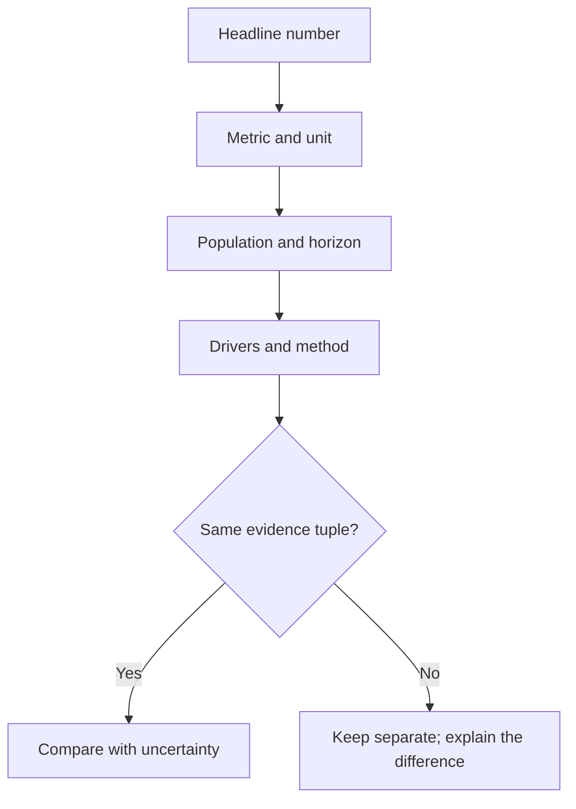
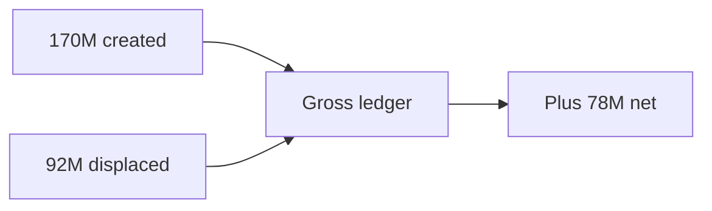
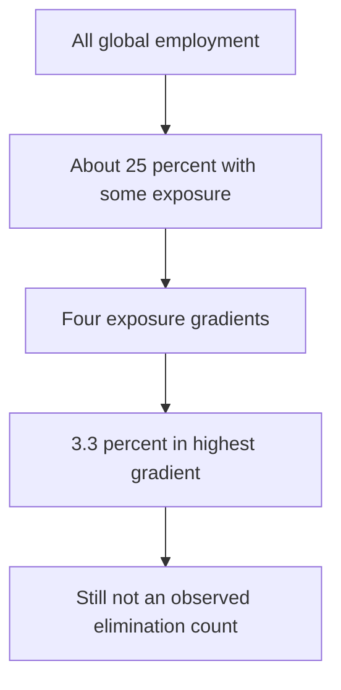
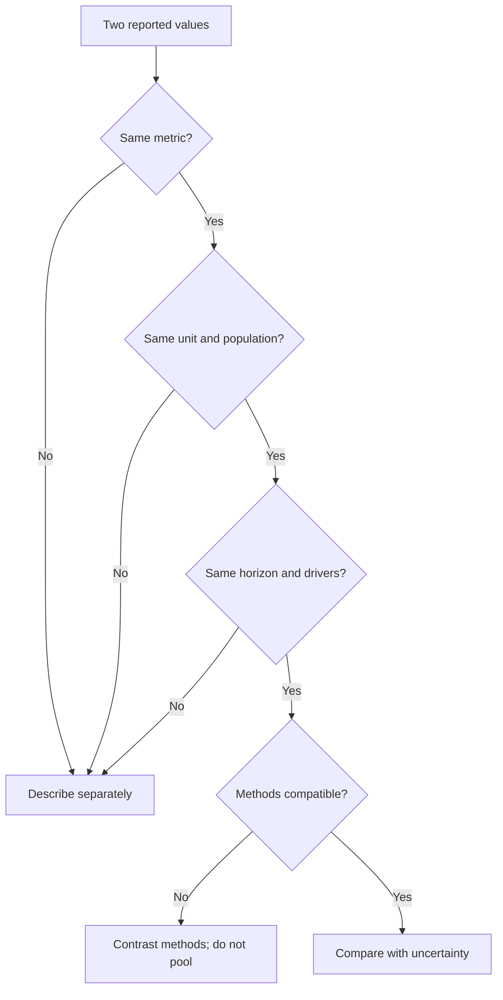
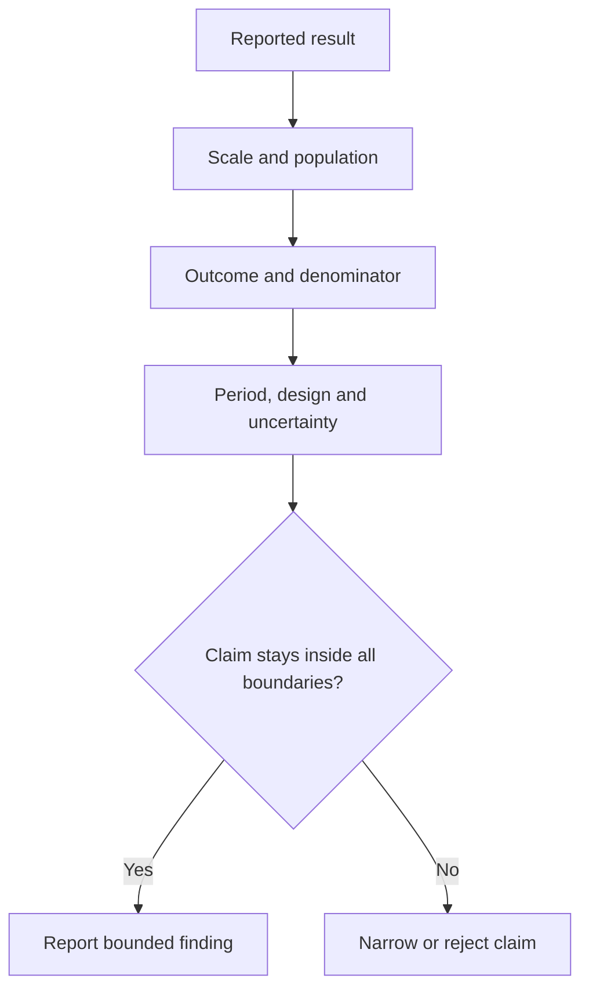
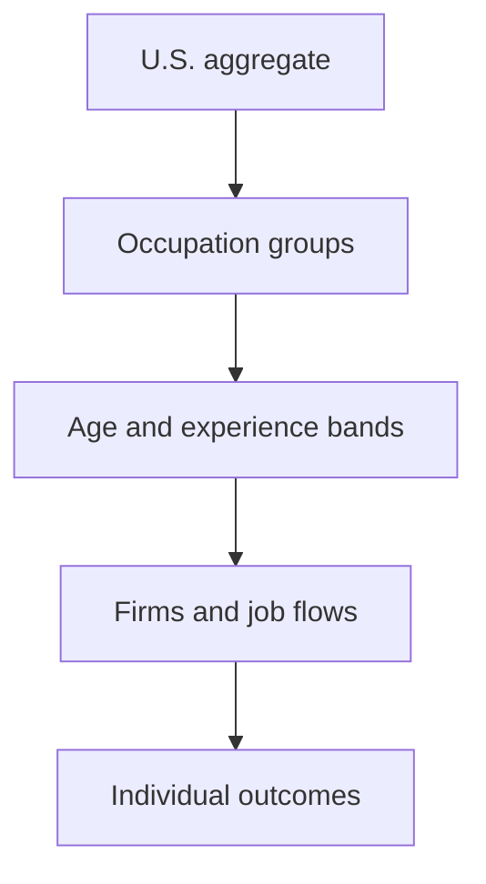
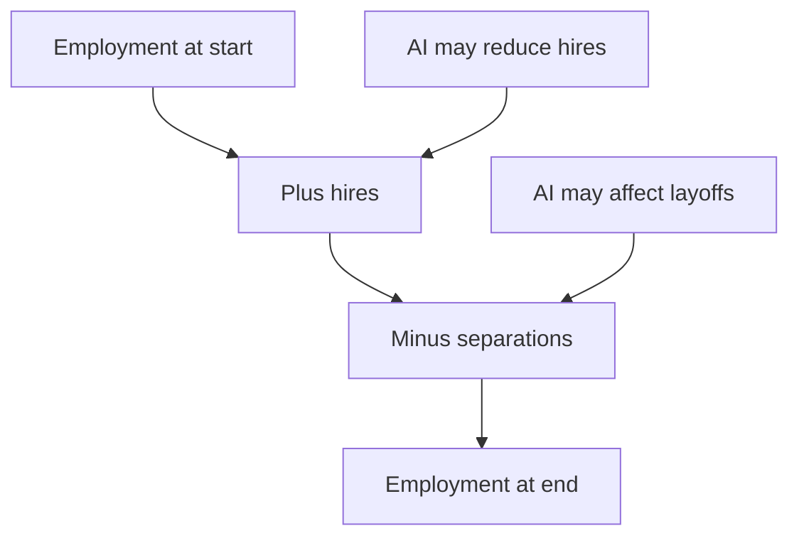
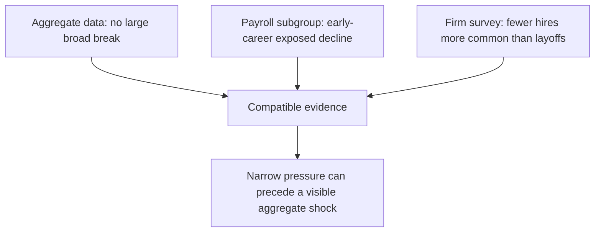

# AI Employment Impact — Reading Evidence Without Headline Errors

> **Incremental status:** Source Sections 1–2 are promoted from lines 16–83. Sections 3–10 remain queued. The source's scenario ranges are retained as attributed analysis, not presented here as consensus forecasts.

## Contents

- [1. Why the headline numbers conflict](#1-why-the-headline-numbers-conflict)
  - [Requirement contract](#requirement-contract)
  - [The evidence tuple](#the-evidence-tuple)
  - [Example 1 — WEF is a multi-driver gross-and-net ledger](#example-1--wef-is-a-multi-driver-gross-and-net-ledger)
  - [Example 2 — IMF exposure contains both risk and complementarity](#example-2--imf-exposure-contains-both-risk-and-complementarity)
  - [Example 3 — ILO narrows exposure by task intensity](#example-3--ilo-narrows-exposure-by-task-intensity)
  - [Example 4 — Goldman separates exposure from transition displacement](#example-4--goldman-separates-exposure-from-transition-displacement)
  - [Cross-study comparison gate](#cross-study-comparison-gate)
  - [Executable evidence contracts](#executable-evidence-contracts)
- [2. What is actually happening so far](#2-what-is-actually-happening-so-far)
  - [Observed-evidence contract](#observed-evidence-contract)
  - [Example 1 — an aggregate null does not erase subgroup effects](#example-1--an-aggregate-null-does-not-erase-subgroup-effects)
  - [Example 2 — a 13% relative decline is not a 13-point universal loss](#example-2--a-13-relative-decline-is-not-a-13-point-universal-loss)
  - [Example 3 — reduced hiring is not a layoff](#example-3--reduced-hiring-is-not-a-layoff)
  - [Example 4 — all three observations can be true together](#example-4--all-three-observations-can-be-true-together)
  - [Executable observed-labour contracts](#executable-observed-labour-contracts)
- [References and provenance](#references-and-provenance)

## 1. Why the headline numbers conflict

Forecasts conflict when a headline silently changes the measured object. A study may count exposed workers, automatable work hours, displaced positions, full-time-equivalent task volume, employer intentions, or net job change. Those quantities answer different questions. A responsible comparison keeps the **metric, unit, population, horizon, drivers, method and uncertainty** attached to every number.

The first rule is therefore simple:

> Exposure is a capability or task-overlap measure. It is not, by itself, a count of layoffs, unemployment or permanent job elimination.

### Requirement contract

Before repeating any AI-and-jobs statistic, fill these fields:

| Field | Required question | Invalid shortcut |
|---|---|---|
| metric | exposure, task automation, gross displacement, creation, or net change? | relabeling all of them “jobs lost” |
| unit | workers, jobs, FTE equivalents, work hours, tasks, or employers? | subtracting hours from jobs |
| population | global, national, sector, occupation, age band, or surveyed firms? | generalizing one subgroup to everyone |
| horizon | observed period or scenario year? | treating a ten-year transition as a current count |
| drivers | AI only or several structural forces? | attributing a multi-driver forecast solely to AI |
| method | survey intent, task scoring, model scenario, or observed payroll? | treating intent and observed outcomes as identical |
| uncertainty | point estimate, range, scenario, or descriptive share? | reporting false precision |



### The evidence tuple

Use this compact representation when taking notes:

`(source, metric, unit, value, population, horizon, drivers, method)`

Two values can be arithmetically combined only when the relevant dimensions match. A global job-creation scenario and a global job-displacement scenario from the same model may form a net ledger. A percentage of work hours cannot be subtracted from a count of jobs. Two exposure percentages for different populations may be contrasted, but the difference must retain the population labels.


Every arrow is a contingent causal step. Reliability, cost, regulation, demand, organizational redesign and worker complementarity can interrupt the chain. A task benchmark at the left edge does not identify a realized employment outcome at the right edge.

### Example 1 — WEF is a multi-driver gross-and-net ledger

The World Economic Forum's *Future of Jobs Report 2025* reports employer expectations for structural labour-market transformation over 2025–2030. It projects 170 million jobs created and 92 million displaced, yielding 78 million net growth.

| tuple field | value |
|---|---|
| metric | gross job creation; gross job displacement; derived net change |
| unit | jobs |
| population | global labour market represented by the survey extrapolation |
| horizon | 2030 |
| drivers | technology, demographics, geoeconomic change, economic pressure and green transition |
| method | survey of more than 1,000 employers representing over 14 million workers, then extrapolation |

Exact ledger:

`170 million created - 92 million displaced = 78 million net growth`



**Incorrect claim:** “AI will eliminate 92 million jobs.”

**Why it fails:** the displaced count is not AI-only, it is not the net result, and displacement does not assert permanent unemployment for every affected worker.

### Example 2 — IMF exposure contains both risk and complementarity

The IMF estimates that almost 40% of global employment is exposed to AI, rising to about 60% in advanced economies. In the average advanced economy, exposure splits across higher- and lower-complementarity work: some jobs may gain productivity while others may face reduced labour demand, wage pressure or hiring pressure.

| tuple field | global figure | advanced-economy figure |
|---|---:|---:|
| metric | occupational exposure | occupational exposure |
| unit | share of employment | share of employment |
| population | global | advanced economies |
| value | almost 40% | about 60% |
| interpretation | potential effect, including augmentation | potential effect, including augmentation and displacement pressure |

Trace the inference:

1. An occupation contains tasks with AI overlap.
2. That creates **exposure**, not an employment outcome.
3. Complementarity and adoption determine whether productivity, job redesign or reduced demand dominates.
4. Only observed labour data or an explicit downstream model can estimate employment effects.

The 60% figure is not a more severe version of the same global population; it is a different population with a different occupational mix and adoption capacity.

### Example 3 — ILO narrows exposure by task intensity

The ILO–NASK refined index scores nearly 30,000 tasks and places occupations into four exposure gradients. It reports that one in four workers globally is in an occupation with some GenAI exposure, while 3.3% of global employment is in the highest exposure category. The report's central interpretation is job transformation rather than wholesale redundancy because most occupations still contain tasks requiring human input.



This is a nested-population trace, not a subtraction exercise. The 3.3% group sits within the broader exposed population, but the two percentages use different category definitions. Even the highest gradient measures task-level automation potential; it does not say that every job in the category disappears.

### Example 4 — Goldman separates exposure from transition displacement

Goldman Sachs Research describes about 300 million full-time-equivalent jobs globally as exposed to AI automation. Its March 18, 2026 outlook separately gives a base case in which 6–7% of workers could be displaced during an approximately ten-year adoption transition and U.S. unemployment could temporarily rise about 0.6 percentage point above baseline.

| number | correct label | forbidden relabeling |
|---:|---|---|
| 300 million | global FTE-equivalent exposure to automation | 300 million people permanently unemployed |
| 6–7% | workers displaced during the modeled transition | current layoff rate or permanent net loss |
| 0.6 percentage point | modeled temporary U.S. unemployment increase above baseline | 0.6% of jobs eliminated globally |

The three figures differ in unit, population and role in the model. Keeping them together as one “jobs lost” headline creates a category error three times over.

McKinsey supplies another unit check: activities accounting for up to 30% of current U.S. work hours could be automated by 2030. Work hours are task volume, not headcount. An occupation can lose some tasks, gain others, change output, or expand demand without disappearing.

### Cross-study comparison gate

Use this gate before producing a chart, subtraction or ranking:



| attempted operation | verdict | reason |
|---|---|---|
| WEF `170M - 92M` | valid within its ledger | same model, unit, horizon and structural-driver frame |
| IMF `60% - 40%` | descriptive contrast only | different populations; not a global “20% loss” |
| ILO `25% - 3.3%` | category remainder only if definitions are retained | nested exposure gradients, not employment outcomes |
| Goldman `300M - WEF 92M` | invalid | different metrics, methods, frames and likely denominators |
| McKinsey `30% hours = 30% jobs` | invalid | task-time share is not headcount |

### Executable evidence contracts

`EmploymentEvidenceContracts.java` encodes the evidence tuple and refuses the most common invalid inference. `EXPOSURE`, `TASK_AUTOMATION` and `GROSS_DISPLACEMENT` do not satisfy a `PERMANENT_JOB_ELIMINATION` claim. Comparability requires matching metric, unit, population, horizon and driver scope.

```java
static boolean supportsPermanentElimination(Claim claim) {
    return claim.metric() == Metric.PERMANENT_JOB_ELIMINATION
            && claim.unit() == Unit.JOBS;
}

static long netJobs(long created, long displaced) {
    return Math.subtractExact(created, displaced);
}
```

Twenty deterministic groups encode the WEF, IMF, ILO, Goldman and McKinsey category boundaries. Then 20,000 seeded trials check ledger conservation, percentage bounds, exposure-versus-elimination separation and symmetric comparability—80,000 evidence checks.

```bash
java -ea study-guides/ai/employment-impact/EmploymentEvidenceContracts.java
```

Expected result:

```text
PASS groups=20 trials=20000 evidence checks=80000
```

## 2. What is actually happening so far

The current evidence is not one number. It is a set of measurements at different scales: broad U.S. employment, a narrow early-career subgroup in highly exposed occupations, and self-reported workforce adjustments among regional firms using AI. The measurements can coexist because they have different populations, outcomes and denominators.

The careful conclusion is:

> Broad employment data have not yet identified a large economy-wide AI shock, while narrower data show plausible pressure on some entry-level workers and on hiring flows. Neither statement licenses a universal causal claim.

This section treats the source's 2025 findings as dated evidence snapshots. It also checks them against the latest official updates available in 2026: the Budget Lab still found no statistically or economically significant broad effect in May 2026, while the New York Fed's September 2026 regional survey continued to find limited layoffs but somewhat more reduced hiring among AI-using service firms.

### Observed-evidence contract

Before turning an empirical result into a claim, preserve these fields:

| Field | Required question | Headline error prevented |
|---|---|---|
| scale | economy, occupation, age-by-occupation subgroup, or firm sample? | generalizing a local effect to all workers |
| outcome | employment stock, unemployment, hiring flow, separation, wage, or survey response? | calling fewer hires “layoffs” |
| denominator | workers, jobs, AI-using firms, all surveyed firms, or an index? | comparing percentages with different bases |
| period | which months or quarters, and observed or expected? | mixing realized and forecast adjustments |
| design | descriptive, survey attribution, controlled comparison, or causal estimate? | replacing “consistent with” by “caused by” |
| unit | level, percentage, percentage point, or relative percent change? | turning a relative decline into a population share |
| uncertainty | sampling error, confidence interval, model sensitivity, and omitted factors? | treating a point estimate as exact |



### Example 1 — an aggregate null does not erase subgroup effects

The Budget Lab's October 1, 2025 analysis examined the U.S. labour market over the 33 months after ChatGPT's November 2022 release. Its broad measures found no discernible disruption and no systematic relationship between occupational AI exposure measures and employment or unemployment changes. That is evidence against the claim that a large economy-wide AI unemployment shock had already occurred by that observation window.

It is not evidence that every subgroup was unaffected. Aggregation can hide offsetting or concentrated movements:

| subgroup | illustrative employment change | contribution to broad total |
|---|---:|---:|
| early-career, highly exposed | -13 | negative |
| experienced, same occupations | +8 | positive |
| other occupations | +5 | positive |
| combined illustrative change | 0 | no broad movement |

The table is a reconciliation example, not an estimate. It shows why a stable aggregate cannot logically prove that each component is stable.



Evidence gets more specific down the ladder, but usually less representative. A broad Current Population Survey analysis is suited to aggregate change; it may be underpowered for a narrow age-by-occupation slice. A payroll dataset can resolve that slice more sharply, but its covered firms and controls still define the claim boundary.

The Budget Lab's May 7, 2026 synthetic difference-in-differences update reached the same broad result—no statistically or economically significant effect through its post-2022 window—while explicitly warning that exposure measures can average positive and negative effects together and that the CPS is weaker for small subgroups. The correct trace is therefore:

1. Define the economy-wide outcome and observation window.
2. Observe no detectable broad break under the chosen method.
3. Reject “a broad crisis is already visible in these data.”
4. Keep subgroup effects, future effects and effects outside the method's power unresolved.

### Example 2 — a 13% relative decline is not a 13-point universal loss

Brynjolfsson, Chandar and Chen's Stanford/SIEPR working paper uses high-frequency administrative payroll data. It reports that workers aged 22–25 in the most AI-exposed occupations experienced a **13% relative decline in employment** after controls for firm-level shocks, while older workers in the same occupations and workers in less-exposed occupations did not show the same pattern. The decline was concentrated in occupations classified as more likely to be automated than augmented.

Keep all qualifiers attached:

`(ages 22–25, most-exposed occupations, covered payroll firms, post-GenAI period, controlled relative estimate)`

The arithmetic matters. If the comparison path has index 100, a 13% relative decline produces index 87:

`100 × (1 - 0.13) = 87`

If the baseline employment rate were 40%, the analogous 13% relative decline would be 5.2 percentage points, producing 34.8%, not 27%:

`40% × (1 - 0.13) = 34.8%`

Those calculations explain the unit; they do not reconstruct the paper's regression. “Thirteen percent of all young workers lost their jobs” is invalid because it swaps a conditional relative estimate for a universal headcount claim.


The design strengthens the evidence beyond a raw before-and-after comparison, but it does not make every alternative explanation impossible. The paper describes the evidence as consistent with the AI mechanism, reports robustness checks, and remains a working paper. The bounded wording is “a disproportionate early-career decline in the most-exposed occupations, consistent with an AI effect,” not “AI caused a universal 13% collapse.”

### Example 3 — reduced hiring is not a layoff

The New York Fed's August 2025 regional business surveys asked firms in New York and Northern New Jersey about AI use and workforce changes during the prior six months. Among AI-using service firms, about 1% reported laying off workers because of AI and about 12% reported hiring fewer workers because of AI. These are shares of firms, not shares of workers or jobs.

| 2025 survey measure | denominator | event | valid interpretation |
|---|---|---|---|
| 1% | AI-using service firms | reported AI-related layoffs | uncommon reported separation response |
| 12% | AI-using service firms | reported fewer hires due to AI | more common hiring-flow response |
| 13% | AI-using service firms | expected layoffs in next six months | expectation, not a realized layoff rate |

The two realized responses may overlap, so `12% - 1% = 11%` is not a count of firms that “only reduced hiring.” The survey also found firms adding AI-skilled workers and retraining existing workers. It therefore measures a mixture of workforce adjustments, not a one-direction ledger.



A hiring slowdown can reduce future employment without a same-day layoff spike. Suppose a team starts with 100 people, normally hires 20 replacements and loses 18 workers. Employment would end at 102. If hiring falls to 10 while separations stay 18, it ends at 92—an employment decline caused through the hiring margin even though layoffs did not increase:

`100 + 10 - 18 = 92`

This is a flow illustration, not a New York Fed estimate.

The September 1, 2026 survey update preserves the distinction. It reports 4% of AI-using service firms with layoffs and 15% with fewer hires in the prior six months; no surveyed manufacturers reported layoffs. Adoption rose, but retraining remained the most common adjustment. The update confirms that the 2025 numbers were time-specific and should not be frozen as permanent rates.

### Example 4 — all three observations can be true together

The evidence is reconciled by separating **scale** from **flow**:



1. A subgroup is a small share of the full labour market, so a material subgroup decline can be muted in the aggregate.
2. Reduced hiring changes an inflow; it does not require a contemporaneous wave of separations.
3. Other groups, occupations and AI-enabled hiring can offset declines in the broad stock.
4. Each study uses a different design, so agreement on direction does not justify pooling the percentages.

The responsible synthesis is not “nothing is happening” or “mass unemployment has arrived.” It is “no large broad shock is identified yet, while entry-level and hiring-margin signals warrant continued measurement.”

### Executable observed-labour contracts

`ObservedLaborEvidenceContracts.java` makes the scale and unit boundaries executable. It keeps economy-wide observations, subgroup estimates and firm-survey shares distinct; converts relative changes only against an explicit baseline; and conserves the employment stock across hires and separations.

```java
static double afterRelativeDecline(double baseline, double percent) {
    require(baseline >= 0.0, "baseline must be non-negative");
    require(percent >= 0.0 && percent <= 100.0, "percent must be in [0,100]");
    return baseline * (1.0 - percent / 100.0);
}

static long endingEmployment(long start, long hires, long separations) {
    return Math.subtractExact(Math.addExact(start, hires), separations);
}
```

Twenty deterministic groups encode the Yale aggregate boundary, Stanford relative-estimate boundary, New York Fed firm-share boundary and stock-flow identity. Then 20,000 seeded trials check relative-change bounds, firm-share bounds, stock conservation and scale-gated generalization—80,000 evidence checks.

```bash
java -ea study-guides/ai/employment-impact/ObservedLaborEvidenceContracts.java
```

Expected result:

```text
PASS groups=20 trials=20000 evidence checks=80000
```

## References and provenance

- [World Economic Forum, *Future of Jobs Report 2025*](https://www.weforum.org/publications/the-future-of-jobs-report-2025/) — survey frame, multiple structural drivers, 170 million created, 92 million displaced and 78 million net growth through 2030.
- [IMF, *Gen-AI: Artificial Intelligence and the Future of Work*](https://www.imf.org/-/media/files/publications/sdn/2024/english/sdnea2024001.pdf) — global and advanced-economy exposure shares plus complementarity distinction.
- [ILO–NASK, *Generative AI and Jobs: A Refined Global Index of Occupational Exposure*](https://www.ilo.org/publications/generative-ai-and-jobs-refined-global-index-occupational-exposure) — task-scoring method, four gradients, one-in-four exposure and 3.3% highest-gradient estimate.
- [Goldman Sachs Research, *How Will AI Affect the US Labor Market?*](https://www.goldmansachs.com/insights/articles/how-will-ai-affect-the-us-labor-market.html) — March 18, 2026 exposure, transition-displacement and temporary-unemployment scenario distinctions.
- [McKinsey Global Institute, *Generative AI and the Future of Work in America*](https://www.mckinsey.com/mgi/our-research/generative-ai-and-the-future-of-work-in-america) — work-hour automation unit and occupational-transition framing.
- [The Budget Lab at Yale, *Evaluating the Impact of AI on the Labor Market: Current State of Affairs*](https://budgetlab.yale.edu/research/evaluating-impact-ai-labor-market-current-state-affairs) — October 1, 2025 broad U.S. occupational-mix, exposure and employment evidence.
- [The Budget Lab at Yale, *What We Do and Don't Know About How AI is Affecting the Labor Market*](https://budgetlab.yale.edu/research/what-we-do-and-dont-know-about-how-ai-affecting-labor-market) — May 7, 2026 synthetic difference-in-differences update and explicit aggregate/subgroup limitations.
- [Stanford SIEPR, *Canaries in the Coal Mine? Six Facts about the Recent Employment Effects of Artificial Intelligence*](https://siepr.stanford.edu/publications/working-paper/canaries-coal-mine-six-facts-about-recent-employment-effects-artificial) — August 2025 working paper, administrative payroll design and conditional 13% relative early-career estimate.
- [Federal Reserve Bank of New York, *Are Businesses Scaling Back Hiring Due to AI?*](https://libertystreeteconomics.newyorkfed.org/2025/09/are-businesses-scaling-back-hiring-due-to-ai/) — September 4, 2025 regional survey, realized versus expected workforce responses and firm-share denominators.
- [Federal Reserve Bank of New York, *Businesses Are Using AI to Transform Work, Not Cut Jobs*](https://libertystreeteconomics.newyorkfed.org/2026/09/businesses-are-using-ai-to-transform-work-not-cut-jobs/) — September 1, 2026 update showing time-varying adoption, layoffs, hiring and retraining responses.

Source intake:

- `ai_jobs_elimination_deep_research_2026.md`, Library file `libfile_ec5bdd926d1881918e6f8523ea1ab36a`, SHA-256 `32006ec0ff03ed1b643e6e10083977df523266112cfe8f2646e827b8c2e1e0a8`, refreshed November 19, 2026. Source Sections 1–2 at lines 16–83 are promoted. Source lines 85–212 remain queued; Section 3 is the next bounded continuation at lines 85–98.

The source provides the section boundaries, cited evidence and seed distinctions. The evidence tuples, requirements gates, eight worked traces across the two sections, diagrams, comparison rules and executable Java contracts are newly authored study-guide material. No older or competing AI guide was copied, and this incremental promotion does not mark the source or wider collection complete.
