# AI Employment Impact — Reading Evidence Without Headline Errors

> **Incremental status:** Source Sections 1–9 are promoted from lines 16–189. Section 10 remains queued. The source's scenario ranges, occupational-pressure list, relative-resistance factors, career strategy, entry-level vulnerability statement, downside conditions and downward-revision conditions are retained as attributed analysis, not presented here as consensus forecasts.

## Contents

- [1. Why the headline numbers conflict](#1-why-the-headline-numbers-conflict)
  - [Requirement contract](#requirement-contract)
  - [The evidence tuple](#the-evidence-tuple)
  - [Example 1 — WEF is a multi-driver gross-and-net ledger](#example-1--wef-is-a-multi-driver-gross-and-net-ledger)
  - [Example 2 — IMF exposure contains both risk and complementarity](#example-2--imf-exposure-contains-both-risk-and-complementarity)
  - [Example 3 — ILO narrows exposure by task intensity](#example-3--ilo-narrows-exposure-by-task-intensity)
  - [Example 4 — Goldman separates exposure from transition displacement](#example-4--goldman-separates-exposure-from-transition-displacement)
  - [Cross-study comparison gate](#cross-study-comparison-gate)
  - [Executable evidence contracts](#executable-evidence-contracts)
- [2. What is actually happening so far](#2-what-is-actually-happening-so-far)
  - [Observed-evidence contract](#observed-evidence-contract)
  - [Example 1 — an aggregate null does not erase subgroup effects](#example-1--an-aggregate-null-does-not-erase-subgroup-effects)
  - [Example 2 — a 13% relative decline is not a 13-point universal loss](#example-2--a-13-relative-decline-is-not-a-13-point-universal-loss)
  - [Example 3 — reduced hiring is not a layoff](#example-3--reduced-hiring-is-not-a-layoff)
  - [Example 4 — all three observations can be true together](#example-4--all-three-observations-can-be-true-together)
  - [Executable observed-labour contracts](#executable-observed-labour-contracts)
- [3. Why 30–80 million is a planning range, not a forecast](#3-why-3080-million-is-a-planning-range-not-a-forecast)
  - [Scenario-range contract](#scenario-range-contract)
  - [Example 1 — WEF supplies a compatibility ceiling, not an AI allocation](#example-1--wef-supplies-a-compatibility-ceiling-not-an-ai-allocation)
  - [Example 2 — ILO exposure constrains interpretation, not headcount arithmetic](#example-2--ilo-exposure-constrains-interpretation-not-headcount-arithmetic)
  - [Example 3 — a ten-year displacement path cannot be silently compressed to 2030](#example-3--a-ten-year-displacement-path-cannot-be-silently-compressed-to-2030)
  - [Example 4 — a scenario ledger keeps evidence and assumptions separate](#example-4--a-scenario-ledger-keeps-evidence-and-assumptions-separate)
  - [Executable scenario-range contracts](#executable-scenario-range-contracts)
- [4. The occupations I expect to take the hardest hit](#4-the-occupations-i-expect-to-take-the-hardest-hit)
  - [Occupational-pressure contract](#occupational-pressure-contract)
  - [Example 1 — a declining occupation can still have many openings](#example-1--a-declining-occupation-can-still-have-many-openings)
  - [Example 2 — absolute decline and decline rate answer different questions](#example-2--absolute-decline-and-decline-rate-answer-different-questions)
  - [Example 3 — task pressure can produce redesign without disappearance](#example-3--task-pressure-can-produce-redesign-without-disappearance)
  - [Example 4 — exposed tasks can coexist with occupational growth](#example-4--exposed-tasks-can-coexist-with-occupational-growth)
  - [Executable occupational-pressure contracts](#executable-occupational-pressure-contracts)
- [5. Jobs that are safer than people assume](#5-jobs-that-are-safer-than-people-assume)
  - [Relative-resistance contract](#relative-resistance-contract)
  - [Example 1 — electricians combine physical variability with local accountability](#example-1--electricians-combine-physical-variability-with-local-accountability)
  - [Example 2 — paramedic work has a short consequence-to-action loop](#example-2--paramedic-work-has-a-short-consequence-to-action-loop)
  - [Example 3 — cybersecurity illustrates complementarity, not immunity](#example-3--cybersecurity-illustrates-complementarity-not-immunity)
  - [Example 4 — architecture ownership is a role design, not an occupation forecast](#example-4--architecture-ownership-is-a-role-design-not-an-occupation-forecast)
  - [Executable relative-resistance contracts](#executable-relative-resistance-contracts)
- [6. Software engineering deserves a separate answer](#6-software-engineering-deserves-a-separate-answer)
  - [Software-responsibility contract](#software-responsibility-contract)
  - [Example 1 — ticket-to-PR work exposes the weak position](#example-1--ticket-to-pr-work-exposes-the-weak-position)
  - [Example 2 — incident assistance does not transfer production authority](#example-2--incident-assistance-does-not-transfer-production-authority)
  - [Example 3 — architecture is option generation plus accountable choice](#example-3--architecture-is-option-generation-plus-accountable-choice)
  - [Example 4 — AI integration begins after the API call](#example-4--ai-integration-begins-after-the-api-call)
  - [Executable software-responsibility contracts](#executable-software-responsibility-contracts)
- [7. Evidence against a simple “AI destroys jobs” model](#7-evidence-against-a-simple-ai-destroys-jobs-model)
  - [Association-to-delegation contract](#association-to-delegation-contract)
  - [Example 1 — faster exposed-company growth is evidence against inevitability, not proof of causation](#example-1--faster-exposed-company-growth-is-evidence-against-inevitability-not-proof-of-causation)
  - [Example 2 — AI-skill postings need both numerator and denominator](#example-2--ai-skill-postings-need-both-numerator-and-denominator)
  - [Example 3 — entry-level outcomes split instead of moving as one block](#example-3--entry-level-outcomes-split-instead-of-moving-as-one-block)
  - [Example 4 — observed task success is still short of workflow delegation](#example-4--observed-task-success-is-still-short-of-workflow-delegation)
  - [Executable evidence-against-destruction contracts](#executable-evidence-against-destruction-contracts)
- [8. What could make the forecast much worse](#8-what-could-make-the-forecast-much-worse)
  - [Downside-scenario contract](#downside-scenario-contract)
  - [Example 1 — long tasks require compounded reliability](#example-1--long-tasks-require-compounded-reliability)
  - [Example 2 — consequential workflows are governed by failure severity](#example-2--consequential-workflows-are-governed-by-failure-severity)
  - [Example 3 — inexpensive models do not imply inexpensive delegation](#example-3--inexpensive-models-do-not-imply-inexpensive-delegation)
  - [Example 4 — productivity reduces labor only when demand fails to absorb it](#example-4--productivity-reduces-labor-only-when-demand-fails-to-absorb-it)
  - [Executable downside-scenario contracts](#executable-downside-scenario-contracts)
- [9. What could make the forecast too pessimistic](#9-what-could-make-the-forecast-too-pessimistic)
  - [Downward-revision contract](#downward-revision-contract)
  - [Example 1 — human plus AI can beat either one alone](#example-1--human-plus-ai-can-beat-either-one-alone)
  - [Example 2 — required human authority preserves consequential work](#example-2--required-human-authority-preserves-consequential-work)
  - [Example 3 — lower prices can create enough demand to offset productivity](#example-3--lower-prices-can-create-enough-demand-to-offset-productivity)
  - [Example 4 — slow diffusion and new work can absorb gross displacement](#example-4--slow-diffusion-and-new-work-can-absorb-gross-displacement)
  - [Executable pessimism-scenario contracts](#executable-pessimism-scenario-contracts)
- [References and provenance](#references-and-provenance)

## 1. Why the headline numbers conflict

Forecasts conflict when a headline silently changes the measured object. A study may count exposed workers, automatable work hours, displaced positions, full-time-equivalent task volume, employer intentions, or net job change. Those quantities answer different questions. A responsible comparison keeps the **metric, unit, population, horizon, drivers, method and uncertainty** attached to every number.

The first rule is therefore simple:

> Exposure is a capability or task-overlap measure. It is not, by itself, a count of layoffs, unemployment or permanent job elimination.

### Requirement contract

Before repeating any AI-and-jobs statistic, fill these fields:

| Field | Required question | Invalid shortcut |
|---|---|---|
| metric | exposure, task automation, gross displacement, creation, or net change? | relabeling all of them “jobs lost” |
| unit | workers, jobs, FTE equivalents, work hours, tasks, or employers? | subtracting hours from jobs |
| population | global, national, sector, occupation, age band, or surveyed firms? | generalizing one subgroup to everyone |
| horizon | observed period or scenario year? | treating a ten-year transition as a current count |
| drivers | AI only or several structural forces? | attributing a multi-driver forecast solely to AI |
| method | survey intent, task scoring, model scenario, or observed payroll? | treating intent and observed outcomes as identical |
| uncertainty | point estimate, range, scenario, or descriptive share? | reporting false precision |

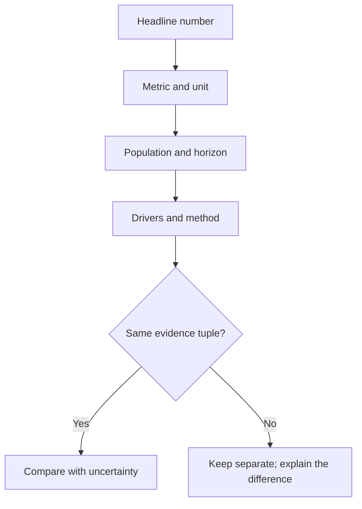

### The evidence tuple

Use this compact representation when taking notes:

`(source, metric, unit, value, population, horizon, drivers, method)`

Two values can be arithmetically combined only when the relevant dimensions match. A global job-creation scenario and a global job-displacement scenario from the same model may form a net ledger. A percentage of work hours cannot be subtracted from a count of jobs. Two exposure percentages for different populations may be contrasted, but the difference must retain the population labels.


Every arrow is a contingent causal step. Reliability, cost, regulation, demand, organizational redesign and worker complementarity can interrupt the chain. A task benchmark at the left edge does not identify a realized employment outcome at the right edge.

### Example 1 — WEF is a multi-driver gross-and-net ledger

The World Economic Forum's *Future of Jobs Report 2025* reports employer expectations for structural labour-market transformation over 2025–2030. It projects 170 million jobs created and 92 million displaced, yielding 78 million net growth.

| tuple field | value |
|---|---|
| metric | gross job creation; gross job displacement; derived net change |
| unit | jobs |
| population | global labour market represented by the survey extrapolation |
| horizon | 2030 |
| drivers | technology, demographics, geoeconomic change, economic pressure and green transition |
| method | survey of more than 1,000 employers representing over 14 million workers, then extrapolation |

Exact ledger:

`170 million created - 92 million displaced = 78 million net growth`

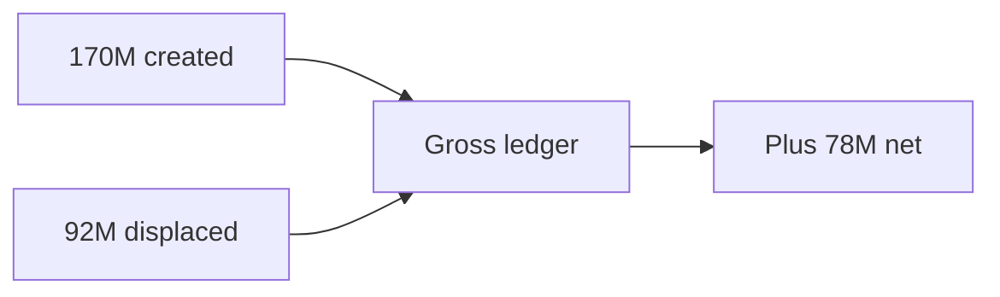

**Incorrect claim:** “AI will eliminate 92 million jobs.”

**Why it fails:** the displaced count is not AI-only, it is not the net result, and displacement does not assert permanent unemployment for every affected worker.

### Example 2 — IMF exposure contains both risk and complementarity

The IMF estimates that almost 40% of global employment is exposed to AI, rising to about 60% in advanced economies. In the average advanced economy, exposure splits across higher- and lower-complementarity work: some jobs may gain productivity while others may face reduced labour demand, wage pressure or hiring pressure.

| tuple field | global figure | advanced-economy figure |
|---|---:|---:|
| metric | occupational exposure | occupational exposure |
| unit | share of employment | share of employment |
| population | global | advanced economies |
| value | almost 40% | about 60% |
| interpretation | potential effect, including augmentation | potential effect, including augmentation and displacement pressure |

Trace the inference:

1. An occupation contains tasks with AI overlap.
2. That creates **exposure**, not an employment outcome.
3. Complementarity and adoption determine whether productivity, job redesign or reduced demand dominates.
4. Only observed labour data or an explicit downstream model can estimate employment effects.

The 60% figure is not a more severe version of the same global population; it is a different population with a different occupational mix and adoption capacity.

### Example 3 — ILO narrows exposure by task intensity

The ILO–NASK refined index scores nearly 30,000 tasks and places occupations into four exposure gradients. It reports that one in four workers globally is in an occupation with some GenAI exposure, while 3.3% of global employment is in the highest exposure category. The report's central interpretation is job transformation rather than wholesale redundancy because most occupations still contain tasks requiring human input.

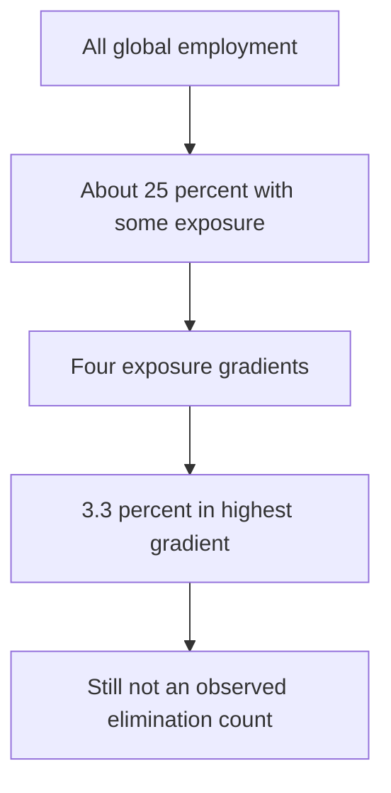

This is a nested-population trace, not a subtraction exercise. The 3.3% group sits within the broader exposed population, but the two percentages use different category definitions. Even the highest gradient measures task-level automation potential; it does not say that every job in the category disappears.

### Example 4 — Goldman separates exposure from transition displacement

Goldman Sachs Research describes about 300 million full-time-equivalent jobs globally as exposed to AI automation. Its March 18, 2026 outlook separately gives a base case in which 6–7% of workers could be displaced during an approximately ten-year adoption transition and U.S. unemployment could temporarily rise about 0.6 percentage point above baseline.

| number | correct label | forbidden relabeling |
|---:|---|---|
| 300 million | global FTE-equivalent exposure to automation | 300 million people permanently unemployed |
| 6–7% | workers displaced during the modeled transition | current layoff rate or permanent net loss |
| 0.6 percentage point | modeled temporary U.S. unemployment increase above baseline | 0.6% of jobs eliminated globally |

The three figures differ in unit, population and role in the model. Keeping them together as one “jobs lost” headline creates a category error three times over.

McKinsey supplies another unit check: activities accounting for up to 30% of current U.S. work hours could be automated by 2030. Work hours are task volume, not headcount. An occupation can lose some tasks, gain others, change output, or expand demand without disappearing.

### Cross-study comparison gate

Use this gate before producing a chart, subtraction or ranking:

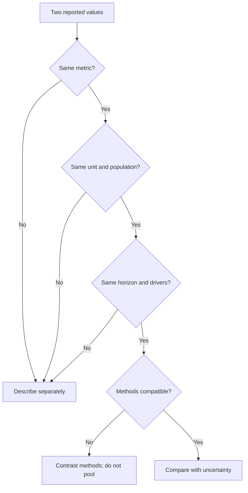

| attempted operation | verdict | reason |
|---|---|---|
| WEF `170M - 92M` | valid within its ledger | same model, unit, horizon and structural-driver frame |
| IMF `60% - 40%` | descriptive contrast only | different populations; not a global “20% loss” |
| ILO `25% - 3.3%` | category remainder only if definitions are retained | nested exposure gradients, not employment outcomes |
| Goldman `300M - WEF 92M` | invalid | different metrics, methods, frames and likely denominators |
| McKinsey `30% hours = 30% jobs` | invalid | task-time share is not headcount |

### Executable evidence contracts

`EmploymentEvidenceContracts.java` encodes the evidence tuple and refuses the most common invalid inference. `EXPOSURE`, `TASK_AUTOMATION` and `GROSS_DISPLACEMENT` do not satisfy a `PERMANENT_JOB_ELIMINATION` claim. Comparability requires matching metric, unit, population, horizon and driver scope.

```java
static boolean supportsPermanentElimination(Claim claim) {
    return claim.metric() == Metric.PERMANENT_JOB_ELIMINATION
            && claim.unit() == Unit.JOBS;
}

static long netJobs(long created, long displaced) {
    return Math.subtractExact(created, displaced);
}
```

Twenty deterministic groups encode the WEF, IMF, ILO, Goldman and McKinsey category boundaries. Then 20,000 seeded trials check ledger conservation, percentage bounds, exposure-versus-elimination separation and symmetric comparability—80,000 evidence checks.

```bash
java -ea study-guides/ai/employment-impact/EmploymentEvidenceContracts.java
```

Expected result:

```text
PASS groups=20 trials=20000 evidence checks=80000
```

## 2. What is actually happening so far

The current evidence is not one number. It is a set of measurements at different scales: broad U.S. employment, a narrow early-career subgroup in highly exposed occupations, and self-reported workforce adjustments among regional firms using AI. The measurements can coexist because they have different populations, outcomes and denominators.

The careful conclusion is:

> Broad employment data have not yet identified a large economy-wide AI shock, while narrower data show plausible pressure on some entry-level workers and on hiring flows. Neither statement licenses a universal causal claim.

This section treats the source's 2025 findings as dated evidence snapshots. It also checks them against the latest official updates available in 2026: the Budget Lab still found no statistically or economically significant broad effect in May 2026, while the New York Fed's September 2026 regional survey continued to find limited layoffs but somewhat more reduced hiring among AI-using service firms.

### Observed-evidence contract

Before turning an empirical result into a claim, preserve these fields:

| Field | Required question | Headline error prevented |
|---|---|---|
| scale | economy, occupation, age-by-occupation subgroup, or firm sample? | generalizing a local effect to all workers |
| outcome | employment stock, unemployment, hiring flow, separation, wage, or survey response? | calling fewer hires “layoffs” |
| denominator | workers, jobs, AI-using firms, all surveyed firms, or an index? | comparing percentages with different bases |
| period | which months or quarters, and observed or expected? | mixing realized and forecast adjustments |
| design | descriptive, survey attribution, controlled comparison, or causal estimate? | replacing “consistent with” by “caused by” |
| unit | level, percentage, percentage point, or relative percent change? | turning a relative decline into a population share |
| uncertainty | sampling error, confidence interval, model sensitivity, and omitted factors? | treating a point estimate as exact |

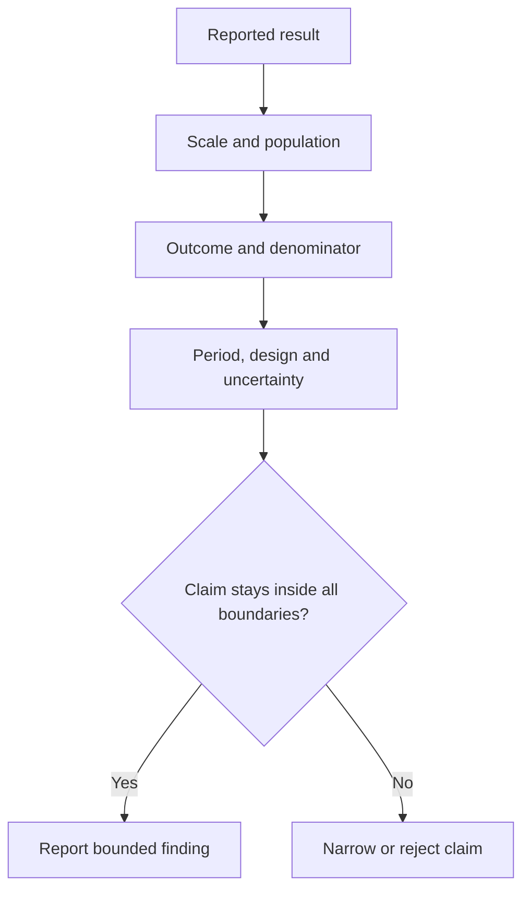

### Example 1 — an aggregate null does not erase subgroup effects

The Budget Lab's October 1, 2025 analysis examined the U.S. labour market over the 33 months after ChatGPT's November 2022 release. Its broad measures found no discernible disruption and no systematic relationship between occupational AI exposure measures and employment or unemployment changes. That is evidence against the claim that a large economy-wide AI unemployment shock had already occurred by that observation window.

It is not evidence that every subgroup was unaffected. Aggregation can hide offsetting or concentrated movements:

| subgroup | illustrative employment change | contribution to broad total |
|---|---:|---:|
| early-career, highly exposed | -13 | negative |
| experienced, same occupations | +8 | positive |
| other occupations | +5 | positive |
| combined illustrative change | 0 | no broad movement |

The table is a reconciliation example, not an estimate. It shows why a stable aggregate cannot logically prove that each component is stable.

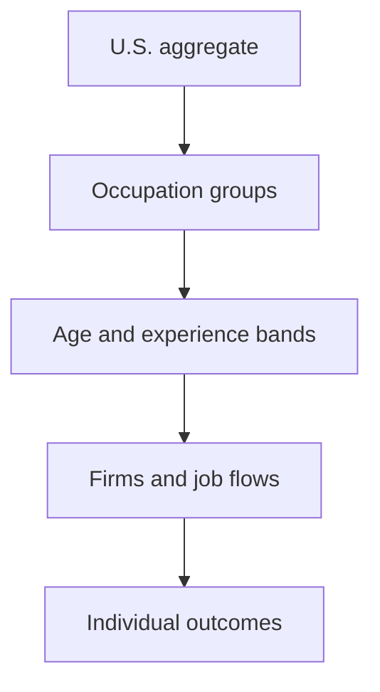

Evidence gets more specific down the ladder, but usually less representative. A broad Current Population Survey analysis is suited to aggregate change; it may be underpowered for a narrow age-by-occupation slice. A payroll dataset can resolve that slice more sharply, but its covered firms and controls still define the claim boundary.

The Budget Lab's May 7, 2026 synthetic difference-in-differences update reached the same broad result—no statistically or economically significant effect through its post-2022 window—while explicitly warning that exposure measures can average positive and negative effects together and that the CPS is weaker for small subgroups. The correct trace is therefore:

1. Define the economy-wide outcome and observation window.
2. Observe no detectable broad break under the chosen method.
3. Reject “a broad crisis is already visible in these data.”
4. Keep subgroup effects, future effects and effects outside the method's power unresolved.

### Example 2 — a 13% relative decline is not a 13-point universal loss

Brynjolfsson, Chandar and Chen's Stanford/SIEPR working paper uses high-frequency administrative payroll data. It reports that workers aged 22–25 in the most AI-exposed occupations experienced a **13% relative decline in employment** after controls for firm-level shocks, while older workers in the same occupations and workers in less-exposed occupations did not show the same pattern. The decline was concentrated in occupations classified as more likely to be automated than augmented.

Keep all qualifiers attached:

`(ages 22–25, most-exposed occupations, covered payroll firms, post-GenAI period, controlled relative estimate)`

The arithmetic matters. If the comparison path has index 100, a 13% relative decline produces index 87:

`100 × (1 - 0.13) = 87`

If the baseline employment rate were 40%, the analogous 13% relative decline would be 5.2 percentage points, producing 34.8%, not 27%:

`40% × (1 - 0.13) = 34.8%`

Those calculations explain the unit; they do not reconstruct the paper's regression. “Thirteen percent of all young workers lost their jobs” is invalid because it swaps a conditional relative estimate for a universal headcount claim.


The design strengthens the evidence beyond a raw before-and-after comparison, but it does not make every alternative explanation impossible. The paper describes the evidence as consistent with the AI mechanism, reports robustness checks, and remains a working paper. The bounded wording is “a disproportionate early-career decline in the most-exposed occupations, consistent with an AI effect,” not “AI caused a universal 13% collapse.”

### Example 3 — reduced hiring is not a layoff

The New York Fed's August 2025 regional business surveys asked firms in New York and Northern New Jersey about AI use and workforce changes during the prior six months. Among AI-using service firms, about 1% reported laying off workers because of AI and about 12% reported hiring fewer workers because of AI. These are shares of firms, not shares of workers or jobs.

| 2025 survey measure | denominator | event | valid interpretation |
|---|---|---|---|
| 1% | AI-using service firms | reported AI-related layoffs | uncommon reported separation response |
| 12% | AI-using service firms | reported fewer hires due to AI | more common hiring-flow response |
| 13% | AI-using service firms | expected layoffs in next six months | expectation, not a realized layoff rate |

The two realized responses may overlap, so `12% - 1% = 11%` is not a count of firms that “only reduced hiring.” The survey also found firms adding AI-skilled workers and retraining existing workers. It therefore measures a mixture of workforce adjustments, not a one-direction ledger.

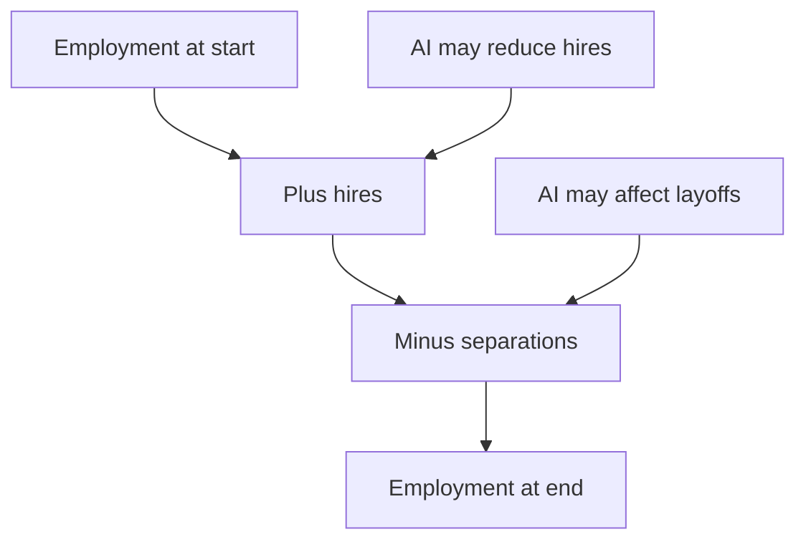

A hiring slowdown can reduce future employment without a same-day layoff spike. Suppose a team starts with 100 people, normally hires 20 replacements and loses 18 workers. Employment would end at 102. If hiring falls to 10 while separations stay 18, it ends at 92—an employment decline caused through the hiring margin even though layoffs did not increase:

`100 + 10 - 18 = 92`

This is a flow illustration, not a New York Fed estimate.

The September 1, 2026 survey update preserves the distinction. It reports 4% of AI-using service firms with layoffs and 15% with fewer hires in the prior six months; no surveyed manufacturers reported layoffs. Adoption rose, but retraining remained the most common adjustment. The update confirms that the 2025 numbers were time-specific and should not be frozen as permanent rates.

### Example 4 — all three observations can be true together

The evidence is reconciled by separating **scale** from **flow**:

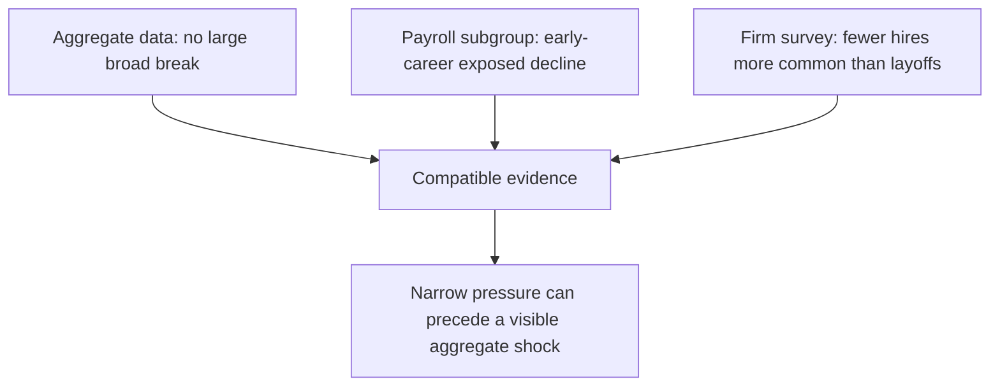

1. A subgroup is a small share of the full labour market, so a material subgroup decline can be muted in the aggregate.
2. Reduced hiring changes an inflow; it does not require a contemporaneous wave of separations.
3. Other groups, occupations and AI-enabled hiring can offset declines in the broad stock.
4. Each study uses a different design, so agreement on direction does not justify pooling the percentages.

The responsible synthesis is not “nothing is happening” or “mass unemployment has arrived.” It is “no large broad shock is identified yet, while entry-level and hiring-margin signals warrant continued measurement.”

### Executable observed-labour contracts

`ObservedLaborEvidenceContracts.java` makes the scale and unit boundaries executable. It keeps economy-wide observations, subgroup estimates and firm-survey shares distinct; converts relative changes only against an explicit baseline; and conserves the employment stock across hires and separations.

```java
static double afterRelativeDecline(double baseline, double percent) {
    require(baseline >= 0.0, "baseline must be non-negative");
    require(percent >= 0.0 && percent <= 100.0, "percent must be in [0,100]");
    return baseline * (1.0 - percent / 100.0);
}

static long endingEmployment(long start, long hires, long separations) {
    return Math.subtractExact(Math.addExact(start, hires), separations);
}
```

Twenty deterministic groups encode the Yale aggregate boundary, Stanford relative-estimate boundary, New York Fed firm-share boundary and stock-flow identity. Then 20,000 seeded trials check relative-change bounds, firm-share bounds, stock conservation and scale-gated generalization—80,000 evidence checks.

```bash
java -ea study-guides/ai/employment-impact/ObservedLaborEvidenceContracts.java
```

Expected result:

```text
PASS groups=20 trials=20000 evidence checks=80000
```

## 3. Why 30–80 million is a planning range, not a forecast

The source proposes **30–80 million gross job eliminations globally by 2030** as a central planning range. No cited institution publishes that exact interval. It is an author synthesis intended to sit between two overconfident claims: “almost no jobs will disappear” and “all exposed work becomes unemployment.”

The range is useful only when every label stays attached:

`(author synthesis, gross eliminations, jobs, global, AI-attributable, by 2030, 30M–80M)`

It is **not** a probability interval, a net-employment forecast, a current layoff count, or a quotation from WEF, ILO, Goldman Sachs or the Budget Lab. The evidence constrains a scenario; it does not mechanically derive its endpoints.

### Scenario-range contract

Before using an authored range, record these fields:

| Field | Section 3 value | What must not replace it |
|---|---|---|
| provenance | author synthesis | “WEF predicts 30–80 million” |
| metric | gross job elimination | exposure, work hours, hiring slowdown or net change |
| unit | jobs | workers, tasks, firms or FTE-equivalent task volume |
| population | global | U.S. workers or one regional survey |
| horizon | by 2030 | a ten-year transition ending later |
| driver scope | AI-attributable | all structural macrotrends |
| uncertainty form | planning interval | confidence interval or probability distribution |

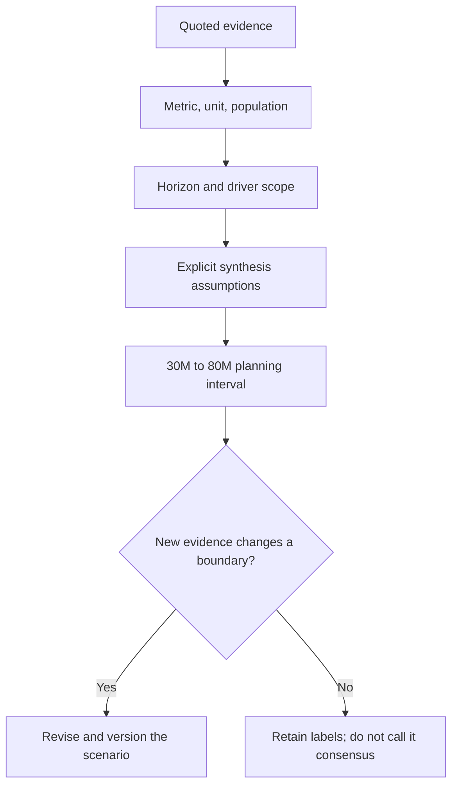

The contract prevents a common forecasting failure: combining individually credible numbers into a result that none of them supports. A scenario may be coherent without being estimated. Its value comes from transparent boundaries, falsifiable update rules and decision usefulness—not from extra decimal places.

### Example 1 — WEF supplies a compatibility ceiling, not an AI allocation

The World Economic Forum projects 92 million jobs displaced and 170 million created through 2030, for 78 million net growth. Its displacement ledger covers several structural forces, including technological, demographic, geoeconomic and green-transition change. Therefore:

1. `92M` is a multi-driver gross-displacement figure.
2. It is not an AI-only gross-elimination estimate.
3. Using `80M < 92M` as a **compatibility check** keeps the authored upper endpoint below that chosen multi-driver frame.
4. The comparison does not prove that 80 million is likely, nor that WEF places 80/92 of displacement on AI.

| operation | result | verdict |
|---|---:|---|
| `170M created - 92M displaced` | `+78M net` | valid inside WEF's own ledger |
| `80M scenario max <= 92M WEF displacement` | true | conservative compatibility check |
| `92M × AI share` | unknown | no cited AI-attribution share exists in this section |
| `92M = permanent AI unemployment` | false | wrong driver scope, metric and outcome |

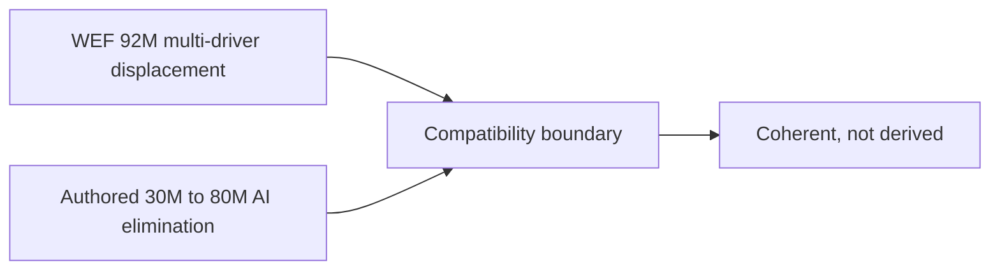

The distinction matters because a subset relation is not an allocation rule. The WEF number can reject a scenario that claims to be a conservative subset yet exceeds its chosen ceiling; it cannot select the correct point inside the remaining interval.

### Example 2 — ILO exposure constrains interpretation, not headcount arithmetic

The ILO–NASK refined index reports that one in four workers globally is in an occupation with some GenAI exposure and 3.3% of global employment is in the highest exposure gradient. It also concludes that job transformation is more likely than wholesale redundancy because most occupations retain tasks requiring human input.

Invalid trace:

`3.3% × global employment = jobs eliminated`

The multiplication fails before any population number is inserted:

| step | evidence category | can it become elimination headcount? |
|---|---|---|
| classify occupation tasks | exposure score | no |
| place occupation in Gradient 4 | highest exposure category | no |
| observe adoption and workflow redesign | missing in the index | requires new evidence |
| measure reduced labour demand | missing in the index | requires an outcome model or observation |
| count gross eliminated jobs | target scenario metric | only after the missing transitions |


ILO evidence therefore pushes against an “all exposed jobs vanish” upper model. It does not by itself set the 30 million lower endpoint or the 80 million upper endpoint. The correct use is qualitative constraint: transformation, augmentation and retained human tasks must remain possible outcomes in every scenario.

### Example 3 — a ten-year displacement path cannot be silently compressed to 2030

Goldman Sachs Research's March 2026 base case describes 6–7% of workers being displaced during an approximately ten-year adoption transition. That horizon is not automatically “by 2030.” If an illustrative transition runs from 2026 through 2036, only four of ten years have elapsed at 2030:

`(2030 - 2026) / (2036 - 2026) = 0.4`

Multiplying a ten-year total by `0.4` would still require an explicit **linear timing assumption**. Adoption could be front-loaded, back-loaded or S-shaped. The arithmetic is a timing illustration, not a forecast:

| assumed path for a hypothetical 70M ten-year total | by-2030 share | illustrative by-2030 count |
|---|---:|---:|
| linear, explicitly declared | 40% | 28M |
| front-loaded | greater than 40% | requires a specified curve |
| back-loaded | less than 40% | requires a specified curve |
| no timing model | unknown | must not be calculated |

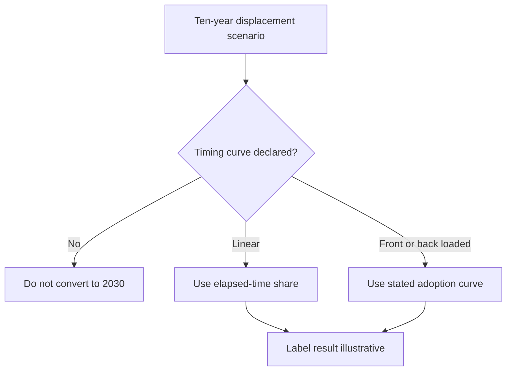

The Budget Lab's tracker, updated October 14, 2026 with September CPS microdata, still found no clear evidence of large-scale U.S. labour-market disruption associated with AI. That observation is a brake on claims that the global transition is already complete. It does not rule out later or concentrated effects, and it is not a global forecast.

### Example 4 — a scenario ledger keeps evidence and assumptions separate

A defensible planning note uses three columns rather than blending every input into one formula:

| item | type | role in the 30M–80M scenario |
|---|---|---|
| WEF 92M displaced, 170M created by 2030 | quoted multi-driver employer scenario | compatibility boundary and net/gross reminder |
| ILO 3.3% highest gradient; transformation dominates | quoted exposure analysis | blocks exposure-equals-elimination reasoning |
| Goldman 6–7% over roughly ten years | quoted transition scenario | shows material displacement is plausible but horizon-sensitive |
| Budget Lab tracker through September 2026 | quoted observed U.S. evidence | blocks claims that a large broad shock is already measured |
| agent reliability and workflow autonomy improve | explicit directional assumption | upside risk; no headcount conversion without adoption data |
| 30M–80M global AI gross eliminations by 2030 | authored planning interval | stress-test decisions; not a consensus forecast |

Use the range for decisions that tolerate scenario uncertainty—for example, testing whether a reskilling program, education plan or workforce strategy still works at 30 million and at 80 million. Do not use it as a point prediction or expected value.

The update rule is explicit:

1. Narrow or shift the range only when new evidence speaks to the same metric, unit, population, horizon and AI-only scope.
2. Keep exposure, adoption, displacement, elimination, creation and net change in separate ledgers.
3. Record new timing assumptions instead of hiding them in arithmetic.
4. Preserve dated observations; do not freeze a 2025 or 2026 rate through 2030.

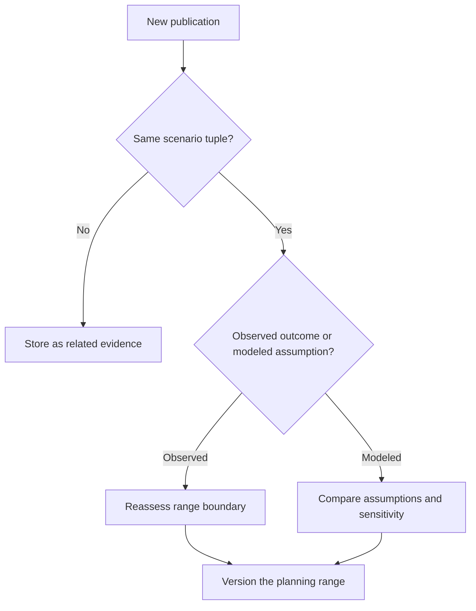

### Executable scenario-range contracts

`ScenarioRangeContracts.java` encodes provenance, metric, unit, population, horizon and driver scope. It refuses to present the 30–80 million interval as an institution estimate, refuses undeclared linear timing and refuses to relabel exposure as elimination.

```java
static boolean isPlanningScenario(Range range) {
    return range.provenance() == Provenance.AUTHOR_SYNTHESIS;
}

static long linearizedCount(long total, double share, boolean linearAssumptionDeclared) {
    require(linearAssumptionDeclared, "linear timing is an assumption, not evidence");
    return Math.round(total * share);
}
```

Twenty deterministic groups cover the authored range, WEF compatibility boundary, provenance separation, ten-year horizon and rejection paths. Then 20,000 seeded trials check range order, interval containment, elapsed-time bounds and explicitly declared linear arithmetic—80,000 scenario checks.

```bash
java -ea study-guides/ai/employment-impact/ScenarioRangeContracts.java
```

Expected result:

```text
PASS groups=20 trials=20000 scenario checks=80000
```

## 4. The occupations I expect to take the hardest hit

The source prioritizes work that is digital, repetitive, language-heavy, measurable and easy to verify. That is a useful **task-pressure hypothesis**, not a ranked forecast that every listed occupation will shrink. The unit of analysis must remain explicit:

- a task can be automated while its occupation grows,
- an occupation can contract while still producing many replacement openings,
- a projection can name AI as one contributing mechanism without assigning the whole change to AI, and
- a projected decline is not a count of permanent eliminations.

### Occupational-pressure contract

Before describing an occupation as “hard hit,” preserve this packet:

| Field | Required question | Invalid shortcut prevented |
|---|---|---|
| task mechanism | which activities are standardized, digital and verifiable? | labeling the whole occupation automatable |
| projection metric | employment stock, numeric change, percent change, or annual openings? | subtracting a flow from a stock |
| population | U.S. occupation, industry-specific role, or global work category? | generalizing U.S. projections globally |
| horizon | observed period or 2025–2035 projection? | calling a decade projection a current layoff count |
| driver scope | AI explicit, broader automation, occupational substitution, or demand change? | assigning every decline to AI |
| countervailing demand | replacement needs, new products, regulation, trust or human review? | treating efficiency as zero demand |
| uncertainty | rounded estimate, scenario and revision cycle? | reporting false precision |

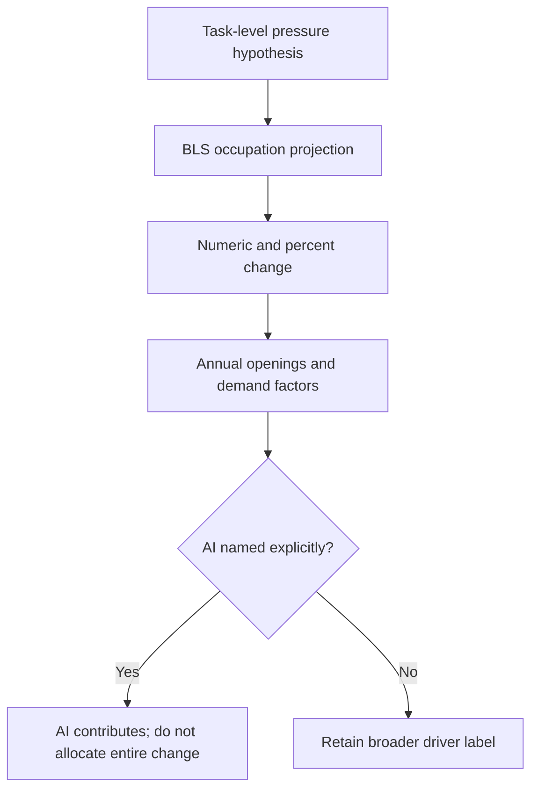

The current BLS 2025–2035 projections supply a consistent U.S. horizon, occupation codes, employment stocks and annual openings. BLS also warns that its AI-exposure category is not a forecast of employment growth, decline, automation probability or wage effects. Exposure and projection are related evidence, not interchangeable metrics.

### Example 1 — a declining occupation can still have many openings

BLS projects U.S. customer-service-representative employment to move from about 2.666 million in 2025 to 2.524 million in 2035: a published decline of 141,800 jobs, or 5.3%. Its utilization table explicitly names speech/language processing and AI as technologies that allow computers to handle more interactions.

The same Occupational Outlook Handbook projects about 289,500 openings per year, all from workers transferring or leaving the labour force. These statements coexist because they measure different things:

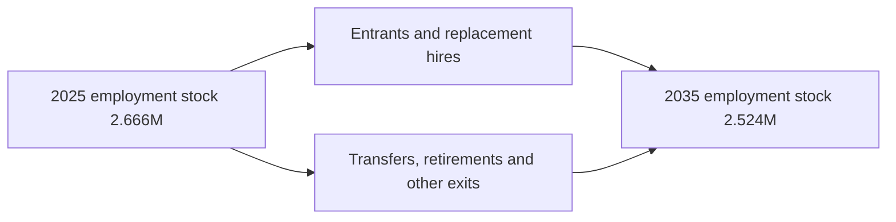

| Measure | Value | Interpretation |
|---|---:|---|
| projected net stock change | `-141,800` over ten years | occupation contracts |
| projected percent change | `-5.3%` | contraction relative to 2025 employment |
| average annual openings | `289,500` | gross hiring opportunities, primarily replacement |
| AI factor | explicitly named | contributes to pressure; not a complete causal allocation |

Multiplying `289,500 × 10` gives a decade gross-opening flow, not net growth. The same position can be vacated and refilled, and many workers can enter while the ending stock is smaller. A learner deciding whether to enter the field needs both the contraction signal and the continued replacement market.

### Example 2 — absolute decline and decline rate answer different questions

The BLS largest-declines table illustrates why a single “most affected” ranking is underspecified:

| Occupation | 2025 employment | 2035 employment | Numeric change | Percent change |
|---|---:|---:|---:|---:|
| customer service representatives | 2,666,000 | 2,524,100 | `-141,800` | `-5.3%` |
| bookkeeping, accounting and auditing clerks | 1,532,400 | 1,446,800 | `-85,600` | `-5.6%` |
| data entry keyers | 131,800 | 98,200 | `-33,600` | `-25.5%` |

The displayed customer-service stocks are rounded independently, so their subtraction differs from the separately published numeric change by 100 jobs. Treat that as table rounding, not as an analytical discovery.

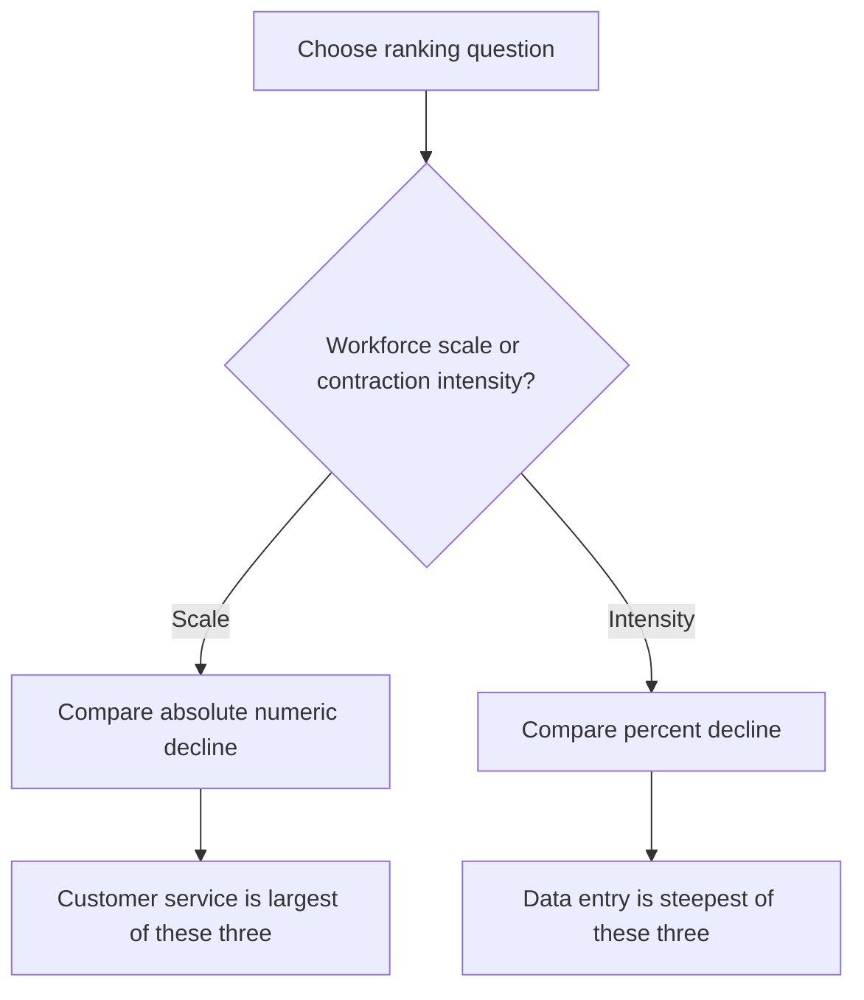

BLS explicitly names AI, machine learning, mobile capture and OCR in the data-entry mechanism. For bookkeeping, its current utilization table names automated bookkeeping software more broadly. The careful conclusion is that both face automation pressure, while the cited driver scope is not identical. Neither row alone estimates permanent unemployment or an AI-only share of the decline.

### Example 3 — task pressure can produce redesign without disappearance

Routine claims processing, document review and translation are highly digitized, but the occupation-level evidence remains mixed:

| Occupation | 2025–2035 projection | Average annual openings | What the official evidence says about technology |
|---|---:|---:|---|
| insurance claims and policy processing clerks | `-1.9%` (`-4,400`) | `17,500` | BLS names AI-enhanced software automating claims/policy processing in several insurance industries |
| paralegals and legal assistants | approximately `0%` (`-1,100`) | `40,800` | AI can improve research/document preparation and may limit demand |
| interpreters and translators | `+2%` (`+1,500`) | `6,000` | AI improves efficiency, but BLS says many jobs cannot be entirely automated |

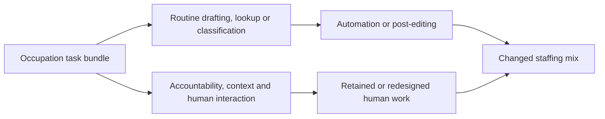

The source's “routine paralegal/document-review” and “basic translation” labels are therefore best read at task level. The BLS evidence supports efficiency pressure, but it does not support replacing the occupation name with “eliminated.” A rounded `0%` can also coexist with a small numeric decline because the published rate is rounded.

### Example 4 — exposed tasks can coexist with occupational growth

The source includes repetitive software testing and basic code maintenance among near-term pressure areas. Yet BLS projects combined employment of software developers, quality-assurance analysts and testers to grow 10% from 2025 to 2035; software QA analysts and testers alone are projected to grow 6%. About 106,100 openings per year are projected for the combined group.

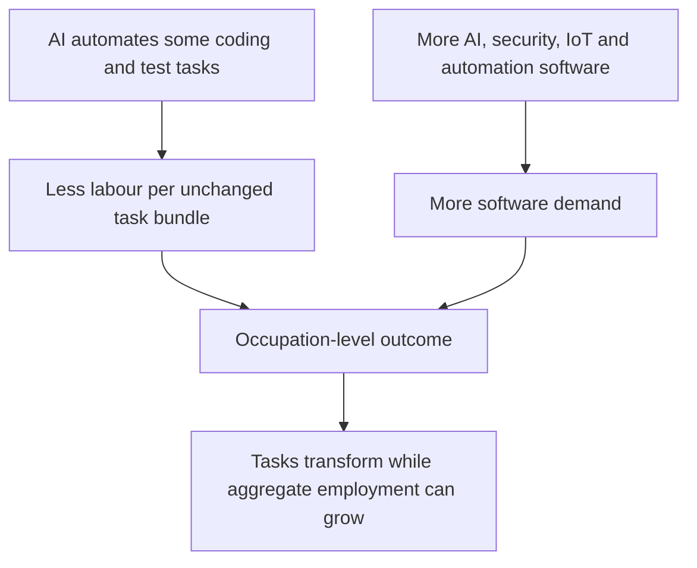

This is not a contradiction. Productivity can reduce labour required for some existing tasks while lower costs, new products, security needs and AI infrastructure expand total demand. The correct statement is bounded: repetitive testing and straightforward maintenance may face workflow pressure; the current BLS projection does not show the broader U.S. occupation group disappearing.

Use this decision gate for every occupation on the source list:

```mermaid
flowchart TD
  A[Occupation claim] --> B{Task evidence or occupation projection?}
  B -->|Task evidence| C[Describe affected activities]
  B -->|Projection| D[Keep geography, horizon and metric]
  C --> E{Net decline also projected?}
  D --> E
  E -->|Yes| F[Report pressure plus openings and drivers]
  E -->|No| G[Report transformation without inventing decline]
```

### Executable occupational-pressure contracts

`OccupationalPressureContracts.java` encodes the stock/flow, absolute/rate, driver-scope and claim boundaries. It permits “AI contributes to pressure” only when the cited factor explicitly names AI, and it never promotes an employment projection into permanent job elimination.

```java
static boolean supports(Projection evidence, Claim claim) {
    return switch (claim) {
        case PROJECTED_NET_DECLINE -> evidence.publishedChange() < 0;
        case AI_CONTRIBUTES_TO_PRESSURE ->
                evidence.driverScope() == DriverScope.AI_EXPLICIT;
        case PERMANENT_JOB_ELIMINATION -> false;
    };
}
```

Twenty deterministic groups encode the BLS customer-service, bookkeeping, data-entry, claims, paralegal and translation boundaries. Then 20,000 seeded trials perform 80,000 checks of rounded count consistency, percentage arithmetic, stock/flow coexistence and rejection of permanent-elimination claims.

```bash
java -ea study-guides/ai/employment-impact/OccupationalPressureContracts.java
```

Expected result:

```text
PASS groups=20 trials=20000 checks=80000
```

## 5. Jobs that are safer than people assume

The source lists eight features that can make work relatively resistant to full substitution: physical work in unpredictable environments; legal or operational accountability; trust and relationship ownership; high-stakes judgment under uncertainty; organizational influence; cross-functional coordination; proprietary context; and responsibility for architecture or final decisions.

These are **workflow properties**, not permanent labels for occupations. A role can contain resistant and automatable tasks at the same time. “Safer” therefore means that replacing the complete human responsibility loop is harder than automating a bounded task; it does not mean zero exposure, guaranteed employment growth or protection from restructuring.

### Relative-resistance contract

Fill this packet before calling work relatively resistant:

| Field | Required question | Invalid shortcut prevented |
|---|---|---|
| task boundary | which activity is being automated: drafting, diagnosis, installation, approval or the whole role? | turning one capable model demo into occupation replacement |
| environment | is the input digitally standardized, or must the worker sense and manipulate an uncertain physical setting? | assuming software access equals physical execution |
| accountable actor | who signs, authorizes, bears liability or owns the incident after the recommendation? | confusing advice with accountable action |
| human relationship | does trust, negotiation, consent or repeated relationship history affect the outcome? | treating communication as text generation only |
| uncertainty loop | must the worker detect novel conditions, act and update under time pressure? | benchmarking only the happy path |
| context access | is essential context proprietary, tacit, local or permission-gated? | assuming the model has complete ground truth |
| coordination span | how many teams, vendors, regulators or operational systems must agree? | optimizing one step while ignoring handoffs |
| outcome evidence | is there an official projection, work-context measure or observed adoption result? | inferring headcount from qualitative features alone |

```mermaid
flowchart TD
  A[Candidate task] --> B{Digitally bounded and verifiable?}
  B -->|Yes| C[Higher task-automation potential]
  B -->|No| D[Physical or contextual execution remains]
  C --> E{Human owns approval or consequences?}
  D --> E
  E -->|Yes| F[Augmentation or redesign more plausible]
  E -->|No| G[Substitution case is stronger]
```

The ILO's 2025 refined exposure index supports this task-bundle interpretation: nearly all occupations retain activities requiring human input, so transformation is more likely than wholesale redundancy. Its exposure gradients are potential-exposure measures, not employment forecasts. Current BLS 2025–2035 projections provide a separate outcome frame; they incorporate technology assumptions but do not convert the feature list into a universal “safety score.”

Use a **gate**, not an additive prediction score:

1. `automationCandidate` asks whether a bounded task is standardized, accessible and verifiable.
2. `humanResponsibilityLoop` asks whether physical execution, authorization, trust, severe consequences or cross-system coordination still require a person.
3. `outcomeClaim` is allowed only when projection or observed evidence matches the occupation, geography, metric and horizon.

```mermaid
flowchart LR
  A[Task evidence] --> D[Bounded task conclusion]
  B[Work-context evidence] --> E[Responsibility-loop conclusion]
  C[Projection evidence] --> F[Employment-outcome conclusion]
  D --> G[Do not merge units]
  E --> G
  F --> G
```

### Example 1 — electricians combine physical variability with local accountability

An AI system can read a wiring diagram, retrieve code requirements, propose a diagnostic sequence and draft an estimate. It cannot thereby inspect an unknown wall cavity, isolate the correct circuit, manipulate damaged hardware and accept responsibility for a safe installation.

| Step | Evidence or requirement | Bounded conclusion |
|---|---|---|
| 1 | diagram lookup and troubleshooting text are digitally representable | those tasks can be assisted |
| 2 | on-site sensing and manipulation vary by building and fault | execution remains physically situated |
| 3 | errors can create fire, shock and code-compliance consequences | a competent accountable actor remains in the loop |
| 4 | BLS projects electrician employment to grow 9% from 2025 to 2035, with about 72,700 openings per year | current U.S. projection shows growth and replacement demand |
| 5 | BLS also cites electricity demand from AI/data centers among demand contributors | AI can increase demand while assisting some tasks |

```mermaid
sequenceDiagram
  participant A as AI assistant
  participant E as Electrician
  participant S as Physical site
  participant I as Inspector or owner
  A->>E: Retrieve code and suggest tests
  E->>S: Sense, isolate, manipulate and verify
  E->>I: Document and accept accountable handoff
  I-->>E: Approve or require correction
```

The safe claim is not “electricians cannot be automated.” It is: some information tasks are assistable; the present end-to-end workflow retains physical and accountable gates; and the cited U.S. projection currently shows growth. None of those facts guarantees an individual job.

### Example 2 — paramedic work has a short consequence-to-action loop

O*NET's current work-context profile for paramedics reports daily face-to-face discussion, very close physical proximity, frequent operation in vehicles and uncontrolled environments, substantial decision freedom and extremely serious consequences of error. These measurements describe the work context; they are not employment projections.

Trace one chest-pain response:

1. A model can surface protocol branches from reported symptoms.
2. The responder must assess an evolving patient, scene hazards and unreliable or missing information.
3. The responder performs physical interventions, coordinates transport and updates the plan as vital signs change.
4. The human team owns consent, escalation, documentation and immediate consequences.

```mermaid
stateDiagram-v2
  [*] --> SceneAssessment
  SceneAssessment --> ProtocolSupport: symptoms and vitals
  ProtocolSupport --> HumanDecision: recommendation
  HumanDecision --> PhysicalIntervention
  PhysicalIntervention --> Reassess
  Reassess --> HumanDecision: condition changes
  Reassess --> Handoff: stabilized or transported
  Handoff --> [*]
```

The AI-addressable step is inside a larger closed loop. A successful protocol-answer benchmark does not demonstrate scene perception, lawful authority, physical execution or responsibility for the outcome. Conversely, resistant workflow properties do not prove that staffing, documentation or dispatch work will remain unchanged.

### Example 3 — cybersecurity illustrates complementarity, not immunity

BLS projects U.S. information-security-analyst employment to grow 21% from 2025 to 2035, with about 14,100 openings per year. It explicitly names greater AI use and e-commerce among contributors to security demand. This is a useful counterexample to the assumption that high AI capability must reduce every related occupation.

| Workflow element | AI contribution | Human/accountable remainder |
|---|---|---|
| alert triage | summarize logs, cluster similar events | decide whether evidence is sufficient to escalate |
| detection engineering | draft queries and candidate rules | validate false positives against proprietary systems |
| incident response | propose containment steps | authorize business-disrupting isolation and coordinate owners |
| risk acceptance | draft scenarios and controls | accountable executive or system owner accepts residual risk |

```mermaid
flowchart TD
  A[AI-assisted alert] --> B[Analyst validates evidence]
  B --> C{Containment affects production?}
  C -->|Yes| D[Coordinate service and business owners]
  C -->|No| E[Apply bounded response]
  D --> F[Authorized action and audit trail]
  E --> F
```

This does not make every cybersecurity task safe. Standard alert enrichment and first-draft analysis may require fewer minutes per case. The defensible conclusion is narrower: adversarial novelty, proprietary telemetry, production authority and accountability preserve a human responsibility loop, while current demand projections remain positive.

### Example 4 — architecture ownership is a role design, not an occupation forecast

“Senior technical roles” and “architecture” are organizational responsibilities, not single BLS occupation codes. Treat them as a workflow design that may appear inside software-development, engineering-management or computer-and-information-systems-management jobs.

Trace an order-service migration:

1. AI produces three plausible event schemas and a migration checklist.
2. The architect identifies hidden constraints: a partner contract, a PCI boundary, a recovery objective and an undocumented reconciliation job.
3. Finance, security, operations and product disagree about acceptable cost and rollout risk.
4. A human owner chooses the trade-off, records the decision, sequences the migration and owns rollback criteria.

```mermaid
flowchart LR
  A[AI-generated options] --> B[Proprietary constraints]
  B --> C[Cross-functional negotiation]
  C --> D[Accountable decision]
  D --> E[Production feedback]
  E --> B
```

The key boundary is **option generation versus decision ownership**. Architecture artifacts can be automated heavily; final responsibility may remain human because the decision binds several systems and stakeholders under incomplete information. Do not use that reasoning to claim headcount growth. For an employment claim, attach a matching occupation projection; for a career strategy, describe the responsibility loop explicitly.

### Executable relative-resistance contracts

[`RelativeResistanceContracts.java`](RelativeResistanceContracts.java) encodes the boundary between task assistance, a retained human-responsibility loop and a supported employment-outcome claim. It deliberately refuses a numeric “job safety score.”

```java
static boolean retainsHumanLoop(WorkPacket work) {
    return work.physicalExecution()
            || work.accountableApproval()
            || work.severeConsequence()
            || work.trustOwnership()
            || work.crossSystemCoordination();
}

static boolean supportsGrowthClaim(WorkPacket work) {
    return work.projectionDirection() == Direction.GROWTH
            && work.projectionGeography() != null
            && work.projectionHorizon() != null;
}
```

Twenty deterministic groups cover the electrician, paramedic, cybersecurity and architecture boundaries. Then 20,000 seeded trials run 80,000 checks that feature order does not change the result, assistance never implies elimination, retained responsibility never implies growth, and outcome claims require matching projection metadata.

```bash
java -ea study-guides/ai/employment-impact/RelativeResistanceContracts.java
```

Expected result:

```text
PASS groups=20 trials=20000 checks=80000
```

## 6. Software engineering deserves a separate answer

Generative AI can produce, explain, transform and test code, so software work is an unusually direct capability match. The source correctly identifies the weakest position as receiving a well-specified ticket, writing straightforward code and handing it to someone else. That is a **task-boundary claim**, however—not proof that the software-developer occupation is disappearing.

Current BLS evidence is more restrained than the source's older 2024–2034 figures. For 2025–2035, BLS projects U.S. software-developer employment to rise from about 1.718 million to 1.893 million: approximately **174,700 additional jobs, or 10.2% growth**. The broader developer/QA/tester group is projected to grow 10%, with about 106,100 openings per year. BLS names AI, IoT, robotics, automation and security software among demand drivers. These are projections under stated assumptions, not guarantees; BLS separately warns that AI exposure is not a replacement estimate, productivity forecast or employment forecast.

The correct economic identity has two unknowns:

```text
developer labor demanded = software output demanded / output per developer
```

AI can raise the denominator by reducing labor per unit of software. It can also raise the numerator by making more software worth building. Without evidence for both effects, “developers per feature fell” does not determine whether developer headcount rises or falls.

### Software-responsibility contract

Fill this packet before turning a coding capability into an employment claim:

| Field | Required question | Invalid shortcut prevented |
|---|---|---|
| task boundary | Is the evidence about drafting, testing, review, deployment, incident response or the complete role? | turning a coding benchmark into occupation replacement |
| requirement authority | Who resolves ambiguity and decides that the requested behavior is correct? | assuming a ticket contains complete ground truth |
| validation | Which tests, security checks, evaluations and acceptance criteria can falsify the output? | equating plausible code with working software |
| production authority | Who may deploy, roll back, isolate systems or accept operational risk? | treating a recommendation as an authorized action |
| responsibility | Who owns incidents, audits, maintenance and downstream consequences? | transferring accountability to a code generator |
| productivity evidence | What unit improved—minutes, accepted changes, throughput or business outcomes—and against what baseline? | mapping a local time saving directly to staffing |
| demand response | Does lower software cost expand output, quality, customization or previously uneconomic projects? | holding software demand fixed without evidence |
| outcome metadata | Does an employment claim name the occupation, geography, horizon, direction and projection assumptions? | mixing a global capability claim with a U.S. occupation forecast |

```mermaid
flowchart TD
  A[AI completes a coding task] --> B{Requirements and acceptance complete?}
  B -->|No| C[Human resolves product intent]
  B -->|Yes| D[Validate behavior and security]
  C --> D
  D --> E{Production authority required?}
  E -->|Yes| F[Accountable owner decides and operates]
  E -->|No| G[Bounded task may be delegated]
  F --> H[Task evidence stays separate from headcount]
  G --> H
```

The BLS AI-exposure categories reinforce this separation. They describe relative task-capability overlap, and explicitly do not estimate worker replacement, adoption probability, productivity or employment growth. The current BLS projection is a different evidence object with a U.S. occupation, a 2025–2035 horizon and a modeled direction. Keep both objects visible rather than using either one to erase the other.

### Example 1 — ticket-to-PR work exposes the weak position

Suppose a ticket says: “Add a CSV export button to the account-history page.” An AI assistant can inspect local patterns, draft a handler, generate serialization code and propose tests. That is meaningful task assistance. It is also the source's weak-position example because the implementation is digitally bounded and easy to review.

Trace the boundary:

1. The model drafts a pull request from the ticket and repository context.
2. A contract test reveals that commas inside merchant names are not escaped.
3. Security review finds that the query omitted the tenant predicate.
4. A product owner clarifies that exports require an audit event and a 90-day limit.
5. The corrected change is accepted only after the hidden requirements become explicit.

| Observation | Supported conclusion | Unsupported conclusion |
|---|---|---|
| first draft took 8 rather than 40 minutes | drafting time fell for this task and setup | developer employment falls 80% |
| review caught two material defects | validation and repository context remain part of delivery | the model is useless |
| a reviewer can specify all rules up front | more of this bounded task may be delegated | every software workflow has the same boundary |

```mermaid
sequenceDiagram
  participant P as Product owner
  participant A as AI assistant
  participant E as Engineer
  participant C as CI and security
  P->>A: Ticket and repository context
  A->>E: Draft pull request
  E->>C: Run behavioral and security gates
  C-->>E: CSV and tenant failures
  E->>P: Resolve audit and retention rules
  P-->>E: Acceptance criteria
  E->>C: Corrected change
```

The defensible career inference is narrower than “move up the value chain”: reduce dependence on commodity implementation alone, and learn to own requirements, validation and production outcomes. It is advice derived from workflow structure, not an empirical prediction that every senior title is safe.

### Example 2 — incident assistance does not transfer production authority

At 02:10, an order service's error rate jumps after a schema migration. An assistant can summarize logs, correlate the deployment, propose a rollback and draft a status update. It cannot silently decide the acceptable loss of new writes, whether a rollback is compatible with already-migrated rows, or which customer commitments take priority.

| Time | Evidence and action | Authority boundary |
|---|---|---|
| 02:10 | alert fires; traces show deserialization failures | observation is automatable |
| 02:13 | assistant links the failure to deployment `v42` | diagnosis is a hypothesis, not authorization |
| 02:16 | engineer finds 8% of rows already use the new schema | proprietary state changes the rollback plan |
| 02:19 | incident commander chooses write isolation plus a forward fix | human owns blast radius and business trade-off |
| 02:41 | service recovers; team records causes and guardrails | accountability continues after recovery |

```mermaid
stateDiagram-v2
  [*] --> Detect
  Detect --> Diagnose: logs and traces
  Diagnose --> AssessBlastRadius: candidate cause
  AssessBlastRadius --> AuthorizeAction: proprietary state and risk
  AuthorizeAction --> Execute
  Execute --> Verify
  Verify --> AuthorizeAction: recovery incomplete
  Verify --> Postmortem: service restored
  Postmortem --> [*]
```

This is why production ownership, observability, security and distributed-systems knowledge are defensible strategy areas: they enlarge the engineer's responsibility loop. They do not make the person immune to restructuring, and they do not prove a particular staffing level.

### Example 3 — architecture is option generation plus accountable choice

Consider splitting identity data from a monolith. A model can generate event-driven, synchronous-service and shared-database options. The architecture decision still depends on facts that may not appear in the prompt: a regional residency rule, a recovery-time objective, a partner's fixed contract, the on-call team's skills and an acquisition deadline.

1. AI generates three plausible designs and lists textbook trade-offs.
2. The team attaches proprietary constraints and failure-history evidence.
3. Security rejects a cross-region replication path; operations rejects a new broker before peak season.
4. The accountable owner chooses a staged synchronous extraction, records rejected options and defines rollback gates.

```mermaid
flowchart LR
  A[Generated options] --> B[Proprietary constraints]
  B --> C[Security and operations review]
  C --> D[Accountable decision record]
  D --> E[Production feedback]
  E --> B
```

Option generation can become cheap while decision quality remains scarce. The evidence boundary is important: this trace supports a skill strategy around systems, trade-offs and organizational coordination. It is not an occupation projection. Attach the separate BLS 15-1252 projection only when making a current U.S. software-developer employment claim.

### Example 4 — AI integration begins after the API call

Calling a model endpoint is a small part of production AI integration. A support-summary feature needs an evaluation set, authorization-safe context, prompt/model versioning, latency and cost budgets, harmful-output handling, monitoring, fallback behavior and an owner who can disable the feature.

Trace one release:

1. The team defines a 500-case evaluation set with critical privacy and hallucination slices.
2. The candidate passes aggregate quality but fails 7 of 20 cross-tenant adversarial cases.
3. Engineers fix retrieval authorization, rerun the exact versioned suite and require zero critical failures.
4. A 5% canary monitors latency, abstention, support-agent overrides and privacy signals.
5. An automated threshold pauses rollout; an accountable owner decides whether to roll back or repair.

```mermaid
flowchart TD
  A[Versioned candidate] --> B[Offline evaluation]
  B --> C{Critical slices pass?}
  C -->|No| D[Repair retrieval or policy]
  D --> B
  C -->|Yes| E[Bounded canary]
  E --> F{Runtime signals healthy?}
  F -->|No| G[Pause and accountable decision]
  F -->|Yes| H[Gradual release and monitoring]
```

NIST's final SSDF 1.1 and its final generative-AI community profile treat secure development as lifecycle work, not code generation alone. CISA's Secure by Design guidance likewise puts ownership of customer security outcomes, transparency and organizational responsibility on software manufacturers. These sources support the responsibility boundary; they do not establish employment growth. The separate current BLS projection supplies the occupation-level evidence.

### Executable software-responsibility contracts

[`SoftwareResponsibilityContracts.java`](SoftwareResponsibilityContracts.java) encodes three independent gates: bounded coding assistance, retained human responsibility and projection-backed employment direction. It deliberately rejects the shortcut from measured productivity to headcount reduction.

```java
static boolean retainsHumanResponsibility(SoftwarePacket packet) {
    return packet.requirementsOwnership()
            || packet.securityApproval()
            || packet.productionAuthority()
            || packet.incidentOwnership()
            || packet.crossSystemDecision();
}

static boolean supportsGrowthClaim(SoftwarePacket packet) {
    return packet.projectionDirection() == Direction.GROWTH
            && hasProjectionMetadata(packet);
}
```

Twenty deterministic groups cover the ticket, incident, architecture and AI-integration traces. Then 20,000 seeded trials run 80,000 checks that responsibility remains an exact workflow predicate, task assistance stays bounded to task evidence, growth requires occupation/geography/horizon metadata, and productivity never determines headcount by itself.

```bash
java -ea study-guides/ai/employment-impact/SoftwareResponsibilityContracts.java
```

Expected result:

```text
PASS groups=20 trials=20000 checks=80000
```

## 7. Evidence against a simple “AI destroys jobs” model

The source's Section 6 coda says entry-level and commodity implementation work is likely to be vulnerable first. Treat that as a **testable heterogeneity hypothesis**, not a universal result. PwC's 2026 data show sharply different outcomes even inside highly AI-exposed entry-level work, while its company comparison shows exposed firms growing headcount faster than less-exposed firms. Anthropic's January 2026 Economic Index observes real task use, automation/augmentation patterns, autonomy and estimated success—but not the complete organizational chain from use to staffing.

Together, these sources reject the deterministic rule “more exposure automatically means fewer jobs.” They do not establish the opposite rule that AI causes job growth.

### Association-to-delegation contract

Classify each claim before using it:

| Layer | Required evidence | Safe conclusion | Invalid shortcut |
|---|---|---|---|
| exposure | capability/task match with a defined occupation universe and vintage | AI may assist or complete some tasks | exposure equals workplace adoption |
| observed use | real interactions mapped to work tasks with coverage and sampling limits | the tool is being used in these measured ways | usage equals successful automation |
| descriptive association | exposure/use and outcome measured for comparable units, baseline and horizon | the variables move together in the sample | exposure caused the outcome |
| causal effect | credible identification, matched treatment/comparator and outcome | the intervention changed the bounded outcome under stated assumptions | one study proves a universal law |
| workflow delegation | workplace use covers the complete workflow reliably, with authorization and exception handling | labor can be removed from this bounded workflow under tested conditions | task success eliminates an occupation |

```mermaid
flowchart TD
  A[Task exposure] --> B[Observed use]
  B --> C[Measured task success]
  C --> D{Complete workflow covered?}
  D -->|No| E[Augmentation or partial automation evidence]
  D -->|Yes| F{Reliable, authorized and exception-safe?}
  F -->|No| E
  F -->|Yes| G[Bounded delegation evidence]
  G --> H{Matched headcount design?}
  H -->|No| I[Do not claim a causal job effect]
  H -->|Yes| J[Bounded causal headcount claim]
```

BLS's current exposure categories provide an independent interpretation check: their theoretical and observed-use inputs do not directly observe whether workers used AI on the job, and the categories do not estimate adoption, productivity, replacement or employment growth. The same restraint applies when reading vendor usage data and company-level associations.

### Example 1 — faster exposed-company growth is evidence against inevitability, not proof of causation

PwC reports that, relative to a 2018 baseline, headcount at the most AI-exposed companies reached 52% growth in 2025 versus 36% at the least-exposed companies. The descriptive difference is 16 percentage points.

| Gate | PwC packet | Interpretation |
|---|---|---|
| units | companies grouped by AI exposure | company outcome, not an occupation count |
| outcome | headcount change from a common 2018 baseline | growth rate, not jobs created by AI |
| comparator | most- versus least-exposed companies | supports a descriptive association |
| confounders | sector mix, firm quality, investment and prior growth may differ | blocks a simple causal claim |
| valid use | exposure did not mechanically force headcount decline in this sample | evidence against inevitability |

```mermaid
flowchart LR
  A[AI exposure] --> C[Observed headcount growth]
  B[Sector, capital, management and prior growth] --> A
  B --> C
  A -. association .-> C
```

A “super-star” selection effect is especially important: firms that can adopt AI effectively may also be better managed, better capitalized or concentrated in faster-growing markets. A causal design must address those backdoor paths. The source already states this limitation; retaining it is essential, not a footnote.

### Example 2 — AI-skill postings need both numerator and denominator

PwC reports that postings requiring specific AI skills grew 69%, while the total jobs market grew 9%. That is roughly `69 / 9 = 7.7` times the growth rate, often summarized as “almost eight times.”

Trace the arithmetic and its limits:

1. Identify the same comparison period and posting universe.
2. Keep `69%` as growth in AI-skill postings, not a 69% share of all postings.
3. Keep `9%` as growth in the broader market, not a control-group causal effect.
4. Report the ratio only after preserving both original rates.
5. Do not convert posting growth into filled jobs, employment stocks or net job creation.

```mermaid
flowchart TD
  A[AI-skill postings growth: 69%] --> C[Growth-rate ratio: about 7.7x]
  B[All-postings growth: 9%] --> C
  C --> D[Demand signal for listed skills]
  D --> E{Observed hires or employment stock?}
  E -->|No| F[Stop before headcount claim]
  E -->|Yes| G[Analyze matched employment outcome separately]
```

This finding is strong evidence that employer skill demand is changing. It is compatible with job creation, job redesign, higher requirements for the same number of openings, or churn in posting behavior. The posting unit cannot choose among those mechanisms by itself.

### Example 3 — entry-level outcomes split instead of moving as one block

PwC's targeted U.S. analysis covers 2.4 million entry-level postings. Within the top AI-exposure quartile, roles that added more than ten traditionally senior skills grew 35% from 2019 to 2025, while other entry-level roles declined 10%.

| Source statement | Supported reading | Unsupported reading |
|---|---|---|
| “seniorised” exposed entry roles grew 35% | some exposed junior work expanded while skill requirements changed | all junior workers benefited |
| other exposed entry roles declined 10% | a vulnerable segment exists inside the entry-level market | AI caused every decline |
| leadership, judgement and interaction appear more often | apprenticeship and hiring criteria may be changing | a skill keyword proves job quality or worker proficiency |

```mermaid
flowchart TD
  A[Highly exposed entry-level postings] --> B{More than ten senior skills added?}
  B -->|Yes| C[Seniorised group: +35%]
  B -->|No| D[Other group: -10%]
  C --> E[Heterogeneous redesign evidence]
  D --> E
  E --> F[Investigate causes, access and training]
```

This result refines the source's line 152 hypothesis. Commodity entry work can be vulnerable, but exposure alone is not the partition: skill redesign, sector, employer strategy and task composition matter. It also raises a separate policy question—how workers acquire senior judgement if routine apprenticeship tasks shrink—which the posting data do not resolve.

### Example 4 — observed task success is still short of workflow delegation

Anthropic's January 15, 2026 report adds five primitives to its automation/augmentation measure: task complexity, human and AI skills, use case, AI autonomy and task success. The underlying sample uses Claude conversations from November 2025, predominantly Sonnet 4.5. The report describes the classifiers as directionally accurate and notes that workplace effects depend on complementarity and demand.

Trace a support-ticket workflow:

1. Claude summarizes the ticket and drafts a response; the interaction is classified as work use.
2. The draft is successful at the bounded text task and may be “directive,” meaning little back-and-forth.
3. Customer identity, refund eligibility and policy exceptions live in systems outside the conversation.
4. An authorized worker checks those systems, decides the exception and owns the customer outcome.
5. Only a deployed system that performs all steps reliably, handles exceptions and is authorized to act supplies complete-workflow delegation evidence.

```mermaid
sequenceDiagram
  participant U as Worker
  participant A as AI
  participant S as Enterprise systems
  participant O as Accountable owner
  U->>A: Ticket and request
  A-->>U: Successful draft
  U->>S: Verify identity, policy and state
  S-->>U: Proprietary evidence
  U->>O: Escalate exception or approval
  O-->>U: Authorized decision
  U->>S: Execute and record outcome
```

Automation/augmentation and autonomy are related but distinct. A simple translation can be highly automated yet require little autonomous decision-making; a complex delegated workflow may require many decisions and repeated exception handling. Neither task coverage nor a model-judged success rate establishes an employer's staffing response.

### Executable evidence-against-destruction contracts

[`EvidenceAgainstDestructionContracts.java`](EvidenceAgainstDestructionContracts.java) makes the four layers executable. It admits a descriptive association only with a comparator, baseline and matched unit/horizon; admits a causal headcount claim only with an identification design and outcome direction; and admits complete-workflow delegation only with observed workplace use, full coverage, reliability and authority.

```java
static boolean supportsCausalHeadcountEffect(EvidencePacket packet) {
    return supportsAssociation(packet)
            && packet.causalDesign()
            && packet.headcountDirection() != Direction.UNKNOWN;
}

static boolean supportsCompleteWorkflowDelegation(EvidencePacket packet) {
    return packet.workplaceUseObserved()
            && packet.completeWorkflowCoverage()
            && packet.reliableSuccess()
            && packet.authorizedDeployment();
}
```

Twenty deterministic groups cover the PwC company comparison, AI-skill postings, entry-level split, Anthropic task-use packet and a deliberately stronger workflow trial. Then 20,000 seeded trials run 80,000 checks across association, causality, delegation and the invariant that exposure never proves automatic job destruction.

```bash
java -ea study-guides/ai/employment-impact/EvidenceAgainstDestructionContracts.java
```

Expected result:

```text
PASS groups=20 trials=20000 checks=80000
```

## 8. What could make the forecast much worse

The source says its 30–80 million 2030 planning range could be too low if several developments arrive together: agents operate reliably across long tasks; consequential-workflow errors fall; integration becomes inexpensive; firms redesign workflows; robotics extends automation into physical work; and demand growth fails to absorb displaced labor. This is a **conjunction stress test**, not a new forecast. Each condition must be measured separately, and correlation between them must be reported rather than hidden in one probability.

The most important distinction is between raw model intelligence and reliable end-to-end automation. METR's task-completion time horizon is a useful capability measure, but it is the human time required for tasks in a mostly software, machine-learning and cybersecurity suite at a stated success threshold. It is not the amount of wall-clock time an agent runs, and measurements above 16 human-hours are currently marked unreliable. The measure therefore supplies evidence about one link, not proof of unattended workplace delegation.

```mermaid
flowchart TD
  A[Longer-task capability] --> B[Reliable end-to-end execution]
  B --> C[Acceptable consequential risk]
  C --> D[Affordable integration]
  D --> E[Workflow redesign and adoption]
  E --> F{Demand absorbs productivity?}
  F -->|Yes| G[Output growth, redesign or new work]
  F -->|No| H[Severe labor-demand downside]
  I[Robotics and physical reach] --> H
```

Robotics is a scope amplifier in this diagram. It can bring more physical tasks into reach, but it does not substitute for reliability, adoption or a demand model. Likewise, weak demand absorption can turn productivity into lower labor requirements, but it cannot make an unusable system deployable.

### Downside-scenario contract

Before calling a downside case “plausible,” complete this packet:

| Field | Required evidence | Why it matters | Invalid shortcut |
|---|---|---|---|
| task horizon | success curve, threshold, task suite and human-duration method | distinguishes longer-task capability from anecdotes | “worked once for hours” |
| end-to-end reliability | complete workflow boundary, retries, recovery and correlated failures | many individually strong steps can still fail as a chain | single benchmark score |
| consequential acceptance | failure severity, detectability, residual risk and accountable owner | regulated/customer-facing use is risk-weighted, not accuracy-only | average accuracy is sufficient |
| integration economics | model, data, tools, identity, monitoring, support and exception costs | cheap inference may coexist with expensive deployment | token price equals automation cost |
| organizational redesign | changed process, decision rights, training and observed adoption | a copilot in the old workflow need not remove labor | license purchase equals redesign |
| physical reach | bounded robot tasks, environment variability, safety and utilization | identifies which physical tasks actually enter scope | lab demo equals occupation automation |
| demand absorption | output demand, productivity, prices, substitution and new work | maps productivity into labor demand | productivity gain equals job loss |
| comparison frame | geography, sector, horizon and outcome unit | keeps the stress test aligned with the forecast | mixing global jobs with U.S. hours |
| dependencies | shared causes and correlated failure/adoption assumptions | prevents multiplying invented independent probabilities | opaque “combined likelihood” |

```mermaid
stateDiagram-v2
  [*] --> Capable
  Capable --> Checked: checkpoint
  Checked --> Complete: verified result
  Checked --> Recovered: retry or repair
  Recovered --> Checked
  Checked --> Escalated: exception or uncertainty
  Escalated --> Complete: accountable resolution
  Complete --> [*]
```

An unattended system must own the transitions, not merely the happy-path action. If a person still detects uncertainty, repairs state, resolves policy exceptions or authorizes consequential actions, the measured result is partial automation or augmentation unless that retained labor is explicitly counted.

### Example 1 — long tasks require compounded reliability

Suppose an illustrative workflow has 100 necessary steps and every step succeeds independently with probability `0.99`. Complete-run success is:

`0.99^100 = 0.3660`, or about **36.6%**.

| Necessary steps | Per-step success | Illustrative complete success |
|---:|---:|---:|
| 1 | 99% | 99.0% |
| 10 | 99% | 90.4% |
| 50 | 99% | 60.5% |
| 100 | 99% | 36.6% |

This is a teaching model, not an empirical forecast. Real steps are seldom independent: the same ambiguous instruction, stale data or tool outage can cause several failures together. Checkpoints and retries can improve recovery, but only if the system detects failure, preserves valid state and avoids replaying an irreversible action.

Trace an eight-hour reconciliation job:

1. The agent reads a bounded work queue and records an operation key.
2. It validates identity, source version and tool permissions before mutation.
3. After each batch it stores a checkpoint with the expected source version.
4. A transient tool failure is retried only when the operation is replay-safe.
5. An ambiguous mismatch enters an exception queue instead of being guessed.
6. Completion requires reconciliation against the authoritative ledger, not a fluent summary.

```mermaid
sequenceDiagram
  participant A as Agent
  participant S as Source system
  participant C as Checkpoint store
  participant O as Accountable owner
  A->>S: Read versioned batch
  A->>S: Apply replay-safe operation
  A->>C: Save version and result
  S-->>A: Ambiguous mismatch
  A->>O: Escalate evidence packet
  O-->>A: Resolve or reject
  A->>S: Reconcile final state
```

METR's horizon work directly warns against a common wording error: a “four-hour task” means a task estimated to take an expert four hours, not four hours of autonomous model operation. Its suite is also concentrated in well-specified technical tasks with automatic evaluation. A downside scenario must show transfer to the less-specified, stateful and socially constrained workflows whose labor effects it predicts.

### Example 2 — consequential workflows are governed by failure severity

An apparent `99.9%` decision success rate still implies an expectation of about `1,000` failures across one million decisions:

`1,000,000 × (1 - 0.999) = 1,000`.

That arithmetic does **not** say all failures cause harm. It shows why a mean accuracy number is incomplete. A typo caught before delivery, an incorrect refund, a denied medical benefit and an unsafe robot motion have different severity, detectability and reversibility.

| Gate | Question | Evidence needed |
|---|---|---|
| validity | did the system meet the task specification? | representative evaluations and slice results |
| detection | will an error be noticed before action? | calibrated monitors and tested abstention |
| severity | what happens if it escapes? | hazard analysis and consequence tiers |
| recovery | can the action be reversed safely? | versioning, compensation and reconciliation tests |
| accountability | who accepts residual risk? | named human or organization with decision authority |

```mermaid
flowchart TD
  A[Model output] --> B{Valid for this slice?}
  B -->|No or uncertain| C[Abstain or escalate]
  B -->|Yes| D{Consequence within delegated authority?}
  D -->|No| C
  D -->|Yes| E[Execute with audit record]
  E --> F{Outcome reconciled?}
  F -->|No| G[Contain and recover]
  F -->|Yes| H[Close]
```

NIST AI 600-1 identifies confabulation as confidently presented erroneous or false content and highlights extra concern in consequential decision-making. Its risk-management framing is about governing, mapping, measuring and managing trustworthiness in the application context—not certifying a universal error rate. The downside condition is therefore met only when residual risk is low enough for the specific workflow and an accountable deployer accepts it.

### Example 3 — inexpensive models do not imply inexpensive delegation

Enterprise delegation is a chain. For an illustrative workflow with stage success probabilities of `0.98` for data access, `0.97` for model reasoning, `0.95` for tool execution and `0.99` for policy/recording, the product under an independence assumption is:

`0.98 × 0.97 × 0.95 × 0.99 = 0.8940`, or about **89.4%**.

The product is not an estimate of any real deployment. It demonstrates why a strong model result cannot stand in for identity, data freshness, tool semantics, policy checks and recovery. A real evaluation should measure the whole chain and retain stage-level outcomes so the limiting component remains visible.

```mermaid
flowchart LR
  A[Authorized data] --> B[Model decision]
  B --> C[Tool action]
  C --> D[Policy and audit]
  D --> E[Reconciled outcome]
```

Workflow-redesign trace:

1. Baseline the existing process, including queueing, review, exceptions and rework.
2. Define what the system may read, decide and mutate; preserve a human owner for residual authority.
3. Integrate data and tools with identity, version and audit controls.
4. Measure accepted outcomes per total attempts, not just model responses per prompt.
5. Redesign roles only after the exception load, support cost and failure recovery are observed.
6. Compare total cost and capacity with the baseline at the same service level.

The Census Bureau's 2026 BTOS supplement supplies an adoption reality check. During November 2025–January 2026, 18% of firms reported AI use in a business function, rising to 32% when weighted by employment; among adopting firms, 57% used AI in three or fewer business functions. Those descriptive figures show uneven diffusion and limited breadth, not a cap on future adoption. They also show why a downside scenario needs explicit evidence of organizational spread instead of assuming that capability instantaneously becomes economy-wide redesign.

Physical automation adds another integration chain: perception, planning, actuation, safety interlocks, maintenance and local operating conditions. Robotics can amplify the downside if those stages become reliable and economical across variable environments. A successful bounded demonstration does not show the utilization, exception rate or capital turnover needed for occupational-scale replacement.

### Example 4 — productivity reduces labor only when demand fails to absorb it

For a deliberately simplified one-period trace, hold hours per worker constant and write the labor requirement relative to baseline as:

`labor factor = (1 + output-demand growth) / (1 + productivity growth)`.

| Demand growth | Productivity growth | Labor factor | Mechanical reading before other adjustments |
|---:|---:|---:|---|
| 5% | 20% | `1.05 / 1.20 = 0.875` | 12.5% less labor than baseline |
| 20% | 20% | `1.20 / 1.20 = 1.000` | unchanged labor requirement |
| 30% | 20% | `1.30 / 1.20 = 1.083` | 8.3% more labor than baseline |

This is an accounting identity for a toy scenario, not a macroeconomic forecast. Prices, substitution, income effects, new products, worker hours, capital constraints and sector reallocation can all change the result. Its value is to expose the missing variable in “productivity means layoffs”: demand.

```mermaid
flowchart TD
  A[AI raises output per worker] --> B[Lower unit cost or higher capacity]
  B --> C{Output demand response}
  C -->|Below productivity growth| D[Lower labor requirement]
  C -->|Matches productivity growth| E[Similar labor requirement]
  C -->|Exceeds productivity growth| F[Higher labor requirement]
  G[New products and tasks] --> C
```

BLS develops occupational projections through linked labor-force, aggregate-economy, final-demand, industry-output, industry-employment and occupational-employment models. Its 2025–2035 projections assume a full-employment economy in the target year and explicitly warn that unknown factors make individual-occupation projections uncertain. That system-level method is the right conceptual boundary: adoption, productivity and final demand must interact before a headcount result can be stated.

The severe-downside packet is therefore satisfied only when evidence supports all of the following at a matched horizon: longer-task capability, reliable complete workflows, acceptable consequential risk, affordable integration, organizational redesign, and weak demand absorption. Physical reach broadens the scope when present. No one factor proves the combined forecast, and the packet still supports a conditional scenario—not a probability-weighted prediction.

### Executable downside-scenario contracts

[`DownsideScenarioContracts.java`](DownsideScenarioContracts.java) encodes the four traces. `compoundSuccess` makes its independence assumption explicit; `workflowSuccess` rejects missing or invalid stages; `expectedFailures` preserves the decision count; and `laborFactor` keeps demand and productivity separate. The scenario predicate requires the key capability, reliability, risk, integration, redesign and absorption conditions together, while physical reach is modeled as an amplifier.

```java
static boolean supportsSevereDownside(ScenarioPacket packet) {
    return packet.longHorizonCapability()
            && packet.reliableEndToEnd()
            && packet.acceptableConsequentialRisk()
            && packet.affordableIntegration()
            && packet.workflowRedesign()
            && packet.weakDemandAbsorption();
}

static double laborFactor(double demandGrowth, double productivityGrowth) {
    return (1.0 + demandGrowth) / (1.0 + productivityGrowth);
}
```

Twenty deterministic groups cover the `0.99^100` reliability trace, the four-stage integration product, one million consequential decisions, two demand/productivity cases, input rejection and the physical-reach boundary. Then 20,000 seeded trials run 80,000 checks across probability bounds, compounding monotonicity, labor-factor arithmetic and the invariant that no single downside condition is sufficient.

```bash
java -ea study-guides/ai/employment-impact/DownsideScenarioContracts.java
```

Expected result:

```text
PASS groups=20 trials=20000 checks=80000
```

## 9. What could make the forecast too pessimistic

The source says the 30–80 million 2030 planning range could be too high if reliability still requires review, human–AI teams outperform autonomous systems, regulation or liability retains human sign-off, lower costs create new demand, new occupations absorb workers, or adoption takes longer than expected. These are **downward-revision mechanisms**, not proof that displacement disappears. Each mechanism must be measured at the same geography, unit and horizon as the forecast it revises.

```mermaid
flowchart TD
  A[Gross displacement scenario] --> B{Reliable without review?}
  B -->|No| C[Retained review and exception work]
  B -->|Yes| D{Autonomy beats human plus AI?}
  D -->|No| E[Complementary team design]
  D -->|Yes| F[Higher automation pressure]
  C --> G{Demand and new work absorb transitions?}
  E --> G
  F --> G
  G -->|Yes| H[Revise net loss downward]
  G -->|No| I[Retain gross downside]
```

The update direction matters. Evidence that review is still necessary can reduce an autonomy-based displacement estimate, but it does not show that the same number or mix of workers remains. Evidence of new jobs can offset gross losses in a net ledger, but it does not make worker transitions costless or prove that displaced people can fill the new roles.

### Downward-revision contract

For each proposed revision, record:

| Field | Required question | Valid evidence | Invalid shortcut |
|---|---|---|---|
| baseline scenario | which gross or net estimate is being revised? | named metric, unit, geography and horizon | “the forecast” without identity |
| mechanism | reliability, complementarity, authority, demand, absorption or diffusion? | one bounded causal or descriptive channel | treating all optimism as one factor |
| counterfactual | compared with autonomous AI, no AI or the current workflow? | explicit comparator and assignment/design | comparing unlike baselines |
| outcome | accepted output, labor hours, headcount, openings or adoption? | numerator, denominator and time window | quality score equals jobs |
| retained work | review, exception, accountability, relationship or physical execution? | task inventory and measured load | “human in the loop” with no work count |
| demand response | did lower cost expand quantity, quality or product variety? | price, output and elasticity evidence | productivity automatically creates demand |
| worker absorption | can workers move into the new work, when and at what cost? | skills, geography, wages, training and transition time | gross creation equals painless transition |
| diffusion | what share of firms, functions, workers and tasks adopted? | observed adoption path | exposure equals immediate economy-wide use |
| uncertainty | what would falsify the revision? | confidence interval, sensitivity or scenario bounds | one favorable case proves neutrality |

```mermaid
flowchart LR
  A[Capability evidence] --> B[Work design]
  B --> C[Accepted output]
  C --> D[Demand response]
  D --> E[Gross job flows]
  E --> F[Worker transitions]
  F --> G[Net employment]
```

A study can support one arrow without identifying the rest. The revision must stop at the last measured outcome.

### Example 1 — human plus AI can beat either one alone

Harvard's preregistered BCG experiment assigned 758 consultants to no-AI, GPT-4, or GPT-4-plus-guidance conditions. Across 18 tasks inside the tested capability frontier, AI users completed 12.2% more tasks, worked 25.1% faster and produced higher-quality results. On a selected task outside that frontier, AI users were 19% less likely to reach the correct answer. The lesson is heterogeneity: assistance can raise accepted throughput while uncritical reliance can reduce correctness.

Use **accepted outputs per hour**, not raw attempts, as a minimal team metric:

`accepted outputs/hour = attempts/hour × completion rate × acceptance rate`.

| Workflow | Attempts/hour | Completion | Accepted quality | Accepted outputs/hour |
|---|---:|---:|---:|---:|
| human baseline | 6 | 100% | 90% | `6 × 1.00 × 0.90 = 5.40` |
| fast AI-only | 12 | 100% | 40% | `12 × 1.00 × 0.40 = 4.80` |
| human + AI | 10 | 95% | 85% | `10 × 0.95 × 0.85 = 8.08` |

These figures are illustrative, not the BCG results. They show why speed alone is insufficient and why review can be economically productive rather than mere friction.

```mermaid
sequenceDiagram
  participant H as Human owner
  participant A as AI assistant
  participant V as Validator
  H->>A: Delegate bounded draft or analysis
  A-->>H: Candidate plus evidence
  H->>V: Test critical assumptions and quality
  V-->>H: Accept, repair or reject
  H->>H: Own final decision and exception
```

NBER's customer-support study supplies a different setting: staggered access for 5,179 agents increased issues resolved per hour by 14% on average, with a 34% gain for novice and lower-skilled workers and little effect for the most experienced workers. That is evidence of assistance and heterogeneous learning in one deployed environment. It does not estimate the long-run staffing response, and it should not be pooled numerically with the consultant experiment.

Trace the safe inference:

1. Define the task frontier and accepted-quality threshold.
2. Compare human-only, AI-assisted and—if actually deployed—AI-only configurations.
3. Count review and repair time inside the assisted workflow.
4. Segment results by task and worker experience.
5. Revise displacement only for work where complementary labor remains economically useful.

### Example 2 — required human authority preserves consequential work

The EU AI Act's Article 14 requires high-risk systems to be designed so natural persons can effectively oversee them during use. Oversight measures must be commensurate with risk, autonomy and context, and assigned people must be able to understand limitations, monitor anomalies, avoid automation bias, interpret outputs and intervene. This is a concrete authority boundary, not a universal requirement that every AI output receive a manual click.

```mermaid
stateDiagram-v2
  [*] --> Proposed
  Proposed --> Reviewed: consequential action
  Reviewed --> Approved: within authority
  Reviewed --> Rejected: unsafe or unsupported
  Reviewed --> Escalated: exception or conflict
  Escalated --> Approved: accountable resolution
  Approved --> Executed
  Executed --> Reconciled
  Reconciled --> [*]
```

Retained-human-work trace for a high-risk decision:

| Step | System contribution | Human contribution | Labor implication |
|---|---|---|---|
| prepare | assemble evidence and propose decision | define policy and verify source scope | preparation may shrink |
| review | flag uncertainty and policy conflicts | interpret, challenge and detect automation bias | review remains |
| authorize | present action packet | exercise legal/organizational authority | sign-off remains |
| exception | route unsupported cases | resolve context and competing duties | exception work remains |
| reconcile | record outcome | own appeal, correction and accountability | post-decision work remains |

This can make a forecast too pessimistic when it assumed the whole job disappears after model competence. It can also change the occupation: fewer routine preparers, more reviewers or exception owners. Regulation is therefore a task-allocation input, not a one-for-one employment guarantee.

### Example 3 — lower prices can create enough demand to offset productivity

Suppose automation raises productivity by 25% and the savings reduce the delivered price by 20%. Under a constant-elasticity teaching model, quantity demand changes by:

`demand multiplier = (1 - price reduction)^(-elasticity)`.

| Demand elasticity | Demand multiplier after 20% price reduction | Labor factor after 25% productivity growth |
|---:|---:|---:|
| 0.5 | `0.8^-0.5 = 1.118` | `1.118 / 1.25 = 0.894` |
| 1.0 | `0.8^-1.0 = 1.250` | `1.250 / 1.25 = 1.000` |
| 1.5 | `0.8^-1.5 = 1.398` | `1.398 / 1.25 = 1.118` |

With weak demand response, labor falls in the toy model. At unit elasticity it is unchanged; with a strong response it rises. This is not an estimate of AI demand elasticity. It exposes the threshold a forecast must justify.

```mermaid
flowchart TD
  A[Higher productivity] --> B[Lower cost or better quality]
  B --> C[Lower price, new features or new product]
  C --> D{Quantity and variety response}
  D -->|Weak| E[Labor demand falls]
  D -->|Matches productivity| F[Labor demand stable]
  D -->|Strong| G[Labor demand rises]
```

The calculation assumes full price pass-through, constant elasticity, no capacity bottleneck and unchanged hours per worker. A real revision needs observed price, quantity, service quality and labor inputs. BLS explicitly models final demand, industry output, productivity and occupational employment in linked stages; that structure is why productivity alone cannot settle the job count.

### Example 4 — slow diffusion and new work can absorb gross displacement

Exposure is an upper boundary; realized displacement requires adoption and actual labor removal. An illustrative decomposition is:

`realized displacement share = exposed task share × adoption share × removal share`.

If 60% of tasks are exposed, 20% of the relevant workflow has adopted, and half of adopted task volume removes labor rather than augmenting it, the realized share is:

`0.60 × 0.20 × 0.50 = 0.06`, or **6% of task volume** in the defined frame.

Do not relabel 6% of task volume as 6% of jobs. The trace only shows how timing and implementation can shrink a near-term realization relative to an exposure ceiling.

```mermaid
flowchart LR
  A[Exposed tasks] --> B[Adopting firms]
  B --> C[Adopting functions]
  C --> D[Workers using AI]
  D --> E[Tasks with labor removal]
  E --> F[Gross displacement]
  G[New demand and occupations] --> H[Gross creation]
  F --> I[Net ledger]
  H --> I
```

Census's nationally representative 2026 BTOS supplement found that 18% of firms used AI in a business function during November 2025–January 2026, 32% when weighted by employment, and 57% of adopters used it in three or fewer functions. The New York Fed's August 2026 regional surveys found much broader firm-level use in its region—61% of service firms and 51% of manufacturers—but median worker use was only 17% and 7%, respectively; retraining was the main workforce response and layoffs remained uncommon. Different populations and question wording explain why the percentages must not be merged.

New-work absorption requires a separate gross ledger. The World Economic Forum's multi-driver employer scenario projects 170 million jobs created and 92 million displaced through 2030, a net `+78 million`. That does not isolate AI and does not prove displaced workers enter the created roles. It demonstrates the arithmetic a net-loss forecast must include:

1. measure gross displacement and gross creation in the same unit, population and horizon;
2. identify skill, wage and geography mismatch;
3. model training and transition time rather than instant reassignment;
4. retain distributional loss even when the aggregate net is positive.

Slow adoption, complementary work, retained authority, demand rebound and new occupations are independent revision channels. Evidence for any one can lower the matching part of a displacement scenario; none supports the blanket claim that technological change creates enough jobs automatically.

### Executable pessimism-scenario contracts

[`PessimismScenarioContracts.java`](PessimismScenarioContracts.java) makes the four traces executable. It calculates accepted output rather than raw speed, keeps demand elasticity explicit, decomposes exposure into realized task displacement, preserves the gross-creation/gross-displacement ledger and refuses a downward revision when horizon or unit is mismatched.

```java
static double realizedDisplacementShare(
        double exposedTaskShare, double adoptionShare, double removalShare) {
    return exposedTaskShare * adoptionShare * removalShare;
}

static boolean supportsDownwardRevision(RevisionPacket packet) {
    return packet.matchedHorizonAndUnit()
            && downwardRevisionSignals(packet) > 0;
}
```

Twenty deterministic groups cover accepted-throughput arithmetic, two rebound-demand cases, the 6% adoption trace, the WEF gross ledger, invalid inputs and matched-frame revision signals. Then 20,000 seeded trials run 80,000 checks across output bounds, exposure ceilings, nonnegative demand multipliers and exact signal counts.

```bash
java -ea study-guides/ai/employment-impact/PessimismScenarioContracts.java
```

Expected result:

```text
PASS groups=20 trials=20000 checks=80000
```

## References and provenance

- [World Economic Forum, *Future of Jobs Report 2025*](https://www.weforum.org/publications/the-future-of-jobs-report-2025/) — survey frame, multiple structural drivers, 170 million created, 92 million displaced and 78 million net growth through 2030.
- [IMF, *Gen-AI: Artificial Intelligence and the Future of Work*](https://www.imf.org/-/media/files/publications/sdn/2024/english/sdnea2024001.pdf) — global and advanced-economy exposure shares plus complementarity distinction.
- [ILO–NASK, *Generative AI and Jobs: A Refined Global Index of Occupational Exposure*](https://www.ilo.org/publications/generative-ai-and-jobs-refined-global-index-occupational-exposure) — task-scoring method, four gradients, one-in-four exposure and 3.3% highest-gradient estimate.
- [Goldman Sachs Research, *How Will AI Affect the US Labor Market?*](https://www.goldmansachs.com/insights/articles/how-will-ai-affect-the-us-labor-market.html) — March 18, 2026 exposure, transition-displacement and temporary-unemployment scenario distinctions.
- [McKinsey Global Institute, *Generative AI and the Future of Work in America*](https://www.mckinsey.com/mgi/our-research/generative-ai-and-the-future-of-work-in-america) — work-hour automation unit and occupational-transition framing.
- [The Budget Lab at Yale, *Evaluating the Impact of AI on the Labor Market: Current State of Affairs*](https://budgetlab.yale.edu/research/evaluating-impact-ai-labor-market-current-state-affairs) — October 1, 2025 broad U.S. occupational-mix, exposure and employment evidence.
- [The Budget Lab at Yale, *What We Do and Don't Know About How AI is Affecting the Labor Market*](https://budgetlab.yale.edu/research/what-we-do-and-dont-know-about-how-ai-affecting-labor-market) — May 7, 2026 synthetic difference-in-differences update and explicit aggregate/subgroup limitations.
- [The Budget Lab at Yale, *AI Labor Market Tracker*](https://interactives.budgetlab.yale.edu/tools/ai-labor-market-tracker/) — October 14, 2026 update incorporating September 2026 CPS microdata and retaining the no-clear-large-scale-disruption boundary.
- [Stanford SIEPR, *Canaries in the Coal Mine? Six Facts about the Recent Employment Effects of Artificial Intelligence*](https://siepr.stanford.edu/publications/working-paper/canaries-coal-mine-six-facts-about-recent-employment-effects-artificial) — August 2025 working paper, administrative payroll design and conditional 13% relative early-career estimate.
- [Federal Reserve Bank of New York, *Are Businesses Scaling Back Hiring Due to AI?*](https://libertystreeteconomics.newyorkfed.org/2025/09/are-businesses-scaling-back-hiring-due-to-ai/) — September 4, 2025 regional survey, realized versus expected workforce responses and firm-share denominators.
- [Federal Reserve Bank of New York, *Businesses Are Using AI to Transform Work, Not Cut Jobs*](https://libertystreeteconomics.newyorkfed.org/2026/09/businesses-are-using-ai-to-transform-work-not-cut-jobs/) — September 1, 2026 update showing time-varying adoption, layoffs, hiring and retraining responses.
- [U.S. Bureau of Labor Statistics, *Occupations with the largest job declines, 2025–2035*](https://www.bls.gov/emp/tables/occupations-largest-job-declines.htm) — current employment stocks, numeric changes and percent changes for customer service, bookkeeping and data entry.
- [U.S. Bureau of Labor Statistics, *Factors affecting occupational utilization*](https://www.bls.gov/emp/tables/factors-affecting-occupational-utilization.htm) — occupation/industry-specific AI, automation, productivity, substitution and demand mechanisms.
- [U.S. Bureau of Labor Statistics, *Artificial Intelligence exposure categories*](https://www.bls.gov/emp/publications/ai-exposure-categories.htm) — current methodology and warning that exposure is not an employment-growth forecast.
- [U.S. Bureau of Labor Statistics, *Customer Service Representatives*](https://www.bls.gov/ooh/office-and-administrative-support/customer-service-representatives.htm) — 2025–2035 decline and replacement-opening distinction.
- [U.S. Bureau of Labor Statistics, *Paralegals and Legal Assistants*](https://www.bls.gov/ooh/legal/paralegals-and-legal-assistants.htm) and [*Interpreters and Translators*](https://www.bls.gov/ooh/media-and-communication/interpreters-and-translators.htm) — task-efficiency pressure alongside flat or growing occupational projections and replacement openings.
- [U.S. Bureau of Labor Statistics, *Software Developers, Quality Assurance Analysts, and Testers*](https://www.bls.gov/ooh/computer-and-information-technology/software-developers.htm) — current 2025–2035 occupation projection, annual openings, stated demand drivers and the task-automation/headcount boundary.
- [International Labour Organization, *Generative AI and Jobs: A Refined Global Index of Occupational Exposure*](https://www.ilo.org/publications/generative-ai-and-jobs-refined-global-index-occupational-exposure) — 2025 task-level exposure gradients and the transformation-versus-redundancy boundary.
- [U.S. Bureau of Labor Statistics, *Electricians*](https://www.bls.gov/ooh/construction-and-extraction/electricians.htm) — current 2025–2035 growth, annual openings and electricity-demand factors.
- [U.S. Bureau of Labor Statistics, *Information Security Analysts*](https://www.bls.gov/ooh/computer-and-information-technology/information-security-analysts.htm) — current 2025–2035 growth, annual openings and AI/security demand interaction.
- [O*NET OnLine, *Paramedics*](https://www.onetonline.org/link/summary/29-2043.00) — work-context evidence for proximity, physical environment, decision freedom and consequence of error.
- [NIST, *Secure Software Development Framework publications*](https://csrc.nist.gov/Projects/ssdf/publications) — final SSDF 1.1, final generative-AI community profile and status of the 1.2 draft.
- [CISA, *Secure by Demand Guide*](https://www.cisa.gov/sites/default/files/2024-08/SecureByDemandGuide_080624_508c.pdf) — secure-by-design manufacturer principles for ownership, transparency and organizational responsibility.
- [PwC, *2026 Global AI Jobs Barometer*](https://www.pwc.com/gx/en/issues/artificial-intelligence/publications/artificial-intelligence-study.html) and [full report](https://www.pwc.com/gx/en/issues/artificial-intelligence/job-barometer/2026/2026-global-ai-jobs-barometer-full-report.pdf) — company headcount/productivity associations, AI-skill posting growth and heterogeneous entry-level outcomes; descriptive rather than causal evidence.
- [Anthropic, *Economic Index: New building blocks for understanding AI use*](https://www.anthropic.com/research/economic-index-primitives) and [January 2026 report](https://www.anthropic.com/research/anthropic-economic-index-january-2026-report) — automation/augmentation plus task complexity, skill, use case, autonomy and success measures with sampling and classifier limitations.
- [METR, *Task-Completion Time Horizons of Frontier AI Models*](https://metr.org/time-horizons/) and [method introduction](https://metr.org/blog/2025-03-19-measuring-ai-ability-to-complete-long-tasks/) — human-duration task horizons at explicit success thresholds, suite boundaries and the warning that the horizon is not autonomous wall-clock runtime.
- [NIST, *Artificial Intelligence Risk Management Framework: Generative Artificial Intelligence Profile*](https://www.nist.gov/publications/artificial-intelligence-risk-management-framework-generative-artificial-intelligence) — July 26, 2024 application-context risk management, confabulation and consequential-decision boundaries.
- [U.S. Census Bureau, *AI Use Among U.S. Businesses*](https://www2.census.gov/ces/wp/2026/CES-WP-26-25R.pdf) and [BTOS data release](https://www.census.gov/newsroom/press-releases/2026/btos-june-18.html) — nationally representative November 2025–January 2026 firm-use, employment-weighted adoption and business-function breadth; descriptive diffusion evidence rather than a delegation outcome.
- [U.S. Bureau of Labor Statistics, *Employment Projections Data Overview*](https://www.bls.gov/emp/documentation/data-overview.htm) and [Employment Projections FAQ](https://www.bls.gov/emp/frequently-asked-questions.htm) — linked macro-to-occupation projection steps, target-year assumptions and uncertainty limits for the 2025–2035 projections.
- [Dell'Acqua et al., *Navigating the Jagged Technological Frontier*](https://www.hbs.edu/ris/Publication%20Files/dell-acqua-et-al-2026-navigating-the-jagged-technological-frontier_5c589c8c-fbb5-458f-b285-c944746cd717.pdf) — March 11, 2026 published preregistered field experiment with 758 consultants, inside-frontier productivity/quality gains and outside-frontier correctness loss.
- [Brynjolfsson, Li and Raymond, *Generative AI at Work*](https://www.nber.org/papers/w31161) — deployed customer-support-assistant study with 5,179 agents, heterogeneous productivity effects and no direct long-run staffing estimate.
- [European Union, Regulation (EU) 2024/1689, Article 14](https://eur-lex.europa.eu/legal-content/EN/TXT/PDF/?uri=CELEX:32024R1689) — risk-proportionate human oversight requirements for high-risk AI systems, including monitoring, interpretation, automation-bias awareness and intervention.
- [Federal Reserve Bank of New York, *Businesses Are Using AI to Transform Work, Not Cut Jobs*](https://libertystreeteconomics.newyorkfed.org/2026/09/businesses-are-using-ai-to-transform-work-not-cut-jobs/) — September 1, 2026 regional adoption, worker-use, retraining, hiring and layoff evidence with explicit sample boundaries.
- [World Economic Forum, *Future of Jobs Report 2025: Jobs Outlook*](https://www.weforum.org/publications/the-future-of-jobs-report-2025/2-jobs-outlook) — multi-driver employer-scenario gross ledger of 170 million created, 92 million displaced and 78 million net growth through 2030.

Source intake:

- `ai_jobs_elimination_deep_research_2026.md`, Library file `libfile_ec5bdd926d1881918e6f8523ea1ab36a`, SHA-256 `32006ec0ff03ed1b643e6e10083977df523266112cfe8f2646e827b8c2e1e0a8`, refreshed November 25, 2026. Source Sections 1–9 at lines 16–189 are promoted. Section 10 at lines 191–197 remains queued; the exact next bounded continuation is Section 10 at lines 191–197.

The source provides the section boundaries, cited evidence and seed distinctions. The evidence tuples, requirements gates, thirty-six worked traces across nine sections, diagrams, comparison rules and executable Java contracts are newly authored study-guide material. No older or competing AI guide was copied, and this incremental promotion does not mark the source or wider collection complete.
