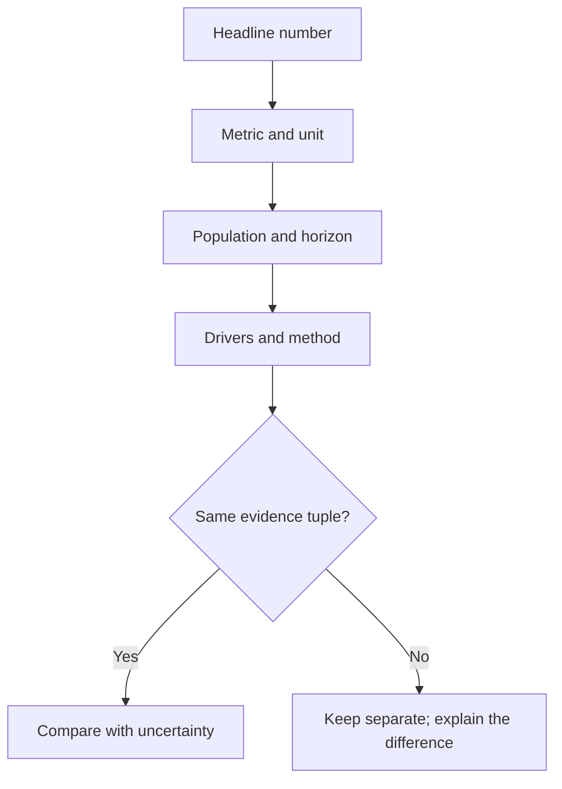
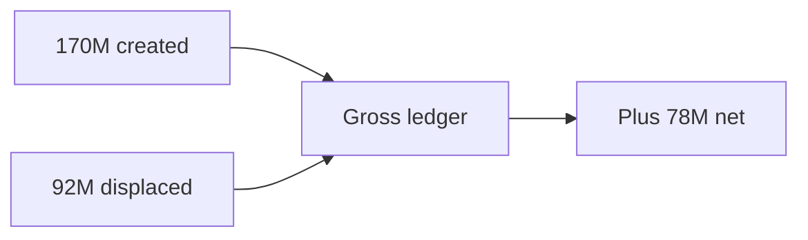
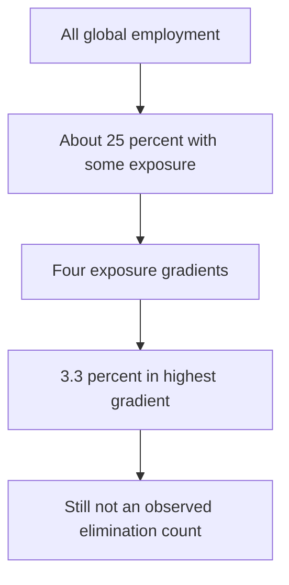
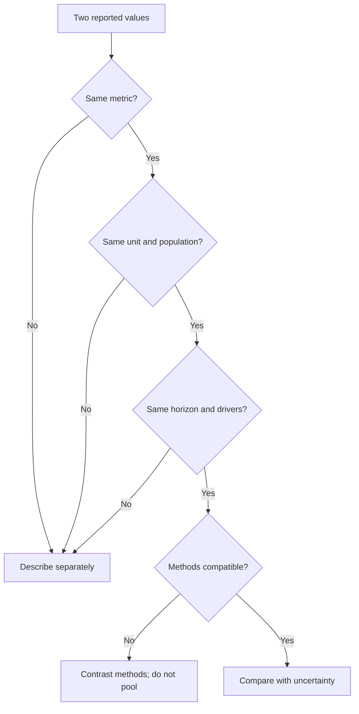

# AI Employment Impact — Reading Evidence Without Headline Errors

> **Incremental status:** Source Section 1, “Why the headline numbers conflict,” is promoted from lines 16–56. Sections 2–10 remain queued. The source's scenario ranges are retained as attributed analysis, not presented here as consensus forecasts.

## Contents

- [1. Why the headline numbers conflict](#1-why-the-headline-numbers-conflict)
  - [Requirement contract](#requirement-contract)
  - [The evidence tuple](#the-evidence-tuple)
  - [Example 1 — WEF is a multi-driver gross-and-net ledger](#example-1--wef-is-a-multi-driver-gross-and-net-ledger)
  - [Example 2 — IMF exposure contains both risk and complementarity](#example-2--imf-exposure-contains-both-risk-and-complementarity)
  - [Example 3 — ILO narrows exposure by task intensity](#example-3--ilo-narrows-exposure-by-task-intensity)
  - [Example 4 — Goldman separates exposure from transition displacement](#example-4--goldman-separates-exposure-from-transition-displacement)
  - [Cross-study comparison gate](#cross-study-comparison-gate)
  - [Executable evidence contracts](#executable-evidence-contracts)
- [References and provenance](#references-and-provenance)

## 1. Why the headline numbers conflict

Forecasts conflict when a headline silently changes the measured object. A study may count exposed workers, automatable work hours, displaced positions, full-time-equivalent task volume, employer intentions, or net job change. Those quantities answer different questions. A responsible comparison keeps the **metric, unit, population, horizon, drivers, method and uncertainty** attached to every number.

The first rule is therefore simple:

> Exposure is a capability or task-overlap measure. It is not, by itself, a count of layoffs, unemployment or permanent job elimination.

### Requirement contract

Before repeating any AI-and-jobs statistic, fill these fields:

| Field | Required question | Invalid shortcut |
|---|---|---|
| metric | exposure, task automation, gross displacement, creation, or net change? | relabeling all of them “jobs lost” |
| unit | workers, jobs, FTE equivalents, work hours, tasks, or employers? | subtracting hours from jobs |
| population | global, national, sector, occupation, age band, or surveyed firms? | generalizing one subgroup to everyone |
| horizon | observed period or scenario year? | treating a ten-year transition as a current count |
| drivers | AI only or several structural forces? | attributing a multi-driver forecast solely to AI |
| method | survey intent, task scoring, model scenario, or observed payroll? | treating intent and observed outcomes as identical |
| uncertainty | point estimate, range, scenario, or descriptive share? | reporting false precision |



### The evidence tuple

Use this compact representation when taking notes:

`(source, metric, unit, value, population, horizon, drivers, method)`

Two values can be arithmetically combined only when the relevant dimensions match. A global job-creation scenario and a global job-displacement scenario from the same model may form a net ledger. A percentage of work hours cannot be subtracted from a count of jobs. Two exposure percentages for different populations may be contrasted, but the difference must retain the population labels.


Every arrow is a contingent causal step. Reliability, cost, regulation, demand, organizational redesign and worker complementarity can interrupt the chain. A task benchmark at the left edge does not identify a realized employment outcome at the right edge.

### Example 1 — WEF is a multi-driver gross-and-net ledger

The World Economic Forum's *Future of Jobs Report 2025* reports employer expectations for structural labour-market transformation over 2025–2030. It projects 170 million jobs created and 92 million displaced, yielding 78 million net growth.

| tuple field | value |
|---|---|
| metric | gross job creation; gross job displacement; derived net change |
| unit | jobs |
| population | global labour market represented by the survey extrapolation |
| horizon | 2030 |
| drivers | technology, demographics, geoeconomic change, economic pressure and green transition |
| method | survey of more than 1,000 employers representing over 14 million workers, then extrapolation |

Exact ledger:

`170 million created - 92 million displaced = 78 million net growth`



**Incorrect claim:** “AI will eliminate 92 million jobs.”

**Why it fails:** the displaced count is not AI-only, it is not the net result, and displacement does not assert permanent unemployment for every affected worker.

### Example 2 — IMF exposure contains both risk and complementarity

The IMF estimates that almost 40% of global employment is exposed to AI, rising to about 60% in advanced economies. In the average advanced economy, exposure splits across higher- and lower-complementarity work: some jobs may gain productivity while others may face reduced labour demand, wage pressure or hiring pressure.

| tuple field | global figure | advanced-economy figure |
|---|---:|---:|
| metric | occupational exposure | occupational exposure |
| unit | share of employment | share of employment |
| population | global | advanced economies |
| value | almost 40% | about 60% |
| interpretation | potential effect, including augmentation | potential effect, including augmentation and displacement pressure |

Trace the inference:

1. An occupation contains tasks with AI overlap.
2. That creates **exposure**, not an employment outcome.
3. Complementarity and adoption determine whether productivity, job redesign or reduced demand dominates.
4. Only observed labour data or an explicit downstream model can estimate employment effects.

The 60% figure is not a more severe version of the same global population; it is a different population with a different occupational mix and adoption capacity.

### Example 3 — ILO narrows exposure by task intensity

The ILO–NASK refined index scores nearly 30,000 tasks and places occupations into four exposure gradients. It reports that one in four workers globally is in an occupation with some GenAI exposure, while 3.3% of global employment is in the highest exposure category. The report's central interpretation is job transformation rather than wholesale redundancy because most occupations still contain tasks requiring human input.



This is a nested-population trace, not a subtraction exercise. The 3.3% group sits within the broader exposed population, but the two percentages use different category definitions. Even the highest gradient measures task-level automation potential; it does not say that every job in the category disappears.

### Example 4 — Goldman separates exposure from transition displacement

Goldman Sachs Research describes about 300 million full-time-equivalent jobs globally as exposed to AI automation. Its March 18, 2026 outlook separately gives a base case in which 6–7% of workers could be displaced during an approximately ten-year adoption transition and U.S. unemployment could temporarily rise about 0.6 percentage point above baseline.

| number | correct label | forbidden relabeling |
|---:|---|---|
| 300 million | global FTE-equivalent exposure to automation | 300 million people permanently unemployed |
| 6–7% | workers displaced during the modeled transition | current layoff rate or permanent net loss |
| 0.6 percentage point | modeled temporary U.S. unemployment increase above baseline | 0.6% of jobs eliminated globally |

The three figures differ in unit, population and role in the model. Keeping them together as one “jobs lost” headline creates a category error three times over.

McKinsey supplies another unit check: activities accounting for up to 30% of current U.S. work hours could be automated by 2030. Work hours are task volume, not headcount. An occupation can lose some tasks, gain others, change output, or expand demand without disappearing.

### Cross-study comparison gate

Use this gate before producing a chart, subtraction or ranking:



| attempted operation | verdict | reason |
|---|---|---|
| WEF `170M - 92M` | valid within its ledger | same model, unit, horizon and structural-driver frame |
| IMF `60% - 40%` | descriptive contrast only | different populations; not a global “20% loss” |
| ILO `25% - 3.3%` | category remainder only if definitions are retained | nested exposure gradients, not employment outcomes |
| Goldman `300M - WEF 92M` | invalid | different metrics, methods, frames and likely denominators |
| McKinsey `30% hours = 30% jobs` | invalid | task-time share is not headcount |

### Executable evidence contracts

`EmploymentEvidenceContracts.java` encodes the evidence tuple and refuses the most common invalid inference. `EXPOSURE`, `TASK_AUTOMATION` and `GROSS_DISPLACEMENT` do not satisfy a `PERMANENT_JOB_ELIMINATION` claim. Comparability requires matching metric, unit, population, horizon and driver scope.

```java
static boolean supportsPermanentElimination(Claim claim) {
    return claim.metric() == Metric.PERMANENT_JOB_ELIMINATION
            && claim.unit() == Unit.JOBS;
}

static long netJobs(long created, long displaced) {
    return Math.subtractExact(created, displaced);
}
```

Twenty deterministic groups encode the WEF, IMF, ILO, Goldman and McKinsey category boundaries. Then 20,000 seeded trials check ledger conservation, percentage bounds, exposure-versus-elimination separation and symmetric comparability—80,000 evidence checks.

```bash
java -ea study-guides/ai/employment-impact/EmploymentEvidenceContracts.java
```

Expected result:

```text
PASS groups=20 trials=20000 evidence checks=80000
```

## References and provenance

- [World Economic Forum, *Future of Jobs Report 2025*](https://www.weforum.org/publications/the-future-of-jobs-report-2025/) — survey frame, multiple structural drivers, 170 million created, 92 million displaced and 78 million net growth through 2030.
- [IMF, *Gen-AI: Artificial Intelligence and the Future of Work*](https://www.imf.org/-/media/files/publications/sdn/2024/english/sdnea2024001.pdf) — global and advanced-economy exposure shares plus complementarity distinction.
- [ILO–NASK, *Generative AI and Jobs: A Refined Global Index of Occupational Exposure*](https://www.ilo.org/publications/generative-ai-and-jobs-refined-global-index-occupational-exposure) — task-scoring method, four gradients, one-in-four exposure and 3.3% highest-gradient estimate.
- [Goldman Sachs Research, *How Will AI Affect the US Labor Market?*](https://www.goldmansachs.com/insights/articles/how-will-ai-affect-the-us-labor-market.html) — March 18, 2026 exposure, transition-displacement and temporary-unemployment scenario distinctions.
- [McKinsey Global Institute, *Generative AI and the Future of Work in America*](https://www.mckinsey.com/mgi/our-research/generative-ai-and-the-future-of-work-in-america) — work-hour automation unit and occupational-transition framing.

Source intake:

- `ai_jobs_elimination_deep_research_2026.md`, Library file `libfile_ec5bdd926d1881918e6f8523ea1ab36a`, SHA-256 `32006ec0ff03ed1b643e6e10083977df523266112cfe8f2646e827b8c2e1e0a8`, refreshed November 19, 2026. This pass promotes only source Section 1 at lines 16–56. Source lines 58–212 remain queued.

The source provides the section boundary, cited evidence and seed distinctions. The evidence tuple, requirements gate, four worked traces, diagrams, comparison rules and executable Java contracts are newly authored study-guide material. No older or competing AI guide was copied, and this incremental promotion does not mark the source or wider collection complete.
