# AI Platform Engineering

> Canonical incremental guide. This pass has processed source Chapters 1–4. Later source chapters remain queued.

## 1. Choose prompting, RAG, fine-tuning, and tools by authority

The mechanisms are complementary. The useful first question is not “Which AI technique is newest?” but **“What must change, and which system is authoritative for that change?”**

| Mechanism | What changes | Use it for | It does **not** grant |
|---|---|---|---|
| Prompting | Instructions and request context | A one-off task, output shape, constraints, or a baseline before optimization | Current private facts, durable learning, or permission |
| Retrieval-augmented generation (RAG) | Evidence selected at request time | Approved documents, policies, source code, catalog facts, and citations | Correct retrieval, correct reasoning, or authorization |
| Fine-tuning | Model behavior through training | Repeated, stable behavior whose success can be evaluated on held-out examples | A reliable database of changing facts |
| Tool calling / MCP | Access to an external capability | Live state, deterministic computation, and controlled actions | Blanket authority to invoke every exposed operation |

The original RAG work describes generation that combines parametric memory with retrieved non-parametric memory. That history matters, but a production definition should stay broader: retrieval may be lexical, vector, SQL, graph-based, or hybrid. A vector database is an implementation choice, not the definition of RAG.

MCP standardizes how an AI application and capability server exchange tools, resources, and other context. In the current `2026-07-28` specification, the protocol core is stateless; the surrounding application can still keep state. A server exposing a tool does not make the model the network or authorization boundary. The host/client remains responsible for policy, consent, credentials, result handling, and audit.

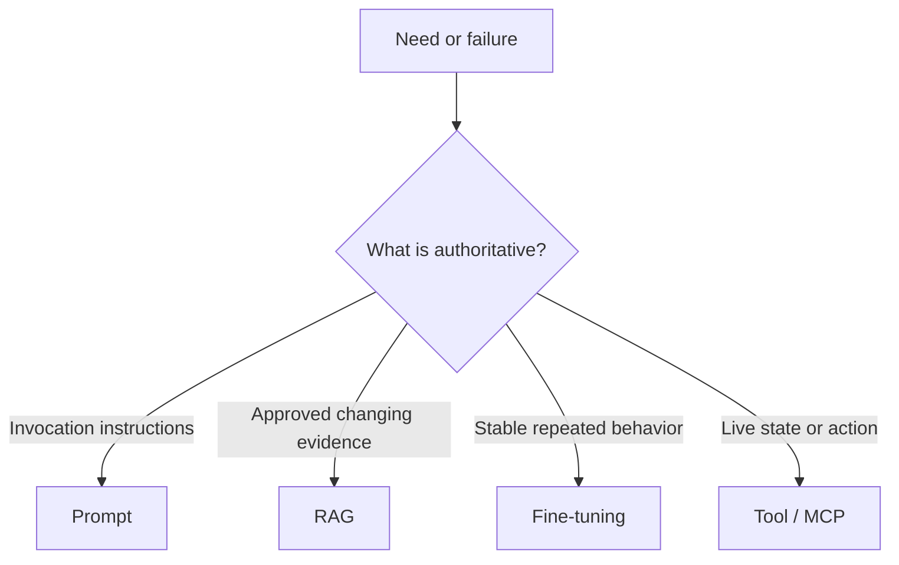

### Requirements and invariants

1. **Facts have an authority.** Current enterprise facts come from an approved source revision or a live system, not from model weights.
2. **Evidence is typed.** A passage and a live tool result carry different provenance and freshness semantics.
3. **Retrieval precedes generation, authorization precedes disclosure.** Filter by caller/tenant before evidence enters model context; do not retrieve broadly and redact later.
4. **Training changes behavior, not the source of truth.** Fine-tuning may improve a stable task, but frequently changing facts remain external.
5. **Capability is not permission.** Tool discovery and model selection never replace server-side authorization, host policy, or user confirmation.
6. **Side effects are explicit.** Classify read-only and mutating calls; use least privilege, bounded inputs, idempotency keys, and postcondition checks for mutations.
7. **Unsupported claims fail closed.** If required evidence is missing, stale, conflicting, or unauthorized, abstain or return a typed partial result.

## Example 1 — rollback instructions plus live health

An employee asks: **“How do I roll back payments, and is the deployment healthy now?”**

This is two questions with two authorities:

- The rollback procedure comes from the latest approved runbook revision accessible to the employee. Use RAG and cite the exact revision and section.
- Current health comes from a read-only deployment-status capability. Use a tool, authenticated for the employee's scope, and timestamp the observation.

Do not use a six-month-old “3/3 replicas ready” example embedded in the runbook as current status. Do not let the status tool invent rollback steps. Join the results only after preserving their separate provenance.

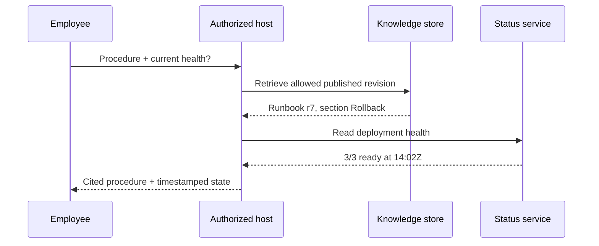

| Step | Evidence | Required validation | Failure response |
|---|---|---|---|
| 1 | Caller and tenant | Identity and scope are present | Reject before retrieval/tool use |
| 2 | Runbook r7 | Published, authorized, not superseded | Abstain from procedure |
| 3 | Status observation | Correct environment and freshness bound | Mark health unknown/stale |
| 4 | Generated answer | Every operational claim maps to evidence | Remove unsupported claim |

A useful evidence envelope keeps the authorities distinguishable:

```json
{
  "kind": "DOCUMENT",
  "authority": "kb://runbooks/payments",
  "subject": "payments/prod",
  "revision": "7",
  "observedAt": "2026-10-21T13:02:00Z",
  "freshUntil": null,
  "citation": "Rollback §2",
  "authorizationScope": "payments-operator:read"
}
```

The live result uses `kind: "LIVE_STATE"`, a status-service authority, an observation timestamp, and a short freshness deadline. It should not pretend to have a document revision.

## Example 2 — stable invoice classification

Suppose an accounts-payable team maps invoice text into a fixed schema and twelve stable categories.

1. Start with a prompt and an output schema. This is the cheapest test of task clarity.
2. Build an evaluation set before changing the model. Measure schema validity, per-class precision/recall, abstention, and human-review rate.
3. Retrieve current vendor or policy facts when classification depends on them. Those facts do not belong in weights.
4. Consider fine-tuning only after the task, labels, examples, and grader are stable and the prompt baseline misses the target consistently.

| Case | Prompt | RAG | Fine-tune | Tool |
|---|---:|---:|---:|---:|
| Put supplied invoice fields into JSON | Yes | No | Not initially | Deterministic schema validator |
| Decide category using today's vendor policy | Yes | Yes | Maybe for behavior | Policy lookup may be deterministic |
| Apply a stable nuanced taxonomy at high volume | Yes | If facts are external | Candidate after evals | Validator/review queue |
| Post the approved invoice | Yes | Maybe | Irrelevant to permission | Mutating finance tool with confirmation |

Fine-tuning is an optimization step, not an escape from unclear requirements. A model can emit syntactically valid JSON and still choose the wrong category; the evaluator must test business meaning.

## Example 3 — employee policy answer

Question: **“How much parental leave do I have?”**

The prompt can require a concise cited answer. RAG can retrieve the current policy, but retrieval must be filtered by country, employment class, effective date, and caller permissions. A payroll/HR tool may be required for the employee's eligibility or accrued balance. Fine-tuning cannot safely memorize either value.

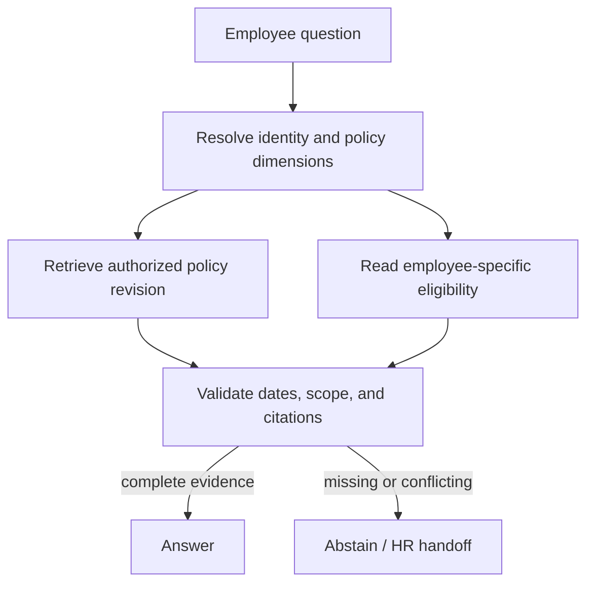

Trace a conflict instead of smoothing it away:

| Observation | Decision |
|---|---|
| Policy r12 says 16 weeks and is effective 2026-10-01 | Candidate policy fact |
| Employee record says country `CA`; policy r12 applies only to `US` | Reject r12 for this caller |
| No published CA revision is retrieved | Do not answer with 16 weeks |
| HR directory supplies a verified handoff | Return “unable to determine” plus the handoff |

## Example 4 — a side-effectful deployment tool

A model proposes `rollback(service="payments", environment="prod", revision="sha256:…")`. MCP can describe and transport that capability. It does not authorize the change.

Before invocation, the host and server should enforce:

- authenticated principal, exact environment scope, and server-side authorization;
- a trusted tool definition and constrained arguments;
- a visible summary of impact plus explicit confirmation where policy requires it;
- a single-use or time-bounded approval bound to the exact arguments;
- an idempotency key and operation record;
- a postcondition read showing the deployed immutable revision;
- audit data that separates proposer, approver, caller, and executor.

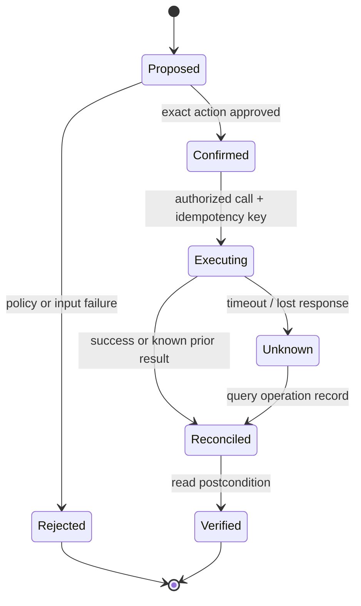

A timeout is not proof that the rollback failed. Retry only with the same idempotency key, or query the operation record first. Never generate a fresh operation identity for an ambiguous prior attempt.

## Executable routing contract

[`EvidenceRouting.java`](EvidenceRouting.java) turns the distinctions into a small Java 17 contract. Its output is intentionally a plan, not an answer: it selects evidence mechanisms, records safeguards, and rejects unsafe mutations before any model or external service is called.

Run it from this directory:

```bash
java -ea EvidenceRouting.java
```

The four scenario groups assert:

1. approved procedure plus live state routes to RAG and a read-only tool;
2. stable extraction starts with prompting and adds fine-tuning only when requested;
3. current policy uses RAG and does not mistake fine-tuning for freshness;
4. a production mutation requires authorization, confirmation, and an idempotency key.

## 2. Model mechanics you need for system design

A model request crosses three separate contracts: **tokens** decide whether the request fits, **embeddings** decide which items can be compared, and **generation settings plus evaluators** decide how output is produced and accepted. Character count, vector shape alone, and exact-string tests are unsafe substitutes.

### Requirements and invariants

1. **Measure with the deployed tokenizer.** Count the fully serialized request—including system and tool instructions, history, separators, evidence, and the user turn—with the tokenizer and chat template for the exact model revision. A character or word estimate may alert, but must not be the admission authority.
2. **Reserve before retrieval.** Let `E = W - F - O - R`, where `W` is the tested context window, `F` is fixed encoded input, `O` is the maximum generated output, and `R` is a safety reserve. Admit evidence only while its measured encoded size fits `E`; reject an overcommitted fixed budget before the model call.
3. **Treat embedding identity as schema.** Store model revision, dimension, normalization, preprocessing, and index generation. Query and corpus identities must match exactly. Re-embed or run an explicit versioned migration; never compare vectors from assumed-compatible spaces.
4. **Validate vector math.** Reject dimension mismatch, non-finite values, and zero vectors. Cosine similarity ranks directions; it is not a probability that a passage is correct or that an answer is supported.
5. **Make sampling state explicit.** Sampling mode determines whether temperature is effective. Record model revision, effective decoding parameters, seed when available, and backend fingerprint. A seed can improve repeatability but is not a proof of identical output across software or hardware changes.
6. **Evaluate meaning, not prose identity.** Gate production output on schema, supported claims, allowed citations, and task-specific checks. A valid paraphrase may differ byte-for-byte; a fluent unsupported answer must fail.

## Example 1 — admit evidence within a 16,000-token budget

Assume the deployed model and template have a tested 16,000-token window. The serialized system/tool instructions, history, and user turn consume 3,500 tokens; the response allowance is 3,000; and operations reserve 1,500 for template drift and bounded retries. Evidence capacity is therefore `16,000 - 3,500 - 3,000 - 1,500 = 8,000` tokens.

Three authorized chunks are ranked: runbook r7 (`4,800`, score `0.92`), incident 42 (`3,500`, `0.88`), and an older runbook (`2,600`, `0.41`). Deterministic greedy admission takes r7, skips incident 42 because `4,800 + 3,500 > 8,000`, then takes the older runbook for `7,400` total. Retrieval score does not override the hard budget.

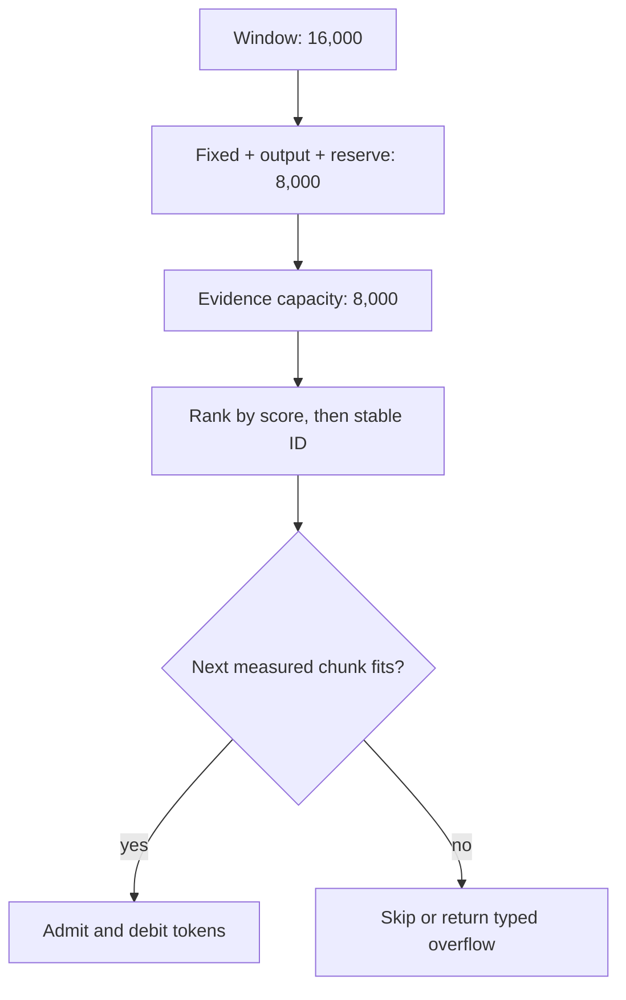

Trace and failure boundary:

| Step | Used before | Candidate | Decision | Used after |
|---|---:|---:|---|---:|
| 1 | 0 | runbook r7: 4,800 | Admit | 4,800 |
| 2 | 4,800 | incident 42: 3,500 | Skip; would reach 8,300 | 4,800 |
| 3 | 4,800 | old runbook: 2,600 | Admit | 7,400 |

In a real retriever, stale or superseded material should normally be excluded before ranking; it is present here only to expose the arithmetic. If `F + O + R > W`, do not truncate instructions silently—return a typed over-budget result.

## Example 2 — cosine ranks direction, not truth

For query `q = [1, 0]`, normalized document `a = [0.8, 0.6]` has cosine `0.8`; document `b = [0, 1]` has cosine `0`. The first ranks closer in this toy space. Neither score proves that the document is current, authorized, or sufficient to support an answer.

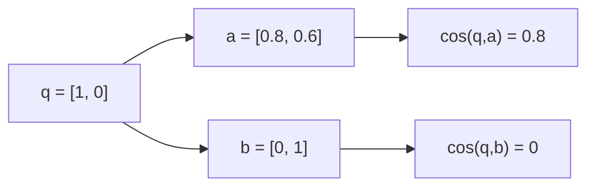

The implementation computes `dot(q,d) / (||q|| ||d||)` and rejects a zero norm because cosine would be undefined. It also rejects non-finite values and unequal dimensions before ranking. Authorization, freshness, reranking, and claim support remain later and separate checks.

## Example 3 — prevent a silent cross-generation embedding join

An index was built with identity `(embed-v3@2026-09-01, 1536, L2, utf8+nfc, generation 7)`. A new query service starts emitting generation 8 vectors. Even if dimension and model family names match, the request fails closed because its complete identity differs.

```mermaid
sequenceDiagram
    participant Q as Query service
    participant G as Compatibility gate
    participant I as Vector index
    Q->>G: vector + identity generation 8
    G->>I: read index identity
    I-->>G: generation 7
    G-->>Q: incompatible identity; do not search
    Note over Q,I: Rebuild, dual-read, or route to matching generation
```

A safe migration builds a new generation, evaluates it independently, then switches traffic or dual-reads with metrics. It does not mix old corpus vectors and new query vectors in one similarity calculation, and it keeps the prior generation addressable for rollback.

## Example 4 — deterministic configuration is not deterministic acceptance

Suppose release metadata records `(answer-v5, sampling=false, temperature=0, seed=73, backend=backend-a9)`. Greedy decoding and a seed reduce one source of variation, but library, kernel, device, and provider backend changes can still change output. A new backend fingerprint therefore triggers evaluation rather than a claim of byte-identical replay.

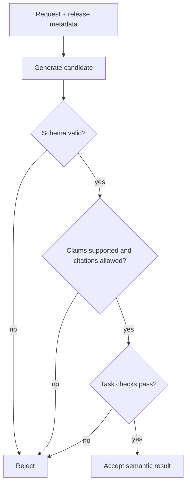

Two answers can both pass while using different wording. Conversely, valid JSON that cites an unauthorized source fails. If sampling is disabled, this guide records temperature as zero rather than carrying a misleading inactive value; when sampling is enabled, temperature changes the probability distribution used to select tokens.

## Executable model-mechanics contract

[`ModelMechanics.java`](ModelMechanics.java) implements the token ledger, deterministic evidence admission, embedding identity gate, guarded cosine function, explicit generation configuration, and semantic acceptance predicate.

Run both contracts from this directory:

```bash
java -ea EvidenceRouting.java
java -ea ModelMechanics.java
```

`ModelMechanics` exercises thirteen scenario groups: valid and invalid context budgets, ranked admission, cosine examples and malformed vectors, same- and cross-generation embedding identities, explicit decoding settings, and semantic acceptance versus fluent unsupported output.

## 3. Ingestion is a data pipeline, not a file-upload callback

An upload is only an immutable input revision. Publication is a separate, asynchronous decision reached after bounded parsing, provenance-preserving chunking, embedding, staging, and validation. This separation makes retries safe, keeps malformed inputs away from serving indexes, and prevents delayed work from replacing newer knowledge.

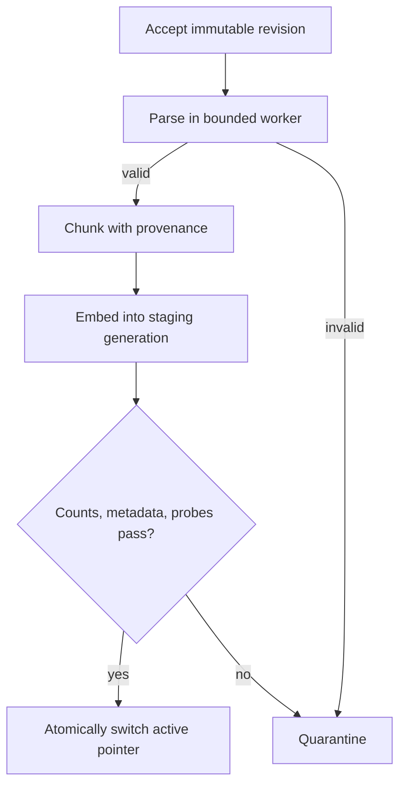

### Requirements and invariants

1. **Identity has distinct dimensions.** Keep tenant, stable document ID, immutable revision, content hash, source URI, parser/chunker/model versions, ACL version, and chunk location separate. A content hash detects byte equality; it does not replace document identity or authorization.
2. **The complete transformation tuple is idempotent.** At minimum, key work by `(tenant, document, revision, parser version, chunker version, embedding model)`. A retry returns or resumes the same durable job and outputs; it does not append another copy.
3. **Revision publication is monotonic.** A delayed revision 6 job cannot replace active revision 8. Enforce the comparison where the authoritative pointer is changed, inside one transaction or equivalent compare-and-set operation.
4. **Parsing is hostile-input processing.** Validate allowed type and extension independently, generate storage names, keep inputs outside the serving path, and cap compressed bytes, expanded bytes, pages, nested items, elapsed time, and output metadata. Isolate parsing with narrow network and filesystem access.
5. **Structure and provenance survive extraction.** Preserve page, section, headings, table headers, code symbol/language, source revision, and offsets. A warning must not be separated from the instruction it qualifies.
6. **Chunk settings are measured configuration.** Record tokenizer, size, overlap, boundary strategy, and parent relation. Evaluate recall and citation completeness on representative questions; there is no universally optimal window.
7. **Only a coherent generation is queryable.** Write and validate a staging generation, then atomically switch one active pointer. Readers use one generation unless mixed-version semantics are deliberately specified and tested.
8. **Deletion and ACL changes invalidate derived state.** Tombstone source revisions and remove or invalidate vectors, extracted text, caches, and summaries. Recheck authorization at read time and include an authorization epoch or equivalent freshness token in cache identity.

## Example 1 — retry safely and reject a delayed old revision

The payments runbook has stable document ID `payments`. Revision 7 is ingested with tuple `(acme, payments, 7, tika-4.1, heading-v3, embed-v5)`. A worker loses its acknowledgement after creating `job-1`; the client retries the exact tuple. The registry returns `job-1`, not `job-2`.

Revision 8 then publishes generation `g18`. Much later, a revision 6 worker finishes. Its chunks may be retained for diagnosis, but the authoritative publication check records the job as `SUPERSEDED`; active revision 8 remains unchanged.

```mermaid
sequenceDiagram
    participant C as Ingestion client
    participant J as Job registry
    participant W as Worker
    participant A as Active pointer
    C->>J: accept tuple for revision 7
    J-->>C: job-1
    C->>J: retry same tuple
    J-->>C: job-1
    W->>A: publish revision 8 / g18
    A-->>W: active = revision 8
    W->>A: delayed publish revision 6 / g16
    A-->>W: SUPERSEDED; active unchanged
```

| Event | Durable check | Result |
|---|---|---|
| First revision 7 acceptance | No row for complete tuple | Create `job-1` |
| Retry after lost response | Unique tuple already maps to `job-1` | Return/resume `job-1` |
| Revision 8 publication | `8 >= active revision 7` and staging passed | Switch active pointer to `g18` |
| Delayed revision 6 publication | `6 < active revision 8` | Mark superseded; do not switch |

A database implementation can use a unique constraint plus `INSERT ... ON CONFLICT` for job identity. Publication still needs an atomic conditional update or locked transaction; an upsert by itself does not express “only if this revision is not older.”

## Example 2 — parse layout under explicit resource limits

An HTTP endpoint receives `pricing.pdf`. It validates the declared extension, detected media type, authorization, and a 10 MB input limit; stores the bytes under a generated name outside the web root; records a hash and immutable revision; enqueues a job; and returns `202 Accepted` with the job ID. It does not hold an application transaction open while OCR runs.

The isolated worker has limits of 100 MB expanded content, 500 pages, and 30 seconds. A normal 2 MB PDF expands to 18 MB and 42 pages, so parsing proceeds. A crafted 2 MB archive attempts to expand to 120 MB, so the worker stops, marks the revision `QUARANTINED`, and publishes nothing.

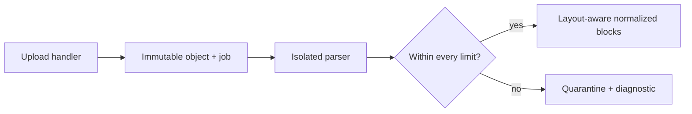

| Observation | Limit | Decision |
|---|---:|---|
| Compressed bytes `2,000,000` | `10,000,000` | Continue |
| Expanded bytes `18,000,000` | `100,000,000` | Continue |
| Pages `42` | `500` | Continue |
| Elapsed time `1,900 ms` | `30,000 ms` | Continue |
| Alternate expanded bytes `120,000,000` | `100,000,000` | Stop and quarantine |

Successful extraction is not merely a string. A pricing-table row carries its column headers; a code block carries repository, revision, path, language, and symbol; a two-column PDF retains reading order and page; and OCR output is labeled as OCR-derived. Representative golden files should detect silent layout regressions when a parser changes.

## Example 3 — calculate windows and protect a warning boundary

For a 4,000-token normalized document, window size 600 and overlap 100 produce stride `600 - 100 = 500`. Starts are `0, 500, 1000, 1500, 2000, 2500, 3000, 3500`, so there are eight windows. The first is `[0,600)` and the last is `[3500,4000)`, only 500 tokens long. Total indexed token occurrences are `7 × 600 + 500 = 4,700`: overlap adds 700 occurrences, or 17.5% over the source length.

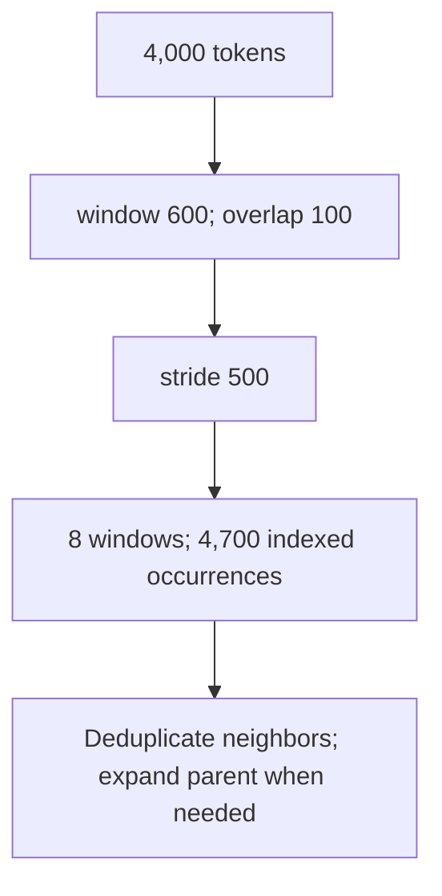

| Window | Range | Size | Boundary note |
|---:|---:|---:|---|
| 0 | `[0,600)` | 600 | Full window |
| 1 | `[500,1100)` | 600 | Repeats 100 tokens from window 0 |
| 6 | `[3000,3600)` | 600 | May contain the migration warning |
| 7 | `[3500,4000)` | 500 | Must not return rollback steps without their warning |

If “Do not roll back after migration M42 without the recovery procedure” ends near token 3,550 and the next passage begins “Restore the previous image,” overlap alone may still rank the incomplete passage first. Heading-aware boundaries, a warning-to-procedure parent relation, parent expansion, and adjacent-hit deduplication solve different problems from merely raising top-k. Compare configurations such as 300/600/900 tokens and 10–20% overlap using task-specific recall and complete-citation checks.

## Example 4 — validate, publish, revoke, and delete coherently

Generation `g18` for revision 8 expects eight chunks. The first validation observes seven, so publication fails and readers remain on `g17`. After repair, `g18` has eight chunks, complete provenance/ACL metadata, and passes retrieval probes. A single authoritative pointer change makes `g18` visible; readers never observe half of `g17` and half of `g18`.

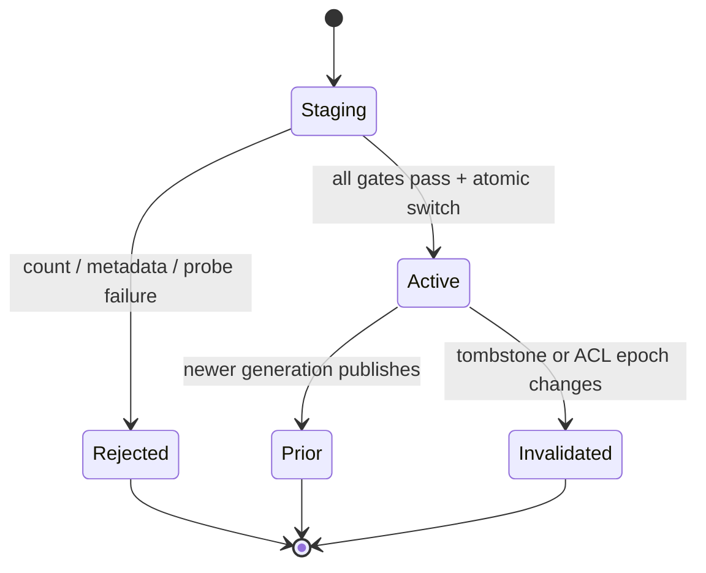

| Stage | Expected / observed | Pointer | Serve? |
|---|---|---|---|
| First `g18` validation | 8 / 7 chunks | `g17` | No from `g18` |
| Repaired `g18` validation | 8 / 8 + metadata + probe pass | atomically `g17 → g18` | Yes from `g18` |
| ACL revocation | authorization epoch `12 → 13` | `g18` | Old epoch cache entry: no |
| Delete revision 8 | tombstone through revision 8 | `g18` until cleanup/next publish | Revision 8: no |

An ACL change can invalidate authorization without changing document bytes, so the content hash is not a sufficient cache key. Likewise, a tombstone must outrank a stale replica or cache. Retaining `g17` for rollback does not authorize serving content that has since been deleted or revoked.

## Executable ingestion contract

[`IngestionContracts.java`](IngestionContracts.java) implements the complete idempotency tuple, monotonic publication, bounded parse observations, deterministic windows, staging validation, atomic active views, tombstones, and authorization epochs.

Run all three contracts from this directory:

```bash
java -ea EvidenceRouting.java
java -ea ModelMechanics.java
java -ea IngestionContracts.java
```

`IngestionContracts` exercises twelve scenario groups: retry identity; revision 7/8 publication; a delayed revision 6; normal and expansion-bomb parsing; the exact eight-window trace; failed then successful generation publication; fresh, revoked, and deleted reads; and quarantine isolation.

## 4. Retrieval internals: lexical, vector, hybrid, and reranking

Retrieval is a staged decision, not one similarity call. Lexical and vector systems create candidates with different strengths and incomparable raw scores. Fusion combines their **positions** or calibrated evidence, a bounded reranker spends more compute on a small authorized set, and the context builder still decides which passages are safe, current, diverse, and affordable enough to send to generation.

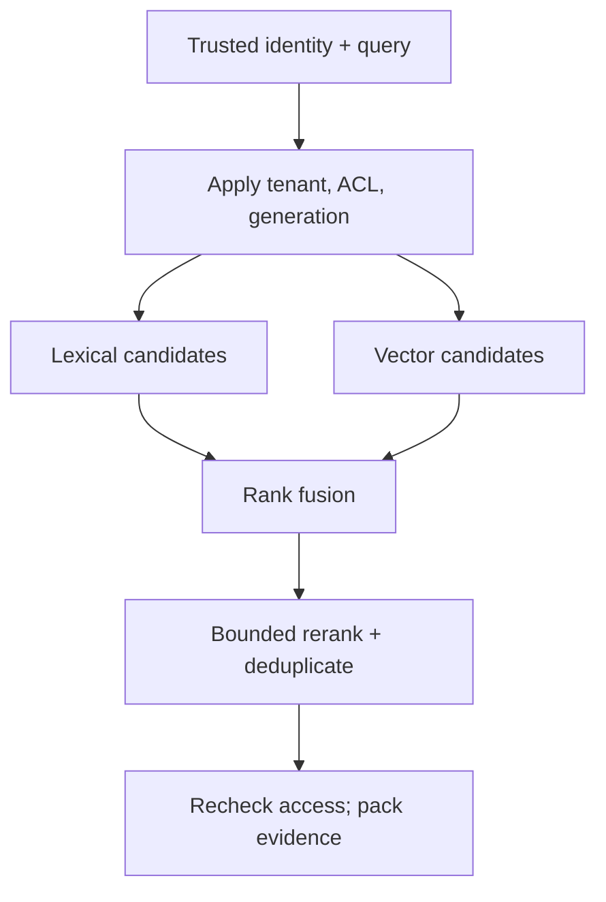

### Requirements and invariants

1. **Scope precedes scoring and disclosure.** Derive tenant and access scope from validated identity, not prompt text. Exclude ineligible rows before ranking whenever the engine supports it, and always recheck before text crosses a process or provider boundary.
2. **Analyzer behavior is part of the lexical schema.** Record field, tokenizer, case folding, stemming, synonyms, and index revision. Preserve a keyword field for identifiers such as `ERR_PAY_042`; do not assume a prose analyzer preserves punctuation or dots.
3. **Exact vector search is the recall oracle.** Approximate indexes trade recall for latency or memory. Compare HNSW/IVFFlat results with exact search on representative, authorization-filtered queries and report recall by important slice.
4. **Embedding and distance contracts match the index.** Model identity, dimension, normalization, distance operator, and index generation must agree. A high similarity is a ranking signal, not evidence of authorization, freshness, or factual support.
5. **Capacity includes operational overhead.** Raw coordinates are only a floor. Budget graph/list structures, tuples, text, metadata, write-ahead logging, replicas, backups, build headroom, and temporary query memory.
6. **Never add unrelated raw scores blindly.** BM25, cosine, dot-product, and reranker scores have different scales. Use a validated calibration or a rank method such as reciprocal rank fusion (RRF), with deterministic tie-breaking.
7. **Reranking has hard budgets and a typed fallback.** Bound candidate count, input tokens, batch size, deadline, and model revision. On timeout, return the deterministic fused order or a typed failure; do not silently widen access or wait without limit.
8. **Every stage is observable and evaluable.** Record candidate IDs and ranks, not confidential text, plus index/analyzer/model versions, filters, timing, fallback, and final selections. Evaluate retrieval recall, rank quality, security, latency, and cost separately.

## Example 1 — exact error code: lexical search earns its place

Query: **“What does `ERR_PAY_042` mean?”** The corpus contains an exact runbook passage, a semantically broad payments overview, and a confidential passage for another tenant. The trusted tenant is `acme`.

The lexical field lowercases while retaining underscores, so the query term remains `err_pay_042`. The exact runbook matches; the generic overview does not. The other-tenant passage must be removed by trusted scope even though it contains the same identifier. A separate keyword field can preserve the original code for an exact term query, while the prose field continues to support normal language.

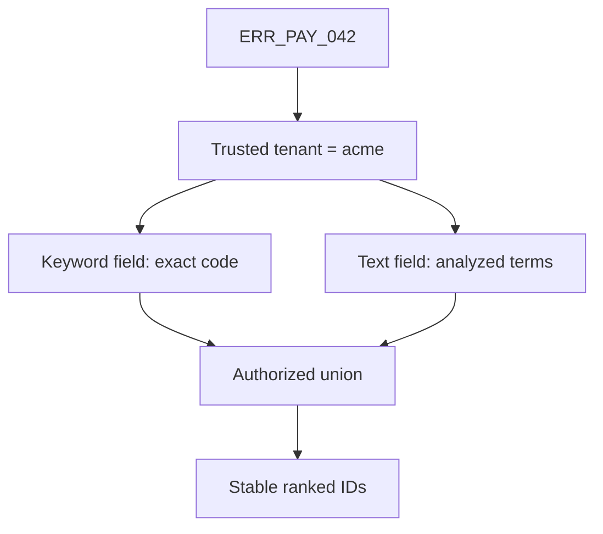

For a simple term, Lucene's BM25 implementation uses

`idf = log(1 + (docCount - docFreq + 0.5) / (docFreq + 0.5))`.

Its `k1` controls term-frequency saturation and `b` controls document-length normalization. Those parameters do not repair a destructive analyzer: if tokenization loses the identifier, scoring never sees it.

| Candidate | Trusted tenant? | Analyzed exact term? | Semantic theme? | Decision |
|---|---:|---:|---:|---|
| `pay-code` | Yes | Yes | Yes | Strong lexical candidate |
| `pay-overview` | Yes | No | Yes | Vector candidate; not an exact-code lexical hit |
| `beta-secret` | No | Yes | Yes | Exclude before result text is exposed |

`RetrievalContracts.bm25` is an inspectable teaching oracle using `k1=1.2`, `b=0.75`, unique query terms, corpus document frequency, average field length, and stable ID tie-breaking. A production Lucene/OpenSearch/Elasticsearch score must come from that engine's configured analyzer and index statistics; do not claim byte-for-byte parity with this small reference.

## Example 2 — exact vectors define recall; ANN earns latency

Suppose the authorized corpus contains one million 768-dimensional `float32` embeddings. Raw coordinates require

`1,000,000 × 768 × 4 = 3,072,000,000 bytes ≈ 2.861 GiB`.

That number excludes every index and operational cost. HNSW adds a multilayer proximity graph and usually spends more memory/build time for a strong speed–recall trade-off. IVFFlat partitions vectors into trained lists and searches selected lists; its probes setting trades work for recall. Distribution drift, sparse tenant filters, and index settings can all change observed recall.

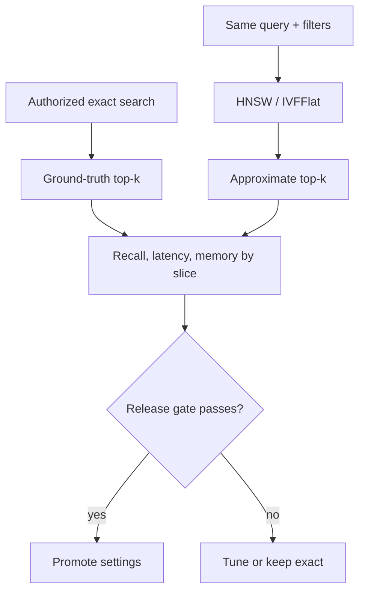

Trace the acceptance decision rather than asserting “ANN is fast”:

| Check | Exact baseline | Candidate ANN | Gate |
|---|---:|---:|---|
| Authorized relevant IDs recovered | 50 / 50 | 48 / 50 | Recall@50 = 0.96 |
| Rare error-code slice | 10 / 10 | 7 / 10 | Fail if slice floor is 0.90 |
| p95 retrieval latency | 180 ms | 28 ms | Pass a 40 ms target |
| Returned rows | All `acme`, active generation | All `acme`, active generation | Mandatory |

The overall recall looks acceptable, but the rare-code slice fails. Possible repairs include better hybrid candidate generation, a larger HNSW search breadth, more IVFFlat probes, partitioning, or an exact path for small authorized subsets. Removing the authorization predicate is never a recall optimization.

The Java contract performs exact cosine ranking only after trusted-tenant filtering and rejects non-finite, zero, and dimension-mismatched vectors. It calculates raw capacity with checked multiplication so an overflow cannot become a plausible-looking budget.

## Example 3 — fuse ranks, not BM25 and cosine magnitudes

Lexical and vector retrievers return these independent ranks:

| Rank | Lexical | Vector |
|---:|---|---|
| 1 | A | B |
| 2 | X | C |
| 3 | B | D |
| 4 | Y | A |

RRF uses `RRF(d) = Σ 1 / (k + rank_i(d))`, with ranks starting at one and zero contribution when a document is absent. At `k=60`:

- A: `1/61 + 1/64 = 0.0320184426…`
- B: `1/63 + 1/61 = 0.0322664585…`

B wins narrowly because it is first in one list and third in the other. No conversion between a BM25 score and a cosine value was required.

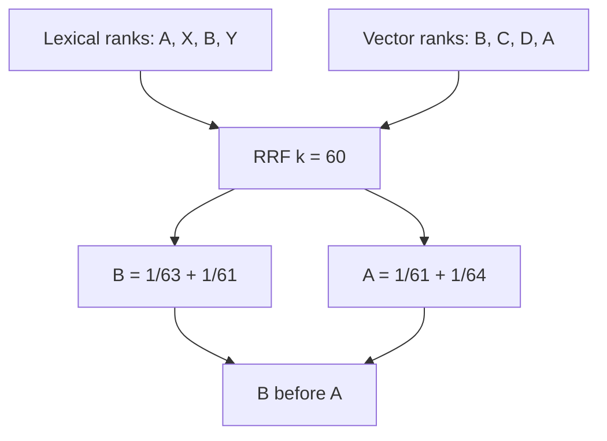

| Failure boundary | Why it matters | Contract |
|---|---|---|
| Same ID appears twice in one child list | Ambiguous rank contribution | Reject the malformed ranking |
| Rank constant is zero/negative | Invalid formula/configuration | Reject before serving |
| Two fused scores tie | Runtime/map order could leak into output | Break ties by stable document ID |
| Child windows are too small | Useful candidates never reach fusion | Evaluate window size and recall |

RRF is a strong baseline, not proof that every query benefits from hybrid search. Keep per-retriever and fused metrics, tune the rank window and constant on labeled queries, and preserve independent child ranks for diagnosis.

## Example 4 — authorize, budget, rerank, and fall back

A fused list for tenant `acme` contains five candidates. The external cross-encoder budget is three candidates and 1,000 estimated tokens.

| Candidate | Tenant / ACL | Fused score | Reranker score | Tokens | Before reranker |
|---|---|---:|---:|---:|---|
| `beta-secret` | `beta` / allow | 0.050 | 1.00 | 100 | Exclude: wrong trusted tenant |
| `revoked` | `acme` / deny | 0.040 | 1.00 | 100 | Exclude: ACL denies |
| `runbook-r7` | `acme` / allow | 0.032 | 0.71 | 420 | Admit |
| `incident-42` | `acme` / allow | 0.031 | 0.94 | 500 | Admit |
| `long-appendix` | `acme` / allow | 0.030 | 0.99 | 900 | Skip: would exceed 1,000 tokens |

Only `runbook-r7` and `incident-42` cross the reranker boundary, consuming 920 tokens. If the cross-encoder completes, it orders `incident-42` before `runbook-r7`. If it times out, the system returns the fused order—`runbook-r7`, then `incident-42`—with `usedFallback=true`. The secret, revoked, and over-budget candidates never become reranker inputs.

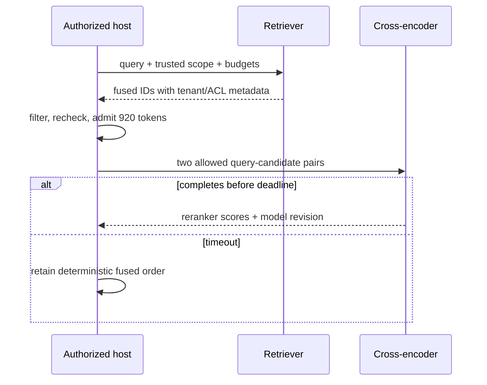

A cross-encoder jointly attends to the query and each candidate, which can improve ordering but is too expensive for corpus-wide scoring. It is a second-stage ranker, not an authorization service. Log model revision, admitted IDs, deadline/fallback, and score order; avoid logging confidential text merely to debug ranking.

## Executable retrieval contract

[`RetrievalContracts.java`](RetrievalContracts.java) implements the teaching BM25 oracle, exact tenant-scoped cosine ranking, checked vector-capacity arithmetic, deterministic RRF, and an authorization-first bounded reranker with timeout fallback.

Run all four contracts from this directory:

```bash
java -ea EvidenceRouting.java
java -ea ModelMechanics.java
java -ea IngestionContracts.java
java -ea RetrievalContracts.java
```

`RetrievalContracts` exercises thirteen scenario groups: exact identifier retrieval; invalid BM25 parameters; tenant-scoped exact vectors; cosine validation; decimal/GiB capacity and overflow; the exact A/B RRF trace; malformed child ranks; authorization and token admission before reranking; successful reorder; timeout fallback; and invalid budget rejection.

## Failure-oriented review

| Tempting shortcut | Broken assumption | Repair |
|---|---|---|
| “The model probably knows the policy” | Weights are current and authoritative | Retrieve a published revision and cite it |
| “Vector search means RAG” | One retrieval algorithm defines the system | Specify authority, filtering, retrieval, evidence, and generation |
| “Fine-tune with the handbook” | Training is a reliable mutable database | Keep facts external; tune stable behavior only after evals |
| “The tool is listed, so it is allowed” | Discovery equals authorization | Enforce host policy, consent, and server authorization |
| “The tool timed out, so retry” | No response means no side effect | Reconcile by idempotency key and operation record |
| “JSON is valid, so the answer is correct” | Syntax proves semantics | Validate claims, citations, business rules, and postconditions |
| “The upload returned 200, so it is searchable” | Storage equals validated publication | Return a job; parse, stage, validate, then switch generations |
| “The same filename is the same document” | Filename provides stable identity and revision ordering | Store stable document ID, immutable revision, hash, and transform tuple |
| “Overlap fixes every bad boundary” | Redundancy guarantees complete meaning | Preserve structure; evaluate parent expansion and deduplication |
| “Delete the vector row and we are done” | No derived or cached copy can survive | Tombstone and invalidate text, vectors, summaries, caches, and ACL state |
| “Cosine replaces keyword search” | Semantic proximity preserves exact codes and names | Keep an analyzed lexical baseline and keyword fields |
| “ANN is close enough” | Average recall covers filtered and rare-query slices | Compare with exact search using the same trusted scope |
| “Add BM25 and cosine scores” | Their numeric scales are directly comparable | Calibrate explicitly or fuse ranks such as RRF |
| “Rerank everything, then remove secrets” | Text is safe until the final answer is shown | Filter and recheck before any reranker/model boundary |
| “A reranker timeout should widen top-k” | More candidates are always safer | Use the bounded deterministic fallback and expose it |

## Primary references

- Lewis et al., [Retrieval-Augmented Generation for Knowledge-Intensive NLP Tasks](https://arxiv.org/abs/2005.11401) (2020).
- Model Context Protocol, [Architecture overview](https://modelcontextprotocol.io/docs/2026-07-28/learn/architecture) and [2026-07-28 specification](https://modelcontextprotocol.io/specification/2026-07-28).
- Model Context Protocol, [Tools](https://modelcontextprotocol.io/specification/2026-07-28/server/tools) and [authorization guidance](https://modelcontextprotocol.io/docs/2026-07-28/tutorials/security/authorization).
- OpenAI, [Model optimization](https://developers.openai.com/api/docs/guides/model-optimization) and [supervised fine-tuning](https://developers.openai.com/api/docs/guides/supervised-fine-tuning). Product availability is time-sensitive; the architectural rule here is provider-independent.
- OpenAI, [`tiktoken`](https://github.com/openai/tiktoken) tokenizer and [encoding API](https://github.com/openai/tiktoken/blob/main/tiktoken/core.py).
- OpenAI, [Embeddings guide](https://developers.openai.com/api/docs/guides/embeddings), [embeddings API](https://developers.openai.com/api/reference/resources/embeddings/methods/create), and [retrieval guide](https://platform.openai.com/docs/guides/retrieval). Provider-specific dimensions and limits are configuration, not architectural constants.
- Hugging Face Transformers, [generation configuration](https://huggingface.co/docs/transformers/main_classes/text_generation) and [generation strategies](https://huggingface.co/docs/transformers/generation_strategies).
- PyTorch, [Reproducibility](https://docs.pytorch.org/docs/stable/notes/randomness.html) and [`use_deterministic_algorithms`](https://docs.pytorch.org/docs/stable/generated/torch.use_deterministic_algorithms.html).
- NIST, [AI RMF Generative AI Profile](https://doi.org/10.6028/NIST.AI.600-1) (2024).
- OWASP Cheat Sheet Series, [File Upload Cheat Sheet](https://cheatsheetseries.owasp.org/cheatsheets/File_Upload_Cheat_Sheet.html) (accessed 2026-10-22).
- Apache Tika 4.x, [Tika Server security guidance](https://tika.apache.org/docs/4.0.x/using-tika/server/index.html), [unpack safety limits](https://tika.apache.org/docs/4.0.x/pipes/unpack-config.html), and [metadata limits](https://tika.apache.org/docs/4.0.x/migration-to-4x/metadata-changes-4x.html) (accessed 2026-10-22).
- PostgreSQL 18, [`INSERT ... ON CONFLICT`](https://www.postgresql.org/docs/current/sql-insert.html), [transaction isolation](https://www.postgresql.org/docs/current/transaction-iso.html), and [explicit locking](https://www.postgresql.org/docs/current/explicit-locking.html) (accessed 2026-10-22).
- Apache Lucene 10.5.1, [`BM25Similarity`](https://lucene.apache.org/core/10_5_1/core/org/apache/lucene/search/similarities/BM25Similarity.html) (accessed 2026-10-23).
- pgvector, [exact and approximate search, HNSW, IVFFlat, filtering, and iterative scans](https://github.com/pgvector/pgvector) (accessed 2026-10-23).
- Elasticsearch, [reciprocal rank fusion](https://www.elastic.co/docs/reference/elasticsearch/rest-apis/reciprocal-rank-fusion) (accessed 2026-10-23).
- Sentence Transformers, [retrieve-and-rerank pipeline](https://sbert.net/examples/sentence_transformer/applications/retrieve_rerank/README.html) (accessed 2026-10-23).

## Source provenance and continuation

- Selected source: `ai_platform_master_guide.html`, SHA-256 `c0d23c3a9b64d88e8ad52720402b162c124283958aa7ad0afe228f9a4bc2b24a`, expanded 21-chapter standalone edition.
- Companion editable source: bundle member `02_rag_mcp.md`, SHA-256 `45896b5283ca92e712f7cb3db075b0f076edfaeff34d9127cd867520ff5dfa05`.
- Compared source: `ai_platform_engineering_illustrated.html`, SHA-256 `006aaba7bfaf978849a5fe1df6a8e9f611c0d99a806ef6c3a05c3eeb2101beb9`; it is byte-identical to the HTML inside the bundle and is not promoted as a duplicate guide.
- Processed range: Chapters 1–4, through `Retrieval internals: lexical, vector, hybrid and reranking`, bounded by Chapter 5.
- Chapter 2 source comparison: the selected master and bundled editable companion contain the same token, embedding, and generation material; no duplicate guide was created.
- Chapter 3 source comparison: selected master lines 96–138 and editable companion lines 65–127 agree on versioned ingestion, bounded parsing, chunking, publication, and deletion; the companion was used for editable structure, not promoted as a duplicate guide.
- Chapter 4 source comparison: selected master lines 139–168 and editable companion lines 129–178 agree on BM25, exact and approximate vectors, capacity, RRF, reranking, and authorization-before-disclosure; the companion was used for editable structure, not promoted as a duplicate guide.
- Next bounded section: Chapter 5, `PostgreSQL data design for a production RAG store` (after the recorded domain rotation).

