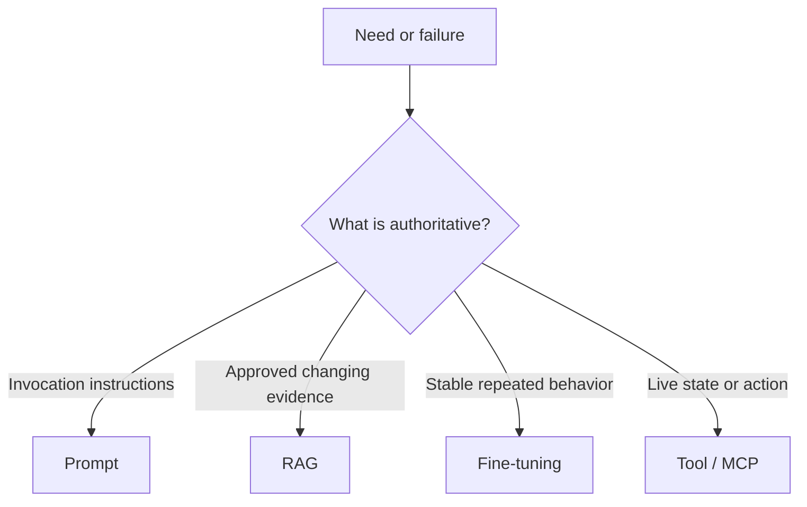
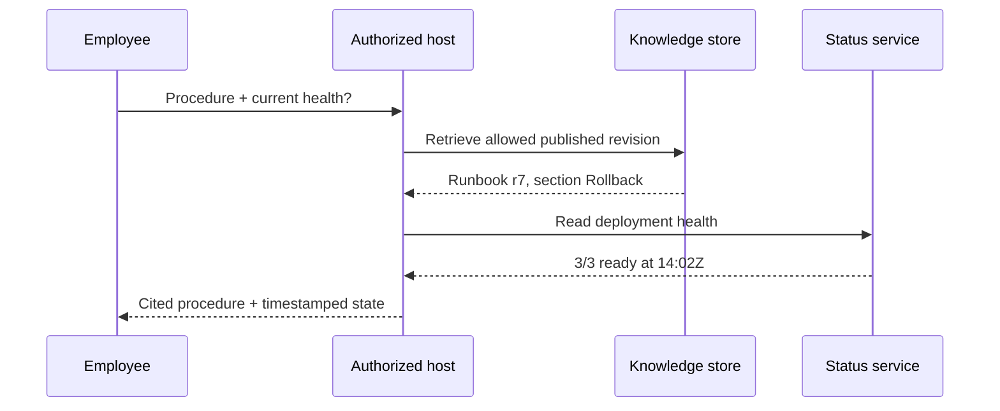
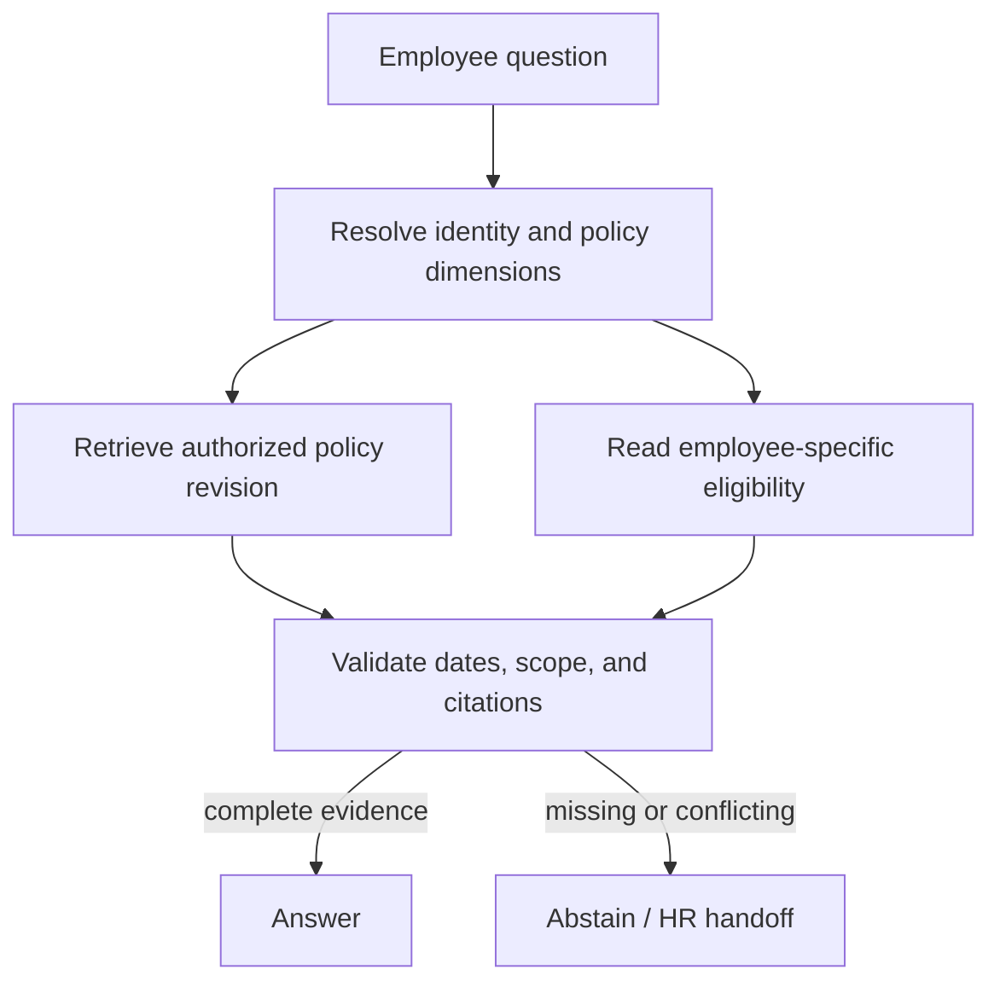
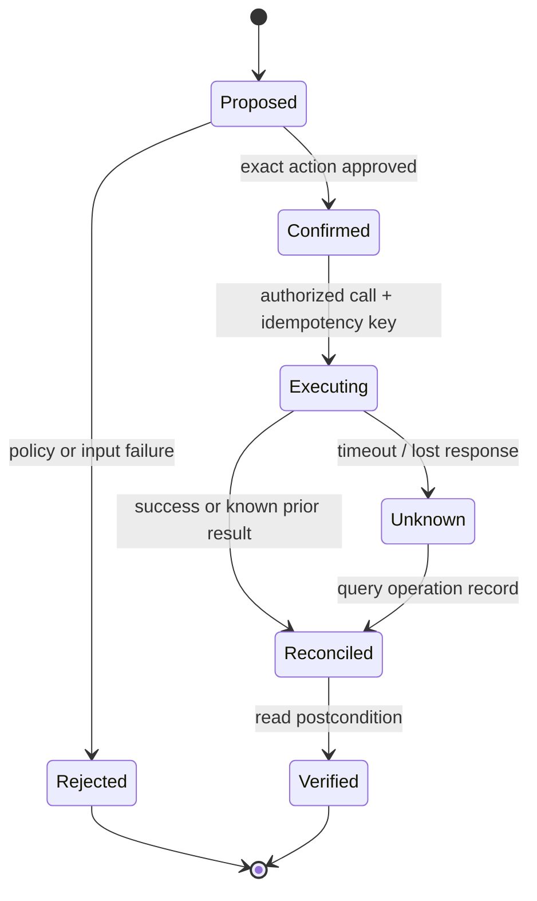

# AI Platform Engineering

> Canonical incremental guide. This pass processes only source Chapter 1, “Four things engineers often confuse.” Later source chapters remain queued.

## 1. Choose prompting, RAG, fine-tuning, and tools by authority

The mechanisms are complementary. The useful first question is not “Which AI technique is newest?” but **“What must change, and which system is authoritative for that change?”**

| Mechanism | What changes | Use it for | It does **not** grant |
|---|---|---|---|
| Prompting | Instructions and request context | A one-off task, output shape, constraints, or a baseline before optimization | Current private facts, durable learning, or permission |
| Retrieval-augmented generation (RAG) | Evidence selected at request time | Approved documents, policies, source code, catalog facts, and citations | Correct retrieval, correct reasoning, or authorization |
| Fine-tuning | Model behavior through training | Repeated, stable behavior whose success can be evaluated on held-out examples | A reliable database of changing facts |
| Tool calling / MCP | Access to an external capability | Live state, deterministic computation, and controlled actions | Blanket authority to invoke every exposed operation |

The original RAG work describes generation that combines parametric memory with retrieved non-parametric memory. That history matters, but a production definition should stay broader: retrieval may be lexical, vector, SQL, graph-based, or hybrid. A vector database is an implementation choice, not the definition of RAG.

MCP standardizes how an AI application and capability server exchange tools, resources, and other context. In the current `2026-07-28` specification, the protocol core is stateless; the surrounding application can still keep state. A server exposing a tool does not make the model the network or authorization boundary. The host/client remains responsible for policy, consent, credentials, result handling, and audit.



### Requirements and invariants

1. **Facts have an authority.** Current enterprise facts come from an approved source revision or a live system, not from model weights.
2. **Evidence is typed.** A passage and a live tool result carry different provenance and freshness semantics.
3. **Retrieval precedes generation, authorization precedes disclosure.** Filter by caller/tenant before evidence enters model context; do not retrieve broadly and redact later.
4. **Training changes behavior, not the source of truth.** Fine-tuning may improve a stable task, but frequently changing facts remain external.
5. **Capability is not permission.** Tool discovery and model selection never replace server-side authorization, host policy, or user confirmation.
6. **Side effects are explicit.** Classify read-only and mutating calls; use least privilege, bounded inputs, idempotency keys, and postcondition checks for mutations.
7. **Unsupported claims fail closed.** If required evidence is missing, stale, conflicting, or unauthorized, abstain or return a typed partial result.

## Example 1 — rollback instructions plus live health

An employee asks: **“How do I roll back payments, and is the deployment healthy now?”**

This is two questions with two authorities:

- The rollback procedure comes from the latest approved runbook revision accessible to the employee. Use RAG and cite the exact revision and section.
- Current health comes from a read-only deployment-status capability. Use a tool, authenticated for the employee's scope, and timestamp the observation.

Do not use a six-month-old “3/3 replicas ready” example embedded in the runbook as current status. Do not let the status tool invent rollback steps. Join the results only after preserving their separate provenance.



| Step | Evidence | Required validation | Failure response |
|---|---|---|---|
| 1 | Caller and tenant | Identity and scope are present | Reject before retrieval/tool use |
| 2 | Runbook r7 | Published, authorized, not superseded | Abstain from procedure |
| 3 | Status observation | Correct environment and freshness bound | Mark health unknown/stale |
| 4 | Generated answer | Every operational claim maps to evidence | Remove unsupported claim |

A useful evidence envelope keeps the authorities distinguishable:

```json
{
  "kind": "DOCUMENT",
  "authority": "kb://runbooks/payments",
  "subject": "payments/prod",
  "revision": "7",
  "observedAt": "2026-10-21T13:02:00Z",
  "freshUntil": null,
  "citation": "Rollback §2",
  "authorizationScope": "payments-operator:read"
}
```

The live result uses `kind: "LIVE_STATE"`, a status-service authority, an observation timestamp, and a short freshness deadline. It should not pretend to have a document revision.

## Example 2 — stable invoice classification

Suppose an accounts-payable team maps invoice text into a fixed schema and twelve stable categories.

1. Start with a prompt and an output schema. This is the cheapest test of task clarity.
2. Build an evaluation set before changing the model. Measure schema validity, per-class precision/recall, abstention, and human-review rate.
3. Retrieve current vendor or policy facts when classification depends on them. Those facts do not belong in weights.
4. Consider fine-tuning only after the task, labels, examples, and grader are stable and the prompt baseline misses the target consistently.

| Case | Prompt | RAG | Fine-tune | Tool |
|---|---:|---:|---:|---:|
| Put supplied invoice fields into JSON | Yes | No | Not initially | Deterministic schema validator |
| Decide category using today's vendor policy | Yes | Yes | Maybe for behavior | Policy lookup may be deterministic |
| Apply a stable nuanced taxonomy at high volume | Yes | If facts are external | Candidate after evals | Validator/review queue |
| Post the approved invoice | Yes | Maybe | Irrelevant to permission | Mutating finance tool with confirmation |

Fine-tuning is an optimization step, not an escape from unclear requirements. A model can emit syntactically valid JSON and still choose the wrong category; the evaluator must test business meaning.

## Example 3 — employee policy answer

Question: **“How much parental leave do I have?”**

The prompt can require a concise cited answer. RAG can retrieve the current policy, but retrieval must be filtered by country, employment class, effective date, and caller permissions. A payroll/HR tool may be required for the employee's eligibility or accrued balance. Fine-tuning cannot safely memorize either value.



Trace a conflict instead of smoothing it away:

| Observation | Decision |
|---|---|
| Policy r12 says 16 weeks and is effective 2026-10-01 | Candidate policy fact |
| Employee record says country `CA`; policy r12 applies only to `US` | Reject r12 for this caller |
| No published CA revision is retrieved | Do not answer with 16 weeks |
| HR directory supplies a verified handoff | Return “unable to determine” plus the handoff |

## Example 4 — a side-effectful deployment tool

A model proposes `rollback(service="payments", environment="prod", revision="sha256:…")`. MCP can describe and transport that capability. It does not authorize the change.

Before invocation, the host and server should enforce:

- authenticated principal, exact environment scope, and server-side authorization;
- a trusted tool definition and constrained arguments;
- a visible summary of impact plus explicit confirmation where policy requires it;
- a single-use or time-bounded approval bound to the exact arguments;
- an idempotency key and operation record;
- a postcondition read showing the deployed immutable revision;
- audit data that separates proposer, approver, caller, and executor.



A timeout is not proof that the rollback failed. Retry only with the same idempotency key, or query the operation record first. Never generate a fresh operation identity for an ambiguous prior attempt.

## Executable routing contract

[`EvidenceRouting.java`](EvidenceRouting.java) turns the distinctions into a small Java 17 contract. Its output is intentionally a plan, not an answer: it selects evidence mechanisms, records safeguards, and rejects unsafe mutations before any model or external service is called.

Run it from this directory:

```bash
java -ea EvidenceRouting.java
```

The four scenario groups assert:

1. approved procedure plus live state routes to RAG and a read-only tool;
2. stable extraction starts with prompting and adds fine-tuning only when requested;
3. current policy uses RAG and does not mistake fine-tuning for freshness;
4. a production mutation requires authorization, confirmation, and an idempotency key.

## Failure-oriented review

| Tempting shortcut | Broken assumption | Repair |
|---|---|---|
| “The model probably knows the policy” | Weights are current and authoritative | Retrieve a published revision and cite it |
| “Vector search means RAG” | One retrieval algorithm defines the system | Specify authority, filtering, retrieval, evidence, and generation |
| “Fine-tune with the handbook” | Training is a reliable mutable database | Keep facts external; tune stable behavior only after evals |
| “The tool is listed, so it is allowed” | Discovery equals authorization | Enforce host policy, consent, and server authorization |
| “The tool timed out, so retry” | No response means no side effect | Reconcile by idempotency key and operation record |
| “JSON is valid, so the answer is correct” | Syntax proves semantics | Validate claims, citations, business rules, and postconditions |

## Primary references

- Lewis et al., [Retrieval-Augmented Generation for Knowledge-Intensive NLP Tasks](https://arxiv.org/abs/2005.11401) (2020).
- Model Context Protocol, [Architecture overview](https://modelcontextprotocol.io/docs/2026-07-28/learn/architecture) and [2026-07-28 specification](https://modelcontextprotocol.io/specification/2026-07-28).
- Model Context Protocol, [Tools](https://modelcontextprotocol.io/specification/2026-07-28/server/tools) and [authorization guidance](https://modelcontextprotocol.io/docs/2026-07-28/tutorials/security/authorization).
- OpenAI, [Model optimization](https://developers.openai.com/api/docs/guides/model-optimization) and [supervised fine-tuning](https://developers.openai.com/api/docs/guides/supervised-fine-tuning). Product availability is time-sensitive; the architectural rule here is provider-independent.
- NIST, [AI RMF Generative AI Profile](https://doi.org/10.6028/NIST.AI.600-1) (2024).

## Source provenance and continuation

- Selected source: `ai_platform_master_guide.html`, SHA-256 `c0d23c3a9b64d88e8ad52720402b162c124283958aa7ad0afe228f9a4bc2b24a`, expanded 21-chapter standalone edition.
- Companion editable source: bundle member `02_rag_mcp.md`, SHA-256 `45896b5283ca92e712f7cb3db075b0f076edfaeff34d9127cd867520ff5dfa05`.
- Compared source: `ai_platform_engineering_illustrated.html`, SHA-256 `006aaba7bfaf978849a5fe1df6a8e9f611c0d99a806ef6c3a05c3eeb2101beb9`; it is byte-identical to the HTML inside the bundle and is not promoted as a duplicate guide.
- Processed range: Chapter 1 only, from `Four things engineers often confuse` through the worked question, bounded by Chapter 2.
- Next bounded section: Chapter 2, `Model mechanics you need for system design`.

