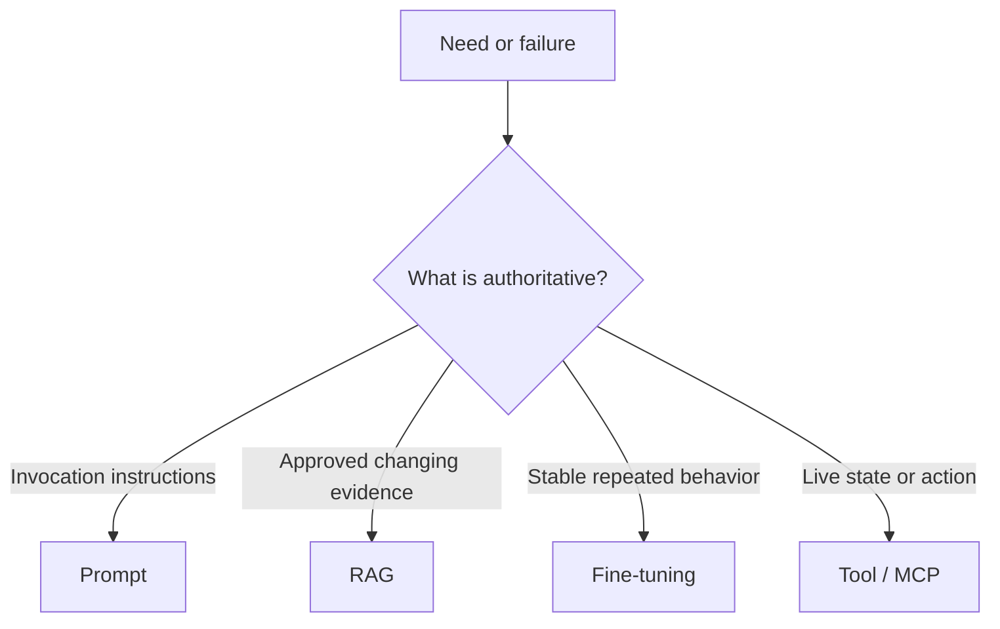
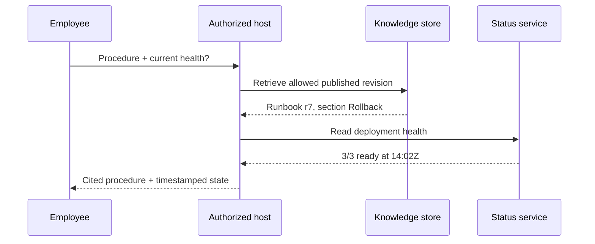
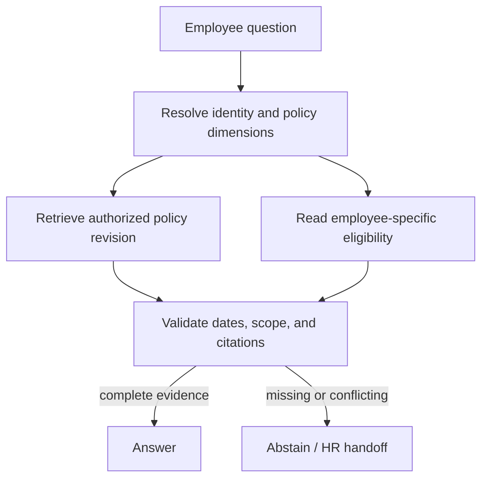
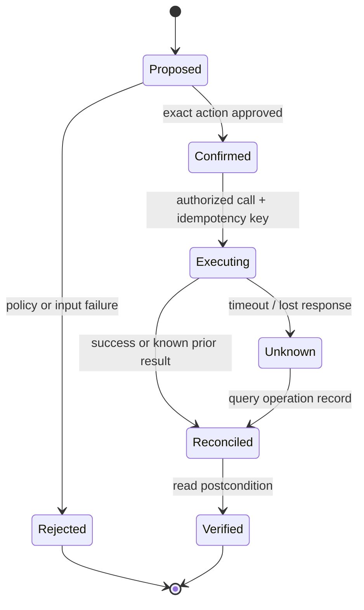
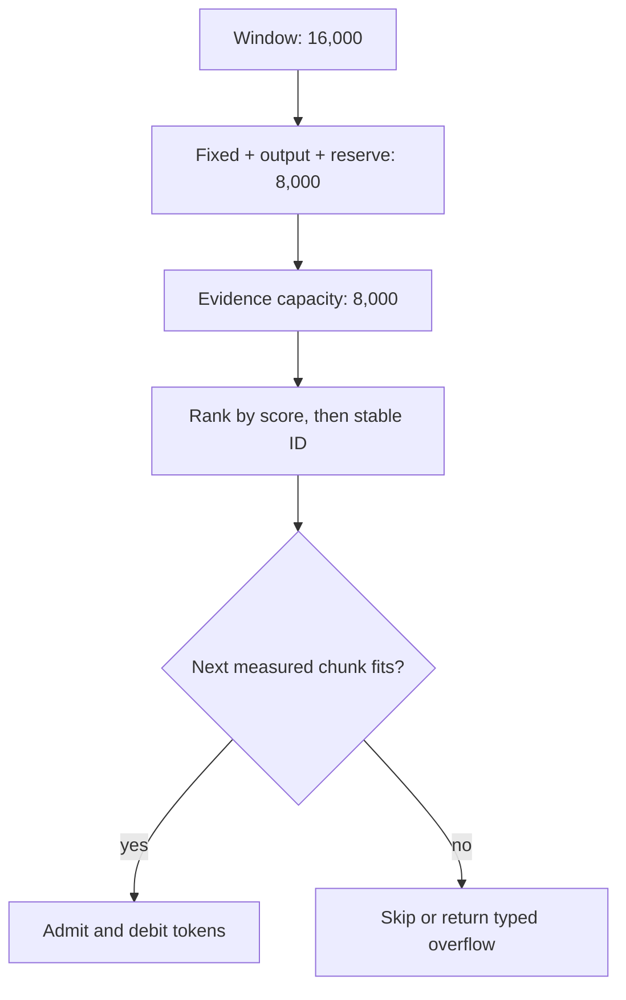
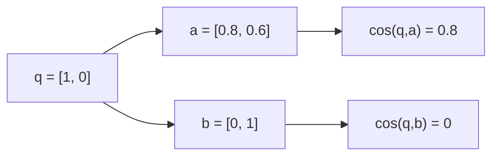
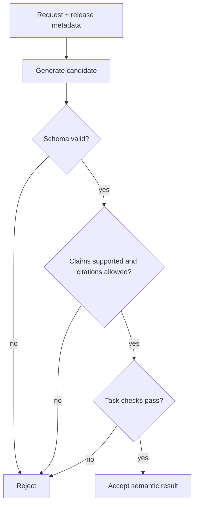

# AI Platform Engineering

> Canonical incremental guide. This pass has processed source Chapters 1–2. Later source chapters remain queued.

## 1. Choose prompting, RAG, fine-tuning, and tools by authority

The mechanisms are complementary. The useful first question is not “Which AI technique is newest?” but **“What must change, and which system is authoritative for that change?”**

| Mechanism | What changes | Use it for | It does **not** grant |
|---|---|---|---|
| Prompting | Instructions and request context | A one-off task, output shape, constraints, or a baseline before optimization | Current private facts, durable learning, or permission |
| Retrieval-augmented generation (RAG) | Evidence selected at request time | Approved documents, policies, source code, catalog facts, and citations | Correct retrieval, correct reasoning, or authorization |
| Fine-tuning | Model behavior through training | Repeated, stable behavior whose success can be evaluated on held-out examples | A reliable database of changing facts |
| Tool calling / MCP | Access to an external capability | Live state, deterministic computation, and controlled actions | Blanket authority to invoke every exposed operation |

The original RAG work describes generation that combines parametric memory with retrieved non-parametric memory. That history matters, but a production definition should stay broader: retrieval may be lexical, vector, SQL, graph-based, or hybrid. A vector database is an implementation choice, not the definition of RAG.

MCP standardizes how an AI application and capability server exchange tools, resources, and other context. In the current `2026-07-28` specification, the protocol core is stateless; the surrounding application can still keep state. A server exposing a tool does not make the model the network or authorization boundary. The host/client remains responsible for policy, consent, credentials, result handling, and audit.



### Requirements and invariants

1. **Facts have an authority.** Current enterprise facts come from an approved source revision or a live system, not from model weights.
2. **Evidence is typed.** A passage and a live tool result carry different provenance and freshness semantics.
3. **Retrieval precedes generation, authorization precedes disclosure.** Filter by caller/tenant before evidence enters model context; do not retrieve broadly and redact later.
4. **Training changes behavior, not the source of truth.** Fine-tuning may improve a stable task, but frequently changing facts remain external.
5. **Capability is not permission.** Tool discovery and model selection never replace server-side authorization, host policy, or user confirmation.
6. **Side effects are explicit.** Classify read-only and mutating calls; use least privilege, bounded inputs, idempotency keys, and postcondition checks for mutations.
7. **Unsupported claims fail closed.** If required evidence is missing, stale, conflicting, or unauthorized, abstain or return a typed partial result.

## Example 1 — rollback instructions plus live health

An employee asks: **“How do I roll back payments, and is the deployment healthy now?”**

This is two questions with two authorities:

- The rollback procedure comes from the latest approved runbook revision accessible to the employee. Use RAG and cite the exact revision and section.
- Current health comes from a read-only deployment-status capability. Use a tool, authenticated for the employee's scope, and timestamp the observation.

Do not use a six-month-old “3/3 replicas ready” example embedded in the runbook as current status. Do not let the status tool invent rollback steps. Join the results only after preserving their separate provenance.



| Step | Evidence | Required validation | Failure response |
|---|---|---|---|
| 1 | Caller and tenant | Identity and scope are present | Reject before retrieval/tool use |
| 2 | Runbook r7 | Published, authorized, not superseded | Abstain from procedure |
| 3 | Status observation | Correct environment and freshness bound | Mark health unknown/stale |
| 4 | Generated answer | Every operational claim maps to evidence | Remove unsupported claim |

A useful evidence envelope keeps the authorities distinguishable:

```json
{
  "kind": "DOCUMENT",
  "authority": "kb://runbooks/payments",
  "subject": "payments/prod",
  "revision": "7",
  "observedAt": "2026-10-21T13:02:00Z",
  "freshUntil": null,
  "citation": "Rollback §2",
  "authorizationScope": "payments-operator:read"
}
```

The live result uses `kind: "LIVE_STATE"`, a status-service authority, an observation timestamp, and a short freshness deadline. It should not pretend to have a document revision.

## Example 2 — stable invoice classification

Suppose an accounts-payable team maps invoice text into a fixed schema and twelve stable categories.

1. Start with a prompt and an output schema. This is the cheapest test of task clarity.
2. Build an evaluation set before changing the model. Measure schema validity, per-class precision/recall, abstention, and human-review rate.
3. Retrieve current vendor or policy facts when classification depends on them. Those facts do not belong in weights.
4. Consider fine-tuning only after the task, labels, examples, and grader are stable and the prompt baseline misses the target consistently.

| Case | Prompt | RAG | Fine-tune | Tool |
|---|---:|---:|---:|---:|
| Put supplied invoice fields into JSON | Yes | No | Not initially | Deterministic schema validator |
| Decide category using today's vendor policy | Yes | Yes | Maybe for behavior | Policy lookup may be deterministic |
| Apply a stable nuanced taxonomy at high volume | Yes | If facts are external | Candidate after evals | Validator/review queue |
| Post the approved invoice | Yes | Maybe | Irrelevant to permission | Mutating finance tool with confirmation |

Fine-tuning is an optimization step, not an escape from unclear requirements. A model can emit syntactically valid JSON and still choose the wrong category; the evaluator must test business meaning.

## Example 3 — employee policy answer

Question: **“How much parental leave do I have?”**

The prompt can require a concise cited answer. RAG can retrieve the current policy, but retrieval must be filtered by country, employment class, effective date, and caller permissions. A payroll/HR tool may be required for the employee's eligibility or accrued balance. Fine-tuning cannot safely memorize either value.



Trace a conflict instead of smoothing it away:

| Observation | Decision |
|---|---|
| Policy r12 says 16 weeks and is effective 2026-10-01 | Candidate policy fact |
| Employee record says country `CA`; policy r12 applies only to `US` | Reject r12 for this caller |
| No published CA revision is retrieved | Do not answer with 16 weeks |
| HR directory supplies a verified handoff | Return “unable to determine” plus the handoff |

## Example 4 — a side-effectful deployment tool

A model proposes `rollback(service="payments", environment="prod", revision="sha256:…")`. MCP can describe and transport that capability. It does not authorize the change.

Before invocation, the host and server should enforce:

- authenticated principal, exact environment scope, and server-side authorization;
- a trusted tool definition and constrained arguments;
- a visible summary of impact plus explicit confirmation where policy requires it;
- a single-use or time-bounded approval bound to the exact arguments;
- an idempotency key and operation record;
- a postcondition read showing the deployed immutable revision;
- audit data that separates proposer, approver, caller, and executor.



A timeout is not proof that the rollback failed. Retry only with the same idempotency key, or query the operation record first. Never generate a fresh operation identity for an ambiguous prior attempt.

## Executable routing contract

[`EvidenceRouting.java`](EvidenceRouting.java) turns the distinctions into a small Java 17 contract. Its output is intentionally a plan, not an answer: it selects evidence mechanisms, records safeguards, and rejects unsafe mutations before any model or external service is called.

Run it from this directory:

```bash
java -ea EvidenceRouting.java
```

The four scenario groups assert:

1. approved procedure plus live state routes to RAG and a read-only tool;
2. stable extraction starts with prompting and adds fine-tuning only when requested;
3. current policy uses RAG and does not mistake fine-tuning for freshness;
4. a production mutation requires authorization, confirmation, and an idempotency key.

## 2. Model mechanics you need for system design

A model request crosses three separate contracts: **tokens** decide whether the request fits, **embeddings** decide which items can be compared, and **generation settings plus evaluators** decide how output is produced and accepted. Character count, vector shape alone, and exact-string tests are unsafe substitutes.

### Requirements and invariants

1. **Measure with the deployed tokenizer.** Count the fully serialized request—including system and tool instructions, history, separators, evidence, and the user turn—with the tokenizer and chat template for the exact model revision. A character or word estimate may alert, but must not be the admission authority.
2. **Reserve before retrieval.** Let `E = W - F - O - R`, where `W` is the tested context window, `F` is fixed encoded input, `O` is the maximum generated output, and `R` is a safety reserve. Admit evidence only while its measured encoded size fits `E`; reject an overcommitted fixed budget before the model call.
3. **Treat embedding identity as schema.** Store model revision, dimension, normalization, preprocessing, and index generation. Query and corpus identities must match exactly. Re-embed or run an explicit versioned migration; never compare vectors from assumed-compatible spaces.
4. **Validate vector math.** Reject dimension mismatch, non-finite values, and zero vectors. Cosine similarity ranks directions; it is not a probability that a passage is correct or that an answer is supported.
5. **Make sampling state explicit.** Sampling mode determines whether temperature is effective. Record model revision, effective decoding parameters, seed when available, and backend fingerprint. A seed can improve repeatability but is not a proof of identical output across software or hardware changes.
6. **Evaluate meaning, not prose identity.** Gate production output on schema, supported claims, allowed citations, and task-specific checks. A valid paraphrase may differ byte-for-byte; a fluent unsupported answer must fail.

## Example 1 — admit evidence within a 16,000-token budget

Assume the deployed model and template have a tested 16,000-token window. The serialized system/tool instructions, history, and user turn consume 3,500 tokens; the response allowance is 3,000; and operations reserve 1,500 for template drift and bounded retries. Evidence capacity is therefore `16,000 - 3,500 - 3,000 - 1,500 = 8,000` tokens.

Three authorized chunks are ranked: runbook r7 (`4,800`, score `0.92`), incident 42 (`3,500`, `0.88`), and an older runbook (`2,600`, `0.41`). Deterministic greedy admission takes r7, skips incident 42 because `4,800 + 3,500 > 8,000`, then takes the older runbook for `7,400` total. Retrieval score does not override the hard budget.



Trace and failure boundary:

| Step | Used before | Candidate | Decision | Used after |
|---|---:|---:|---|---:|
| 1 | 0 | runbook r7: 4,800 | Admit | 4,800 |
| 2 | 4,800 | incident 42: 3,500 | Skip; would reach 8,300 | 4,800 |
| 3 | 4,800 | old runbook: 2,600 | Admit | 7,400 |

In a real retriever, stale or superseded material should normally be excluded before ranking; it is present here only to expose the arithmetic. If `F + O + R > W`, do not truncate instructions silently—return a typed over-budget result.

## Example 2 — cosine ranks direction, not truth

For query `q = [1, 0]`, normalized document `a = [0.8, 0.6]` has cosine `0.8`; document `b = [0, 1]` has cosine `0`. The first ranks closer in this toy space. Neither score proves that the document is current, authorized, or sufficient to support an answer.



The implementation computes `dot(q,d) / (||q|| ||d||)` and rejects a zero norm because cosine would be undefined. It also rejects non-finite values and unequal dimensions before ranking. Authorization, freshness, reranking, and claim support remain later and separate checks.

## Example 3 — prevent a silent cross-generation embedding join

An index was built with identity `(embed-v3@2026-09-01, 1536, L2, utf8+nfc, generation 7)`. A new query service starts emitting generation 8 vectors. Even if dimension and model family names match, the request fails closed because its complete identity differs.

```mermaid
sequenceDiagram
    participant Q as Query service
    participant G as Compatibility gate
    participant I as Vector index
    Q->>G: vector + identity generation 8
    G->>I: read index identity
    I-->>G: generation 7
    G-->>Q: incompatible identity; do not search
    Note over Q,I: Rebuild, dual-read, or route to matching generation
```

A safe migration builds a new generation, evaluates it independently, then switches traffic or dual-reads with metrics. It does not mix old corpus vectors and new query vectors in one similarity calculation, and it keeps the prior generation addressable for rollback.

## Example 4 — deterministic configuration is not deterministic acceptance

Suppose release metadata records `(answer-v5, sampling=false, temperature=0, seed=73, backend=backend-a9)`. Greedy decoding and a seed reduce one source of variation, but library, kernel, device, and provider backend changes can still change output. A new backend fingerprint therefore triggers evaluation rather than a claim of byte-identical replay.



Two answers can both pass while using different wording. Conversely, valid JSON that cites an unauthorized source fails. If sampling is disabled, this guide records temperature as zero rather than carrying a misleading inactive value; when sampling is enabled, temperature changes the probability distribution used to select tokens.

## Executable model-mechanics contract

[`ModelMechanics.java`](ModelMechanics.java) implements the token ledger, deterministic evidence admission, embedding identity gate, guarded cosine function, explicit generation configuration, and semantic acceptance predicate.

Run both contracts from this directory:

```bash
java -ea EvidenceRouting.java
java -ea ModelMechanics.java
```

`ModelMechanics` exercises thirteen scenario groups: valid and invalid context budgets, ranked admission, cosine examples and malformed vectors, same- and cross-generation embedding identities, explicit decoding settings, and semantic acceptance versus fluent unsupported output.

## Failure-oriented review

| Tempting shortcut | Broken assumption | Repair |
|---|---|---|
| “The model probably knows the policy” | Weights are current and authoritative | Retrieve a published revision and cite it |
| “Vector search means RAG” | One retrieval algorithm defines the system | Specify authority, filtering, retrieval, evidence, and generation |
| “Fine-tune with the handbook” | Training is a reliable mutable database | Keep facts external; tune stable behavior only after evals |
| “The tool is listed, so it is allowed” | Discovery equals authorization | Enforce host policy, consent, and server authorization |
| “The tool timed out, so retry” | No response means no side effect | Reconcile by idempotency key and operation record |
| “JSON is valid, so the answer is correct” | Syntax proves semantics | Validate claims, citations, business rules, and postconditions |

## Primary references

- Lewis et al., [Retrieval-Augmented Generation for Knowledge-Intensive NLP Tasks](https://arxiv.org/abs/2005.11401) (2020).
- Model Context Protocol, [Architecture overview](https://modelcontextprotocol.io/docs/2026-07-28/learn/architecture) and [2026-07-28 specification](https://modelcontextprotocol.io/specification/2026-07-28).
- Model Context Protocol, [Tools](https://modelcontextprotocol.io/specification/2026-07-28/server/tools) and [authorization guidance](https://modelcontextprotocol.io/docs/2026-07-28/tutorials/security/authorization).
- OpenAI, [Model optimization](https://developers.openai.com/api/docs/guides/model-optimization) and [supervised fine-tuning](https://developers.openai.com/api/docs/guides/supervised-fine-tuning). Product availability is time-sensitive; the architectural rule here is provider-independent.
- OpenAI, [`tiktoken`](https://github.com/openai/tiktoken) tokenizer and [encoding API](https://github.com/openai/tiktoken/blob/main/tiktoken/core.py).
- OpenAI, [Embeddings guide](https://developers.openai.com/api/docs/guides/embeddings), [embeddings API](https://developers.openai.com/api/reference/resources/embeddings/methods/create), and [retrieval guide](https://platform.openai.com/docs/guides/retrieval). Provider-specific dimensions and limits are configuration, not architectural constants.
- Hugging Face Transformers, [generation configuration](https://huggingface.co/docs/transformers/main_classes/text_generation) and [generation strategies](https://huggingface.co/docs/transformers/generation_strategies).
- PyTorch, [Reproducibility](https://docs.pytorch.org/docs/stable/notes/randomness.html) and [`use_deterministic_algorithms`](https://docs.pytorch.org/docs/stable/generated/torch.use_deterministic_algorithms.html).
- NIST, [AI RMF Generative AI Profile](https://doi.org/10.6028/NIST.AI.600-1) (2024).

## Source provenance and continuation

- Selected source: `ai_platform_master_guide.html`, SHA-256 `c0d23c3a9b64d88e8ad52720402b162c124283958aa7ad0afe228f9a4bc2b24a`, expanded 21-chapter standalone edition.
- Companion editable source: bundle member `02_rag_mcp.md`, SHA-256 `45896b5283ca92e712f7cb3db075b0f076edfaeff34d9127cd867520ff5dfa05`.
- Compared source: `ai_platform_engineering_illustrated.html`, SHA-256 `006aaba7bfaf978849a5fe1df6a8e9f611c0d99a806ef6c3a05c3eeb2101beb9`; it is byte-identical to the HTML inside the bundle and is not promoted as a duplicate guide.
- Processed range: Chapters 1–2, through `Model mechanics you need for system design`, bounded by Chapter 3.
- Chapter 2 source comparison: the selected master and bundled editable companion contain the same token, embedding, and generation material; no duplicate guide was created.
- Next bounded section: Chapter 3, `Embeddings and retrieval engineering`.

