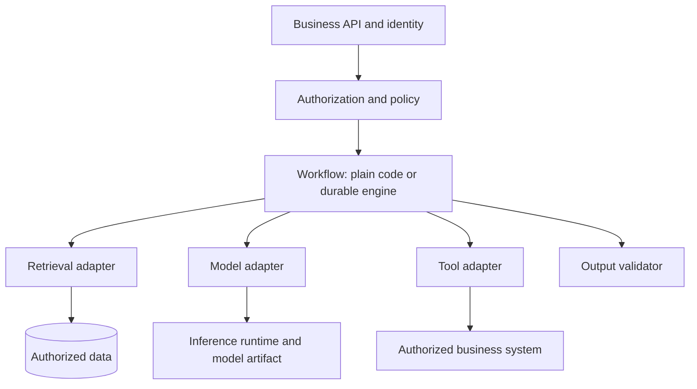
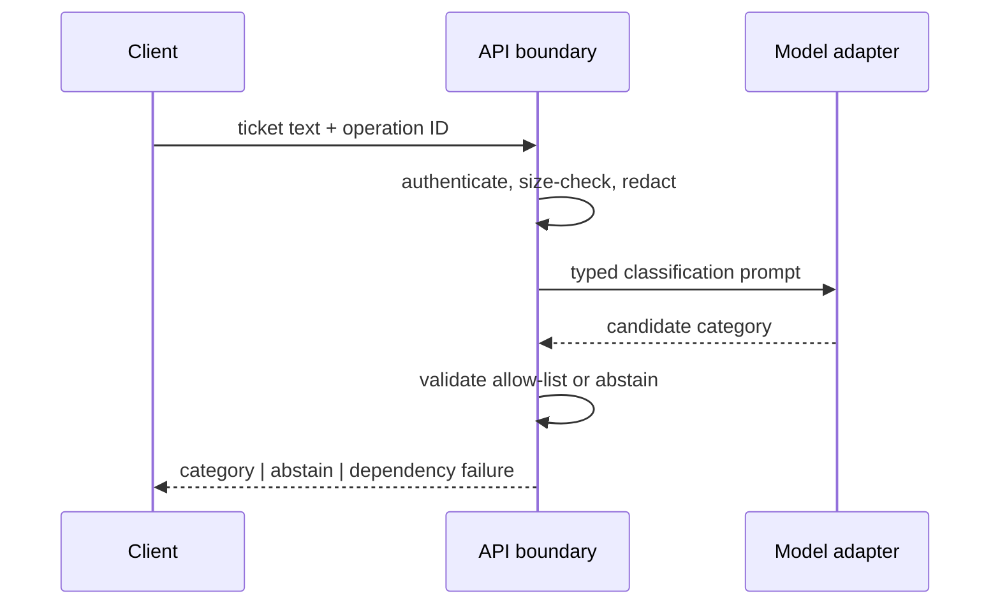
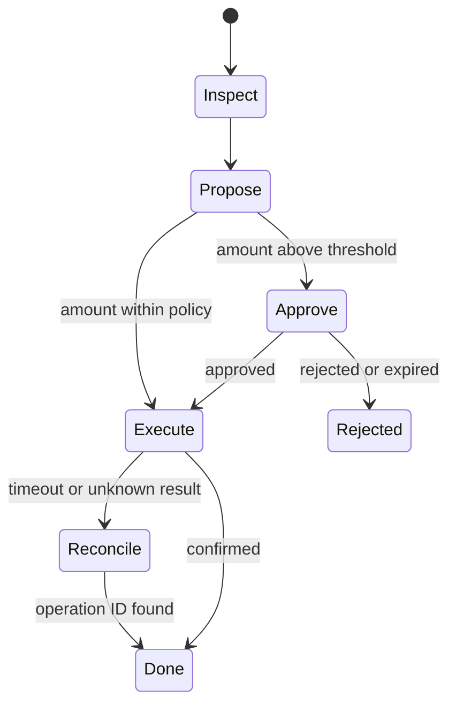
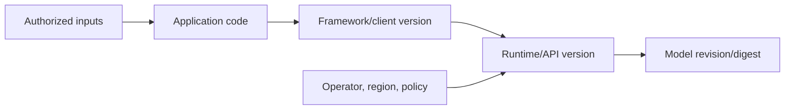

# Spring AI and Python APIs

This is the canonical incremental guide. It compares Java and Python implementation choices by contract and ownership boundary rather than treating a framework, model, runtime, and host as interchangeable. This pass processes only source Section 1, lines 6–30.

## Section 1 — Choose the layer before choosing the library

### Start with requirements, not package names

Before selecting Spring AI, FastAPI, an orchestration framework, or a model client, write the observable contract:

| Question | Required answer |
|---|---|
| What enters and leaves? | typed request, typed success, explicit no-answer and dependency-failure outcomes |
| Which evidence is authoritative? | database/search results before model prose; tenant and resource scope enforced before prompt construction |
| Which effects occur? | read-only model call, retrieval, durable write, tool invocation, or human approval |
| What may be retried? | only idempotent/read operations unless a durable operation key reconciles effects |
| What must survive restart? | nothing for a simple call; workflow state for branching, delayed or human-reviewed work |
| Who owns each layer? | team/service plus versioned framework, runtime, model revision, and operator |

The minimum useful pipeline is usually a typed boundary, deterministic business/retrieval logic, a model adapter, and an output validator. Add an orchestration layer when it removes repeated integration work or owns durable branching—not merely because the application uses a model.



The diagram is a contract map, not a requirement that every box be a separate service.

### Example 1 — one-call classification API

Requirement: classify a support ticket into one of five allowed categories and return a confidence/abstain outcome. No retrieval, tools, or durable branching.

Selected layers: HTTP/DTO validation → model adapter → allow-list validator. In Spring, a controller plus `ChatModel`/`ChatClient` adapter can be enough. In Python, FastAPI/Pydantic plus one explicit HTTP or SDK adapter can be enough. An agent graph adds persistence and transition states that the requirement never asked for.



Expected outcomes:

| Input condition | Output |
|---|---|
| model returns `billing` | accepted typed category |
| model returns `finance-admin` | `abstain` because it is outside the allow-list |
| provider times out | dependency failure, not a fabricated category |

### Example 2 — tenant-scoped RAG answer

Requirement: answer only from documents the authenticated user may read and cite every claim. The layer selection changes because retrieval is now an authority boundary.

Selected layers: API/identity → authorization predicate → retrieval adapter → context packer → model adapter → citation/output validator. A vector database is one possible retrieval implementation; it is not “RAG” by itself. The application must apply tenant/resource filters before candidate text enters the prompt and must reject citations outside the retrieved evidence IDs.

Trace:

| Step | Fact established | Failure behavior |
|---:|---|---|
| 1 | token identifies subject and tenant | reject invalid identity |
| 2 | policy derives permitted resource scope | fail closed |
| 3 | retrieval returns scoped evidence IDs | empty evidence becomes `NO_EVIDENCE` |
| 4 | packer preserves question and bounded evidence | reject over-budget request deterministically |
| 5 | model proposes answer and citations | no direct authority |
| 6 | validator proves every cited ID was retrieved | reject unsupported output |

Choose an orchestration framework only when repeated provider/retriever integrations or trace hooks outweigh its abstraction cost. The authorization predicate remains application-owned even when a framework supplies the retriever.

### Example 3 — refund tool with human review

Requirement: inspect an order, draft a refund, pause for approval above a threshold, execute exactly once, and resume after a restart. This does justify a durable workflow or graph.



The model may propose arguments; it does not authorize the refund. The tool adapter rechecks account/order scope and policy. Persist the operation ID before calling the payment system, and reconcile an unknown result before retrying. “The framework retries tools” is not a correctness policy.

### Example 4 — local model development versus production hosting

Requirement: prototype locally, then deploy reproducibly. Record four separate identities:

| Identity | Example | What a mismatch explains |
|---|---|---|
| client/framework | `spring-ai:2.0.1` or a pinned Python client | request/response mapping and retry behavior |
| inference runtime/API | Ollama release or hosted-provider API revision | supported fields, context/runtime behavior |
| model artifact | repository plus immutable commit/digest | tokenizer, weights, license and behavior |
| operator/host | laptop, internal platform, or named cloud account/region | network, policy, quota, observability and data handling |

“We use Spring AI,” “we use Python,” or “we use Hugging Face” does not identify the inference contract. Hugging Face can host versioned model artifacts and metadata; Ollama can run a local model or expose a cloud API; Spring AI is an application integration abstraction. Pin what you deploy and capture the resolved identities in release evidence.



### When to escalate from plain code to a framework

Use an explicit gate:

1. Start with narrow adapters and one end-to-end test.
2. Measure duplicated integration code, not imagined future nodes.
3. Escalate when there are several repeated integrations, durable branching, restart/resume, or human review.
4. Keep business authorization, idempotency, output semantics, and release identity outside opaque framework defaults.
5. Re-run contract tests when changing a library, runtime, model revision, or host independently.

The paired executable exercises encode this selection rule and the four-part release identity:

```bash
java -ea study-guides/backend/spring-ai-python/LayerSelectionContracts.java
python3 study-guides/backend/spring-ai-python/layer_selection_contracts.py
```

### Common mistakes and interview follow-ups

- **Framework equals model:** ask which process performs inference and which artifact it loaded.
- **Schema-valid equals correct:** DTO/Pydantic validation proves shape, not factual support or authorization.
- **Async equals nonblocking:** a blocking client inside a Python `async def` still blocks its worker; Java virtual threads still need downstream capacity limits.
- **Provider portability is perfect:** common interfaces do not erase provider-specific tool, streaming, token, safety, or error semantics.
- **Agent equals tool call:** one deterministic function call does not require a durable agent loop.

Interview variations: replace the model provider without changing the business API; move local inference to a managed host; add tenant-scoped retrieval; add a tool with an unknown outcome; explain exactly which new requirement justifies a workflow engine.

### Current primary references

- [Spring AI introduction](https://docs.spring.io/spring-ai/reference/index.html), [Model API](https://docs.spring.io/spring-ai/reference/api/index.html), and [Chat Model API](https://docs.spring.io/spring-ai/reference/api/chatmodel.html) — provider abstractions and model integration boundaries.
- [Spring AI tool calling](https://docs.spring.io/spring-ai/reference/api/tools.html) — current distinction between model-returned tool calls and application-driven execution.
- [Ollama API introduction](https://docs.ollama.com/api/introduction) and [usage metrics](https://docs.ollama.com/api/usage) — local/cloud runtime distinction and runtime evidence.
- [Hugging Face Model Hub](https://huggingface.co/docs/hub/models-the-hub) and [model cards](https://huggingface.co/docs/hub/model-cards) — versioned model artifacts and accompanying metadata.
- [FastAPI request bodies](https://fastapi.tiangolo.com/tutorial/body/) and [async guidance](https://fastapi.tiangolo.com/async/) — transport/validation and blocking-boundary behavior.

### Source provenance and continuation

The selected editable source is `atlas_guides/spring_ai_python_api_interview_guide.md` from `ai_cicd_spring_python_guides_complete.zip`, member SHA-256 `af25c41d54a3ca18dfc60b6cf828515ab6afb7e39cf64c7df94fe4a44eb4a553`. This section promotes source lines 6–30 and adds four worked examples, traces, paired executable contracts, escalation criteria, and refreshed primary references. The standalone HTML SHA-256 `6289a19e0ce5514c25d96d44806d47063e726244b5d55d13422234d3e499f3a3` is byte-identical to the bundle’s generated HTML and is retained as comparison evidence, not copied as a duplicate guide. Section 2, **Python library map: purpose, ownership and trade-offs**, begins at source line 31 and remains queued after fair domain rotation. The 25-section source is not complete.
