# Spring AI and Python APIs

This is the canonical incremental guide. It compares Java and Python implementation choices by contract and ownership boundary rather than treating a framework, model, runtime, and host as interchangeable. The guide currently processes source Sections 1–10, lines 6–783.

## Section 1 — Choose the layer before choosing the library

### Start with requirements, not package names

Before selecting Spring AI, FastAPI, an orchestration framework, or a model client, write the observable contract:

| Question | Required answer |
|---|---|
| What enters and leaves? | typed request, typed success, explicit no-answer and dependency-failure outcomes |
| Which evidence is authoritative? | database/search results before model prose; tenant and resource scope enforced before prompt construction |
| Which effects occur? | read-only model call, retrieval, durable write, tool invocation, or human approval |
| What may be retried? | only idempotent/read operations unless a durable operation key reconciles effects |
| What must survive restart? | nothing for a simple call; workflow state for branching, delayed or human-reviewed work |
| Who owns each layer? | team/service plus versioned framework, runtime, model revision, and operator |

The minimum useful pipeline is usually a typed boundary, deterministic business/retrieval logic, a model adapter, and an output validator. Add an orchestration layer when it removes repeated integration work or owns durable branching—not merely because the application uses a model.

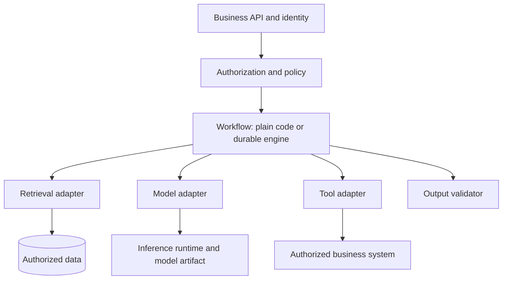

The diagram is a contract map, not a requirement that every box be a separate service.

### Example 1 — one-call classification API

Requirement: classify a support ticket into one of five allowed categories and return a confidence/abstain outcome. No retrieval, tools, or durable branching.

Selected layers: HTTP/DTO validation → model adapter → allow-list validator. In Spring, a controller plus `ChatModel`/`ChatClient` adapter can be enough. In Python, FastAPI/Pydantic plus one explicit HTTP or SDK adapter can be enough. An agent graph adds persistence and transition states that the requirement never asked for.

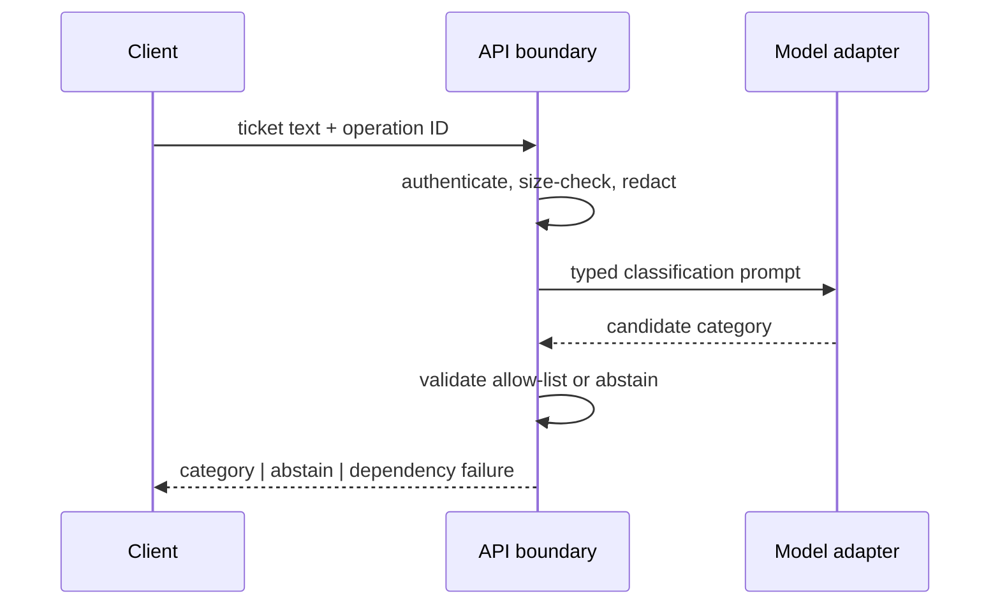

Expected outcomes:

| Input condition | Output |
|---|---|
| model returns `billing` | accepted typed category |
| model returns `finance-admin` | `abstain` because it is outside the allow-list |
| provider times out | dependency failure, not a fabricated category |

### Example 2 — tenant-scoped RAG answer

Requirement: answer only from documents the authenticated user may read and cite every claim. The layer selection changes because retrieval is now an authority boundary.

Selected layers: API/identity → authorization predicate → retrieval adapter → context packer → model adapter → citation/output validator. A vector database is one possible retrieval implementation; it is not “RAG” by itself. The application must apply tenant/resource filters before candidate text enters the prompt and must reject citations outside the retrieved evidence IDs.

Trace:

| Step | Fact established | Failure behavior |
|---:|---|---|
| 1 | token identifies subject and tenant | reject invalid identity |
| 2 | policy derives permitted resource scope | fail closed |
| 3 | retrieval returns scoped evidence IDs | empty evidence becomes `NO_EVIDENCE` |
| 4 | packer preserves question and bounded evidence | reject over-budget request deterministically |
| 5 | model proposes answer and citations | no direct authority |
| 6 | validator proves every cited ID was retrieved | reject unsupported output |

Choose an orchestration framework only when repeated provider/retriever integrations or trace hooks outweigh its abstraction cost. The authorization predicate remains application-owned even when a framework supplies the retriever.

### Example 3 — refund tool with human review

Requirement: inspect an order, draft a refund, pause for approval above a threshold, execute exactly once, and resume after a restart. This does justify a durable workflow or graph.

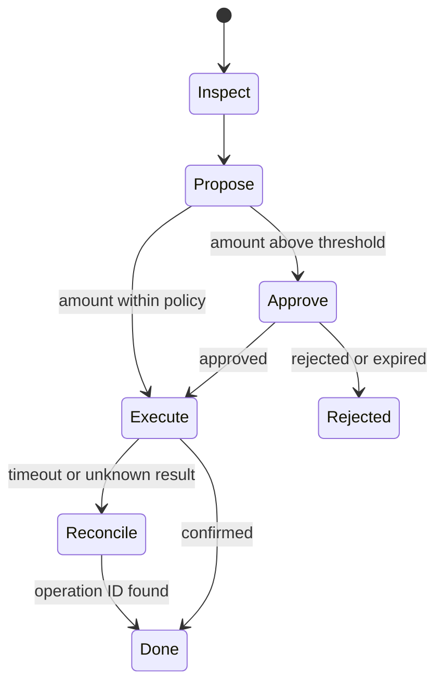

The model may propose arguments; it does not authorize the refund. The tool adapter rechecks account/order scope and policy. Persist the operation ID before calling the payment system, and reconcile an unknown result before retrying. “The framework retries tools” is not a correctness policy.

### Example 4 — local model development versus production hosting

Requirement: prototype locally, then deploy reproducibly. Record four separate identities:

| Identity | Example | What a mismatch explains |
|---|---|---|
| client/framework | `spring-ai:2.0.1` or a pinned Python client | request/response mapping and retry behavior |
| inference runtime/API | Ollama release or hosted-provider API revision | supported fields, context/runtime behavior |
| model artifact | repository plus immutable commit/digest | tokenizer, weights, license and behavior |
| operator/host | laptop, internal platform, or named cloud account/region | network, policy, quota, observability and data handling |

“We use Spring AI,” “we use Python,” or “we use Hugging Face” does not identify the inference contract. Hugging Face can host versioned model artifacts and metadata; Ollama can run a local model or expose a cloud API; Spring AI is an application integration abstraction. Pin what you deploy and capture the resolved identities in release evidence.

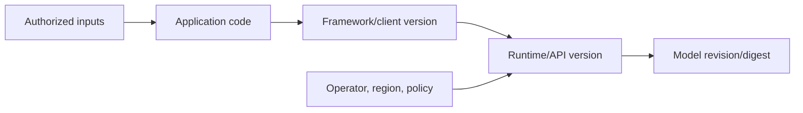

### When to escalate from plain code to a framework

Use an explicit gate:

1. Start with narrow adapters and one end-to-end test.
2. Measure duplicated integration code, not imagined future nodes.
3. Escalate when there are several repeated integrations, durable branching, restart/resume, or human review.
4. Keep business authorization, idempotency, output semantics, and release identity outside opaque framework defaults.
5. Re-run contract tests when changing a library, runtime, model revision, or host independently.

The paired executable exercises encode this selection rule and the four-part release identity:

```bash
java -ea study-guides/backend/spring-ai-python/LayerSelectionContracts.java
python3 study-guides/backend/spring-ai-python/layer_selection_contracts.py
```

### Common mistakes and interview follow-ups

- **Framework equals model:** ask which process performs inference and which artifact it loaded.
- **Schema-valid equals correct:** DTO/Pydantic validation proves shape, not factual support or authorization.
- **Async equals nonblocking:** a blocking client inside a Python `async def` still blocks its worker; Java virtual threads still need downstream capacity limits.
- **Provider portability is perfect:** common interfaces do not erase provider-specific tool, streaming, token, safety, or error semantics.
- **Agent equals tool call:** one deterministic function call does not require a durable agent loop.

Interview variations: replace the model provider without changing the business API; move local inference to a managed host; add tenant-scoped retrieval; add a tool with an unknown outcome; explain exactly which new requirement justifies a workflow engine.

### Current primary references

- [Spring AI introduction](https://docs.spring.io/spring-ai/reference/index.html), [Model API](https://docs.spring.io/spring-ai/reference/api/index.html), and [Chat Model API](https://docs.spring.io/spring-ai/reference/api/chatmodel.html) — provider abstractions and model integration boundaries.
- [Spring AI tool calling](https://docs.spring.io/spring-ai/reference/api/tools.html) — current distinction between model-returned tool calls and application-driven execution.
- [Ollama API introduction](https://docs.ollama.com/api/introduction) and [usage metrics](https://docs.ollama.com/api/usage) — local/cloud runtime distinction and runtime evidence.
- [Hugging Face Model Hub](https://huggingface.co/docs/hub/models-the-hub) and [model cards](https://huggingface.co/docs/hub/model-cards) — versioned model artifacts and accompanying metadata.
- [FastAPI request bodies](https://fastapi.tiangolo.com/tutorial/body/) and [async guidance](https://fastapi.tiangolo.com/async/) — transport/validation and blocking-boundary behavior.

## Section 2 — Python library map: purpose, ownership and trade-offs

### Select one owner for each required job

A Python AI stack is not a single ladder from “basic” to “advanced.” The projects in the source map own different jobs. Select from observable requirements, and remove any package whose responsibility you cannot name.

| Job family | Focused choices from the source | Owned contract | Do not assume |
|---|---|---|---|
| arrays and tabular analysis | NumPy, pandas | dtypes, shapes, vector math, cleaning, inspection | a DataFrame is a durable corpus store |
| statistical or neural modeling | scikit-learn, PyTorch, Transformers, Sentence Transformers | fit/evaluate, tensor execution, model/tokenizer loading, embeddings/reranking | a large language model is the best baseline |
| local or explicit model transport | Ollama Python, HTTPX | typed runtime client or explicit sync/async HTTP exchange | a client package installs or authorizes a model |
| API boundary | FastAPI, Pydantic | HTTP/ASGI handling, typed parsing, JSON Schema | schema-valid output is factually supported |
| orchestration and retrieval | LangChain, LangGraph, LlamaIndex, Haystack | integration glue, durable graph state, ingestion/indexing, component pipelines | the framework supplies business authorization or idempotency |
| protocols and evidence | MCP SDK, Ragas, MLflow | tool/resource protocol, task evaluation, experiment/trace evidence | a judge score or stored trace is automatically safe or calibrated |

The smallest correct stack often spans two or three rows. It should not contain one tool from every row. Before adding a package, write:

1. the job it owns and the interface on each side;
2. the artifact, configuration, and library versions required to reproduce it;
3. the resource model—memory, accelerator, connection pool, worker, or persisted state;
4. the failure and retry boundary;
5. the evidence that would justify keeping the abstraction.

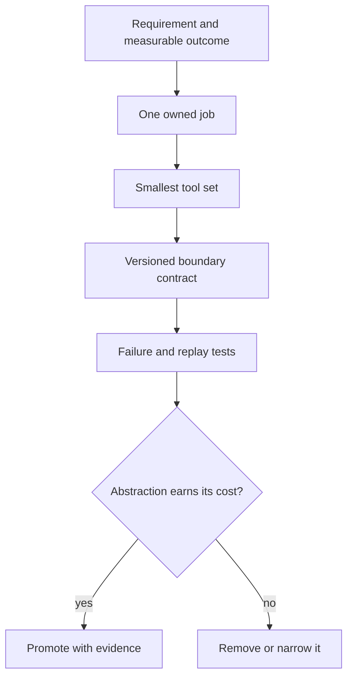

### Example 1 — prove the classical baseline before adding a model runtime

Requirement: classify short support tickets with a reproducible held-out score and explain which terms influenced the decision. Start with NumPy/scikit-learn and a TF-IDF plus linear-classifier pipeline. pandas may help inspect data, but it is not required in the serving path. PyTorch, Transformers, a model server, and an agent framework own no required job yet.

The split must happen before any learned preprocessing is fit. A pipeline makes the vectorizer and classifier fit only on training folds; fitting TF-IDF on the full corpus leaks test-set document statistics into evaluation.

```python
from sklearn.feature_extraction.text import TfidfVectorizer
from sklearn.linear_model import LogisticRegression
from sklearn.pipeline import make_pipeline

baseline = make_pipeline(
    TfidfVectorizer(ngram_range=(1, 2), min_df=2),
    LogisticRegression(max_iter=1_000, random_state=7),
)
baseline.fit(train_text, train_label)       # train partition only
score = baseline.score(test_text, test_label)  # untouched holdout
```

Trace:

| Step | Evidence | Reject when |
|---:|---|---|
| 1 | immutable dataset revision and label policy | labels or duplicate policy are unknown |
| 2 | train/test split IDs written before fitting | preprocessing saw holdout rows |
| 3 | one pipeline fits vectorizer and classifier | test score drove repeated manual tuning |
| 4 | baseline metric plus confusion slices | aggregate score hides a critical class |
| 5 | latency and artifact size measured | a larger model has no demonstrated gain |

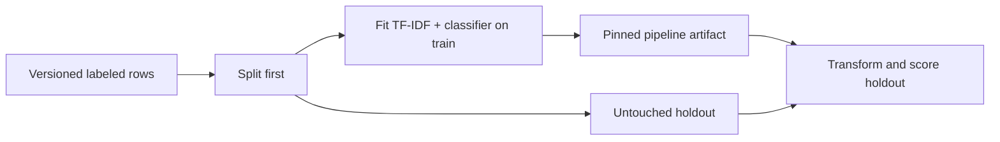

### Example 2 — load a local pretrained model as a versioned artifact

Requirement: compare a local pretrained classifier with the baseline. Transformers owns model/tokenizer construction; PyTorch owns tensor execution and the loaded state. Neither owns the business label policy, evaluation split, or deployment authorization.

Treat the tokenizer, model weights/configuration, runtime version, and task head as one compatibility set. Pin an immutable repository revision for both tokenizer and model, record the resolved commit, and evaluate the exact promoted artifact. A floating repository name can resolve to new bytes without an application-code change.

```python
from transformers import AutoModelForSequenceClassification, AutoTokenizer

MODEL = "org/ticket-classifier"
REVISION = "immutable-commit-sha"
tokenizer = AutoTokenizer.from_pretrained(MODEL, revision=REVISION)
model = AutoModelForSequenceClassification.from_pretrained(MODEL, revision=REVISION)
model.eval()
```

| Boundary | Required release evidence | Typical mismatch |
|---|---|---|
| tokenizer | repository, revision, vocabulary/config digest | token IDs differ from training |
| model | repository, revision, task head, weights/config digest | wrong output shape or labels |
| runtime | Python, Transformers, PyTorch, device/backend versions | unsupported operator or device behavior |
| application | label map, thresholds, input limits | technically valid but wrong business result |

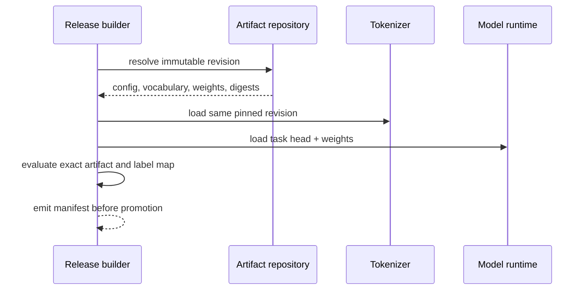

### Example 3 — explicit asynchronous provider API

Requirement: expose a typed Python endpoint that calls one remote model provider. The narrow stack is FastAPI for the ASGI boundary, Pydantic for structural request/response validation, and one long-lived HTTPX `AsyncClient` for the provider protocol. This does not yet require LangChain or a graph.

Create the client in application lifespan, close it at shutdown, bound pool size, and set connect/read/write/pool timeouts intentionally. Do not create a client inside a hot loop: the reusable client owns connection pooling. An `async def` route remains blockable if it directly calls a blocking SDK or CPU-heavy model; isolate that work or choose a synchronous route/worker plan deliberately.

```python
timeout = httpx.Timeout(connect=0.25, read=2.0, write=0.5, pool=0.1)
limits = httpx.Limits(max_connections=64, max_keepalive_connections=16)
client = httpx.AsyncClient(timeout=timeout, limits=limits)

async def call_provider(request: ProviderRequest) -> ProviderResponse:
    response = await client.post(PROVIDER_URL, json=request.model_dump())
    response.raise_for_status()
    parsed = ProviderResponse.model_validate(response.json())
    return validate_business_semantics(parsed)  # shape is not truth
```

Trace:

| Event | Owner | Observable outcome |
|---|---|---|
| request parse fails | Pydantic/API boundary | stable 4xx; provider is not called |
| pool slot unavailable | HTTPX pool timeout | bounded dependency failure and saturation metric |
| connection/read phase expires | HTTPX adapter | phase-specific timeout; retry only if operation semantics allow |
| JSON has correct shape but unsupported citation | application validator | reject or abstain |
| application shuts down | lifespan owner | client closes; connections are released |

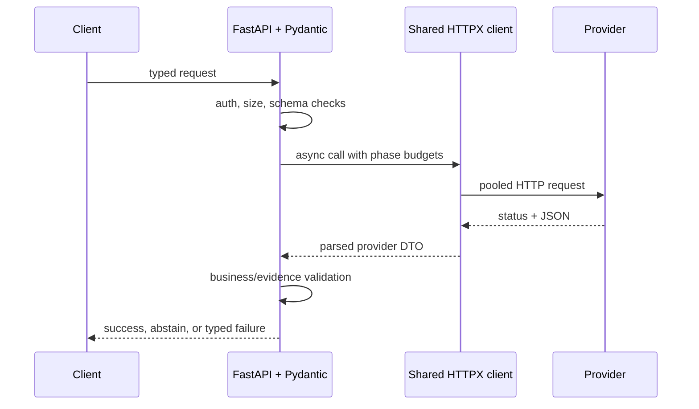

### Example 4 — add durable graph orchestration only for replayable state

Requirement: draft a refund, pause for human approval, survive restart, then call a payment API exactly once from the application's point of view. LangGraph can own persisted graph position and resumption. HTTPX or a focused SDK still owns transport; the payment system owns the actual effect; application code owns authorization and idempotency.

Persist the operation ID and proposed arguments before the effect. On resume, a node may run again, so first query the effect ledger/provider by operation ID. “The graph checkpointed” does not prove the external refund did or did not happen.

| Replay state | Decision |
|---|---|
| no approval | remain paused; make no payment call |
| approved, operation absent | execute with stable idempotency key |
| timeout, operation status unknown | reconcile before any retry |
| operation already applied | record result and advance without a second effect |

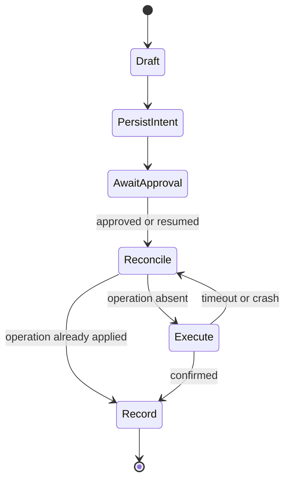

Use LlamaIndex or Haystack instead when ingestion, indexing, and explicit retrieval components dominate. Use LangChain when numerous model/tool/retrieval integrations eliminate proven repeated glue. Use the MCP SDK when the requirement is an interoperable tool/resource/prompt protocol. Add Ragas or MLflow when an evaluation or evidence-retention requirement exists—and define calibration, redaction, access, and retention before storing production prompts or traces.

### Executable selection and boundary contracts

The dependency-free Java/Python pair proves the four minimal tool sets, clean-evaluation gate, pinned model/tokenizer identity, phase-timeout budget, and replay-safe effect decision:

```bash
java -ea study-guides/backend/spring-ai-python/LibrarySelectionContracts.java
python3 study-guides/backend/spring-ai-python/library_selection_contracts.py
```

These programs test decision logic; they do not pretend to compile FastAPI, HTTPX, scikit-learn, PyTorch, Transformers, or LangGraph integrations without those dependency graphs.

### Common mistakes and interview follow-ups

- **Install the whole ecosystem:** require a named owner and deletion test for every dependency.
- **DataFrame as production storage:** pandas is excellent for bounded analysis, not tenant authorization, transactions, or durable corpus serving.
- **Pretrained means reproducible:** pin model and tokenizer revisions plus runtime/device compatibility.
- **Pydantic means correct:** structural parsing cannot prove citation support, policy, or factual truth.
- **Async means unlimited:** bound connection pools, workers, queues, and every wait phase.
- **Checkpoint means exactly once:** graph replay requires idempotent effects or reconciliation with stable operation IDs.
- **Evaluation framework means objective judge:** calibrate against reviewed data and track judge/model versions.

Interview variations: remove a framework without changing the business contract; prove the classical baseline is insufficient; replace a local model with a hosted adapter; diagnose pool starvation separately from provider read timeout; resume after a crash between external success and local checkpoint.

### Current primary references

- [scikit-learn common pitfalls](https://scikit-learn.org/stable/common_pitfalls.html) and [pipelines](https://scikit-learn.org/stable/modules/compose.html) — split-before-fit discipline and leakage-resistant preprocessing.
- [Hugging Face Transformers auto classes](https://huggingface.co/docs/transformers/model_doc/auto) and [model loading](https://huggingface.co/docs/transformers/models) — task-specific model/tokenizer construction and pretrained artifact loading.
- [PyTorch serialization semantics](https://docs.pytorch.org/docs/stable/notes/serialization.html) — state-dictionary ownership and safer artifact loading boundaries.
- [FastAPI concurrency](https://fastapi.tiangolo.com/async/) and [lifespan events](https://fastapi.tiangolo.com/advanced/events/) — sync/async execution boundaries and resource lifecycle.
- [HTTPX async support](https://www.python-httpx.org/async/), [timeouts](https://www.python-httpx.org/advanced/timeouts/), [resource limits](https://www.python-httpx.org/advanced/resource-limits/), and [clients](https://www.python-httpx.org/advanced/clients/) — reusable pools and bounded wait phases.
- [LangGraph Functional API](https://docs.langchain.com/oss/python/langgraph/functional-api) — durable replay and idempotent-side-effect requirements.

## Section 3 — Java library map: choose the owner, then the abstraction

### Preserve the source map, but select by contract

The Java projects in the source solve different jobs. Spring AI and LangChain4j are application-integration choices; the MCP SDK is a protocol implementation; Spring Security, Reactor, validation, resilience, telemetry and JDBC are general application infrastructure; DJL and ONNX Runtime Java can run models inside the JVM. None of them makes authorization, evidence quality, idempotency or capacity decisions for the application.

| Library / project | Job it can own | Python-side analogy | Boundary to make explicit |
|---|---|---|---|
| Spring AI | Spring-native chat, embedding, vector-store and tool adapters | parts of LangChain/LlamaIndex integrated with Spring | provider features and business policy remain outside the abstraction |
| LangChain4j | Java LLM integrations, AI Services, tools, memory and RAG helpers | similar problem space to LangChain | independent Java API, not a Python translation or a model runtime |
| MCP Java SDK | MCP client/server protocol implementation | official Python MCP SDK | pin SDK and protocol revision; negotiate capabilities |
| Spring AI MCP starters | Boot auto-configuration for MCP transports and annotations | protocol SDK integrated into a web framework | HTTP transports need a deliberate authentication/authorization boundary |
| Spring Security | authentication plus request, method and domain authorization | framework identity/policy middleware | endpoint authentication does not prove resource-level access |
| Reactor / WebFlux | nonblocking streams, demand and scheduling | async streams/ASGI concepts | blocking work, scheduler choice and bounded demand remain design decisions |
| Jakarta Validation | structural constraints on Java DTOs | Pydantic constraints | valid shape does not prove truth, authorization or citation support |
| Resilience4j | retry, rate limit, circuit breaker, bulkhead and time limit | focused resilience primitives | choose one retry owner and preserve a total deadline |
| Micrometer / OpenTelemetry | metrics, observations and distributed traces | OTel Python and metrics clients | prompts, resource IDs and user IDs are unsafe high-cardinality labels |
| Deep Java Library (DJL) | engine-agnostic Java deep-learning APIs and translators | selected PyTorch/Transformers workflows | native engine, model format, preprocessing and predictor ownership must match |
| ONNX Runtime Java | direct JVM inference for compatible ONNX artifacts | ONNX Runtime Python | operator support, tensor shape/type and pre/post-processing are part of the artifact contract |
| JDBC / database drivers | SQL transactions and database wire access | DB-API drivers such as psycopg | pooling, transaction scope and publication consistency still apply in AI services |

Use the narrowest row set that satisfies a written requirement. Do not install both Spring AI and LangChain4j merely to preserve optionality. Hide the selected framework behind an application-owned port only when there is a real replacement or testing need, and test the semantic gap—stream events, tool-call arguments, token accounting, errors and cancellation—not just method signatures.

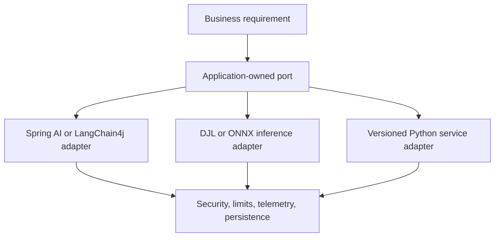

### Example 1 — Spring business service with an MCP tool

Requirement: a signed-in support agent asks for an order summary; the model may call a read-only `lookup_order` tool, but only for an order the agent may view. The service must emit traces without prompt or customer data in metric labels.

Choose Spring AI for the model/tool adapter, an MCP Java SDK or Spring AI MCP starter only if an MCP transport is actually required, Spring Security for request and method authorization, Jakarta Validation for DTO shape, and Micrometer/OpenTelemetry for bounded evidence. Keep the resource predicate in application code and repeat it inside the tool boundary. Spring AI's current MCP starter documentation explicitly says HTTP transports expose an unauthenticated JSON-RPC endpoint by default, so network reachability must not be treated as authority.

```java
public OrderSummary lookupOrder(ToolRequest request, Principal principal) {
    var orderId = requireValidId(request.orderId());       // shape only
    authorization.checkCanReadOrder(principal, orderId);   // resource authority
    return orders.readSummary(orderId);                    // scoped projection
}
```

Trace:

| Step | Owner | Required result |
|---:|---|---|
| 1 | Spring Security | authenticated principal and request-level policy |
| 2 | application service | authorized resource scope before prompt/tool exposure |
| 3 | model adapter | proposed tool name and structurally parsed arguments |
| 4 | tool service | resource authorization repeated; read executes only if allowed |
| 5 | telemetry | low-cardinality outcome (`allowed`, `denied`, `invalid`, `failed`) plus trace correlation |

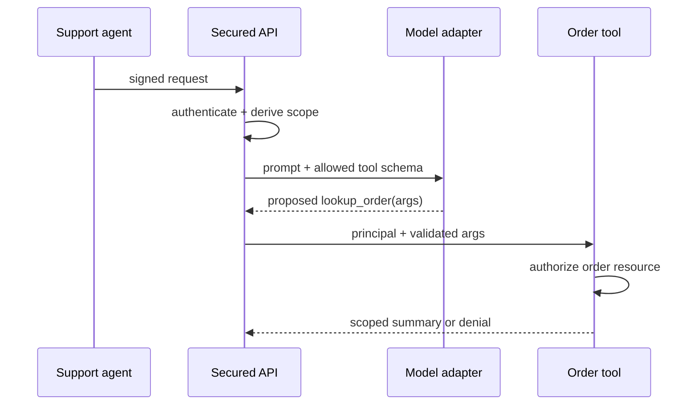

Never expose database rows merely because the generated tool arguments pass Jakarta Validation. DTO validation answers “is the input shaped correctly?”; authorization answers “may this principal act on this resource?”

### Example 2 — Spring AI versus LangChain4j behind one business port

Requirement: generate a typed, cited answer and allow a later provider/framework replacement without changing the public business API. Define the application port around outcomes the product owns:

```java
sealed interface AnswerResult permits Answered, NoEvidence, DependencyFailure {}
interface EvidenceAnswerer {
    AnswerResult answer(AuthorizedQuestion question, Deadline deadline);
}
```

A Spring AI adapter may use `ChatClient`; a LangChain4j adapter may use an AI Service. That common port is useful only if its contract includes citation membership, cancellation, deadline propagation and typed failure mapping. Lowest-common-denominator wrappers that discard streaming/tool/provider features create apparent portability while moving surprises to production.

Compatibility trace:

| Probe | Old adapter | Candidate adapter | Promotion gate |
|---|---|---|---|
| empty authorized evidence | `NoEvidence` | must also abstain | no provider call with fabricated context |
| unsupported citation | reject | reject | every citation belongs to authorized evidence IDs |
| deadline expires | cancel/map timeout | same typed outcome | no hidden second retry owner |
| provider tool call | normalized arguments | normalized arguments | schema and effect policy are equivalent |

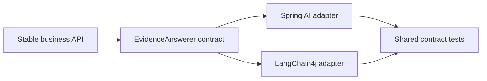

Select one production adapter. Run the other only in an evaluation or migration lane until the shared oracles and provider-specific tests pass.

### Example 3 — DJL versus direct ONNX Runtime inference

Requirement: run a classifier in the JVM with bounded concurrency and reproducible inputs. Choose DJL when engine-agnostic model loading, translators and a broader deep-learning API earn their cost. Choose direct ONNX Runtime Java when the promoted artifact is ONNX and explicit tensor/session control is preferable. DJL can itself use an ONNX Runtime engine; that does not make direct ORT calls and DJL's abstraction identical.

The release unit must bind these values:

| Identity | Example evidence | Reject when |
|---|---|---|
| model bytes | immutable URI plus SHA-256 | digest differs |
| format/opset | ONNX plus declared opset | runtime/provider lacks required operators |
| preprocessing | tokenizer/normalizer code digest | training and serving transforms differ |
| tensor contract | names, dtypes and shapes | request shape/type is incompatible |
| runtime/native provider | DJL engine or ORT version plus CPU/CUDA provider | native library or accelerator is incompatible |
| concurrency owner | fixed predictor/session admission limit | request bypasses the permit gate |

```java
if (!artifact.digest().equals(actualDigest)) throw new IllegalStateException("model drift");
if (!permits.tryAcquire()) return InferenceResult.saturated();
try {
    return predictor.predict(preprocessor.translate(input));
} finally {
    permits.release();
}
```

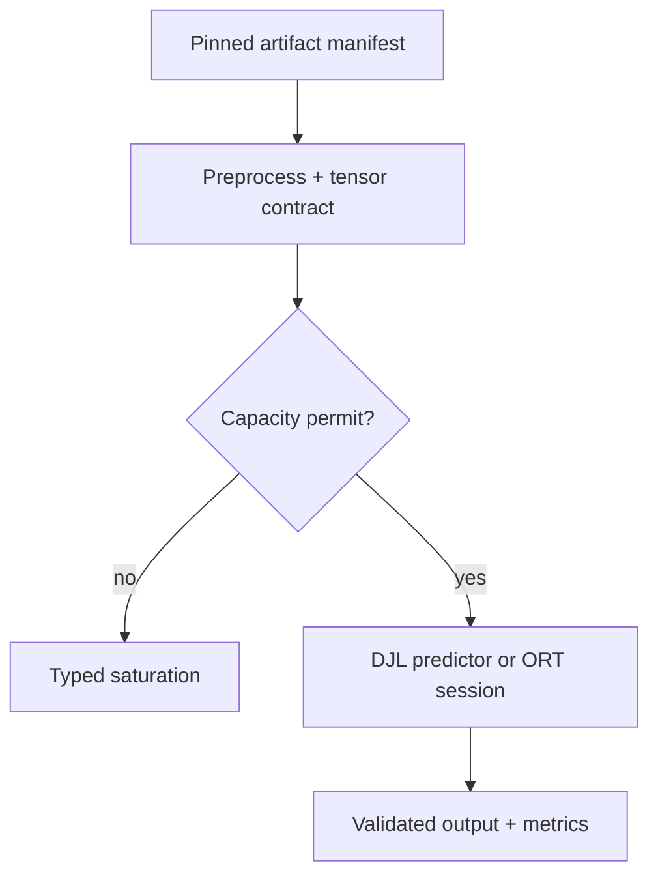

Do not share a stateful predictor because construction is expensive unless its API explicitly permits that concurrency. Pool or create per-request resources according to the selected runtime's ownership contract, and close native resources deterministically.

### Example 4 — keep specialized Python inference behind a versioned service boundary

Requirement: Java owns identity, orders and durable workflow; Python owns a specialized GPU model. Split the process when release cadence, native dependencies, accelerator scheduling or team ownership justify the operational boundary—not because Python is “the AI language.”

The Java-to-Python envelope needs an immutable schema version, operation ID, absolute deadline, trace context, authenticated service identity and model capability/version. The Java service authorizes business resources before sending the minimum necessary input. The Python service authenticates the caller, validates its own request limits, admits work only while capacity and deadline remain, and returns a typed outcome.

| Event | Java decision | Python decision |
|---|---|---|
| invalid business resource | reject locally | no request received |
| stale schema/model capability | map compatibility failure | reject before inference |
| no capacity before deadline | do not multiply retries | return `SATURATED` with bounded retry guidance |
| transport timeout, operation read-only | retry only within remaining deadline and one retry owner | deduplicate expensive work when an operation ID cache is configured |
| result shape valid but policy-invalid | reject at business boundary | record technical success only |

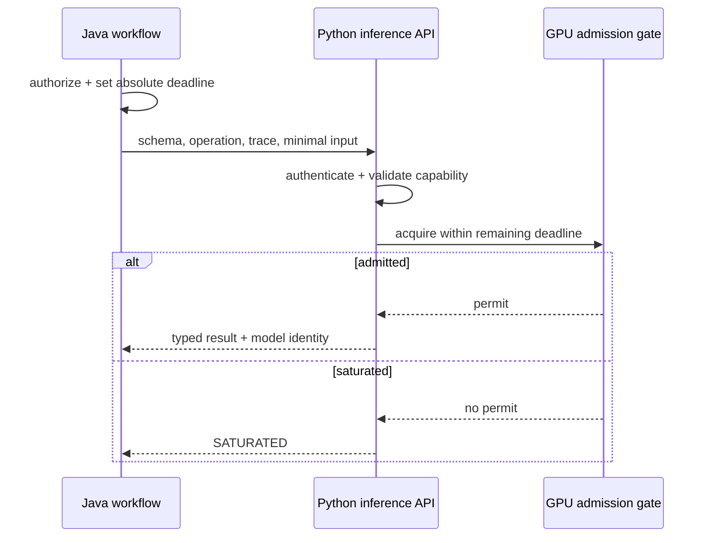

### Version, retry and observability discipline

As verified on 23 October 2026, the Spring reference lists Spring AI 2.0.1 as stable and states that the 2.0.x line supports Spring Boot 4.0.x and 4.1.x. Treat that as a compatible release family, not permission to float dependencies: import the Spring AI BOM, pin the application build, record the resolved graph, and review upgrades. The MCP Java SDK documentation is independently versioned; pin the SDK and record the negotiated MCP revision/capabilities rather than assuming every server supports the same transport or feature set.

Retries belong at one layer. An application retry around a Spring AI client that already retries, combined with an ingress retry, can multiply calls. Keep one absolute deadline, allocate phase budgets from its remaining time, and do not retry effectful tools without an idempotency/reconciliation contract. Bulkheads and Reactor demand are related but not interchangeable: a stream can honor downstream demand while an unbounded number of independent requests still compete for the same database, provider or GPU.

Metrics must aggregate. Put bounded values such as adapter name, model family, outcome and failure class in metric tags; put request/resource identifiers and detailed events in access-controlled traces or logs. Redact prompt/tool payloads by default and define retention before enabling framework observations in production.

### Executable Java/Python contracts

The paired standard-library exercises encode all twelve source-map selections, framework-port promotion gates, pinned inference identity, bounded inference admission, and a versioned cross-language service envelope:

```bash
java -ea study-guides/backend/spring-ai-python/JavaLibraryMapContracts.java
python3 study-guides/backend/spring-ai-python/java_library_map_contracts.py
```

They test decision and boundary logic. They do not claim to compile Spring AI, LangChain4j, MCP, DJL or ONNX Runtime integrations without those dependency graphs and native runtimes.

### Common mistakes and interview follow-ups

- **Two frameworks for optionality:** demand an application contract and migration evidence; otherwise choose one.
- **MCP endpoint equals secure tool:** require transport authentication plus resource/effect authorization inside every tool.
- **Reactive equals bounded:** name the queue, demand, scheduler and downstream capacity limit.
- **Circuit breaker equals retry policy:** breakers stop calls after evidence of failure; they do not decide whether an effect is safe to repeat.
- **Model format equals serving contract:** include preprocessing, tensor names/types/shapes, runtime/native provider and output mapping.
- **Trace equals safe evidence:** define redaction, access, retention and cardinality before recording prompts or identities.

Interview variations: expose the same MCP tool over stdio and Streamable HTTP; replace Spring AI with LangChain4j while preserving failure semantics; choose DJL over direct ORT for two model formats; diagnose blocking JDBC inside a WebFlux chain; split GPU inference to Python without moving business authorization.

### Current primary references

- [Spring AI introduction](https://docs.spring.io/spring-ai/reference/index.html), [getting started](https://docs.spring.io/spring-ai/reference/getting-started.html), [tool calling](https://docs.spring.io/spring-ai/reference/api/tools.html), and [MCP server starters](https://docs.spring.io/spring-ai/reference/api/mcp/mcp-server-boot-starter-docs.html) — current release family, application abstractions, tool execution and the explicit MCP transport-security warning.
- [LangChain4j introduction](https://docs.langchain4j.dev/intro/) and [AI Services](https://docs.langchain4j.dev/tutorials/ai-services/) — Java-native integration scope and high-level typed interface.
- [Official MCP SDK tiers](https://modelcontextprotocol.io/docs/2026-07-28/sdk) and [MCP Java SDK overview](https://java.sdk.modelcontextprotocol.io/latest/overview/) — maintenance/support expectations, SDK version and protocol implementation.
- [Spring Security authorization](https://docs.spring.io/spring-security/reference/servlet/authorization/) and [Reactor backpressure](https://projectreactor.io/docs/core/release/reference/coreFeatures/simple-ways-to-create-a-flux-or-mono-and-subscribe-to-it.html) — request/method authorization and demand propagation.
- [Resilience4j introduction](https://resilience4j.readme.io/docs/getting-started) and [bulkheads](https://resilience4j.readme.io/docs/bulkhead) — composable resilience primitives and concurrency isolation.
- [DJL overview](https://docs.djl.ai/master/index.html), [inference performance](https://docs.djl.ai/master/docs/development/inference_performance_optimization.html), and [ONNX Runtime Java](https://onnxruntime.ai/docs/get-started/with-java.html) — engine abstraction, predictor/concurrency considerations and direct JVM ONNX execution.

## Section 4 — Start with the offline lab

### Requirements before infrastructure

The first retrieval exercise should be runnable without a model, API key, vector database, network call or third-party package. That constraint is useful: it makes five contracts independently testable before probabilistic generation can hide a defect.

| Contract | Required invariant | Failure outcome |
|---|---|---|
| candidate authority | derive the tenant/resource scope from trusted identity, then exclude ineligible documents before scoring | reject a missing scope; return no evidence for an unknown scope |
| lexical baseline | tokenize deterministically, score only eligible documents and break equal scores by immutable ID | return an empty ranking for no positive overlap |
| vector math | require equal non-empty dimensions, finite coordinates and non-zero directions | reject invalid vectors rather than emit `NaN` |
| rank fusion | give one contribution per document per input ranking and use a stable final tie-break | reject an invalid rank constant |
| citation membership | every citation must belong to the exact evidence set supplied to generation | reject missing or unknown IDs; evaluate entailment separately |

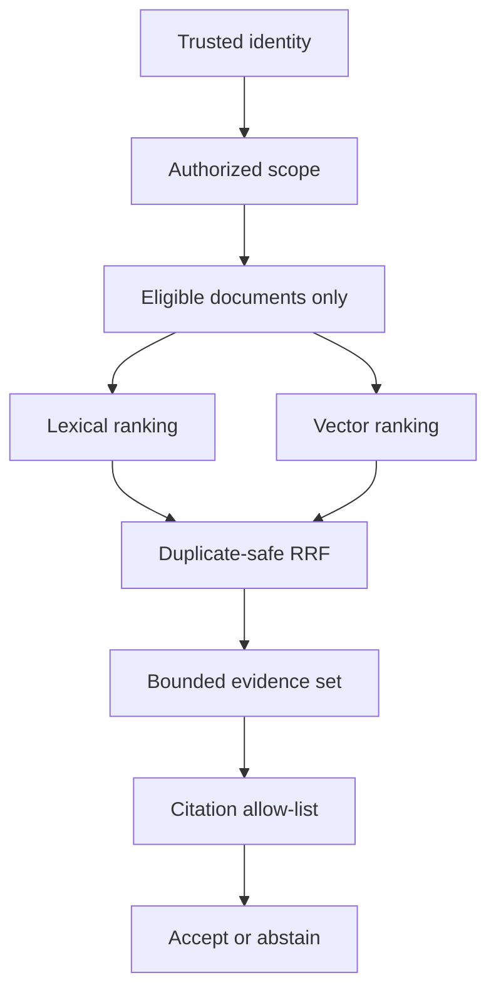

The order is part of the security contract. Filtering after global retrieval is not equivalent: an unauthorized document may already have influenced top-k selection, logs, caches or timing. The offline function accepts `trusted_tenant` only after authentication and authorization have resolved it; it must not be bound directly from an arbitrary request field.

### Example 1 — authorization before similarity

Corpus:

| ID | tenant | relevant terms |
|---|---|---|
| `payments-r7` | `acme` | `payments` once, `rollback` twice |
| `cache-r2` | `acme` | neither query term |
| `vectors-r3` | `acme` | neither query term |
| `private-r1` | `globex` | both query terms repeated; deliberately stronger lexical match |

Request: query `payments rollback`, trusted scope `acme`, `top_k=3`.

Trace:

1. The authority predicate selects the three Acme documents. `private-r1` is never passed to the scorer even though its text would score higher.
2. Token counts for the query are `{payments: 1, rollback: 1}`. `payments-r7` is the only eligible positive-overlap document.
3. The result is exactly `payments-r7`. An unknown tenant or an Acme query such as `quasar` returns `NO_EVIDENCE`; it does not broaden scope or fabricate a fallback.

```python
eligible = (doc for doc in CORPUS if doc.tenant == trusted_tenant)
scored = ((lexical_score(query, doc.text), doc) for doc in eligible)
ranked = sorted(
    (pair for pair in scored if pair[0] > 0.0),
    key=lambda pair: (-pair[0], pair[1].id),
)[:top_k]
```

The deterministic ID tie-break matters because equal floating-point scores otherwise inherit container or database iteration order. Reproducible ordering makes parity tests, caches and incident traces comparable.

### Example 2 — bag-of-words cosine by hand

For query vector \(q=(1,1)\), and the document's query-term projection \(d=(1,2)\):

\[
q \cdot d = 3,\qquad \lVert q\rVert=\sqrt{2},\qquad \lVert d\rVert=\sqrt{5},\qquad
\cos(q,d)=\frac{3}{\sqrt{10}}\approx 0.948683.
\]

That projected value is not the final corpus score, because the full document norm also contains every other token. The implementation builds a `Counter`/map over all lower-cased `[a-z0-9]+` terms, computes the dot product over query terms and divides by both full norms. Repeated terms therefore affect direction, while document length affects the denominator.

| Input | Result | Why |
|---|---:|---|
| empty query | `0.0` | query has no direction |
| no term overlap | `0.0` | dot product is zero |
| positive overlap | `(0, 1]` for nonnegative counts | ordinary cosine bound |
| equal scores | lower document ID first | explicit deterministic order |

This is a transparent baseline, not BM25: it has no inverse-document-frequency term or length normalization parameter. It is also not a neural embedding: the coordinates are literal token counts, not learned latent features. Naming the baseline correctly prevents test results from being attributed to an algorithm that was never run.

Complexity for \(D\) eligible documents, query token count \(Q\), total eligible document tokens \(T\), and requested \(k\): tokenization and scoring cost \(O(Q+T)\); the simple full sort costs \(O(D\log D)\); stored score pairs cost \(O(D)\). A production top-k heap can reduce ranking work to \(O(D\log k)\), but it does not change the scope-first invariant.

### Example 3 — cosine guards are part of the API

The generic vector function tests shape and numerical validity independently of lexical retrieval:

```java
if (left.length == 0 || left.length != right.length) {
    throw new IllegalArgumentException("non-empty equal dimensions required");
}
if (!Double.isFinite(left[i]) || !Double.isFinite(right[i])) {
    throw new IllegalArgumentException("finite vector coordinates required");
}
```

Expected traces:

| left | right | outcome |
|---|---|---|
| `[1, 0]` | `[1, 0]` | `1.0`, same direction |
| `[1, 0]` | `[0, 1]` | `0.0`, orthogonal |
| `[1, 0]` | `[-1, 0]` | `-1.0`, opposite direction |
| `[]` | `[]` | reject empty dimensions |
| `[0, 0]` | `[1, 0]` | reject directionless zero vector |
| `[NaN]` | `[1]` | reject non-finite coordinate |
| `[1]` | `[1, 2]` | reject dimension mismatch |

A naive sum of squares can overflow even when every coordinate is finite. The paired contracts first divide each vector by its own maximum absolute coordinate. Cosine is invariant under positive scaling, so `[1e308, 1e308]` compared with itself safely yields `1.0` instead of `Infinity / Infinity`. The implementation still checks the result and clamps only final round-off to `[-1, 1]`; it never uses clamping to disguise invalid input.

For vector dimension \(n\), the guarded calculation takes \(O(n)\) time. The teaching implementation stores two scaled arrays in Python and uses scalar accumulation in Java; a production implementation may fuse those passes while preserving identical validation.

### Example 4 — duplicate-safe RRF and citation gates

Fuse these two rankings with rank constant 60:

1. lexical: `payments-r7`, `cache-r2`, `payments-r7`
2. vector: `cache-r2`, `payments-r7`, `vectors-r3`

Within the first ranking, the second `payments-r7` is discarded before ranks are assigned. The contributions are:

| ID | lexical contribution | vector contribution | total |
|---|---:|---:|---:|
| `cache-r2` | \(1/62\) | \(1/61\) | \(1/61+1/62\) |
| `payments-r7` | \(1/61\) | \(1/62\) | \(1/61+1/62\) |
| `vectors-r3` | — | \(1/63\) | \(1/63\) |

The first two totals tie, so immutable ID order produces `cache-r2`, `payments-r7`, `vectors-r3`. Without per-ranking duplicate removal, one retriever could overweight a document by repeating it. With \(R\) rankings and \(N\) total entries, fusion is \(O(N)\) expected time for sets/maps plus \(O(U\log U)\) to sort \(U\) unique IDs.

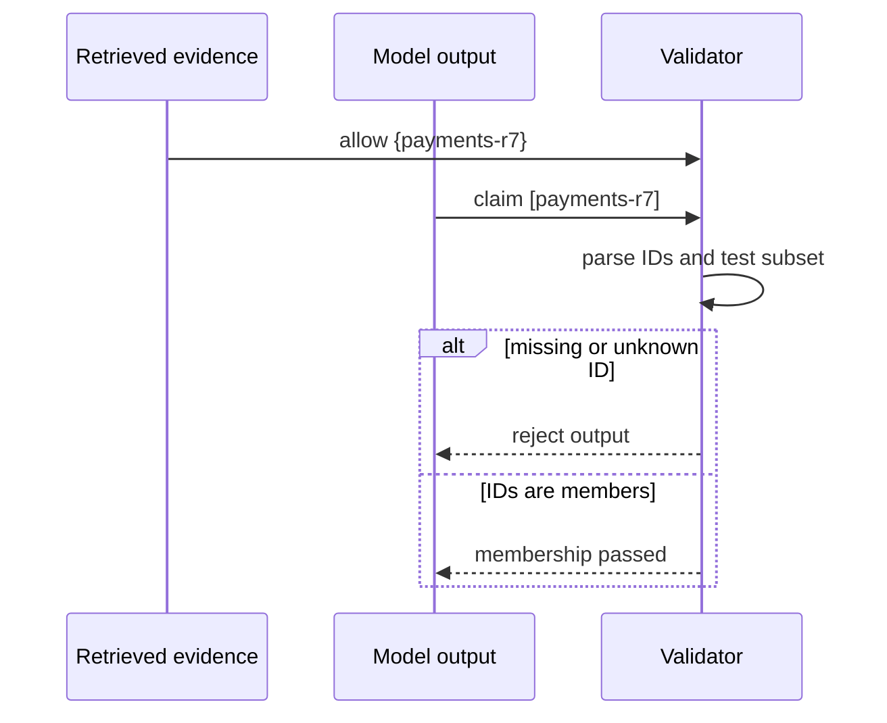

Membership is necessary but insufficient. “The moon is green `[payments-r7]`” passes an ID allow-list yet is not entailed by the passage. Keep three checks distinct: citation syntax, membership in supplied evidence, and claim-to-passage support. The offline lab owns the first two; a separate grounded-evaluation contract owns the third.

### Paired executable contract

The Java and Python programs use the same corpus, token grammar, scope-first retrieval, numerically guarded cosine, duplicate-safe RRF and citation rules. Both print the same parity line before their language-specific test summary:

```text
PARITY|payments-r7|NO_EVIDENCE|cache-r2,payments-r7,vectors-r3|1
```

Run them from the repository root:

```bash
java -ea study-guides/backend/spring-ai-python/OfflineRetrievalLabContracts.java
python3 study-guides/backend/spring-ai-python/offline_retrieval_lab_contracts.py
```

The 31 scenario groups per language cover positive ranking, adversarial cross-tenant text, unknown scope, no-overlap abstention, `top_k` bounds, repeated tokens, empty lexical input, cosine identities, overflow resistance, invalid vectors, RRF duplicates/ties, empty fusion and citation acceptance/rejection. Matching output demonstrates the cross-language algorithm contract; it does not prove the two standard libraries use identical internal data structures.

### Failure matrix and review checklist

| Fault | Detection point | Safe response |
|---|---|---|
| caller supplies tenant text directly | API/authentication boundary | ignore request scope; derive authorized scope from verified identity |
| unknown authorized scope | candidate selection | `NO_EVIDENCE` |
| `top_k` outside `[1,20]` | retrieval input validation | reject |
| empty/no-overlap query | lexical scorer/retriever | empty ranking, then abstain |
| vector mismatch, zero, `NaN` or infinity | cosine preconditions | reject before ranking |
| duplicate ID inside one ranking | RRF per-ranking set | count once at its first rank |
| equal fused score | final comparator | order by immutable ID |
| missing/foreign citation | membership validator | reject generated output |
| allowed citation with unsupported prose | entailment evaluator | reject or send to review; membership alone cannot decide |

Before replacing the corpus with a database or vector engine, preserve these oracles: unauthorized documents are never scored, no evidence is a first-class outcome, numerical errors fail closed, ranking is reproducible, and citations are checked against the exact supplied evidence set. Infrastructure integration should be tested against those contracts instead of redefining them.

### Current primary references

Verified on 23 October 2026:

- [Python `collections.Counter`](https://docs.python.org/3/library/collections.html#collections.Counter), [`math.isfinite`](https://docs.python.org/3/library/math.html#math.isfinite), and [`unittest`](https://docs.python.org/3/library/unittest.html) — standard-library counting, finiteness and executable-test semantics.
- [Java `Pattern`](https://docs.oracle.com/en/java/javase/21/docs/api/java.base/java/util/regex/Pattern.html) and [`Comparator`](https://docs.oracle.com/en/java/javase/21/docs/api/java.base/java/util/Comparator.html) — reusable compiled token grammar and explicit total ordering.
- [Elasticsearch reciprocal rank fusion](https://www.elastic.co/docs/reference/elasticsearch/rest-apis/reciprocal-rank-fusion) — the current rank contribution formula, one-based ranks and rank-constant constraints.
- [OWASP Authorization Cheat Sheet](https://cheatsheetseries.owasp.org/cheatsheets/Authorization_Cheat_Sheet.html) — deny by default, validate permission on every request, test authorization and do not let framework capabilities define requirements.

### Source provenance and continuation

The selected editable source is `atlas_guides/spring_ai_python_api_interview_guide.md` from `ai_cicd_spring_python_guides_complete.zip`, bundle SHA-256 `c52c8295ae7ff7d08013e30a8d7097480719db78104a91b79e367a382465dd31`, member SHA-256 `af25c41d54a3ca18dfc60b6cf828515ab6afb7e39cf64c7df94fe4a44eb4a553`. Sections 1–4 promote source lines 6–202. Section 4 expands the source's dependency-free lab with four requirement-driven examples, exact traces, numerical overflow guards, complexity analysis, adversarial authorization checks, paired 31-scenario executable contracts and primary references checked on 23 October 2026. The standalone HTML SHA-256 `6289a19e0ce5514c25d96d44806d47063e726244b5d55d13422234d3e499f3a3` is comparison evidence rather than a duplicate guide.

## Section 5 — A model call at the wire level

### Make the transport contract explicit

A model call is an HTTP exchange with unusually expensive and slow failure modes. The client library owns connection reuse, TLS negotiation, byte transfer and serialization. The application still owns endpoint trust, authentication material, request identity, admission, total deadline, replay policy, response limits, completion semantics, domain validation and safe observability.

| Requirement | Concrete contract | Failure behavior |
|---|---|---|
| trusted destination | base URI comes from deployment configuration; remote origins require HTTPS; reject URL credentials, query and fragment | fail startup or request construction |
| bounded request | pin model/revision policy, input limit, output-token limit and non-streaming/streaming mode | reject before acquiring scarce model capacity |
| bounded transport | reuse one client/pool; set pool, connect, write and read-inactivity timeouts beneath an outer deadline | return a phase-specific dependency failure |
| replay safety | distinguish “not sent,” transient response and unknown result after send; tool/effect calls are not blind retries | reconcile effects or surface unknown outcome |
| layered acceptance | validate status, media type, bytes, JSON/provider envelope, completion reason, schema and business rules | reject, abstain or mark incomplete |
| useful telemetry | record IDs, model identity, phase latency, outcome, token counts and bounded error class | never log secrets or full prompts by default |

`stream: false` is useful when the application must validate one complete JSON value before returning it. Streaming changes the protocol contract: the client must parse a sequence, enforce cumulative byte/token/time bounds, detect terminal completion, cancel on disconnect, and avoid exposing an answer before validation permits it.

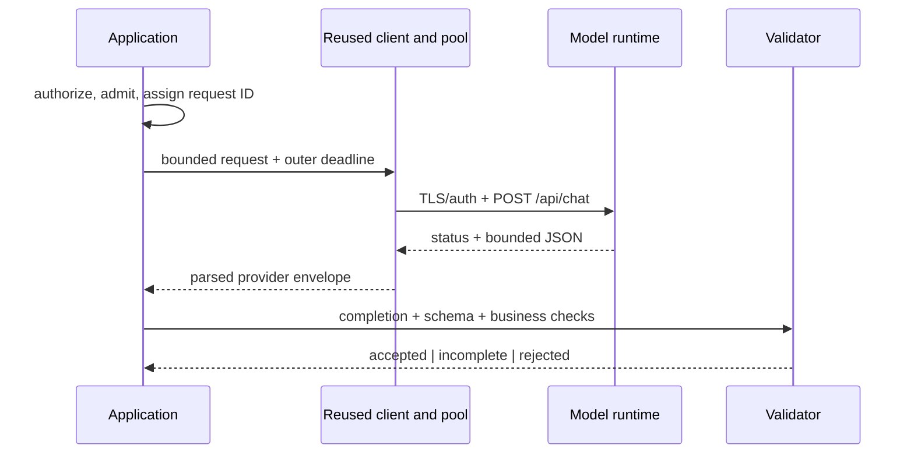

### Example 1 — trace one complete Ollama chat exchange

For a trusted local runtime, `http://127.0.0.1:11434` is a reasonable development origin. A remote runtime must use an authenticated HTTPS origin chosen by configuration, not a caller-supplied URL. This representative request asks the runtime for one complete response and caps generation:

```http
POST /api/chat HTTP/1.1
Host: 127.0.0.1:11434
Content-Type: application/json
X-Request-ID: req_01HZX9A2

{
  "model": "qwen3:8b",
  "messages": [{"role": "user", "content": "Classify: duplicate invoice"}],
  "stream": false,
  "options": {"temperature": 0, "num_predict": 120}
}
```

A representative successful envelope is:

```json
{
  "model": "qwen3:8b",
  "message": {"role": "assistant", "content": "billing"},
  "done": true,
  "done_reason": "stop",
  "total_duration": 1850000000,
  "load_duration": 120000000,
  "prompt_eval_count": 900,
  "eval_count": 100
}
```

Trace the fields by owner:

| Check | Observed | Interpretation |
|---|---:|---|
| HTTP status/media type | `200`, `application/json` | transport envelope may be parsed; content is not accepted yet |
| body limit | `640 < 1,048,576` bytes | bounded memory use |
| requested/returned model | `qwen3:8b` | expected runtime identity; a production alias policy must resolve to immutable release evidence |
| completion | `done=true`, `done_reason=stop` | provider says generation terminated normally |
| domain value | `billing` | accepted only if it is in the application's category allow-list |
| usage | 900 prompt + 100 output tokens | 1,000 tokens for cost/capacity evidence |

Ollama can also accept `format: "json"` or a JSON Schema. That narrows syntax; it does not prove truth, authorization or business validity. In Spring AI, `ChatClient` can hide the wire DTO and map structured output, but the same endpoint, deadline, completion and domain contracts must remain visible at the adapter boundary.

### Example 2 — allocate timeout and concurrency budgets

Suppose the API has a 20-second dependency deadline. One explicit phase allocation is:

| Phase | Ceiling | What expiry means |
|---|---:|---|
| wait for pool slot | 250 ms | local saturation; model request was not sent |
| connect/TLS | 2,000 ms | origin unavailable or handshake too slow |
| write request | 1,000 ms | upload stalled; whether bytes were sent matters to replay |
| read inactivity | 16,750 ms | no response bytes within the allowed interval |
| outer stopwatch | 20,000 ms | absolute application deadline across every phase and retry |

HTTPX exposes pool, connect, write and read timeouts. They are phase/inactivity bounds, not a substitute for the absolute stopwatch across acquisition, transfer, parsing, validation and retries. Create one `Client`/`AsyncClient` for its lifecycle so connection pooling works; do not instantiate it inside the hot request loop.

```python
timeout = httpx.Timeout(pool=0.250, connect=2.0, write=1.0, read=16.750)
limits = httpx.Limits(max_connections=480, max_keepalive_connections=120)
client = httpx.AsyncClient(base_url=MODEL_ORIGIN, timeout=timeout, limits=limits)
# Wrap the complete operation in the application's 20 s deadline.
```

At 50 admitted requests/second and 8 seconds mean dependency latency, Little's Law gives (L=\lambda W=50\times8=400) mean in-flight calls. A 64-connection default would queue this target before the model is necessarily saturated. A 480 hard cap provides an illustrative 20% headroom; it is not a universal setting. Measure latency distribution and runtime concurrency, then bound the pool, admission queue and model scheduler consistently. When all 480 slots are committed, reject or shed according to the API contract rather than creating an unbounded queue.

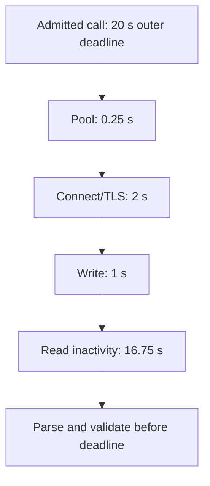

### Example 3 — retry by observed state, not exception name alone

HTTP `POST` is not inherently idempotent. A read-only model inference can be *application-classified* as replayable, but a retry may still duplicate billing and return different text. Once tools or other effects are possible, a model request is not pure inference: preserve a logical operation ID and reconcile the effect instead of blindly replaying the turn.

| Observation | Pure inference | Tool/effect-capable request |
|---|---|---|
| pool/connect failure proved no bytes sent | retry within attempt/deadline caps | retry; external effect was not requested |
| `429`/`503` response | retry only under explicit policy; honor valid `Retry-After`, add bounded jitter | generally do not replay the whole turn; follow provider/tool reconciliation contract |
| read timeout after request bytes sent | outcome unknown; retry only if duplicate cost/nondeterminism are explicitly accepted | do not retry blindly; reconcile by stable operation ID |
| `400`/`401`/`403` or schema rejection | fail; fix request, credentials or contract | fail closed |
| attempt/outer deadline exhausted | return typed dependency failure | return typed failure or unknown-effect state |

The same stable logical request ID is useful for traces and provider-supported deduplication, but a header by itself does not make a provider idempotent. Bound attempts, include retry delay inside the original deadline, and cap `Retry-After` according to product latency policy.

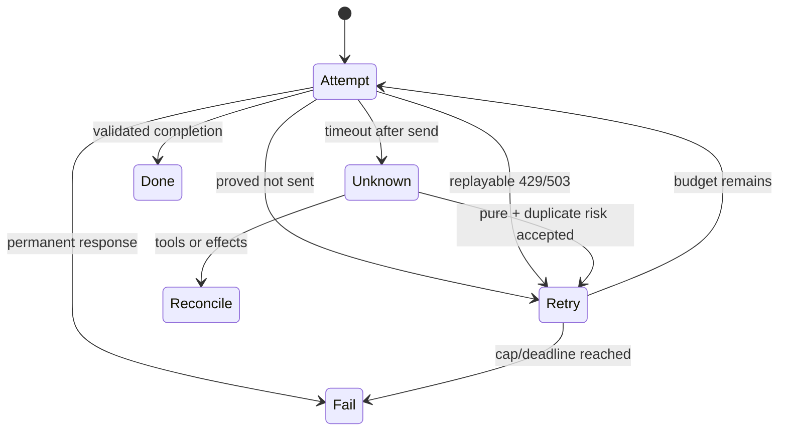

### Example 4 — validate in layers and keep cost arithmetic auditable

Validation is ordered so an attacker or broken runtime cannot skip directly to domain parsing:

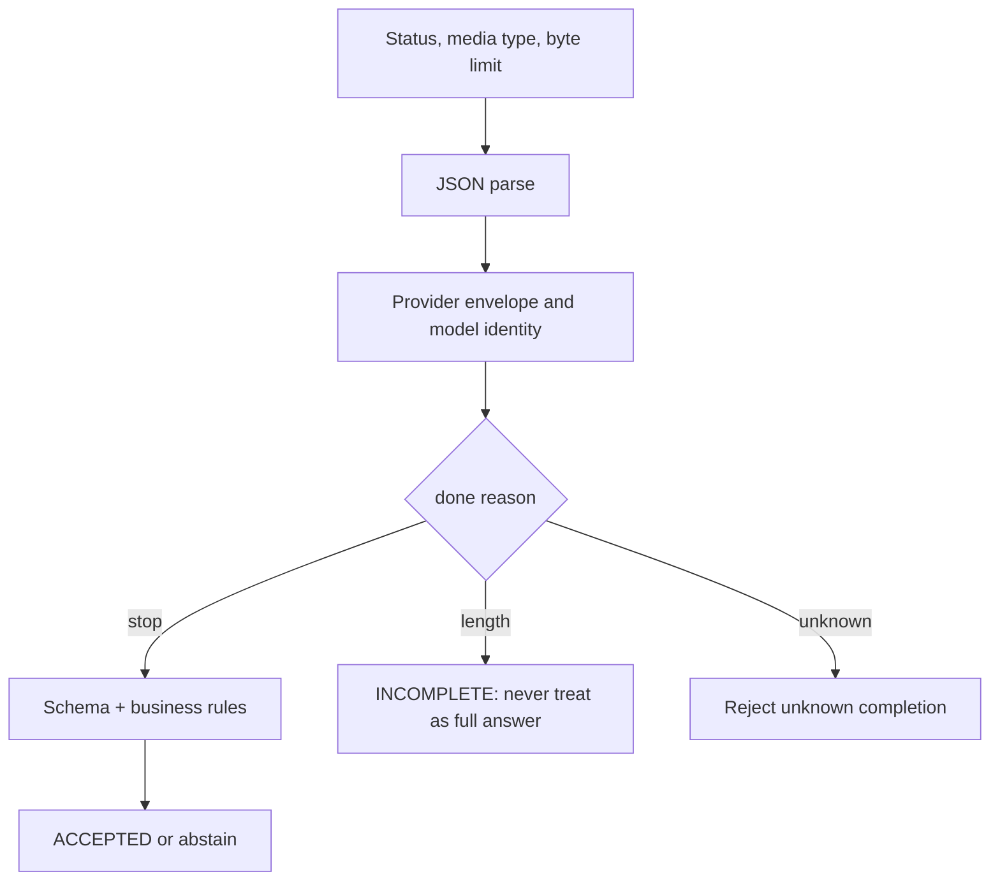

For the example response, assume illustrative rates of $2 per million input tokens and $8 per million output tokens. Use integer microdollars and round each charged component upward:

\[
\lceil 900\times2{,}000{,}000/1{,}000{,}000\rceil+
\lceil 100\times8{,}000{,}000/1{,}000{,}000\rceil
=1{,}800+800=2{,}600\text{ microdollars}.
\]

That arithmetic is evidence, not a claim about a current provider price. Record the actual rate-card version separately. A response with `done=true` and `done_reason=length` is transport-complete but application-incomplete; do not parse a truncated JSON object as a successful classification.

Safe telemetry should include request/trace ID, configured and returned model identity, attempt number, pool/connect/write/read/total latency, status/error class, byte count, completion reason, token counts, validation outcome and rate-card version. Redact authorization headers. Hash, sample or omit prompts and answers unless a reviewed purpose, access policy and retention period require their content. Keep metric labels bounded—request IDs belong in traces/logs, not high-cardinality metric dimensions.

### Paired executable contract

The dependency-free Java/Python pair implements the same endpoint, 20-second phase budget, retry state, completion validation, integer-cost and Little's-Law examples:

```bash
java -ea study-guides/backend/spring-ai-python/ModelWireContracts.java
python3 study-guides/backend/spring-ai-python/model_wire_contracts.py
```

Both print this parity trace before their language-specific 30-scenario summary:

```text
PARITY|RETRY_1000|ACCEPTED|INCOMPLETE|400|2600
```

The contracts prove decision logic without opening a socket. They do not prove a live Ollama/Spring AI/provider integration, TLS configuration, pool tuning or model behavior.

### Current primary references

Verified on 23 October 2026:

- [Ollama chat API](https://docs.ollama.com/api/chat) and [structured outputs](https://docs.ollama.com/capabilities/structured-outputs) — request fields, non-streaming mode, response completion/usage fields and JSON/JSON-Schema formatting.
- [Spring AI ChatClient](https://docs.spring.io/spring-ai/reference/api/chatclient.html) — synchronous/reactive fluent client, structured mapping, advisors and the warning around sensitive logging.
- [HTTP Semantics, RFC 9110](https://www.rfc-editor.org/rfc/rfc9110) and [Additional HTTP Status Codes, RFC 6585](https://www.rfc-editor.org/rfc/rfc6585) — method/idempotency semantics, `Retry-After`, `429` and response handling.
- [HTTPX timeouts](https://www.python-httpx.org/advanced/timeouts/), [resource limits](https://www.python-httpx.org/advanced/resource-limits/), [clients](https://www.python-httpx.org/advanced/clients/) and [exceptions](https://www.python-httpx.org/exceptions/) — phase timeouts, pooling/reuse, bounds and failure taxonomy.

### Source provenance and continuation

The confirmed editable range is source lines 203–263, ending immediately before Section 6. The matching standalone HTML range is lines 388–434, with Section 6 beginning at line 435; its substance agrees with the editable member, so no duplicate guide was created. Section 5 preserves the source's Ollama and Spring `ChatClient` model-call boundary, then adds four requirement-driven traces, phase/deadline arithmetic, replay-aware failure states, layered validation, capacity/cost evidence, four diagrams and paired 30-scenario contracts. Section 6, **Complete Python RAG endpoint: trace every subcomponent**, begins at source line 264 and is promoted below; the source is not complete.

## 6. Complete Python RAG endpoint: trace every subcomponent

This endpoint is a deliberately small, local RAG laboratory: FastAPI owns HTTP integration and lifespan, Pydantic bounds DTO fields, one process-scoped HTTPX client talks to Ollama, and standard-library functions validate vectors, ranking and citations. The corpus is fixed to a synthetic `acme` scope. That is a safe demo boundary, not authenticated tenancy; production retrieval must derive scope from validated identity and enforce it before search.

The contract is explicit:

- startup either publishes one complete immutable retrieval snapshot or fails readiness;
- a parsed question is 3–2,000 characters and nonblank, while the server/proxy separately bounds request bytes before parsing;
- admission waits at most 50 ms for one of four process-local permits;
- a 12-second outer deadline contains admission, embedding, retrieval, generation and validation; HTTPX phase timeouts remain separate guards;
- embeddings must have the expected count, one nonzero dimension, finite coordinates and nonzero norms;
- ranking is descending cosine with document ID as the deterministic tie-breaker;
- an uncalibrated “always top two” demo is not a production no-answer policy;
- supplied citation membership and semantic support are separate checks; and
- every acquired permit is released exactly once, including error and cancellation paths.

### Example 1 — publish an all-or-nothing startup snapshot

Given three documents, `/api/embed` must return three vectors. Validate all vectors into temporary state first; only then publish the document/vector pair used by requests. If vector 2 contains `NaN`, vector 3 has a different dimension, or the response contains only two vectors, startup fails and the old or absent snapshot remains authoritative. Never expose “documents from revision B with vectors from revision A.”

```python
def checked_snapshot(documents, vectors):
    if not documents or len(vectors) != len(documents):
        raise ValueError("embedding count mismatch")
    dimension = len(vectors[0])
    if dimension == 0:
        raise ValueError("empty embedding")
    frozen = []
    for vector in vectors:
        if len(vector) != dimension or not all(math.isfinite(x) for x in vector):
            raise ValueError("invalid embedding shape or coordinate")
        if math.sqrt(sum(x * x for x in vector)) == 0:
            raise ValueError("zero-norm embedding")
        frozen.append(tuple(vector))
    return tuple(documents), tuple(frozen), dimension  # publish this object atomically
```

```mermaid
stateDiagram-v2
  [*] --> Loading
  Loading --> Validating: embed all documents
  Validating --> Ready: publish complete snapshot
  Validating --> Failed: count, shape, finite or norm check fails
  Ready --> Serving
  Failed --> [*]
```

FastAPI lifespan code before `yield` runs before the application accepts requests, and code after `yield` performs cleanup. Use that boundary to create one reusable client and one coherent snapshot per process. A successful upstream status is necessary but not sufficient evidence that an embedding response is usable.

### Example 2 — bound queueing and the whole attempt

For three Uvicorn workers and four permits per worker, the process-local upper bound is `3 × 4 = 12` admitted handlers, not four globally. It is also not a provider quota: Pods and replicas multiply it again. Enforce a fleet-wide budget at an upstream admission layer or distributed limiter when that is the requirement.

| Observation | Endpoint result | Why |
|---|---:|---|
| blank or field longer than 2,000 characters | `422` | request contract failed |
| no permit within 50 ms | `429` | bounded load shedding; do not hide an unbounded queue |
| HTTPX connect/read/write/pool failure | `502` | dependency transport failed |
| any admitted attempt exceeds 12 seconds | `504` | application deadline expired |
| valid request but calibrated retrieval finds no evidence | `200` abstention | expected domain outcome, not an infrastructure error |

```mermaid
flowchart TB
  Q["Validated question"] --> A{"Permit within 50 ms?"}
  A -->|no| R["429: shed"]
  A -->|yes| D["12 s outer deadline"]
  D --> E["embed → retrieve → generate → validate"]
  E --> O["answer or typed abstention"]
  D -->|expires| T["504"]
```

Python documents that a semaphore decrements on acquisition and increments on release; its preferred manual equivalent uses `try/finally`. `asyncio.timeout()` cancels the current task when its deadline expires and converts cancellation to `TimeoutError` outside the context. HTTPX connect, read, write and pool timeouts constrain individual network phases; none alone is an end-to-end request deadline. Local cancellation also does not prove the upstream stopped computing.

### Example 3 — deterministic retrieval, untrusted context and two gates

Suppose a normalized query produces these scores:

| Document | Cosine | Rank |
|---|---:|---:|
| `payments-r7` | `1.000` | 1 |
| `runbook-r2` | `0.970` | 2 |
| `catalog-r1` | `-1.000` | 3 |

Descending score selects the first two. If equal scores occur, ascending stable document ID breaks the tie, making tests and incident replay deterministic. Context retains document IDs and revisions and is delimited as untrusted data; a sentence inside evidence that says “ignore the system message” is not executable instruction.

The output passes two different gates:

1. **Membership:** every cited ID exists in the selected snapshot, and at least one citation is present.
2. **Support:** the cited evidence actually entails the answer claim.

Membership can be exact code. Support needs a domain-specific verifier, reviewed structured extraction, or a conservative abstention policy; a citation-shaped token is not proof. If the best score is below a versioned, evaluated threshold, return a typed `ABSTAIN` without calling generation. Record the embedding model, corpus revision and threshold version with the decision.

```mermaid
flowchart TB
  V["Validated query vector"] --> C["Exact cosine for one snapshot"]
  C --> S["Sort: score desc, ID asc"]
  S --> H{"Best score ≥ threshold?"}
  H -->|no| AB["ABSTAIN"]
  H -->|yes| G["Generate from delimited evidence"]
  G --> M{"Citations are selected IDs?"}
  M -->|no| X["502 malformed dependency output"]
  M -->|yes| P{"Claims supported?"}
  P -->|no| AB
  P -->|yes| OK["ANSWER"]
```

Ollama's `/api/embed` accepts one string or a list and returns an `embeddings` array. Use the same pinned embedding model for corpus and query vectors. The API currently documents L2-normalized output, but local validation still protects the application from malformed, mismatched or substituted responses.

### Example 4 — map failure by meaning and release once

Acquire a permit only after request validation, set `acquired = True` immediately after success, and release in `finally` only when that flag is true. This avoids both leaks and over-release. `asyncio.BoundedSemaphore` can additionally expose over-release during development, but it remains process-local.

```mermaid
stateDiagram-v2
  [*] --> Waiting
  Waiting --> Shed: admission timeout
  Waiting --> Held: acquired
  Held --> Answer: validated supported result
  Held --> Abstain: no supported evidence
  Held --> BadGateway: transport or malformed dependency output
  Held --> GatewayTimeout: outer deadline
  Answer --> Released
  Abstain --> Released
  BadGateway --> Released
  GatewayTimeout --> Released
  Released --> [*]
```

Do not collapse all failures into `500`, and do not convert no-evidence into `502`. A malformed embedding/chat envelope or an invented citation is a dependency-contract failure (`502`); the outer deadline is `504`; admission exhaustion is `429`; a validated absence of evidence is a successful abstention. Safe telemetry includes trace ID, snapshot/model revisions, queue wait, permit outcome, phase and total latency, selected IDs/scores, validation outcome and status. Do not place raw questions, answers or document text in logs by default.

### Paired executable contract

The dependency-free pair exercises snapshot publication, DTO bounds, exact cosine and tie order, abstention, citation membership/support, fleet-capacity arithmetic, failure mapping and exactly-once release. It also runs 10,000 seeded cosine self-similarity trials:

```bash
java -ea study-guides/backend/spring-ai-python/PythonRagEndpointContracts.java
python3 study-guides/backend/spring-ai-python/python_rag_endpoint_contracts.py
```

Both print this parity trace before their language-specific summary:

```text
PARITY|READY|ANSWER|ABSTAIN|429|504|502|RELEASED
```

The pair proves the pure decision contracts without third-party packages or sockets. It does not prove FastAPI/Pydantic serialization, ASGI body limits, HTTPX/Ollama integration, cancellation propagation, authentication, multi-process coordination, threshold quality or semantic support.

### Current primary references

Verified on 23 October 2026:

- [FastAPI lifespan events](https://fastapi.tiangolo.com/advanced/events/) — before/after-`yield` startup and shutdown boundaries for shared resources.
- [Python `asyncio` synchronization primitives](https://docs.python.org/3/library/asyncio-sync.html) and [timeouts](https://docs.python.org/3/library/asyncio-task.html#timeouts) — semaphore acquire/release behavior, `try/finally`, timeout cancellation and `TimeoutError` conversion.
- [HTTPX async support](https://www.python-httpx.org/async/), [timeouts](https://www.python-httpx.org/advanced/timeouts/), [resource limits](https://www.python-httpx.org/advanced/resource-limits/) and [exceptions](https://www.python-httpx.org/exceptions/) — reusable async clients, connection bounds, phase-specific timeout semantics and transport failure taxonomy.
- [Ollama embedding API](https://docs.ollama.com/api/embed) and [embedding capability guide](https://docs.ollama.com/capabilities/embeddings) — batch `input`, returned `embeddings`, normalized-vector behavior and consistent-model guidance.

### Source provenance and continuation

The confirmed editable range is source lines 264–427, ending immediately before Section 7. The matching standalone HTML range is lines 435–579, with Section 7 beginning at line 580; it describes the same endpoint and was used as a comparison, not promoted as a duplicate. Section 6 retains the source's complete FastAPI/Pydantic/HTTPX/Ollama path and local-run boundary, then adds four requirement-driven traces, calibrated-abstention semantics, failure/status mapping, four diagrams and paired 32-scenario/10,000-trial contracts. Section 7, **Complete Spring AI RAG path**, begins at source line 428 and is promoted below. Sections 8–25 remain queued; the source is not complete.

## 7. Complete Spring AI RAG path: make the lifecycle observable

The Spring implementation should satisfy the same business contract as Section 6 without pretending that the framework removes lifecycle, authorization, capacity or grounding decisions. `EmbeddingModel` owns vector-provider integration, `ChatClient` owns the fluent chat call, and Spring Boot owns dependency injection, availability and server shutdown. The application still owns a coherent corpus snapshot, trusted scope, admission, total deadline, deterministic ranking and output acceptance.

Write the contract before wiring beans:

| Boundary | Required invariant | Failure meaning |
|---|---|---|
| release identity | resolved Boot/Spring AI versions plus immutable chat and embedding model identities | deployment evidence is incomplete; do not call it reproducible |
| startup publication | one generation contains matching evidence and validated vectors | remain unready; never publish a partial index |
| request admission | caller is validated, capacity is acquired once, and one absolute deadline follows the attempt | `429` before send or `504` after deadline, not an unbounded queue |
| retrieval | trusted scope and one snapshot precede deterministic score/ID ordering | empty calibrated result is `ABSTAIN`, not infrastructure failure |
| generation | only delimited selected evidence enters the prompt | model output is a proposal, never authority |
| acceptance | citations are selected IDs and claims are supported | malformed/invented references are dependency failure; unsupported claims abstain |
| shutdown | readiness refuses new traffic while bounded in-flight work drains | grace expiry is observable cancellation, not proof the provider stopped |

### Example 1 — pin the deployable combination, not an isolated snippet

The Library source used Spring Boot `4.1.1` and Spring AI `2.0.1`. On 24 October 2026 the official stable documentation lists Boot `4.1.2` and Spring AI `2.0.2`. A copied POM can therefore be internally plausible and already stale. Choose a tested combination, commit the lock, and record the resolved dependency graph with the model artifacts. This bounded guide uses the current stable pair as an example, not a promise that every future starter remains compatible:

```xml
<parent>
  <groupId>org.springframework.boot</groupId>
  <artifactId>spring-boot-starter-parent</artifactId>
  <version>4.1.2</version>
</parent>
<properties>
  <java.version>21</java.version>
  <spring-ai.version>2.0.2</spring-ai.version>
</properties>
<dependencyManagement><dependencies><dependency>
  <groupId>org.springframework.ai</groupId>
  <artifactId>spring-ai-bom</artifactId>
  <version>${spring-ai.version}</version><type>pom</type><scope>import</scope>
</dependency></dependencies></dependencyManagement>
<dependencies>
  <dependency><groupId>org.springframework.boot</groupId><artifactId>spring-boot-starter-webmvc</artifactId></dependency>
  <dependency><groupId>org.springframework.boot</groupId><artifactId>spring-boot-starter-validation</artifactId></dependency>
  <dependency><groupId>org.springframework.boot</groupId><artifactId>spring-boot-starter-actuator</artifactId></dependency>
  <dependency><groupId>org.springframework.ai</groupId><artifactId>spring-ai-starter-model-ollama</artifactId></dependency>
</dependencies>
```

The BOM aligns Spring AI artifacts; it does not select the chat model, embedding model, Ollama runtime, corpus or prompt. Exclude the MCP server starter unless this service actually exposes an MCP server. Extra starters widen configuration, transport and security surface.

Use current property families and externalize model identity:

```yaml
spring:
  ai:
    model:
      chat: ollama
      embedding: ollama
    ollama:
      base-url: ${OLLAMA_BASE_URL:http://127.0.0.1:11434}
      init:
        pull-model-strategy: never
      chat:
        model: ${CHAT_MODEL}
        temperature: 0.0
        num-predict: 400
      embedding:
        model: ${EMBED_MODEL}
        truncate: false
  lifecycle:
    timeout-per-shutdown-phase: 20s
management.endpoint.health.probes.enabled: true
```

Trace one release as `boot=4.1.2`, `spring-ai=2.0.2`, `ollama=<runtime digest>`, `chat=<artifact digest>`, `embedding=<artifact digest>`, `corpus=42`, `prompt=rag-v9`, `threshold=payments-v4`. A model name alone is mutable evidence. `pull-model-strategy: never` keeps an ordinary API restart from silently downloading an artifact; provisioning must prove the required models exist.

```mermaid
flowchart TB
  BUILD["Resolved Boot + Spring AI graph"] --> REL["Release evidence"]
  CHAT["Chat model digest"] --> REL
  EMB["Embedding model digest"] --> REL
  CORP["Corpus + prompt + threshold revisions"] --> REL
  REL --> DEP["Deploy one tested combination"]
```

### Example 2 — build privately, publish one ready snapshot

Do not perform a large corpus embedding loop in every request or expose a mutable list while startup is still filling it. A production ingestion job usually builds the durable index separately. For this fixed in-memory lab, build temporary evidence/vector state during startup, validate the entire generation, freeze/defensively copy it, then publish one reference and mark readiness accepting traffic.

```java
record Snapshot(String generation, List<Evidence> evidence,
                List<double[]> vectors, int dimension) {}

final AtomicReference<Snapshot> current = new AtomicReference<>();

Snapshot buildCandidate(List<Evidence> docs) {
    List<double[]> vectors = docs.stream()
        .map(doc -> embeddings.embed(doc.text()))
        .map(floatVector -> widenAndValidate(floatVector))
        .toList();
    return validateAndFreeze("corpus-42/embed-v3", docs, vectors);
}

void start() {
    Snapshot candidate = buildCandidate(FIXTURE); // not externally visible
    current.set(candidate);                       // one publication point
    availability.publishEvent(new AvailabilityChangeEvent<>(
        this, ReadinessState.ACCEPTING_TRAFFIC));
}
```

If vector 2 has a different dimension, vector 3 contains `NaN`, two evidence IDs collide, or the provider returns only two vectors for three documents, the candidate is rejected and readiness stays closed. Merely having a non-null `EmbeddingModel` bean is liveness, not proof this service can answer from a coherent generation.

Trace for `corpus-42/embed-v3`:

| Step | State | Published snapshot |
|---:|---|---|
| 1 | three evidence records loaded | none |
| 2 | vectors 1–2 valid; vector 3 wrong dimension | none |
| 3 | startup attempt fails and reports cause | none |
| 4 | next attempt validates all three and clones arrays | generation `corpus-42/embed-v3` |
| 5 | readiness becomes accepting | same immutable generation |

```mermaid
stateDiagram-v2
  [*] --> Refusing
  Refusing --> Building: embed fixed corpus
  Building --> Refusing: any validation fails
  Building --> Published: all records valid
  Published --> Accepting: publish readiness
  Accepting --> Refusing: shutdown begins
```

### Example 3 — carry one deadline through admission, embedding and chat

The source's immediate `Semaphore.tryAcquire()` is valid fail-fast load shedding. If the API contract allows a 50 ms admission wait, use timed `tryAcquire(50, MILLISECONDS)` and restore interruption rather than silently swallowing it. Release only after successful acquisition and only in `finally`:

```java
boolean acquired = false;
long deadline = System.nanoTime() + Duration.ofSeconds(12).toNanos();
try {
    acquired = slots.tryAcquire(50, TimeUnit.MILLISECONDS);
    if (!acquired) throw new Rejected("model concurrency exhausted");
    long remainingMs = remainingMillis(deadline, System.nanoTime());
    if (remainingMs == 0) throw new DeadlineExceeded();
    return answerWithin(question, snapshot(), deadline); // every adapter gets remaining time
} catch (InterruptedException interrupted) {
    Thread.currentThread().interrupt();
    throw new RequestCancelled(interrupted);
} finally {
    if (acquired) slots.release();
}
```

For three JVM processes and four permits each, the upper bound is `3 × 4 = 12` admitted calls. Four is not a fleet quota; replicas multiply it. Java 21 virtual threads can reduce thread-per-request overhead but do not increase Ollama/GPU capacity. Spring's graceful shutdown refuses new traffic and gives in-flight requests the configured phase timeout; it does not replace the request deadline or guarantee provider cancellation.

```mermaid
sequenceDiagram
  participant C as Client
  participant A as Spring API
  participant E as EmbeddingModel
  participant M as ChatClient
  C->>A: validated question
  A->>A: permit ≤ 50 ms; deadline = now + 12 s
  A->>E: embed with remaining budget
  E-->>A: validated query vector
  A->>A: rank one snapshot
  A->>M: bounded evidence + remaining budget
  M-->>A: proposed answer + citations
  A->>A: validate, release once
  A-->>C: answer | abstain | typed failure
```

Useful low-cardinality telemetry is stage, outcome, model/corpus revision, permit outcome and latency bucket. Spring AI instruments `ChatClient`, `ChatModel`, `EmbeddingModel` and `VectorStore`; do not enable raw prompt/response logging by default because evidence and questions may be sensitive.

### Example 4 — separate model failure, citation membership and support

The source wraps almost every `RuntimeException` as `502`. That is simple, but it can erase application bugs and policy outcomes. Validate the request before admission; use typed adapter exceptions; map the outer deadline separately; and keep successful no-evidence/unsupported outcomes distinct from malformed provider output.

For selected IDs `{payments-r7, runbook-r2}`:

| Candidate output | Membership | Support | Result |
|---|---|---|---|
| “Check migration compatibility `[payments-r7]`” | pass | pass | `200 ANSWER` |
| “Rollback is always safe `[payments-r7]`” | pass | fail | `200 ABSTAIN` |
| “Use document `[invented-r9]`” | fail | not evaluated | `502 DEPENDENCY_OUTPUT` |
| empty content or no citation | fail | not evaluated | `502 DEPENDENCY_OUTPUT` |
| best score below calibrated threshold | no generation call | n/a | `200 ABSTAIN` |

Keep the evidence ID and revision in the returned envelope. Returning all top-k documents even when only one was cited blurs provenance; return cited evidence for the accepted answer and keep the full selected set only in access-controlled trace evidence. A regex can prove token membership, not semantic support. Use domain checks, reviewed structured extraction, calibrated verification or conservative abstention.

```mermaid
flowchart TB
  R["Rank one authorized snapshot"] --> T{"Best score passes threshold?"}
  T -->|no| AB["200 ABSTAIN"]
  T -->|yes| G["Generate from delimited evidence"]
  G --> M{"Nonempty citations ⊆ selected IDs?"}
  M -->|no| D["502 dependency output"]
  M -->|yes| S{"Every claim supported?"}
  S -->|no| AB
  S -->|yes| OK["200 ANSWER + cited evidence"]
```

### Paired executable contract

The dependency-free Java/Python pair proves release identity, all-or-nothing snapshot publication, defensive vector copies, deterministic ranking, calibrated abstention, citation membership/support, deadline arithmetic, process/fleet capacity and exactly-once release:

```bash
java -ea study-guides/backend/spring-ai-python/SpringRagPathContracts.java
python3 study-guides/backend/spring-ai-python/spring_rag_path_contracts.py
```

Both print:

```text
PARITY|CONFIGURED|READY|ANSWER|ABSTAIN|429|504|502|RELEASED
```

Each implementation executes 36 scenario groups and 10,000 seeded cosine checks. These pure contracts do not compile Spring AI, start a servlet container, call Ollama, prove cancellation propagation, calibrate the retrieval threshold, authorize real tenants, render Actuator probes or measure load.

### Current primary references

Verified on 24 October 2026:

- [Spring AI dependency management](https://docs.spring.io/spring-ai/reference/getting-started.html) — the BOM aligns Spring AI modules but is not a plugin or model lock.
- [Spring AI Ollama chat](https://docs.spring.io/spring-ai/reference/api/chat/ollama-chat.html) and [Embedding Model API](https://docs.spring.io/spring-ai/reference/api/embeddings.html) — current starter/property families, model options and vector dimensionality.
- [Spring AI ChatClient](https://docs.spring.io/spring-ai/reference/api/chatclient.html) and [observability](https://docs.spring.io/spring-ai/reference/observability/index.html) — fluent calls, advisor logging caution, metrics and traces for AI components.
- [Spring Boot system requirements](https://docs.spring.io/spring-boot/system-requirements.html), [application availability](https://docs.spring.io/spring-boot/reference/actuator/endpoints.html) and [graceful shutdown](https://docs.spring.io/spring-boot/reference/web/graceful-shutdown.html) — current stable release evidence, readiness transitions and bounded shutdown behavior.
- [Java `Semaphore`](https://docs.oracle.com/en/java/javase/21/docs/api/java.base/java/util/concurrent/Semaphore.html) — immediate/timed acquisition, interruption and application-owned release discipline.

### Source provenance and continuation

The confirmed editable range is source lines 428–620, ending immediately before Section 8. The matching standalone HTML range is lines 580–752, with Section 8 beginning at line 753; dependency, configuration, service and build/run content agree. The canonical section preserves that Spring AI path but updates the dated `4.1.1`/`2.0.1` example to the current documented `4.1.2`/`2.0.2` pair, removes the unrelated MCP starter from the minimal RAG dependency set, and makes lifecycle publication, total deadlines, typed failures, grounding and shutdown behavior testable. Section 8, **Replacing in-memory vectors with durable retrieval**, begins at editable source line 621 / standalone HTML line 753 and is promoted below. Sections 9–25 remain queued; the source is not complete.

## 8. Replacing in-memory vectors with durable retrieval: preserve scope, generation and evidence identity

Moving vectors to PostgreSQL is not a storage-only refactor. The durable path must preserve the same answer contract as the in-memory lab while adding migration ownership, authorization predicates, generation cutover, query planning, connection-pool pressure and index-recall evidence. A `VectorStore` removes adapter boilerplate; it does not decide who may see a chunk, which corpus generation is active, whether an approximate index returned enough authorized neighbors or how long a request may hold a database connection.

Write these invariants before choosing HNSW, IVFFlat or exact search:

| Boundary | Required invariant | Failure meaning |
|---|---|---|
| schema and model identity | dimension, distance operator, embedding-model revision and chunk schema are one reviewed release contract | reject incompatible ingestion or query vectors; never silently truncate |
| row authority | every row carries immutable tenant, document, revision, chunk and generation identity | an unscoped query is a security defect, not a recall optimization |
| generation publication | ingestion writes a private generation; one small control record activates it only after validation | readers see the old complete generation or the new complete generation, never a mixture |
| retrieval | authorization and active generation constrain candidates before result acceptance; ordering is distance then stable ID | too few authorized results means abstain/fallback within policy, never broaden scope |
| ANN quality | approximate results are compared with an exact authorized baseline on representative slices | a fast plan with unacceptable recall fails the release gate |
| runtime budget | pool wait, SQL execution and result decoding share the caller's remaining deadline | pool exhaustion is admission pressure; statement expiry is retrieval timeout |
| resource ownership | the transaction and connection end before model generation or token streaming begins | a model call must not pin a scarce database session |

### Example 1 — ingest privately, validate, then switch one generation pointer

Suppose `corpus-42` is serving while a new embedding model builds `corpus-43`. Do not delete or mutate the active rows in place. Write immutable `corpus-43` rows, verify expected counts, unique identities, dimensions, finite values, source revisions and retrieval quality, then update one control row in a short transaction.

```sql
CREATE TABLE rag_generation (
  tenant_id text NOT NULL,
  generation text NOT NULL,
  embedding_model text NOT NULL,
  dimensions integer NOT NULL CHECK (dimensions > 0),
  state text NOT NULL CHECK (state IN ('BUILDING', 'READY', 'ACTIVE', 'RETIRED')),
  expected_chunks bigint NOT NULL CHECK (expected_chunks >= 0),
  PRIMARY KEY (tenant_id, generation)
);

CREATE TABLE rag_chunk (
  tenant_id text NOT NULL,
  generation text NOT NULL,
  document_id text NOT NULL,
  revision bigint NOT NULL,
  chunk_id text NOT NULL,
  body text NOT NULL,
  embedding vector(768) NOT NULL,
  PRIMARY KEY (tenant_id, generation, document_id, revision, chunk_id),
  FOREIGN KEY (tenant_id, generation)
    REFERENCES rag_generation (tenant_id, generation)
);
```

The fixed `vector(768)` column makes a wrong dimension fail at storage. The generation record still stores `dimensions=768` so release evidence can prove that application configuration and schema agree. A deployment may instead use one table per model family when dimensions change; it must not reinterpret old rows as vectors from the new model.

Trace a safe cutover for tenant `payments`:

| Step | `corpus-42` | `corpus-43` | Reader-visible generation |
|---:|---|---|---|
| 1 | `ACTIVE`, 2,400 chunks | absent | `corpus-42` |
| 2 | unchanged | `BUILDING`, 2,397/2,400 rows | `corpus-42` |
| 3 | unchanged | validator finds three missing rows | `corpus-42` |
| 4 | unchanged | rebuilt, 2,400 rows; exact/ANN gates pass; `READY` | `corpus-42` |
| 5 | marked `RETIRED` and retained for rollback | marked `ACTIVE` in one transaction | `corpus-43` |
| 6 | removed only after rollback window and no readers | unchanged | `corpus-43` |

```mermaid
stateDiagram-v2
  [*] --> Building
  Building --> Building: ingest immutable chunks
  Building --> Rejected: count, identity or vector check fails
  Building --> Ready: integrity and recall gates pass
  Ready --> Active: atomic control-row switch
  Active --> Retired: newer generation activates
  Retired --> [*]: rollback window and readers drain
```

Activation is control-plane data. Keep it small and strongly consistent. If authorization differs inside one tenant, include immutable ACL-group or policy-version metadata in each row and bind the trusted value as another predicate; never copy an untrusted request field directly into the filter.

### Example 2 — bind values, validate the vector, and make ordering replayable

The Spring AI path should use trusted server-side scope and the active generation in its metadata filter. Schema creation belongs to reviewed migrations; application startup should not receive broad extension or DDL privileges merely because automatic initialization exists.

```java
var f = new FilterExpressionBuilder();
var request = SearchRequest.builder()
    .query(question)
    .topK(6)
    .filterExpression(f.and(
        f.eq("tenant_id", authenticatedTenant),
        f.eq("generation", activeGeneration),
        f.eq("acl_group", authorizedGroup)).build())
    .build();
List<Document> candidates = vectorStore.similaritySearch(request);
```

The direct Python repository path is useful when SQL plans, deterministic tie handling or transaction-local settings must be explicit. Values stay in the driver parameter sequence. The embedding is rejected before SQL if its length differs, a coordinate is non-finite or the vector is all zeros.

```python
import math

def vector_literal(values: list[float], dimensions: int) -> str:
    if len(values) != dimensions or not all(math.isfinite(x) for x in values):
        raise ValueError("invalid embedding")
    if not any(x != 0.0 for x in values):
        raise ValueError("zero embedding")
    return "[" + ",".join(format(float(x), ".9g") for x in values) + "]"

def retrieve(conn, vector, *, tenant, generation, dimensions, k, timeout_ms):
    if not 1 <= k <= 50 or not 1 <= timeout_ms <= 5_000:
        raise ValueError("invalid retrieval bounds")
    literal = vector_literal(vector, dimensions)
    with conn.transaction():
        with conn.cursor() as cur:
            cur.execute("SET LOCAL statement_timeout = %s", (timeout_ms,))
            cur.execute("""
                SELECT document_id, revision, chunk_id, body,
                       embedding <=> %s::vector AS distance
                FROM rag_chunk
                WHERE tenant_id = %s AND generation = %s
                ORDER BY distance, document_id, revision, chunk_id
                LIMIT %s
            """, (literal, tenant, generation, k))
            return cur.fetchall()
```

`tenant` and `generation` may contain hostile-looking text without changing the SQL grammar because they are values, not string-built SQL. Table/column names cannot use value placeholders; keep identifiers static or build them only from an allowlist with the driver's SQL-composition API. The final ID tuple makes equal-distance results replayable across tests and traces.

```mermaid
flowchart TB
  I["Authenticated identity"] --> S["Trusted tenant + ACL scope"]
  G["Active generation record"] --> S
  Q["Validated query vector"] --> SQL["Parameterized SQL"]
  S --> SQL
  SQL --> O["Distance, then stable-ID order"]
  O --> R["Bounded evidence envelope"]
```

### Example 3 — measure filtered ANN against the exact authorized answer

Approximate indexes trade recall for latency. Filtering makes the trade more subtle: an ANN scan can visit global neighbors and discard rows that fail `tenant_id`, `generation` or ACL predicates, returning fewer than `k` authorized results even when more exist. That is not permission to retry without filters.

For a payments slice with exact authorized top five `{p1,p2,p3,p4,p5}`:

| Candidate plan | Returned IDs | Recall@5 | Decision |
|---|---|---:|---|
| exact scan | `p1,p2,p3,p4,p5` | 1.00 | baseline |
| HNSW default search budget | `p1,p2,p4` | 0.60 | fail: too few and below 0.95 gate |
| HNSW iterative strict scan | `p1,p2,p3,p4,p5` | 1.00 | pass for this slice |
| unscoped HNSW | `p1,c7,h2,p2,p3` | not evaluated | security failure, even if latency is excellent |

The pgvector project documents that approximate filtering is applied after the index scan and that iterative scans can visit more tuples until enough filtered results are found or a configured bound is reached. Strict iterative order preserves distance order; relaxed order may improve recall/latency and requires an outer reorder if strict ranking matters. Treat those settings as measured plan inputs, not universal defaults.

```mermaid
flowchart TB
  A["Exact authorized top-k baseline"] --> C["Compare candidate ANN plan"]
  C --> S{"Scope identical?"}
  S -->|no| X["Reject security defect"]
  S -->|yes| N{"Returned enough rows?"}
  N -->|no| F["Abstain or bounded exact fallback"]
  N -->|yes| R{"Recall and p95 meet gates?"}
  R -->|no| X
  R -->|yes| P["Promote index/settings evidence"]
```

Evaluate by tenant size, ACL selectivity, query family and corpus generation. Record the exact plan, pgvector/PostgreSQL versions, index parameters, recall distribution and tail latency. A global mean can hide a small tenant or restrictive ACL slice with zero useful neighbors. When a bounded exact fallback is permitted, it must use the same authorization predicates and remaining deadline.

### Example 4 — budget pool wait and SQL, then release before generation

Assume a request has 900 ms remaining after authentication and query embedding. Pool wait is capped at 100 ms and retrieval execution at 250 ms. The application gets a connection in 40 ms, sets a transaction-local 250 ms statement timeout, retrieves six rows in 75 ms, ends the transaction and returns the connection. Roughly 785 ms remains for prompt assembly, model generation and final validation. The connection is not held while the model streams.

| Phase | Cap | Actual | Remaining deadline | Resource state |
|---|---:|---:|---:|---|
| pool acquisition | 100 ms | 40 ms | 860 ms | connection held |
| transaction + vector query | min(250, 860) ms | 75 ms | 785 ms | connection held |
| decode/copy bounded rows | included | 0–small | about 785 ms | connection released |
| model generation + validation | remaining budget | variable | must finish before 0 | no DB resource held |

If the pool wait expires, return admission pressure (`503` with an intentional retry policy, or the API's documented overload status) before sending SQL. If PostgreSQL cancels the statement at its timeout, report a retrieval timeout; do not continue with partial rows. If caller cancellation arrives, request cancellation and still close the transaction, but remember that a client-side cancel attempt is not proof the server stopped immediately.

```mermaid
sequenceDiagram
  participant A as API
  participant P as Pool
  participant D as PostgreSQL
  participant M as Model
  A->>P: acquire within min(pool cap, remaining)
  P-->>A: connection
  A->>D: BEGIN; SET LOCAL statement_timeout
  A->>D: scoped vector query
  D-->>A: bounded rows or typed timeout
  A->>P: end transaction; release
  A->>M: evidence + remaining deadline
  M-->>A: proposed answer
  A->>A: validate citations/support
```

Pool size is a server-capacity decision, not a per-process convenience. Eight application instances with 12 connections each can consume 96 sessions before migrations, operators and other workloads. Bound the pool queue as well as its size, publish wait/timeout/utilization metrics, and size from database capacity and measured service time rather than thread count.

### Paired executable contract

The dependency-free pair models private-generation promotion, fixed vector validation, parameter/value separation, trusted-scope exact retrieval, stable tie order, ANN recall gating, deadline-derived statement budgets and exactly-once connection release:

```bash
java -ea study-guides/backend/spring-ai-python/DurableRetrievalContracts.java
python3 study-guides/backend/spring-ai-python/durable_retrieval_contracts.py
```

Both print the same first line:

```text
PARITY|GEN=corpus-43|SCOPE=payments|TOP=payments-r8|RECALL=1.000|POOL=RELEASED|TIMEOUT=250
```

The randomized portion injects unauthorized decoys and checks that exact results never escape the trusted tenant/generation, while independent score ordering agrees for 10,000 seeded trials. These pure contracts do not create PostgreSQL tables, exercise a real HNSW/IVFFlat plan, compile Spring AI, prove row-level-security policy, calibrate production recall, load-test a connection pool or verify cancellation on a live server.

### Current primary references

Verified on 24 October 2026:

- [Spring AI PGvector](https://docs.spring.io/spring-ai/reference/api/vectordbs/pgvector.html) — current starter, dimensions, schema-initialization behavior, distance/index options and metadata filters.
- [Spring AI RAG](https://docs.spring.io/spring-ai/reference/api/retrieval-augmented-generation.html) — advisors and retrieval components that can reduce wiring while leaving application policy observable.
- [pgvector](https://github.com/pgvector/pgvector) — exact/approximate operators, HNSW/IVFFlat indexes, filtering behavior and bounded iterative scans.
- [PostgreSQL client connection defaults](https://www.postgresql.org/docs/current/runtime-config-client.html) — `statement_timeout`, `lock_timeout` and idle-transaction limits.
- [Psycopg parameters](https://www.psycopg.org/psycopg3/docs/basic/params.html), [transactions](https://www.psycopg.org/psycopg3/docs/basic/transactions.html), [async behavior](https://www.psycopg.org/psycopg3/docs/advanced/async.html) and [pool API](https://www.psycopg.org/psycopg3/docs/api/pool.html) — value binding, transaction ownership, cancellation semantics, bounded wait queues and pool timeouts.

### Source provenance and continuation

The selected editable bundle member's Section 8 is source lines 621–677; Section 9 begins at line 678. The matching standalone HTML is lines 753–795; Section 9 begins at line 796. Both contain the same Spring `VectorStore`, parameterized psycopg and higher-level-advisor substance, so the HTML remains a comparison source rather than a duplicate guide. This canonical section retains those boundaries and adds generation-safe migration, exact-versus-ANN recall gates, deterministic scoped SQL, four worked traces, four diagrams, deadline/pool ownership and paired executable contracts. Section 9, **Structured outputs: validate syntax and business meaning**, begins at editable source line 678 / standalone HTML line 796. Sections 9–25 remain queued; the source is not complete.

## 9. Structured outputs: validate syntax, shape and business meaning

A model's JSON is untrusted input, even when a provider accepts a response schema or a framework maps the response directly to a record. Format instructions improve probability; they do not grant authority. A safe boundary distinguishes five outcomes: invalid JSON syntax, invalid structural schema, invalid application meaning, accepted output and repair exhaustion.

For an incident-summary response, define the contract before prompting:

| Layer | Requirement | Example rejection |
|---|---|---|
| envelope | UTF-8 response is at most 2,048 bytes and contains exactly one JSON document | prose before JSON, trailing document or oversized payload |
| syntax | RFC 8259 JSON; duplicate object names rejected rather than silently overwritten | two `service` fields |
| structure | exactly `service`, `severity`, `summary`, `evidence_ids`; no missing or unknown fields | model invents `auto_resolve: true` |
| field constraints | strings have bounds; severity is an enum; evidence is a nonempty unique list of at most eight bounded IDs | empty summary or repeated evidence ID |
| business meaning | service belongs to the authenticated request's allowed set and every evidence ID is in the exact supplied evidence envelope | valid-looking `foreign-99` citation |
| server authority | request ID, tenant, release, policy version, reviewer decision and side effects come from trusted application state | output-supplied `approved: true` |
| repair | each retry receives only bounded diagnostics, shares the original deadline and is fully revalidated | parse succeeds on retry but citation membership fails |

```mermaid
flowchart TB
  B["Bounded model bytes"] --> J{"One strict JSON document?"}
  J -->|no| X1["SYNTAX_INVALID"]
  J -->|yes| S{"Exact schema and limits?"}
  S -->|no| X2["SCHEMA_INVALID"]
  S -->|yes| M{"Trusted-scope meaning valid?"}
  M -->|no| X3["BUSINESS_INVALID"]
  M -->|yes| A["ACCEPTED + server provenance"]
```

Spring AI 2.0.2 describes `StructuredOutputConverter` as best effort and recommends schema validation. `BeanOutputConverter` derives Draft 2020-12 JSON Schema and maps JSON to a target type; `.entity(IncidentSummary.class)` is convenient syntax over that conversion. Neither successful deserialization nor a Java record constructor proves request-specific authorization, evidence provenance or domain policy. Likewise, Pydantic guarantees that its resulting model conforms to configured types and constraints; coercion is enabled in many ordinary configurations, so an external trust boundary should choose strictness and extra-field behavior deliberately.

### Example 1 — accept one fully traced summary

Trusted request state:

```text
request_id       = req-73                 # server generated
allowed_services = {payments}             # authentication + authorization
evidence_ids     = {evt-17, log-22}        # exact retrieved envelope
release          = corpus-43/qwen3:8b      # server deployment state
```

Candidate model output:

```json
{"service":"payments","severity":"HIGH","summary":"Payment errors rose after deploy.","evidence_ids":["evt-17","log-22"]}
```

Trace:

1. The 127 UTF-8 bytes are below the 2,048-byte cap; the strict decoder consumes one document and finds no duplicate names.
2. The key set is exact. Three scalar fields are strings, severity is in the four-value enum, and the evidence list is bounded and unique.
3. `payments` belongs to the trusted allowed-service set. Both proposed IDs are members of the evidence envelope supplied to this model call.
4. The application returns `ACCEPTED` and attaches `req-73`, the authenticated tenant, `corpus-43/qwen3:8b` and the validator policy version from server state. Those fields were never offered to the model as decision authority.

```mermaid
sequenceDiagram
  participant A as Authorized API
  participant R as Retriever
  participant M as Model
  participant V as Strict validator
  A->>R: trusted tenant + active generation
  R-->>A: evt-17, log-22
  A->>M: delimited evidence + response schema
  M-->>V: proposed JSON only
  A->>V: allowed service and evidence sets
  V-->>A: ACCEPTED structured value
  A->>A: attach request/release provenance
```

Membership is still not entailment. If the summary says “database loss occurred” while both passages discuss only elevated latency, citation membership passes but claim-to-passage support fails in a subsequent grounded-output gate. Keep syntax, structure, membership and support observable as separate checks so an incident can be attributed to the right stage.

### Example 2 — reject parser and schema traps before domain code

These candidates must not converge to the same generic “bad response” metric:

| Candidate | Typed result | Why |
|---|---|---|
| `{` | `SYNTAX_INVALID` | truncated document |
| valid object followed by `{} ` | `SYNTAX_INVALID` | trailing second value |
| two `service` names | `SYNTAX_INVALID` | duplicate-name ambiguity; last-value-wins is unsafe |
| `{"service":1,...}` | `SCHEMA_INVALID` | no implicit number-to-string conversion |
| exact fields plus `"auto_resolve":true` | `SCHEMA_INVALID` | unknown capability-like field |
| nine evidence IDs | `SCHEMA_INVALID` | cardinality exceeds the reviewed prompt/evaluation bound |
| `"summary":" x"` | `SCHEMA_INVALID` | noncanonical leading whitespace |

The Python standard decoder exposes `object_pairs_hook`, which lets the boundary reject duplicate names instead of accepting the final value. Pydantic can then express the declarative portion without silently accepting extras or coercing types:

```python
from typing import Literal
from pydantic import BaseModel, ConfigDict, Field, field_validator

class IncidentSummary(BaseModel):
    model_config = ConfigDict(extra="forbid", strict=True)
    service: str = Field(min_length=1, max_length=64)
    severity: Literal["LOW", "MEDIUM", "HIGH", "CRITICAL"]
    summary: str = Field(min_length=1, max_length=240)
    evidence_ids: list[str] = Field(min_length=1, max_length=8)

    @field_validator("summary")
    @classmethod
    def canonical_summary(cls, value: str) -> str:
        if value != value.strip():
            raise ValueError("summary must be trimmed")
        return value

    @field_validator("evidence_ids")
    @classmethod
    def unique_evidence(cls, value: list[str]) -> list[str]:
        if len(value) != len(set(value)):
            raise ValueError("duplicate evidence ID")
        return value
```

Run a byte-limited, duplicate-aware JSON decoder first, then `IncidentSummary.model_validate(decoded, strict=True)`. Calling `model_construct()` would intentionally bypass validation and is therefore wrong for model output. JSON Schema can express required fields, enums, maximum lengths, `uniqueItems` and `unevaluatedProperties: false`; it cannot express every request-specific semantic relationship. That is why structural and general-purpose semantic validation remain separate phases.

```mermaid
flowchart LR
  R["Raw response"] --> D["Duplicate-aware decoder"]
  D --> P["Pydantic strict model"]
  P --> C["Request-context checks"]
  C --> G["Grounded-claim checks"]
  G --> O["Typed outcome"]
```

### Example 3 — mapping is not authorization or automatic Jakarta Validation

This candidate is structurally valid:

```json
{"service":"orders","severity":"HIGH","summary":"Rollback advised.","evidence_ids":["foreign-99"]}
```

For the request in Example 1 it is `BUSINESS_INVALID` twice: `orders` is outside the allowed service set, and `foreign-99` was not supplied as evidence. Expanding either set from model output would reverse the trust boundary.

A Java record can carry structural annotations, but mapping JSON into the record does not universally mean that Jakarta Validation has run. Invoke the configured `Validator` explicitly and then apply request-context checks:

```java
record IncidentSummary(
    @jakarta.validation.constraints.Size(min = 1, max = 64) String service,
    Severity severity,
    @jakarta.validation.constraints.Size(min = 1, max = 240) String summary,
    @jakarta.validation.constraints.Size(min = 1, max = 8) List<String> evidenceIds) {}

IncidentSummary candidate = chatClient.prompt(prompt).call().entity(IncidentSummary.class);
Set<ConstraintViolation<IncidentSummary>> violations = validator.validate(candidate);
if (!violations.isEmpty()) throw new SchemaInvalid(violations);
if (!allowedServices.contains(candidate.service())) throw new BusinessInvalid("service");
if (!allowedEvidence.containsAll(candidate.evidenceIds())) throw new BusinessInvalid("evidence");
```

`validator.validate` covers the constraints actually declared and supported by the configured provider. Application code still owns uniqueness, request-specific subset relationships, policy lookups and evidence support. A converter exception maps to syntax/shape failure; a constraint violation maps to schema failure; a failed trusted-set comparison maps to business failure. Preserve those distinctions in logs and metrics without logging the full incident text by default.

```mermaid
flowchart TB
  E["entity(IncidentSummary.class)"] --> V["validator.validate(candidate)"]
  V --> U["Uniqueness and canonical-form rules"]
  U --> T["Trusted service/evidence subset"]
  T --> Q["Claim support / review policy"]
  Q --> P["Server-owned provenance + publish"]
```

### Example 4 — repair is a bounded state machine, not a loop until parse succeeds

Assume two attempts, 60 ms of validator/repair budget, a modeled 20 ms cost per attempt and a 10 ms response reserve:

| Attempt | Candidate | Validation result | Remaining budget | Decision |
|---:|---|---|---:|---|
| 1 | truncated `{` | `SYNTAX_INVALID` | 40 ms | one repair is still affordable |
| 2 | valid payments summary citing `evt-17` | `ACCEPTED` after all layers | 20 ms | return structured value |

If attempt 2 instead cites `foreign-99`, it is not “close enough”; final status is `EXHAUSTED` with the last internal reason recorded as business-invalid. If only 25 ms was available initially, the 20 ms attempt plus 10 ms reserve would not fit and no attempt would start. The outer request deadline wins over every nominal retry count.

```mermaid
stateDiagram-v2
  [*] --> CheckBudget
  CheckBudget --> Exhausted: no attempt or reserve budget
  CheckBudget --> Validate: attempt fits and limit remains
  Validate --> Accepted: every layer passes
  Validate --> CheckBudget: typed failure and repair allowed
  Validate --> Exhausted: limit reached or deadline spent
  Accepted --> [*]
  Exhausted --> [*]
```

A repair prompt should contain the stable schema and a bounded error code such as `SCHEMA_INVALID:evidence_ids_unique`; do not echo arbitrary parser text, secrets or the full previous output. Repaired output returns to byte and syntax validation first. Never resume midway because a repair can change fields that previously passed.

### Paired executable contract

The dependency-free Java/Python pair implements a strict, duplicate-aware flat JSON boundary, exact fields, enum/length/cardinality/uniqueness rules, trusted service/evidence subsets and deadline-aware repair:

```bash
java -ea study-guides/backend/spring-ai-python/StructuredOutputContracts.java
python3 study-guides/backend/spring-ai-python/structured_output_contracts.py
```

Both print the same first line:

```text
PARITY|ACCEPTED|SYNTAX_INVALID|SCHEMA_INVALID|BUSINESS_INVALID|EXHAUSTED|3398
```

Each implementation passes 36 explicit scenario groups and 10,000 seeded scope/evidence trials. The Java parser is deliberately limited to this flat teaching schema rather than presented as a replacement for a maintained JSON library. These contracts do not call a model, prove provider-native schema enforcement, run Spring/Jackson/Jakarta/Pydantic integration, evaluate entailment, render prompts safely or calibrate repair cost under production load.

### Current primary references

Verified on 25 October 2026:

- [Spring AI output converters](https://docs.spring.io/spring-ai/reference/api/structured-output/converters.html) and [structured-output schema validation](https://docs.spring.io/spring-ai/reference/api/structured-output/schema-validation.html) — converter best-effort behavior, Draft 2020-12 schema generation, provider schema mode and validation switches.
- [Pydantic models](https://docs.pydantic.dev/latest/concepts/models/), [strict mode](https://docs.pydantic.dev/latest/concepts/strict_mode/) and [validators](https://docs.pydantic.dev/latest/concepts/validators/) — validated model construction, deliberate coercion controls, extra-field policy and field/model validators.
- [Python `json`](https://docs.python.org/3/library/json.html) — `JSONDecodeError`, strict document decoding, nonstandard numeric behavior and `object_pairs_hook` for duplicate-name policy.
- [JSON Schema Draft 2020-12 validation vocabulary](https://json-schema.org/draft/2020-12/json-schema-validation) and [Understanding JSON Schema](https://json-schema.org/understanding-json-schema/) — structural keywords and the explicit structural-versus-semantic validation boundary.
- [Jakarta Validation 3.1 specification](https://jakarta.ee/specifications/bean-validation/3.1/) — constraint declaration, validation routines, groups and violation reporting; mapping and validation are separate responsibilities.

### Source provenance and continuation

The selected editable bundle member's Section 9 is source lines 678–714; Section 10 begins at line 715. The matching standalone HTML is lines 796–831; Section 10 begins at line 832. Both sources agree on the incident-summary fields, Pydantic validation, Spring AI record conversion, explicit business checks and bounded repair loop. This canonical section preserves that intent while separating syntax, structural schema, request-specific meaning and grounding; adding duplicate/extra-field policy, server-owned provenance, four worked traces, four diagrams and paired executable contracts. Section 10, **MCP implementations in Python and Java**, begins at editable source line 715 / standalone HTML line 832. Sections 10–25 remain queued; the source is not complete.

## 10. MCP implementations in Python and Java: expose a contract, not ambient authority

MCP standardizes how a host discovers and invokes server capabilities; it does not decide whether a function should be remote, authenticate the caller, authorize a resource, make tool annotations truthful, or turn fixture data into live operational truth. Start from the business boundary, then choose a local callback, an MCP tool or an MCP resource.

### Requirements and invariants

1. **Choose exposure by ownership.** Keep a function as a local application callback when one application owns its lifecycle and no interoperable discovery is needed. Use an MCP tool when multiple hosts need a standardized executable capability. Use an MCP resource for addressable, read-oriented content such as `runbook://payments/7`.
2. **Separate the protocol declaration from the business service.** The decorator or annotation declares a tool name, schema and metadata; a small adapter validates delivered arguments, obtains trusted caller context, invokes a framework-independent service, and maps the typed result.
3. **Treat schemas as shape gates, not policy.** Generated input/output schemas help clients and reject malformed calls. They do not prove tenant access, object ownership, freshness, human intent or semantic correctness.
4. **State provenance explicitly.** Training data returns `source=synthetic-training-fixture` and `live=false`. A live adapter must own backend authorization, deadlines, error/freshness semantics and an observation timestamp before it may claim live state.
5. **Authorize the exact capability and object.** Validate token issuer/audience/expiry outside these teaching contracts, require the capability scope, and check the service or resource tenant inside the trusted server boundary. Never accept tenant or approval authority from model arguments.
6. **Transport changes the deployment boundary.** For stdio, the host launches the intended process and protocol bytes alone use stdout; diagnostics go to stderr. Streamable HTTP is a network endpoint and requires an explicit security layer, even on a framework-generated route.
7. **Annotations are client hints.** `readOnlyHint`, `destructiveHint`, `idempotentHint` and `openWorldHint` can improve review UX when the server is trusted. They never grant permission or constrain the implementation by themselves.
8. **Test both the adapter and the delivered shape.** Direct function tests cover business logic; contract tests also exercise exact tool names, required/unknown fields, URI identity, authorization failures, transport admission, nonlive provenance and Java/Python parity.

### Example 1 — decide whether the function should be MCP at all

The payments application owns `lookupRunbook`. If only its `ChatClient` uses the function in the same process, a Spring AI `@Tool` or ordinary callback is enough. Adding a server, client, transport and discovery lifecycle would add failure modes without adding ownership value.

When an IDE host, an operations host and a support host all need the same versioned capability, expose a thin MCP adapter over the existing service. The underlying method remains independently testable.

```mermaid
flowchart TD
    F["Business function"] --> Q{"Several independent hosts need discovery?"}
    Q -->|no| L["Local callback / @Tool"]
    Q -->|yes| K{"Executable action?"}
    K -->|yes| T["MCP tool adapter"]
    K -->|no, addressable content| R["MCP resource adapter"]
```

| Need | Correct boundary | Why |
|---|---|---|
| one Spring application calls `lookupRunbook` | local callback | one owner; no protocol hop |
| several MCP hosts request deployment status | MCP tool | discoverable typed execution |
| hosts read immutable runbook revision 7 | MCP resource | stable URI and read semantics |
| model invents `runbook://payments/latest` | reject | mutable aliases hide revision/freshness identity |

MCP is valuable when interoperability is a requirement, not as a synonym for every model-callable Java or Python function.

### Example 2 — build the Python v2 server around a typed adapter

The official Python SDK v2 uses `MCPServer`. A minimal adapter can retain the source's safe training behavior while keeping authorization and business work outside the decorator:

```python
from mcp.server import MCPServer

mcp = MCPServer("Atlas training tools")

@mcp.tool()
def deployment_status(service: str) -> dict:
    caller = trusted_request_context()       # transport/auth middleware, not model input
    authorize(caller, "status:read", service)
    if service not in {"payments", "catalog"}:
        raise ValueError("unknown training service")
    return {"service": service, "ready": 3, "desired": 3,
            "source": "synthetic-training-fixture", "live": False}

@mcp.resource("runbook://payments/7")
def payments_runbook() -> str:
    caller = trusted_request_context()
    authorize(caller, "runbook:read", "runbook://payments/7")
    return "Training runbook revision 7: verify migration compatibility."
```

```mermaid
sequenceDiagram
    participant H as MCP host
    participant A as Python adapter
    participant P as Policy
    participant S as Business service
    H->>A: deployment_status(service=payments)
    A->>A: validate delivered schema
    A->>P: trusted caller + capability + object
    P-->>A: allow tenant-a
    A->>S: read bounded status
    S-->>A: typed fixture result
    A-->>H: source=fixture, live=false
```

Exact outcomes make the boundary teachable:

- `{service: "payments"}` plus the correct audience, scope and tenant returns a nonlive fixture;
- an extra argument is `BAD_SCHEMA`, even if the business method would ignore it;
- `orders` is `UNKNOWN_SERVICE`, not a guessed backend name;
- a valid shape with the wrong tenant is `TENANT_DENIED`;
- `runbook://payments/7` is allowed while an unregistered or mutable URI is denied.

For stdio, start the program through a compatible MCP host. It is a protocol process, not a terminal chat interface, and application logging must not corrupt protocol stdout. For Streamable HTTP, use the SDK's supported transport and place authentication/authorization at the network boundary.

### Example 3 — make the Spring `@McpTool` adapter explicit

Spring AI can scan `@McpTool` methods and generate schemas. Keep the annotated method small and make the policy dependency visible:

```java
@Component
final class StatusTools {
    private final StatusService service;
    private final CapabilityPolicy policy;

    @McpTool(
        name = "deployment_status",
        description = "Return bounded deployment status for an authorized service.",
        generateOutputSchema = true,
        annotations = @McpTool.McpAnnotations(
            readOnlyHint = true, destructiveHint = false,
            idempotentHint = true, openWorldHint = false))
    Status deploymentStatus(
        @McpToolParam(description = "payments or catalog", required = true)
        String serviceName) {
        Caller caller = policy.currentCaller();
        policy.require(caller, "status:read", serviceName);
        return service.fixture(serviceName); // source=synthetic..., live=false
    }
}
```

```mermaid
flowchart LR
    D["@McpTool declaration"] --> S["Generated schemas + hints"]
    C["Trusted caller context"] --> P["Capability/object policy"]
    S --> A["Thin adapter"]
    P --> A
    A --> B["Framework-independent service"]
    B --> O["Typed result + provenance"]
```

`generateOutputSchema=true` describes the nonprimitive return shape; it does not run employee authorization. Likewise, `readOnlyHint=true` helps a trusted client reason about interaction risk but cannot stop code from mutating a database. Backend credentials, service methods and policy checks must make the hint true.

An application `@Tool` passed to `ChatClient` and an `@McpTool` exported from an MCP server may call the same `StatusService`, but they are different adapters. That separation lets the local application avoid a needless network hop while remote hosts use the interoperable contract.

### Example 4 — admit stdio and HTTP by different evidence

Stdio trust starts with process ownership: the host launches a pinned command, supplies a minimal environment, writes protocol requests to stdin, reads protocol responses from stdout and treats stderr as diagnostics. A random process already attached to a terminal is not equivalent.

Streamable HTTP trust starts with the network request: TLS, authenticated caller, token audience for this MCP resource server, expiry, rate/admission limits and object authorization. The Spring MCP starter wires the endpoint but does not authenticate it automatically.

```mermaid
flowchart TD
    R["Incoming tool call"] --> T{"Transport"}
    T -->|stdio| P{"Host spawned + stdout clean?"}
    T -->|HTTP| A{"Authenticated + intended audience?"}
    P -->|no| X["Reject unsafe channel"]
    A -->|no| Y["401 / deny"]
    P -->|yes| Z["Validate schema and policy"]
    A -->|yes| Z
    Z --> O{"Exact object authorized?"}
    O -->|no| D["403 / deny"]
    O -->|yes| E["Execute bounded adapter"]
```

Do not use annotations as a shortcut around this flow. An untrusted server can falsely advertise a mutating tool as read-only; a trusted server can still contain a bug. The host may use hints to choose a confirmation UI, but deterministic policy and server-side authorization own the decision.

### Paired executable contract

The dependency-free pair models local-versus-MCP selection, exact tool shape, synthetic provenance, URI resources, scope/tenant checks, transport admission and nonauthoritative hints:

```bash
java -ea study-guides/backend/spring-ai-python/McpImplementationContracts.java
python3 study-guides/backend/spring-ai-python/mcp_implementation_contracts.py
```

Both print the same first line:

```text
PARITY|LOCAL=CALLBACK|REMOTE=MCP_TOOL|RESOURCE=runbook://payments/7|FIXTURE=NONLIVE|HTTP=AUTH_REQUIRED|HINT=NONAUTH|ALLOWED=2456
```

Each implementation passes 32 explicit scenario groups and 10,000 seeded service/tenant trials. These pure contracts do not import the MCP SDK, start Spring Boot, inspect real generated schemas, authenticate a live HTTP endpoint, launch an MCP host, validate JSON-RPC bytes or query Kubernetes. Those require dependency and integration environments and must not be inferred from source-file execution.

### Current primary references

Verified on 25 October 2026:

- [Official MCP Python SDK](https://github.com/modelcontextprotocol/python-sdk), [v2 documentation](https://modelcontextprotocol.github.io/python-sdk/) and [v2 changes](https://github.com/modelcontextprotocol/python-sdk/blob/main/docs/whats-new.md) — `MCPServer`, tool/resource decorators, Python requirements and supported transports.
- [Spring AI MCP overview](https://docs.spring.io/spring-ai/reference/api/mcp/mcp-overview.html), [server annotations](https://docs.spring.io/spring-ai/reference/api/mcp/mcp-annotations-server.html) and [`McpTool` API](https://docs.spring.io/spring-ai/docs/current/api/org/springframework/ai/mcp/annotation/McpTool.html) — declarative server capabilities, generated schemas and annotation fields.
- [Spring AI MCP server starter](https://docs.spring.io/spring-ai/reference/api/mcp/mcp-server-boot-starter-docs.html) — stdio, Streamable HTTP and stateless transports, plus the explicit unauthenticated-by-default HTTP boundary.
- [Spring AI tool calling](https://docs.spring.io/spring-ai/reference/api/tools.html) — the application owns execution; local tool callbacks and MCP exports are different integration boundaries.
- Model Context Protocol, [tools](https://modelcontextprotocol.io/specification/2026-07-28/server/tools) and [authorization](https://modelcontextprotocol.io/specification/2026-07-28/basic/authorization) — tool declarations/calls, user control and resource-server authorization requirements.
- Model Context Protocol, [tool annotations as risk vocabulary](https://blog.modelcontextprotocol.io/posts/2026-03-16-tool-annotations/) — annotations are hints and are not trustworthy policy when the server itself is untrusted.

### Source provenance and continuation

The selected editable bundle member's Section 10 is source lines 716–783; Section 11 begins at line 785. The matching standalone HTML is lines 825–881; Section 11 begins at line 882. Both sources contain the same Python v2 server, synthetic deployment-status contract, revisioned runbook resource, Spring `@McpTool` example, unauthenticated-by-default HTTP warning and local-callback-versus-MCP distinction. This canonical section retains that substance while adding boundary-selection rules, trusted caller/object checks, delivered-shape and transport admission, four worked examples, four diagrams and paired executable contracts. Section 11, **Streaming, concurrency and cancellation**, begins at editable source line 785 / standalone HTML line 882. Sections 11–25 remain queued; the source is not complete.

## 11. Streaming, concurrency and cancellation: make partial delivery an explicit state machine

Streaming changes latency and failure shape; it does not turn fragments into a validated answer. A Spring AI `Flux<String>` or an asynchronous Python generator may emit arbitrary chunks: half a word, part of a JSON string, a tool-call delta or provider metadata. Treat every delta as provisional until the stream ends and the application has run the same citation, authorization and business checks required for a nonstreaming answer.

### Requirements and invariants

1. **Choose the least powerful transport that fits.** Use SSE for authenticated server-to-client text events when ordinary HTTP request/response semantics are enough. Use WebSocket only when the application needs ongoing client-to-server messages, binary messages or an application protocol that cannot be represented cleanly as separate HTTP requests.
2. **Define an application protocol.** Every event or message needs a type, request ID, monotonically ordered sequence within that request and a terminal outcome. TCP order does not define what `delta`, `final`, `cancelled` or `error` means.
3. **Bound every queue and lifetime.** Limit admitted streams, pending outbound frames, event/message size, total output, idle time and the end-to-end deadline. A reactive type or `async def` does not create provider quota, memory or database capacity.
4. **Make replay truthful.** An SSE `id` is a replay cursor only if events are retained durably for a documented window. Validate `Last-Event-ID`; replay the missing interval, return an explicit reset when it has expired, and never silently present a gap as continuous output.
5. **Separate provisional and final.** The client may render low-risk deltas as provisional, but only a terminal event produced after validation may say `complete`. Structured or high-risk output should be buffered until it passes its whole-object checks.
6. **Cancellation is cooperative and observable.** Stop local work, cancel upstream where the client/provider supports it, release permits exactly once and record `abandoned`. A disconnect does not prove that a tool call or other side effect rolled back.
7. **Authenticate before opening; authorize every operation.** A successful WebSocket handshake is not authorization for every later message. SSE reconnect and WebSocket resume must remain bound to the same principal, tenant and request object. Do not put bearer tokens in URLs.
8. **Design for intermediaries.** Configure proxy buffering, idle timeouts and heartbeats deliberately. A heartbeat proves only that some path was live recently; it is not an answer, an acknowledgement of a business operation or proof that the provider stopped.

### Example 1 — choose SSE for one-way deltas and frame every event

An answer endpoint receives one prompt and sends progress, token and terminal events. The client does not need to send commands on the same connection, so SSE preserves ordinary HTTP admission and reconnect semantics without inventing a duplex protocol.

```mermaid
flowchart TD
    R["Streaming requirement"] --> C{"Client sends messages while open?"}
    C -->|no| B{"Text server events over HTTP?"}
    B -->|yes| S["SSE + typed events"]
    B -->|no| H["Ordinary HTTP or file stream"]
    C -->|yes| W["WebSocket + application protocol"]
    W --> Q["Bounded outbound queue"]
```

The wire format is a sequence of UTF-8 fields terminated by a blank line. Multiline payloads require one `data:` field per logical line; raw user text must not be concatenated into the `event:` or `id:` fields.

```text
event: delta
id: 42
data: {"requestId":"r-17","sequence":42,"text":"partial"}

event: final
id: 43
data: {"requestId":"r-17","sequence":43,"status":"validated"}

```

A WebFlux controller can return `Flux<ServerSentEvent<StreamEvent>>` and declare `text/event-stream`. Keep transport mapping thin: admission, tenant policy, replay lookup and final validation belong to explicit services. Spring AI provides the chunk source:

```java
Flux<String> chunks = chatClient.prompt().user(question).stream().content();

return chunks
    .index()
    .map(item -> ServerSentEvent.<StreamEvent>builder()
        .event("delta")
        .id(Long.toString(item.getT1() + 1))
        .data(StreamEvent.delta(requestId, item.getT1() + 1, item.getT2()))
        .build())
    .doOnCancel(() -> lifecycle.abandon(requestId));
```

That sketch shows event mapping, not a durable replay ledger. If the service cannot replay event `42` after a reconnect, it must not imply that the ID is a durable resume contract. In current FastAPI, `EventSourceResponse` and `ServerSentEvent` provide SSE-aware framing; a generic `StreamingResponse` streams iterator bytes but leaves the event protocol to the application. In either framework, a producer must reach cancellation points and must not block its event-loop thread with synchronous provider calls or CPU-heavy parsing.

### Example 2 — reconnect by cursor, or reset visibly

Suppose request `r-17` retained events 40–57. The browser reconnects with `Last-Event-ID: 43`. After authenticating and checking ownership of `r-17`, the server replays 44–57 and then follows the live tail. A cursor of 12 is outside the retention window, so the server returns a typed reset instead of silently jumping to 58.

```mermaid
sequenceDiagram
    participant U as EventSource client
    participant A as SSE endpoint
    participant L as Event ledger
    participant G as Generation
    U->>A: GET r-17 + Last-Event-ID 43
    A->>A: authenticate + authorize request
    A->>L: read 44 through latest
    L-->>A: events 44..57
    A-->>U: replay 44..57
    G-->>A: event 58
    A->>L: append 58
    A-->>U: live event 58
```

| Cursor | Retained window | Outcome | Why |
|---:|---:|---|---|
| absent | 40–57 | start the documented live/new-request behavior | there is no replay claim |
| 43 | 40–57 | replay 44–57, then follow live | the complete suffix exists |
| 57 | 40–57 | follow live | client already has the latest retained event |
| 12 | 40–57 | `reset_required` | the missing interval is gone |
| `43x` | 40–57 | reject the cursor | cursors are untrusted input |

An ID orders events only inside the application contract that issued it. Do not compare IDs from different requests or tenants. Retain terminal events long enough for the documented reconnect window, and make the final event self-describing so a reconnecting client can distinguish `validated`, `invalid`, `incomplete` and `abandoned`.

### Example 3 — use WebSocket for duplex control, with a bounded queue

A collaborative client needs to start a request, acknowledge rendered output and cancel generation without opening separate HTTP requests. WebSocket fits, but the protocol still needs exact schemas and state transitions.

```json
{"type":"start","requestId":"r-22","prompt":"...","deadlineMs":20000}
{"type":"ack","requestId":"r-22","sequence":18}
{"type":"cancel","requestId":"r-22","reason":"user"}
```

Server messages use a disjoint set such as `accepted`, `delta`, `final`, `error` and `cancelled`. Validate maximum message bytes, exact fields, request ownership and the legal state for every message. A second `start` with an active `requestId` is a protocol error, not a second hidden generation.

```mermaid
sequenceDiagram
    participant C as Client
    participant W as WebSocket handler
    participant Q as Queue max 32
    participant P as Provider
    C->>W: start r-22
    W->>W: authorize + admit
    W->>P: begin with deadline
    P-->>Q: delta sequence 1
    Q-->>C: delta sequence 1
    C->>W: cancel r-22
    W->>P: cooperative cancel
    W-->>C: cancelled or terminal error
```

Backpressure is not “keep appending to a list until the browser catches up.” Give each connection a bounded outbound queue. If it is full, the contract pair in this repository rejects the new frame and closes with registered code `1013` (`Try Again Later`). Other policies are possible—drop only explicitly lossy telemetry or coalesce replaceable progress—but never drop answer deltas and still claim a complete answer.

Reactive Streams demand can bound compatible upstream publishers. It cannot force a remote model provider, socket callback or blocking library to honor demand. Bridge such producers through a documented bounded buffer and overflow policy. Similarly, `asyncio.Queue(maxsize=n)` is useful only if producers await `put()` or handle overload; `put_nowait()` plus an unbounded retry list just moves the leak.

### Example 4 — cancel locally, reconcile effects, and release only a validated final

The client closes after seeing five deltas. The server should cancel its subscription/task, attempt provider cancellation where supported, release the stream permit exactly once and record an `abandoned` terminal outcome. It must not infer that an already-started tool side effect was undone.

```mermaid
stateDiagram-v2
    [*] --> Admitted
    Admitted --> Streaming
    Streaming --> Provisional: delta
    Provisional --> Provisional: more deltas
    Provisional --> ValidatedFinal: end + all gates pass
    Provisional --> InvalidFinal: end + gate fails
    Provisional --> Incomplete: deadline or budget
    Provisional --> Abandoned: disconnect or cancel
    ValidatedFinal --> [*]
    InvalidFinal --> [*]
    Incomplete --> [*]
    Abandoned --> Reconcile: inspect side-effect keys
    Reconcile --> [*]
```

For Python, cancellation is delivered at an `await`. Cleanup may catch `asyncio.CancelledError`, but it should normally re-raise it after releasing local resources; swallowing it can break `TaskGroup` and timeout semantics. For Reactor, attach cancellation/termination cleanup deliberately and keep blocking JDBC, synchronous SDK calls and CPU-heavy work off event-loop threads. Virtual threads can make suitable blocking Java code cheaper to schedule, but they do not raise provider quotas or database pool size.

The visible completion rules are precise:

| Observed state | Client-visible terminal status | Side-effect conclusion |
|---|---|---|
| stream still open after deltas | `provisional` | none |
| upstream ended; citations and business checks pass | `validated` | report only recorded effects |
| upstream ended; a final gate fails | `invalid` | do not relabel deltas as a valid answer |
| deadline/token/output budget exceeded | `incomplete` | reconcile any issued idempotency keys |
| disconnect or explicit cancellation | `abandoned` | unknown until reconciled |

A deadline covers queue wait, retrieval, tools, provider generation and final validation. Heartbeats may keep an idle connection observable, but they do not extend that business deadline. Track at least admitted, active, queue wait, first-event latency, terminal outcome, abandoned work, overflow and upstream-cancel acknowledgement with bounded metric labels.

### Paired executable contract

The dependency-free pair models transport selection, safe SSE framing, replay windows, bounded WebSocket queues, provisional/final states and the fact that disconnect does not prove rollback:

```bash
java -ea study-guides/backend/spring-ai-python/StreamingTransportContracts.java
python3 study-guides/backend/spring-ai-python/streaming_transport_contracts.py
```

Both print the same first line:

```text
PARITY|ONE_WAY=SSE|DUPLEX=WEBSOCKET|RESUME=REPLAY|OVERFLOW=CLOSE_1013|DISCONNECT=ABANDONED|FINAL=VALIDATED|ACCEPTED=3439
```

Each implementation passes 36 explicit scenario groups and 10,000 seeded queue-admission trials. These pure contracts do not start Spring Boot or FastAPI, open sockets, authenticate a proxy, call a live model, prove provider-side cancellation, load-test concurrency, render a browser client or verify a production replay store. Those require framework and integration environments and must not be inferred from source-file execution.

### Current primary references

Verified on 25 October 2026:

- [Spring AI `ChatClient`](https://docs.spring.io/spring-ai/reference/api/chatclient.html) and [Chat Model](https://docs.spring.io/spring-ai/reference/api/chatmodel.html) — synchronous/streaming APIs, `Flux` responses and the distinction between chunks and aggregated responses.
- Spring Framework, [WebFlux controller return values](https://docs.spring.io/spring-framework/reference/web/webflux/controller/ann-methods/return-types.html), [WebFlux overview](https://docs.spring.io/spring-framework/reference/web/webflux.html) and [WebSocket support](https://docs.spring.io/spring-framework/reference/web/webflux-websocket.html) — `Flux<ServerSentEvent>`, `text/event-stream`, Reactive Streams backpressure and full-duplex WebSocket handling.
- [FastAPI SSE](https://fastapi.tiangolo.com/tutorial/server-sent-events/), [streaming responses](https://fastapi.tiangolo.com/advanced/custom-response/) and [WebSockets](https://fastapi.tiangolo.com/advanced/websockets/) — SSE field framing, generator cancellation points and WebSocket accept/send/receive/disconnect handling.
- WHATWG HTML, [server-sent events](https://html.spec.whatwg.org/dev/server-sent-events.html) — `text/event-stream`, event grammar, IDs, reconnect behavior and `Last-Event-ID`.
- IETF [RFC 6455](https://www.rfc-editor.org/rfc/rfc6455.html) and the [IANA WebSocket registries](https://www.iana.org/assignments/websocket) — opening/closing behavior, control frames and registered close code `1013`.
- Project Reactor, [backpressure](https://projectreactor.io/docs/core/release/reference/subscribe-backpressure.html) and [programmatic sequence cleanup](https://projectreactor.io/docs/core/release/reference/coreFeatures/programmatically-creating-sequence.html) — demand propagation, cancellation and disposal callbacks.
- Python, [`asyncio` tasks and cancellation](https://docs.python.org/3/library/asyncio-task.html) — cancellation at suspension points, `CancelledError`, timeouts and structured-concurrency behavior.

### Source provenance and continuation

The selected editable bundle member's Section 11 is source lines 785–814; Section 12 begins at line 816. The matching standalone HTML is lines 882–901; Section 12 begins at line 902. Both sources contain the same request-budget diagram, Spring AI `Flux<String>` and ASGI-generator boundary, provisional-display warning, cancellation propagation, WebFlux blocking caveat, Python cooperative-async caveat and measured view of the GIL. This canonical section retains that substance while adding SSE-versus-WebSocket selection, exact event framing, authenticated replay cursors, bounded queues and overflow, terminal-state semantics, four worked examples, four diagrams and paired executable contracts. Section 12, **More Python AI: embeddings, reranking and classical ML**, begins at editable source line 816 / standalone HTML line 902. Sections 12–25 remain queued; the source is not complete.

## 12. More Python AI: embeddings, reranking and classical ML

The question is not whether a neural model is more fashionable than a linear model. It is which measurable task needs to be solved, what data and runtime boundaries are allowed, and which candidate earns promotion against the smallest honest baseline. Embedding retrieval, pairwise reranking, classical classification and generative answering are different jobs; combining them without separate evaluation hides where quality, latency or authorization failed.

### Requirements and invariants

1. **Name the task and unit of truth.** Retrieval ranks versioned document IDs for a query; reranking reorders only that authorized candidate set; classification chooses from a fixed label policy; generation creates new text. Give each stage its own metric and failure outcome.
2. **Keep identity complete.** Pin the encoder, tokenizer, reranker and any classifier by immutable revision or digest. Record library/runtime version, preprocessing configuration, embedding dimension, normalization, distance convention, label map and operator/device configuration.
3. **Validate vectors before scoring.** Require the configured dimension, finite values and nonzero norms when cosine normalization needs them. A cosine score is meaningful only for embeddings produced by the compatible model and preprocessing contract.
4. **Retrieve broadly, rerank narrowly.** A bi-encoder can precompute document vectors and cheaply search many items. A cross-encoder jointly scores each query–document pair, so run it only on a bounded, already-authorized shortlist. Reranking must not introduce a document that retrieval and policy did not admit.
5. **Split before anything learns.** Freeze train/validation/test membership before fitting TF-IDF, imputers, feature selectors, thresholds or model parameters. Group near-duplicates and related users/incidents together; use a time split when production predicts the future.
6. **Tune on validation, report once on test.** Repeatedly choosing models or thresholds from test results turns the test set into training information. Store row/group IDs and dataset revision so the split is auditable.
7. **Promote on task value and operational budgets.** Compare quality slices, false-positive/false-negative cost, p95 latency, memory, artifact size and throughput against the baseline. A higher offline score that violates the serving budget is not a successful replacement.
8. **Treat export as a new release.** Python service, DJL and ONNX Runtime are deployment choices, not proof of equivalence. Re-run golden inputs through the exact tokenizer/preprocessor, input names/dtypes/shapes, model and label/postprocessing logic; gate promotion on tolerance and semantic parity.

### Example 1 — retrieve with a bi-encoder, then rerank the authorized shortlist

Requirement: search 500,000 tenant-scoped runbook chunks and return the best three evidence IDs within 180 ms p95. The corpus changes hourly, while the query changes per request. Precompute normalized document embeddings with one pinned bi-encoder, retrieve a bounded top 40, then apply a pinned cross-encoder to those 40 query–chunk pairs. The cross-encoder never sees candidates outside the caller's policy scope.

```mermaid
flowchart LR
    Q["Query + trusted scope"] --> E["Pinned query encoder"]
    E --> R["Scoped vector search: top 40"]
    R --> C["Authorized candidate IDs"]
    C --> X["Cross-encoder pair scores"]
    X --> K["Stable top 3 + evidence IDs"]
```

```python
from sentence_transformers import CrossEncoder, SentenceTransformer

ENCODER_ID = "sentence-transformers/all-MiniLM-L6-v2"
RERANKER_ID = "cross-encoder/ms-marco-MiniLM-L6-v2"
# Production: resolve and record immutable revisions/digests for both artifacts.
encoder = SentenceTransformer(ENCODER_ID)
reranker = CrossEncoder(RERANKER_ID)

query_vector = encoder.encode([query], normalize_embeddings=True)[0]
candidates = scoped_index.search(
    vector=query_vector, tenant_id=trusted_tenant, limit=40
)  # each item has id, text and retrieval_score
pair_scores = reranker.predict([(query, item.text) for item in candidates])
ranked = sorted(
    zip(candidates, pair_scores), key=lambda pair: (-float(pair[1]), pair[0].id)
)[:3]
```

This is an integration sketch, not a license or quality recommendation for those example model IDs. The production loader must pin artifacts, check model cards and licenses, enforce input limits, bound batch and shortlist sizes, and fail readiness when dimensions or revisions do not match the active index.

Worked trace for three already-authorized candidates:

| Candidate | Cosine retrieval score | Retrieval rank | Pair score | Final rank |
|---|---:|---:|---:|---:|
| `runbook/payments/v7#rollback` | 0.81 | 2 | 4.7 | 1 |
| `runbook/cache/v3#ttl` | 0.87 | 1 | -1.2 | 3 |
| `runbook/payments/v6#deploy` | 0.74 | 3 | 2.1 | 2 |

The pair score is model-specific; do not call it a calibrated probability unless calibration was measured for this model and domain. Use retrieval recall at candidate `k` to decide whether the desired evidence reaches the reranker, and nDCG/MRR or task-specific ranking judgments to decide whether reranking helps. End-to-end answer quality cannot diagnose a missing candidate by itself.

### Example 2 — make the classical baseline hard to beat honestly

Requirement: route support tickets into stable `billing`, `identity` and `delivery` queues. No text generation is required. A TF-IDF plus logistic-regression pipeline is the first candidate because it is cheap, inspectable and directly aligned with fixed labels.

```python
from sklearn.feature_extraction.text import TfidfVectorizer
from sklearn.linear_model import LogisticRegression
from sklearn.pipeline import make_pipeline

# split_ids was frozen first; duplicate incidents share one group.
pipeline = make_pipeline(
    TfidfVectorizer(ngram_range=(1, 2), min_df=2, sublinear_tf=True),
    LogisticRegression(max_iter=1_000, class_weight="balanced", random_state=7),
)
pipeline.fit(train_text, train_label)       # vocabulary and weights learn from train only
validation_score = pipeline.predict_proba(validation_text)
# choose model/thresholds on validation; evaluate the locked release once on test
```

```mermaid
flowchart TD
    D["Versioned rows + group/time keys"] --> S["Freeze train / validation / test IDs"]
    S --> T["Fit TF-IDF + classifier on train"]
    T --> V["Choose model and thresholds on validation"]
    V --> L["Lock artifact + label map"]
    L --> H["One final test evaluation"]
```

Assume the untouched test set has 1,000 tickets. Candidate A reaches 91% accuracy but misses 18 of 40 urgent identity cases. Candidate B reaches 89% accuracy and misses 3 urgent cases. If an urgent miss costs 20 units and an ordinary error costs 1, the aggregate accuracy winner may be the business loser. Report the confusion matrix and slices, then state the cost rule before looking at model results.

| Checkpoint | Evidence | Reject when |
|---:|---|---|
| 1 | dataset revision, label policy, group/time keys | label provenance is unknown |
| 2 | immutable split IDs | preprocessing or duplicate grouping saw holdout rows |
| 3 | train-only fitted pipeline | vocabulary, scaler or selector fit on all rows |
| 4 | validation decisions and thresholds | test score influenced another choice |
| 5 | per-class metrics, cost, latency and artifact manifest | only aggregate accuracy is reported |

Use probability calibration only when downstream decisions need meaningful probabilities, and evaluate that calibration on unseen data. A `predict_proba` method name alone does not make scores calibrated or thresholds portable across changing class prevalence.

### Example 3 — run a pinned PyTorch model without mixing training and serving state

Requirement: compare a pretrained local classifier with the classical baseline. The release manifest binds tokenizer/model revisions, task head and label map to Python, Transformers, PyTorch and device/backend versions. Load once during process startup, call `eval()` for modules such as dropout and batch normalization, and use inference mode for work that will not participate in autograd.

```python
import torch
from transformers import AutoModelForSequenceClassification, AutoTokenizer

MODEL_ID = "org/ticket-classifier"
REVISION = "immutable-commit-sha"
tokenizer = AutoTokenizer.from_pretrained(MODEL_ID, revision=REVISION)
model = AutoModelForSequenceClassification.from_pretrained(
    MODEL_ID, revision=REVISION
).eval().to(device)

def classify(texts: list[str]) -> torch.Tensor:
    encoded = tokenizer(
        texts, padding=True, truncation=True, max_length=256, return_tensors="pt"
    ).to(device)
    with torch.inference_mode():
        return model(**encoded).logits.cpu()
```

`eval()` changes the behavior of modules that distinguish training and evaluation; `inference_mode()` disables additional autograd tracking. They solve different problems, so one is not a substitute for the other. Bound request text, batch size, token length and queue delay. Warm up the exact shapes you expect, measure p50/p95/p99 and peak memory, and treat an out-of-memory failure as an admission/capacity problem rather than blindly retrying the same batch.

```mermaid
sequenceDiagram
    participant R as Release builder
    participant A as Artifact registry
    participant S as Python service
    participant E as Evaluation gate
    R->>A: pin tokenizer, model, config and digests
    S->>A: resolve exact manifest
    S->>S: load, eval, warm up and health-check
    E->>S: golden + holdout batches
    S-->>E: logits, latency and memory
    E-->>R: promote or reject with evidence
```

Reproducibility is bounded: identical seeds do not guarantee identical results across releases, platforms and devices. Preserve the environment and resolved artifact identities, set deterministic controls where required, and define numeric tolerances rather than claiming bitwise identity without evidence.

### Example 4 — move inference to Java only after whole-pipeline parity

Requirement: a Java service must infer locally because a separate Python service violates the deployment topology. ONNX Runtime provides a JVM binding for supported exported graphs; DJL can provide a higher-level Java inference boundary with an engine and translator. Neither automatically reproduces Python tokenization, truncation, padding, label ordering or postprocessing.

```mermaid
flowchart TD
    N{"Must inference live in JVM?"} -->|no| P["Versioned Python service contract"]
    N -->|yes| J{"Supported export/engine?"}
    J -->|no| X["Reject migration"]
    J -->|yes| G["Golden whole-pipeline parity"]
    G -->|fails| X
    G -->|passes| C["Shadow traffic + capacity gate"]
    C -->|passes| O["Canary JVM runtime"]
```

```java
try (var environment = ai.onnxruntime.OrtEnvironment.getEnvironment();
     var options = new ai.onnxruntime.OrtSession.SessionOptions();
     var session = environment.createSession("classifier.onnx", options);
     var inputIds = ai.onnxruntime.OnnxTensor.createTensor(environment, ids, shape);
     var mask = ai.onnxruntime.OnnxTensor.createTensor(environment, masks, shape);
     var result = session.run(java.util.Map.of(
         "input_ids", inputIds, "attention_mask", mask))) {
    // Verify configured output name/shape, then apply the versioned label map.
}
```

Before canarying, assert exact input/output names, integer/float dtypes, dynamic axes, maximum lengths, special tokens, label order and finite outputs. A useful parity suite includes empty/minimal input, Unicode, truncation boundary, maximum batch, every label and adversarial near-ties. Compare logits within a justified absolute/relative tolerance and require identical final labels at the released threshold. Then shadow realistic traffic and measure latency, memory, throughput and native-resource cleanup.

| Boundary | Must match | Failure example |
|---|---|---|
| tokenizer/preprocessor | revision, normalization, vocabulary, special tokens, truncation/padding | different token IDs |
| graph/session | model digest, opset/operators, input names/dtypes/shapes, execution provider | load failure or different logits |
| postprocessor | output name, label order, activation and thresholds | valid tensor mapped to wrong label |
| service | batching, deadline, overload and error semantics | fast model hidden behind an unbounded queue |

If exact preprocessing cannot be reproduced safely in the JVM, keep a narrow, versioned Python inference service rather than shipping a silently different model. Network separation has cost, but semantic mismatch is not portability.

### Paired executable contract

The dependency-free pair makes vector validation, stable top-k, shortlist-only reranking, leakage checks, deployment parity and quality/latency promotion gates executable without downloading a model:

```bash
java -ea study-guides/backend/spring-ai-python/EmbeddingRerankingContracts.java
python3 study-guides/backend/spring-ai-python/embedding_reranking_contracts.py
```

Both print the same first line:

```text
PARITY|FIRST=CLASSICAL_BASELINE|RETRIEVAL=BI_ENCODER|RERANK=CROSS_ENCODER|SPLIT=BEFORE_FIT|JVM=PARITY_GATED|PROMOTED=3094
```

Each implementation passes 29 explicit scenario groups and 10,000 seeded quality/latency trials. These contracts use tiny in-memory vectors; they do not download Sentence Transformers, fit scikit-learn, load PyTorch/Transformers or ONNX Runtime, inspect an exported graph, compare native numerical kernels, call a vector database, benchmark an accelerator or prove model quality. Those claims require the pinned dependency, artifact, data and serving environments.

### Current primary references

Verified on 25 October 2026:

- Sentence Transformers, [semantic search](https://sbert.net/examples/sentence_transformer/applications/semantic-search/README.html), [retrieve and rerank](https://sbert.net/examples/sentence_transformer/applications/retrieve_rerank/README.html) and [CrossEncoder API](https://sbert.net/docs/package_reference/cross_encoder/model.html) — bi-encoder retrieval, pairwise cross-encoder scoring and why reranking is bounded to a candidate set.
- scikit-learn, [common pitfalls](https://scikit-learn.org/stable/common_pitfalls.html), [pipelines](https://scikit-learn.org/stable/modules/compose.html) and [cross-validation](https://scikit-learn.org/stable/modules/cross_validation.html) — split-before-fit, leakage prevention and keeping a final test set outside model selection.
- PyTorch, [`Module.eval()`](https://docs.pytorch.org/docs/stable/generated/torch.nn.Module.html), [`inference_mode`](https://docs.pytorch.org/docs/stable/generated/torch.autograd.grad_mode.inference_mode.html) and [reproducibility](https://docs.pytorch.org/docs/stable/notes/randomness.html) — evaluation behavior, disabled autograd tracking and the limits of cross-platform/release reproducibility.
- ONNX Runtime, [Java binding](https://onnxruntime.ai/docs/get-started/with-java) and [Java API](https://onnxruntime.ai/docs/api/java/) — session/input/output ownership, supported JVM packages and native-value cleanup.
- Deep Java Library, [main documentation](https://docs.djl.ai/) and [inference performance guidance](https://docs.djl.ai/master/docs/development/inference_performance_optimization.html) — Java engine/translator abstraction and predictor lifecycle/performance considerations.

### Source provenance and continuation

The selected editable bundle member's Section 12 is source lines 816–867; Section 13 begins at line 869. The matching standalone HTML begins Section 12 at line 902 and Section 13 at line 942. Both sources contain the same local Sentence Transformer/CrossEncoder example, warning to pin revisions and inspect licenses, TF-IDF/logistic-regression baseline, leakage warning, PyTorch/Transformers inference guidance and Java service/DJL/ONNX alternatives. This canonical section retains that substance while adding task and identity invariants, authorized shortlist-only reranking, explicit evaluation and cost traces, Python serving gates, whole-pipeline JVM parity, four worked examples, four diagrams and paired executable contracts. Section 13, **Provider adapters and portability**, begins at editable source line 869 / standalone HTML line 942. Sections 13–25 remain queued; the source is not complete.
