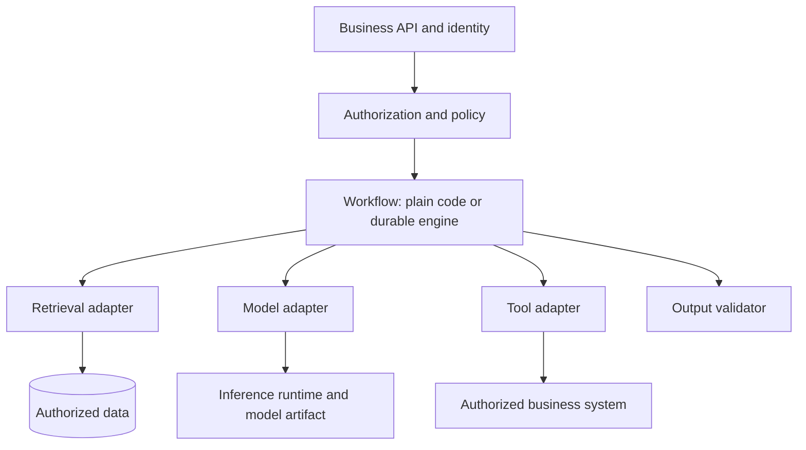
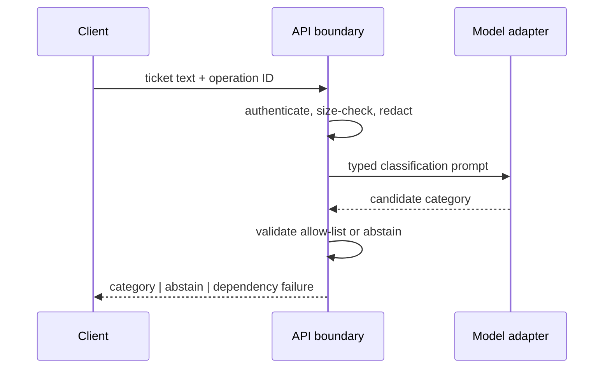
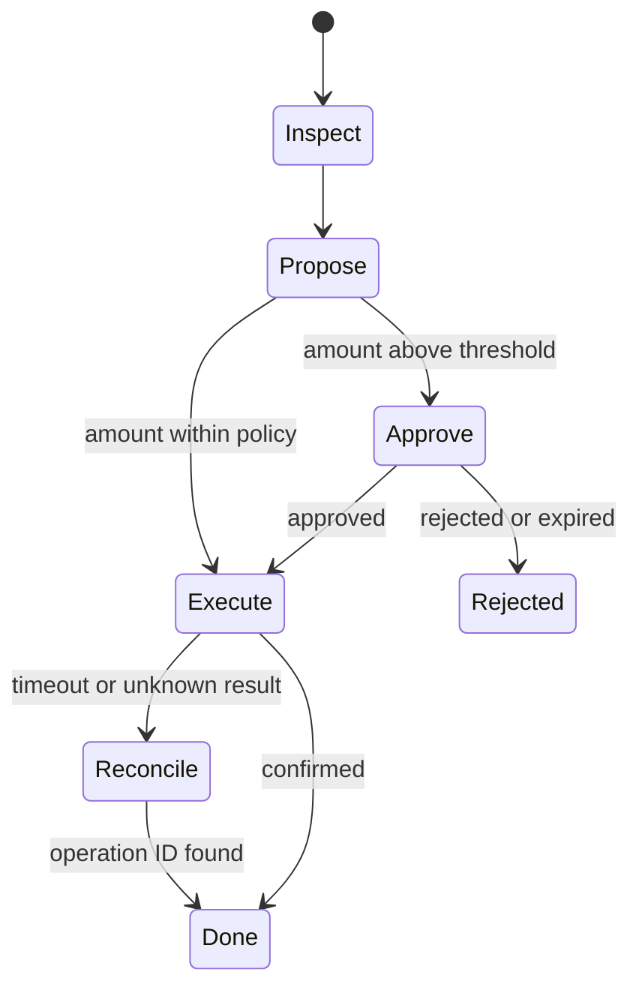
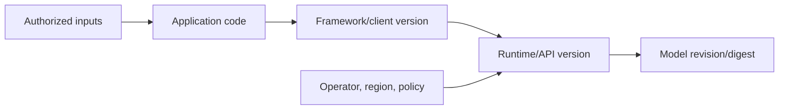
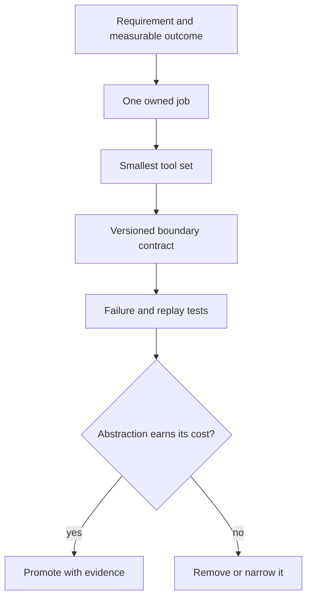
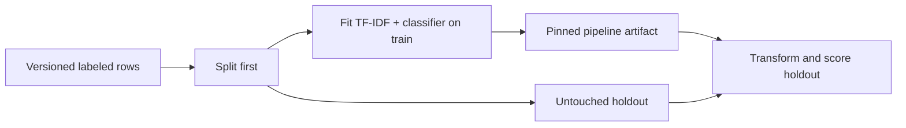
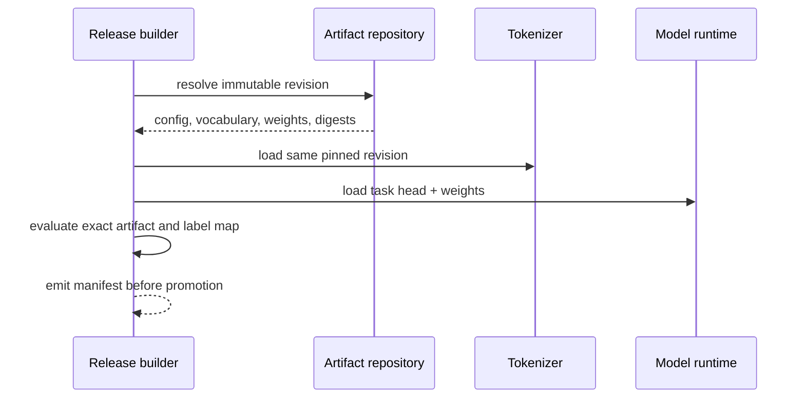
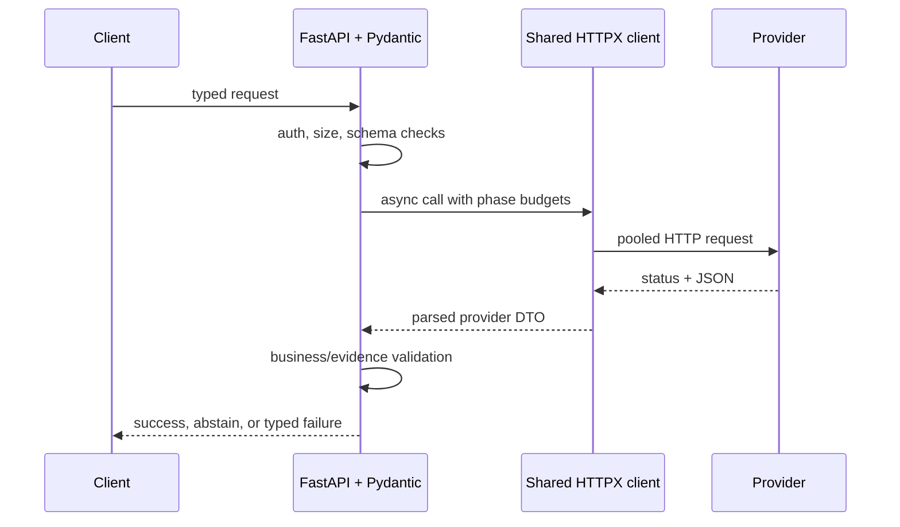
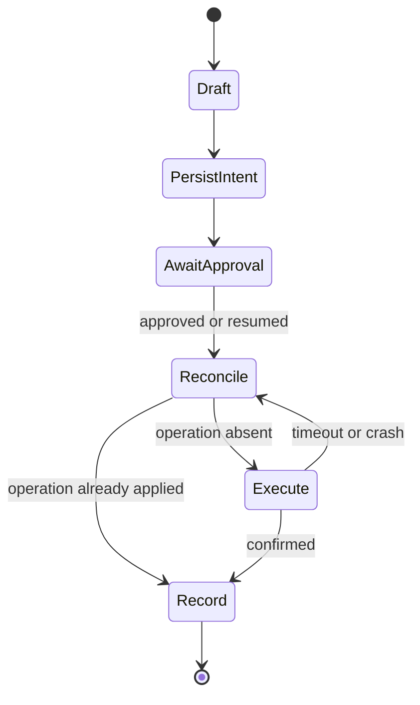

# Spring AI and Python APIs

This is the canonical incremental guide. It compares Java and Python implementation choices by contract and ownership boundary rather than treating a framework, model, runtime, and host as interchangeable. The guide currently processes source Sections 1–2, lines 6–56.

## Section 1 — Choose the layer before choosing the library

### Start with requirements, not package names

Before selecting Spring AI, FastAPI, an orchestration framework, or a model client, write the observable contract:

| Question | Required answer |
|---|---|
| What enters and leaves? | typed request, typed success, explicit no-answer and dependency-failure outcomes |
| Which evidence is authoritative? | database/search results before model prose; tenant and resource scope enforced before prompt construction |
| Which effects occur? | read-only model call, retrieval, durable write, tool invocation, or human approval |
| What may be retried? | only idempotent/read operations unless a durable operation key reconciles effects |
| What must survive restart? | nothing for a simple call; workflow state for branching, delayed or human-reviewed work |
| Who owns each layer? | team/service plus versioned framework, runtime, model revision, and operator |

The minimum useful pipeline is usually a typed boundary, deterministic business/retrieval logic, a model adapter, and an output validator. Add an orchestration layer when it removes repeated integration work or owns durable branching—not merely because the application uses a model.



The diagram is a contract map, not a requirement that every box be a separate service.

### Example 1 — one-call classification API

Requirement: classify a support ticket into one of five allowed categories and return a confidence/abstain outcome. No retrieval, tools, or durable branching.

Selected layers: HTTP/DTO validation → model adapter → allow-list validator. In Spring, a controller plus `ChatModel`/`ChatClient` adapter can be enough. In Python, FastAPI/Pydantic plus one explicit HTTP or SDK adapter can be enough. An agent graph adds persistence and transition states that the requirement never asked for.



Expected outcomes:

| Input condition | Output |
|---|---|
| model returns `billing` | accepted typed category |
| model returns `finance-admin` | `abstain` because it is outside the allow-list |
| provider times out | dependency failure, not a fabricated category |

### Example 2 — tenant-scoped RAG answer

Requirement: answer only from documents the authenticated user may read and cite every claim. The layer selection changes because retrieval is now an authority boundary.

Selected layers: API/identity → authorization predicate → retrieval adapter → context packer → model adapter → citation/output validator. A vector database is one possible retrieval implementation; it is not “RAG” by itself. The application must apply tenant/resource filters before candidate text enters the prompt and must reject citations outside the retrieved evidence IDs.

Trace:

| Step | Fact established | Failure behavior |
|---:|---|---|
| 1 | token identifies subject and tenant | reject invalid identity |
| 2 | policy derives permitted resource scope | fail closed |
| 3 | retrieval returns scoped evidence IDs | empty evidence becomes `NO_EVIDENCE` |
| 4 | packer preserves question and bounded evidence | reject over-budget request deterministically |
| 5 | model proposes answer and citations | no direct authority |
| 6 | validator proves every cited ID was retrieved | reject unsupported output |

Choose an orchestration framework only when repeated provider/retriever integrations or trace hooks outweigh its abstraction cost. The authorization predicate remains application-owned even when a framework supplies the retriever.

### Example 3 — refund tool with human review

Requirement: inspect an order, draft a refund, pause for approval above a threshold, execute exactly once, and resume after a restart. This does justify a durable workflow or graph.



The model may propose arguments; it does not authorize the refund. The tool adapter rechecks account/order scope and policy. Persist the operation ID before calling the payment system, and reconcile an unknown result before retrying. “The framework retries tools” is not a correctness policy.

### Example 4 — local model development versus production hosting

Requirement: prototype locally, then deploy reproducibly. Record four separate identities:

| Identity | Example | What a mismatch explains |
|---|---|---|
| client/framework | `spring-ai:2.0.1` or a pinned Python client | request/response mapping and retry behavior |
| inference runtime/API | Ollama release or hosted-provider API revision | supported fields, context/runtime behavior |
| model artifact | repository plus immutable commit/digest | tokenizer, weights, license and behavior |
| operator/host | laptop, internal platform, or named cloud account/region | network, policy, quota, observability and data handling |

“We use Spring AI,” “we use Python,” or “we use Hugging Face” does not identify the inference contract. Hugging Face can host versioned model artifacts and metadata; Ollama can run a local model or expose a cloud API; Spring AI is an application integration abstraction. Pin what you deploy and capture the resolved identities in release evidence.



### When to escalate from plain code to a framework

Use an explicit gate:

1. Start with narrow adapters and one end-to-end test.
2. Measure duplicated integration code, not imagined future nodes.
3. Escalate when there are several repeated integrations, durable branching, restart/resume, or human review.
4. Keep business authorization, idempotency, output semantics, and release identity outside opaque framework defaults.
5. Re-run contract tests when changing a library, runtime, model revision, or host independently.

The paired executable exercises encode this selection rule and the four-part release identity:

```bash
java -ea study-guides/backend/spring-ai-python/LayerSelectionContracts.java
python3 study-guides/backend/spring-ai-python/layer_selection_contracts.py
```

### Common mistakes and interview follow-ups

- **Framework equals model:** ask which process performs inference and which artifact it loaded.
- **Schema-valid equals correct:** DTO/Pydantic validation proves shape, not factual support or authorization.
- **Async equals nonblocking:** a blocking client inside a Python `async def` still blocks its worker; Java virtual threads still need downstream capacity limits.
- **Provider portability is perfect:** common interfaces do not erase provider-specific tool, streaming, token, safety, or error semantics.
- **Agent equals tool call:** one deterministic function call does not require a durable agent loop.

Interview variations: replace the model provider without changing the business API; move local inference to a managed host; add tenant-scoped retrieval; add a tool with an unknown outcome; explain exactly which new requirement justifies a workflow engine.

### Current primary references

- [Spring AI introduction](https://docs.spring.io/spring-ai/reference/index.html), [Model API](https://docs.spring.io/spring-ai/reference/api/index.html), and [Chat Model API](https://docs.spring.io/spring-ai/reference/api/chatmodel.html) — provider abstractions and model integration boundaries.
- [Spring AI tool calling](https://docs.spring.io/spring-ai/reference/api/tools.html) — current distinction between model-returned tool calls and application-driven execution.
- [Ollama API introduction](https://docs.ollama.com/api/introduction) and [usage metrics](https://docs.ollama.com/api/usage) — local/cloud runtime distinction and runtime evidence.
- [Hugging Face Model Hub](https://huggingface.co/docs/hub/models-the-hub) and [model cards](https://huggingface.co/docs/hub/model-cards) — versioned model artifacts and accompanying metadata.
- [FastAPI request bodies](https://fastapi.tiangolo.com/tutorial/body/) and [async guidance](https://fastapi.tiangolo.com/async/) — transport/validation and blocking-boundary behavior.

## Section 2 — Python library map: purpose, ownership and trade-offs

### Select one owner for each required job

A Python AI stack is not a single ladder from “basic” to “advanced.” The projects in the source map own different jobs. Select from observable requirements, and remove any package whose responsibility you cannot name.

| Job family | Focused choices from the source | Owned contract | Do not assume |
|---|---|---|---|
| arrays and tabular analysis | NumPy, pandas | dtypes, shapes, vector math, cleaning, inspection | a DataFrame is a durable corpus store |
| statistical or neural modeling | scikit-learn, PyTorch, Transformers, Sentence Transformers | fit/evaluate, tensor execution, model/tokenizer loading, embeddings/reranking | a large language model is the best baseline |
| local or explicit model transport | Ollama Python, HTTPX | typed runtime client or explicit sync/async HTTP exchange | a client package installs or authorizes a model |
| API boundary | FastAPI, Pydantic | HTTP/ASGI handling, typed parsing, JSON Schema | schema-valid output is factually supported |
| orchestration and retrieval | LangChain, LangGraph, LlamaIndex, Haystack | integration glue, durable graph state, ingestion/indexing, component pipelines | the framework supplies business authorization or idempotency |
| protocols and evidence | MCP SDK, Ragas, MLflow | tool/resource protocol, task evaluation, experiment/trace evidence | a judge score or stored trace is automatically safe or calibrated |

The smallest correct stack often spans two or three rows. It should not contain one tool from every row. Before adding a package, write:

1. the job it owns and the interface on each side;
2. the artifact, configuration, and library versions required to reproduce it;
3. the resource model—memory, accelerator, connection pool, worker, or persisted state;
4. the failure and retry boundary;
5. the evidence that would justify keeping the abstraction.



### Example 1 — prove the classical baseline before adding a model runtime

Requirement: classify short support tickets with a reproducible held-out score and explain which terms influenced the decision. Start with NumPy/scikit-learn and a TF-IDF plus linear-classifier pipeline. pandas may help inspect data, but it is not required in the serving path. PyTorch, Transformers, a model server, and an agent framework own no required job yet.

The split must happen before any learned preprocessing is fit. A pipeline makes the vectorizer and classifier fit only on training folds; fitting TF-IDF on the full corpus leaks test-set document statistics into evaluation.

```python
from sklearn.feature_extraction.text import TfidfVectorizer
from sklearn.linear_model import LogisticRegression
from sklearn.pipeline import make_pipeline

baseline = make_pipeline(
    TfidfVectorizer(ngram_range=(1, 2), min_df=2),
    LogisticRegression(max_iter=1_000, random_state=7),
)
baseline.fit(train_text, train_label)       # train partition only
score = baseline.score(test_text, test_label)  # untouched holdout
```

Trace:

| Step | Evidence | Reject when |
|---:|---|---|
| 1 | immutable dataset revision and label policy | labels or duplicate policy are unknown |
| 2 | train/test split IDs written before fitting | preprocessing saw holdout rows |
| 3 | one pipeline fits vectorizer and classifier | test score drove repeated manual tuning |
| 4 | baseline metric plus confusion slices | aggregate score hides a critical class |
| 5 | latency and artifact size measured | a larger model has no demonstrated gain |



### Example 2 — load a local pretrained model as a versioned artifact

Requirement: compare a local pretrained classifier with the baseline. Transformers owns model/tokenizer construction; PyTorch owns tensor execution and the loaded state. Neither owns the business label policy, evaluation split, or deployment authorization.

Treat the tokenizer, model weights/configuration, runtime version, and task head as one compatibility set. Pin an immutable repository revision for both tokenizer and model, record the resolved commit, and evaluate the exact promoted artifact. A floating repository name can resolve to new bytes without an application-code change.

```python
from transformers import AutoModelForSequenceClassification, AutoTokenizer

MODEL = "org/ticket-classifier"
REVISION = "immutable-commit-sha"
tokenizer = AutoTokenizer.from_pretrained(MODEL, revision=REVISION)
model = AutoModelForSequenceClassification.from_pretrained(MODEL, revision=REVISION)
model.eval()
```

| Boundary | Required release evidence | Typical mismatch |
|---|---|---|
| tokenizer | repository, revision, vocabulary/config digest | token IDs differ from training |
| model | repository, revision, task head, weights/config digest | wrong output shape or labels |
| runtime | Python, Transformers, PyTorch, device/backend versions | unsupported operator or device behavior |
| application | label map, thresholds, input limits | technically valid but wrong business result |



### Example 3 — explicit asynchronous provider API

Requirement: expose a typed Python endpoint that calls one remote model provider. The narrow stack is FastAPI for the ASGI boundary, Pydantic for structural request/response validation, and one long-lived HTTPX `AsyncClient` for the provider protocol. This does not yet require LangChain or a graph.

Create the client in application lifespan, close it at shutdown, bound pool size, and set connect/read/write/pool timeouts intentionally. Do not create a client inside a hot loop: the reusable client owns connection pooling. An `async def` route remains blockable if it directly calls a blocking SDK or CPU-heavy model; isolate that work or choose a synchronous route/worker plan deliberately.

```python
timeout = httpx.Timeout(connect=0.25, read=2.0, write=0.5, pool=0.1)
limits = httpx.Limits(max_connections=64, max_keepalive_connections=16)
client = httpx.AsyncClient(timeout=timeout, limits=limits)

async def call_provider(request: ProviderRequest) -> ProviderResponse:
    response = await client.post(PROVIDER_URL, json=request.model_dump())
    response.raise_for_status()
    parsed = ProviderResponse.model_validate(response.json())
    return validate_business_semantics(parsed)  # shape is not truth
```

Trace:

| Event | Owner | Observable outcome |
|---|---|---|
| request parse fails | Pydantic/API boundary | stable 4xx; provider is not called |
| pool slot unavailable | HTTPX pool timeout | bounded dependency failure and saturation metric |
| connection/read phase expires | HTTPX adapter | phase-specific timeout; retry only if operation semantics allow |
| JSON has correct shape but unsupported citation | application validator | reject or abstain |
| application shuts down | lifespan owner | client closes; connections are released |



### Example 4 — add durable graph orchestration only for replayable state

Requirement: draft a refund, pause for human approval, survive restart, then call a payment API exactly once from the application's point of view. LangGraph can own persisted graph position and resumption. HTTPX or a focused SDK still owns transport; the payment system owns the actual effect; application code owns authorization and idempotency.

Persist the operation ID and proposed arguments before the effect. On resume, a node may run again, so first query the effect ledger/provider by operation ID. “The graph checkpointed” does not prove the external refund did or did not happen.

| Replay state | Decision |
|---|---|
| no approval | remain paused; make no payment call |
| approved, operation absent | execute with stable idempotency key |
| timeout, operation status unknown | reconcile before any retry |
| operation already applied | record result and advance without a second effect |



Use LlamaIndex or Haystack instead when ingestion, indexing, and explicit retrieval components dominate. Use LangChain when numerous model/tool/retrieval integrations eliminate proven repeated glue. Use the MCP SDK when the requirement is an interoperable tool/resource/prompt protocol. Add Ragas or MLflow when an evaluation or evidence-retention requirement exists—and define calibration, redaction, access, and retention before storing production prompts or traces.

### Executable selection and boundary contracts

The dependency-free Java/Python pair proves the four minimal tool sets, clean-evaluation gate, pinned model/tokenizer identity, phase-timeout budget, and replay-safe effect decision:

```bash
java -ea study-guides/backend/spring-ai-python/LibrarySelectionContracts.java
python3 study-guides/backend/spring-ai-python/library_selection_contracts.py
```

These programs test decision logic; they do not pretend to compile FastAPI, HTTPX, scikit-learn, PyTorch, Transformers, or LangGraph integrations without those dependency graphs.

### Common mistakes and interview follow-ups

- **Install the whole ecosystem:** require a named owner and deletion test for every dependency.
- **DataFrame as production storage:** pandas is excellent for bounded analysis, not tenant authorization, transactions, or durable corpus serving.
- **Pretrained means reproducible:** pin model and tokenizer revisions plus runtime/device compatibility.
- **Pydantic means correct:** structural parsing cannot prove citation support, policy, or factual truth.
- **Async means unlimited:** bound connection pools, workers, queues, and every wait phase.
- **Checkpoint means exactly once:** graph replay requires idempotent effects or reconciliation with stable operation IDs.
- **Evaluation framework means objective judge:** calibrate against reviewed data and track judge/model versions.

Interview variations: remove a framework without changing the business contract; prove the classical baseline is insufficient; replace a local model with a hosted adapter; diagnose pool starvation separately from provider read timeout; resume after a crash between external success and local checkpoint.

### Current primary references

- [scikit-learn common pitfalls](https://scikit-learn.org/stable/common_pitfalls.html) and [pipelines](https://scikit-learn.org/stable/modules/compose.html) — split-before-fit discipline and leakage-resistant preprocessing.
- [Hugging Face Transformers auto classes](https://huggingface.co/docs/transformers/model_doc/auto) and [model loading](https://huggingface.co/docs/transformers/models) — task-specific model/tokenizer construction and pretrained artifact loading.
- [PyTorch serialization semantics](https://docs.pytorch.org/docs/stable/notes/serialization.html) — state-dictionary ownership and safer artifact loading boundaries.
- [FastAPI concurrency](https://fastapi.tiangolo.com/async/) and [lifespan events](https://fastapi.tiangolo.com/advanced/events/) — sync/async execution boundaries and resource lifecycle.
- [HTTPX async support](https://www.python-httpx.org/async/), [timeouts](https://www.python-httpx.org/advanced/timeouts/), [resource limits](https://www.python-httpx.org/advanced/resource-limits/), and [clients](https://www.python-httpx.org/advanced/clients/) — reusable pools and bounded wait phases.
- [LangGraph Functional API](https://docs.langchain.com/oss/python/langgraph/functional-api) — durable replay and idempotent-side-effect requirements.

### Source provenance and continuation

The selected editable source is `atlas_guides/spring_ai_python_api_interview_guide.md` from `ai_cicd_spring_python_guides_complete.zip`, bundle SHA-256 `c52c8295ae7ff7d08013e30a8d7097480719db78104a91b79e367a382465dd31`, member SHA-256 `af25c41d54a3ca18dfc60b6cf828515ab6afb7e39cf64c7df94fe4a44eb4a553`. Sections 1–2 promote source lines 6–56. Section 2 preserves the source's 17-project selection map while adding four requirement-driven examples, trace tables, paired executable contracts, failure/replay tests, and refreshed primary references. The standalone HTML SHA-256 `6289a19e0ce5514c25d96d44806d47063e726244b5d55d13422234d3e499f3a3` is byte-identical to the bundle’s generated HTML and remains comparison evidence rather than a duplicate guide. Section 3, **Java library map and how it differs**, begins at source line 57 and remains queued after fair domain rotation. The 25-section source is not complete.
