# Spring AI and Python APIs

This is the canonical incremental guide. It compares Java and Python implementation choices by contract and ownership boundary rather than treating a framework, model, runtime, and host as interchangeable. The guide currently processes source Sections 1–4, lines 6–202.

## Section 1 — Choose the layer before choosing the library

### Start with requirements, not package names

Before selecting Spring AI, FastAPI, an orchestration framework, or a model client, write the observable contract:

| Question | Required answer |
|---|---|
| What enters and leaves? | typed request, typed success, explicit no-answer and dependency-failure outcomes |
| Which evidence is authoritative? | database/search results before model prose; tenant and resource scope enforced before prompt construction |
| Which effects occur? | read-only model call, retrieval, durable write, tool invocation, or human approval |
| What may be retried? | only idempotent/read operations unless a durable operation key reconciles effects |
| What must survive restart? | nothing for a simple call; workflow state for branching, delayed or human-reviewed work |
| Who owns each layer? | team/service plus versioned framework, runtime, model revision, and operator |

The minimum useful pipeline is usually a typed boundary, deterministic business/retrieval logic, a model adapter, and an output validator. Add an orchestration layer when it removes repeated integration work or owns durable branching—not merely because the application uses a model.

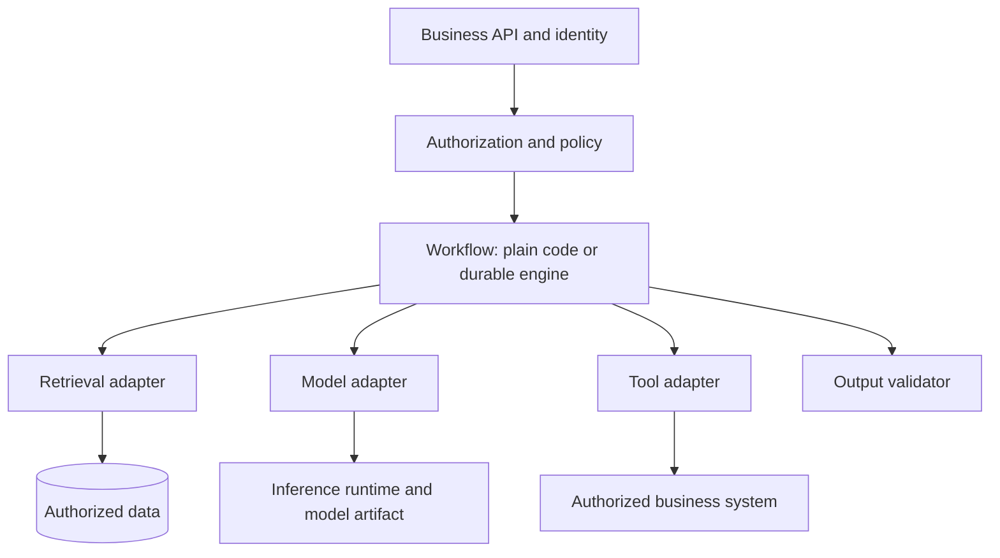

The diagram is a contract map, not a requirement that every box be a separate service.

### Example 1 — one-call classification API

Requirement: classify a support ticket into one of five allowed categories and return a confidence/abstain outcome. No retrieval, tools, or durable branching.

Selected layers: HTTP/DTO validation → model adapter → allow-list validator. In Spring, a controller plus `ChatModel`/`ChatClient` adapter can be enough. In Python, FastAPI/Pydantic plus one explicit HTTP or SDK adapter can be enough. An agent graph adds persistence and transition states that the requirement never asked for.

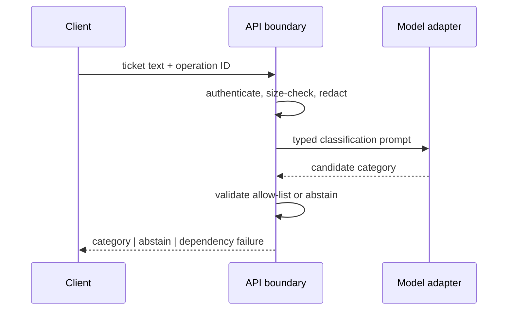

Expected outcomes:

| Input condition | Output |
|---|---|
| model returns `billing` | accepted typed category |
| model returns `finance-admin` | `abstain` because it is outside the allow-list |
| provider times out | dependency failure, not a fabricated category |

### Example 2 — tenant-scoped RAG answer

Requirement: answer only from documents the authenticated user may read and cite every claim. The layer selection changes because retrieval is now an authority boundary.

Selected layers: API/identity → authorization predicate → retrieval adapter → context packer → model adapter → citation/output validator. A vector database is one possible retrieval implementation; it is not “RAG” by itself. The application must apply tenant/resource filters before candidate text enters the prompt and must reject citations outside the retrieved evidence IDs.

Trace:

| Step | Fact established | Failure behavior |
|---:|---|---|
| 1 | token identifies subject and tenant | reject invalid identity |
| 2 | policy derives permitted resource scope | fail closed |
| 3 | retrieval returns scoped evidence IDs | empty evidence becomes `NO_EVIDENCE` |
| 4 | packer preserves question and bounded evidence | reject over-budget request deterministically |
| 5 | model proposes answer and citations | no direct authority |
| 6 | validator proves every cited ID was retrieved | reject unsupported output |

Choose an orchestration framework only when repeated provider/retriever integrations or trace hooks outweigh its abstraction cost. The authorization predicate remains application-owned even when a framework supplies the retriever.

### Example 3 — refund tool with human review

Requirement: inspect an order, draft a refund, pause for approval above a threshold, execute exactly once, and resume after a restart. This does justify a durable workflow or graph.

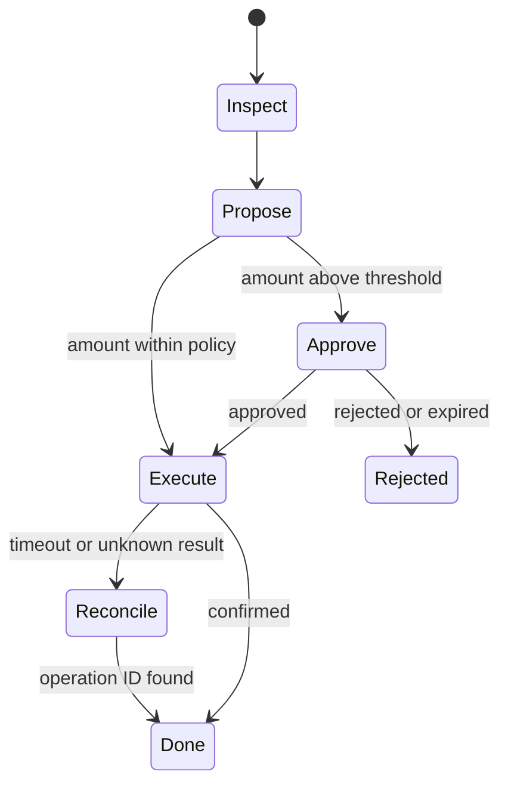

The model may propose arguments; it does not authorize the refund. The tool adapter rechecks account/order scope and policy. Persist the operation ID before calling the payment system, and reconcile an unknown result before retrying. “The framework retries tools” is not a correctness policy.

### Example 4 — local model development versus production hosting

Requirement: prototype locally, then deploy reproducibly. Record four separate identities:

| Identity | Example | What a mismatch explains |
|---|---|---|
| client/framework | `spring-ai:2.0.1` or a pinned Python client | request/response mapping and retry behavior |
| inference runtime/API | Ollama release or hosted-provider API revision | supported fields, context/runtime behavior |
| model artifact | repository plus immutable commit/digest | tokenizer, weights, license and behavior |
| operator/host | laptop, internal platform, or named cloud account/region | network, policy, quota, observability and data handling |

“We use Spring AI,” “we use Python,” or “we use Hugging Face” does not identify the inference contract. Hugging Face can host versioned model artifacts and metadata; Ollama can run a local model or expose a cloud API; Spring AI is an application integration abstraction. Pin what you deploy and capture the resolved identities in release evidence.

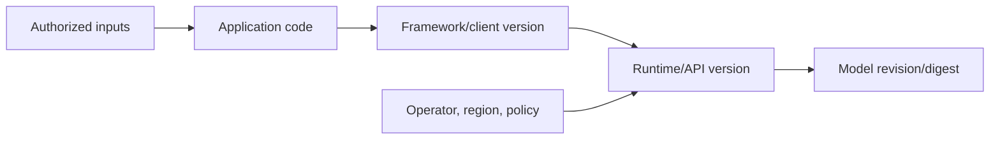

### When to escalate from plain code to a framework

Use an explicit gate:

1. Start with narrow adapters and one end-to-end test.
2. Measure duplicated integration code, not imagined future nodes.
3. Escalate when there are several repeated integrations, durable branching, restart/resume, or human review.
4. Keep business authorization, idempotency, output semantics, and release identity outside opaque framework defaults.
5. Re-run contract tests when changing a library, runtime, model revision, or host independently.

The paired executable exercises encode this selection rule and the four-part release identity:

```bash
java -ea study-guides/backend/spring-ai-python/LayerSelectionContracts.java
python3 study-guides/backend/spring-ai-python/layer_selection_contracts.py
```

### Common mistakes and interview follow-ups

- **Framework equals model:** ask which process performs inference and which artifact it loaded.
- **Schema-valid equals correct:** DTO/Pydantic validation proves shape, not factual support or authorization.
- **Async equals nonblocking:** a blocking client inside a Python `async def` still blocks its worker; Java virtual threads still need downstream capacity limits.
- **Provider portability is perfect:** common interfaces do not erase provider-specific tool, streaming, token, safety, or error semantics.
- **Agent equals tool call:** one deterministic function call does not require a durable agent loop.

Interview variations: replace the model provider without changing the business API; move local inference to a managed host; add tenant-scoped retrieval; add a tool with an unknown outcome; explain exactly which new requirement justifies a workflow engine.

### Current primary references

- [Spring AI introduction](https://docs.spring.io/spring-ai/reference/index.html), [Model API](https://docs.spring.io/spring-ai/reference/api/index.html), and [Chat Model API](https://docs.spring.io/spring-ai/reference/api/chatmodel.html) — provider abstractions and model integration boundaries.
- [Spring AI tool calling](https://docs.spring.io/spring-ai/reference/api/tools.html) — current distinction between model-returned tool calls and application-driven execution.
- [Ollama API introduction](https://docs.ollama.com/api/introduction) and [usage metrics](https://docs.ollama.com/api/usage) — local/cloud runtime distinction and runtime evidence.
- [Hugging Face Model Hub](https://huggingface.co/docs/hub/models-the-hub) and [model cards](https://huggingface.co/docs/hub/model-cards) — versioned model artifacts and accompanying metadata.
- [FastAPI request bodies](https://fastapi.tiangolo.com/tutorial/body/) and [async guidance](https://fastapi.tiangolo.com/async/) — transport/validation and blocking-boundary behavior.

## Section 2 — Python library map: purpose, ownership and trade-offs

### Select one owner for each required job

A Python AI stack is not a single ladder from “basic” to “advanced.” The projects in the source map own different jobs. Select from observable requirements, and remove any package whose responsibility you cannot name.

| Job family | Focused choices from the source | Owned contract | Do not assume |
|---|---|---|---|
| arrays and tabular analysis | NumPy, pandas | dtypes, shapes, vector math, cleaning, inspection | a DataFrame is a durable corpus store |
| statistical or neural modeling | scikit-learn, PyTorch, Transformers, Sentence Transformers | fit/evaluate, tensor execution, model/tokenizer loading, embeddings/reranking | a large language model is the best baseline |
| local or explicit model transport | Ollama Python, HTTPX | typed runtime client or explicit sync/async HTTP exchange | a client package installs or authorizes a model |
| API boundary | FastAPI, Pydantic | HTTP/ASGI handling, typed parsing, JSON Schema | schema-valid output is factually supported |
| orchestration and retrieval | LangChain, LangGraph, LlamaIndex, Haystack | integration glue, durable graph state, ingestion/indexing, component pipelines | the framework supplies business authorization or idempotency |
| protocols and evidence | MCP SDK, Ragas, MLflow | tool/resource protocol, task evaluation, experiment/trace evidence | a judge score or stored trace is automatically safe or calibrated |

The smallest correct stack often spans two or three rows. It should not contain one tool from every row. Before adding a package, write:

1. the job it owns and the interface on each side;
2. the artifact, configuration, and library versions required to reproduce it;
3. the resource model—memory, accelerator, connection pool, worker, or persisted state;
4. the failure and retry boundary;
5. the evidence that would justify keeping the abstraction.

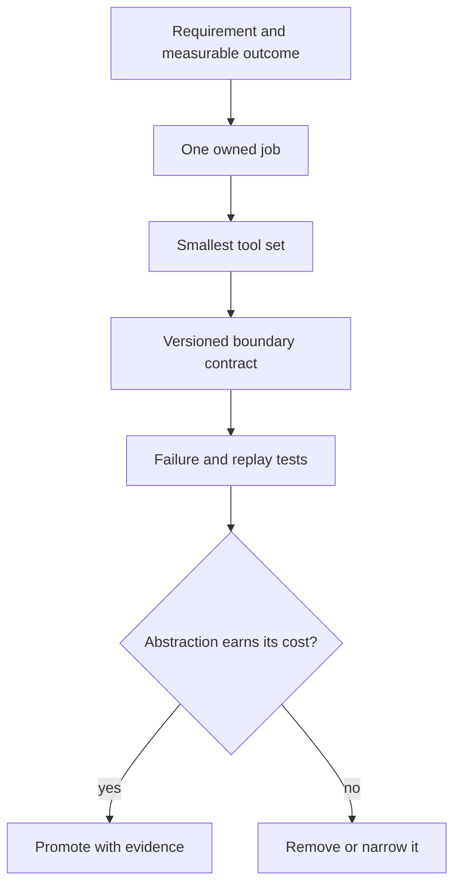

### Example 1 — prove the classical baseline before adding a model runtime

Requirement: classify short support tickets with a reproducible held-out score and explain which terms influenced the decision. Start with NumPy/scikit-learn and a TF-IDF plus linear-classifier pipeline. pandas may help inspect data, but it is not required in the serving path. PyTorch, Transformers, a model server, and an agent framework own no required job yet.

The split must happen before any learned preprocessing is fit. A pipeline makes the vectorizer and classifier fit only on training folds; fitting TF-IDF on the full corpus leaks test-set document statistics into evaluation.

```python
from sklearn.feature_extraction.text import TfidfVectorizer
from sklearn.linear_model import LogisticRegression
from sklearn.pipeline import make_pipeline

baseline = make_pipeline(
    TfidfVectorizer(ngram_range=(1, 2), min_df=2),
    LogisticRegression(max_iter=1_000, random_state=7),
)
baseline.fit(train_text, train_label)       # train partition only
score = baseline.score(test_text, test_label)  # untouched holdout
```

Trace:

| Step | Evidence | Reject when |
|---:|---|---|
| 1 | immutable dataset revision and label policy | labels or duplicate policy are unknown |
| 2 | train/test split IDs written before fitting | preprocessing saw holdout rows |
| 3 | one pipeline fits vectorizer and classifier | test score drove repeated manual tuning |
| 4 | baseline metric plus confusion slices | aggregate score hides a critical class |
| 5 | latency and artifact size measured | a larger model has no demonstrated gain |

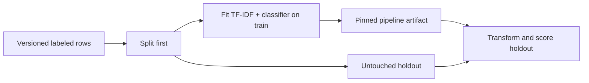

### Example 2 — load a local pretrained model as a versioned artifact

Requirement: compare a local pretrained classifier with the baseline. Transformers owns model/tokenizer construction; PyTorch owns tensor execution and the loaded state. Neither owns the business label policy, evaluation split, or deployment authorization.

Treat the tokenizer, model weights/configuration, runtime version, and task head as one compatibility set. Pin an immutable repository revision for both tokenizer and model, record the resolved commit, and evaluate the exact promoted artifact. A floating repository name can resolve to new bytes without an application-code change.

```python
from transformers import AutoModelForSequenceClassification, AutoTokenizer

MODEL = "org/ticket-classifier"
REVISION = "immutable-commit-sha"
tokenizer = AutoTokenizer.from_pretrained(MODEL, revision=REVISION)
model = AutoModelForSequenceClassification.from_pretrained(MODEL, revision=REVISION)
model.eval()
```

| Boundary | Required release evidence | Typical mismatch |
|---|---|---|
| tokenizer | repository, revision, vocabulary/config digest | token IDs differ from training |
| model | repository, revision, task head, weights/config digest | wrong output shape or labels |
| runtime | Python, Transformers, PyTorch, device/backend versions | unsupported operator or device behavior |
| application | label map, thresholds, input limits | technically valid but wrong business result |

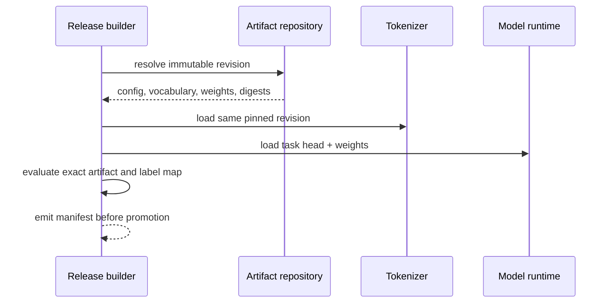

### Example 3 — explicit asynchronous provider API

Requirement: expose a typed Python endpoint that calls one remote model provider. The narrow stack is FastAPI for the ASGI boundary, Pydantic for structural request/response validation, and one long-lived HTTPX `AsyncClient` for the provider protocol. This does not yet require LangChain or a graph.

Create the client in application lifespan, close it at shutdown, bound pool size, and set connect/read/write/pool timeouts intentionally. Do not create a client inside a hot loop: the reusable client owns connection pooling. An `async def` route remains blockable if it directly calls a blocking SDK or CPU-heavy model; isolate that work or choose a synchronous route/worker plan deliberately.

```python
timeout = httpx.Timeout(connect=0.25, read=2.0, write=0.5, pool=0.1)
limits = httpx.Limits(max_connections=64, max_keepalive_connections=16)
client = httpx.AsyncClient(timeout=timeout, limits=limits)

async def call_provider(request: ProviderRequest) -> ProviderResponse:
    response = await client.post(PROVIDER_URL, json=request.model_dump())
    response.raise_for_status()
    parsed = ProviderResponse.model_validate(response.json())
    return validate_business_semantics(parsed)  # shape is not truth
```

Trace:

| Event | Owner | Observable outcome |
|---|---|---|
| request parse fails | Pydantic/API boundary | stable 4xx; provider is not called |
| pool slot unavailable | HTTPX pool timeout | bounded dependency failure and saturation metric |
| connection/read phase expires | HTTPX adapter | phase-specific timeout; retry only if operation semantics allow |
| JSON has correct shape but unsupported citation | application validator | reject or abstain |
| application shuts down | lifespan owner | client closes; connections are released |

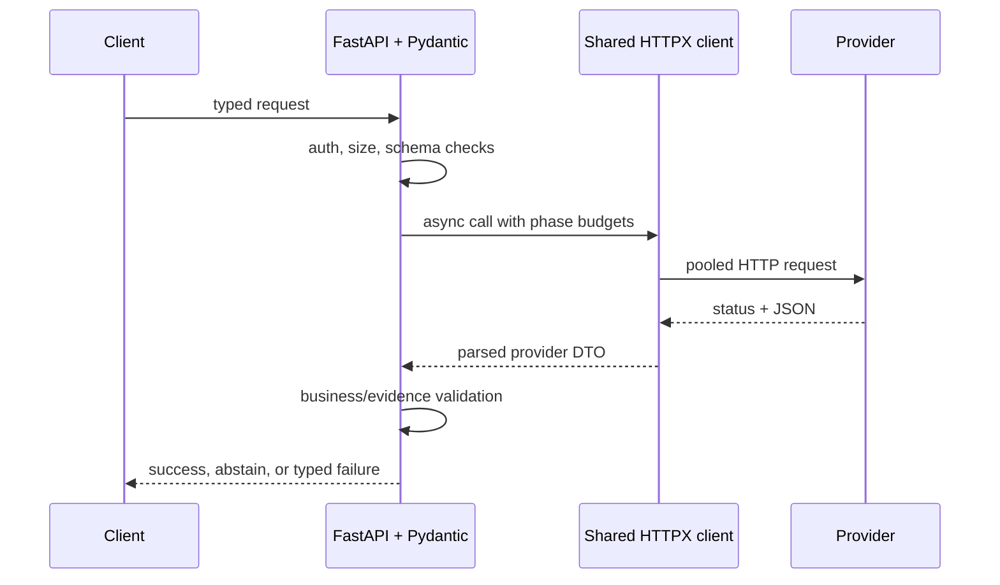

### Example 4 — add durable graph orchestration only for replayable state

Requirement: draft a refund, pause for human approval, survive restart, then call a payment API exactly once from the application's point of view. LangGraph can own persisted graph position and resumption. HTTPX or a focused SDK still owns transport; the payment system owns the actual effect; application code owns authorization and idempotency.

Persist the operation ID and proposed arguments before the effect. On resume, a node may run again, so first query the effect ledger/provider by operation ID. “The graph checkpointed” does not prove the external refund did or did not happen.

| Replay state | Decision |
|---|---|
| no approval | remain paused; make no payment call |
| approved, operation absent | execute with stable idempotency key |
| timeout, operation status unknown | reconcile before any retry |
| operation already applied | record result and advance without a second effect |

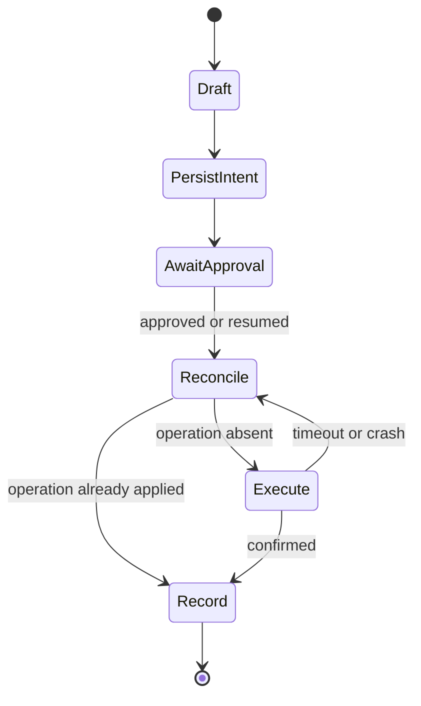

Use LlamaIndex or Haystack instead when ingestion, indexing, and explicit retrieval components dominate. Use LangChain when numerous model/tool/retrieval integrations eliminate proven repeated glue. Use the MCP SDK when the requirement is an interoperable tool/resource/prompt protocol. Add Ragas or MLflow when an evaluation or evidence-retention requirement exists—and define calibration, redaction, access, and retention before storing production prompts or traces.

### Executable selection and boundary contracts

The dependency-free Java/Python pair proves the four minimal tool sets, clean-evaluation gate, pinned model/tokenizer identity, phase-timeout budget, and replay-safe effect decision:

```bash
java -ea study-guides/backend/spring-ai-python/LibrarySelectionContracts.java
python3 study-guides/backend/spring-ai-python/library_selection_contracts.py
```

These programs test decision logic; they do not pretend to compile FastAPI, HTTPX, scikit-learn, PyTorch, Transformers, or LangGraph integrations without those dependency graphs.

### Common mistakes and interview follow-ups

- **Install the whole ecosystem:** require a named owner and deletion test for every dependency.
- **DataFrame as production storage:** pandas is excellent for bounded analysis, not tenant authorization, transactions, or durable corpus serving.
- **Pretrained means reproducible:** pin model and tokenizer revisions plus runtime/device compatibility.
- **Pydantic means correct:** structural parsing cannot prove citation support, policy, or factual truth.
- **Async means unlimited:** bound connection pools, workers, queues, and every wait phase.
- **Checkpoint means exactly once:** graph replay requires idempotent effects or reconciliation with stable operation IDs.
- **Evaluation framework means objective judge:** calibrate against reviewed data and track judge/model versions.

Interview variations: remove a framework without changing the business contract; prove the classical baseline is insufficient; replace a local model with a hosted adapter; diagnose pool starvation separately from provider read timeout; resume after a crash between external success and local checkpoint.

### Current primary references

- [scikit-learn common pitfalls](https://scikit-learn.org/stable/common_pitfalls.html) and [pipelines](https://scikit-learn.org/stable/modules/compose.html) — split-before-fit discipline and leakage-resistant preprocessing.
- [Hugging Face Transformers auto classes](https://huggingface.co/docs/transformers/model_doc/auto) and [model loading](https://huggingface.co/docs/transformers/models) — task-specific model/tokenizer construction and pretrained artifact loading.
- [PyTorch serialization semantics](https://docs.pytorch.org/docs/stable/notes/serialization.html) — state-dictionary ownership and safer artifact loading boundaries.
- [FastAPI concurrency](https://fastapi.tiangolo.com/async/) and [lifespan events](https://fastapi.tiangolo.com/advanced/events/) — sync/async execution boundaries and resource lifecycle.
- [HTTPX async support](https://www.python-httpx.org/async/), [timeouts](https://www.python-httpx.org/advanced/timeouts/), [resource limits](https://www.python-httpx.org/advanced/resource-limits/), and [clients](https://www.python-httpx.org/advanced/clients/) — reusable pools and bounded wait phases.
- [LangGraph Functional API](https://docs.langchain.com/oss/python/langgraph/functional-api) — durable replay and idempotent-side-effect requirements.

## Section 3 — Java library map: choose the owner, then the abstraction

### Preserve the source map, but select by contract

The Java projects in the source solve different jobs. Spring AI and LangChain4j are application-integration choices; the MCP SDK is a protocol implementation; Spring Security, Reactor, validation, resilience, telemetry and JDBC are general application infrastructure; DJL and ONNX Runtime Java can run models inside the JVM. None of them makes authorization, evidence quality, idempotency or capacity decisions for the application.

| Library / project | Job it can own | Python-side analogy | Boundary to make explicit |
|---|---|---|---|
| Spring AI | Spring-native chat, embedding, vector-store and tool adapters | parts of LangChain/LlamaIndex integrated with Spring | provider features and business policy remain outside the abstraction |
| LangChain4j | Java LLM integrations, AI Services, tools, memory and RAG helpers | similar problem space to LangChain | independent Java API, not a Python translation or a model runtime |
| MCP Java SDK | MCP client/server protocol implementation | official Python MCP SDK | pin SDK and protocol revision; negotiate capabilities |
| Spring AI MCP starters | Boot auto-configuration for MCP transports and annotations | protocol SDK integrated into a web framework | HTTP transports need a deliberate authentication/authorization boundary |
| Spring Security | authentication plus request, method and domain authorization | framework identity/policy middleware | endpoint authentication does not prove resource-level access |
| Reactor / WebFlux | nonblocking streams, demand and scheduling | async streams/ASGI concepts | blocking work, scheduler choice and bounded demand remain design decisions |
| Jakarta Validation | structural constraints on Java DTOs | Pydantic constraints | valid shape does not prove truth, authorization or citation support |
| Resilience4j | retry, rate limit, circuit breaker, bulkhead and time limit | focused resilience primitives | choose one retry owner and preserve a total deadline |
| Micrometer / OpenTelemetry | metrics, observations and distributed traces | OTel Python and metrics clients | prompts, resource IDs and user IDs are unsafe high-cardinality labels |
| Deep Java Library (DJL) | engine-agnostic Java deep-learning APIs and translators | selected PyTorch/Transformers workflows | native engine, model format, preprocessing and predictor ownership must match |
| ONNX Runtime Java | direct JVM inference for compatible ONNX artifacts | ONNX Runtime Python | operator support, tensor shape/type and pre/post-processing are part of the artifact contract |
| JDBC / database drivers | SQL transactions and database wire access | DB-API drivers such as psycopg | pooling, transaction scope and publication consistency still apply in AI services |

Use the narrowest row set that satisfies a written requirement. Do not install both Spring AI and LangChain4j merely to preserve optionality. Hide the selected framework behind an application-owned port only when there is a real replacement or testing need, and test the semantic gap—stream events, tool-call arguments, token accounting, errors and cancellation—not just method signatures.

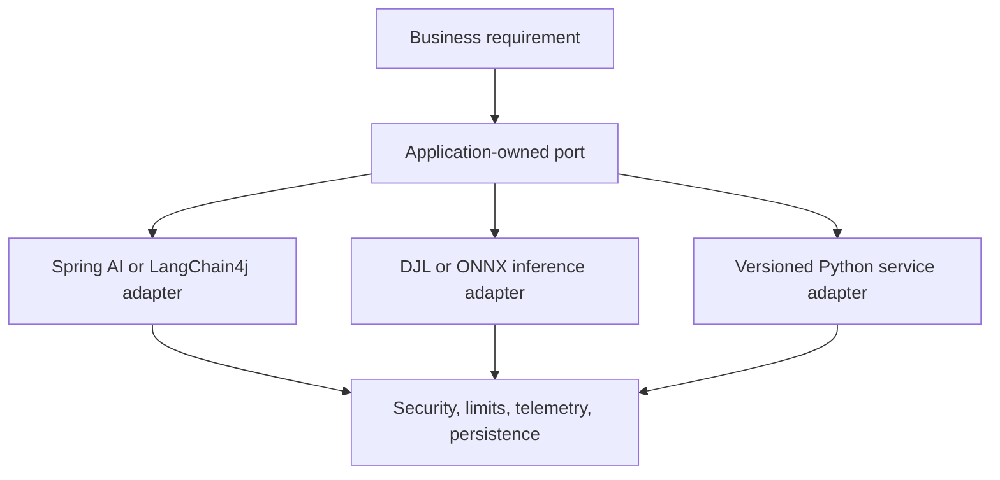

### Example 1 — Spring business service with an MCP tool

Requirement: a signed-in support agent asks for an order summary; the model may call a read-only `lookup_order` tool, but only for an order the agent may view. The service must emit traces without prompt or customer data in metric labels.

Choose Spring AI for the model/tool adapter, an MCP Java SDK or Spring AI MCP starter only if an MCP transport is actually required, Spring Security for request and method authorization, Jakarta Validation for DTO shape, and Micrometer/OpenTelemetry for bounded evidence. Keep the resource predicate in application code and repeat it inside the tool boundary. Spring AI's current MCP starter documentation explicitly says HTTP transports expose an unauthenticated JSON-RPC endpoint by default, so network reachability must not be treated as authority.

```java
public OrderSummary lookupOrder(ToolRequest request, Principal principal) {
    var orderId = requireValidId(request.orderId());       // shape only
    authorization.checkCanReadOrder(principal, orderId);   // resource authority
    return orders.readSummary(orderId);                    // scoped projection
}
```

Trace:

| Step | Owner | Required result |
|---:|---|---|
| 1 | Spring Security | authenticated principal and request-level policy |
| 2 | application service | authorized resource scope before prompt/tool exposure |
| 3 | model adapter | proposed tool name and structurally parsed arguments |
| 4 | tool service | resource authorization repeated; read executes only if allowed |
| 5 | telemetry | low-cardinality outcome (`allowed`, `denied`, `invalid`, `failed`) plus trace correlation |

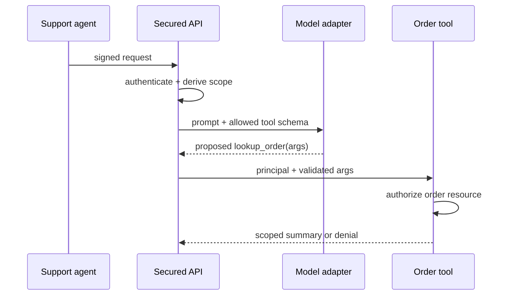

Never expose database rows merely because the generated tool arguments pass Jakarta Validation. DTO validation answers “is the input shaped correctly?”; authorization answers “may this principal act on this resource?”

### Example 2 — Spring AI versus LangChain4j behind one business port

Requirement: generate a typed, cited answer and allow a later provider/framework replacement without changing the public business API. Define the application port around outcomes the product owns:

```java
sealed interface AnswerResult permits Answered, NoEvidence, DependencyFailure {}
interface EvidenceAnswerer {
    AnswerResult answer(AuthorizedQuestion question, Deadline deadline);
}
```

A Spring AI adapter may use `ChatClient`; a LangChain4j adapter may use an AI Service. That common port is useful only if its contract includes citation membership, cancellation, deadline propagation and typed failure mapping. Lowest-common-denominator wrappers that discard streaming/tool/provider features create apparent portability while moving surprises to production.

Compatibility trace:

| Probe | Old adapter | Candidate adapter | Promotion gate |
|---|---|---|---|
| empty authorized evidence | `NoEvidence` | must also abstain | no provider call with fabricated context |
| unsupported citation | reject | reject | every citation belongs to authorized evidence IDs |
| deadline expires | cancel/map timeout | same typed outcome | no hidden second retry owner |
| provider tool call | normalized arguments | normalized arguments | schema and effect policy are equivalent |

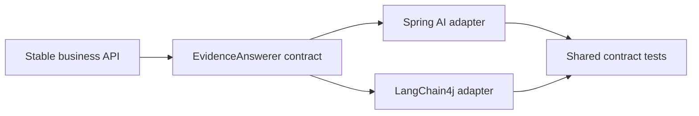

Select one production adapter. Run the other only in an evaluation or migration lane until the shared oracles and provider-specific tests pass.

### Example 3 — DJL versus direct ONNX Runtime inference

Requirement: run a classifier in the JVM with bounded concurrency and reproducible inputs. Choose DJL when engine-agnostic model loading, translators and a broader deep-learning API earn their cost. Choose direct ONNX Runtime Java when the promoted artifact is ONNX and explicit tensor/session control is preferable. DJL can itself use an ONNX Runtime engine; that does not make direct ORT calls and DJL's abstraction identical.

The release unit must bind these values:

| Identity | Example evidence | Reject when |
|---|---|---|
| model bytes | immutable URI plus SHA-256 | digest differs |
| format/opset | ONNX plus declared opset | runtime/provider lacks required operators |
| preprocessing | tokenizer/normalizer code digest | training and serving transforms differ |
| tensor contract | names, dtypes and shapes | request shape/type is incompatible |
| runtime/native provider | DJL engine or ORT version plus CPU/CUDA provider | native library or accelerator is incompatible |
| concurrency owner | fixed predictor/session admission limit | request bypasses the permit gate |

```java
if (!artifact.digest().equals(actualDigest)) throw new IllegalStateException("model drift");
if (!permits.tryAcquire()) return InferenceResult.saturated();
try {
    return predictor.predict(preprocessor.translate(input));
} finally {
    permits.release();
}
```

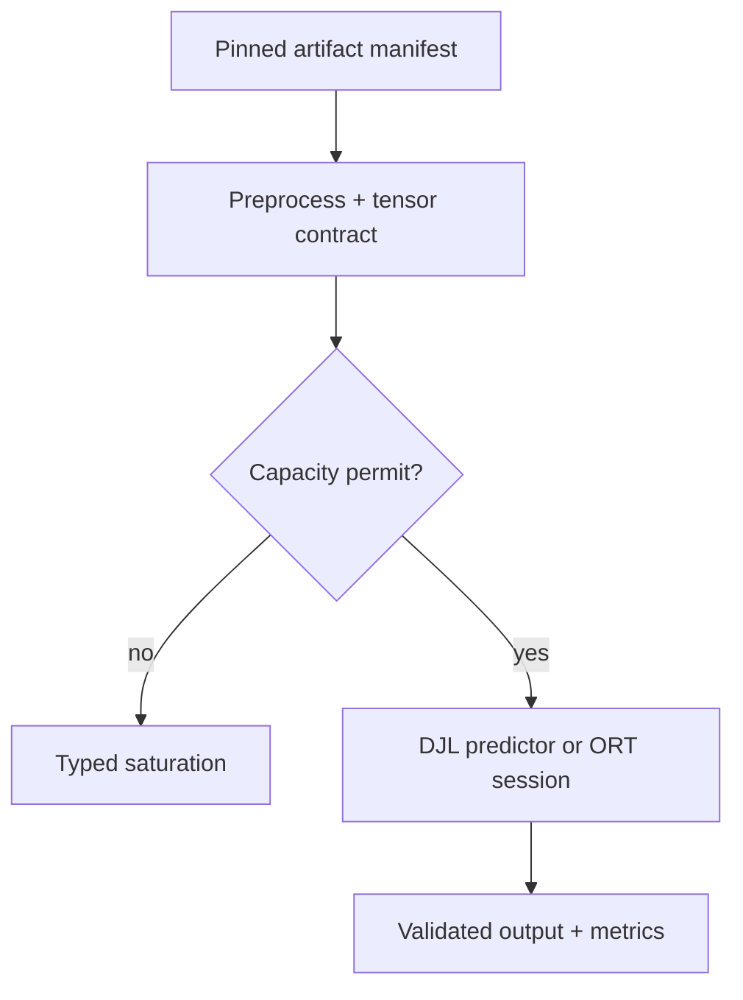

Do not share a stateful predictor because construction is expensive unless its API explicitly permits that concurrency. Pool or create per-request resources according to the selected runtime's ownership contract, and close native resources deterministically.

### Example 4 — keep specialized Python inference behind a versioned service boundary

Requirement: Java owns identity, orders and durable workflow; Python owns a specialized GPU model. Split the process when release cadence, native dependencies, accelerator scheduling or team ownership justify the operational boundary—not because Python is “the AI language.”

The Java-to-Python envelope needs an immutable schema version, operation ID, absolute deadline, trace context, authenticated service identity and model capability/version. The Java service authorizes business resources before sending the minimum necessary input. The Python service authenticates the caller, validates its own request limits, admits work only while capacity and deadline remain, and returns a typed outcome.

| Event | Java decision | Python decision |
|---|---|---|
| invalid business resource | reject locally | no request received |
| stale schema/model capability | map compatibility failure | reject before inference |
| no capacity before deadline | do not multiply retries | return `SATURATED` with bounded retry guidance |
| transport timeout, operation read-only | retry only within remaining deadline and one retry owner | deduplicate expensive work when an operation ID cache is configured |
| result shape valid but policy-invalid | reject at business boundary | record technical success only |

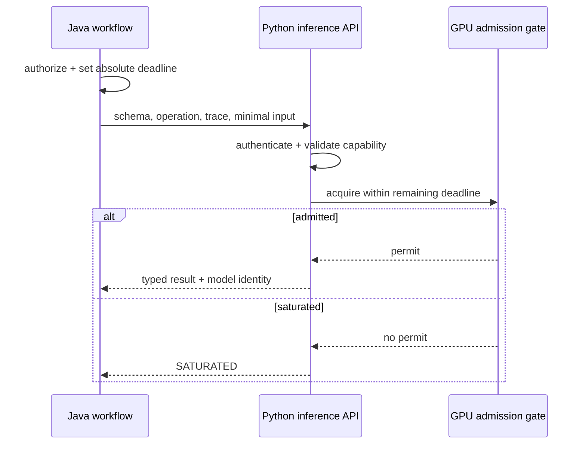

### Version, retry and observability discipline

As verified on 23 October 2026, the Spring reference lists Spring AI 2.0.1 as stable and states that the 2.0.x line supports Spring Boot 4.0.x and 4.1.x. Treat that as a compatible release family, not permission to float dependencies: import the Spring AI BOM, pin the application build, record the resolved graph, and review upgrades. The MCP Java SDK documentation is independently versioned; pin the SDK and record the negotiated MCP revision/capabilities rather than assuming every server supports the same transport or feature set.

Retries belong at one layer. An application retry around a Spring AI client that already retries, combined with an ingress retry, can multiply calls. Keep one absolute deadline, allocate phase budgets from its remaining time, and do not retry effectful tools without an idempotency/reconciliation contract. Bulkheads and Reactor demand are related but not interchangeable: a stream can honor downstream demand while an unbounded number of independent requests still compete for the same database, provider or GPU.

Metrics must aggregate. Put bounded values such as adapter name, model family, outcome and failure class in metric tags; put request/resource identifiers and detailed events in access-controlled traces or logs. Redact prompt/tool payloads by default and define retention before enabling framework observations in production.

### Executable Java/Python contracts

The paired standard-library exercises encode all twelve source-map selections, framework-port promotion gates, pinned inference identity, bounded inference admission, and a versioned cross-language service envelope:

```bash
java -ea study-guides/backend/spring-ai-python/JavaLibraryMapContracts.java
python3 study-guides/backend/spring-ai-python/java_library_map_contracts.py
```

They test decision and boundary logic. They do not claim to compile Spring AI, LangChain4j, MCP, DJL or ONNX Runtime integrations without those dependency graphs and native runtimes.

### Common mistakes and interview follow-ups

- **Two frameworks for optionality:** demand an application contract and migration evidence; otherwise choose one.
- **MCP endpoint equals secure tool:** require transport authentication plus resource/effect authorization inside every tool.
- **Reactive equals bounded:** name the queue, demand, scheduler and downstream capacity limit.
- **Circuit breaker equals retry policy:** breakers stop calls after evidence of failure; they do not decide whether an effect is safe to repeat.
- **Model format equals serving contract:** include preprocessing, tensor names/types/shapes, runtime/native provider and output mapping.
- **Trace equals safe evidence:** define redaction, access, retention and cardinality before recording prompts or identities.

Interview variations: expose the same MCP tool over stdio and Streamable HTTP; replace Spring AI with LangChain4j while preserving failure semantics; choose DJL over direct ORT for two model formats; diagnose blocking JDBC inside a WebFlux chain; split GPU inference to Python without moving business authorization.

### Current primary references

- [Spring AI introduction](https://docs.spring.io/spring-ai/reference/index.html), [getting started](https://docs.spring.io/spring-ai/reference/getting-started.html), [tool calling](https://docs.spring.io/spring-ai/reference/api/tools.html), and [MCP server starters](https://docs.spring.io/spring-ai/reference/api/mcp/mcp-server-boot-starter-docs.html) — current release family, application abstractions, tool execution and the explicit MCP transport-security warning.
- [LangChain4j introduction](https://docs.langchain4j.dev/intro/) and [AI Services](https://docs.langchain4j.dev/tutorials/ai-services/) — Java-native integration scope and high-level typed interface.
- [Official MCP SDK tiers](https://modelcontextprotocol.io/docs/2026-07-28/sdk) and [MCP Java SDK overview](https://java.sdk.modelcontextprotocol.io/latest/overview/) — maintenance/support expectations, SDK version and protocol implementation.
- [Spring Security authorization](https://docs.spring.io/spring-security/reference/servlet/authorization/) and [Reactor backpressure](https://projectreactor.io/docs/core/release/reference/coreFeatures/simple-ways-to-create-a-flux-or-mono-and-subscribe-to-it.html) — request/method authorization and demand propagation.
- [Resilience4j introduction](https://resilience4j.readme.io/docs/getting-started) and [bulkheads](https://resilience4j.readme.io/docs/bulkhead) — composable resilience primitives and concurrency isolation.
- [DJL overview](https://docs.djl.ai/master/index.html), [inference performance](https://docs.djl.ai/master/docs/development/inference_performance_optimization.html), and [ONNX Runtime Java](https://onnxruntime.ai/docs/get-started/with-java.html) — engine abstraction, predictor/concurrency considerations and direct JVM ONNX execution.

## Section 4 — Start with the offline lab

### Requirements before infrastructure

The first retrieval exercise should be runnable without a model, API key, vector database, network call or third-party package. That constraint is useful: it makes five contracts independently testable before probabilistic generation can hide a defect.

| Contract | Required invariant | Failure outcome |
|---|---|---|
| candidate authority | derive the tenant/resource scope from trusted identity, then exclude ineligible documents before scoring | reject a missing scope; return no evidence for an unknown scope |
| lexical baseline | tokenize deterministically, score only eligible documents and break equal scores by immutable ID | return an empty ranking for no positive overlap |
| vector math | require equal non-empty dimensions, finite coordinates and non-zero directions | reject invalid vectors rather than emit `NaN` |
| rank fusion | give one contribution per document per input ranking and use a stable final tie-break | reject an invalid rank constant |
| citation membership | every citation must belong to the exact evidence set supplied to generation | reject missing or unknown IDs; evaluate entailment separately |

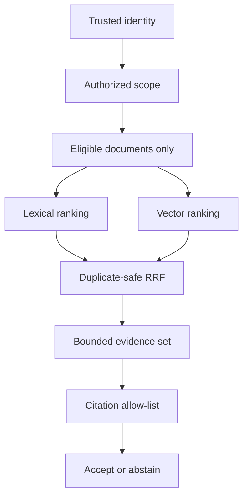

The order is part of the security contract. Filtering after global retrieval is not equivalent: an unauthorized document may already have influenced top-k selection, logs, caches or timing. The offline function accepts `trusted_tenant` only after authentication and authorization have resolved it; it must not be bound directly from an arbitrary request field.

### Example 1 — authorization before similarity

Corpus:

| ID | tenant | relevant terms |
|---|---|---|
| `payments-r7` | `acme` | `payments` once, `rollback` twice |
| `cache-r2` | `acme` | neither query term |
| `vectors-r3` | `acme` | neither query term |
| `private-r1` | `globex` | both query terms repeated; deliberately stronger lexical match |

Request: query `payments rollback`, trusted scope `acme`, `top_k=3`.

Trace:

1. The authority predicate selects the three Acme documents. `private-r1` is never passed to the scorer even though its text would score higher.
2. Token counts for the query are `{payments: 1, rollback: 1}`. `payments-r7` is the only eligible positive-overlap document.
3. The result is exactly `payments-r7`. An unknown tenant or an Acme query such as `quasar` returns `NO_EVIDENCE`; it does not broaden scope or fabricate a fallback.

```python
eligible = (doc for doc in CORPUS if doc.tenant == trusted_tenant)
scored = ((lexical_score(query, doc.text), doc) for doc in eligible)
ranked = sorted(
    (pair for pair in scored if pair[0] > 0.0),
    key=lambda pair: (-pair[0], pair[1].id),
)[:top_k]
```

The deterministic ID tie-break matters because equal floating-point scores otherwise inherit container or database iteration order. Reproducible ordering makes parity tests, caches and incident traces comparable.

### Example 2 — bag-of-words cosine by hand

For query vector \(q=(1,1)\), and the document's query-term projection \(d=(1,2)\):

\[
q \cdot d = 3,\qquad \lVert q\rVert=\sqrt{2},\qquad \lVert d\rVert=\sqrt{5},\qquad
\cos(q,d)=\frac{3}{\sqrt{10}}\approx 0.948683.
\]

That projected value is not the final corpus score, because the full document norm also contains every other token. The implementation builds a `Counter`/map over all lower-cased `[a-z0-9]+` terms, computes the dot product over query terms and divides by both full norms. Repeated terms therefore affect direction, while document length affects the denominator.

| Input | Result | Why |
|---|---:|---|
| empty query | `0.0` | query has no direction |
| no term overlap | `0.0` | dot product is zero |
| positive overlap | `(0, 1]` for nonnegative counts | ordinary cosine bound |
| equal scores | lower document ID first | explicit deterministic order |

This is a transparent baseline, not BM25: it has no inverse-document-frequency term or length normalization parameter. It is also not a neural embedding: the coordinates are literal token counts, not learned latent features. Naming the baseline correctly prevents test results from being attributed to an algorithm that was never run.

Complexity for \(D\) eligible documents, query token count \(Q\), total eligible document tokens \(T\), and requested \(k\): tokenization and scoring cost \(O(Q+T)\); the simple full sort costs \(O(D\log D)\); stored score pairs cost \(O(D)\). A production top-k heap can reduce ranking work to \(O(D\log k)\), but it does not change the scope-first invariant.

### Example 3 — cosine guards are part of the API

The generic vector function tests shape and numerical validity independently of lexical retrieval:

```java
if (left.length == 0 || left.length != right.length) {
    throw new IllegalArgumentException("non-empty equal dimensions required");
}
if (!Double.isFinite(left[i]) || !Double.isFinite(right[i])) {
    throw new IllegalArgumentException("finite vector coordinates required");
}
```

Expected traces:

| left | right | outcome |
|---|---|---|
| `[1, 0]` | `[1, 0]` | `1.0`, same direction |
| `[1, 0]` | `[0, 1]` | `0.0`, orthogonal |
| `[1, 0]` | `[-1, 0]` | `-1.0`, opposite direction |
| `[]` | `[]` | reject empty dimensions |
| `[0, 0]` | `[1, 0]` | reject directionless zero vector |
| `[NaN]` | `[1]` | reject non-finite coordinate |
| `[1]` | `[1, 2]` | reject dimension mismatch |

A naive sum of squares can overflow even when every coordinate is finite. The paired contracts first divide each vector by its own maximum absolute coordinate. Cosine is invariant under positive scaling, so `[1e308, 1e308]` compared with itself safely yields `1.0` instead of `Infinity / Infinity`. The implementation still checks the result and clamps only final round-off to `[-1, 1]`; it never uses clamping to disguise invalid input.

For vector dimension \(n\), the guarded calculation takes \(O(n)\) time. The teaching implementation stores two scaled arrays in Python and uses scalar accumulation in Java; a production implementation may fuse those passes while preserving identical validation.

### Example 4 — duplicate-safe RRF and citation gates

Fuse these two rankings with rank constant 60:

1. lexical: `payments-r7`, `cache-r2`, `payments-r7`
2. vector: `cache-r2`, `payments-r7`, `vectors-r3`

Within the first ranking, the second `payments-r7` is discarded before ranks are assigned. The contributions are:

| ID | lexical contribution | vector contribution | total |
|---|---:|---:|---:|
| `cache-r2` | \(1/62\) | \(1/61\) | \(1/61+1/62\) |
| `payments-r7` | \(1/61\) | \(1/62\) | \(1/61+1/62\) |
| `vectors-r3` | — | \(1/63\) | \(1/63\) |

The first two totals tie, so immutable ID order produces `cache-r2`, `payments-r7`, `vectors-r3`. Without per-ranking duplicate removal, one retriever could overweight a document by repeating it. With \(R\) rankings and \(N\) total entries, fusion is \(O(N)\) expected time for sets/maps plus \(O(U\log U)\) to sort \(U\) unique IDs.

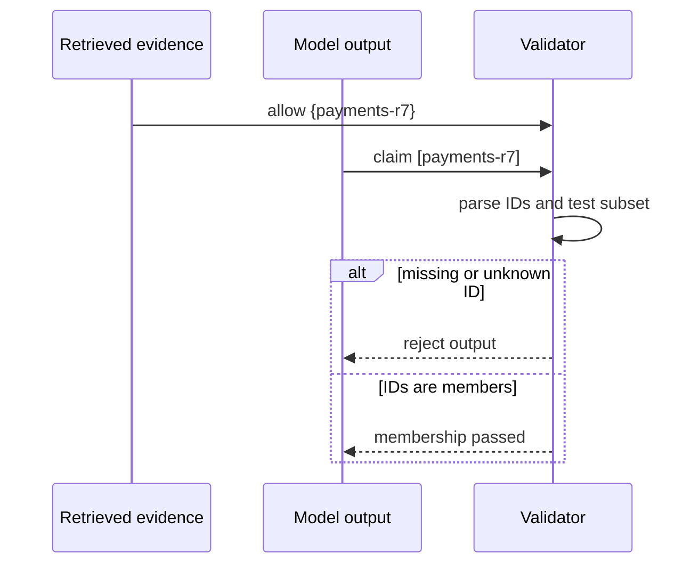

Membership is necessary but insufficient. “The moon is green `[payments-r7]`” passes an ID allow-list yet is not entailed by the passage. Keep three checks distinct: citation syntax, membership in supplied evidence, and claim-to-passage support. The offline lab owns the first two; a separate grounded-evaluation contract owns the third.

### Paired executable contract

The Java and Python programs use the same corpus, token grammar, scope-first retrieval, numerically guarded cosine, duplicate-safe RRF and citation rules. Both print the same parity line before their language-specific test summary:

```text
PARITY|payments-r7|NO_EVIDENCE|cache-r2,payments-r7,vectors-r3|1
```

Run them from the repository root:

```bash
java -ea study-guides/backend/spring-ai-python/OfflineRetrievalLabContracts.java
python3 study-guides/backend/spring-ai-python/offline_retrieval_lab_contracts.py
```

The 31 scenario groups per language cover positive ranking, adversarial cross-tenant text, unknown scope, no-overlap abstention, `top_k` bounds, repeated tokens, empty lexical input, cosine identities, overflow resistance, invalid vectors, RRF duplicates/ties, empty fusion and citation acceptance/rejection. Matching output demonstrates the cross-language algorithm contract; it does not prove the two standard libraries use identical internal data structures.

### Failure matrix and review checklist

| Fault | Detection point | Safe response |
|---|---|---|
| caller supplies tenant text directly | API/authentication boundary | ignore request scope; derive authorized scope from verified identity |
| unknown authorized scope | candidate selection | `NO_EVIDENCE` |
| `top_k` outside `[1,20]` | retrieval input validation | reject |
| empty/no-overlap query | lexical scorer/retriever | empty ranking, then abstain |
| vector mismatch, zero, `NaN` or infinity | cosine preconditions | reject before ranking |
| duplicate ID inside one ranking | RRF per-ranking set | count once at its first rank |
| equal fused score | final comparator | order by immutable ID |
| missing/foreign citation | membership validator | reject generated output |
| allowed citation with unsupported prose | entailment evaluator | reject or send to review; membership alone cannot decide |

Before replacing the corpus with a database or vector engine, preserve these oracles: unauthorized documents are never scored, no evidence is a first-class outcome, numerical errors fail closed, ranking is reproducible, and citations are checked against the exact supplied evidence set. Infrastructure integration should be tested against those contracts instead of redefining them.

### Current primary references

Verified on 23 October 2026:

- [Python `collections.Counter`](https://docs.python.org/3/library/collections.html#collections.Counter), [`math.isfinite`](https://docs.python.org/3/library/math.html#math.isfinite), and [`unittest`](https://docs.python.org/3/library/unittest.html) — standard-library counting, finiteness and executable-test semantics.
- [Java `Pattern`](https://docs.oracle.com/en/java/javase/21/docs/api/java.base/java/util/regex/Pattern.html) and [`Comparator`](https://docs.oracle.com/en/java/javase/21/docs/api/java.base/java/util/Comparator.html) — reusable compiled token grammar and explicit total ordering.
- [Elasticsearch reciprocal rank fusion](https://www.elastic.co/docs/reference/elasticsearch/rest-apis/reciprocal-rank-fusion) — the current rank contribution formula, one-based ranks and rank-constant constraints.
- [OWASP Authorization Cheat Sheet](https://cheatsheetseries.owasp.org/cheatsheets/Authorization_Cheat_Sheet.html) — deny by default, validate permission on every request, test authorization and do not let framework capabilities define requirements.

### Source provenance and continuation

The selected editable source is `atlas_guides/spring_ai_python_api_interview_guide.md` from `ai_cicd_spring_python_guides_complete.zip`, bundle SHA-256 `c52c8295ae7ff7d08013e30a8d7097480719db78104a91b79e367a382465dd31`, member SHA-256 `af25c41d54a3ca18dfc60b6cf828515ab6afb7e39cf64c7df94fe4a44eb4a553`. Sections 1–4 promote source lines 6–202. Section 4 expands the source's dependency-free lab with four requirement-driven examples, exact traces, numerical overflow guards, complexity analysis, adversarial authorization checks, paired 31-scenario executable contracts and primary references checked on 23 October 2026. The standalone HTML SHA-256 `6289a19e0ce5514c25d96d44806d47063e726244b5d55d13422234d3e499f3a3` is comparison evidence rather than a duplicate guide. Section 5, **A model call at the wire level**, begins at source line 203 and remains queued after fair domain rotation. The 25-section source is not complete.
