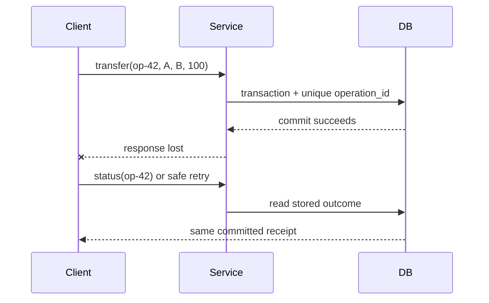
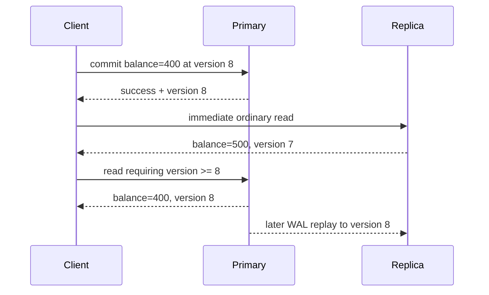
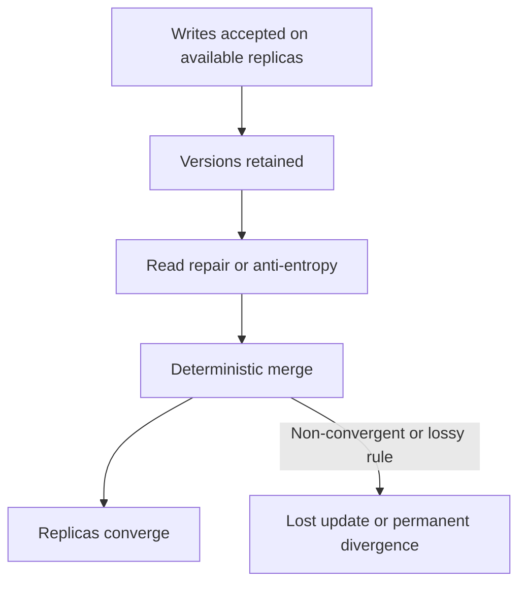

# Database Internals, Caching, and Java Connectivity

> **Incremental canonical guide.** This publication deepens source Section 1 only: **ACID, BASE, and the misleading SQL/NoSQL split**. Later source sections are deliberately queued rather than summarized prematurely.

## Learning contract

After this section you should be able to:

1. state each ACID property without turning it into a promise about replicas, caches, or external side effects;
2. distinguish serializability, strict serializability, linearizability, read-your-writes, and eventual convergence;
3. explain why a commit acknowledgement depends on the configured log/replication durability boundary, not on every data page being flushed;
4. design a transfer that preserves an invariant and survives an unknown commit outcome; and
5. explain why `R + W > N` is not, by itself, a proof of linearizability.

### Requirements before product names

Write the contract before selecting an engine:

| Question | Example requirement | Mechanism to investigate |
|---|---|---|
| What must be atomic? | Debit A and credit B commit together | One database transaction; otherwise an explicit distributed protocol |
| What invariant must survive? | `balance >= 0` and total money is conserved | Constraint plus conditional write inside the transaction |
| Which histories are allowed? | Concurrent transfers behave like some serial order | Serializable transaction or explicit locking/validation |
| How fresh must a read be? | The writer must immediately see its own committed transfer | Primary/session routing, replay token, or a documented strong-read option |
| What failure must an acknowledgement survive? | Process crash and loss of one node | Durable WAL plus the required replica acknowledgement policy |
| What happens after a timeout? | Retrying a transfer must not apply it twice | Durable idempotency key and stored outcome |

The words **SQL**, **NoSQL**, **ACID**, and **BASE** do not answer these questions. A relational primary may expose stale asynchronous-replica reads. A key-value service may provide atomic transactions and optional strongly consistent reads. DynamoDB, for example, offers strong reads on tables and local secondary indexes, while global secondary indexes remain eventually consistent.

## ACID: property, mechanism, and boundary

| Property | Typical mechanism | It does **not** promise |
|---|---|---|
| Atomicity | Commit record, rollback/undo, version visibility, recovery | Atomicity across SQL + Redis + email without another protocol |
| Consistency | Constraints and correctly designed transactions preserve invariants | Every replica or cache immediately sees the commit |
| Isolation | Locks, snapshots, predicate protection, conflict validation | Serializable execution merely because code uses `BEGIN` |
| Durability | WAL/redo reaches the configured durable boundary before acknowledgement | Survival beyond the chosen media/node/region failure domain |

**ACID consistency** is application validity: a valid state transitions to another valid state. The application still has to state the invariant. A database cannot infer that two ledger entries must net to zero.

**Serializability** means the committed transaction history is equivalent to some serial order. **Strict serializability** additionally respects real-time order. **Linearizability** is a per-operation real-time guarantee: each operation appears to take effect at one instant between invocation and response. A transaction can be serializable without a lagging replica offering linearizable reads.

PostgreSQL's current documentation makes the isolation boundary concrete: `READ COMMITTED` takes a new snapshot for each statement; `REPEATABLE READ` keeps a stable transaction snapshot but can still permit serialization anomalies; `SERIALIZABLE` detects histories that cannot match any serial execution and requires clients to retry rejected transactions.

## Example 1 — atomic transfer with an invariant

**Requirement.** Transfer 100 from A to B, never let A become negative, and conserve the total. The balance check must not come from a cache because it must participate in the same atomic decision as both writes.

Production SQL usually uses a stable lock order and a conditional debit:

```sql
BEGIN TRANSACTION ISOLATION LEVEL SERIALIZABLE;
-- lock account rows in stable account_id order
SELECT account_id FROM account
WHERE account_id IN (:from, :to)
ORDER BY account_id
FOR UPDATE;

UPDATE account
SET balance = balance - :amount
WHERE account_id = :from AND balance >= :amount;
-- require exactly one affected row

UPDATE account SET balance = balance + :amount
WHERE account_id = :to;
INSERT INTO transfer(operation_id, from_id, to_id, amount, status)
VALUES (:operationId, :from, :to, :amount, 'COMMITTED');
COMMIT;
```

The runnable Java model stages both balances and publishes them only on commit. Its injected failure after the debit proves that partial state is not visible.

| Step | Staged A | Staged B | Published A | Published B | Invariant |
|---:|---:|---:|---:|---:|---|
| Start | 500 | 200 | 500 | 200 | total = 700 |
| Conditional debit | 400 | 200 | 500 | 200 | staged A is non-negative |
| Injected failure | discarded | discarded | 500 | 200 | no partial transfer |
| Successful retry | 400 | 300 | 400 | 300 | total = 700 |

Run [the Java scenarios](ConsistencyContracts.java):

```bash
javac ConsistencyContracts.java
java -ea ConsistencyContracts
```

## Commit path: WAL first, pages later

```mermaid
sequenceDiagram
    participant App as Transfer service
    participant Tx as Transaction manager
    participant WAL as Durable WAL
    participant Pages as Data pages
    App->>Tx: BEGIN; conditional debit; credit
    Tx->>WAL: Append row changes + commit record
    WAL-->>Tx: Configured durable flush completes
    Tx-->>App: COMMIT acknowledged
    Tx->>Pages: Flush dirty pages later
    Note over WAL,Pages: Recovery replays committed changes not yet in pages
```

The write-ahead rule is an ordering rule: log records describing a data-page change must reach durable storage before that changed page. Therefore commit need not flush every table and index page. PostgreSQL documents that only WAL must be flushed to guarantee a normal durable commit; one WAL sync can cover many small concurrent commits. A checkpoint bounds recovery work by flushing dirty state and recording a restart position—it is not the commit of an ordinary user transaction.

**Configured boundary matters.** A local WAL flush can survive a process crash and still fail to survive loss of the primary disk. Synchronous replica acknowledgement can enlarge the failure domain, at latency and availability cost. An asynchronous replica can miss an already acknowledged commit if the primary is lost before shipping it.

## Example 2 — timeout after commit is an unknown outcome

The client can lose the response after the database commits. Treating every timeout as failure and blindly retrying duplicates the effect.



| Attempt | Durable `operation_id` row | Balance effect | Client observation |
|---|---|---|---|
| First `op-42` | Inserted and committed with transfer | Applied once | Response lost |
| Status query | Existing committed outcome | None | Learns success |
| Retry `op-42` | Uniqueness conflict/read existing row | None | Receives same receipt |

The key and outcome must live in the same atomic boundary as the effect. A process-local set, a short-lived cache entry, or “check then insert” outside the transaction reopens the duplicate window.

## Recovery is not replication

| Failure | Correct response |
|---|---|
| Process crash; durable log intact | Replay committed changes and discard/undo incomplete work according to the engine |
| Torn data-page write | Use engine-specific page protection plus recovery |
| Primary disk lost | Restore/fail over from a surviving replica or backup and logs |
| Async failover before replica receives commit | Acknowledged work may be lost |
| Client response lost after commit | Query by operation ID; do not blindly repeat the effect |

MySQL 8.4 documents InnoDB crash recovery as redo application followed by rollback of incomplete transactions, with purge of delete-marked records that are no longer visible. Do not generalize that exact undo/purge implementation to PostgreSQL: PostgreSQL uses tuple-version visibility and vacuum, and its recovery vocabulary and mechanics differ.

## Example 3 — ACID primary, stale replica



This is not a violation of primary transaction atomicity. It is a mismatch between the caller's **read-your-writes** requirement and an eventually consistent routing choice. PostgreSQL hot standby explicitly allows a measurable delay: a commit becomes visible to new standby snapshots only after its commit record is replayed.

Useful policies include:

1. pin the writer's session to the primary for a bounded interval;
2. return a commit/replay token and use a replica only after its applied position reaches that token;
3. choose a service's documented strong-read mode where supported; or
4. accept staleness for endpoints whose product contract permits it.

The Java model returns a stale value from an ordinary replica read, routes a read-your-writes request to the primary while the replica lags, then returns to the replica after replay.

## BASE: convergence is a designed mechanism

BASE—Basically Available, Soft state, Eventually consistent—is a design stance, not a fixed convergence deadline. Convergence requires communication to recover, updates to remain available for repair, and a deterministic conflict rule whose repeated merge reaches the same state.



Amazon's original Dynamo paper describes object versioning with application-assisted conflict resolution and trades consistency under some failures for availability. Its concrete mechanisms include configurable replica participation, hinted handoff, and anti-entropy repair. That historical design must not be presented as a complete description of today's DynamoDB service.

## Example 4 — a convergent cart needs removal semantics

“Union both carts” preserves concurrent additions but resurrects removed items. The Java example stores, per item, the maximum observed add and remove logical versions. Merge is component-wise `max`; an item is present when `addVersion >= removeVersion`, an explicit add-wins tie policy.

| Event | Replica A | Replica B | After merge |
|---|---|---|---|
| Concurrent adds | mug@1 | pen@1 | `{mug, pen}` |
| Remove mug | remove(mug)@2 | still mug@1 | `{pen}` after merge |
| Late old add | add(mug)@1 | remove(mug)@2 | mug stays removed |

Why it converges: `max` is associative, commutative, and idempotent. Reordering, duplicating, or regrouping repair messages therefore yields the same per-item state. The example is a teaching model, not a full production CRDT: a real system must define logical-clock allocation, metadata compaction, identity, and behavior for truly concurrent add/remove operations.

## The quorum trap

`R + W > N` proves read/write-set overlap only under stated membership assumptions. Linearizability additionally depends on which replicas count as a completed write, how the read chooses among versions, what happens during membership changes or sloppy quorum substitution, how concurrent writes are ordered, and how failover treats acknowledged state.

| Claim | Missing question |
|---|---|
| “`R + W > N`, so reads are fresh” | Does the reader select the newest causally valid version from the overlap? |
| “We wrote to any `W` reachable nodes” | Are these the same membership set from which `R` is later chosen? |
| “Last-write-wins resolves conflicts” | Are clocks trustworthy, and can a valid concurrent write be discarded? |
| “Read repair eventually fixes it” | What guarantee applies before repair completes? |

Never infer linearizability from one inequality. State the full read, write, membership, version, and failover protocol.

## Complexity and cost boundaries

| Operation in the Java model | Time | Space | Production cost that dominates |
|---|---:|---:|---|
| Two-account transfer | `O(1)` | `O(1)` staged state | Lock/conflict waits and durable commit latency |
| Idempotency lookup | expected `O(1)` | `O(k)` retained operation IDs | Unique-index I/O and retention/partition strategy |
| Read-your-writes routing | `O(1)` | `O(1)` token | Replica apply lag or primary load |
| Cart merge | `O(a + b)` | `O(a + b)` | Version metadata, repair bandwidth, compaction |

The asymptotic notation describes the small teaching structures. It does not erase network round trips, fsync latency, conflict retries, replication lag, or storage-engine page access.

## Review checklist

- Is each invariant written and enforced inside the transaction boundary?
- Can the client distinguish rejection, committed success, and unknown outcome?
- Is the idempotency record atomic with the effect and retained long enough?
- Does the read path state primary/replica/cache freshness semantics?
- What exact failure domain does “durable” cover?
- Does the conflict rule converge under duplicate and reordered messages?
- Are quorum membership, version selection, repair, and failover specified?
- Are retries for serialization failures bounded, observable, and jittered?

## Primary references

Accessed 2026-10-16.

1. [PostgreSQL 18 — Write-Ahead Logging](https://www.postgresql.org/docs/current/wal-intro.html): WAL-before-data ordering, redo, and group commit.
2. [PostgreSQL 18 — Transaction Isolation](https://www.postgresql.org/docs/current/transaction-iso.html): statement snapshots, repeatable read, serializable histories, and required retries.
3. [PostgreSQL 18 — Hot Standby](https://www.postgresql.org/docs/current/hot-standby.html): read-only standby visibility and replay lag.
4. [MySQL 8.4 — InnoDB Recovery](https://dev.mysql.com/doc/refman/8.4/en/innodb-recovery.html): redo application, incomplete-transaction rollback, and purge.
5. [Amazon DynamoDB — Read consistency](https://docs.aws.amazon.com/amazondynamodb/latest/developerguide/HowItWorks.ReadConsistency.html): eventual and strong read scopes, including GSI limitations.
6. DeCandia et al., [Dynamo: Amazon's Highly Available Key-value Store](https://www.amazon.science/publications/dynamo-amazons-highly-available-key-value-store), SOSP 2007: versioning, availability trade-offs, and application-assisted conflict resolution.

## Source provenance and verification

- Confirmed Library source: `database_internals_caching_java_master_guide.md`
- Library file ID: `libfile_969515775294819195d90fe08e46b7be`
- Backing file ID: `file_00000000dadc81f59cf6b82ca990a48a`
- Version: `1`
- Whole-file SHA-256: `ec8a88daa8b9d26be7c7817f20e8d0e1c8f0ef1697c5bbf8cd7cb1e4a703f34a`
- Processed bounded range: source lines **62–133**, “ACID, BASE, and the misleading SQL/NoSQL split”
- Deliberate continuation: Section 2, “B+ Trees: why indexes are shallow,” begins at source line 134.

Validation commands:

```bash
python3 build_reader.py
node validate_reader.mjs
javac ConsistencyContracts.java
java -ea ConsistencyContracts
```

The Markdown is canonical. `guide.html` is generated deterministically and embeds the exact Markdown bytes for synchronization checks.
