# Database Internals, Caching, and Java Connectivity

> **Incremental canonical guide.** This publication deepens source Sections 1–5: **ACID/BASE contracts**, **B+ tree page economics**, **LSM write/read/compaction mechanics**, **row/column storage with CDC-fed analytics**, and **isolation anomalies with engine-specific semantics**. Later source sections are deliberately queued rather than summarized prematurely.

## Learning contract

After this section you should be able to:

1. state each ACID property without turning it into a promise about replicas, caches, or external side effects;
2. distinguish serializability, strict serializability, linearizability, read-your-writes, and eventual convergence;
3. explain why a commit acknowledgement depends on the configured log/replication durability boundary, not on every data page being flushed;
4. design a transfer that preserves an invariant and survives an unknown commit outcome; and
5. explain why `R + W > N` is not, by itself, a proof of linearizability.

### Requirements before product names

Write the contract before selecting an engine:

| Question | Example requirement | Mechanism to investigate |
|---|---|---|
| What must be atomic? | Debit A and credit B commit together | One database transaction; otherwise an explicit distributed protocol |
| What invariant must survive? | `balance >= 0` and total money is conserved | Constraint plus conditional write inside the transaction |
| Which histories are allowed? | Concurrent transfers behave like some serial order | Serializable transaction or explicit locking/validation |
| How fresh must a read be? | The writer must immediately see its own committed transfer | Primary/session routing, replay token, or a documented strong-read option |
| What failure must an acknowledgement survive? | Process crash and loss of one node | Durable WAL plus the required replica acknowledgement policy |
| What happens after a timeout? | Retrying a transfer must not apply it twice | Durable idempotency key and stored outcome |

The words **SQL**, **NoSQL**, **ACID**, and **BASE** do not answer these questions. A relational primary may expose stale asynchronous-replica reads. A key-value service may provide atomic transactions and optional strongly consistent reads. DynamoDB, for example, offers strong reads on tables and local secondary indexes, while global secondary indexes remain eventually consistent.

## ACID: property, mechanism, and boundary

| Property | Typical mechanism | It does **not** promise |
|---|---|---|
| Atomicity | Commit record, rollback/undo, version visibility, recovery | Atomicity across SQL + Redis + email without another protocol |
| Consistency | Constraints and correctly designed transactions preserve invariants | Every replica or cache immediately sees the commit |
| Isolation | Locks, snapshots, predicate protection, conflict validation | Serializable execution merely because code uses `BEGIN` |
| Durability | WAL/redo reaches the configured durable boundary before acknowledgement | Survival beyond the chosen media/node/region failure domain |

**ACID consistency** is application validity: a valid state transitions to another valid state. The application still has to state the invariant. A database cannot infer that two ledger entries must net to zero.

**Serializability** means the committed transaction history is equivalent to some serial order. **Strict serializability** additionally respects real-time order. **Linearizability** is a per-operation real-time guarantee: each operation appears to take effect at one instant between invocation and response. A transaction can be serializable without a lagging replica offering linearizable reads.

PostgreSQL's current documentation makes the isolation boundary concrete: `READ COMMITTED` takes a new snapshot for each statement; `REPEATABLE READ` keeps a stable transaction snapshot but can still permit serialization anomalies; `SERIALIZABLE` detects histories that cannot match any serial execution and requires clients to retry rejected transactions.

## Example 1 — atomic transfer with an invariant

**Requirement.** Transfer 100 from A to B, never let A become negative, and conserve the total. The balance check must not come from a cache because it must participate in the same atomic decision as both writes.

Production SQL usually uses a stable lock order and a conditional debit:

```sql
BEGIN TRANSACTION ISOLATION LEVEL SERIALIZABLE;
-- lock account rows in stable account_id order
SELECT account_id FROM account
WHERE account_id IN (:from, :to)
ORDER BY account_id
FOR UPDATE;

UPDATE account
SET balance = balance - :amount
WHERE account_id = :from AND balance >= :amount;
-- require exactly one affected row

UPDATE account SET balance = balance + :amount
WHERE account_id = :to;
INSERT INTO transfer(operation_id, from_id, to_id, amount, status)
VALUES (:operationId, :from, :to, :amount, 'COMMITTED');
COMMIT;
```

The runnable Java model stages both balances and publishes them only on commit. Its injected failure after the debit proves that partial state is not visible.

| Step | Staged A | Staged B | Published A | Published B | Invariant |
|---:|---:|---:|---:|---:|---|
| Start | 500 | 200 | 500 | 200 | total = 700 |
| Conditional debit | 400 | 200 | 500 | 200 | staged A is non-negative |
| Injected failure | discarded | discarded | 500 | 200 | no partial transfer |
| Successful retry | 400 | 300 | 400 | 300 | total = 700 |

Run [the Java scenarios](ConsistencyContracts.java):

```bash
javac ConsistencyContracts.java
java -ea ConsistencyContracts
```

## Commit path: WAL first, pages later

```mermaid
sequenceDiagram
    participant App as Transfer service
    participant Tx as Transaction manager
    participant WAL as Durable WAL
    participant Pages as Data pages
    App->>Tx: BEGIN; conditional debit; credit
    Tx->>WAL: Append row changes + commit record
    WAL-->>Tx: Configured durable flush completes
    Tx-->>App: COMMIT acknowledged
    Tx->>Pages: Flush dirty pages later
    Note over WAL,Pages: Recovery replays committed changes not yet in pages
```

The write-ahead rule is an ordering rule: log records describing a data-page change must reach durable storage before that changed page. Therefore commit need not flush every table and index page. PostgreSQL documents that only WAL must be flushed to guarantee a normal durable commit; one WAL sync can cover many small concurrent commits. A checkpoint bounds recovery work by flushing dirty state and recording a restart position—it is not the commit of an ordinary user transaction.

**Configured boundary matters.** A local WAL flush can survive a process crash and still fail to survive loss of the primary disk. Synchronous replica acknowledgement can enlarge the failure domain, at latency and availability cost. An asynchronous replica can miss an already acknowledged commit if the primary is lost before shipping it.

## Example 2 — timeout after commit is an unknown outcome

The client can lose the response after the database commits. Treating every timeout as failure and blindly retrying duplicates the effect.

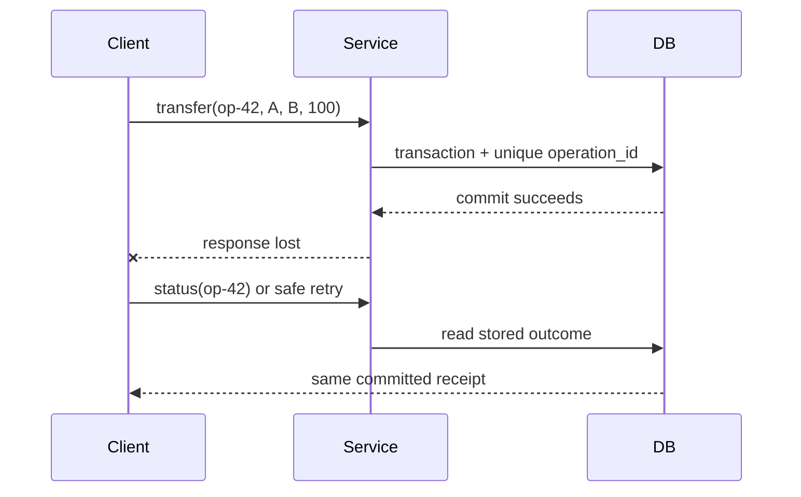

| Attempt | Durable `operation_id` row | Balance effect | Client observation |
|---|---|---|---|
| First `op-42` | Inserted and committed with transfer | Applied once | Response lost |
| Status query | Existing committed outcome | None | Learns success |
| Retry `op-42` | Uniqueness conflict/read existing row | None | Receives same receipt |

The key and outcome must live in the same atomic boundary as the effect. A process-local set, a short-lived cache entry, or “check then insert” outside the transaction reopens the duplicate window.

## Recovery is not replication

| Failure | Correct response |
|---|---|
| Process crash; durable log intact | Replay committed changes and discard/undo incomplete work according to the engine |
| Torn data-page write | Use engine-specific page protection plus recovery |
| Primary disk lost | Restore/fail over from a surviving replica or backup and logs |
| Async failover before replica receives commit | Acknowledged work may be lost |
| Client response lost after commit | Query by operation ID; do not blindly repeat the effect |

MySQL 8.4 documents InnoDB crash recovery as redo application followed by rollback of incomplete transactions, with purge of delete-marked records that are no longer visible. Do not generalize that exact undo/purge implementation to PostgreSQL: PostgreSQL uses tuple-version visibility and vacuum, and its recovery vocabulary and mechanics differ.

## Example 3 — ACID primary, stale replica

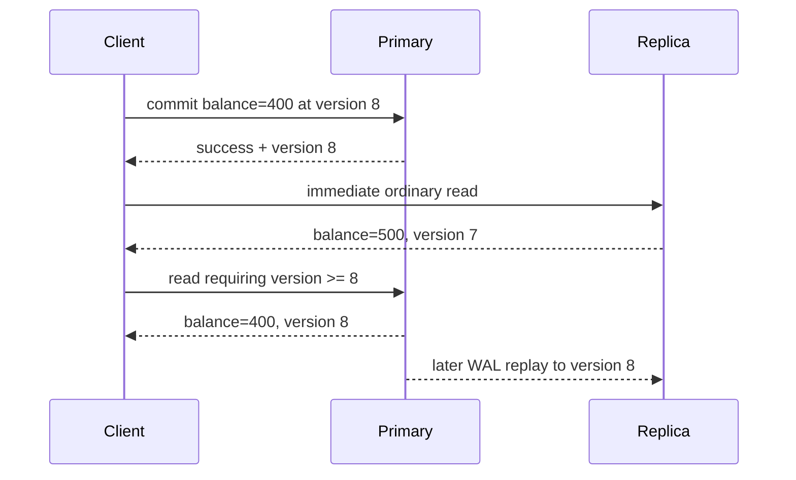

This is not a violation of primary transaction atomicity. It is a mismatch between the caller's **read-your-writes** requirement and an eventually consistent routing choice. PostgreSQL hot standby explicitly allows a measurable delay: a commit becomes visible to new standby snapshots only after its commit record is replayed.

Useful policies include:

1. pin the writer's session to the primary for a bounded interval;
2. return a commit/replay token and use a replica only after its applied position reaches that token;
3. choose a service's documented strong-read mode where supported; or
4. accept staleness for endpoints whose product contract permits it.

The Java model returns a stale value from an ordinary replica read, routes a read-your-writes request to the primary while the replica lags, then returns to the replica after replay.

## BASE: convergence is a designed mechanism

BASE—Basically Available, Soft state, Eventually consistent—is a design stance, not a fixed convergence deadline. Convergence requires communication to recover, updates to remain available for repair, and a deterministic conflict rule whose repeated merge reaches the same state.

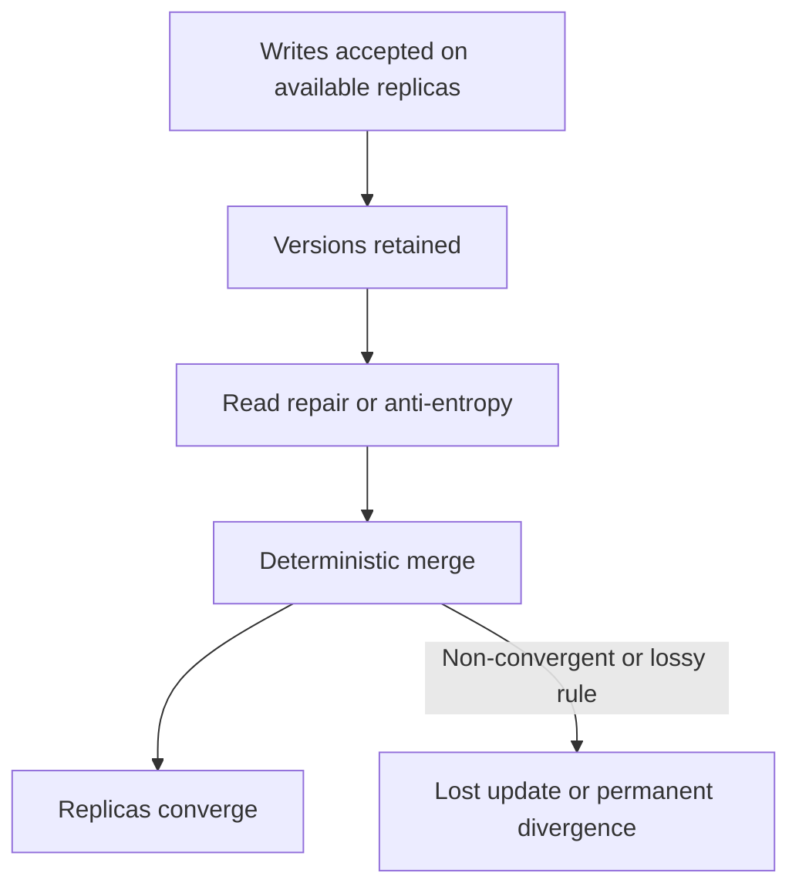

Amazon's original Dynamo paper describes object versioning with application-assisted conflict resolution and trades consistency under some failures for availability. Its concrete mechanisms include configurable replica participation, hinted handoff, and anti-entropy repair. That historical design must not be presented as a complete description of today's DynamoDB service.

## Example 4 — a convergent cart needs removal semantics

“Union both carts” preserves concurrent additions but resurrects removed items. The Java example stores, per item, the maximum observed add and remove logical versions. Merge is component-wise `max`; an item is present when `addVersion >= removeVersion`, an explicit add-wins tie policy.

| Event | Replica A | Replica B | After merge |
|---|---|---|---|
| Concurrent adds | mug@1 | pen@1 | `{mug, pen}` |
| Remove mug | remove(mug)@2 | still mug@1 | `{pen}` after merge |
| Late old add | add(mug)@1 | remove(mug)@2 | mug stays removed |

Why it converges: `max` is associative, commutative, and idempotent. Reordering, duplicating, or regrouping repair messages therefore yields the same per-item state. The example is a teaching model, not a full production CRDT: a real system must define logical-clock allocation, metadata compaction, identity, and behavior for truly concurrent add/remove operations.

## The quorum trap

`R + W > N` proves read/write-set overlap only under stated membership assumptions. Linearizability additionally depends on which replicas count as a completed write, how the read chooses among versions, what happens during membership changes or sloppy quorum substitution, how concurrent writes are ordered, and how failover treats acknowledged state.

| Claim | Missing question |
|---|---|
| “`R + W > N`, so reads are fresh” | Does the reader select the newest causally valid version from the overlap? |
| “We wrote to any `W` reachable nodes” | Are these the same membership set from which `R` is later chosen? |
| “Last-write-wins resolves conflicts” | Are clocks trustworthy, and can a valid concurrent write be discarded? |
| “Read repair eventually fixes it” | What guarantee applies before repair completes? |

Never infer linearizability from one inequality. State the full read, write, membership, version, and failover protocol.

## Complexity and cost boundaries

| Operation in the Java model | Time | Space | Production cost that dominates |
|---|---:|---:|---|
| Two-account transfer | `O(1)` | `O(1)` staged state | Lock/conflict waits and durable commit latency |
| Idempotency lookup | expected `O(1)` | `O(k)` retained operation IDs | Unique-index I/O and retention/partition strategy |
| Read-your-writes routing | `O(1)` | `O(1)` token | Replica apply lag or primary load |
| Cart merge | `O(a + b)` | `O(a + b)` | Version metadata, repair bandwidth, compaction |

The asymptotic notation describes the small teaching structures. It does not erase network round trips, fsync latency, conflict retries, replication lag, or storage-engine page access.

## Review checklist

- Is each invariant written and enforced inside the transaction boundary?
- Can the client distinguish rejection, committed success, and unknown outcome?
- Is the idempotency record atomic with the effect and retained long enough?
- Does the read path state primary/replica/cache freshness semantics?
- What exact failure domain does “durable” cover?
- Does the conflict rule converge under duplicate and reordered messages?
- Are quorum membership, version selection, repair, and failover specified?
- Are retries for serialization failures bounded, observable, and jittered?

## Primary references used across Sections 1–3

Accessed 2026-10-16.

1. [PostgreSQL 18 — Write-Ahead Logging](https://www.postgresql.org/docs/current/wal-intro.html): WAL-before-data ordering, redo, and group commit.
2. [PostgreSQL 18 — Transaction Isolation](https://www.postgresql.org/docs/current/transaction-iso.html): statement snapshots, repeatable read, serializable histories, and required retries.
3. [PostgreSQL 18 — Hot Standby](https://www.postgresql.org/docs/current/hot-standby.html): read-only standby visibility and replay lag.
4. [MySQL 8.4 — InnoDB Recovery](https://dev.mysql.com/doc/refman/8.4/en/innodb-recovery.html): redo application, incomplete-transaction rollback, and purge.
5. [Amazon DynamoDB — Read consistency](https://docs.aws.amazon.com/amazondynamodb/latest/developerguide/HowItWorks.ReadConsistency.html): eventual and strong read scopes, including GSI limitations.
6. DeCandia et al., [Dynamo: Amazon's Highly Available Key-value Store](https://www.amazon.science/publications/dynamo-amazons-highly-available-key-value-store), SOSP 2007: versioning, availability trade-offs, and application-assisted conflict resolution.
7. [PostgreSQL 18 — B-Tree Indexes](https://www.postgresql.org/docs/current/btree.html): page-level structure, recursive splits, root growth, and implementation-specific deletion.
8. [PostgreSQL 18 — Indexes and `ORDER BY`](https://www.postgresql.org/docs/current/indexes-ordering.html): ordered B-tree scans, planner trade-offs, and `ORDER BY ... LIMIT`.
9. [PostgreSQL 18 — `CREATE INDEX`](https://www.postgresql.org/docs/current/sql-createindex.html): B-tree fill factor and covering/index-construction options.
10. [MySQL 8.4 — Clustered and Secondary Indexes](https://dev.mysql.com/doc/refman/8.4/en/innodb-index-types.html): clustered row storage and primary-key payload in secondary entries.
11. [MySQL 8.4 — Physical Structure of an InnoDB Index](https://dev.mysql.com/doc/refman/8.4/en/innodb-physical-structure.html): 16 KiB default pages, occupancy, fill factor, and merge threshold.

# Section 2 — B+ trees: shallow indexes, ordered leaves, and write cost

The repository already contains a focused [B+ tree algorithm guide](../../local-project-notes/advanced-trees/b-plus-tree-database-index.md) and its heavily randomized immutable read model. This section does not create a second copy of that guide. It adds the storage-engine and schema-design questions the earlier module deliberately omits: page capacity, clustered versus heap organization, secondary-index amplification, online splits, fill factor, and what to measure in production.

## Learning and requirements contract

After this section you should be able to:

1. derive an illustrative tree height from entry count, leaf capacity, and internal fan-out without calling the estimate a product guarantee;
2. trace equality, bounded range, and `ORDER BY ... LIMIT` access through internal pages and linked leaves;
3. explain why an InnoDB secondary lookup normally carries the primary key and can require a second tree traversal;
4. explain why random and sequential inserts create different locality and contention profiles; and
5. distinguish a short structural latch from a transaction lock, then name the logging/recovery work a real split needs.

Before creating an index, state the workload contract:

| Question | Example requirement | Consequence |
|---|---|---|
| Which predicates must be fast? | `tenant_id = ? AND created_at BETWEEN ? AND ?` | Order the composite key so the required interval is contiguous |
| Is ordered output needed? | newest 20 orders per tenant | A matching B-tree order may avoid a separate sort |
| Must the query fetch base rows? | list needs status and total only | A covering index can save lookups but makes leaves wider |
| What is the write pattern? | random UUID inserts at 10k/s | Expect dispersed dirty pages and possible splits |
| What is the concurrency hotspot? | monotonically increasing IDs | Good locality can concentrate writers on the right edge |
| Which engine layout applies? | InnoDB clustered primary index | Primary-key width is repeated in secondary entries |

## Page anatomy and the height calculation

Internal pages store routing separators and child page identifiers. Leaves store ordered index entries and are connected for ordered traversal. PostgreSQL describes each level as a doubly linked list of pages; its leaf tuples point to table rows, while its internal tuples point down one level. InnoDB uses B-tree index pages, with a default 16 KiB page size, but its clustered-index leaves hold row data and its secondary entries include the primary-key columns.

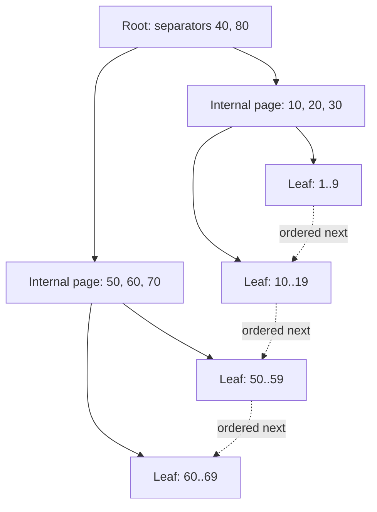

### Example 5 — one million entries can still mean three page levels

Assume, only for arithmetic, 200 entries per leaf and fan-out 200:

| Level | Calculation | Pages |
|---|---:|---:|
| Leaf | `ceil(1,000,000 / 200)` | 5,000 |
| Internal above leaves | `ceil(5,000 / 200)` | 25 |
| Root | `ceil(25 / 200)` | 1 |

That is three page levels: root → internal → leaf. The executable `capacityPlan` scenario derives the same result. It also tests boundaries such as one entry, an exact full leaf, and a fan-out smaller than two.

This does **not** promise three physical reads. Upper pages may already be in the buffer pool, a leaf may not be resident, a covering index may avoid a base-row read, and read-ahead can change the I/O pattern. Key width, row identifier width, tuple headers, page headers, free space, compression, deduplication, and occupancy all change effective fan-out.

## One descent, then an ordered leaf scan

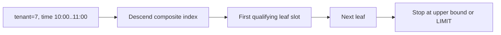

### Example 6 — composite range plus `ORDER BY ... LIMIT`

For an index on `(tenant_id, created_at DESC, order_id)`, the query below forms one ordered interval after tenant equality:

```sql
SELECT order_id, created_at
FROM orders
WHERE tenant_id = :tenant
  AND created_at >= :from
  AND created_at < :to
ORDER BY created_at DESC
LIMIT 20;
```

Trace for tenant 7:

| Step | Page action | Work avoided |
|---:|---|---|
| 1 | Use separators to descend to the first qualifying composite key | No full index scan |
| 2 | Lower-bound inside the leaf | No scan of earlier tenants/timestamps |
| 3 | Read forward through leaf entries and sibling pages | No root descent per row |
| 4 | Stop after 20 entries or at `:to` | No need to sort/consume the remaining interval when the plan matches |

PostgreSQL explicitly documents that B-tree is its index type capable of producing sorted output and that a matching index is especially valuable for `ORDER BY ... LIMIT`. The optimizer may still prefer a table scan plus sort when a query needs a large fraction of the table. Also, a suffix-only predicate on `created_at` lacks tenant equality and may not describe one narrow interval in this key order.

## Clustered and secondary layouts are not interchangeable

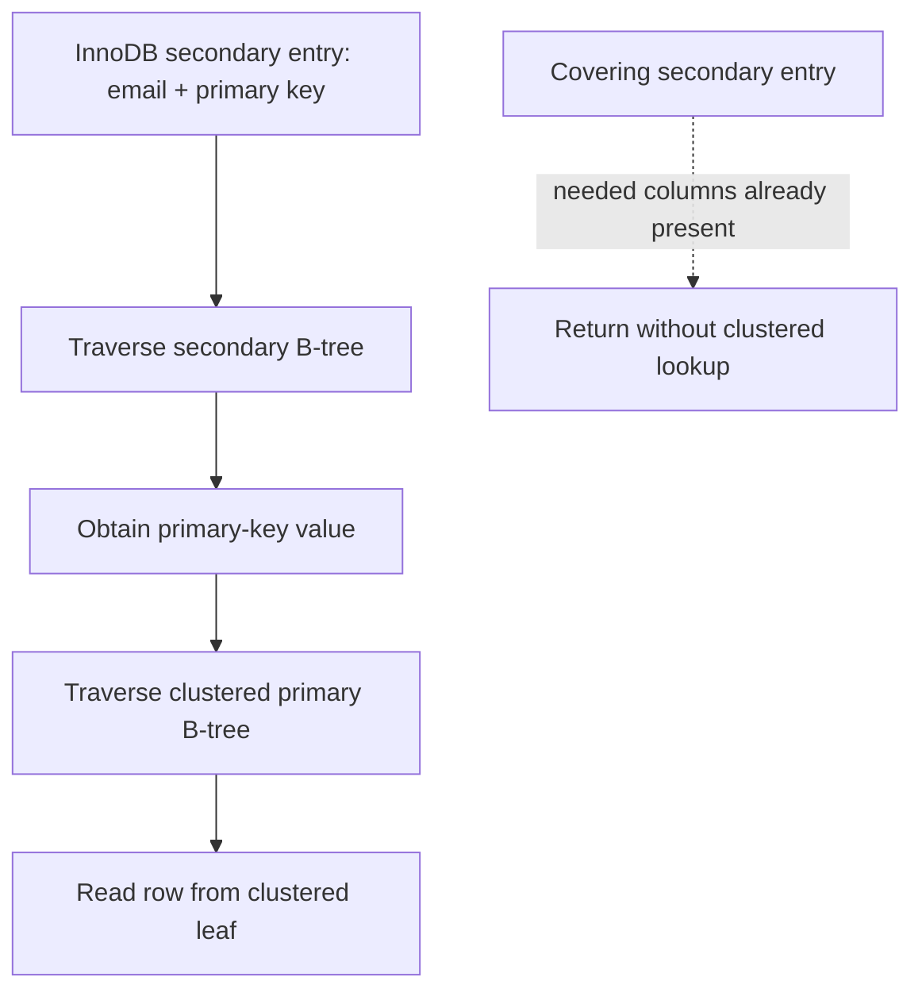

### Example 7 — a wide primary key multiplies secondary-index bytes

Consider 50 million rows and four secondary indexes. Ignoring headers, compression, free space, and included columns, replacing an 8-byte primary key with a 36-byte textual UUID adds:

\[
50{,}000{,}000 \times 4 \times (36 - 8) = 5.6\text{ GB}
\]

This is a deliberately narrow lower-bound model, not a storage forecast. The executable scenario verifies the arithmetic and rejects negative dimensions. Real capacity planning must measure encoded entries and page occupancy. MySQL documents the underlying reason: each InnoDB secondary record includes the primary-key columns, and a secondary lookup uses that value to search the clustered index.

PostgreSQL's ordinary layout differs: B-tree leaf tuples point to rows in a heap-organized table. A useful interview answer says which engine is being discussed instead of treating every “B-tree index” as clustered.

## Insert, split, and recovery-safe publication

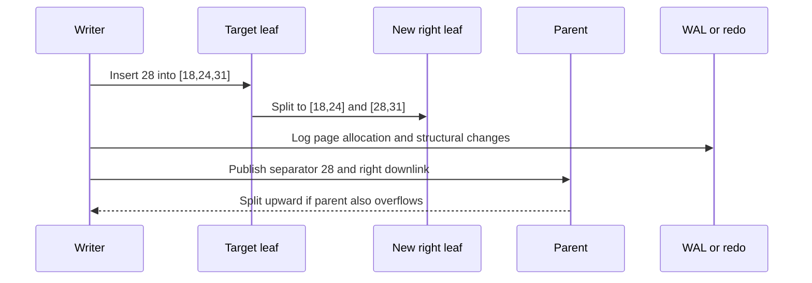

### Example 8 — split a full leaf without losing order

The Java teaching helper inserts 28 into a capacity-three leaf `[18,24,31]`, then returns:

| Output | Value | Invariant |
|---|---|---|
| left page | `[18,24]` | sorted and within old lower range |
| right page | `[28,31]` | sorted and within old upper range |
| promoted separator | `28` | minimum key of the new right page |

The scenario also inserts 32 into a non-full leaf and verifies that no split occurs. This is a structural teaching model only. A production split must allocate and initialize a sibling, preserve sibling links, log changes, make parent navigation safe for concurrent readers, and recover from crashes at intermediate moments. A **latch** briefly protects in-memory page structure; a **transaction lock** protects logical records or predicates across transaction work. They solve different problems.

PostgreSQL documents recursive split propagation and root splitting: only a root split adds a new level. It also performs implementation-specific deletion/deduplication work that can sometimes avoid a split. Do not infer that every full-looking logical insert allocates a page, or that every split immediately writes all touched pages to storage.

## Insert pattern and fill-factor trade-offs

| Pattern | Benefit | Dominant risk |
|---|---|---|
| Random keys | Distributes writers across key space | Scattered dirty pages, lower locality, more split opportunities |
| Sequential keys | High locality and compact right-edge growth | Rightmost-page latch contention at high concurrency |
| Lower fill factor | Leaves headroom for later inserts | Larger index, lower cache density, more scan I/O |
| Wider covering index | Avoids some base-row lookups | Lower fan-out and higher write/storage cost |

InnoDB documents that sequential insert builds tend toward about 15/16-full pages, while random insertion can yield pages between one-half and 15/16 full. PostgreSQL exposes B-tree `fillfactor`, but the right value is workload-specific. Measure instead of prescribing a magic percentage.

Useful signals include index bytes and growth, page split/merge rate where exposed, buffer-cache hit and residency, dirty-page and WAL/redo bytes, index scan versus table-fetch counts, query latency by plan, right-edge latch waits, and write latency. A logical `O(log n)` insertion can touch several pages yet still have fewer device operations because buffering coalesces writes.

## Complexity, failure boundaries, and review

| Operation | Logical CPU | Page-oriented shape | Important boundary |
|---|---:|---:|---|
| Point lookup | `O(log_F n)` levels | one page per level if cold | clustered/covering layout determines extra fetches |
| Range returning `k` rows | `O(log_F n + k)` | one descent plus leaf pages visited | output and base-row fetches still cost work |
| Insert without split | search plus in-page movement | leaf dirtied and logged | acknowledgement follows the durability policy |
| Split | search plus redistribution | new sibling + parent update; may cascade | concurrent visibility and crash recovery are engine-specific |

Review questions:

- What exactly lives in internal and leaf pages for this engine?
- Which separator convention routes equality left or right?
- Does the query describe one contiguous composite-key interval?
- Can index order satisfy the requested sort and limit?
- Does the read require a heap/clustered lookup, or is the index covering?
- How many times is the primary key replicated into secondary entries?
- Is a hotspot caused by poor locality or by too much right-edge locality?
- Are page latches, transaction locks, WAL/redo, and recovery described separately?
- Which measurements would prove that splits or cache misses are the bottleneck?

The earlier focused module remains the canonical place for separator invariants, immutable bulk loading, linked-leaf correctness proofs, deletion mechanics, and 150,000 randomized point/range oracle checks. This section supplies the complementary database-design and operational layer.

# Section 3 — LSM trees: moving write cost into compaction

An LSM tree turns many foreground random updates into WAL appends, in-memory sorted updates, sequential table flushes, and later background merges. That is a **scheduling trade**, not “write once.” The design can improve ingest throughput and locality while increasing version-resolution work, background I/O, temporary disk demand, and operational coupling between compaction and foreground latency.

## Learning and requirements contract

After this section you should be able to:

1. trace acknowledgement, crash recovery, freeze, flush, and manifest publication without treating them as one event;
2. resolve a point read by snapshot sequence across mutable memory and overlapping sorted tables;
3. explain why a Bloom-filter negative can skip a table while a positive cannot prove the key exists;
4. state the conditions under which a tombstone may be removed without resurrecting an older value;
5. compare leveled and universal/tiered compaction by write, read, and space amplification; and
6. calculate explicitly scoped amplification and disk-headroom estimates, then name the signals that warn of compaction debt.

State the workload before choosing an LSM policy:

| Question | Example requirement | Design consequence |
|---|---|---|
| What must survive acknowledgement? | process crash after a cart update | WAL must cross the configured durability boundary before success |
| Which snapshot semantics apply? | an iterator keeps sequence 80 | versions needed by that snapshot cannot be discarded |
| Are reads point-heavy or scan-heavy? | 95% absent point lookups | per-table filters and cached indexes matter |
| How bursty are writes? | 500 MB/s for 30 seconds | memtable, flush bandwidth, L0 limits, and backpressure need headroom |
| How much rewrite can storage sustain? | 1 GB/s background budget | compaction style and level sizing must fit the device budget |
| How much free disk is reserved? | compaction may overlap old and new files | live data alone is not a safe capacity target |

## Write acknowledgement, recovery, and flush are separate

RocksDB journals in-memory state changes in the WAL and on-disk file-set changes in the MANIFEST. A write normally reaches the WAL and mutable memtable; when a memtable becomes immutable, a background flush produces an SST file. Memtables can flush for several reasons, including memory pressure and WAL-size pressure, so “flushes only when exactly full” is false.

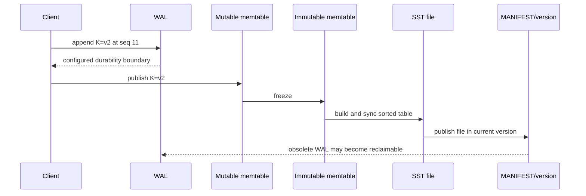

### Example 9 — recover the newest WAL update, then flush it

The Java `LsmBuffer` writes `cart:7=v1@10`, then `cart:7=v2@11`. A simulated crash retains the WAL and durable tables but loses the mutable map. Recovery replays both WAL entries and chooses sequence 11. After flush, the model has one immutable table and can clear its WAL because that table is the durable teaching-model state.

| Moment | WAL | Mutable state | Durable table | Read at snapshot 11 |
|---|---|---|---|---|
| first write | `v1@10` | `v1@10` | none | `v1` |
| overwrite | `v1@10, v2@11` | `v2@11` | none | `v2` |
| crash/replay | same records replayed | `v2@11` | none | `v2` |
| flush published | reclaimable in model | empty | `v2@11` | `v2` |

The order in this small model is intentionally strict: append the WAL record before exposing the memtable mutation. Production acknowledgement, batching, WAL sync options, atomic write batches, file syncing, and MANIFEST edits are engine-specific. Disabling or weakening WAL sync changes the failure contract; a memtable update alone is not durable.

## A read is version selection, not “check every file and return first”

The read path may consult the mutable memtable, immutable memtables, Level 0 files whose key ranges overlap, and at most the relevant file(s) in non-overlapping lower levels under leveled compaction. It must choose the newest sequence visible to the caller's snapshot. Block indexes narrow a file to likely blocks; Bloom filters can rule out definite absence for the represented key domain; caches can avoid device reads.

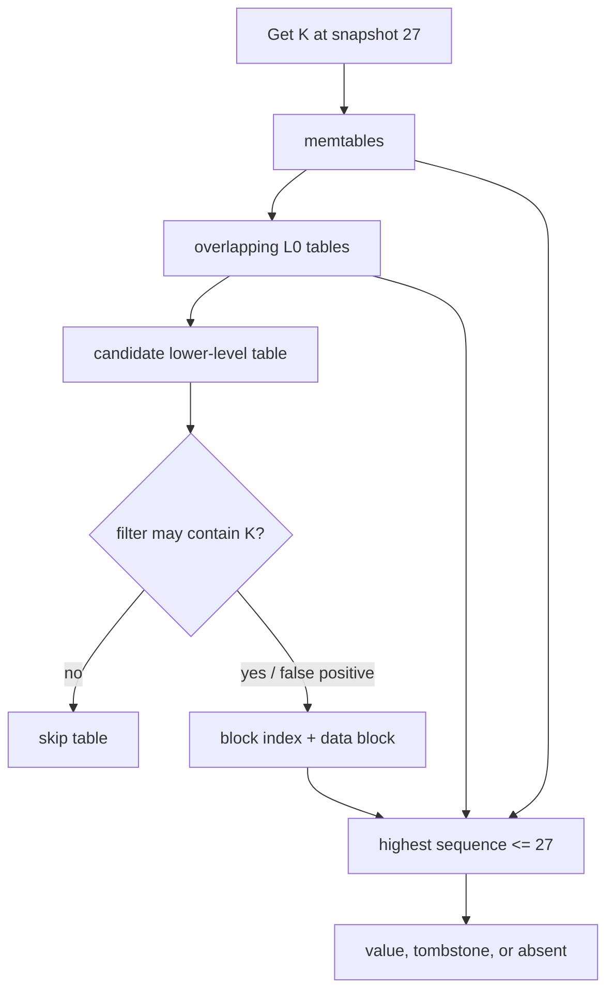

### Example 10 — one key, three snapshot answers

Candidate versions for `K` are tombstone `@30`, value `new@25`, and value `old@12`:

| Snapshot | Visible candidates | Selected result |
|---:|---|---|
| 20 | `old@12` | `old` |
| 27 | `new@25`, `old@12` | `new` |
| 30 | tombstone `@30`, both older values | absent |

The Java `newestVisible` scenario verifies all three results. It also models a Bloom negative as zero candidate probes. A real Bloom positive is only “maybe”: it can be a false positive and still require index/data-block work. A correctly built Bloom filter must not create false negatives for the key domain it covers.

For a range scan, the engine merges ordered iterators from participating structures, keeps the newest snapshot-visible version per key, and suppresses keys hidden by tombstones. If there are `r` runs, a heap-based merge is commonly described as `O(output_candidates log r)` CPU plus the blocks actually read; filters that help point absence do not erase the need to walk a requested range.

## Tombstones are promises that older values stay hidden

A delete writes a newer tombstone. Removing it too early can expose an older value in another table—a resurrection bug. Safe reclamation needs both visibility information and coverage information: no active snapshot may need the pre-delete version, and no older version capable of reappearing may remain outside the compaction's knowledge.

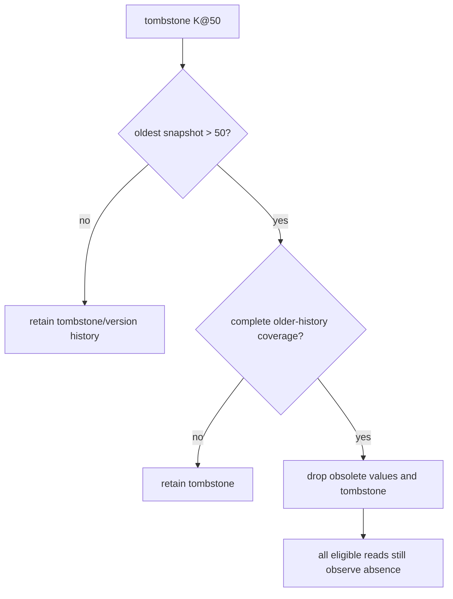

### Example 11 — both safety gates must pass

The executable teaching predicate accepts removal only when `tombstoneSequence < oldestSnapshotSequence` **and** the compaction covers all older history for that key:

| Tombstone | Oldest snapshot | Complete older-history coverage? | Decision |
|---:|---:|---|---|
| 50 | 40 | yes | keep; snapshot 40 may need the old value |
| 50 | 80 | no | keep; an older value might survive elsewhere |
| 50 | 80 | yes | safe in this deliberately complete model |

Real RocksDB compaction uses sequence numbers, snapshots, level placement, merge/range-deletion semantics, and file/version metadata rather than this one predicate. Distributed stores add repair and replica-retention constraints. An LSM tombstone is also not a certified secure-erasure mechanism; backups, logs, snapshots, replicas, and device behavior belong to a separate deletion policy.

## Compaction shapes the amplification trade

Leveled compaction aims for non-overlap in lower levels, usually reducing point-read candidates and steady-state space amplification at the cost of rewriting data as it moves through levels. Universal/tiered-style compaction keeps several sorted runs and merges selected runs, often reducing write amplification while increasing read candidates and temporary space. These are workload-dependent families, not universal rankings.

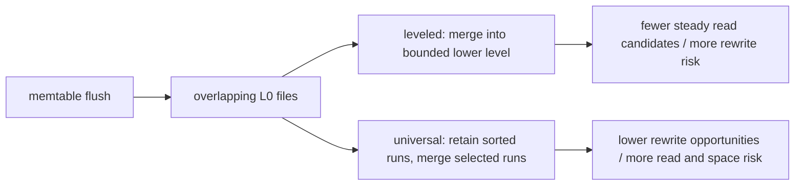

### Example 12 — define the accounting boundary before quoting a ratio

Suppose 100 MB of logical updates cause 100 MB of WAL writes, 100 MB of flush output, and 500 MB of compaction output:

\[
WA = \frac{100 + 100 + 500}{100} = 7
\]

If a lookup reads 64 KiB to return 8 KiB, byte-based read amplification is 8. That is not the same metric as “files probed per lookup.” The Java `amplification` scenario keeps these ratios separate and calculates required modeled disk occupancy:

\[
\text{headroom target} = \text{live} + \text{obsolete} + \text{compaction overlap}
\]

For `1000 + 120 + 300`, the result is 1420 units. This is an accounting example, not a promised RocksDB ratio or a complete capacity formula. State whether WAL, compression, replication, filesystem/device amplification, backups, and temporary outputs are included.

## Compaction debt becomes foreground backpressure

If flush or compaction bandwidth stays below incoming work, immutable memtables and L0 files accumulate. Reads face more candidates; background I/O competes with foreground work; eventually the engine delays or stops writes to protect memory and file-count bounds. More cache cannot repay insufficient compaction bandwidth.

| Signal | What it can reveal | Avoid this shortcut |
|---|---|---|
| pending compaction bytes / compaction score | queued rewrite work | one instant is not a trend |
| L0 file count | overlap and stall proximity | thresholds depend on configuration |
| write-stall count and duration | foreground impact | average write latency can hide stalls |
| flush/compaction read and write throughput | whether background work keeps pace | device bandwidth is shared with reads/WAL |
| block-cache and filter usefulness | avoided data-block reads | hit rate alone does not show tail latency |
| live, obsolete, and total SST bytes | space amplification and reclaim lag | filesystem free space may include other users |
| oldest snapshot/iterator age | why versions cannot be reclaimed | long scans can pin history intentionally |

Recovery planning must reserve space for the WAL and the published SST set, while compaction planning must additionally cover old inputs and new outputs until metadata publication makes inputs obsolete. If the disk fills, compaction may be unable to finish the very rewrite needed to reclaim space.

## Complexity, failure boundaries, and review

| Operation | Logical shape | Dominant physical risk |
|---|---|---|
| Write | WAL append + `O(log m)` memtable insert for a tree-backed memtable | sync policy and memtable contention |
| Point read | newest visible version across candidate structures | overlapping runs, cache misses, false-positive filters |
| Range read | ordered merge across `r` iterators | read amplification and obsolete versions |
| Flush | sort/encode mutable state into an immutable table | burst I/O and L0 growth |
| Compaction | merge selected inputs, rewrite surviving versions | write/space amplification and foreground interference |

Review questions:

- Which exact event makes a write acknowledged, recoverable, flushed, and visible in the current file version?
- Which sequence number defines the caller's snapshot?
- Can a filter skip the table, or does it only say “maybe”?
- Which older values might a tombstone still mask?
- Does the compaction input cover all relevant older history for the key?
- Which amplification numerator and denominator are being reported?
- How much temporary disk is required while old and new files coexist?
- Which queue, L0, throughput, stall, and snapshot-age signals show debt before outage?

### Primary references for Section 3

Accessed 2026-10-16.

12. [RocksDB overview](https://github.com/facebook/rocksdb/wiki): embedded LSM storage engine scope and RocksJava distinction.
13. [RocksDB Journal](https://github.com/facebook/rocksdb/wiki/Journal): WAL journals in-memory updates; MANIFEST journals on-disk state changes.
14. [RocksDB MemTable](https://github.com/facebook/rocksdb/wiki/MemTable): mutable/immutable memtables and flush triggers.
15. [RocksDB Compaction](https://github.com/facebook/rocksdb/wiki/Compaction): leveled/tiered trade-offs and workload-dependent write amplification.
16. [RocksDB Universal Compaction](https://github.com/facebook/rocksdb/wiki/Universal-Compaction): lower-write-amplification goal and read/space trade-offs.
17. [RocksDB Leveled Compaction](https://github.com/facebook/rocksdb/wiki/Leveled-Compaction): L0 overlap, lower-level organization, and compaction behavior.
18. [RocksDB Write Stalls](https://github.com/facebook/rocksdb/wiki/Write-Stalls): memtable, L0, and pending-compaction backpressure triggers.
19. [RocksDB Compaction Stats and DB Status](https://github.com/facebook/rocksdb/wiki/Compaction-Stats-and-DB-Status): bytes, amplification, stall, and per-level operational metrics.

# Section 4 — Row-oriented and column-oriented storage

Row and column layouts answer different access patterns. A row store keeps the attributes of one record near one another, which is useful when a request reads or changes most of one record. A column store keeps values of one attribute together, which lets an analytical scan read only selected columns, compress similar values, and process vectors of values. Neither layout is automatically faster: predicates, sort order, indexes, compression, partitioning, batch size, merge debt, and hardware still determine the physical work.

## Learning and requirements contract

After this section you should be able to:

1. estimate bytes requested by a full-row scan versus a selected-column scan without calling that estimate elapsed time;
2. trace a batch/vector aggregation over aligned columns and identify its null/type/overflow contracts;
3. explain immutable MergeTree parts, background merges, sparse primary-index marks, granules, and `ORDER BY` pruning;
4. distinguish a sorting key from a uniqueness constraint and a partition key from a primary index;
5. design an OLTP-to-OLAP path with a transactional outbox, stable event identity, per-aggregate versions, duplicate handling, gap detection, replay, and freshness reporting; and
6. keep order acceptance on the transactional system instead of treating an asynchronous analytical projection as the source of truth.

Write these requirements before choosing a layout:

| Question | Example requirement | Consequence |
|---|---|---|
| What is the unit of work? | fetch and update one order | row locality and transactional indexes are valuable |
| Which columns does the scan need? | `region_id`, `revenue_cents` from 10 million rows | column projection can avoid unrelated attributes |
| Which predicates dominate? | tenant plus event-day range | sort key should place useful pruning prefixes first |
| How fresh must analytics be? | dashboard may lag by 30 seconds | show a watermark; do not use it to confirm a just-written order |
| Can delivery repeat or reorder? | connector retry and partition failover | stable event IDs, versions, idempotent application, and replay |
| How are writes batched? | tens of thousands of facts per insert | fewer initial parts and less merge pressure |

## Example 13 — byte selection is a bound, not a benchmark

Assume 10,000,000 logical rows, an uncompressed modeled row width of 200 bytes, and a query that needs two 8-byte columns. The Java `scanEstimate` model calculates:

| Layout estimate | Arithmetic | Bytes |
|---|---:|---:|
| row-oriented input | `10,000,000 × 200` | 2,000,000,000 |
| selected columns | `10,000,000 × (8 + 8)` | 160,000,000 |
| modeled reduction | `2,000,000,000 / 160,000,000` | 12.5× |

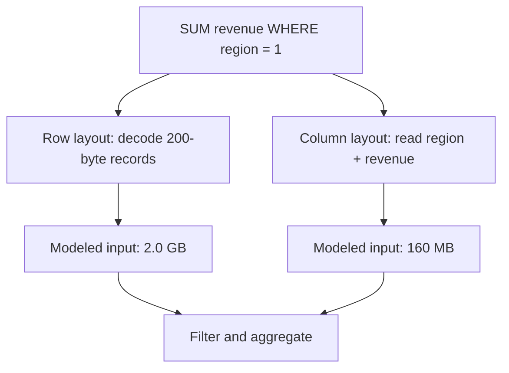

This is a logical input estimate. It deliberately excludes compression ratios, metadata, mark/index reads, caching, predicate selectivity, prefetching, decompression CPU, vectorization, parallelism, and storage bandwidth. Therefore **12.5× less selected input is not a claim of 12.5× lower latency**. Conversely, a point update may favor a row layout because all fields and transactional metadata for one record are already colocated instead of being spread across column files or rewritten immutable parts.

The model rejects zero/negative dimensions, integer overflow, and selected widths greater than the modeled row. Those checks matter: a capacity calculation that silently wraps is worse than no estimate.

## Example 14 — process aligned columns in bounded batches

The executable `sumRevenueForRegion` model receives aligned `regionIds` and `revenueCents` arrays. With regions `[1, 2, 1, 3, 1]`, revenues `[100, 200, 300, 400, 500]`, target `1`, and batch size `2`, it produces 900 cents across three batches.

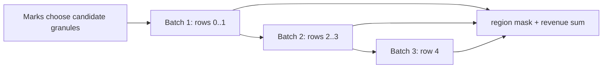

| Batch | Region vector | Revenue vector | Matching contribution | Running sum |
|---:|---|---|---:|---:|
| 1 | `[1, 2]` | `[100, 200]` | 100 | 100 |
| 2 | `[1, 3]` | `[300, 400]` | 300 | 400 |
| 3 | `[1]` | `[500]` | 500 | 900 |

The arrays are a teaching analogue for columnar batches, not an implementation of ClickHouse. Production engines use typed compressed streams, null maps, selection masks, specialized functions, multiple execution threads, and CPU-vector-friendly loops. Still, the model exposes real contracts: arrays must have equal row counts, batch size must be positive, and the sum must have a defined overflow policy. Java's `Math.addExact` makes overflow a failure instead of corrupting the aggregate.

## Example 15 — sparse marks prune granules, not individual rows

For the MergeTree family, each insert creates a sorted immutable data part. Background merges combine parts. Data is physically ordered by the sorting key; a sparse primary index stores marks for granules instead of one entry per row. A query uses key conditions to identify candidate granules, then reads those granules and applies the remaining predicate. The primary key is **not a uniqueness constraint**.

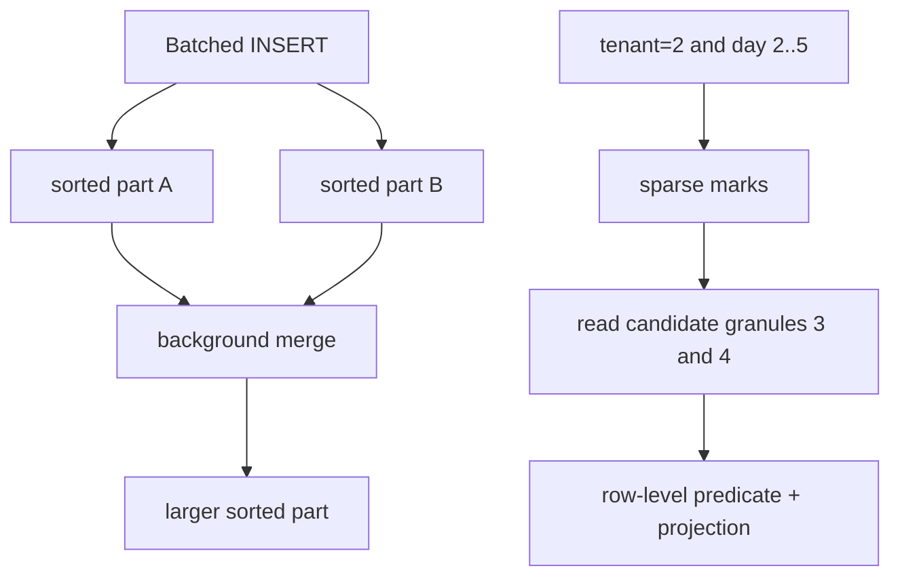

The Java scenario models six 8,192-row granules. Two can contain tenant 2 in day range 2–5, so the sparse filter selects granules 3 and 4: 16,384 candidate rows. It does **not** assert that every selected row matches or that all other engine-level skipping mechanisms have run.

| Granule | Tenant bounds | Day bounds | Candidate? | Reason |
|---:|---|---|---|---|
| 0 | 1..1 | 1..3 | no | tenant cannot match |
| 1 | 1..1 | 4..6 | no | tenant cannot match |
| 2 | 1..2 | 7..9 | no | day range cannot overlap |
| 3 | 2..2 | 1..3 | yes | both bounds may overlap |
| 4 | 2..2 | 4..6 | yes | both bounds may overlap |
| 5 | 3..3 | 1..9 | no | tenant cannot match |

Pruning quality depends on physical order. For frequent `tenant_id = ? AND event_day BETWEEN ? AND ?` queries, an `ORDER BY (tenant_id, event_day, event_id)` prefix can make tenant/day ranges adjacent. Reversing the first two fields changes which predicates form a useful contiguous range. Put high-cardinality IDs in `PARTITION BY` only with evidence; excessive partitions multiply parts and metadata. Wide and Compact are storage formats for parts selected by size/row thresholds, not row-store versus column-store product modes.

ClickHouse recommends batching inserts (at least 1,000 rows and ideally 10,000–100,000 in the cited guidance) because each insert otherwise creates a part and increases merge work. If client batching is impractical, asynchronous inserts can move batching to the server, but acknowledgement and retry settings still define the failure contract.

## Example 16 — an analytical projection is replayable, not authoritative

Use an OLTP transaction to change an order and insert its outbox event together. Logical decoding or a CDC connector publishes the committed outbox row. The analytical consumer applies events by stable `event_id` and per-order `version`. The dashboard reports its source watermark or lag; order confirmation reads the OLTP result, not the lagging projection.

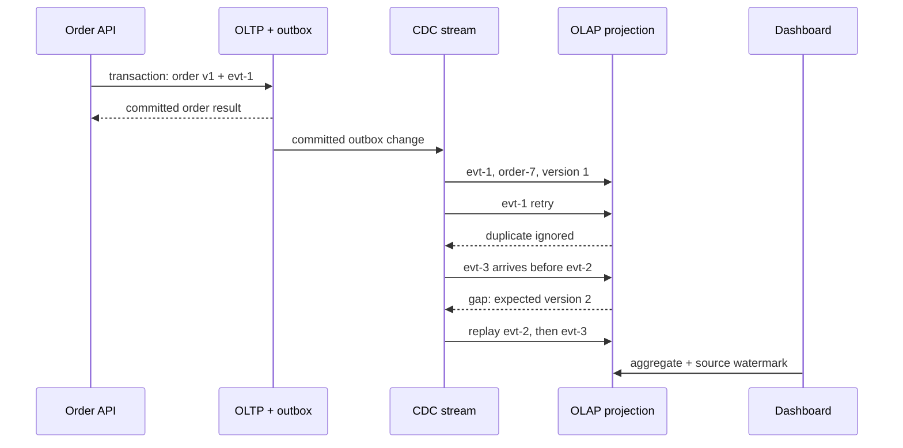

The Java `OrderProjection` proves this sequence:

| Delivery | Current version | Decision | Resulting version/value |
|---|---:|---|---|
| `evt-1`, v1, 1000 | 0 | apply | v1 / 1000 |
| same `evt-1` | 1 | duplicate | unchanged |
| `evt-3`, v3, 1200 | 1 | gap; expect v2 | unchanged |
| `evt-2`, v2, 1100 | 1 | apply | v2 / 1100 |
| retry `evt-3` | 2 | apply | v3 / 1200 |
| distinct old event, v2 | 3 | stale | unchanged |

The gap event is not recorded as consumed because it must be retried after replay. A stale event ID may be remembered to avoid repeated work. Production implementations need durable deduplication/version state, a dead-letter or quarantine policy, retained/reconstructable source history, alerting on gaps and lag, and a reconciliation job that compares source counts/sums or business invariants. If the projection cannot replay from a retained log or source snapshot, “eventual consistency” has no mechanism that guarantees eventual repair.

Debezium's outbox router uses the outbox `id` as an event identity suitable for duplicate removal and `aggregateid` as the message key, which is important for ordering within Kafka partitions. PostgreSQL logical decoding exposes committed row changes through replication slots; output plugins decode concurrent transactions in commit order and do not decode rolled-back transactions. Those facts do not make the entire end-to-end pipeline exactly once: connectors, brokers, consumers, and sinks still need explicit retry and idempotency behavior.

## Complexity, operations, and review

| Path | Useful model | Failure/latency risk |
|---|---|---|
| OLTP point read/write | indexed lookup plus transactional log work | lock/conflict retry, log sync, replica policy |
| column projection scan | selected compressed column chunks | decompression, bandwidth, weak pruning, skew |
| sparse-key pruning | index marks plus candidate granules | key order mismatch and granule over-read |
| insert | sort/encode one new immutable part | tiny batches create too many parts |
| merge | read input parts and write replacement part | disk/CPU pressure and temporary space |
| CDC projection | apply/reject by event ID and version | duplicates, gaps, lag, retention loss |

Operational signals should include parts per active partition, insert batch rows/bytes, merge backlog and throughput, bytes read after pruning, selected granules, compression ratio, query CPU and p95/p99 latency, CDC source position, consumer lag, oldest unprocessed event, gap/quarantine count, replay age, and reconciliation drift.

Review questions:

- Which fields does the query actually read, and what bytes are estimated before and after compression?
- Is the claimed speedup a byte estimate or a measured latency result?
- Does the sort-key prefix match equality and range predicates in order?
- How many granules remain after mark pruning, and how many rows are examined afterward?
- Are insert batches large enough to avoid part explosion, and can merges keep pace?
- Are event identity and aggregate ordering separate concepts?
- What happens to a duplicate, a stale version, and a forward version gap?
- Which source watermark tells a user how fresh the dashboard is?
- Which reconciliation process repairs a missed or poisoned event?
- Which user decisions must remain on the transactional source of truth?

### Primary references for Section 4

Accessed 2026-10-16.

20. [ClickHouse architecture overview](https://clickhouse.com/docs/development/architecture): column-oriented storage and vectorized/chunk-oriented execution.
21. [Understanding the ClickHouse primary index](https://clickhouse.com/docs/guides/best-practices/sparse-primary-indexes): physical sort order, sparse marks, granules, candidate-range pruning, and non-unique primary keys.
22. [MergeTree table engine](https://clickhouse.com/docs/engines/table-engines/mergetree-family/mergetree): sorted parts, marks, granule sizing, and Wide/Compact part formats.
23. [Selecting an insert strategy](https://clickhouse.com/docs/concepts/best-practices/selecting-an-insert-strategy): client/server batching, part creation, merge load, and acknowledgement trade-offs.
24. [ClickHouse data parts](https://clickhouse.com/docs/concepts/core-concepts/parts): immutable part creation and background merge mechanics.
25. [Debezium Outbox Event Router](https://debezium.io/documentation/reference/stable/transformations/outbox-event-router.html): event identity, aggregate key, payload routing, and duplicate-handling support.
26. [PostgreSQL logical decoding](https://www.postgresql.org/docs/current/logicaldecoding.html) and [output plugins](https://www.postgresql.org/docs/current/logicaldecoding-output-plugin.html): committed change streams, replication slots, transaction ordering, and rollback exclusion.

# Section 5 — Isolation: name the anomaly, snapshot, and repair

An isolation label is only the start of the contract. State which rows or predicates must remain stable, whether ordinary reads use a statement or transaction snapshot, which statements lock current index ranges, which conflicts can abort, and how the caller retries. The SQL-standard phenomenon table is a portable minimum; PostgreSQL and InnoDB deliberately implement stronger or different behavior in important cases.

## Learning and requirements contract

After this section you should be able to:

1. identify dirty reads, non-repeatable reads, phantoms, lost updates, and write skew from a two-transaction history;
2. distinguish a statement snapshot from a transaction snapshot and a snapshot read from a locking/current read;
3. explain why PostgreSQL Repeatable Read prevents phantoms yet can allow write skew, and why Serializable may abort a transaction;
4. explain why InnoDB Repeatable Read ordinary `SELECT` and locking DML can observe different effective states;
5. select an invariant repair: declarative constraint, atomic statement, version check, stable lock target, or Serializable retry; and
6. retry a complete transaction within a bound while keeping external effects idempotent and resolving unknown commit outcomes.

Write these requirements before choosing an isolation level:

| Question | Example requirement | Consequence |
|---|---|---|
| Which facts form the invariant? | at least one engineer remains on call | protecting only each engineer's own row is insufficient |
| Must a reread be stable? | one report uses one database snapshot | use a transaction snapshot or an explicitly exported snapshot |
| Must a predicate be stable for writes? | no new OPEN order may enter the selected range | use serializable validation or a locking design whose scanned index range is understood |
| May a conflict abort? | checkout may retry twice within 150 ms | retry the whole decision with jitter and a deadline |
| Can the operation be repeated? | payment operation ID is unique | store the operation result atomically; never replay an external effect blindly |
| How long may a snapshot live? | export finishes within five minutes | monitor oldest transaction age and vacuum/purge debt |

## Example 17 — classify the history before prescribing a level

“Possible” below means the standard-style minimum does not generally prohibit the phenomenon. It does not mean every engine or execution exhibits it. Write skew is a serialization anomaly across a predicate or invariant; it is not one of the original three phenomena used to summarize the weaker SQL levels.

| Isolation level: standard-style minimum | Dirty read | Non-repeatable read | Phantom | Write skew |
|---|---|---|---|---|
| Read Uncommitted | possible | possible | possible | possible |
| Read Committed | prevented | possible | possible | possible |
| Repeatable Read | prevented | prevented | possible | possible |
| Serializable | prevented | prevented | prevented | prevented among committed transactions |

Use a trace rather than a label:

| Phenomenon | Initial state | Interleaving | Broken assumption |
|---|---|---|---|
| dirty read | `price=10` | A writes 20; B reads 20; A rolls back | B treated uncommitted state as real |
| non-repeatable read | `price=10` | A reads 10; B commits 20; A rereads 20 | one row stayed stable across A's statements |
| phantom | two OPEN orders | A counts 2; B commits another OPEN order; A counts 3 | the predicate result stayed stable |
| lost update | `counter=10` | A and B read 10; each blindly writes 11 | both increments were preserved |
| write skew | Alice and Bob are on call | each sees two on call; each updates only self to off | stable snapshots preserved a cross-row invariant |

```mermaid
sequenceDiagram
    participant A as Transaction A
    participant D as Database
    participant B as Transaction B
    A->>D: SELECT price -> 10
    B->>D: UPDATE price=20; COMMIT
    A->>D: SELECT price
    D-->>A: RC -> 20; transaction snapshot -> 10
```

The Java `repeatReadAfterCommit` scenario makes only this visibility rule executable. Under a statement-snapshot policy it reads versions 1 then 2 and returns 10 then 20. Under a transaction-snapshot policy both reads use version 1 and return 10 then 10. It is a deterministic history model, not a substitute for an integration test against a selected engine and driver.

PostgreSQL maps Read Uncommitted to Read Committed. At Read Committed each command sees a snapshot as of that command's start. PostgreSQL Repeatable Read uses one transaction snapshot and does not allow phantom reads, which is stronger than the table's minimum, but serialization anomalies such as write skew can remain. PostgreSQL Serializable adds Serializable Snapshot Isolation monitoring and rejects dangerous histories so that only serializable transactions commit.

## Example 18 — stable snapshots do not protect a cross-row invariant

Suppose the rule is “at least one engineer is on call.” Alice and Bob each read the same snapshot containing `Alice=on, Bob=on`. Each changes a different row, so ordinary snapshot isolation finds no same-row write/write conflict. Both commits can leave zero engineers on call.

```mermaid
sequenceDiagram
    participant A as Alice transaction
    participant D as Snapshot database
    participant B as Bob transaction
    A->>D: read Alice=on, Bob=on
    B->>D: read Alice=on, Bob=on
    A->>D: set Alice=off; COMMIT
    B->>D: set Bob=off; COMMIT
    Note over A,B: different rows changed; invariant is false
```

The executable `concurrentOffCall(false)` trace commits both row changes and proves `onCallCount()==0`. With predicate-version validation enabled, Alice's commit changes the roster version, Bob's stale decision is rejected, and one engineer remains on call. This models the outcome of serializable conflict detection, not PostgreSQL's internal SSI graph.

Repair choices depend on the schema and workload:

- express the invariant as a database constraint when it can be represented and enforced atomically;
- route every decision through a roster guard row and lock it in a stable order;
- use Serializable for all participating reads and writes, then retry rejected transactions; or
- redesign the aggregate so the invariant is updated through one atomic record or command.

Locking only the row each transaction updates does not repair this history. Nor does a partial retry after the original reads: the decision must be recomputed from a new snapshot.

## Example 19 — InnoDB snapshot reads and current locking reads are different contracts

InnoDB Repeatable Read ordinary consistent reads use the snapshot established by the first such read. Locking reads, `UPDATE`, and `DELETE` instead operate with locking/current-read behavior. MySQL's own 8.4 manual cautions against mixing locking and nonlocking statements when the application expects one coherent view. Under Read Committed, each consistent read receives a fresh snapshot and ordinary gap locking is reduced, so phantoms may occur.

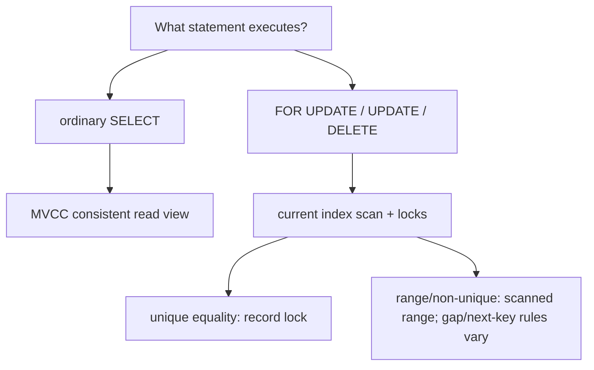

At InnoDB Repeatable Read, a suitable unique-index equality generally locks only the found index record. A range or non-unique search generally locks the scanned index range with gap or next-key locks. At Read Committed, InnoDB generally locks records rather than gaps except for foreign-key and duplicate-key checks. The actual plan therefore changes the lock footprint: without a useful index a locking statement can scan and lock far more records than the business predicate suggests.

Do not infer these details from JDBC's constants. `Connection.TRANSACTION_REPEATABLE_READ` describes portable phenomenon prohibitions, not PostgreSQL's stronger phantom behavior or InnoDB's statement-specific locking. Configure the connection before beginning work because JDBC declares changing isolation during a transaction implementation-defined:

```java
try (Connection connection = dataSource.getConnection()) {
    connection.setTransactionIsolation(Connection.TRANSACTION_SERIALIZABLE);
    connection.setAutoCommit(false);
    try {
        // Execute every read, validation, and write for one attempt here.
        connection.commit();
    } catch (SQLException failure) {
        connection.rollback();
        throw failure;
    }
}
```

An integration test should run the exact indexed predicate concurrently, capture SQLSTATEs and wait outcomes, and inspect the engine's lock/transaction diagnostics. A generic Java unit model cannot prove an engine's lock plan.

## Example 20 — prevent lost updates and retry the whole decision

Two clients that both read counter 10 and blindly assign 11 lose one increment. The Java `blindIncrement` trace makes that failure explicit. Prefer one atomic statement when the operation is commutative:

```sql
UPDATE counters SET value = value + 1 WHERE counter_id = :id;
```

For an optimistic edit, compare the version that was read:

```sql
UPDATE article
SET body = :body, version = version + 1
WHERE tenant_id = :tenant AND id = :id AND version = :expected;
-- 1 row: success. 0 rows: missing object or version conflict; reread before retry.
```

The executable `versionCheckedIncrement` trace lets the first writer move version 1 to 2 and rejects the second writer's expected version 1 rather than overwriting silently.

PostgreSQL documents SQLSTATE `40001` as a serialization failure and requires retrying the **complete transaction**, including the logic that selected SQL and values. More than one retry may be necessary, so production code needs an attempt bound, deadline, jittered backoff, metrics, and a non-retry path. The Java `incrementWithWholeTransactionRetry` scenario injects one concurrent increment: attempt 1 conflicts, attempt 2 rereads value 11, commits 12, and publishes one durable operation ID.

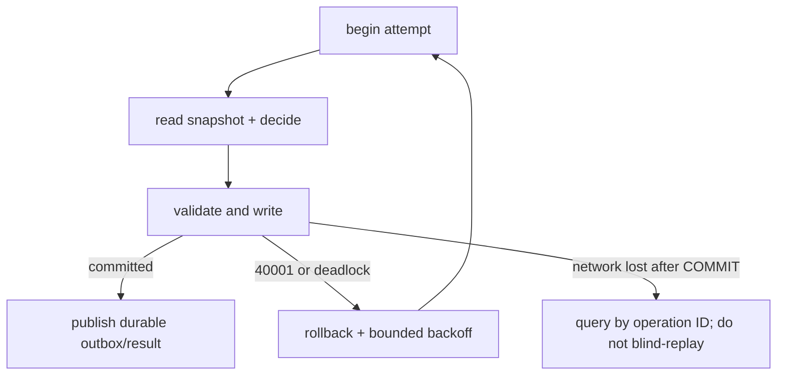

A deadlock victim or serialization failure says the attempt did not commit and may be retried when business effects are transactionally staged or idempotent. A network failure after `COMMIT` was sent is an **unknown outcome**: the server might have committed. Resolve it through a unique operation ID and stored result. Sending email, charging a card, or publishing directly inside a retriable body can duplicate the effect; write an outbox row in the transaction and dispatch it idempotently after commit.

## MVCC retention, operations, and review

Snapshot readers reduce reader/writer blocking, but old snapshots retain visibility requirements. PostgreSQL vacuum and InnoDB purge cannot reclaim every obsolete version while an eligible old transaction may still need it. A long export should not keep a broad transaction open across user interaction or network calls.

```mermaid
flowchart LR
    S["snapshot at version 100"] --> V["version 95 remains visible"]
    W["writer commits version 105"] --> N["new snapshots see 105"]
    V --> G["reclaim only after no required snapshot needs 95"]
```

Monitor oldest active transaction/snapshot age, dead tuples or undo history, vacuum/purge progress, serialization failures by operation, deadlocks, retry attempts, lock waits, transaction latency, and unknown-outcome resolutions. Correlate failures with the indexed statement and isolation level; an aggregate error rate alone does not reveal the dangerous history.

Review questions:

- Which exact history is disallowed: dirty read, reread change, phantom, lost update, or write skew?
- Is each read a statement snapshot, transaction snapshot, or locking/current read?
- Which rows or index ranges does the actual plan inspect and lock?
- Does the repair protect the invariant or only the row being updated?
- Is every read and decision rerun after a serialization failure?
- What attempt/deadline budget prevents retry storms?
- Which operation ID resolves an unknown commit result?
- Which external effects are staged transactionally or made idempotent?
- How old can a snapshot become before version retention threatens operations?

### Primary references for Section 5

Accessed 2026-10-16.

27. [PostgreSQL 18 transaction isolation](https://www.postgresql.org/docs/current/transaction-iso.html): standard phenomena, Read Committed command snapshots, Repeatable Read snapshot behavior, PostgreSQL's Read Uncommitted mapping, and Serializable conflict detection.
28. [PostgreSQL 18 serialization failure handling](https://www.postgresql.org/docs/current/mvcc-serialization-failure-handling.html): complete-transaction retry and the possibility of multiple attempts.
29. [PostgreSQL 18 application-level consistency](https://www.postgresql.org/docs/current/applevel-consistency.html): Serializable conflict monitoring and explicit-lock alternatives.
30. [MySQL 8.4 InnoDB transaction isolation levels](https://dev.mysql.com/doc/refman/8.4/en/innodb-transaction-isolation-levels.html): per-level snapshots, locking reads, gap behavior, and the warning about mixed read modes.
31. [MySQL 8.4 consistent nonlocking reads](https://dev.mysql.com/doc/refman/8.4/en/innodb-consistent-read.html): read views, Repeatable Read's first-read snapshot, Read Committed's fresh snapshots, and DML visibility caveats.
32. [MySQL 8.4 locks set by statements](https://dev.mysql.com/doc/refman/8.4/en/innodb-locks-set.html): unique equality, scanned ranges, missing-index effects, and next-key locks.
33. [Java SE 17 `Connection`](https://docs.oracle.com/en/java/javase/17/docs/api/java.sql/java/sql/Connection.html): auto-commit, commit/rollback boundaries, portable isolation constants, and isolation-configuration timing.

# Section 6 — Cache topology: local, distributed, and two-level

A cache topology is a placement and failure contract, not merely a latency choice. A JVM-local cache removes a network hop but creates one independent copy per process. A distributed cache shares values but adds routing, serialization, network tails, hot-key pressure, and failover behavior. An L1 + L2 design combines both and therefore has **two freshness boundaries** to bound and observe.

## Learning and requirements contract

After this section you should be able to:

1. choose local, distributed, or two-level caching from latency, capacity, failure, and freshness requirements;
2. separate maximum size, expiry, eviction, and admission instead of calling all four “LRU”;
3. quantify duplicated L1 memory and conditional L2/origin traffic before adding a tier;
4. explain why one JVM's loader, lock, or invalidation does not coordinate other JVMs;
5. handle missed or reordered invalidations, including flushing an untrusted local cache after a tracking connection is lost; and
6. design a cache key that preserves tenant, locale, schema, revision, and authorization boundaries.

Write the contract before selecting a product:

| Requirement | Example | Design consequence |
|---|---|---|
| Authority | PostgreSQL owns article version 6 | every cache copy is disposable and versioned |
| Freshness | ordinary article ≤30 s stale; permission revocation 0 s | TTL may cover the article; authorization is checked against current policy |
| Failure mode | Redis loss may increase latency, not corrupt results | bounded fallback and origin load shedding are mandatory |
| Capacity | 12 JVMs, 50,000 local entries each | local capacity is duplicated, not fleet-global |
| Key scope | tenant + article + locale + renderer version | a bare `articleId` is unsafe |
| Recovery | node may miss invalidations while disconnected | reconnect establishes a new trust boundary and flushes L1 |

| Topology | Placement and useful property | Dominant risk |
|---|---|---|
| Caffeine/Guava local | each JVM; no network or serialization on a hit | divergent nodes, duplicated heap, cold starts, GC pressure |
| Redis distributed | shared remote service with TTLs and atomic server commands | network tail, hot keys, memory pressure, failover semantics |
| Memcached distributed | client/proxy routes each key to an ephemeral server | node loss becomes misses/errors; servers do not synchronize or replicate |
| L1 local + L2 distributed | hot reads stop at the JVM; fleet shares the next tier | two invalidation races, two capacities, and ambiguous ownership if undocumented |

The focused examples below complement the repository's broader system-design caching chapter: they concentrate on JVM placement, admission, client tracking, and multi-tenant safety rather than repeating cache-aside strategy coverage.

## Example 21 — quantify topology before adding a tier

Assume 12 service instances, each allowing 50,000 L1 entries, one million L2 entries, and an estimated 1,024 bytes per serialized entry including key/value overhead for this planning model.

| Quantity | Calculation | Result |
|---|---:|---:|
| duplicated L1 bytes | `12 × 50,000 × 1,024` | 614,400,000 B ≈ 586 MiB |
| shared L2 bytes | `1,000,000 × 1,024` | 1,024,000,000 B ≈ 977 MiB |
| fleet entries represented by L1 | at most `12 × 50,000` physical copies | not necessarily 600,000 distinct keys |

For an arithmetic-mean teaching estimate, let the L1 hit rate be 90%, the conditional L2 hit rate after an L1 miss be 80%, and service times be 0.0001 ms, 1.2 ms, and 8 ms for L1, L2, and the authority:

`E = L1 + P(L1 miss) × [L2 + P(L2 miss | L1 miss) × authority]`

`E = 0.0001 + 0.10 × (1.2 + 0.20 × 8) = 0.2801 ms`

The executable `topologyEstimate` model in [ConsistencyContracts.java](ConsistencyContracts.java) checks those bytes and the conditional-probability formula. It is not a p99 prediction: correlated misses, retries, queueing, connection pools, payload size, failover, and hot-key skew dominate tails.

```mermaid
flowchart TD
    R["request on JVM A"] --> L1{"A's bounded L1"}
    L1 -->|hit| X["return versioned value"]
    L1 -->|miss| L2{"shared L2"}
    L2 -->|hit| F["fill A's L1"]
    L2 -->|miss| D["authoritative database"]
    D --> P["publish to L2, then L1 under version rules"]
    P --> X
    F --> X
```

Measure hit ratios **by tier and outcome**: L1 hit, L2 hit after L1 miss, authority fallback, timeout, rejected fallback, and stale/invalidated read. A 95% combined hit rate can still hide a useless L1 or an overloaded origin during synchronized expiry.

## Example 22 — admission is not eviction

Four different decisions are often collapsed into “LRU”:

- **capacity:** how much memory or how many weighted entries may be retained;
- **expiry:** when age makes an entry ineligible (`expireAfterWrite`, `expireAfterAccess`, or a per-entry policy);
- **eviction:** which resident becomes the victim when space is needed; and
- **admission:** whether the incoming candidate deserves to displace that victim.

Caffeine documents Window TinyLFU: a small admission window captures recency bursts, a frequency sketch estimates historic use, and a candidate competes for the main space. It is not a synchronized linked-list LRU. The following trace is deliberately a **simplified admission comparison**, not Caffeine's internal implementation:

| Candidate | Estimated frequency | Main victim | Victim frequency | Teaching decision |
|---|---:|---|---:|---|
| one-off scan key | 1 | hot profile | 8 | reject scan key; retain profile |
| popular article | 9 | warm profile | 8 | admit article; evict profile |

The Java `tinyLfuAdmissionModel` asserts both outcomes. A real sketch is approximate, ages history, and operates with window/main segments; tests should therefore evaluate the library with representative request traces rather than assert its private queue layout.

```mermaid
flowchart LR
    N["new candidate"] --> W["small recency window"]
    W --> C{"candidate estimate > victim estimate?"}
    C -->|yes| A["admit to main space"]
    C -->|no| R["reject candidate"]
    A --> E["evict selected resident"]
```

A Caffeine loading cache may coalesce compatible loads **inside one JVM**. It does not create a fleet-wide single-flight. Twelve cold JVMs may still issue twelve authority reads for the same key. Cross-process coordination needs a shared lease, request collapsing tier, prewarming plan, or an origin that safely absorbs the concurrency. Guava also supplies bounded/loading caches but separate JVM caches do not synchronize automatically; its maintenance and removal-listener timing must not be mistaken for a real-time coherence protocol.

## Example 23 — a two-level cache must distrust missed invalidations

Initial state: nodes A and B hold article version 5 in L1, and L2 also holds version 5. B commits version 6 to the authority. The application invalidates L2 and emits the L1 invalidation, but A's invalidation connection was lost.

| Step | Node A | Node B | L2 | Authority |
|---:|---|---|---|---|
| 1 | v5 | v5 | v5 | v5 |
| 2: A disconnects | v5, now untrusted | v5 | v5 | v5 |
| 3: commit v6 | v5, event missed | invalidates v5 | invalidated | v6 |
| 4: unsafe implementation | serves stale v5 | reloads v6 | may refill v6 | v6 |
| 5: safe reconnect | flush A; reload v6 | v6 | v6 | v6 |

```mermaid
sequenceDiagram
    participant A as JVM A L1
    participant R as Shared L2 / tracking
    participant B as Writer on JVM B
    participant D as Authority
    A->>R: read article -> v5; cache locally
    R--xA: invalidation connection lost
    B->>D: commit v6
    B->>R: replace/delete shared key
    R--xA: invalidation v5 missed
    Note over A: local v5 is no longer trustworthy
    A->>A: reconnect boundary: flush L1
    A->>R: miss and reload v6
```

Redis client-side caching calls this server-assisted mechanism **Tracking**. Default tracking remembers keys read by a client; broadcast mode trades server-side tracking memory for prefix invalidations. The Redis reference explicitly requires flushing the local cache when the invalidation connection is lost. With separate data and invalidation connections, an invalidation can also arrive before an older `GET` response; a “caching-in-progress” placeholder prevents that late response from repopulating the key. Same-connection RESP3 ordering avoids that particular two-connection race, but not every application-level DB/Redis race.

The Java `TwoLevelCache` scenario models the application boundary: A's ordinary read is rejected while invalidations are untrusted, `reconnectAndFlush` discards v5, and the next read loads v6. It does not pretend Redis queries the database; the application owns commit, L2 mutation, and repair ordering.

Use one explicit multi-node policy:

1. bounded local TTL with a stated staleness budget and bounded fill duration;
2. reliable invalidation delivery with per-node recovery/watermarks;
3. immutable revision keys plus a separately resolved current revision; or
4. no data cache for facts—such as current authorization revocations—that cannot tolerate stale reads.

A competing-consumer queue is not fan-out: if only one JVM receives each event, the other L1 copies remain stale. Pub/Sub-style delivery is a hint unless disconnect and replay semantics close that gap.

## Example 24 — key scope and authorization are correctness boundaries

Caching personalized HTML under `article:7` allows the first tenant, locale, renderer, or permission context to contaminate the next request. A safer logical key is:

`(tenantId, articleId, locale, rendererSchemaVersion, contentRevision or permissionEpoch)`

| Request difference | Unsafe result with `article:7` | Required treatment |
|---|---|---|
| tenant A vs tenant B | cross-tenant disclosure | tenant is mandatory in the key/namespace |
| `en-US` vs `fr-FR` | wrong language | locale is a key dimension |
| renderer v3 vs v4 | incompatible representation | version the key or invalidate the old schema |
| permission epoch 11 vs 12 | revoked user sees old personalized body | reauthorize each request or change the revision/epoch |

```mermaid
flowchart TD
    Q["incoming request"] --> A{"authorized now?"}
    A -->|no| D["deny; do not consult personalized value"]
    A -->|yes| K["build scoped key"]
    K --> C{"cache hit for exact scope?"}
    C -->|yes| S["serve versioned value"]
    C -->|no| O["load authority and publish safely"]
```

The Java `ScopedCacheKey` proves equal article IDs do not collide across tenants or permission epochs, and `mayServePersonalizedValue` refuses a cached value when current authorization fails. Prefer caching permission-independent article data and authorizing every request; putting a permission epoch in a key is useful only when that epoch itself is current and cannot be served from the stale object being protected.

## Distributed placement, failure, and operations

Memcached's official documentation makes the ownership boundary unusually clear: clients receive a server list, hash a key to a server, and decide what to do when that server is unreachable. Servers do not coordinate, broadcast, or replicate with each other. Losing a node therefore means errors or misses and origin reloads, not an automatic coherent failover. Client/proxy failover that remaps keys can cause a miss wave; it must not turn a disposable cache into a second authority.

For Redis or Memcached, monitor per-tier p50/p95/p99 latency, timeout/error rates, hit/miss/eviction/expiry counts, item and byte occupancy, hot keys, network bytes, connection-pool wait, backend-node distribution, failover/remap rate, origin fallback concurrency, loader coalescing, invalidation lag/disconnects, reconnect flushes, and value-version regressions. For JVM L1 add heap retained bytes, allocation/GC pressure, entry weight distribution, load success/failure time, and node-by-node hit-rate skew.

Review questions:

- Is L1 capacity stated per JVM, per pod, or for the whole fleet?
- Is L2 hit rate conditional on an L1 miss?
- Which tier owns expiry, admission, and version validation?
- Can an older fill arrive after invalidation and repopulate stale data?
- What exactly happens when the invalidation channel disconnects?
- Does every intended cache owner receive an event, or only one consumer?
- Are key routing and server membership consistent across clients?
- Which dimensions prevent tenant, locale, schema, and permission leakage?
- How much origin concurrency is allowed during cold start or node loss?
- Can the cache be deleted completely without losing committed business state?

### Primary references for Section 6

Accessed 2026-10-17.

34. [Caffeine efficiency](https://github.com/ben-manes/caffeine/wiki/Efficiency): Window TinyLFU's admission window, frequency sketch, recency/frequency trade-off, and comparison with plain LRU.
35. [Redis client-side caching reference](https://redis.io/docs/latest/develop/reference/client-side-caching/): tracking modes, invalidation delivery, separate-connection ordering race, reconnect flush, TTL, and client memory bounds.
36. [Redis client-side caching introduction](https://redis.io/docs/latest/develop/clients/client-side-caching/): supported-client behavior, disconnect flushing, suitable key workloads, and capacity estimation.
37. [Memcached documentation](https://docs.memcached.org/) and [FAQ](https://docs.memcached.org/userguide/faq/): client-side routing, disconnected servers, lack of replication, ephemeral failure semantics, and network round-trip costs.
38. [Guava cache guide](https://github.com/google/guava/wiki/cachesexplained): local cache population, size/time eviction, maintenance timing, and removal-listener behavior.

# Section 7 — Four read/write strategies: ownership, acknowledgement, and repair

Cache-aside, read-through, write-through, and write-behind are not interchangeable labels for “use a cache.” Each chooses who loads or writes, which component acknowledges success, and what must happen after a partial failure. The database remains authoritative in the first three strategies described here. Write-behind is safe only when a durable queue or log—not volatile cache memory—owns every acknowledged write until the database applies it.

## Learning and requirements contract

After this section you should be able to:

1. name the authority, acknowledgement boundary, freshness target, and repair owner for each strategy;
2. reproduce the cache-aside stale-resurrection race and reject an obsolete fill with a generation or version fence;
3. distinguish “not found” from “load failed” in a read-through API and limit same-key load coalescing to its actual scope;
4. handle database success followed by cache failure without claiming the entire write failed; and
5. design write-behind around durable enqueue-before-acknowledge, idempotent ordered replay, and explicit backpressure.

| Strategy | Read miss owner | Write/acknowledgement boundary | Required failure contract |
|---|---|---|---|
| Cache-aside | application reads authority, then attempts publication | database commit is durable; cache deletion/update is separate | obsolete fills cannot republish; cache failure degrades performance/freshness, not authority |
| Read-through | cache abstraction invokes a loader | normally same as the application's database write path | loader failure is not absence; coalescing scope and negative-cache policy are explicit |
| Write-through | miss still needs lazy/read-through loading | database commit, then cache mutation in this model | database success plus cache failure becomes “committed, repair pending” |
| Write-behind | cache usually serves the newly accepted value | durable queue/log append before success is returned | bounded queue, idempotent consumer, per-key order/version checks, lag and poison-message handling |

A useful review sentence is: **“This request is successful when ___ is durable; if the next step fails, ___ repairs it while reads follow ___.”** If those blanks are unclear, the strategy is incomplete.

## Example 25 — cache-aside can resurrect a value after deletion

Cache-aside usually reads `cache → database → cache` and writes `database commit → cache delete`. “Delete after commit” avoids invalidating for a transaction that later rolls back, but it does not close the race between a slow reader and a writer:

| Step | Reader | Writer | Cache | Authority |
|---:|---|---|---|---|
| 1 | misses and starts reading | — | empty | v5 |
| 2 | receives v5, pauses | commits v6 | empty | v6 |
| 3 | still paused | deletes key | empty | v6 |
| 4 | publishes its earlier result | — | **v5 resurrected** | v6 |

```mermaid
sequenceDiagram
    participant R as Reader
    participant C as Cache
    participant D as Authority
    participant W as Writer
    R->>C: GET key -> miss
    R->>D: read -> v5
    W->>D: commit v6
    W->>C: delete key
    R->>C: unsafe SET v5
    Note over C,D: cache regresses to v5 after invalidation
```

The executable `CacheAsideRace` reproduces that history, then repairs it with a per-key generation fence. A fill records the generation observed before loading and publishes only if the generation still matches and its version is not older than the authority:

```java
PendingFill fill = cache.beginMiss();       // captures v5, generation 0
cache.commitAndInvalidate(v6);              // authority v6, generation 1
boolean published = cache.publishIfCurrent(fill);
assert !published;                          // obsolete v5 cannot reappear
```

An immutable key such as `article:7:v6` also prevents v5 from overwriting v6, provided the separately resolved “current version” pointer is itself coherent. A compare-and-set, server-side script, or shared generation record can fence a distributed cache. A JVM-local counter does not coordinate other nodes. If generation metadata expires, is evicted, or resets to an old value, the same number can reappear—the ABA problem—so the fence must be monotonic and at least as durable as the race window it protects.

Delayed double-delete can reduce the probability that a slow fill survives, but the delay is a timing estimate, not a proof. TTL is also a bound from the **late insertion time**: if the stale fill lands 900 ms after the writer and receives a 30-second TTL, it may remain stale for almost another 30 seconds. Treat delete, expiry, and retry as repair tools unless a version/generation rule makes publication safe.

## Example 26 — read-through must represent value, absence, and failure separately

A read-through cache attaches the loader to the cache abstraction. Caffeine's population API can atomically compute an absent entry and offers synchronous and asynchronous loading caches. That removes duplicated loading code and can collapse compatible same-key work **inside that cache instance**; it does not turn twelve JVMs into one distributed single-flight.

```mermaid
flowchart TD
    Q["same-key requests in JVM A"] --> L{"local entry or in-flight load?"}
    L -->|present| V["return typed outcome"]
    L -->|absent| O["invoke one bounded loader"]
    O -->|value| P["cache value"]
    O -->|missing| N["optional short negative entry"]
    O -->|timeout/error| F["propagate failure; do not cache as missing"]
```

The loader result should be a sum type rather than a nullable value:

```java
enum LoadKind { VALUE, ABSENT, FAILURE }
record LoadOutcome(LoadKind kind, CacheValue value) {}
```

The Java `ReadThroughModel` sends a wave of 20 same-JVM callers through one modeled loader call. A value is cached; an explicit `ABSENT` may be negatively cached for a deliberately short policy; `FAILURE` is never converted to absence or retained. The next wave after a timeout therefore calls the loader again and may recover.

| Loader result | Client meaning | Cache action |
|---|---|---|
| `VALUE(v6)` | object exists | retain v6 under normal size/expiry policy |
| `ABSENT` | authoritative lookup completed and found no object | optionally retain a short negative entry if creation visibility permits it |
| `FAILURE(timeout)` | existence is unknown | surface/fallback according to policy; do not turn outage into a false 404 |

Bound the loader by timeout, origin concurrency, and caller deadline. Observe value, absence, failure, timeout, coalesced-waiter count, and load duration separately. Cross-JVM stampede control needs a shared lease/coordinator or an authority designed for the aggregate concurrency; a local `CacheLoader` is not that coordinator.

## Example 27 — write-through has a committed-but-not-cached outcome

In this guide, write-through means `commit authority → update or invalidate cache`. The order preserves the database as authority. It also creates an unavoidable partial-failure state because an ordinary SQL transaction and a remote cache command do not share one atomic commit:

| Step | Result |
|---:|---|
| 1 | operation `op-article-6` commits v6 in the database |
| 2 | cache write times out; its outcome may itself be unknown |
| 3 | old cache still contains v5 |
| 4 | service records a durable repair task and marks the key's coherence degraded |
| 5 | reads for that key route to the authority until idempotent repair installs v6 |

```mermaid
flowchart TD
    W["write with operation ID"] --> D{"database commit"}
    D -->|failed| X["rollback / report not committed"]
    D -->|succeeded| C{"cache mutation"}
    C -->|succeeded| S["committed and cached"]
    C -->|failed or unknown| R["durable repair + degraded key"]
    R --> A["read authority until repair catches up"]
```

The executable `WriteThroughStore` returns `COMMITTED_REPAIR_QUEUED`, not a generic error implying “nothing happened.” It preserves the operation ID and desired version in a repair outbox, routes reads to the authority while the key is degraded, and makes replay idempotent:

```java
WriteThroughStatus status = store.write(
    "op-article-6", "article:7", v6, true); // inject cache failure
assert status == COMMITTED_REPAIR_QUEUED;
assert store.read("article:7").version() == 6;
store.replayRepair("op-article-6");
store.replayRepair("op-article-6");          // duplicate is harmless
```

A transactional outbox written in the same database transaction as the business change is a common durable hand-off. Debezium's outbox event router documents a unique event ID for duplicate removal and uses the aggregate ID as the message key, which is important for partition ordering. Cache repair consumers should still compare versions because delivery can be duplicated, delayed, or reordered around deployment and recovery.

Do not blindly retry the whole client operation after an unknown response: the database may already contain v6. Query by operation ID or return a status endpoint. Also do not promise “cache is never stale” merely because the happy-path diagram has two arrows; that promise requires a defined partial-failure and read-routing contract.

## Example 28 — write-behind begins with a durable queue, not a dirty map

Write-behind acknowledges before the database applies the mutation. Therefore the acknowledged write must first survive process and cache-node loss. A volatile map plus a background thread is data loss with a delay; the safe boundary is a replicated durable queue/log or an equivalent persistent journal.

```mermaid
flowchart TD
    Q["write op ID + key version"] --> B{"durable queue has capacity?"}
    B -->|no| R["reject / backpressure; do not acknowledge"]
    B -->|yes| A["append durably, expose value, acknowledge"]
    A --> P["partitioned per-key worker"]
    P --> I{"duplicate or next version?"}
    I -->|duplicate| K["skip idempotently"]
    I -->|next| D["apply database transaction"]
    I -->|gap| G["pause key and repair/replay"]
```

The `WriteBehindStore` uses a bounded durable-queue model. It acknowledges only after enqueue, exposes the newest accepted version in the cache, rejects when capacity is full, deduplicates by operation ID, and requires the next per-key version at replay. Its trace accepts versions 1 and 2 plus a duplicate retry, rejects a fourth request while the queue is full, applies 1 then 2, skips the duplicate, and detects a later version-4 gap rather than silently jumping over version 3.

| Queue condition | Correct behavior | Incorrect shortcut |
|---|---|---|
| full or unavailable | block within a deadline or reject before acknowledgement | accept into process memory and hope |
| duplicate operation ID | return prior result or skip replay | apply mutation twice |
| version gap/out-of-order key | pause that key, replay/repair, alert | overwrite the authority with whichever arrived last |
| poison record | bounded retries, quarantine, preserve visibility | spin forever and block the whole partition invisibly |
| lag above freshness/SLO bound | shed writes, increase workers safely, or degrade feature | let an unbounded backlog become recovery time |

Kafka's producer configuration documents idempotent writes and ordering constraints for retries. Those producer guarantees do not make a database consumer idempotent: the worker still needs an operation-ID uniqueness rule or version-checked database mutation. Coalescing several queued assignments into the latest value is valid only when intermediate states are semantically disposable; increments, inventory reservations, audit transitions, and notifications usually are not.

## Strategy selection, operations, and review

Choose from the contract, not the shortest diagram:

- Use cache-aside when selective population and simple ownership matter and bounded staleness is acceptable, but fence publication when an obsolete fill can violate the freshness requirement.
- Use read-through when central loader behavior and typed miss/failure handling improve consistency, while documenting whether coalescing is local or distributed.
- Use write-through when a hotter post-write cache justifies extra write latency, and make “database committed, cache repair pending” a first-class outcome.
- Use write-behind only when lower foreground latency or write coalescing justifies durable-queue operations, replay semantics, and the period in which the cache/log is ahead of the database.

Monitor by state transition: stale-publication rejections, generation/version regressions, loader calls and coalesced waiters, negative-cache hits, load failures by cause, database-commit/cache-failure outcomes, repair backlog age, degraded-key reads, durable-queue depth/bytes/oldest age, enqueue rejections, replay duplicates, version gaps, poison records, per-key lag, and database apply latency.

Review questions:

- What exact component is authoritative before and after acknowledgement?
- Can a late fill publish an older value after an invalidation?
- Does “not found” mean a completed authoritative lookup or a swallowed timeout?
- Is same-key coalescing per thread, JVM, cache cluster, or fleet?
- How does the caller learn that the database committed but the cache did not?
- Where is repair intent durable, and what makes replay idempotent?
- Does write-behind preserve per-key order and detect missing versions?
- What happens before acknowledgement when the queue is full?
- Is coalescing legal for this business mutation, or are intermediate states meaningful?
- Which metrics prove the cache can still be deleted or rebuilt without losing acknowledged business data?

### Primary references for Section 7

Accessed 2026-10-17.

39. [AWS Database Caching Strategies Using Redis — caching patterns](https://docs.aws.amazon.com/whitepapers/latest/database-caching-strategies-using-redis/caching-patterns.html): cache-aside retrieval order, database-first write-through population, combined lazy loading, and expiry guidance.
40. [Amazon ElastiCache caching strategies](https://docs.aws.amazon.com/AmazonElastiCache/latest/dg/Strategies.html): lazy-loading miss steps, write-through steps and costs, empty-node behavior, and TTL limits.
41. [Caffeine population](https://github.com/ben-manes/caffeine/wiki/Population): atomic compute-if-absent, synchronous/asynchronous loading caches, computation failure behavior, and bulk-loading APIs.
42. [Debezium outbox event router](https://debezium.io/documentation/reference/transformations/outbox-event-router.html): durable outbox capture, event IDs for deduplication, aggregate keys, and ordering relevance.
43. [Apache Kafka 4.0 producer configuration](https://kafka.apache.org/40/configuration/producer-configs/): idempotent producer requirements, retry duplication risk, and ordering constraints for in-flight requests.

# Section 8 — Eviction internals: LRU, LFU, FIFO, and full 2Q

Expiration, eviction, and admission answer different questions. **Expiration** decides whether an entry is still eligible to serve. **Eviction** chooses a resident victim when the cache must free capacity. **Admission** decides whether a candidate deserves that space at all. A cache may expire entries without memory pressure, evict unexpired entries under pressure, and reject a candidate without ever making it resident.

## Learning and requirements contract

After this section you should be able to:

1. derive the exact victim and metadata mutation for LRU, LFU, FIFO, and full 2Q traces;
2. explain why an exact access-order LRU makes every hit a write to recency metadata;
3. apply an LFU tie-break and aging rule so old popularity does not become permanent;
4. distinguish FIFO's low hit-path churn from recency-aware eviction;
5. identify `A1in`, `A1out`, and `Am` in full 2Q and explain why the ghost queue holds keys but no values; and
6. compare a textbook model with Redis and Memcached implementations without promising an exact production eviction order.

Write the capacity contract before choosing a policy:

| Requirement | Example | Consequence |
|---|---|---|
| capacity unit | 100,000 entries or 512 MiB weighted | an entry-count model can exceed a byte budget when values vary |
| candidate set | all keys or only expiring keys | Redis `allkeys-*` and `volatile-*` policies protect different populations |
| hit metadata | synchronous move, counter increment, or no change | affects locks, CPU, and contention on a hot cache |
| tie-break | oldest access among equal frequencies | makes LFU victim selection deterministic |
| history aging | halve counters every epoch | lets a formerly hot key eventually leave |
| scan resistance | retain reused pages through a one-pass scan | may justify admission filtering or 2Q history |
| observability | evictions by reason/policy/size class | a hit ratio alone cannot reveal policy failure |

The Java models below are deterministic teaching implementations. They prove trace semantics, not production scalability: their LFU model scans residents to select a victim, while a production exact `O(1)` LFU can maintain a key map, frequency buckets with recency lists, and a minimum-frequency pointer.

## Example 29 — exact LRU: a hit mutates recency

Canonical exact LRU combines a key-to-node hash map with a doubly linked list ordered from least to most recently used. A hit locates the node in expected `O(1)`, unlinks it, and moves it to the most-recent end. Insertion into a full cache removes the least-recent end.

Capacity 3, trace `A, B, C, A, D`:

| Request | LRU → MRU after request | Event |
|---|---|---|
| `A` | `A` | insert |
| `B` | `A, B` | insert |
| `C` | `A, B, C` | insert; cache full |
| `A` | `B, C, A` | hit moves A to MRU |
| `D` | `C, A, D` | evict B, then insert D |

```mermaid
flowchart TD
    G["GET A"] --> H["hash map finds A"]
    H --> U["unlink A from recency list"]
    U --> M["append A at MRU end"]
    D["insert D at capacity"] --> E["remove LRU node B"]
    E --> N["append D at MRU end"]
```

The executable `ExactLruCache` uses Java 17 `LinkedHashMap` in access-order mode:

```java
ExactLruCache cache = new ExactLruCache(3);
cache.put("A", 1); cache.put("B", 2); cache.put("C", 3);
cache.get("A");
assert cache.put("D", 4).equals("B");
assert cache.orderLeastToMostRecent().equals(List.of("C", "A", "D"));
```

Java documents that access-order `LinkedHashMap` iteration runs from least- to most-recent access and that `get` changes access order. That convenience is not a concurrency guarantee: the class is unsynchronized, and in access-order mode even a `get` is a structural modification. A synchronized wrapper can protect correctness but may serialize hot hits; production libraries therefore use buffering, striping, sampling, or approximate policies to reduce metadata contention.

Pure LRU also confuses “recent once” with “likely reusable.” A scan longer than capacity can evict a stable working set because every scanned key becomes the newest resident. Section 6's admission discussion and Example 32's ghost history address that different problem; expiry alone does not.

## Example 30 — LFU needs a deterministic tie-break and aging

LFU retains keys with the highest observed frequency. One exact `O(1)` design keeps a map from key to node, one recency list per frequency, and a pointer to the minimum non-empty frequency. A hit moves a node from bucket `f` to `f + 1`; eviction chooses the oldest node in the minimum-frequency bucket.

Capacity 3, starting with `A`, `B`, and `C` at frequency 1:

| Action | Frequencies after action | Result |
|---|---|---|
| hit A twice | A=3, B=1, C=1 | A becomes established hot data |
| hit B once | A=3, B=2, C=1 | C is the unique minimum |
| insert D | A=3, B=2, D=1 | evict C |
| decay with `max(1, ceil(f/2))` | A=2, B=1, D=1 | historic counts lose dominance |
| hit D; insert E | A=2, D=2, E=1 | evict B, the remaining minimum |

```mermaid
flowchart TD
    K["hit key in bucket f"] --> R["remove from bucket f"]
    R --> A["append to bucket f + 1"]
    E["eviction required"] --> F["choose minimum-frequency bucket"]
    F --> T["evict oldest tied entry"]
    X["aging epoch"] --> D["decay or halve counters"]
```

The executable `ExactLfuModel` checks that trace, including the recency tie-break and explicit counter decay. Its victim scan is intentionally simple and `O(n)` so the invariant is visible. The bucketed production form avoids that scan but pays for more linked metadata and a mutation on every hit.

Without decay or saturation, yesterday's viral key can remain resident long after demand disappears. The aging interval is therefore part of the policy: too fast approximates recency; too slow preserves stale popularity. Counters also need overflow handling. Measure frequency distribution, victim frequency, counter-decay work, and hit rate after workload phase changes rather than selecting LFU from its name.

Redis does not maintain this textbook structure. Its documentation describes approximate LRU based on sampled candidates and compact LFU accounting with decay. The exact key removed is probabilistic, and increasing the sample count exchanges more CPU for closer approximation. Test the configured product with representative traces and memory pressure.

## Example 31 — FIFO: hits avoid recency churn but cannot protect reuse

FIFO keeps insertion order in a queue plus a lookup map. A hit returns the value without changing queue position. The same capacity-3 trace therefore differs from LRU:

| Request | oldest → newest | Event |
|---|---|---|
| `A` | `A` | insert |
| `B` | `A, B` | insert |
| `C` | `A, B, C` | insert; cache full |
| `A` | `A, B, C` | hit; position unchanged |
| `D` | `B, C, D` | evict A despite its recent hit |

```mermaid
flowchart TD
    N["new key"] --> Q["append queue tail"]
    Q --> C{"over capacity?"}
    C -->|yes| H["evict queue head"]
    C -->|no| V["retain residents"]
    G["hit existing key"] --> R["return value; no queue mutation"]
```

The Java `FifoCache` asserts that A remains the oldest after its hit and is the victim when D arrives. FIFO's advantage is predictable, low hit-path metadata churn. Its disadvantage is equally direct: a frequently reused old entry receives no protection. FIFO can still be valuable as a probationary queue—full 2Q uses this property for first-touch entries—even when it is a poor whole-cache policy.

Insertion-order does not mean “oldest value” or “closest to expiry.” Updating an existing mapping in this model preserves its original position. If the business meaning of an update should reset residency, that is a separate documented rule. Likewise, expired-entry reclamation should run before or alongside pressure eviction; otherwise the cache may evict a live FIFO head while unreachable expired objects consume memory elsewhere.

## Example 32 — full 2Q uses a ghost history to resist scans

Full 2Q separates first touches from demonstrated reuse with three bounded structures:

| Structure | Resident value? | Order | Purpose |
|---|---:|---|---|
| `A1in` | yes | FIFO | probation for first-touch pages |
| `A1out` | **no**—identifier only | FIFO ghost history | recognize a second request after probationary eviction |
| `Am` | yes | LRU | protect established reusable pages |

The executable `FullTwoQueueModel` uses `A1in=2`, `Am=2`, and `A1out=3`. Its trace is `A, B, C, A, D, E, F, G`:

| Request | `A1in` | `A1out` ghosts | `Am` | Explanation |
|---|---|---|---|---|
| A, B | A, B | — | — | first touches enter probation |
| C | B, C | A | — | A's value leaves; identifier remains |
| A | B, C | — | A | ghost hit reloads A into established LRU |
| D, E, F, G | F, G | C, D, E | A | one-pass scan churns probation, not A |

```mermaid
flowchart TD
    R["request key"] --> W{"where is it?"}
    W -->|Am| M["return and move to MRU"]
    W -->|A1in| I["return; keep FIFO position"]
    W -->|A1out ghost| P["reload and promote to Am"]
    W -->|new| N["load into A1in"]
    N --> E["probation eviction keeps bounded ghost ID"]
```

For comparison, exact LRU with total capacity 4 loses A under the same one-pass suffix `D, E, F, G`; 2Q retains A because A demonstrated reuse through a ghost hit. This is the mechanism behind scan resistance, not a magical second chance on every resident hit. A hit while a value is still in `A1in` preserves FIFO position in the full policy used here. Simplified “two-queue” variants that promote on a second resident hit are useful but should not be labeled as the exact full-2Q transition.

Ghost entries save value bytes, not all memory: keys, hashes, links, and allocator overhead remain. `A1in`, `A1out`, and `Am` therefore each need bounds. Fixed partitions can also underperform when the workload mix changes, so replay representative traces and measure resident hit rate, ghost-hit rate, promotion rate, probation churn, ghost metadata bytes, and established-queue evictions.

The original 2Q paper describes constant per-access overhead and evaluates scan-resistant behavior against LRU/2-style history. A production cache may instead use segmented LRU, TinyLFU admission, CLOCK variants, or sampling. Memcached, for example, documents HOT/WARM/COLD segments, asynchronous bumps, a maintainer thread, and tail reclamation by slab class—not a single textbook global LRU. Redis similarly samples candidates for approximate LRU. Product names must not substitute for deployed-policy documentation.

## Production selection, complexity, and review

| Policy | Lookup | Hit metadata | Victim choice | Characteristic failure |
|---|---:|---|---|---|
| exact LRU | expected `O(1)` | move list node | LRU tail in `O(1)` | sequential scan pollutes recency |
| exact bucketed LFU | expected `O(1)` | move frequency bucket | oldest in min-frequency bucket | stale popularity without aging |
| FIFO | expected `O(1)` | none | queue head in `O(1)` | evicts old but actively reused entries |
| full 2Q | expected `O(1)` | queue-specific move or none | bounded probation/established tails | partition and ghost-metadata sensitivity |

This table assumes entry-count capacity and hash/list operations. Byte-weighted values require weight accounting and may need several victims for one large candidate. Serialization size, object overhead, allocator fragmentation, per-shard/slab limits, and pinned entries can make “capacity 1,000” misleading. The policy also cannot repair an unsafe cache key or stale-publication race from earlier sections.

Review questions:

- Is the capacity by entries, bytes, weight, tenant, shard, or slab class?
- Are expired entries reclaimed before live entries are evicted?
- Does a hit synchronously mutate shared metadata?
- What deterministic tie-break applies when LFU frequencies match?
- How and when are frequency counters aged, saturated, or reset?
- Can a one-pass scan displace the working set?
- Does the implementation use exact order, sampling, segments, or admission filtering?
- In 2Q, are `A1out` entries ghosts only, and are all three queues bounded?
- Does a resident `A1in` hit preserve FIFO order, or is this a documented variant?
- Which trace suite and metrics demonstrate that the chosen policy beats a simpler baseline?

### Primary references for Section 8

Accessed 2026-10-17.

44. [Redis key eviction](https://redis.io/docs/latest/develop/reference/eviction/): memory-limit enforcement, policy populations, sampled approximate LRU, tunable sample count, and LFU policy behavior.
45. [Java SE 17 `LinkedHashMap`](https://docs.oracle.com/en/java/javase/17/docs/api/java.base/java/util/LinkedHashMap.html): access-order semantics, `removeEldestEntry`, expected basic-operation cost, structural access mutations, and synchronization requirements.
46. [Johnson and Shasha, “2Q: A Low Overhead High Performance Buffer Management Replacement Algorithm”](https://www.vldb.org/conf/1994/P439.PDF), VLDB 1994: original full-2Q motivation, queue/history design, constant-overhead goal, and trace evaluation.
47. [Memcached modern LRU](https://memcached.org/blog/modern-lru/): HOT/WARM/COLD/TEMP segments, asynchronous bumps, maintainer behavior, overload trade-offs, and live tuning.
48. [Memcached performance and memory guide](https://docs.memcached.org/serverguide/performance/): slab-class allocation, expiration reclamation, memory overhead, and tail eviction under pressure.

# Section 9 — Cache stampede: coordinate fills, bound fallback

A cache stampede is not simply “many misses.” It is a synchronized state transition in which many callers discover the same absent or expired key before any one refill becomes visible. If the origin service is already near its concurrency limit, adding a cache can make the expiry boundary more dangerous than running without one.

## Learning and requirements contract

After this section you should be able to:

1. estimate the number of duplicate loads released by one hot-key expiry;
2. implement per-key single-flight without running a slow loader inside `ConcurrentHashMap.computeIfAbsent`;
3. explain what a Redis fill lease suppresses across processes—and what lease expiry or asynchronous failover can still violate;
4. use an owner token and conditional publish/release so a paused former holder cannot overwrite or delete a successor's lease;
5. bound waiter time and database concurrency, then choose an explicit stale, fallback, or rejection outcome; and
6. distinguish duplicate-work suppression from business-operation mutual exclusion.

Write these requirements before implementation:

| Requirement | Example contract | Failure if omitted |
|---|---|---|
| coordination scope | same key inside one JVM, then optionally across the fleet | local coalescing is mistaken for global protection |
| wait bound | wait at most 80 ms, then choose a typed fallback | request threads accumulate behind a stuck leader |
| origin budget | at most 40 concurrent database fallbacks per instance | all timed-out waiters bypass the lease together |
| stale policy | serve at most 30 s stale for catalog reads, never for balances | “serve stale” becomes unbounded correctness drift |
| lease ownership | unique token, TTL, conditional publish and release | an expired holder deletes or overwrites a successor |
| overload result | explicit `503`/retryable result when no safe fallback exists | hidden retries amplify the incident |

TTL jitter and refresh-ahead reduce synchronized transitions, but neither proves that only one loader runs. Single-flight and leases reduce duplicate work; database permits and overload rejection protect the origin when coordination is unavailable.

## Example 33 — quantify the expiry burst before choosing a lock

Suppose one key receives 8,000 requests/s and its database load takes 150 ms. During a naive miss window, the expected concurrency released toward the database is approximately:

\[
8{,}000\;\text{requests/s} \times 0.150\;\text{s} = 1{,}200\;\text{loads}
\]

That is 180,000 ms of aggregate database work initiated inside one 150 ms wall-clock interval. The estimate is a concurrency bound, not a prediction of exact completed queries: connection pools, admission controls, network delay, and request cancellation change the observed count.

| Input | Value |
|---|---:|
| hot-key rate | 8,000 requests/s |
| origin latency | 150 ms |
| naive overlapping loads | 1,200 |
| desired fleet loaders | usually near 1 per key, plus explicitly bounded fallbacks |

```java
StampedeEstimate burst = naiveExpiryBurst(8_000, 150);
assert burst.concurrentLoads() == 1_200;
assert burst.aggregateDatabaseMillis() == 180_000;
```

```mermaid
flowchart TD
    E["hot key expires"] --> M["1,200 overlapping misses"]
    M --> U{"coordination and admission?"}
    U -->|none| D["origin saturation and rising latency"]
    U -->|bounded| L["one leader plus finite waiters"]
    L --> P["publish once; waiters reread"]
```

Measure hot-key request rate, origin latency distribution, loads started per cache miss, coalesced waiter count, and pool saturation. A cache-hit ratio can remain excellent while one synchronized key causes the outage.

## Example 34 — local single-flight shares one outcome, including failure

Inside one JVM, keep a map from key to an in-progress future. The first caller installs a placeholder and becomes leader; later callers receive the same future. The leader performs the database call outside the map mutation, completes the future, and conditionally removes exactly that future.

```java
LocalSingleFlight<String, String> flights = new LocalSingleFlight<>();
Flight<String> leader = flights.begin("article:7");
Flight<String> waiterA = flights.begin("article:7");
Flight<String> waiterB = flights.begin("article:7");

assert leader.leader();
assert leader.future() == waiterA.future();
assert waiterA.future() == waiterB.future();
flights.succeed("article:7", leader, "value-v6");
assert waiterA.future().join().equals("value-v6");
```

```mermaid
sequenceDiagram
    participant A as Caller A
    participant F as flight map
    participant B as Caller B
    participant DB as Database
    A->>F: install future for key
    F-->>A: leader
    B->>F: request same key
    F-->>B: existing future
    A->>DB: one load outside map mutation
    DB-->>A: value or failure
    A->>F: complete and conditional remove
    F-->>B: shared outcome
```

Java documents that `ConcurrentHashMap.computeIfAbsent` performs the invocation atomically but warns that its mapping function should be short and simple because competing updates may block. Installing an incomplete future is short; running a 150 ms database query inside that mapping function is not. `CompletableFuture` lets the leader complete normally or exceptionally, so every waiter observes the same failure rather than silently launching a second load.

Cleanup must occur on success, failure, timeout, and cancellation. Conditional `remove(key, sameFuture)` matters: an unconditional removal by an old completion can erase a newer flight. A production API should also prevent one impatient waiter from cancelling the shared leader future; give waiters dependent/read-only stages or isolate their timeout from the shared computation.

This mechanism is only per process. With 30 application instances, perfect local single-flight can still produce 30 origin loads for one key. That may be acceptable under an origin semaphore; otherwise add a cross-process fill lease.

## Example 35 — a fill lease needs ownership checks and honest failure semantics

Use one atomic acquisition such as `SET lockKey token NX PX ttl`. The token must be unique for this acquisition. A plain `DEL lockKey` is unsafe: loader A can pause beyond its TTL, loader B can acquire a successor lease, and then A can accidentally delete B's lease. Release—and any publish guarded by the lease—must compare the stored token atomically.

The executable `FillLeaseRegistry` exposes the race:

| Time | Event | Result |
|---:|---|---|
| 0 ms | A acquires token A with 5,000 ms TTL | A owns lease |
| 4,000 ms | B tries token B | rejected |
| 5,000 ms | B retries after A expires | B owns successor lease |
| 5,001 ms | paused A resumes | A may not publish and may not release B |

```java
FillLeaseRegistry leases = new FillLeaseRegistry();
assert leases.acquire("loader-A", 0, 5_000);
assert !leases.acquire("loader-B", 4_000, 5_000);
assert leases.acquire("loader-B", 5_000, 5_000);
assert !leases.mayPublish("loader-A", 5_001);
assert !leases.release("loader-A");
```

```mermaid
sequenceDiagram
    participant A as Loader A
    participant R as Redis
    participant B as Loader B
    A->>R: SET lock tokenA NX PX 5000
    R-->>A: acquired
    Note over A: process pause exceeds TTL
    B->>R: SET lock tokenB NX PX 5000
    R-->>B: acquired after expiry
    A->>R: publish or delete if token == tokenA
    R-->>A: rejected; tokenB owns lease
```

In Redis Cluster, a script that atomically checks the lock, writes the payload, and deletes the lease is a multi-key operation. Put both keys in the same hash slot, for example `cms:{tenant:id:revision}:lock` and `cms:{tenant:id:revision}:value`; Redis hash tags make the substring inside braces determine the slot.

Lease validity is a time window, not a cross-system transaction. Redis documents that asynchronous replication can lose a lock write during failover, allowing two clients to believe they hold the resource. Process pauses and lease expiry create another overlap. An owner-token check prevents a known stale holder from publishing in the same live Redis state, but it does not prove linearizability between Redis and SQL. Use this pattern to suppress duplicate reads. Payments, inventory reservations, and exclusive state transitions need an authoritative database invariant or a fencing token that the protected authority rejects when stale.

## Example 36 — waiters stop waiting, then use one bounded decision ladder

A non-leader should retry the value with bounded jitter, but it must have a deadline. When the wait ends, use one explicit order:

1. reread the cache because the leader may have published between polls;
2. serve a stale value only when its age and data class permit it;
3. otherwise acquire a bounded database permit for a direct load; or
4. reject/degrade when no safe capacity remains.

```java
assert afterBoundedWait(true, true, true) == FallbackDecision.VALUE_APPEARED;
assert afterBoundedWait(false, true, true) == FallbackDecision.SERVE_BOUNDED_STALE;
assert afterBoundedWait(false, false, true) == FallbackDecision.LOAD_WITH_DATABASE_PERMIT;
assert afterBoundedWait(false, false, false) == FallbackDecision.REJECT_OVERLOAD;
```

```mermaid
flowchart TD
    W["bounded jittered wait ends"] --> R{"value appeared?"}
    R -->|yes| V["return refreshed value"]
    R -->|no| S{"stale eligible by age and class?"}
    S -->|yes| T["serve stale and trigger one refresh"]
    S -->|no| P{"database permit available?"}
    P -->|yes| D["one bounded direct load"]
    P -->|no| O["reject or degrade explicitly"]
```

Java's `Semaphore.tryAcquire(timeout, unit)` models a finite origin-concurrency wait. The HTTP `stale-while-revalidate` standard similarly permits bounded stale serving while asynchronous validation runs; its time window is part of the correctness contract. Do not serve a stale authorization decision, balance, or inventory promise merely because stale catalog content is acceptable.

The direct-load permit is still per instance unless the database pool or another authority supplies the fleet-wide bound. Size all layers together: application permits, connection-pool maximum, database worker capacity, and retry policy. A client retry storm can otherwise recreate the stampede after the service returns `503`.

## Operations, failure boundaries, and review

| Failure | Required behavior | Useful signal |
|---|---|---|
| leader fails | complete waiters exceptionally, remove the exact flight, allow bounded retry | flight age, failure count, leaked-flight gauge |
| Redis unavailable | retain local single-flight; direct loads require origin permits | lease errors, permit exhaustion |
| lease expires mid-load | stale owner cannot publish under that token | expired-owner publish rejections |
| leader publishes before waiter poll | waiter reread returns value | cache reread hit after wait |
| stale window exhausted | direct load with permit or explicit rejection | stale served age, stale denied count |
| hot key never cools | refresh-ahead/jitter plus coordination; consider key sharding only if semantics allow | per-key request/load ratio |

Review questions:

- What is the uncoordinated duplicate-load estimate for the hottest key?
- Is single-flight local to a JVM, a cache node, or the whole fleet?
- Can loader work block inside a map-wide atomic callback?
- Do success, exception, timeout, and cancellation all remove the exact in-flight future?
- Is the lease acquired atomically with expiry and a unique owner token?
- Can an expired holder publish or delete a successor's lease?
- Do Redis Cluster keys used by one script share a hash slot?
- Which failure modes permit overlapping loaders despite the lease?
- How long can a waiter block, and what typed outcome follows the deadline?
- Is stale eligibility bounded by both age and data class?
- What caps database fallback when Redis and the leader both fail?
- Are retries themselves rate-limited and jittered?

### Primary references for Section 9

Accessed 2026-10-17.

49. [Redis distributed locks](https://redis.io/docs/latest/develop/clients/patterns/distributed-locks/): atomic `SET ... NX PX` acquisition, unique owner values, conditional release, lease validity, randomized retry, and asynchronous-replication safety limits.
50. [Redis Cluster specification](https://redis.io/docs/latest/operate/oss_and_stack/reference/cluster-spec/): multi-key same-slot requirement, hash-tag calculation, resharding behavior, and acknowledged-write loss windows under asynchronous replication.
51. [Java SE 17 `ConcurrentHashMap`](https://docs.oracle.com/en/java/javase/17/docs/api/java.base/java/util/concurrent/ConcurrentHashMap.html): atomic `computeIfAbsent` semantics and the requirement that its mapping function remain short and simple.
52. [Java SE 17 `CompletableFuture`](https://docs.oracle.com/en/java/javase/17/docs/api/java.base/java/util/concurrent/CompletableFuture.html): shared normal/exceptional completion, `join`, and finite timeout support.
53. [Java SE 17 `Semaphore`](https://docs.oracle.com/en/java/javase/17/docs/api/java.base/java/util/concurrent/Semaphore.html): bounded permits and timed `tryAcquire` behavior.
54. [RFC 5861 — HTTP Cache-Control Extensions for Stale Content](https://www.rfc-editor.org/rfc/rfc5861): bounded `stale-while-revalidate` and `stale-if-error` semantics.

# Section 10 — Cache penetration: absent keys and Bloom filters

Cache penetration is repeated work for keys that do not exist: the cache misses, the authority proves absence, and the next request repeats the same proof. It differs from a stampede. A stampede is many callers racing on one temporarily empty hot key; penetration may be a steady stream of invalid IDs, including millions of distinct guesses that local single-flight cannot combine.

Two controls solve different shapes of the problem:

- a **negative cache** remembers an authoritative absence for one exact, scoped key; and
- a **Bloom filter** cheaply rejects IDs that are definitely absent from a trusted inserted set, while allowing “maybe present” requests to continue.

Neither control authorizes a caller. Validate syntax, tenant, rate limit, and authenticate before using a probabilistic membership result. “Not authorized” and “does not exist” are different outcomes even if an external API intentionally renders both as `404`.

## Learning and requirements contract

After this section you should be able to:

1. distinguish penetration, stampede, and an ordinary cold miss from their request traces;
2. cache only typed, authoritative absence with tenant scope and a short expiry;
3. explain why a Bloom `false` means definitely absent only relative to an intact, complete inserted set;
4. derive bit count and hash count from expected insertions and a target false-positive probability;
5. quantify how false positives translate into remaining authority traffic;
6. explain why clearing ordinary Bloom bits can create false negatives; and
7. fail open during rebuild, change-stream lag, or uncertain completeness.

Write the contract before choosing a library or service:

| Requirement | Example contract | Failure if omitted |
|---|---|---|
| key scope | tenant + object type + normalized ID | one tenant's absence hides another tenant's object |
| typed outcome | cache `ABSENT`; never cache timeout, auth failure, or replica uncertainty as absence | an outage becomes a convincing `404` |
| negative TTL | 1–10 s, plus create-time invalidation where practical | a newly created object remains invisible |
| Bloom population | all committed IDs through watermark `W` | an uninserted valid ID is rejected |
| capacity and target FPP | 10 million insertions, 1% target | saturation silently increases database traffic |
| rebuild behavior | bypass negative Bloom answers until completeness is trusted | a partially loaded filter creates false negatives |
| deletion behavior | rebuild/epoch swap or a deletion-capable structure | clearing shared bits hides surviving keys |
| overload bound | Bloom “maybe” requests still use database admission controls | false positives can bypass protection during attack |

```mermaid
flowchart TD
    R["authenticated, tenant-scoped ID"] --> B{"trusted Bloom says definitely absent?"}
    B -->|yes| N["return typed absence"]
    B -->|no or rebuilding| C{"positive or negative cache hit?"}
    C -->|yes| H["return typed cached result"]
    C -->|no| D["rate-limited authority lookup"]
    D --> S["store value or short authoritative absence"]
```

## Example 37 — negative-cache only authoritative, tenant-scoped absence

Suppose `tenant-a/article/404` is missing. The first request queries the authority and stores `ABSENT` until 1,000 ms. A second request at 999 ms returns the negative entry without querying. `tenant-b/article/404` is a different key, and the tenant-A entry expires at 1,000 ms.

| Time | Scoped key | Authority outcome supplied by trace | Result | Cumulative authority calls |
|---:|---|---|---|---:|
| 0 ms | `tenant-a/404` | `ABSENT` | store short negative entry | 1 |
| 999 ms | `tenant-a/404` | not consulted | negative-cache hit | 1 |
| 999 ms | `tenant-b/404` | `VALUE` | return value | 2 |
| 1,000 ms | `tenant-a/404` | `VALUE` | expired negative; return value | 3 |
| 1,001 ms | `tenant-a/timeout` | `FAILURE` | propagate failure; store nothing | 4 |
| 1,002 ms | `tenant-a/timeout` | `ABSENT` | retry authority; now store absence | 5 |

```java
NegativeCache cache = new NegativeCache(1_000);
assert cache.lookup("tenant-a", "404", 0, LoadKind.ABSENT) == LoadKind.ABSENT;
assert cache.lookup("tenant-a", "404", 999, LoadKind.FAILURE) == LoadKind.ABSENT;
assert cache.authorityCalls() == 1;

assert cache.lookup("tenant-b", "404", 999, LoadKind.VALUE) == LoadKind.VALUE;
assert cache.lookup("tenant-a", "404", 1_000, LoadKind.VALUE) == LoadKind.VALUE;

assert cache.lookup("tenant-a", "timeout", 1_001, LoadKind.FAILURE) == LoadKind.FAILURE;
assert cache.lookup("tenant-a", "timeout", 1_002, LoadKind.ABSENT) == LoadKind.ABSENT;
```

```mermaid
sequenceDiagram
    participant A as Tenant A caller
    participant C as Negative cache
    participant DB as Authority
    A->>C: get tenant-a / 404
    C->>DB: miss; load
    DB-->>C: authoritative ABSENT
    C-->>A: ABSENT until 1000 ms
    A->>C: same key at 999 ms
    C-->>A: cached ABSENT; no DB call
    A->>C: same key at 1000 ms
    C->>DB: expired; load again
```

The executable model removes a negative entry on `VALUE` or `FAILURE`, and exposes explicit invalidation for a successful create. A production loader must classify “authoritative not found” separately from permission denial, timeout, cancellation, replica lag, and malformed input. Jitter a very popular negative entry's expiry if synchronized retries matter, and keep the Section 9 single-flight/origin permits because a negative entry can also stampede when it expires.

Expected lookup and insertion cost is `O(1)` for the backing hash map; space is `O(a)` for `a` live negative entries. The TTL bounds staleness, not memory by itself—expired entries still need lazy or scheduled removal in a real cache.

## Example 38 — a zero bit proves absence; all-one bits prove only “maybe”

Let a teaching filter have 16 bits and three derived positions per ID. Inserting object A sets positions `{1, 4, 11}`. A query mapped to `{1, 4, 12}` is definitely absent because bit 12 is zero. A different, never-inserted object that happens to map to `{1, 4, 11}` is a false positive and must continue to the cache or authority.

| Query | Bits read | Result | Safe action |
|---|---|---|---|
| inserted A | `1=1, 4=1, 11=1` | maybe present | check next layer |
| invalid B | `1=1, 4=1, 12=0` | definitely absent from inserted set | reject only if completeness is trusted |
| colliding C | `1=1, 4=1, 11=1` | false positive / maybe present | check next layer |

```java
BloomBitModel filter = new BloomBitModel(16);
filter.put(1, 4, 11);
assert filter.mightContain(1, 4, 11);
assert !filter.mightContain(1, 4, 12);
```

```mermaid
flowchart LR
    Q["query hash positions 1, 4, 12"] --> P1["bit 1 = 1"]
    P1 --> P4["bit 4 = 1"]
    P4 --> P12["bit 12 = 0"]
    P12 --> A["definitely absent from inserted set"]
```

For `k` positions, membership is `O(k)` time and `O(m)` bits for the filter. The executable model accepts positions directly so the bit invariant is visible. Production code should use a maintained implementation with a stable funnel/encoding; changing serialization, normalization, hash strategy, bit count, or hash count between writer and reader changes the set being tested.

Guava describes this as one-sided error: `mightContain` may return true for an object not inserted, while false means it definitely was not inserted into that filter. It also guarantees that after `put(x)`, subsequent `mightContain(x)` calls on that intact filter return true. That guarantee says nothing about objects a deployment forgot to add.

## Example 39 — size the filter and translate FPP into remaining load

For expected insertions `n`, bit count `m`, hash count `k`, and target false-positive probability `p`:

\[
p \approx \left(1-e^{-kn/m}\right)^k,\qquad
m = \left\lceil-\frac{n\ln p}{(\ln 2)^2}\right\rceil,\qquad
k \approx \operatorname{round}\left(\frac{m}{n}\ln 2\right)
\]

For `n = 10,000,000` and `p = 0.01`:

| Derived quantity | Result |
|---|---:|
| bits per expected item | 9.5850584 |
| total bits | 95,850,584 |
| packed bytes | 11,981,323 bytes |
| packed size | 11.981 MB decimal / 11.426 MiB |
| hash positions | 7 |
| ideal false positives from 100,000 distinct absent probes/s | about 1,000/s |

```java
BloomPlan plan = bloomPlan(10_000_000, 0.01);
assert plan.bits() == 95_850_584L;
assert plan.bytes() == 11_981_323L;
assert plan.hashFunctions() == 7;
assert Math.ceil(100_000 * 0.01) == 1_000;
```

The last row is an expectation under ideal hashing and the planned load, not a per-second ceiling. Burstiness and adversarial inputs still require rate limits. FPP measures Bloom mistakes among absent queries; it is not the overall cache-miss ratio. If only 20,000 of 100,000 probes are absent, the expected false-positive contribution is approximately `20,000 × 0.01 = 200`, not 1,000.

Redis documents 9.585 bits/item and seven hash functions for a 1% target. It also requires an expected capacity: undersizing either degrades the error rate for a fixed filter or introduces stacked subfilters in a scaling implementation, increasing membership-check work. Track inserted count, estimated/current FPP, bit occupancy, subfilter count, reject rate, and the observed fraction of Bloom “maybe” requests that the authority later reports absent.

## Example 40 — completeness and deletion are lifecycle invariants

A mathematically intact filter has no false negatives for inserted keys. An application can still create an operational false negative:

1. SQL commits object `X`.
2. The change event or filter update lags.
3. A request for `X` maps to at least one zero bit.
4. If the application treats that zero as authoritative, it incorrectly returns absent.

The gate therefore needs a completeness state, not only a membership bit:

```java
assert bloomGate(false, true, false) == BloomGateDecision.RETURN_ABSENT;
assert bloomGate(false, false, false) == BloomGateDecision.CHECK_NEXT_LAYER;
assert bloomGate(false, true, true) == BloomGateDecision.CHECK_NEXT_LAYER;
assert bloomGate(true, true, false) == BloomGateDecision.CHECK_NEXT_LAYER;
```

```mermaid
stateDiagram-v2
    [*] --> Rebuilding
    Rebuilding --> CatchingUp: snapshot loaded
    CatchingUp --> Trusted: applied through watermark W
    Trusted --> CatchingUp: consumer lag or gap
    CatchingUp --> Rebuilding: incompatible format or corruption
```

Only `Trusted` may turn a negative Bloom answer into a final absence. `Rebuilding` and `CatchingUp` fail open to the next layer. One safe publication order for new objects is insert membership first and expose the object second: premature membership causes only a false positive. If that order is impossible, expose a durable completeness watermark and bypass negative answers above it or while the change stream is unhealthy. Version the filter alongside the hash/funnel definition, expected capacity, snapshot watermark, and checksum; swap a complete new epoch atomically rather than mutating readers through a partial rebuild.

Ordinary deletion by clearing bits is unsafe because bits are shared. If A uses `{1,4}` and B uses `{4,7}`, clearing A's positions also clears bit 4 and makes B test negative:

```java
BloomBitModel shared = new BloomBitModel(8);
shared.put(1, 4); // A
shared.put(4, 7); // B shares bit 4
assert shared.mightContain(4, 7);
shared.unsafeClearForDemonstration(1, 4);
assert !shared.mightContain(4, 7); // false negative for surviving B
```

Use periodic rebuild/epoch swap when deleted IDs may remain “maybe” until the next rebuild, or choose a deletion-capable structure such as a counting Bloom or Cuckoo filter and account for its different memory/concurrency rules. Never expose the demonstration clear operation in a production ordinary Bloom API.

## Operations, complexity, and review

| Mechanism | Lookup | Insert | Space | Critical boundary |
|---|---:|---:|---:|---|
| negative hash cache | expected `O(1)` | expected `O(1)` | `O(a)` live absences | typed outcome, tenant scope, short TTL |
| Bloom filter | `O(k)` | `O(k)` | `m` bits | completeness, capacity, immutable hash contract |
| rebuild/epoch swap | `O(k)` after publish | `O(nk)` rebuild | old + new filters during swap | watermark and atomic publication |

Review questions:

- Is this traffic repeated identical misses, many distinct invalid IDs, or one expired hot key?
- Which exact authority outcome creates a negative entry, and which outcomes must never do so?
- Does the negative key include tenant and every visibility dimension that changes existence?
- What invalidates a negative entry when an object is created?
- What `n` and `p` were used to size the Bloom filter, and what happens beyond capacity?
- Does a negative answer apply only when the current filter's completeness is trusted?
- How are snapshot watermark, event-stream lag, hash version, and rebuild state observed?
- Can any code clear ordinary Bloom bits for deletion?
- Are Bloom “maybe” requests still protected by origin admission and rate limits?
- Is authorization checked independently from membership?

### Primary references for Section 10

Accessed 2026-10-18.

55. [Guava 33.4.8 `BloomFilter`](https://guava.dev/releases/33.4.8-jre/api/docs/com/google/common/hash/BloomFilter.html): one-sided membership error, expected FPP, post-`put` behavior, compatibility, saturation warnings, and stable funnel requirements.
56. [Redis Bloom filter guide](https://redis.io/docs/latest/develop/data-types/probabilistic/bloom-filter/): `BF.ADD`/`BF.EXISTS` semantics, false positives, capacity, scaling subfilters, and sizing formulas.
57. [Redis `BF.RESERVE`](https://redis.io/docs/latest/commands/bf.reserve/): explicit error-rate/capacity reservation, 1% sizing values, scaling cost, and `NONSCALING` behavior.
58. [Java SE 17 `BitSet`](https://docs.oracle.com/en/java/javase/17/docs/api/java.base/java/util/BitSet.html): the growable bit-vector operations used by the transparent executable model.

# Section 11 — Cache avalanche: TTL jitter, cold starts, and outage protection

A **cache avalanche** is a many-key or whole-tier loss of protection. Thousands of independently hot keys can expire together after a bulk load, a deployment can start with an empty local cache, or a shared cache can become unreachable. This differs from the Section 9 stampede on one hot key: per-key single-flight may reduce 100 callers for each key to one loader, yet 600,000 distinct keys can still create 600,000 concurrent origin loads.

TTL jitter reduces correlated expiry. It does not repair an unavailable Redis cluster, create origin capacity, or make stale data safe. Avalanche protection therefore needs three layers:

1. **shape normal operation** with independent expiry jitter and progressive warming;
2. **bound degradation** with soft/hard freshness rules, per-key coalescing, and bounded refresh workers; and
3. **protect the authority** with one global admission budget, retry limits, circuit state, and an explicit reject path.

## Learning and requirements contract

After this section you should be able to:

1. distinguish a many-key avalanche from a single-key stampede and from penetration by absent IDs;
2. choose symmetric or one-sided jitter without violating a maximum freshness age;
3. calculate average expiry or warm-up rate and compare it with reserved origin capacity;
4. define soft and hard TTLs per data class, including a no-stale policy for security decisions;
5. combine per-key coalescing with a global bulkhead rather than confusing the two controls;
6. quantify retry multiplication across layers; and
7. degrade to bounded stale data or a typed overload response instead of creating an unbounded origin bypass.

Write the operating contract before selecting cache settings:

| Requirement | Example contract | Failure if omitted |
|---|---|---|
| expiry distribution | stable, independent per-key sample in `[240 s, 300 s]` | a bulk load expires as one burst |
| freshness ceiling | hard TTL 300 s; no symmetric extension above it | jitter silently weakens the data contract |
| warm-up budget | at most 2,000 origin reads/s after 20% reserve | prewarming becomes the outage |
| stale eligibility | public article: bounded stale; entitlement: never stale | revoked access can be served |
| per-key control | one in-flight refresh per key | duplicate callers amplify each hot key |
| global control | one shared origin semaphore/rate budget | distinct keys bypass per-key protection |
| retry owner | one layer retries with token budget and deadline | nested retries multiply load |
| unavailable outcome | stale if eligible, otherwise `503`/typed overload | every request falls through to the database |

```mermaid
flowchart TD
    R["cache read"] --> H{"fresh hit?"}
    H -->|yes| V["serve value"]
    H -->|no| S{"bounded stale allowed?"}
    S -->|yes| C["serve stale; coalesce refresh"]
    S -->|no| A{"global origin permit?"}
    A -->|yes| L["one bounded load"]
    A -->|no| X["reject overload"]
```

## Example 41 — jitter expiry without extending a strict freshness ceiling

Let the base TTL be `T = 300 s` and the jitter fraction be `j = 0.20`. Symmetric jitter uses

\[
TTL = T \times (1-j+2ju), \quad u \in [0,1],
\]

which spreads expiry across `240–360 s`. That is valid only when 300 seconds is a target, not a strict maximum. If 300 seconds is the maximum allowed age, use one-sided jitter:

\[
TTL = T \times (1-j+ju),
\]

which spreads expiry across `240–300 s`.

| Unit sample `u` | One-sided strict maximum | Symmetric target |
|---:|---:|---:|
| 0.0 | 240 s | 240 s |
| 0.5 | 270 s | 300 s |
| 1.0 | 300 s | 360 s |

```java
assert jitteredTtlMillis(300_000, 0.20, 0.0, true) == 240_000;
assert jitteredTtlMillis(300_000, 0.20, 0.5, true) == 270_000;
assert jitteredTtlMillis(300_000, 0.20, 1.0, true) == 300_000;

assert jitteredTtlMillis(300_000, 0.20, 0.0, false) == 240_000;
assert jitteredTtlMillis(300_000, 0.20, 0.5, false) == 300_000;
assert jitteredTtlMillis(300_000, 0.20, 1.0, false) == 360_000;
```

```mermaid
flowchart LR
    K["base TTL 300 s"] --> M{"300 s is a hard maximum?"}
    M -->|yes| O["one-sided 240–300 s"]
    M -->|no| Y["symmetric 240–360 s"]
```

The sample must be independent enough to spread keys. Seeding every JVM identically and consuming random values in the same bulk-load order recreates the correlation. A stable hash of a versioned, tenant-scoped key is often operationally useful: it distributes keys while producing the same TTL after a restart, which makes patterns reproducible. Rotate the hash salt/version deliberately if the distribution must change.

Jitter applies to write-based freshness. Caffeine's `expireAfterAccess` is an inactivity policy: a frequently read mutable entry can remain resident indefinitely unless another mechanism enforces freshness. Prefer `expireAfterWrite` or a custom variable expiry when the contract is “refresh within N seconds of publication.”

Computation is `O(1)` time and space per insertion. Observe the expiry histogram rather than merely checking that jitter is configured: record assigned TTL, scheduled expirations per second, actual evictions, and refresh starts by key cohort.

## Example 42 — plan a cold start against origin capacity

Warming 600,000 keys uniformly over 60 seconds averages 10,000 loads/s. Suppose the authority can sustain 2,500 reads/s but 20% must remain available for live misses and unrelated work. The warm-up budget is only `2,500 × 0.80 = 2,000/s`; the minimum safe duration is therefore `ceil(600,000 / 2,000) = 300 s`.

| Scenario | Calculation | Result | Decision |
|---|---:|---:|---|
| requested bulk warm | `600,000 / 60` | 10,000/s | unsafe |
| origin budget after reserve | `2,500 × 0.80` | 2,000/s | hard warm limiter |
| minimum duration | `ceil(600,000 / 2,000)` | 300 s | stretch warm-up to at least 5 min |
| 10 keys over 3 s | `ceil(10 / 3)` | 4/s | ceiling avoids under-planning |

```java
WarmPlan plan = coldStartWarmPlan(600_000, 60, 2_500, 0.20);
assert plan.averagePerSecond() == 10_000;
assert plan.safePerSecond() == 2_000;
assert plan.minimumSeconds() == 300;
```

```mermaid
flowchart TD
    Q["600,000 candidate keys"] --> P["prioritize measured hot set"]
    P --> R["rate limit to 2,000 loads/s"]
    R --> J["assign independent TTL jitter"]
    J --> A["global origin admission"]
    A --> C["cache publish"]
```

Do not assume every key deserves prewarming. Rank by recent demand, warm the hottest cohort first, and let cold keys load on demand behind the same global admission control. Start workers gradually; pause or reduce the warm rate when origin latency, error rate, queue time, or connection-pool saturation crosses its guardrail. A deployment with many replicas should divide one shared warm budget rather than grant the full budget to every process.

The planner is `O(1)`; executing a warm of `n` keys is `O(n)` origin/cache operations. Its average is not a burst guarantee. Use a token bucket or paced queue to bound short windows, and make warm tasks idempotent and cancellable so rollout aborts do not leave uncontrolled work behind.

## Example 43 — soft TTL enables refresh; hard TTL forbids service

A soft TTL marks an entry eligible for asynchronous refresh. A hard TTL marks it unacceptable to serve. For a public article, choose soft `30 s` and hard `120 s`:

| Age | Data policy | Leader state | Decision |
|---:|---|---|---|
| 20 s | stale allowed | irrelevant | `FRESH` |
| 40 s | stale allowed | refresh leader | serve stale and start one refresh |
| 40 s | stale allowed | follower | serve stale; join/skip the in-flight refresh |
| 120 s | stale allowed | leader | `EXPIRED`; hard boundary is exclusive |
| 40 s | entitlement, stale forbidden | leader | `EXPIRED`; do not serve revoked state |

```java
assert freshnessDecision(20_000, 30_000, 120_000, true, false)
        == FreshnessDecision.FRESH;
assert freshnessDecision(40_000, 30_000, 120_000, true, true)
        == FreshnessDecision.STALE_REFRESH_LEADER;
assert freshnessDecision(40_000, 30_000, 120_000, true, false)
        == FreshnessDecision.STALE_REFRESH_FOLLOWER;
assert freshnessDecision(120_000, 30_000, 120_000, true, true)
        == FreshnessDecision.EXPIRED;
assert freshnessDecision(40_000, 30_000, 120_000, false, true)
        == FreshnessDecision.EXPIRED;
```

```mermaid
stateDiagram-v2
    [*] --> Fresh: age < soft TTL
    Fresh --> SoftStale: age >= soft TTL
    SoftStale --> Fresh: bounded refresh succeeds
    SoftStale --> Expired: age >= hard TTL
    Expired --> Fresh: admitted synchronous load succeeds
```

RFC 5861 separates `stale-while-revalidate` from `stale-if-error` and puts finite bounds on both. Apply the same discipline outside HTTP: store creation/version time separately from cache retention, check age against the data-class contract, and never reset age merely because a stale value was reread or copied between tiers.

The decision function is `O(1)`. The refresh path still needs Section 9's same-key coalescing, a finite worker queue, deadlines, and the global origin permit. “Async” without a worker bound can create the same avalanche on another executor. Observe fresh, soft-stale, hard-expired, refresh-leader, refresh-follower, refresh-failure, and stale-served counts by data class.

## Example 44 — contain a cache outage and retry amplification

When the cache tier is unavailable, bypassing it converts every request into origin traffic. Retries can make that worse. If an application layer makes three attempts and an SDK independently makes three attempts, 10,000 incoming requests can produce `10,000 × 3 × 3 = 90,000` downstream attempts. Five layers with three attempts each produce 243 attempts per request, or 2,430,000 downstream attempts for the same input.

```java
RetryAmplification twoLayers = retryAmplification(10_000, 3, 3);
assert twoLayers.attemptsPerRequest() == 9;
assert twoLayers.downstreamAttempts() == 90_000;
assert retryAmplification(10_000, 3, 3, 3, 3, 3).downstreamAttempts() == 2_430_000;

assert outageDecision(true, false, false, false) == OutageDecision.SERVE_STALE;
assert outageDecision(false, true, true, true) == OutageDecision.PROBE_ORIGIN;
assert outageDecision(false, false, true, true) == OutageDecision.REJECT_OVERLOAD;
assert outageDecision(false, true, false, true) == OutageDecision.REJECT_OVERLOAD;
assert outageDecision(false, true, true, false) == OutageDecision.REJECT_OVERLOAD;
```

```mermaid
flowchart TD
    M["cache miss or outage"] --> S{"bounded stale eligible?"}
    S -->|yes| V["serve stale"]
    S -->|no| C{"circuit permits probe?"}
    C -->|no| X["reject overload"]
    C -->|yes| T{"retry token and origin permit?"}
    T -->|yes| P["one deadline-bounded probe"]
    T -->|no| X
```

A circuit breaker decides whether calls should be attempted based on recent outcomes. It does **not** cap concurrent calls. Resilience4j explicitly separates that responsibility into a bulkhead, which may be semaphore-based or use a bounded thread-pool/queue. Use both concepts deliberately:

- one retrying layer owns the finite attempt budget and end-to-end deadline;
- exponential backoff includes jitter so attempts do not align;
- a token bucket limits retry volume even before the breaker opens;
- a bulkhead/global semaphore limits concurrent origin work across distinct keys;
- half-open probes are few and controlled; and
- callers that cannot obtain protection receive bounded stale data or a typed overload response.

The arithmetic function is `O(L)` for `L` retrying layers and uses checked multiplication. The decision is `O(1)`. Production metrics should expose cache connectivity, fallback rate, stale age, breaker state, half-open probe count, bulkhead occupancy/queue time, retry tokens consumed, attempts per request, rejections, origin latency, and origin saturation. Alert on the joint condition—cache degradation plus rising origin admission pressure—before the database exhausts its pools.

## Operations, complexity, and review

| Control | Scope | Cost | What it cannot replace |
|---|---|---:|---|
| TTL jitter | many expiry timestamps | `O(1)` per write | hard freshness policy or origin admission |
| progressive warm-up | selected key population | `O(n)` loads | live-miss capacity reserve |
| per-key single-flight | duplicate callers for one key | expected `O(1)` coordination | a cross-key/global bulkhead |
| soft/hard TTL | one cached value | `O(1)` decision | data-class stale eligibility |
| circuit breaker | outcome-based call permission | `O(1)` | concurrency limiting |
| bulkhead/token budget | all origin work in a scope | `O(1)` admission | retry deadline and idempotency |

Review questions:

- Is the observed event one key, many keys, many invalid IDs, or a whole unavailable tier?
- Does jitter ever extend an entry beyond its maximum legal freshness age?
- Are samples independent across keys and processes, and is the resulting expiry histogram measured?
- What is the origin's safe fallback rate after reserving capacity for critical work?
- Do all warmers, refreshers, misses, and retries share that budget?
- Which data classes may be stale, for how long, and under which errors?
- Can a hot entry live forever under access-based expiry?
- Does per-key coalescing feed a bounded global executor and bulkhead?
- Which one layer owns retries, and what is the maximum downstream amplification?
- What explicit result is returned when stale is forbidden and no origin permit is available?
- Does the circuit breaker have a separate concurrency control and a bounded half-open policy?
- Can a cache outage be tested without risking the production authority?

### Primary references for Section 11

Accessed 2026-10-18.

59. [Amazon Builders' Library — Timeouts, retries, and backoff with jitter](https://aws.amazon.com/builders-library/timeouts-retries-and-backoff-with-jitter/): retry multiplication, token-bucket limiting, exponential backoff, and jitter for correlated work.
60. [Caffeine wiki — Eviction](https://github.com/ben-manes/caffeine/wiki/Eviction): access-, write-, and variable-expiry semantics plus maintenance scheduling.
61. [RFC 5861 — HTTP Cache-Control Extensions for Stale Content](https://www.rfc-editor.org/rfc/rfc5861): finite `stale-while-revalidate` and `stale-if-error` windows.
62. [Resilience4j CircuitBreaker](https://resilience4j.readme.io/docs/circuitbreaker): closed/open/half-open states, failure/slow-call thresholds, and the explicit warning that a circuit breaker does not limit concurrency.
63. [Resilience4j Bulkhead](https://resilience4j.readme.io/docs/bulkhead): semaphore and fixed-thread-pool bulkheads, maximum concurrent calls, bounded queues, and maximum wait duration.

# Section 12 — Architecture: pool objects are not network proxies

“Connection pool” names two different boundaries in this architecture. HikariCP lives inside each Java process and lends the application a logical JDBC `Connection` backed by a reusable client session. PgBouncer is a separate PostgreSQL-speaking process: it accepts those client sessions and, depending on pooling mode, maps them onto a smaller set of PostgreSQL server sessions. They can be composed, but their capacities, queues, lifetimes, and correctness contracts do not collapse into one pool.

```mermaid
flowchart TD
    U["CMS requests"] --> A["CMS node A"]
    U --> B["CMS node B"]
    A --> HA["Hikari primary + replica pools"]
    B --> HB["Hikari primary + replica pools"]
    HA --> P["PgBouncer client sessions"]
    HB --> P
    P --> W["bounded PostgreSQL server sessions"]
```

## Learning and requirements contract

After this section you should be able to:

1. identify whether a count refers to application logical checkouts, PgBouncer clients, or PostgreSQL server sessions;
2. explain why closing a pooled JDBC proxy invalidates that handle but normally returns its physical session for reuse;
3. budget every application node and PgBouncer instance rather than sizing one process in isolation;
4. route writes and read-your-writes traffic explicitly instead of treating `setReadOnly(true)` as a replica router;
5. select session, transaction, or statement pooling from the PostgreSQL features the application actually uses;
6. distinguish protocol-level named prepared-statement tracking from SQL `PREPARE` and other session state; and
7. preserve one end-to-end deadline across Hikari checkout, PgBouncer waiting, and query execution.

Write down the boundaries before configuring either product:

| Boundary | Capacity/timeout | Required observation | Common mistake |
|---|---|---|---|
| request → Hikari | pool size and `connectionTimeout` per JVM/data source | active, idle, pending, checkout latency/timeouts | multiplying a “small” pool by many nodes without noticing |
| Hikari → PgBouncer | accepted client connections | connected/active/waiting clients by database and user | assuming every Hikari client owns a PostgreSQL backend |
| PgBouncer → PostgreSQL | server pool per database/user and global DB reserve | `sv_active`, `sv_idle`, `cl_waiting`, wait time | forgetting that users, databases and PgBouncer instances multiply pools |
| transaction → endpoint | explicit primary or replica data source | route reason and required/replayed position | assuming a read-only hint moves a live connection |
| request deadline | one remaining-time budget | time in both queues plus query/cancel time | configuring three independent full-length timeouts |

## Example 45 — budget logical clients separately from server sessions

Suppose 12 CMS nodes each configure 16 primary and 24 replica Hikari slots. That is `12 × (16 + 24) = 480` possible application-to-PgBouncer client sessions. Two PgBouncer instances each allow 50 server sessions, for 100 possible PostgreSQL sessions. If PostgreSQL permits 140 connections and 20 are reserved for administration, migrations, replication, and emergency work, the application budget is 120; 100 fits.

| Scenario | Application client slots | PgBouncer server slots | Usable PostgreSQL slots | Result |
|---|---:|---:|---:|---|
| 12 nodes, two PgBouncers | 480 | 100 | 120 | within budget |
| add a third PgBouncer at 50 | 480 | 150 | 120 | unsafe |
| deploy 20 app nodes, unchanged PgBouncer tier | 800 | 100 | 120 | DB budget still fits, but PgBouncer client/queue capacity must be checked |
| no PgBouncer multiplexing | up to 480 | up to 480 | 120 | cannot fit |

```java
PoolBudget safe = poolBudget(12, 16, 24, 2, 50, 140, 20);
assert safe.applicationClientSlots() == 480;
assert safe.pgbouncerServerSlots() == 100;
assert safe.usablePostgresSlots() == 120;
assert safe.withinBudget();

PoolBudget unsafe = poolBudget(12, 16, 24, 3, 50, 140, 20);
assert unsafe.pgbouncerServerSlots() == 150;
assert !unsafe.withinBudget();
```

This arithmetic is a ceiling, not a recommendation to fill every slot. HikariCP documents `maximumPoolSize` as the bound across idle and in-use connections and blocks `getConnection()` up to `connectionTimeout` when exhausted. PgBouncer's `default_pool_size` is per user/database pair, so calculate the actual number of pools and multiply by every PgBouncer instance. Also account for direct maintenance clients and any primary/replica PostgreSQL clusters separately.

The function is `O(1)` time and space. Recompute it during autoscaling and topology changes. Alert on ratios and waits—not only counts—because 480 idle clients multiplexed through 100 quiet server sessions is different from 100 saturated backends with a rising PgBouncer queue.

## Example 46 — a JDBC handle is a lease, not the network session

A pooled `DataSource.getConnection()` typically returns a logical wrapper. Calling `close()` is still mandatory: the wrapper becomes unusable and the backing session is returned to the pool instead of being treated as application-owned forever. The next checkout can reuse the same physical session under a new logical generation.

```java
LogicalConnectionPool pool = new LogicalConnectionPool(1);
LogicalLease first = pool.checkout();
pool.execute(first);
pool.close(first);

LogicalLease second = pool.checkout();
assert second.physicalSessionId() == first.physicalSessionId();
assert second.generation() > first.generation();

try {
    pool.execute(first);
    throw new AssertionError("closed logical connection remained usable");
} catch (IllegalStateException expected) {}
```

```mermaid
sequenceDiagram
    participant A as Request A
    participant H as Hikari logical pool
    participant S as Physical JDBC session
    participant B as Request B
    A->>H: checkout lease generation 1
    H->>S: assign session 0
    A->>H: close logical handle
    H-->>H: invalidate generation 1
    B->>H: checkout lease generation 2
    H->>S: reuse session 0
```

Use try-with-resources around every logical checkout. Do not retain a `Connection`, `Statement`, or transaction-bound ORM session beyond its scope, share it between concurrent requests, or use it after close. Return paths must roll back incomplete work and restore tracked connection properties before reuse; validate the real pool/driver behavior for schema, catalog, isolation, read-only, warnings, client info, temporary objects, session variables, and advisory locks.

PgBouncer adds a second reuse boundary. Under transaction pooling, even an open Hikari client session does not imply stable PostgreSQL backend identity across transactions. Session-specific assumptions that survive a Hikari logical close are already dangerous; assumptions that must survive multiple transactions are also incompatible with transaction pooling unless PgBouncer explicitly virtualizes that feature.

Checkout and release are expected `O(1)` control operations; the wait is workload-dependent. Observe checkout time, active/idle/pending counts, leak detection, connection age, validation failures, and unexpected rollbacks. A low connection-creation count is evidence of reuse, not proof that handles are correctly scoped.

## Example 47 — route primary versus replica before checkout

Neither HikariCP nor ordinary PgBouncer reads arbitrary SQL and performs transparent, correctness-preserving read/write splitting. The routing layer selects a primary or replica `DataSource` before starting work. JDBC `setReadOnly(true)` is documented as a driver optimization hint; pgJDBC can translate it into read-only transaction/session behavior, but the target host comes from the chosen URL/data source and its `targetServerType` policy.

After publishing revision 42 at replay position 700:

| Operation | Consistency | Replica replay | Route | Reason |
|---|---|---:|---|---|
| publish write | any | 695 | primary | writes require primary |
| public browse | eventual | 695 | replica | bounded lag is accepted |
| immediate preview | read-your-writes | 695 | primary | replica has not reached 700 |
| later preview | read-your-writes | 700 | replica | required position is visible |
| read while replica unavailable | eventual | n/a | primary | explicit availability fallback |

```java
assert routeDatabase(DatabaseOperation.WRITE, ReadConsistency.EVENTUAL, 0, 0, true)
        == DatabaseTarget.PRIMARY;
assert routeDatabase(DatabaseOperation.READ, ReadConsistency.EVENTUAL, 700, 695, true)
        == DatabaseTarget.REPLICA;
assert routeDatabase(DatabaseOperation.READ, ReadConsistency.READ_YOUR_WRITES, 700, 695, true)
        == DatabaseTarget.PRIMARY;
assert routeDatabase(DatabaseOperation.READ, ReadConsistency.READ_YOUR_WRITES, 700, 700, true)
        == DatabaseTarget.REPLICA;
```

```mermaid
flowchart TD
    O{"write operation?"} -->|yes| P["primary data source"]
    O -->|no| C{"read-your-writes required?"}
    C -->|no| R["available replica data source"]
    C -->|yes| L{"replica replay >= required position?"}
    L -->|yes| R
    L -->|no| P
```

The simple model uses a monotonic replay position. Production implementations can carry a WAL LSN/version token, wait on an explicitly bounded replica catch-up mechanism, or pin the user's subsequent read to primary for a short window. Do not compare wall clocks across machines as if they were replay order. A fallback from replica to primary changes load and must use the primary's admission budget.

Route selection is `O(1)`. Record endpoint, operation class, requested consistency, required position, observed replay position, fallback reason, and replica-lag distribution. Periodically prove that the “primary” pool refuses secondaries and that the “replica” pool follows the intended fallback policy; pgJDBC documents separate write and read data sources using `targetServerType=primary` and `preferSecondary`.

## Example 48 — choose PgBouncer mode by features and spend one deadline

Pooling mode defines when PgBouncer may reassign a server session:

| Feature | Session | Transaction | Statement |
|---|---|---|---|
| one autocommit statement | yes | yes | yes |
| explicit multi-statement transaction | yes | yes | no |
| `LISTEN` or session advisory lock | yes | no | no |
| protocol-level named prepared statement | yes | only with nonzero tracking configuration | configuration/version-dependent; validate |
| SQL `PREPARE` / `DEALLOCATE` session behavior | yes | no | no |
| stable backend identity across transactions | yes | no | no |

```java
assert poolingModeSupports(
        PgBouncerMode.TRANSACTION, DatabaseFeature.MULTI_STATEMENT_TRANSACTION, 0);
assert !poolingModeSupports(
        PgBouncerMode.TRANSACTION, DatabaseFeature.SESSION_ADVISORY_LOCK, 200);
assert !poolingModeSupports(
        PgBouncerMode.TRANSACTION, DatabaseFeature.PROTOCOL_PREPARED_STATEMENT, 0);
assert poolingModeSupports(
        PgBouncerMode.TRANSACTION, DatabaseFeature.PROTOCOL_PREPARED_STATEMENT, 200);
assert !poolingModeSupports(
        PgBouncerMode.TRANSACTION, DatabaseFeature.SQL_PREPARE, 200);
assert !poolingModeSupports(
        PgBouncerMode.STATEMENT, DatabaseFeature.MULTI_STATEMENT_TRANSACTION, 200);
```

Current PgBouncer can track protocol-level named prepared statements when `max_prepared_statements` is nonzero and prepare them on whichever server session is assigned. Its documentation explicitly says this does not make SQL-level `PREPARE`, `EXECUTE`, and ordinary `DEALLOCATE` portable session state. Verify the deployed PgBouncer version, driver protocol mode, migration behavior, and feature matrix rather than copying old advice that all prepared statements are always broken—or new advice that all session semantics are repaired.

Two pools also mean two queues. A 200 ms service budget might spend 30 ms waiting for Hikari and 70 ms waiting for a PgBouncer server session, leaving 100 ms for execution and response. A “fast” 10 ms Hikari checkout can hide a 160 ms PgBouncer wait and leave only 30 ms:

```java
DeadlineBudget normal = deadlineAfterQueues(200, 30, 70);
assert !normal.exhausted() && normal.queryMillisRemaining() == 100;

DeadlineBudget hiddenQueue = deadlineAfterQueues(200, 10, 160);
assert !hiddenQueue.exhausted() && hiddenQueue.queryMillisRemaining() == 30;
assert deadlineAfterQueues(200, 50, 150).exhausted();
```

```mermaid
flowchart LR
    D["200 ms request budget"] --> H["Hikari wait 30 ms"]
    H --> P["PgBouncer wait 70 ms"]
    P --> Q["100 ms remains for query + response"]
```

Pass an absolute deadline or remaining budget down the stack. Configure Hikari checkout, PgBouncer `query_wait_timeout`, JDBC network/query timeouts, transaction timeout, and cancellation so no lower layer can outlive the caller's useful work. PgBouncer exposes `cl_waiting` and wait time; monitor them alongside Hikari pending/checkout latency and PostgreSQL active/lock wait/query time.

The compatibility decision is `O(1)`; the deadline calculation is `O(1)` with checked arithmetic. Failure tests should exhaust Hikari, saturate PgBouncer servers, pause a replica, run a migration that invalidates plans, and verify typed timeout/cancellation behavior without leaking transactions.

## Operations, complexity, and review

| Question | Hikari boundary | PgBouncer boundary | PostgreSQL boundary |
|---|---|---|---|
| what is leased? | logical JDBC handle/client session | server session for connection, transaction, or statement | backend process/session resources |
| what queues? | `getConnection()` callers | clients waiting for server assignment | locks, CPU, I/O and executor work |
| what controls lifetime? | idle/max lifetime and logical close | pool mode and server/client lifetime settings | server/process/session policies |
| what must be measured? | active/idle/pending, checkout and timeout | clients/servers by state, wait time | active sessions, locks, query/transaction latency |
| what chooses primary/replica? | application-selected data source/URL | configured destination | topology/role; not SQL inspection by these pools |

Review questions:

- Are connection counts labeled as Hikari logical/client sessions or PostgreSQL server sessions?
- Does the budget multiply every app node, data source, database/user pair, and PgBouncer instance?
- Are PostgreSQL slots reserved for administration, replication, migrations, and recovery?
- Is every logical `Connection` closed with bounded scope, including exceptional paths?
- Which connection/session properties are reset or forbidden before reuse?
- Is primary/replica selection explicit and made before connection checkout?
- How is read-your-writes represented: primary pin, replay token, or bounded replica wait?
- Which session features require session pooling, and are they covered by integration tests?
- Is prepared-statement guidance tied to protocol mode, PgBouncer version, and nonzero tracking configuration?
- Can Hikari be healthy while `cl_waiting` grows in PgBouncer?
- Does one caller deadline bound both queues, execution, cancellation, and retry?

### Primary references for Section 12

Accessed 2026-10-18.

64. [HikariCP README and configuration](https://github.com/brettwooldridge/HikariCP): `maximumPoolSize`, `connectionTimeout`, connection lifecycle, metrics, leak detection, and sizing guidance.
65. [Java SE 17 `Connection`](https://docs.oracle.com/en/java/javase/17/docs/api/java.sql/java/sql/Connection.html): JDBC connection/session semantics, close behavior, network timeout, and the read-only optimization hint.
66. [PgBouncer feature matrix](https://www.pgbouncer.org/features.html): session, transaction, and statement assignment boundaries plus session-feature compatibility.
67. [PgBouncer configuration](https://www.pgbouncer.org/config.html): per-user/database server pools, database/user limits, prepared-statement tracking, and wait/query timeouts.
68. [PgBouncer administration and `SHOW` fields](https://www.pgbouncer.org/usage): active/waiting client and server states, wait time, prepared-statement counts, and lifecycle commands.
69. [pgJDBC connection and failover properties](https://jdbc.postgresql.org/documentation/use/): read-only modes, `targetServerType`, host selection, and separate write/read pool examples.

# Section 13 — What a physical connection costs

A physical database connection is a protocol session, not merely a Java object. Depending on cache state and configuration, creation can include name resolution, local socket allocation, TCP establishment, PostgreSQL SSL negotiation, a TLS handshake, a startup message, authentication exchanges, backend/session allocation, parameter status, and initialization SQL before `ReadyForQuery`. A no-argument Java `Socket` is explicitly unconnected; the network operation occurs when code calls `connect` or uses a connecting constructor.

Pooling amortizes those steps and puts a concurrency gate in front of the database. It does **not** make an individual SQL statement execute faster. When the database's safe concurrent-work limit is 24, enlarging the pool from 24 to 120 permits more simultaneous pressure; it does not create five times the CPU, memory bandwidth, locks, or I/O capacity.

```mermaid
sequenceDiagram
    participant App as Java request
    participant Net as TCP and TLS
    participant Auth as PostgreSQL startup
    participant DB as Backend session
    App->>Net: resolve and connect
    Net->>Net: TCP plus optional TLS
    Net->>Auth: StartupMessage and authentication
    Auth->>DB: allocate and initialize session
    DB-->>App: ParameterStatus and ReadyForQuery
```

## Learning and requirements contract

After this section you should be able to:

1. separate Java object allocation from DNS, TCP, TLS, authentication, backend startup, and session initialization;
2. measure cold physical creation separately from warm logical checkout;
3. estimate connection churn and retained TCP close state without assuming one universal operating-system timeout;
4. explain why the pool size is a database concurrency limit, not a desired number of always-running queries;
5. preserve reserved PostgreSQL connection slots and avoid treating `max_connections` as free capacity;
6. keep a JDBC connection scoped to one borrower at a time; and
7. decide whether a returned physical session is reusable, must be rolled back/reset, or must be evicted.

Measure at these boundaries rather than reporting one ambiguous “connection latency”:

| Boundary | Start | Completion | Useful metric |
|---|---|---|---|
| pool checkout | caller invokes `getConnection()` | logical handle returned | checkout histogram, pending callers, timeout count |
| physical creation | pool decides to grow/replace | physical session becomes pool-ready | creation histogram and failures by phase |
| PostgreSQL startup | frontend sends startup/auth traffic | `ReadyForQuery` received | authentication method, startup latency, failure class |
| borrow interval | logical handle returned | handle closed | hold-time histogram and leak count |
| database work | first command begins | command/transaction completes | active queries, lock/I/O waits, service time |

## Example 49 — account for the cold-start phases

Assume an observed cold creation trace records 2 ms for name resolution, 8 ms for TCP, 16 ms for TLS, 9 ms for authentication, 6 ms for backend startup, and 4 ms for initialization. The illustrative total is 45 ms. A reused physical connection may need only a 2 ms logical checkout and validation path, but that does not mean TLS or authentication became intrinsically faster; the request avoided repeating them.

| Phase | Observed duration | Network/protocol event |
|---|---:|---|
| DNS/cache lookup | 2 ms | resolve configured host when necessary |
| TCP establishment | 8 ms | create a connected byte stream |
| PostgreSQL SSL + TLS | 16 ms | negotiate encryption; traditional SSLRequest adds protocol work |
| authentication | 9 ms | one or more method-specific exchanges |
| backend/startup | 6 ms | establish session and emit initial status |
| initialization | 4 ms | driver/pool application settings |
| **total** | **45 ms** | usable only after startup completes |

```java
ConnectionStartupCost cold = connectionStartupCost(2, 8, 16, 9, 6, 4);
assert cold.totalMillis() == 45;

ConnectionStartupCost noDnsOrTls = connectionStartupCost(0, 8, 0, 9, 6, 4);
assert noDnsOrTls.totalMillis() == 27;
```

```mermaid
flowchart LR
    D["DNS 2 ms"] --> T["TCP 8 ms"]
    T --> S["TLS 16 ms"]
    S --> A["auth 9 ms"]
    A --> B["backend 6 ms"]
    B --> I["init 4 ms = 45 ms total"]
```

The numbers are measurements, not constants. DNS can be cached, Unix-domain sockets omit TCP, TLS versions and resumption change the handshake, authentication methods may require multiple exchanges, and infrastructure can add proxies. PostgreSQL's current protocol documents startup parameters, method-dependent authentication, backend initialization, `ParameterStatus`, `BackendKeyData`, and the final `ReadyForQuery`. It also documents both the traditional SSLRequest negotiation and a controlled-environment direct TLS mode that can avoid one round trip.

The cost function is `O(p)` for `p` measured phases—six here—and uses checked addition. Record connection-attempt outcome and time for resolve, TCP, TLS, authentication, startup, and initialization independently. Do not infer phase time by subtracting unrelated request metrics.

## Example 50 — quantify connection churn and TIME-WAIT pressure

Suppose a service opens and actively closes 400 TCP database connections per second. If the measured effective retained-close window on that host is 60 seconds, a steady-state estimate is `400 × 60 = 24,000` retained sockets and 24,000 new connections per minute. A pool replacing two physical sessions per second under the same assumption estimates 120 retained sockets.

```java
ConnectionChurn perRequest = connectionChurn(400, 60);
assert perRequest.estimatedRetainedSockets() == 24_000;
assert perRequest.opensPerMinute() == 24_000;

ConnectionChurn pooledRefresh = connectionChurn(2, 60);
assert pooledRefresh.estimatedRetainedSockets() == 120;
```

```mermaid
flowchart TD
    R["400 requests each second"] --> O["400 physical opens and closes"]
    O --> W["retained close state"]
    W --> P["24,000 sockets at a measured 60 s window"]
    R --> H["pooled logical borrows"]
    H --> F["2 physical refreshes each second"]
    F --> Q["120 sockets at the same window"]
```

RFC 9293 requires the active closer to linger in TIME-WAIT for 2×MSL while also describing timestamp-based support for higher establishment rates. Actual ephemeral-port ranges, MSL choices, NAT/proxy ownership, reuse rules, and telemetry are platform-specific. Therefore the Java model accepts a measured retention value rather than hard-coding 60 seconds. Inspect the application host, sidecar, load balancer, NAT, and database endpoint that actually owns the active close.

The estimate is `O(1)` time and space. Monitor physical opens/closes, establishment failures, TCP states, ephemeral-port usage, file descriptors, NAT table pressure, TLS/authentication CPU, Hikari creation failures, and database backend churn. If churn suddenly rises, investigate connection lifetime alignment, mass retirement, network idle limits, authentication failures, and health-check behavior before raising limits.

## Example 51 — use the pool as a concurrency gate

For 120 simultaneous requests, assume the database has been load-tested for 24 concurrent queries. A service gate permits 24 holders, allows 60 callers to wait within their deadlines, and rejects or sheds the remaining 36. This example uses an explicit caller-wait limit around the pool; Hikari itself waits for availability until `connectionTimeout` and then throws `SQLException`.

| Plan | Running | Waiting | Rejected | DB safe concurrency | Interpretation |
|---|---:|---:|---:|---:|---|
| bounded gate | 24 | 60 | 36 | 24 | DB work stays within tested limit |
| pool enlarged to 120 | 120 | 0 | 0 | 24 | 5× oversubscribed; no extra DB resources appeared |
| pool 24, no wait budget | 24 | 0 | 96 | 24 | protects DB but sheds aggressively |
| pool 12, wait 60 | 12 | 60 | 48 | 24 | underuses tested concurrency; may be intentional during degradation |

```java
ConcurrencyGate bounded = concurrencyGate(120, 24, 60, 24);
assert bounded.running() == 24;
assert bounded.waiting() == 60;
assert bounded.rejected() == 36;
assert !bounded.databaseOversubscribed();

ConcurrencyGate oversized = concurrencyGate(120, 120, 0, 24);
assert oversized.running() == 120;
assert oversized.databaseOversubscribed();
```

```mermaid
flowchart TD
    B["120 simultaneous callers"] --> G{"bounded admission"}
    G -->|24| X["execute within tested DB concurrency"]
    G -->|60| W["wait within caller deadline"]
    G -->|36| R["typed overload or retry-later"]
```

Hikari defines `maximumPoolSize` as the total idle-plus-in-use physical connections and blocks checkout callers up to `connectionTimeout` when all are busy. Its sizing guidance emphasizes that excess connections can reduce performance and recommends testing around a small starting point instead of mapping front-end users one-to-one onto backends. PostgreSQL also sizes resources from `max_connections`, including shared memory, and provides reserved and superuser-reserved slots; those slots are emergency capacity, not normal pool headroom.

The gate is `O(1)`. Tune with a workload representative of query mix, transaction length, cache hit rate, locks, CPU, I/O, and replicas. Plot throughput and p50/p95/p99 service time while sweeping concurrency. A rising checkout wait with stable database latency suggests admission pressure; rising database latency/locks with high active sessions suggests the pool may already be too large.

## Example 52 — one borrower owns the connection until clean return

A JDBC connection is a stateful protocol stream. pgJDBC states that the driver is not thread-safe, gives no guarantee that connection methods are synchronized, and notes that concurrent requests to one PostgreSQL backend must be serialized. Scope one logical lease to one request or transaction, close it on every path, and never retain it in a singleton or hand it to parallel tasks.

```java
ConnectionUseGuard lease = new ConnectionUseGuard("request-A");
lease.execute("request-A");

try {
    lease.execute("request-B");
    throw new AssertionError("concurrent borrower accepted");
} catch (IllegalStateException expected) {}

lease.close("request-A");
assert connectionReturnAction(true, false) == ConnectionReturnAction.REUSE;
assert connectionReturnAction(true, true) == ConnectionReturnAction.ROLLBACK_THEN_REUSE;
assert connectionReturnAction(false, false) == ConnectionReturnAction.EVICT;
```

```mermaid
stateDiagram-v2
    [*] --> Borrowed: checkout to request A
    Borrowed --> Reusable: healthy and clean
    Borrowed --> Reset: transaction still open
    Reset --> Reusable: rollback and restore state
    Borrowed --> Evicted: broken protocol or network
    Reusable --> [*]: return to pool
    Evicted --> [*]: close physical session
```

Use try-with-resources for the logical handle. On return, the real pool/driver must decide from actual state and exceptions: unfinished work requires rollback/reset, a broken network/protocol session must be evicted, and only a healthy clean session is reusable. Test state restoration for auto-commit, isolation, read-only, schema/catalog, warnings, session variables, temporary objects, and advisory locks used by the application. Hikari's `maxLifetime` retires a connection only after it is no longer in use and applies negative attenuation to avoid synchronized mass retirement.

The guard and return decision are `O(1)`. Production evidence is borrow/hold histograms, active/idle/pending counts, rollback-on-return count, evictions by cause, validation failures, leak detections, maximum-age retirements, and physical creations. A low average checkout time does not excuse a connection leaked for minutes in the tail.

## Operations, complexity, and review

| Risk | Measurement | Control | Failure signal |
|---|---|---|---|
| slow physical setup | creation phases and failure class | reuse, warm minimum only when justified, bounded connect timeout | cold creation tail exceeds caller budget |
| connection churn | opens/closes, TCP states, ports, FDs | pooling and staggered lifetime | TIME-WAIT/port/NAT pressure rises |
| database oversubscription | active sessions, CPU, locks, I/O, service time | small load-tested pool and bounded admission | more concurrency reduces throughput |
| dirty return | open transactions and changed session state | try-with-resources, rollback/reset, eviction | next borrower observes previous state |
| concurrent handle use | ownership and transaction scope | one borrower per connection | interleaved protocol/state failures |
| exhausted server slots | normal and reserved slot usage | budget below usable `max_connections` | emergency/admin connection unavailable |

Review questions:

- Is “connection latency” split into checkout and physical-creation measurements?
- Which startup phases are skipped on a warm borrow, and which validations still run?
- Does the active closer own TIME-WAIT on the host being monitored?
- Are ephemeral ports, file descriptors, NAT state, TLS CPU, and authentication CPU included in incident dashboards?
- Was the database's safe concurrency found by load testing, or copied from `max_connections`?
- Are PostgreSQL reserved slots excluded from every application pool budget?
- Does every checkout inherit one caller deadline and one owner?
- Can parallel tasks accidentally share the same JDBC connection or ORM session?
- Which session mutations are reset, forbidden, or made transaction-local?
- Are broken sessions evicted and incomplete transactions rolled back before reuse?
- Are connection lifetime settings staggered relative to proxy/database/network limits?
- Can the system shed overload before database work becomes slower for everyone?

### Primary references for Section 13

Accessed 2026-10-18.

70. [PostgreSQL 18 frontend/backend protocol — message flow](https://www.postgresql.org/docs/current/protocol-flow.html): startup, authentication exchanges, backend initialization, `ReadyForQuery`, SSL negotiation, cancellation, and termination.
71. [PostgreSQL 18 connections and authentication settings](https://www.postgresql.org/docs/current/runtime-config-connection.html): `max_connections`, resource allocation, reserved slots, TCP and SSL settings.
72. [HikariCP README and configuration](https://github.com/brettwooldridge/HikariCP): checkout timeout, maximum pool size, connection lifetime, keepalive, metrics, and leak detection.
73. [HikariCP wiki — About Pool Sizing](https://github.com/brettwooldridge/HikariCP/wiki/About-Pool-Sizing): resource-bound concurrency, small-pool guidance, workload testing, and mixed-duration caveats.
74. [Java SE 17 `Socket`](https://docs.oracle.com/en/java/javase/17/docs/api/java.base/java/net/Socket.html): unconnected constructors, connecting constructors, `connect`, socket options, and close behavior.
75. [pgJDBC multithreaded environment guidance](https://jdbc.postgresql.org/documentation/thread/): driver thread-safety and serialization expectations for one backend connection.
76. [RFC 9293 — Transmission Control Protocol](https://www.rfc-editor.org/rfc/rfc9293.html): TCP establishment/close state and TIME-WAIT requirements.

+
# Section 14 — HikariCP controls and pool metrics

`minimumIdle`, `maximumPoolSize`, `connectionTimeout`, and `idleTimeout` are **configuration controls**. They describe desired bounds and waiting behavior; they do not prove that a pool is healthy. Evidence comes from active, idle, total and pending-connection gauges plus acquisition, usage/hold, creation and timeout measurements over time.

HikariCP uses milliseconds for its time-valued properties. `connectionTimeout` bounds how long a caller waits for a logical checkout, not TCP establishment or SQL execution. `maximumPoolSize` caps idle plus in-use physical connections. `idleTimeout` applies only to surplus idle connections when `minimumIdle < maximumPoolSize`, and retirement is deliberately not an exact wall-clock event.

```mermaid
flowchart TD
    C["configuration controls"] --> B["pool behavior"]
    B --> M["active, idle, pending and total"]
    B --> H["acquisition, hold and creation histograms"]
    M --> D{"evidence over a time window"}
    H --> D
    D --> A["keep, shrink, investigate or load-test"]
```

## Learning and requirements contract

After this section you should be able to:

1. distinguish a configured bound from an observed gauge, counter or latency distribution;
2. explain the interaction among `minimumIdle`, `maximumPoolSize`, `connectionTimeout`, `idleTimeout`, `maxLifetime`, `keepaliveTime` and leak detection;
3. propagate one caller deadline across pool checkout, physical connection, authentication and query work;
4. use Little's Law only as an average-occupancy baseline, then load-test burst and tail behavior;
5. budget the sum of every instance and destination rather than copying an HTTP thread count;
6. diagnose a queue, slow physical creation, a long holder and database saturation from correlated metrics; and
7. avoid using ephemeral JMX snapshots as an automatic scale controller.

## Example 53 — controls define eligibility, not an exact retirement instant

Consider an elastic pool with `minimumIdle=4`, `maximumPoolSize=16`, `connectionTimeout=750 ms`, and `idleTimeout=120,000 ms`.

| Observation | Decision | Why |
|---|---|---|
| eight idle, one surplus session idle for 60 s | keep for now | it has not reached idle-timeout eligibility |
| eight idle, one surplus session idle for 120 s | eligible for retirement | idle exceeds the minimum and reached the configured threshold |
| four idle, session idle for 300 s | keep minimum | retiring it would go below the idle target |
| borrowed session older than 120 s idle timeout | keep borrowed | `idleTimeout` does not retire in-use connections |
| `minimumIdle=maximumPoolSize=16` | fixed-size behavior | no surplus exists for idle-timeout shrinkage |

```java
assert idleRetirementDecision(false, 8, 4, 16, 60_000, 120_000)
        == IdleRetirementDecision.KEEP_YOUNG_IDLE;
assert idleRetirementDecision(false, 8, 4, 16, 120_000, 120_000)
        == IdleRetirementDecision.ELIGIBLE_SURPLUS_IDLE;
assert idleRetirementDecision(true, 8, 4, 16, 300_000, 120_000)
        == IdleRetirementDecision.KEEP_BORROWED;
assert idleRetirementDecision(false, 4, 4, 16, 300_000, 120_000)
        == IdleRetirementDecision.KEEP_MINIMUM_IDLE;
```

```mermaid
stateDiagram-v2
    [*] --> Idle
    Idle --> Borrowed: checkout
    Borrowed --> Idle: logical close
    Idle --> Idle: age below threshold
    Idle --> Idle: at minimumIdle
    Idle --> RetireEligible: surplus and old enough
    Borrowed --> RetireOnReturn: maxLifetime reached
```

“Eligible” is intentional: Hikari documents positive scheduling variation for idle retirement. Do not write an assertion that a connection disappears at exactly 120,000 ms. `maxLifetime` is different: it limits physical age, but an in-use connection is removed only after return, with per-connection negative attenuation to avoid mass retirement. `keepaliveTime` operates only on idle connections and must be below `maxLifetime`; it is not OS TCP keepalive. With a JDBC4 driver, prefer `Connection.isValid()` rather than inventing a `connectionTestQuery`.

Leak detection is also observational. It logs when a borrow exceeds the configured threshold; it neither proves the handle is permanently leaked nor forcibly reclaims it. Set the threshold above legitimate p99 hold time, and investigate the trace and transaction boundary behind every warning.

The teaching decision is `O(1)` time and space. Production retirement remains asynchronous pool behavior and must be verified with total/idle gauges and physical create/close rates.

## Example 54 — make the timeout stack spend one request budget

Suppose the application has a 2,000 ms end-to-end database budget. A successful trace spends 180 ms waiting for the pool, 90 ms connecting, 130 ms authenticating/setup, and 900 ms executing. It uses 1,300 ms and leaves 700 ms. Each later timeout must be capped by the **remaining** deadline, not reset to its full configuration value.

| Boundary | This trace | Remaining after boundary | Control/evidence |
|---|---:|---:|---|
| request budget | 0 ms | 2,000 ms | gateway/application deadline |
| pool checkout | 180 ms | 1,820 ms | Hikari acquisition timer and pending callers |
| TCP connect | 90 ms | 1,730 ms | pgJDBC `connectTimeout` |
| login/setup | 130 ms | 1,600 ms | pgJDBC/JDBC login timeout and creation timer |
| query/transaction | 900 ms | 700 ms | JDBC/server statement and lock timeouts |
| socket reads/cancel | not spent here | 700 ms | pgJDBC `socketTimeout` and cancel timeout |

```java
TimeoutTrace ok = timeoutTrace(2_000, 180, 90, 130, 900);
assert ok.exhaustedAt() == TimeoutBoundary.NONE;
assert ok.spentMillis() == 1_300;
assert ok.remainingMillis() == 700;

assert timeoutTrace(750, 750, 0, 0, 0).exhaustedAt()
        == TimeoutBoundary.POOL_ACQUISITION;
assert timeoutTrace(750, 300, 450, 0, 0).exhaustedAt()
        == TimeoutBoundary.CONNECT;
assert timeoutTrace(750, 100, 50, 50, 600).exhaustedAt()
        == TimeoutBoundary.QUERY;
```

```mermaid
sequenceDiagram
    participant R as Request deadline
    participant P as Hikari checkout
    participant C as Driver connect/login
    participant Q as SQL and transaction
    R->>P: remaining 2000 ms
    P-->>C: remaining 1820 ms
    C-->>Q: remaining 1600 ms
    Q-->>R: complete with 700 ms left
```

The boundaries have different meanings:

- Hikari `connectionTimeout` waits for a pool lease. It is not a driver socket-connect timeout.
- pgJDBC `connectTimeout` bounds socket connection, while `loginTimeout` bounds establishment of the database connection.
- pgJDBC `socketTimeout` bounds socket reads and closes the connection on an overrun; it is a coarse transport guard, not a transaction policy.
- JDBC `Statement.setQueryTimeout` requires the driver to attempt cancellation and raise `SQLTimeoutException`; it does not prove every server-side effect was rolled back.
- PostgreSQL `statement_timeout` measures server command execution, while `lock_timeout` applies separately to each lock wait. A shorter statement timeout can make a same-or-longer lock timeout ineffective.

DNS, thread scheduling, result consumption, transaction cleanup, cancel delivery and retries can fall outside a single layer's timer. Therefore classify the terminal outcome and roll back or evict as required. The model is `O(b)` for `b` timeout boundaries—four here—and uses checked addition.

## Example 55 — size from connection hold time, then enforce the global budget

Little's Law gives average in-use connections as:

\[
L = \lambda W
\]

At 1,000 database transactions/s and 12 ms mean checkout-to-return time, average global occupancy is \(1000 \times 0.012 = 12\) sessions. This is a baseline, **not** a recommendation for `maximumPoolSize=12`: p99 hold time, bursts, locks, failover, background jobs and database capacity still matter.

Now assume 20 application instances:

| Per-instance maximum | Global client potential | Usable DB slots | Result |
|---:|---:|---:|---|
| 16 | 320 | 280 | exceeds destination budget by 40 |
| 12 | 240 | 280 | leaves 40 slots for explicitly budgeted non-app work |
| 8 primary + 8 replica | 160 per destination if pools target different endpoints | endpoint-specific | add by actual destination, not as one interchangeable pool |

```java
WorkloadPoolPlan oversized = workloadPoolPlan(1_000, 12, 20, 16, 280);
assert oversized.averageGlobalInUseCeiling() == 12;
assert Math.abs(oversized.averagePerInstanceInUse() - 0.6) < 0.0000001;
assert oversized.configuredGlobalMaximum() == 320;
assert !oversized.configuredMaximumWithinBudget();

WorkloadPoolPlan bounded = workloadPoolPlan(1_000, 12, 20, 12, 280);
assert bounded.configuredGlobalMaximum() == 240;
assert bounded.configuredMaximumWithinBudget();
```

```mermaid
flowchart TD
    W["1000 tx/s x 12 ms"] --> A["12 average sessions globally"]
    I["20 instances x max 16"] --> G["320 possible client sessions"]
    A --> L["load-test burst and p99 behavior"]
    G --> B{"usable destination budget 280"}
    B -->|exceeds by 40| R["reduce, shard by endpoint or gate work"]
    L --> R
```

Do not derive a pool from Tomcat threads, simultaneous users, or `max_connections`. Hikari's sizing guidance explicitly favors a small pool near the database's useful concurrency and warns that excess connections can reduce throughput. Sweep pool size under a representative workload and plot throughput with p50/p95/p99 checkout, hold and SQL time plus database CPU, I/O and locks. Stop increasing when throughput flattens or tail latency worsens.

Measure checkout-to-return separately from SQL execution. A 20 ms query inside a 900 ms transaction holds the scarce connection for 900 ms. Never hold it while waiting on Redis fill leases, HTTP calls, user input or a remote payment API.

The plan is `O(1)` time and space. It uses a ceiling only for average occupancy reporting; the global maximum remains a hard potential-demand budget.

## Example 56 — diagnose from correlated metrics, not one red gauge

A high `ActiveConnections` value is ambiguous. It may be healthy utilization, a slow database, long application-held transactions, or a traffic burst. Correlate a time window and traces:

| Evidence over the same window | Teaching diagnosis | First action |
|---|---|---|
| active 16/16, pending 20, acquisition p99 700 ms, DB healthy | acquisition queue | inspect burst/hold time; load-test before enlarging |
| active 16/16, pending 20, DB CPU/I/O/locks saturated | database saturated | reduce concurrency or fix DB work; do not enlarge |
| active 4/16, pending 20, creation p99 1,200 ms | slow creation/validation | inspect DNS, TLS, auth, DB capacity and creation failures |
| pending 0, usage p99 500 ms, SQL p99 80 ms | holder outside SQL | trace transaction scope and external waits |
| pending 0, usage p99 80 ms, SQL p99 60 ms | no indicated pool bottleneck | keep watching tails and errors |

```java
assert poolSignal(16, 16, 20, 700, 40, 30, 25, false)
        == PoolSignal.ACQUISITION_QUEUE;
assert poolSignal(16, 16, 20, 700, 250, 220, 25, true)
        == PoolSignal.DATABASE_SATURATED;
assert poolSignal(4, 16, 20, 900, 50, 40, 1_200, false)
        == PoolSignal.SLOW_CONNECTION_CREATION;
assert poolSignal(6, 16, 0, 4, 500, 80, 30, false)
        == PoolSignal.LONG_HOLD_OUTSIDE_SQL;
```

```mermaid
flowchart TD
    P{"pending borrowers?"} -->|no| H{"hold p99 much larger than SQL p99?"}
    H -->|yes| O["find work outside SQL"]
    H -->|no| N["no indicated pool bottleneck"]
    P -->|yes| D{"database saturated?"}
    D -->|yes| S["reduce pressure or fix DB"]
    D -->|no| C{"active below max and creation slow?"}
    C -->|yes| F["investigate physical creation"]
    C -->|no| Q["acquisition queue; test capacity"]
```

Hikari's JMX pool bean exposes idle, active, total and waiting-thread counts, but its documentation warns that these independently collected values are ephemeral and might not add up at an instant. Use them for monitoring, not a programmatic auto-scaling decision. Export histograms/counters through a supported metrics tracker, tag only by bounded dimensions such as pool and endpoint class, and keep tenant IDs and raw SQL out of metric labels.

Required operational views:

- **checkout:** acquisition duration p50/p95/p99, pending borrowers, timeouts;
- **ownership:** usage/hold duration, transactions, leak warnings, rollback-on-return;
- **physical lifecycle:** creation duration/failures, validations, evictions, idle/max-lifetime retirements;
- **database:** active work, CPU, I/O, locks, statement and transaction latency;
- **proxy:** PgBouncer waiting clients, active backends and pinned/long transactions when present.

The teaching classifier is `O(1)`. It intentionally returns one first-investigation signal; a real incident can have several simultaneous causes.

## Operations, complexity, and review

| Mistake | Why it fails | Better contract |
|---|---|---|
| treating `maximumPoolSize` as a metric target | a full pool can be healthy or overloaded | correlate queue, hold, SQL and DB saturation |
| setting `minimumIdle` from peak users | reserves physical sessions without proving value | measure creation latency and burst response |
| expecting exact `idleTimeout` retirement | housekeeping is asynchronous and minimum idle is protected | reason in eligibility and observe lifecycle rates |
| setting every timeout to 30 s | independent timers can multiply beyond caller deadline | cap each phase by remaining request budget |
| increasing pool when pending rises | can push an already-saturated DB harder | load-test and inspect DB CPU/I/O/locks first |
| equating leak warning with proven leak | a legitimate long borrow also crosses the threshold | trace checkout-to-return and transaction ownership |
| autoscaling from one JMX snapshot | gauges are independently sampled and ephemeral | use windows, histograms, counters and traces |

Review questions:

- Which values are controls, and which are measured outcomes?
- Is `minimumIdle` intentionally elastic or implicitly fixed at `maximumPoolSize`?
- Does `idleTimeout` apply in the chosen configuration?
- Are `maxLifetime` and `keepaliveTime` staggered below known infrastructure limits?
- Does pool checkout consume the same caller deadline as connect, login and query execution?
- Are pgJDBC `connectTimeout`, `loginTimeout`, `socketTimeout` and cancel timeout assigned distinct roles?
- Is statement cancellation followed by transaction cleanup and an outcome decision?
- Was average occupancy calculated from checkout-to-return hold time?
- Does the global budget multiply every service instance and pool by its actual endpoint?
- Are acquisition, usage and creation distributions available, not only averages?
- Can the dashboard distinguish a full healthy pool from a saturated database?
- Are metric tags bounded and safe?

### Primary references for Section 14

Accessed 2026-10-18.

77. [HikariCP README and configuration](https://github.com/brettwooldridge/HikariCP): millisecond units, checkout/idle/lifetime/keepalive controls, maximum/minimum sizing, metrics, JMX and leak detection.
78. [HikariCP wiki — About Pool Sizing](https://github.com/brettwooldridge/HikariCP/wiki/About-Pool-Sizing): resource-limited concurrency, small-pool guidance, representative load tests and mixed-duration workloads.
79. [HikariCP wiki — JMX monitoring and management](https://github.com/brettwooldridge/HikariCP/wiki/MBean-%28JMX%29-Monitoring-and-Management): active, idle, total and awaiting-thread gauges plus the warning that they are ephemeral monitoring snapshots.
80. [pgJDBC connection parameters](https://jdbc.postgresql.org/documentation/use/): distinct login, connect, socket-read, query and cancel timeouts.
81. [Java SE 17 `Statement`](https://docs.oracle.com/en/java/javase/17/docs/api/java.sql/java/sql/Statement.html): query timeout behavior and attempted cancellation.
82. [Java SE 17 `DriverManager`](https://docs.oracle.com/en/java/javase/17/docs/api/java.sql/java/sql/DriverManager.html): login-timeout scope during connection establishment.
83. [PostgreSQL 18 client connection defaults](https://www.postgresql.org/docs/current/runtime-config-client.html): statement, transaction, lock and idle-in-transaction timeout semantics.


# Section 15 — JDBC is an API, not a network protocol

JDBC standardizes Java-facing interfaces such as `Driver`, `DataSource`, `Connection`, `Statement`, and `ResultSet`. It does **not** define the bytes sent on the network. `DriverManager.getConnection(url, properties)` asks registered drivers which one accepts the URL; the selected vendor driver then implements connection establishment and database protocol behavior. A PostgreSQL URL normally selects pgJDBC and PostgreSQL's frontend/backend protocol. A MySQL URL normally selects Connector/J and the MySQL protocol. Neither is HTTP by default.

Keep these layers separate when debugging:

```mermaid
flowchart TD
    A["application and ORM"] --> J["JDBC API"]
    J --> D{"selected driver or DataSource"}
    D -->|jdbc:postgresql| P["pgJDBC and PostgreSQL protocol"]
    D -->|jdbc:mysql| M["Connector/J and MySQL protocol"]
    P --> T["TCP, optional TLS or alternate local transport"]
    M --> U["TCP and optional TLS"]
```

## Learning and requirements contract

After this section you should be able to:

1. distinguish the JDBC API, a JDBC URL, a driver implementation, a connection pool, a wire protocol, and a transport;
2. explain how `DriverManager` chooses a driver that understands a URL without claiming that JDBC specifies the packet sequence;
3. distinguish a basic vendor `DataSource` that creates a physical connection from a pooling `DataSource` that usually returns a logical lease;
4. prove that a warm pool checkout normally performs no DNS, TCP, TLS, or database-authentication handshake;
5. map pgJDBC and Connector/J to their vendor protocols rather than to HTTP;
6. state the assumptions behind a PostgreSQL startup trace, including transport, encryption negotiation, TLS resumption, authentication, proxies, and pool state; and
7. capture evidence at the correct layer: checkout, physical creation, driver/protocol messages, transport, or server session.

## Example 57 — the JDBC URL selects an implementation, not a packet format

`DriverManager` iterates accessible registered drivers and asks for one that understands a URL. The portable contract says the URL has the form `jdbc:subprotocol:subname`; the driver owns what that subprotocol means. Treat an unsupported scheme as configuration failure rather than silently rewriting it.

| Call | Teaching selection | What is *not* implied |
|---|---|---|
| `jdbc:postgresql://db.example/app` | pgJDBC | one universal JDBC handshake |
| `jdbc:mysql://db.example/app` | Connector/J | HTTP to port 3306 |
| `jdbc:mysql:replication://...` | Connector/J multi-host mode | transparent correctness for every read |
| `https://db.example/app` | no JDBC driver in this model | a JDBC connection merely because it is a URL |

```java
assert jdbcDriverForUrl("jdbc:postgresql://db.example/app")
        == JdbcDriverKind.POSTGRESQL;
assert jdbcDriverForUrl("jdbc:mysql://db.example/app")
        == JdbcDriverKind.MYSQL;
assert jdbcDriverForUrl("jdbc:mysql:replication://primary,replica/app")
        == JdbcDriverKind.MYSQL;
assert jdbcDriverForUrl("https://db.example/app")
        == JdbcDriverKind.UNSUPPORTED;
```

```mermaid
sequenceDiagram
    participant A as Application
    participant M as DriverManager
    participant P as pgJDBC
    participant Y as Connector/J
    A->>M: getConnection(jdbc:postgresql:...)
    M->>P: acceptsURL?
    P-->>M: yes
    M-->>A: PostgreSQL Connection
    Note over Y: not selected for this URL
```

The teaching selector is `O(1)` because it recognizes two prefixes. A real `DriverManager` search is `O(d)` for `d` accessible registered drivers. Driver discovery can depend on service providers and class-loader visibility, so “the dependency exists somewhere” is weaker than “the intended driver is visible and accepts this URL.” Record the actual driver name/version and sanitized endpoint at startup; never log credentials embedded in URLs or properties.

## Example 58 — `DataSource.getConnection()` can mean create or borrow

The Java `DataSource` contract deliberately supports basic, pooled, and distributed-transaction implementations. Therefore the method name alone cannot tell an operator whether a physical network session was created. With a basic vendor `DataSource`, a successful call establishes a physical connection. With Hikari, the same Java call normally borrows an existing idle physical session through a logical proxy; the pool opens a fresh session only for initial fill, growth, or replacement. At capacity with no idle session, the caller waits up to the checkout timeout.

| Data source and state | Result | Fresh physical handshake? |
|---|---|---|
| basic vendor source | create physical connection | yes |
| Hikari: 3 idle, 5 total, max 8 | borrow idle | no |
| Hikari: 0 idle, 5 total, max 8 | grow pool | yes |
| Hikari: 0 idle, 8 total, max 8 | wait or timeout | no new session until capacity changes |

```java
assert acquisitionPath(DataSourceKind.BASIC_VENDOR, 0, 0, 8)
        == AcquisitionPath.FRESH_PHYSICAL;
assert acquisitionPath(DataSourceKind.HIKARI_POOL, 3, 5, 8)
        == AcquisitionPath.BORROW_IDLE;
assert acquisitionPath(DataSourceKind.HIKARI_POOL, 0, 5, 8)
        == AcquisitionPath.GROW_PHYSICAL;
assert acquisitionPath(DataSourceKind.HIKARI_POOL, 0, 8, 8)
        == AcquisitionPath.WAIT_OR_TIMEOUT;
```

```mermaid
stateDiagram-v2
    [*] --> Checkout
    Checkout --> LogicalLease: idle physical session exists
    Checkout --> PhysicalCreate: pool may grow
    PhysicalCreate --> LogicalLease: driver startup succeeds
    Checkout --> Waiting: pool at maximum
    Waiting --> LogicalLease: borrower returns session
    Waiting --> Timeout: checkout budget expires
```

A checkout trace should therefore carry two identities: the logical lease/request ID and the underlying physical-session ID or pool lifecycle event. A latency spike in `getConnection()` can be a checkout queue, slow validation, or physical creation; packet capture alone misses warm borrows, while a checkout timer alone cannot explain TLS or authentication delay. The teaching decision is `O(1)`. Production correlation needs acquisition, creation, validation, active/idle/pending, and hold-time measurements.

## Example 59 — name every layer before saying “the protocol”

“JDBC protocol” is usually a category error. JDBC is the Java API. pgJDBC is a Type 4 driver speaking PostgreSQL frontend/backend protocol; Connector/J is a Type 4 driver implemented in Java for the MySQL protocol. Both commonly use TCP and can add TLS, but that does not turn either database protocol into HTTPS.

```java
JdbcLayerStack postgres = jdbcLayerStack("jdbc:postgresql://db.example/app");
assert postgres.jdbcApi().equals("JDBC");
assert postgres.wireProtocol().equals("PostgreSQL frontend/backend v3");
assert postgres.defaultTransport().equals("TCP");
assert !postgres.httpByDefault();

JdbcLayerStack mysql = jdbcLayerStack("jdbc:mysql://db.example/app");
assert mysql.wireProtocol().equals("MySQL classic protocol");
assert !mysql.httpByDefault();
```

```mermaid
flowchart LR
    J["JDBC call"] --> R["vendor driver"]
    R --> W["vendor wire messages"]
    W --> E["optional encryption"]
    E --> X["transport and network path"]
```

Use a five-column incident note:

| Layer | Example evidence | Typical failure |
|---|---|---|
| API/caller | `getConnection`, `execute`, logical deadline | wrong ownership or timeout budget |
| pool | pending, acquisition, validation, physical create | queue or stale session |
| driver | accepted URL, mode, driver version | property or compatibility mismatch |
| database protocol | Startup/Authentication/ReadyForQuery or MySQL handshake | authentication or state-machine failure |
| transport/path | DNS, socket, TLS, proxy, NAT | resolution, refusal, certificate, reset |

Do not infer protocol from a port alone: proxies can listen on nonstandard ports, and a TLS record does not identify the encrypted application protocol without configuration or negotiated metadata. Redact passwords, tokens, certificate private material, and sensitive SQL from traces.

## Example 60 — a PostgreSQL startup trace is conditional evidence

For the next section, use one explicit baseline: TCP, a fresh physical connection, traditional PostgreSQL `SSLRequest` negotiation, a full TLS handshake with server-certificate validation, and SCRAM-SHA-256 authentication. Under that baseline the high-level phases are:

1. resolve/connect TCP;
2. send `SSLRequest`, receive exactly the server's one-byte response;
3. perform the TLS handshake;
4. send `StartupMessage` inside TLS;
5. complete SCRAM authentication; and
6. receive startup state ending in `ReadyForQuery`.

That is not the only valid trace. Direct TLS omits the `SSLRequest` exchange; TLS resumption changes the handshake; a Unix-domain socket omits TCP; GSSAPI adds a different negotiation; client-certificate authentication can remove the SCRAM exchange; and a proxy can terminate one connection while opening or reusing another. A warm Hikari checkout can omit the entire physical startup path.

```java
PgHandshakePlan traditional = pgHandshakePlan(
        PgTransport.TCP,
        PgEncryption.SSL_REQUEST_TLS,
        PgAuthentication.SCRAM_SHA_256,
        false);
assert traditional.sendsSslRequest();
assert traditional.performsTlsHandshake();
assert traditional.performsScramExchange();

PgHandshakePlan direct = pgHandshakePlan(
        PgTransport.TCP,
        PgEncryption.DIRECT_TLS,
        PgAuthentication.CLIENT_CERTIFICATE,
        true);
assert !direct.sendsSslRequest();
assert direct.performsTlsHandshake();
assert !direct.performsScramExchange();
```

```mermaid
flowchart TD
    F{"fresh physical session?"} -->|no| B["borrow; no startup trace"]
    F -->|yes| T{"transport"}
    T -->|TCP| S{"encryption mode"}
    T -->|Unix socket| A["StartupMessage and configured auth"]
    S -->|postgres negotiation| Q["SSLRequest, TLS, StartupMessage"]
    S -->|direct TLS| D["TLS, then StartupMessage"]
    S -->|GSSAPI or plaintext| V["different startup path"]
```

The model is `O(p)` time and space for `p` recorded phases—seven or fewer here. It is intentionally qualitative: exact packets and round trips depend on DNS caching, address attempts, TCP/TLS versions, session resumption, certificate chain, channel binding, authentication method, protocol version, proxy behavior, driver version, and server policy. Capture the sanitized JDBC properties and pool event beside any packet trace so the assumptions are reproducible.

## Operations, complexity, and review

| Misdiagnosis | Why it fails | Better evidence |
|---|---|---|
| “`getConnection()` always opens a socket” | a pool normally returns a logical lease | separate acquisition from physical creation |
| “JDBC uses HTTP” | JDBC is an API; the vendor driver chooses a database protocol | record driver and wire protocol |
| “the JDBC URL is sent to the server” | it is client configuration parsed by driver/pool | inspect sanitized effective properties |
| “TLS proves PostgreSQL” | TLS can carry many protocols | combine endpoint, driver, ALPN/config, and protocol messages |
| “every PostgreSQL connection starts with `SSLRequest`” | direct TLS, GSSAPI, plaintext, local sockets, and proxies differ | state negotiation assumptions |
| “one packet trace explains pool latency” | warm borrow and pool queues may have no new packets | join pool and network timelines |

Review questions:

- Which concrete `Driver` accepted the URL, and which version is running?
- Is the application using `DriverManager`, a basic vendor `DataSource`, or a pooling `DataSource`?
- Did this logical checkout reuse, create, validate, wait, or time out?
- Which endpoint and protocol does the driver actually target?
- Is TLS negotiated through PostgreSQL `SSLRequest`, direct TLS, or a proxy-specific path?
- Is the connection fresh, resumed, local-socket, proxied, or already pooled?
- Which authentication method and channel-binding policy are configured?
- Do logs and traces redact secrets while retaining request, lease, and physical-session correlation?
- Does the next packet-level diagram label its assumptions rather than presenting one universal JDBC trace?

### Primary references for Section 15

Accessed 2026-10-18.

84. [Java SE 17 `DriverManager`](https://docs.oracle.com/en/java/javase/17/docs/api/java.sql/java/sql/DriverManager.html): driver discovery, URL acceptance, `getConnection`, and the `jdbc:subprotocol:subname` form.
85. [Java SE 17 `DataSource`](https://docs.oracle.com/en/java/javase/17/docs/api/java.sql/javax/sql/DataSource.html): basic, pooling, and distributed-transaction implementations and connection-factory semantics.
86. [HikariCP README and configuration](https://github.com/brettwooldridge/HikariCP): DriverManager- versus DataSource-backed configuration, logical connection cycles, physical pool growth, and checkout waiting.
87. [pgJDBC connection documentation](https://jdbc.postgresql.org/documentation/use/): PostgreSQL JDBC URLs, V3 frontend/backend protocol support, SSL negotiation, and query modes.
88. [MySQL Connector/J overview and URL syntax](https://dev.mysql.com/doc/connector-j/en/connector-j-overview.html): Type 4 MySQL-protocol implementation; `jdbc:mysql`, load-balancing, replication, and X DevAPI scheme distinctions.
89. [PostgreSQL 18 frontend/backend protocol — message flow](https://www.postgresql.org/docs/current/protocol-flow.html): startup completion, `SSLRequest`, direct TLS, GSSAPI alternatives, and `ReadyForQuery`.
90. [PostgreSQL 18 connection control — `sslnegotiation`](https://www.postgresql.org/docs/current/libpq-connect.html): traditional PostgreSQL negotiation versus direct TLS and their constraints.


# Section 16 — Full chronological PostgreSQL trace

This section follows one deliberately explicit branch: a **fresh physical** pgJDBC connection over TCP, traditional PostgreSQL `SSLRequest` negotiation, a full TLS 1.3 server-authenticated handshake, SCRAM-SHA-256, startup completion, and pool registration. It is a protocol-state trace, not a promise that each arrow is one socket read, TLS record, TCP segment, packet, or round trip.

```mermaid
sequenceDiagram
    participant A as Application
    participant H as HikariCP
    participant J as pgJDBC and JSSE
    participant O as Client TCP stack
    participant D as PostgreSQL endpoint
    A->>H: DataSource.getConnection
    H->>J: create physical connection because no idle lease exists
    J->>J: resolve configured hostname
    J->>O: connect selected address and port
    O->>D: SYN
    D-->>O: SYN-ACK
    O->>D: ACK
    O-->>J: connected byte stream
    J->>D: SSLRequest: length 8, code 80877103
    D-->>J: exactly one S byte
    J->>D: TLS ClientHello
    D-->>J: ServerHello, encrypted handshake, certificate, Finished
    J->>J: verify chain, hostname, CertificateVerify and Finished
    J->>D: client Finished
    Note over J,D: PostgreSQL messages below are TLS-protected
    J->>D: StartupMessage with user, database and parameters
    D-->>J: AuthenticationSASL mechanism list
    J->>D: SASLInitialResponse and client-first
    D-->>J: AuthenticationSASLContinue and server-first
    J->>D: SASLResponse and client-final proof
    D-->>J: AuthenticationSASLFinal and AuthenticationOk
    J->>J: verify SCRAM server signature
    D-->>J: ParameterStatus and BackendKeyData
    D-->>J: ReadyForQuery
    J-->>H: physical JDBC connection established
    H->>J: configured baseline and validation work
    J-->>H: usable physical pool entry
    H-->>A: logical Connection proxy
```

## Learning and requirements contract

After this section you should be able to:

1. narrate the chosen fresh-connection path from logical checkout through pool usability without collapsing API, pool, driver, TLS, PostgreSQL and TCP states;
2. use protocol evidence—rather than elapsed time alone—to classify the last completed phase;
3. explain why TCP reads, TLS records and PostgreSQL messages have independent boundaries;
4. distinguish encrypted transport, verified server identity, authenticated database user, startup completion and pool readiness;
5. treat `ReadyForQuery`, not `AuthenticationOk`, as the normal PostgreSQL startup-completion signal;
6. distinguish a full TLS 1.3 handshake from a resumed one and SCRAM-SHA-256 from its channel-binding `-PLUS` variant;
7. correlate one logical lease with an optional physical-creation trace; and
8. reject packet-count claims that do not account for buffering, segmentation, retransmission, coalescing and optional protocol branches.

## Example 61 — make each completion boundary monotonic

Model startup as monotonic state, because an error after one boundary changes both diagnosis and cleanup. A completed TCP handshake proves only a connected byte stream. Successful TLS proves confidentiality and, with full verification, endpoint identity. `AuthenticationOk` completes the authentication exchange, but the client must still consume startup messages until `ReadyForQuery`. Only after driver construction plus configured pool baseline/validation work is the session ready for a logical borrower.

| Last durable evidence | State reached | What is still unproved |
|---|---|---|
| connected socket | `TCP_CONNECTED` | TLS, server identity, database authentication |
| verified TLS `Finished` | `TLS_NEGOTIATED` | PostgreSQL startup and database user |
| complete `StartupMessage` sent | `STARTUP_SENT` | server acceptance and authentication |
| `AuthenticationOk` | `AUTHENTICATED` | backend startup completion |
| `ReadyForQuery` | `READY_FOR_QUERY` | pool-specific setup and validation |
| pool registration succeeds | `POOL_USABLE` | future network health; failures remain possible |

```java
PgStartupState state = PgStartupState.SOCKET_CREATED;
state = advancePgStartup(state, PgStartupState.TCP_CONNECTED);
state = advancePgStartup(state, PgStartupState.TLS_NEGOTIATED);
state = advancePgStartup(state, PgStartupState.STARTUP_SENT);
state = advancePgStartup(state, PgStartupState.AUTHENTICATED);
state = advancePgStartup(state, PgStartupState.READY_FOR_QUERY);
state = advancePgStartup(state, PgStartupState.POOL_USABLE);
assert state == PgStartupState.POOL_USABLE;
```

```mermaid
stateDiagram-v2
    [*] --> TCPConnected: TCP handshake
    TCPConnected --> TLSNegotiated: verified Finished
    TLSNegotiated --> StartupSent: StartupMessage
    StartupSent --> Authenticated: AuthenticationOk
    Authenticated --> Ready: ReadyForQuery
    Ready --> PoolUsable: setup and validation
    TCPConnected --> Failed: refusal, reset or TLS error
    TLSNegotiated --> Failed: startup or auth error
    StartupSent --> Failed: ErrorResponse or close
    Authenticated --> Failed: startup ErrorResponse
```

This is deliberately stricter than a boolean `connected`. The executable transition function rejects skipped and reversed phases. Its time is `O(1)` per transition and its state is `O(1)`. In production, attach monotonic timestamps and a terminal reason, but do not log passwords, SASL material, private keys or unsanitized startup parameters.

The traditional encryption prelude is exact: the frontend sends an eight-byte `SSLRequest` whose two 32-bit fields are length `8` and request code `80877103`. The server's successful reply is exactly one `S` byte before TLS begins. Reading ahead as though more PostgreSQL bytes belong to that reply is a protocol violation and can undermine the intended boundary. A required-encryption policy must reject `N`; it must not quietly continue in plaintext.

## Example 62 — reassemble PostgreSQL messages from a byte stream

TCP provides an ordered reliable **byte stream**. It does not preserve application writes as receive boundaries. TLS adds its own record layer, and PostgreSQL adds message framing inside it. One PostgreSQL message can span several socket reads; several messages can arrive in one read. Retransmission can change observed packets without changing the logical byte stream.

Most post-startup PostgreSQL messages have a one-byte type followed by a 32-bit length that includes the length field itself but excludes the type byte. For example:

| Logical message | Type | Length field | Total encoded bytes |
|---|---:|---:|---:|
| `AuthenticationOk` | `R` | 8 | 9 |
| `ReadyForQuery` with status `I` | `Z` | 5 | 6 |

```java
byte[] authenticationOk = typedPgMessage('R', new byte[] {0, 0, 0, 0});
byte[] ready = typedPgMessage('Z', (byte) 'I');
// The executable scenario decodes the same 15 logical bytes as one read
// and as three reads split in the middle of headers/messages.
List<PgFrame> frames = decodeTypedPgMessages(List.of(authenticationOk, ready));
assert frames.equals(List.of(new PgFrame('R', 8, 9), new PgFrame('Z', 5, 6)));
```

```mermaid
flowchart TD
    B["ordered TCP bytes"] --> R["arbitrary socket reads"]
    R --> T["TLS record decryption"]
    T --> A["application byte stream"]
    A --> H{"complete PostgreSQL header?"}
    H -->|no| W["buffer and read more"]
    H -->|yes| L["parse type and length"]
    L --> P{"complete payload?"}
    P -->|no| W
    P -->|yes| E["emit one protocol message"]
    E --> H
```

The teaching decoder is `O(n)` time and `O(n)` space for `n` received bytes because it first joins the supplied reads. A real incremental decoder keeps a bounded receive buffer, validates lengths before allocation, imposes configured maximums, and retains partial headers/payloads across reads. Never derive message count from packet count, and never assume a grouped sequence-diagram arrow means one TCP segment.

`StartupMessage` is special because there is no leading type byte: its 32-bit length is followed by the protocol version and zero-terminated name/value pairs. The standard version-3 startup message requires `user`; other parameters such as `database` and `application_name` are optional. This is why a decoder needs a connection-state machine as well as a generic typed-message parser.

## Example 63 — prove transport, endpoint, user and readiness separately

TLS and SCRAM answer different questions:

- TLS encryption protects bytes in transit, but encryption alone does not prove which server received them.
- pgJDBC `sslmode=verify-full` validates the certificate chain and verifies the requested hostname, establishing server identity under the configured trust anchors.
- TLS `CertificateVerify` proves possession of the certificate's signing key; `Finished` authenticates the handshake transcript.
- SCRAM authenticates the database user without sending the password as plaintext. The client must verify the server-final signature.
- `SCRAM-SHA-256-PLUS` additionally binds the SCRAM exchange to the TLS channel. Plain `SCRAM-SHA-256` over TLS is encrypted but does not mean channel binding was selected.
- `AuthenticationOk` is not command readiness. Startup can still fail before `ReadyForQuery`.

```java
StartupAssurance encryptedOnly = startupAssurance(
        true, false, false, false, false, false);
assert encryptedOnly.encrypted();
assert !encryptedOnly.serverIdentityVerified();

StartupAssurance verified = startupAssurance(
        true, true, true, true, true, true);
assert verified.serverIdentityVerified();
assert verified.databaseUserAuthenticated();
assert verified.commandReady();
```

```mermaid
flowchart TD
    T{"TLS active?"} -->|no| U["transport unencrypted"]
    T -->|yes| V{"trusted chain and hostname?"}
    V -->|no| E["encrypted, identity unverified"]
    V -->|yes| I["server identity verified"]
    I --> S{"SCRAM proof and AuthenticationOk?"}
    S -->|no| F["database user not authenticated"]
    S -->|yes| A["database user authenticated"]
    A --> R{"ReadyForQuery?"}
    R -->|yes| C["command cycle may begin"]
    R -->|no| W["continue startup or fail"]
```

A full TLS 1.3 handshake commonly carries the server certificate and `CertificateVerify`; a resumed PSK handshake can omit them because prior key material authenticates the resumption. Therefore “I did not see a certificate in this connection” is not by itself proof that TLS validation was disabled. Capture whether the handshake was full or resumed and record the negotiated TLS version, cipher suite, peer identity result, SCRAM mechanism, channel-binding policy and PostgreSQL terminal message.

## Example 64 — join logical checkout and physical startup traces

Only a physical-creation path has this chronological network trace. A warm Hikari checkout maps a new logical lease to an already established physical session. A saturated pool may wait or time out without opening a new socket. Correlation therefore needs at least a request/checkout ID, a logical lease ID, a pool name, an endpoint class, and—when creation occurs—a physical-session/creation ID.

```java
ConnectionTracePlan warm = connectionTracePlan(3, 5, 8);
assert warm.acquisitionPath() == AcquisitionPath.BORROW_IDLE;
assert !warm.physicalHandshake();

ConnectionTracePlan growth = connectionTracePlan(0, 5, 8);
assert growth.acquisitionPath() == AcquisitionPath.GROW_PHYSICAL;
assert growth.physicalHandshake();
assert growth.correlationEvents().contains("ReadyForQuery");

ConnectionTracePlan full = connectionTracePlan(0, 8, 8);
assert full.acquisitionPath() == AcquisitionPath.WAIT_OR_TIMEOUT;
assert !full.physicalHandshake();
```

```mermaid
sequenceDiagram
    participant R as Request and lease trace
    participant H as Hikari pool
    participant P as Physical creation trace
    participant D as PostgreSQL
    R->>H: checkout lease L-42
    alt idle session P-7 exists
        H-->>R: map L-42 to P-7
    else pool may grow
        H->>P: create P-8
        P->>D: TCP, TLS, Startup, SCRAM
        D-->>P: ReadyForQuery
        P-->>H: register P-8
        H-->>R: map L-42 to P-8
    else pool at maximum
        H-->>R: wait, then lease or timeout
    end
```

For a fresh path, time these spans independently: address resolution, TCP connect, encryption negotiation, TLS handshake, `StartupMessage` to `AuthenticationOk`, backend startup to `ReadyForQuery`, driver construction, pool initialization/validation, and checkout return. The sum explains creation latency; the checkout span can additionally include queue time. A packet trace can explain only the network-visible subset.

Do not put tenant IDs, credentials, SQL text or certificate secrets into high-cardinality tracing labels. Use bounded attributes such as driver version, transport/encryption/authentication mode, pool, endpoint class, creation-versus-borrow, terminal phase and failure family. Keep unique request/lease/physical IDs in trace context rather than metric labels.

## Operations, complexity, and review

| Incorrect conclusion | Why it fails | Required evidence |
|---|---|---|
| “SYN-ACK means the database connection succeeded” | TCP does not authenticate PostgreSQL or complete startup | TLS, auth and `ReadyForQuery` phases |
| “TLS means the server identity was verified” | encryption modes can accept unverified certificates | trust-chain and hostname result |
| “AuthenticationOk means SQL can start” | backend startup continues until `ReadyForQuery` | terminal startup message |
| “one arrow equals one packet” | TCP/TLS/application boundaries are independent | byte offsets and decoded lengths |
| “certificate absence means no authentication” | TLS 1.3 resumption can use PSK and omit certificate exchange | full-versus-resumed handshake metadata |
| “slow getConnection means slow TLS” | checkout can queue or borrow without creating a session | joined pool and physical-creation spans |
| “SCRAM over TLS implies channel binding” | only the selected `-PLUS` mechanism supplies that property | negotiated SASL mechanism |
| “ReadyForQuery makes the socket permanently healthy” | failure can occur immediately afterward | normal execution error handling and eviction policy |

Review questions:

- Is this trace definitely for a fresh physical connection rather than a warm logical checkout?
- Does it state TCP, traditional `SSLRequest`, full TLS 1.3, server verification and SCRAM-SHA-256 as assumptions?
- Was exactly one `S` byte consumed before the TLS library took over?
- Are TLS records, TCP segments and PostgreSQL message frames kept conceptually separate?
- Does the decoder validate the 32-bit length before allocation and retain partial data safely?
- Were certificate chain, hostname, `CertificateVerify` and `Finished` results recorded without secrets?
- Which SASL mechanism was selected, and was channel binding required or merely available?
- Did the client verify the SCRAM server-final signature?
- Was `AuthenticationOk` followed by `ParameterStatus`, `BackendKeyData` and `ReadyForQuery`?
- Did pool setup/validation finish before the logical connection was returned?
- Can one timeline join request, logical lease and physical creation without high-cardinality metrics?

### Primary references for Section 16

Accessed 2026-10-18.

91. [PostgreSQL 18 frontend/backend protocol — message flow](https://www.postgresql.org/docs/current/protocol-flow.html): startup/authentication sequencing, `AuthenticationOk`, startup state, `ReadyForQuery`, traditional `SSLRequest` and direct TLS.
92. [PostgreSQL 18 frontend/backend protocol — message formats](https://www.postgresql.org/docs/current/protocol-message-formats.html): exact `SSLRequest`, `StartupMessage`, SASL and `ReadyForQuery` fields and length semantics.
93. [PostgreSQL 18 SASL authentication](https://www.postgresql.org/docs/current/sasl-authentication.html): SASL exchange, SCRAM-SHA-256, `SCRAM-SHA-256-PLUS`, channel binding and server-final verification.
94. [RFC 8446 — TLS 1.3](https://www.rfc-editor.org/rfc/rfc8446): full and resumed handshake message flows, certificate possession proof and `Finished` transcript authentication.
95. [RFC 9293 — TCP](https://www.rfc-editor.org/rfc/rfc9293.html): reliable in-order byte-stream semantics, segmentation, sequence numbers and retransmission.
96. [pgJDBC SSL configuration](https://jdbc.postgresql.org/documentation/ssl/): `ssl=true`, `verify-full`, trust/hostname validation and direct versus PostgreSQL encryption negotiation.


# Section 17 — Stage-by-stage PostgreSQL connection mechanics

Section 16 established the chronology. This section turns each stage into a decision surface: which timeout owns a wait, which identity evidence a TLS mode requires, when SCRAM is actually complete, and where session configuration remains valid under pooling. The examples model policy and observable state; production drivers, JSSE, PostgreSQL and poolers must continue to implement the cryptography and wire protocol.

```mermaid
flowchart TD
    U["JDBC URL and properties"] --> D["driver discovery"]
    D --> N["DNS and address attempts"]
    N --> T["TCP byte stream"]
    T --> L["TLS policy and identity"]
    L --> P["StartupMessage"]
    P --> S["SCRAM exchange"]
    S --> R["ReadyForQuery"]
    R --> B["pool baseline and validation"]
    B --> C["logical Connection"]
```

## Learning and requirements contract

After this section you should be able to:

1. distinguish driver discovery, DNS resolution, each socket-connect attempt, socket reads and cancellation as separately timed work;
2. explain why `connectTimeout`, `socketTimeout` and `cancelSignalTimeout` cannot substitute for one another;
3. classify `require`, `verify-ca` and `verify-full` by the evidence each policy accepts;
4. distinguish a full TLS handshake, resumption and mutual TLS without treating a certificate as a transported symmetric key;
5. select `SCRAM-SHA-256-PLUS` only when the channel-binding policy and TLS evidence permit it;
6. require both server-final signature verification and `AuthenticationOk` before declaring SCRAM complete;
7. separate startup parameters, role/database defaults, physical-connection initialization and transaction-local state; and
8. reject session-scoped features that cannot survive transaction pooling safely.

## Example 65 — assign address attempts and timeouts to the right operation

Modern name resolution can yield several addresses. A driver may attempt more than one before it either connects or reports exhaustion. Preserve the address and outcome of every attempt; otherwise a successful IPv4 fallback can hide a consistently timing-out IPv6 path.

| Operation | pgJDBC control | What expiry means | What it does not prove |
|---|---|---|---|
| open one socket | `connectTimeout` | that socket connect exceeded its budget | authentication failure or query timeout |
| read from established socket | `socketTimeout` | no readable server data arrived in budget; driver closes connection | server rejected credentials |
| send out-of-band cancel | `cancelSignalTimeout` | cancel connection/read exceeded its own budget | original statement was rolled back |
| wait for a pool lease | Hikari `connectionTimeout` | no logical connection became available | a TCP attempt necessarily occurred |

```java
PgTimeouts timeouts = new PgTimeouts(3, 30, 5);
assert timeouts.forOperation(PgIoOperation.CONNECT) == 3;
assert timeouts.forOperation(PgIoOperation.READ) == 30;
assert timeouts.forOperation(PgIoOperation.CANCEL) == 5;

AddressAttemptTrace trace = attemptAddresses(
        List.of("2001:db8::10", "192.0.2.10"),
        List.of(AddressOutcome.TIMEOUT, AddressOutcome.CONNECTED));
assert trace.selectedAddress().equals("192.0.2.10");
assert trace.attemptedAddresses() == 2;
```

Trace:

| Step | Evidence | Classification |
|---:|---|---|
| 1 | URL accepted by pgJDBC | driver selected; network untouched |
| 2 | DNS returns two addresses | resolution succeeded; database untouched |
| 3 | `2001:db8::10` reaches its connect timeout | first address attempt failed |
| 4 | `192.0.2.10` connects | TCP exists; TLS/authentication still unproved |
| 5 | later read expires | established connection is closed; do not relabel it a connect timeout |

```mermaid
stateDiagram-v2
    [*] --> Resolve
    Resolve --> DnsFailed: no address
    Resolve --> TryAddress: address list
    TryAddress --> TryAddress: timeout or refusal and more remain
    TryAddress --> Connected: TCP established
    TryAddress --> Exhausted: no address remains
    Connected --> ReadWait: wait for protocol bytes
    ReadWait --> Closed: socket read timeout
```

The executable address walker is `O(a)` time and `O(a)` trace space for `a` candidate addresses. It deliberately does not promise parallel versus serial attempts; that is driver/runtime behavior. Record DNS duration, each target address family, connect duration, selected endpoint and terminal exception family, but keep credentials and full connection strings out of logs. `ApplicationName` is useful bounded server-side attribution, not a secret carrier.

## Example 66 — make TLS admission evidence explicit

TLS encryption and endpoint authentication are separate properties. pgJDBC documents `require` as encrypted but accepting server certificates, `verify-ca` as chain validation, and `verify-full` as chain plus hostname verification. For an Internet-style endpoint, `verify-full` is the normal secure default.

| Mode | TLS required | Trusted chain required | Hostname required | Teaching result |
|---|---:|---:|---:|---|
| `require` | yes | no | no | encrypted, identity unverified |
| `verify-ca` | yes | yes | no | CA-trusted peer; endpoint-name assurance depends on CA policy |
| `verify-full` | yes | yes | yes | verified endpoint |

```java
TlsEvidence encryptedOnly = new TlsEvidence(true, false, false, false, false);
assert tlsAdmission(PgSslMode.REQUIRE, encryptedOnly)
        == TlsAdmission.ENCRYPTED_UNVERIFIED;
assert tlsAdmission(PgSslMode.VERIFY_CA, encryptedOnly) == TlsAdmission.REJECT;

TlsEvidence trustedWrongName = new TlsEvidence(true, true, false, false, false);
assert tlsAdmission(PgSslMode.VERIFY_FULL, trustedWrongName) == TlsAdmission.REJECT;

TlsEvidence resumedMutual = new TlsEvidence(true, true, true, true, true);
assert tlsAdmission(PgSslMode.VERIFY_FULL, resumedMutual)
        == TlsAdmission.VERIFIED_ENDPOINT;
```

```mermaid
flowchart TD
    A{"TLS established?"} -->|no| X["reject"]
    A -->|yes| M{"sslmode"}
    M -->|require| E["encrypted only"]
    M -->|verify-ca| C{"trusted chain?"}
    M -->|verify-full| H{"trusted chain and hostname?"}
    C -->|yes| V["CA-trusted"]
    C -->|no| X
    H -->|yes| F["verified endpoint"]
    H -->|no| X
```

A full TLS 1.3 handshake derives traffic secrets from key agreement and the transcript; the server certificate authenticates a signing key and `CertificateVerify` proves possession. Resumption can authenticate with a previously established PSK and omit the normal certificate flight. Mutual TLS adds a client-certificate path; it does not replace PostgreSQL authorization or automatically prove the database role unless server policy maps it that way.

For a TLS-terminating proxy, run this admission test independently on the application-to-proxy and proxy-to-database legs. A verified first leg says nothing about the second. Store `resumed`, negotiated version/cipher, trust result, matched server name and client-certificate presence as bounded trace attributes; never log private keys or certificate passwords.

## Example 67 — negotiate SCRAM policy, then verify completion

The server advertises SASL mechanisms in preference order. The client chooses one it supports. `SCRAM-SHA-256-PLUS` is the channel-binding variant; PostgreSQL uses `tls-server-end-point`. A policy requiring channel binding must fail closed when `-PLUS` is unavailable or the TLS channel cannot supply acceptable binding evidence.

```java
Set<String> both = Set.of("SCRAM-SHA-256", "SCRAM-SHA-256-PLUS");
assert selectScramMechanism(both, ChannelBindingPolicy.REQUIRE, true)
        == ScramMechanism.SCRAM_SHA_256_PLUS;
assert selectScramMechanism(both, ChannelBindingPolicy.PREFER, false)
        == ScramMechanism.SCRAM_SHA_256;
assert selectScramMechanism(
        Set.of("SCRAM-SHA-256"), ChannelBindingPolicy.REQUIRE, true)
        == ScramMechanism.REJECT;

ScramCompletion completion = completeScram(true, true, true);
assert completion.authenticated();
assert !completeScram(true, false, true).authenticated();
```

The last assertion matters: receiving `AuthenticationOk` is not permission to ignore a failed or missing server-final verification. The model requires the client proof, a verified server signature and `AuthenticationOk`. PostgreSQL startup still continues until `ReadyForQuery`.

```mermaid
sequenceDiagram
    participant C as Client
    participant S as PostgreSQL
    S-->>C: AuthenticationSASL and mechanisms
    C->>C: apply disable, prefer or require policy
    alt acceptable mechanism exists
        C->>S: SASLInitialResponse and client-first
        S-->>C: salt, iterations and combined nonce
        C->>S: client-final proof
        S-->>C: server-final signature
        C->>C: verify server signature
        S-->>C: AuthenticationOk
    else policy cannot be met
        C->>C: reject before authentication
    end
```

Do not implement PBKDF/HMAC/proof construction in application code; use the maintained driver. Operational evidence should include the offered and selected mechanism, channel-binding policy, terminal PostgreSQL message and a coarse failure family. Never log the password, salted password, client proof, server signature, nonce transcript or `BackendKeyData` secret.

## Example 68 — place session baselines where their lifetime is valid

There is no universal registration packet that safely carries every session preference. Startup parameters are limited protocol name/value pairs. PostgreSQL can publish initial values through `ParameterStatus`. Hikari `connectionInitSql` runs after each **new physical connection** before it enters the pool; it is not a per-checkout hook. PgBouncer transaction pooling can assign a different server session to the next transaction, so client session state is not stable there.

```java
assert baselinePlacement(PoolingMode.SESSION, SessionNeed.STABLE_DEFAULT, true)
        == BaselinePlacement.ROLE_OR_DATABASE_DEFAULT;
assert baselinePlacement(PoolingMode.SESSION, SessionNeed.CUSTOM_SESSION_STATE, false)
        == BaselinePlacement.PHYSICAL_INIT_SQL;
assert baselinePlacement(PoolingMode.TRANSACTION, SessionNeed.PER_TRANSACTION, false)
        == BaselinePlacement.TRANSACTION_LOCAL;
assert baselinePlacement(PoolingMode.TRANSACTION, SessionNeed.TEMPORARY_OBJECT, false)
        == BaselinePlacement.REJECT;
```

| Requirement | Session pool | Transaction pool |
|---|---|---|
| stable timezone or statement policy | prefer role/database default | prefer role/database default |
| transaction-specific timeout/isolation | transaction-local setting | transaction-local setting |
| physical initialization known to pool | `connectionInitSql` can apply | insufficient for every backend assignment |
| temporary table, custom session variable, mutable `search_path` | only with strict ownership/reset | reject or redesign |
| JDBC-tracked state on logical close | pool can restore known fields | still cannot preserve arbitrary backend session state |

```mermaid
flowchart TD
    N{"needed across sessions?"} -->|yes| R["role or database default"]
    N -->|no| T{"needed for one transaction?"}
    T -->|yes| L["SET LOCAL or transaction API"]
    T -->|no| P{"session pooling with reset contract?"}
    P -->|yes| I["physical init plus deliberate reset"]
    P -->|no| X["reject or redesign"]
```

Trace two reuse cases separately:

1. Hikari creates physical session `P-8`, runs initialization and validation, then returns logical lease `L-42`; closing `L-42` restores tracked JDBC state before reuse.
2. PgBouncer transaction pooling binds client `C-3` to backend `B-9` for one transaction and may use `B-4` next time; an initialization statement once observed by `C-3` is not a durable backend guarantee.

PgBouncer's default reset query applies when releasing session-pooled server connections, but transaction pooling deliberately does not use it by default because clients must avoid session-based features. Resetting only JDBC-tracked fields cannot discover arbitrary SQL state, temporary objects or every custom variable. When state cleanliness cannot be proved, close/evict the physical connection or redesign the requirement.

## Operations, complexity, and review

All four executable decision functions are `O(1)` time and space except the address walker, which is `O(a)` for `a` candidates. The models are deterministic policy checks; they do not open sockets, perform TLS, derive SCRAM secrets or execute SQL.

| Failure symptom | First boundary to inspect | Required discriminator |
|---|---|---|
| no address attempted | driver URL and DNS | accepted URL, DNS result/error |
| repeated SYN without completion | per-address connect | address family, target, connect duration |
| TLS alert after TCP | TLS policy | chain, hostname, protocol and handshake mode |
| SASL mechanism rejected | SCRAM policy | offered mechanisms and channel-binding requirement |
| `AuthenticationOk` then disconnect | backend startup | later `ErrorResponse` versus `ReadyForQuery` |
| configuration disappears next transaction | pool lifetime | session versus transaction pooling |
| dirty state appears on reuse | reset/ownership | tracked JDBC state versus arbitrary session SQL |

Review questions:

- Can you identify whether the wait occurred in pool acquisition, DNS, socket connect, socket read, TLS, authentication or pool initialization?
- Are timeout values recorded with their driver-specific units and zero/disabled semantics?
- Does every failed address attempt remain visible even if a later address succeeds?
- Does TLS policy require the chain and hostname evidence the deployment actually needs?
- Is each TLS-terminating hop validated independently?
- Does a channel-binding `REQUIRE` policy fail rather than silently downgrade?
- Does authentication completion require server-final verification as well as `AuthenticationOk`?
- Are startup completion and pool usability still gated on `ReadyForQuery` and initialization?
- Is every session setting placed at a scope that survives the configured pool mode?
- Are unsafe session features rejected under transaction pooling instead of patched with optimistic reset SQL?

### Primary references for Section 17

Accessed 2026-10-18.

97. [pgJDBC connection properties](https://jdbc.postgresql.org/documentation/use/): service-provider driver loading, `connectTimeout`, `socketTimeout`, `cancelSignalTimeout`, `ApplicationName`, V3 protocol and related connection controls.
98. [pgJDBC SSL configuration](https://jdbc.postgresql.org/documentation/ssl/): `require`, `verify-ca`, `verify-full`, trust/hostname validation, client certificates and direct TLS negotiation.
99. [PostgreSQL 18 protocol message flow](https://www.postgresql.org/docs/current/protocol-flow.html): startup parameters, authentication exchanges, `ParameterStatus`, `BackendKeyData`, `ReadyForQuery`, SSL and GSS negotiation.
100. [PostgreSQL 18 protocol message formats](https://www.postgresql.org/docs/current/protocol-message-formats.html): `SSLRequest`, `StartupMessage`, SASL and startup-message layouts.
101. [PostgreSQL 18 SASL authentication](https://www.postgresql.org/docs/current/sasl-authentication.html): advertised mechanisms, SCRAM exchange order, `SCRAM-SHA-256-PLUS` and `tls-server-end-point` channel binding.
102. [RFC 8446 — TLS 1.3](https://www.rfc-editor.org/rfc/rfc8446): key schedule, certificate authentication, `CertificateVerify`, `Finished`, resumption and client authentication.
103. [HikariCP configuration](https://github.com/brettwooldridge/HikariCP): connection initialization, validation and JDBC default controls for new physical connections.
104. [PgBouncer configuration](https://www.pgbouncer.org/config.html): session reset behavior, transaction-pooling restrictions, server checks and connection/login timeouts.


# Section 18 — MySQL has a different authentication order

The MySQL classic protocol is server-first. After TCP connects, the server sends `HandshakeV10` with its version, connection ID, capability flags, status, character-set identifier, authentication-plugin name and challenge data. Only then can the client intersect capabilities, send an `SSLRequest`, complete TLS, and send the full `HandshakeResponse`. Reusing PostgreSQL's client-first `SSLRequest` chronology would put evidence in the wrong order.

```mermaid
sequenceDiagram
    participant H as HikariCP
    participant J as Connector/J
    participant M as MySQL server
    H->>J: create physical connection
    J->>M: TCP connect
    M-->>J: HandshakeV10 greeting
    J->>J: intersect capabilities and choose TLS policy
    J->>M: SSLRequest with CLIENT_SSL
    J->>M: TLS ClientHello
    M-->>J: TLS handshake
    J->>J: verify chain and server identity
    J->>M: encrypted HandshakeResponse
    M-->>J: AuthMoreData, AuthSwitchRequest, OK or ERR
    J->>M: required session initialization
    J-->>H: validated physical session
```

## Learning and requirements contract

After this section you should be able to:

1. narrate MySQL's server-first greeting, capability negotiation, optional TLS and authentication order without importing PostgreSQL assumptions;
2. prove that `CLIENT_SSL` was mutually supported before treating a connection as encrypted;
3. distinguish the greeting's optimistic authentication plugin from the account's required plugin and handle `AuthSwitchRequest`;
4. separate `caching_sha2_password` fast authentication from full authentication;
5. explain why full authentication needs verified TLS or a deliberately trusted RSA-key path;
6. identify password-change, user-rename, `FLUSH PRIVILEGES` and restart events that can turn a formerly fast path into a full path;
7. keep the authentication plugin's server cache conceptually separate from an application Redis/cache tier; and
8. verify character set, collation, SQL mode, time zone and isolation before admitting a physical session to the pool.

## Example 69 — negotiate capabilities before sending credentials

The server greeting is evidence, not a command to accept every advertised feature. The client response must announce only capabilities supported by both sides. For TLS, the client sends a short `SSLRequest` carrying `CLIENT_SSL`; TLS is established before the full `HandshakeResponse`, which contains the username and authentication response.

```java
Set<MySqlCapability> modern = Set.of(
        MySqlCapability.PROTOCOL_41,
        MySqlCapability.SECURE_CONNECTION,
        MySqlCapability.PLUGIN_AUTH,
        MySqlCapability.SSL);

MySqlHandshakePlan secure = mysqlHandshakePlan(modern, modern, true, true);
assert secure.tls() && secure.identityVerified();
assert secure.events().indexOf("server HandshakeV10 greeting")
        < secure.events().indexOf("client SSLRequest with CLIENT_SSL");
assert secure.events().indexOf("TLS established")
        < secure.events().indexOf("client HandshakeResponse");
```

Trace:

| Step | Direction | Durable evidence | Still unproved |
|---:|---|---|---|
| 1 | server → client | protocol 10 greeting, capabilities, plugin guess, scramble | TLS and account identity |
| 2 | client → server | `SSLRequest` with intersected `CLIENT_SSL` | TLS completion and certificate validity |
| 3 | both | TLS handshake completes and identity is verified | database user authentication |
| 4 | client → server | protected `HandshakeResponse` | server acceptance |
| 5 | server → client | terminal `OK` | application session contract |

```mermaid
stateDiagram-v2
    [*] --> TCPConnected
    TCPConnected --> GreetingReceived: HandshakeV10
    GreetingReceived --> SSLRequested: CLIENT_SSL intersected
    SSLRequested --> TLSVerified: TLS plus identity checks
    TLSVerified --> ResponseSent: HandshakeResponse
    GreetingReceived --> ResponseSent: plaintext policy permits
    ResponseSent --> Authenticated: OK
    ResponseSent --> Failed: ERR
```

The executable planner rejects a required-TLS connection when the mutual capability set lacks `SSL`. That prevents the dangerous interpretation “the client requested TLS, therefore TLS happened.” Connector/J currently documents `PREFERRED` as its default `sslMode`, which can fall back to plaintext; production contracts that require endpoint identity should select `VERIFY_IDENTITY` explicitly and configure trust material.

The set intersection is `O(c)` time and space for `c` requested capabilities. Real protocol libraries also validate packet sequence numbers, lengths and capability-dependent fields. Applications should not construct these packets themselves.

## Example 70 — treat the greeting plugin as an optimistic guess

The greeting supplies authentication data for the server's default plugin before the server knows the requested user. The full `HandshakeResponse` identifies the account. If that account requires a different compatible method, the server can issue `AuthSwitchRequest`, and the client answers with plugin-specific data.

```java
MySqlAuthNegotiation guessed = mysqlAuthNegotiation(
        "caching_sha2_password", "caching_sha2_password");
assert guessed.path() == MySqlAuthPath.OPTIMISTIC_PLUGIN;
assert !guessed.messages().contains("AuthSwitchRequest");

MySqlAuthNegotiation switched = mysqlAuthNegotiation(
        "caching_sha2_password", "authentication_ldap_sasl");
assert switched.path() == MySqlAuthPath.AUTH_SWITCH;
assert switched.messages().equals(List.of(
        "HandshakeResponse", "AuthSwitchRequest", "AuthSwitchResponse",
        "AuthMoreData or OK"));
```

```mermaid
flowchart TD
    G["greeting plugin and challenge"] --> R["HandshakeResponse with user and client plugin"]
    R --> Q{"account plugin compatible?"}
    Q -->|yes| C["continue optimistic exchange"]
    Q -->|no| S["AuthSwitchRequest"]
    S --> A["plugin-specific response"]
    C --> T{"terminal packet"}
    A --> T
    T -->|OK| O["authenticated"]
    T -->|ERR| F["reject"]
```

Do not label every post-response packet as an error. `AuthMoreData` can carry a legitimate plugin-specific continuation, while `OK` and `ERR` are terminal. Log the greeting plugin, selected/account plugin, whether a switch occurred and the terminal packet family; never log scramble bytes, password material or plugin responses.

## Example 71 — separate `caching_sha2_password` fast and full paths

The server-side plugin keeps an in-memory account/password-hash cache. A matching entry enables a challenge-response fast path. A miss requires credential verification against account data and, after success, warms the cache. Password changes, account renames and `FLUSH PRIVILEGES` clear affected entries; restart empties the non-persistent cache. Latency can therefore change without an application deployment.

```java
assert cachingSha2Outcome(true, Sha2FullAuthChannel.NONE, false)
        == CachingSha2Outcome.FAST_CHALLENGE_RESPONSE;
assert cachingSha2Outcome(false, Sha2FullAuthChannel.VERIFIED_TLS, false)
        == CachingSha2Outcome.FULL_OVER_TLS;
assert cachingSha2Outcome(false, Sha2FullAuthChannel.PINNED_RSA_PUBLIC_KEY, false)
        == CachingSha2Outcome.FULL_WITH_PINNED_RSA;
assert cachingSha2Outcome(
        false, Sha2FullAuthChannel.RETRIEVED_RSA_PUBLIC_KEY, false)
        == CachingSha2Outcome.REJECT;
```

| Cache state | Transport/key evidence | Outcome |
|---|---|---|
| hit | challenge-response fields | fast authentication; no full password exchange |
| miss | verified TLS | full authentication inside protected channel |
| miss | trusted local server RSA public key | RSA-protected password exchange without TLS |
| miss | server key retrieval disabled | reject rather than improvise |
| miss | server key retrieval explicitly allowed | extra key-retrieval round trip; weaker identity story than verified TLS or a pinned key |

```mermaid
flowchart TD
    H{"server auth-cache hit?"} -->|yes| F["fast challenge-response"]
    H -->|no| T{"verified TLS?"}
    T -->|yes| P["full authentication over TLS"]
    T -->|no| K{"trusted local RSA key?"}
    K -->|yes| R["RSA-protected password exchange"]
    K -->|no| G{"public-key retrieval explicitly allowed?"}
    G -->|yes| E["retrieve key then RSA exchange"]
    G -->|no| X["reject"]
    F --> O["OK or ERR"]
    P --> O
    R --> O
    E --> O
```

On a secure connection the password can be sent in clear form **inside TLS**; it is not clear on the network. On an unencrypted TCP connection the plugin uses RSA for password exchange, not for encrypting the rest of the database session. Connector/J leaves `allowPublicKeyRetrieval` false by default. Prefer `VERIFY_IDENTITY`; if TLS is genuinely unavailable, prefer a securely distributed/pinned server public key over reflexively retrieving one during the handshake.

This authentication cache belongs to MySQL server authentication. It does not contain application query values, does not replace Redis, and should not be included in application cache hit-rate metrics.

## Example 72 — validate the session contract after authentication

An `OK` packet proves connection acceptance, not that application semantics match. The greeting's one-byte character-set field describes a protocol collation identifier; Connector/J and initialization can still negotiate or issue session statements. Before a new physical connection enters the pool, validate the properties whose drift can alter parsing, comparisons, temporal values or transaction behavior.

```java
MySqlSessionContract expected = new MySqlSessionContract(
        "utf8mb4", "utf8mb4_0900_ai_ci", "STRICT_TRANS_TABLES",
        "UTC", "READ_COMMITTED");
MySqlSessionContract actual = new MySqlSessionContract(
        "utf8mb4", "utf8mb4_general_ci", "STRICT_TRANS_TABLES",
        "America/New_York", "REPEATABLE_READ");

assert mysqlSessionMismatches(expected, actual).equals(
        List.of("collation", "timeZone", "isolation"));
```

| Contract field | Failure if it drifts | Example admission check |
|---|---|---|
| character set | encoding error or lossy conversion | expected client/session character set |
| collation | different equality/sort behavior | expected connection collation |
| SQL mode | silent coercion versus rejection | required strict-mode set |
| time zone | shifted temporal interpretation | explicit application zone/UTC |
| isolation | different visibility/locking | JDBC isolation after initialization |

```mermaid
sequenceDiagram
    participant J as Connector/J
    participant M as MySQL session
    participant H as HikariCP
    M-->>J: authentication OK
    J->>M: apply required connection properties
    J->>M: read observable session variables
    M-->>J: charset, collation, SQL mode, zone, isolation
    J->>J: compare with application contract
    alt exact match
        J-->>H: register physical connection
    else mismatch or initialization error
        J-->>H: reject and close physical connection
    end
```

The comparison is `O(1)` for this fixed contract and returns every mismatch so diagnosis is not limited to the first difference. Do not run expensive validation SQL on every warm checkout unless the risk model requires it; initialize and validate new physical sessions, reset tracked state on return, and use bounded health checks for reuse.

## Operations, complexity, and review

| Symptom | Likely stage | Evidence to capture |
|---|---|---|
| immediate server packet before client startup | greeting | packet type, protocol version, server capabilities |
| TLS required but handshake never starts | capability negotiation | server/client `CLIENT_SSL` intersection and `sslMode` |
| authentication adds a round trip | plugin mismatch | greeting plugin, account plugin, `AuthSwitchRequest` |
| first connection after restart is slower | SHA-2 cache cold/full auth | server restart/cache event and chosen secure channel |
| public-key retrieval error | full auth without TLS | pinned-key configuration and retrieval policy |
| `OK` followed by semantic failures | session initialization | charset, collation, SQL mode, zone, isolation |
| `getConnection()` slow only during pool growth | physical creation | joined checkout/handshake/auth/init spans |

Review questions:

- Does the trace show the server greeting before any client `SSLRequest`?
- Are negotiated capabilities the intersection rather than a copy of one side's flags?
- Is the `HandshakeResponse` protected when the policy requires TLS?
- Does `sslMode` require certificate and hostname checks, rather than encryption alone?
- Is an authentication-plugin switch treated as a valid branch?
- Can telemetry distinguish fast SHA-2 authentication, full TLS authentication and RSA fallback?
- Which cache-clearing event explains a sudden full-authentication path?
- Is public-key retrieval disabled unless explicitly justified?
- Are authentication cache metrics kept separate from application-cache metrics?
- Does the pool reject a new session when character set, collation, SQL mode, time zone or isolation violates the contract?

### Primary references for Section 18

Accessed 2026-10-18.

105. [MySQL classic protocol connection phase](https://dev.mysql.com/doc/dev/mysql-server/latest/page_protocol_connection_phase.html): server-first greeting, capability negotiation, optional `SSLRequest`, TLS-before-`HandshakeResponse`, plugin selection/switching and terminal `OK`/`ERR` packets.
106. [MySQL `HandshakeV10` packet](https://dev.mysql.com/doc/dev/mysql-server/latest/page_protocol_connection_phase_packets_protocol_handshake_v10.html): protocol/server version, connection ID, scramble, capability/status/character-set fields and authentication-plugin name.
107. [MySQL `SSLRequest` packet](https://dev.mysql.com/doc/dev/mysql-server/latest/page_protocol_connection_phase_packets_protocol_ssl_request.html): `CLIENT_SSL`, maximum packet size, character set and the truncated pre-username request structure.
108. [MySQL 8.4 `caching_sha2_password`](https://dev.mysql.com/doc/refman/8.4/en/caching-sha2-pluggable-authentication.html): secure/RSA full authentication, server-side cache behavior, invalidation events and non-persistence across restart.
109. [Connector/J security properties](https://dev.mysql.com/doc/connector-j/en/connector-j-connp-props-security.html): `sslMode`, certificate/hostname verification, trust stores, `serverRSAPublicKeyFile`, and default-disabled `allowPublicKeyRetrieval`.


# Section 19 — From connection to prepared query

Once a physical session reaches `ReadyForQuery`, JDBC calls still have to become protocol messages, server objects and result rows. `PreparedStatement` is the application API; it does not promise that every call creates or reuses a named server-side prepared statement. With pgJDBC, the PreparedStatement API normally uses PostgreSQL's extended-query protocol, initially through an unnamed statement. Repeated executions can cross `prepareThreshold` and become a named server-prepared statement.

```mermaid
sequenceDiagram
    participant A as Java application
    participant J as pgJDBC
    participant P as PostgreSQL
    A->>J: prepareStatement(sql)
    A->>J: setLong(1, tenantId); setTimestamp(2, cutoff)
    J->>P: Parse when required
    J->>P: Bind values and result formats
    J->>P: Describe portal when metadata is required
    J->>P: Execute portal
    P-->>J: RowDescription and DataRow batches
    J->>P: Sync
    P-->>J: CommandComplete and ReadyForQuery
    J-->>A: ResultSet rows
```

## Learning and requirements contract

After this section you should be able to:

1. distinguish JDBC `PreparedStatement`, PostgreSQL extended-query messages, unnamed statements, named prepared statements and portals;
2. narrate `Parse → Bind → Describe → Execute → Sync` and identify the exact resynchronization point after an error;
3. explain why bound values are separated from SQL syntax while dynamic table, column and direction choices still require an allowlist;
4. predict when pgJDBC uses an unnamed extended statement versus a named server-prepared statement;
5. explain why server preparation is connection-local and can conflict with transaction-pooling proxies or result-shape-changing DDL;
6. derive when `fetchSize` creates cursor-backed incremental retrieval and when rows are buffered instead;
7. close `ResultSet`, statement, transaction and pooled connection lease in a failure-safe order; and
8. locate failures using the last completed network, authentication, initialization, borrow, query or commit stage.

## Example 73 — separate JDBC API choice from pgJDBC query mode

`prepareStatement(...)` is not equivalent to “the server already owns a durable named plan.” pgJDBC uses the extended protocol for `PreparedStatement`; before the threshold it can repeatedly replace an unnamed statement. At the threshold (five executions by default), it can create a named prepared statement whose handle, plan and metadata may be reused on that physical connection.

```java
assert pgQueryMode(false, 0, 5, false) == PgQueryMode.SIMPLE_QUERY;
assert pgQueryMode(true, 0, 5, false) == PgQueryMode.UNNAMED_EXTENDED;
assert pgQueryMode(true, 3, 5, false) == PgQueryMode.UNNAMED_EXTENDED;
assert pgQueryMode(true, 4, 5, false) == PgQueryMode.NAMED_PREPARED;

// Disables named server preparation, not the PreparedStatement API itself.
assert pgQueryMode(true, 99, 0, false) == PgQueryMode.UNNAMED_EXTENDED;
```

Trace for a threshold of five:

| Application execution | Protocol statement identity | Parse text sent? | Reusable server object afterward? |
|---:|---|---|---|
| 1 | unnamed | yes | replaced by a later unnamed `Parse` |
| 2–4 | unnamed | yes per modeled execution | no stable named handle |
| 5 | named, for example `S_1` | yes | yes, on this physical session |
| 6+ | `S_1` | normally no new `Parse` | bind/execute can reuse handle, plan and metadata |

```mermaid
stateDiagram-v2
    [*] --> JDBCPrepared
    JDBCPrepared --> UnnamedExtended: execution below threshold
    UnnamedExtended --> UnnamedExtended: replace unnamed statement
    UnnamedExtended --> NamedPrepared: threshold reached
    NamedPrepared --> NamedPrepared: reuse on same physical session
    NamedPrepared --> Invalid: DDL changes result shape
    NamedPrepared --> Gone: physical session closes
```

This optimization trades memory for fewer SQL-text/metadata transfers and possible plan reuse. pgJDBC bounds its per-connection statement cache; a large pool multiplies both driver-side and server-side prepared-state cost. Use explicit projection columns rather than `SELECT *` when DDL might change a cached result shape. With a transaction-pooling proxy, verify that named prepared statements are tracked safely or disable named server preparation rather than assuming the next logical checkout reaches the same backend session.

## Example 74 — model the extended-query cycle and its error boundary

The extended protocol gives distinct lifetimes to statements and portals. `Parse` creates a statement. `Bind` combines a statement with parameter values and result-format choices to create a portal. `Execute` runs that portal. A nonzero maximum row count can end with `PortalSuspended`; another `Execute` continues it. `Sync` ends the command segment and produces `ReadyForQuery`.

```java
ExtendedQueryCycle first = extendedQueryCycle(false, true, 0);
assert first.frontendMessages().equals(List.of(
        "Parse", "Bind", "Describe portal", "Execute(maxRows=0)", "Sync"));
assert first.readyForQueryAfterSync();

ExtendedQueryCycle pagedReuse = extendedQueryCycle(true, false, 50);
assert !pagedReuse.frontendMessages().contains("Parse");
assert pagedReuse.possibleExecuteTerminals().contains("PortalSuspended");
```

| Message | Creates/uses | Important outcome |
|---|---|---|
| `Parse` | prepared-statement object | `ParseComplete` or `ErrorResponse` |
| `Bind` | portal plus parameter values | `BindComplete` or `ErrorResponse` |
| `Describe portal` | result metadata request | `RowDescription`, `NoData`, or error |
| `Execute` | runs portal | rows then `CommandComplete`, `PortalSuspended`, or error |
| `Sync` | recovery/transaction boundary | exactly one `ReadyForQuery` for the sync |

```mermaid
flowchart TD
    P["Parse statement"] --> B["Bind values into portal"]
    B --> D["Describe portal"]
    D --> E["Execute portal"]
    E --> C{"execution terminal"}
    C -->|CommandComplete| S["Sync"]
    C -->|PortalSuspended| E
    C -->|ErrorResponse| X["discard until Sync"]
    X --> S
    S --> R["ReadyForQuery with transaction status"]
```

After an extended-query error, PostgreSQL discards messages until `Sync`, then emits `ReadyForQuery`. Therefore `CommandComplete` is not the whole-cycle boundary, and an absent `CommandComplete` does not by itself prove which later pipelined commands ran. Track each `Sync` and its matching `ReadyForQuery`; for a pipeline, count synchronization points rather than assuming every command returns a completion message.

## Example 75 — bind data values; allowlist SQL structure

Binding prevents a value such as a tenant ID or timestamp from being parsed as SQL syntax. It does not make arbitrary identifiers safe: a placeholder occupies a parameter/value position, not a table name, column name, keyword or `ASC`/`DESC` token. Select structural fragments from code-owned allowlists and keep user data in placeholders.

```java
String sql = safeOrderQuery("total_cents", true);
assert sql.equals("SELECT id, total_cents FROM orders "
        + "WHERE tenant_id = ? AND created_at >= ? ORDER BY total_cents DESC");

try {
    safeOrderQuery("total_cents DESC; DROP TABLE orders; --", true);
    throw new AssertionError("unapproved identifier entered SQL text");
} catch (IllegalArgumentException expected) {}
```

Corresponding JDBC use:

```java
try (PreparedStatement ps = connection.prepareStatement(sql)) {
    ps.setLong(1, tenantId);
    ps.setObject(2, cutoffInstant);
    try (ResultSet rs = ps.executeQuery()) {
        while (rs.next()) {
            consume(rs.getLong("id"), rs.getLong("total_cents"));
        }
    }
}
```

```mermaid
flowchart LR
    U["request: sort field and values"] --> A{"structure allowlisted?"}
    A -->|no| R["reject request"]
    A -->|yes| Q["assemble fixed SQL shape"]
    Q --> B["Bind tenant and cutoff values"]
    B --> P["Parse SQL; values stay data"]
```

The allowlist lookup is `O(1)` average time for a fixed hash set. The security invariant matters more than that cost: no request-controlled text reaches an identifier or grammar slot unless it maps to one exact code-owned fragment. Also bind with a type-specific setter when practical; type ambiguity can change inferred parameter types and prepared-plan reuse.

## Example 76 — fetch incrementally and close in ownership order

A returned `ResultSet` does not prove constant-memory retrieval. In pgJDBC, cursor-backed fetching requires a positive fetch size, autocommit disabled, and a forward-only result set. The default fetch size of zero buffers all rows. A fetch size without the other preconditions is not a streaming guarantee.

```java
FetchPlan buffered = fetchPlan(true, true, 0, 10_000, 200, true);
assert buffered.mode() == RetrievalMode.BUFFER_ALL_DEFAULT;
assert buffered.estimatedPeakPayloadBytes() == 2_000_000;

FetchPlan cursor = fetchPlan(false, true, 250, 10_000, 200, true);
assert cursor.mode() == RetrievalMode.CURSOR_BATCHED;
assert cursor.estimatedPeakPayloadBytes() == 50_000;
assert cursor.executeCycles() == 40;
```

The payload estimate is a lower-bound teaching model: `rows held × average row bytes`. Driver objects, decoded strings, TLS/network buffers and application collections add memory. Smaller fetch batches reduce live row payload but increase `Execute`/response cycles; choose a size through load tests, latency targets and row-width measurements.

Failure-safe resource structure:

```java
try (Connection connection = dataSource.getConnection()) {
    connection.setAutoCommit(false);
    try (PreparedStatement ps = connection.prepareStatement(sql)) {
        ps.setFetchSize(250);
        try (ResultSet rs = ps.executeQuery()) {
            while (rs.next()) consume(rs);
        }
        connection.commit();
    } catch (SQLException | RuntimeException failure) {
        connection.rollback();
        throw failure;
    }
} // returns the logical lease only after result, statement and transaction cleanup
```

```mermaid
sequenceDiagram
    participant A as Application
    participant J as pgJDBC
    participant P as PostgreSQL portal
    A->>J: executeQuery with fetchSize 250
    J->>P: Execute maxRows 250
    P-->>J: 250 rows plus PortalSuspended
    loop while rows remain
        J->>P: Execute maxRows 250
        P-->>J: next batch or CommandComplete
    end
    A->>J: close ResultSet and statement
    A->>J: commit or rollback
    A->>J: close pooled connection lease
```

`ResultSet.close()` releases JDBC/database resources promptly; closing or re-executing its generating statement also closes it automatically. Explicit nested scopes still make the ownership boundary reviewable and keep rollback inside the outer connection scope before the lease returns to the pool.

## Failure-location map and review

| Last successful stage | Candidate causes | Safe first evidence |
|---|---|---|
| name resolution | wrong endpoint, resolver timeout | resolved addresses and configured host |
| TCP SYN sent | firewall, route, listener, accept pressure | timed socket attempt and server accept telemetry |
| TCP established | TLS policy or certificate mismatch | negotiated protocol, trust and hostname result |
| TLS established | account policy, password, SCRAM/plugin mismatch | authentication method and server auth log without secrets |
| authentication passed | bad initialization SQL or unsupported setting | initialization SQLSTATE and proxy pooling mode |
| borrow succeeded, query failed | permission, syntax, constraint, lock timeout, stale socket | SQLSTATE, transaction state and query correlation ID |
| `COMMIT` sent, response absent | durable outcome unknown | operation-ID/status reconciliation; never blind replay |

Review questions:

- Is the code discussing a JDBC object, an unnamed protocol statement, a named server statement or a portal?
- At which execution does `prepareThreshold` create named prepared state, and on which physical connection does it live?
- Can a transaction-pooling proxy preserve or track that state?
- Are all request-controlled values bound, and are every dynamic identifier/direction choices allowlisted?
- Does an error path still send/reach `Sync` and observe `ReadyForQuery` before reuse?
- Does incremental retrieval satisfy all three pgJDBC cursor conditions: autocommit off, forward-only result, positive fetch size?
- Are row width, batch count and peak application memory measured rather than inferred from `ResultSet` alone?
- Are result, statement, transaction and pooled lease closed or resolved in that ownership order?

### Primary references for Section 19

Accessed 2026-10-18.

110. [PostgreSQL 18 frontend/backend message flow](https://www.postgresql.org/docs/current/protocol-flow.html): extended-query `Parse`, `Bind`, portals, `Execute`, `PortalSuspended`, `Sync`, error discard and `ReadyForQuery` semantics.
111. [pgJDBC server-prepared statements](https://jdbc.postgresql.org/documentation/server-prepare/): extended protocol for `PreparedStatement`, default `prepareThreshold`, named-statement reuse, binary transfer, per-connection cache limits and DDL/result-shape caveats.
112. [pgJDBC query and result processing](https://jdbc.postgresql.org/documentation/query/): cursor requirements, positive fetch size, autocommit-off and forward-only result behavior.
113. [Java 17 `PreparedStatement`](https://docs.oracle.com/en/java/javase/17/docs/api/java.sql/java/sql/PreparedStatement.html): prepared statement API, typed parameter binding, execution and metadata contracts.
114. [Java 17 `ResultSet`](https://docs.oracle.com/en/java/javase/17/docs/api/java.sql/java/sql/ResultSet.html): cursor movement, prompt close behavior, statement-owned automatic closure and holdability.


## Source provenance and verification

- Confirmed Library source: `database_internals_caching_java_master_guide.md`
- Library file ID: `libfile_969515775294819195d90fe08e46b7be`
- Backing file ID: `file_00000000dadc81f59cf6b82ca990a48a`
- Version: `1`
- Whole-file SHA-256: `ec8a88daa8b9d26be7c7817f20e8d0e1c8f0ef1697c5bbf8cd7cb1e4a703f34a`
- Processed bounded ranges: source lines **62–133**, “ACID, BASE, and the misleading SQL/NoSQL split”; lines **134–176**, “B+ trees: pages, fan-out, and write cost”; lines **177–230**, “LSM trees: moving write cost into compaction”; lines **231–286**, “Row-oriented versus column-oriented storage”; lines **287–356**, “Isolation: exact anomalies and engine-specific differences”; lines **357–396**, “Local, distributed, and two-level caches”; lines **397–493**, “Four read/write strategies”; lines **494–556**, “Eviction internals: LRU, LFU, FIFO and 2Q”; lines **557–588**, “Cache stampede: coordinate fills, bound fallback”; lines **589–615**, “Cache penetration: absent keys and Bloom filters”; lines **616–637**, “Cache avalanche: TTL jitter, cold starts and outage protection”; lines **638–687**, “Architecture: pool objects are not network proxies”; lines **688–718**, “What a physical connection costs”; lines **719–768**, “HikariCP controls and pool metrics”; lines **769–774**, “JDBC is an API, not a network protocol”; lines **775–819**, “Full chronological PostgreSQL trace”; lines **820–906**, “Stage-by-stage mechanics”; lines **907–941**, “MySQL has a different authentication order”; and lines **942–974**, “From connection to prepared query”
- Deliberate continuation: Section 20, “Explicit production contract,” spans source lines **975–1090** and remains unprocessed.

Validation commands:

```bash
python3 build_reader.py
node validate_reader.mjs
javac ConsistencyContracts.java
java -ea ConsistencyContracts
```

The Markdown is canonical. `guide.html` is generated deterministically and embeds the exact Markdown bytes for synchronization checks.

