# Database Internals, Caching, and Java Connectivity

> **Incremental canonical guide.** This publication deepens confirmed source Sections 1–25 across database internals, caching, Java connectivity, production contracts, fault/recovery practice, and senior review drills. Later source sections remain deliberately queued rather than summarized prematurely.

## Learning contract

After this section you should be able to:

1. state each ACID property without turning it into a promise about replicas, caches, or external side effects;
2. distinguish serializability, strict serializability, linearizability, read-your-writes, and eventual convergence;
3. explain why a commit acknowledgement depends on the configured log/replication durability boundary, not on every data page being flushed;
4. design a transfer that preserves an invariant and survives an unknown commit outcome; and
5. explain why `R + W > N` is not, by itself, a proof of linearizability.

### Requirements before product names

Write the contract before selecting an engine:

| Question | Example requirement | Mechanism to investigate |
|---|---|---|
| What must be atomic? | Debit A and credit B commit together | One database transaction; otherwise an explicit distributed protocol |
| What invariant must survive? | `balance >= 0` and total money is conserved | Constraint plus conditional write inside the transaction |
| Which histories are allowed? | Concurrent transfers behave like some serial order | Serializable transaction or explicit locking/validation |
| How fresh must a read be? | The writer must immediately see its own committed transfer | Primary/session routing, replay token, or a documented strong-read option |
| What failure must an acknowledgement survive? | Process crash and loss of one node | Durable WAL plus the required replica acknowledgement policy |
| What happens after a timeout? | Retrying a transfer must not apply it twice | Durable idempotency key and stored outcome |

The words **SQL**, **NoSQL**, **ACID**, and **BASE** do not answer these questions. A relational primary may expose stale asynchronous-replica reads. A key-value service may provide atomic transactions and optional strongly consistent reads. DynamoDB, for example, offers strong reads on tables and local secondary indexes, while global secondary indexes remain eventually consistent.

## ACID: property, mechanism, and boundary

| Property | Typical mechanism | It does **not** promise |
|---|---|---|
| Atomicity | Commit record, rollback/undo, version visibility, recovery | Atomicity across SQL + Redis + email without another protocol |
| Consistency | Constraints and correctly designed transactions preserve invariants | Every replica or cache immediately sees the commit |
| Isolation | Locks, snapshots, predicate protection, conflict validation | Serializable execution merely because code uses `BEGIN` |
| Durability | WAL/redo reaches the configured durable boundary before acknowledgement | Survival beyond the chosen media/node/region failure domain |

**ACID consistency** is application validity: a valid state transitions to another valid state. The application still has to state the invariant. A database cannot infer that two ledger entries must net to zero.

**Serializability** means the committed transaction history is equivalent to some serial order. **Strict serializability** additionally respects real-time order. **Linearizability** is a per-operation real-time guarantee: each operation appears to take effect at one instant between invocation and response. A transaction can be serializable without a lagging replica offering linearizable reads.

PostgreSQL's current documentation makes the isolation boundary concrete: `READ COMMITTED` takes a new snapshot for each statement; `REPEATABLE READ` keeps a stable transaction snapshot but can still permit serialization anomalies; `SERIALIZABLE` detects histories that cannot match any serial execution and requires clients to retry rejected transactions.

## Example 1 — atomic transfer with an invariant

**Requirement.** Transfer 100 from A to B, never let A become negative, and conserve the total. The balance check must not come from a cache because it must participate in the same atomic decision as both writes.

Production SQL usually uses a stable lock order and a conditional debit:

```sql
BEGIN TRANSACTION ISOLATION LEVEL SERIALIZABLE;
-- lock account rows in stable account_id order
SELECT account_id FROM account
WHERE account_id IN (:from, :to)
ORDER BY account_id
FOR UPDATE;

UPDATE account
SET balance = balance - :amount
WHERE account_id = :from AND balance >= :amount;
-- require exactly one affected row

UPDATE account SET balance = balance + :amount
WHERE account_id = :to;
INSERT INTO transfer(operation_id, from_id, to_id, amount, status)
VALUES (:operationId, :from, :to, :amount, 'COMMITTED');
COMMIT;
```

The runnable Java model stages both balances and publishes them only on commit. Its injected failure after the debit proves that partial state is not visible.

| Step | Staged A | Staged B | Published A | Published B | Invariant |
|---:|---:|---:|---:|---:|---|
| Start | 500 | 200 | 500 | 200 | total = 700 |
| Conditional debit | 400 | 200 | 500 | 200 | staged A is non-negative |
| Injected failure | discarded | discarded | 500 | 200 | no partial transfer |
| Successful retry | 400 | 300 | 400 | 300 | total = 700 |

Run [the Java scenarios](ConsistencyContracts.java):

```bash
javac ConsistencyContracts.java
java -ea ConsistencyContracts
```

## Commit path: WAL first, pages later

```mermaid
sequenceDiagram
    participant App as Transfer service
    participant Tx as Transaction manager
    participant WAL as Durable WAL
    participant Pages as Data pages
    App->>Tx: BEGIN; conditional debit; credit
    Tx->>WAL: Append row changes + commit record
    WAL-->>Tx: Configured durable flush completes
    Tx-->>App: COMMIT acknowledged
    Tx->>Pages: Flush dirty pages later
    Note over WAL,Pages: Recovery replays committed changes not yet in pages
```

The write-ahead rule is an ordering rule: log records describing a data-page change must reach durable storage before that changed page. Therefore commit need not flush every table and index page. PostgreSQL documents that only WAL must be flushed to guarantee a normal durable commit; one WAL sync can cover many small concurrent commits. A checkpoint bounds recovery work by flushing dirty state and recording a restart position—it is not the commit of an ordinary user transaction.

**Configured boundary matters.** A local WAL flush can survive a process crash and still fail to survive loss of the primary disk. Synchronous replica acknowledgement can enlarge the failure domain, at latency and availability cost. An asynchronous replica can miss an already acknowledged commit if the primary is lost before shipping it.

## Example 2 — timeout after commit is an unknown outcome

The client can lose the response after the database commits. Treating every timeout as failure and blindly retrying duplicates the effect.

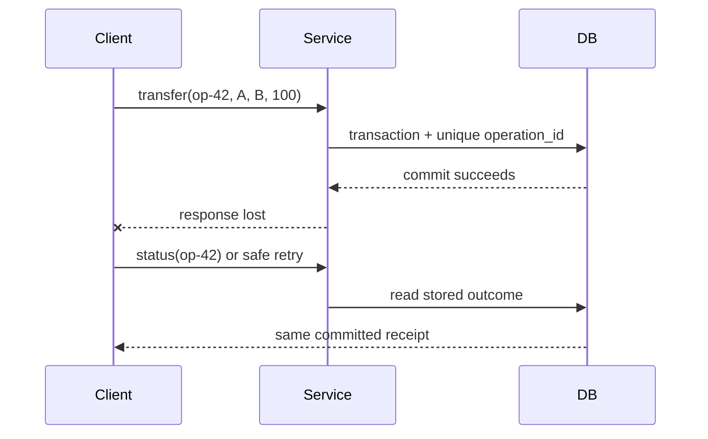

| Attempt | Durable `operation_id` row | Balance effect | Client observation |
|---|---|---|---|
| First `op-42` | Inserted and committed with transfer | Applied once | Response lost |
| Status query | Existing committed outcome | None | Learns success |
| Retry `op-42` | Uniqueness conflict/read existing row | None | Receives same receipt |

The key and outcome must live in the same atomic boundary as the effect. A process-local set, a short-lived cache entry, or “check then insert” outside the transaction reopens the duplicate window.

## Recovery is not replication

| Failure | Correct response |
|---|---|
| Process crash; durable log intact | Replay committed changes and discard/undo incomplete work according to the engine |
| Torn data-page write | Use engine-specific page protection plus recovery |
| Primary disk lost | Restore/fail over from a surviving replica or backup and logs |
| Async failover before replica receives commit | Acknowledged work may be lost |
| Client response lost after commit | Query by operation ID; do not blindly repeat the effect |

MySQL 8.4 documents InnoDB crash recovery as redo application followed by rollback of incomplete transactions, with purge of delete-marked records that are no longer visible. Do not generalize that exact undo/purge implementation to PostgreSQL: PostgreSQL uses tuple-version visibility and vacuum, and its recovery vocabulary and mechanics differ.

## Example 3 — ACID primary, stale replica

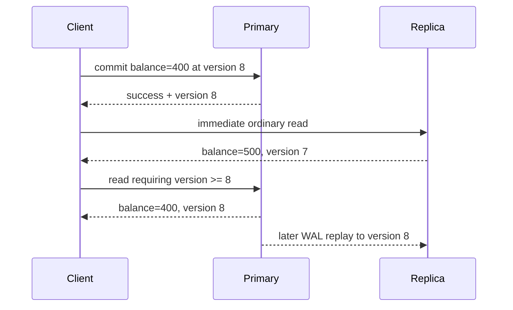

This is not a violation of primary transaction atomicity. It is a mismatch between the caller's **read-your-writes** requirement and an eventually consistent routing choice. PostgreSQL hot standby explicitly allows a measurable delay: a commit becomes visible to new standby snapshots only after its commit record is replayed.

Useful policies include:

1. pin the writer's session to the primary for a bounded interval;
2. return a commit/replay token and use a replica only after its applied position reaches that token;
3. choose a service's documented strong-read mode where supported; or
4. accept staleness for endpoints whose product contract permits it.

The Java model returns a stale value from an ordinary replica read, routes a read-your-writes request to the primary while the replica lags, then returns to the replica after replay.

## BASE: convergence is a designed mechanism

BASE—Basically Available, Soft state, Eventually consistent—is a design stance, not a fixed convergence deadline. Convergence requires communication to recover, updates to remain available for repair, and a deterministic conflict rule whose repeated merge reaches the same state.

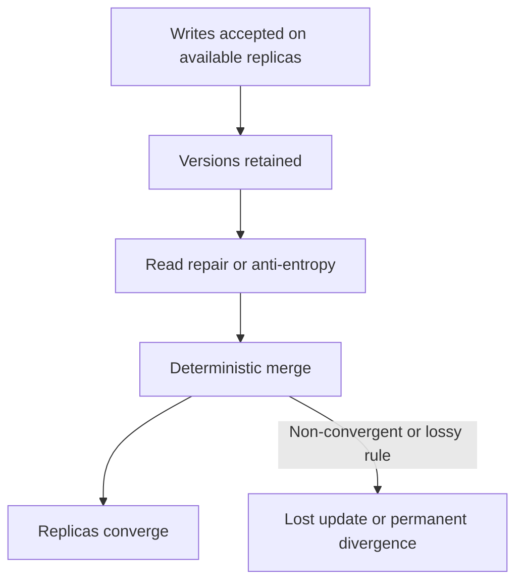

Amazon's original Dynamo paper describes object versioning with application-assisted conflict resolution and trades consistency under some failures for availability. Its concrete mechanisms include configurable replica participation, hinted handoff, and anti-entropy repair. That historical design must not be presented as a complete description of today's DynamoDB service.

## Example 4 — a convergent cart needs removal semantics

“Union both carts” preserves concurrent additions but resurrects removed items. The Java example stores, per item, the maximum observed add and remove logical versions. Merge is component-wise `max`; an item is present when `addVersion >= removeVersion`, an explicit add-wins tie policy.

| Event | Replica A | Replica B | After merge |
|---|---|---|---|
| Concurrent adds | mug@1 | pen@1 | `{mug, pen}` |
| Remove mug | remove(mug)@2 | still mug@1 | `{pen}` after merge |
| Late old add | add(mug)@1 | remove(mug)@2 | mug stays removed |

Why it converges: `max` is associative, commutative, and idempotent. Reordering, duplicating, or regrouping repair messages therefore yields the same per-item state. The example is a teaching model, not a full production CRDT: a real system must define logical-clock allocation, metadata compaction, identity, and behavior for truly concurrent add/remove operations.

## The quorum trap

`R + W > N` proves read/write-set overlap only under stated membership assumptions. Linearizability additionally depends on which replicas count as a completed write, how the read chooses among versions, what happens during membership changes or sloppy quorum substitution, how concurrent writes are ordered, and how failover treats acknowledged state.

| Claim | Missing question |
|---|---|
| “`R + W > N`, so reads are fresh” | Does the reader select the newest causally valid version from the overlap? |
| “We wrote to any `W` reachable nodes” | Are these the same membership set from which `R` is later chosen? |
| “Last-write-wins resolves conflicts” | Are clocks trustworthy, and can a valid concurrent write be discarded? |
| “Read repair eventually fixes it” | What guarantee applies before repair completes? |

Never infer linearizability from one inequality. State the full read, write, membership, version, and failover protocol.

## Complexity and cost boundaries

| Operation in the Java model | Time | Space | Production cost that dominates |
|---|---:|---:|---|
| Two-account transfer | `O(1)` | `O(1)` staged state | Lock/conflict waits and durable commit latency |
| Idempotency lookup | expected `O(1)` | `O(k)` retained operation IDs | Unique-index I/O and retention/partition strategy |
| Read-your-writes routing | `O(1)` | `O(1)` token | Replica apply lag or primary load |
| Cart merge | `O(a + b)` | `O(a + b)` | Version metadata, repair bandwidth, compaction |

The asymptotic notation describes the small teaching structures. It does not erase network round trips, fsync latency, conflict retries, replication lag, or storage-engine page access.

## Review checklist

- Is each invariant written and enforced inside the transaction boundary?
- Can the client distinguish rejection, committed success, and unknown outcome?
- Is the idempotency record atomic with the effect and retained long enough?
- Does the read path state primary/replica/cache freshness semantics?
- What exact failure domain does “durable” cover?
- Does the conflict rule converge under duplicate and reordered messages?
- Are quorum membership, version selection, repair, and failover specified?
- Are retries for serialization failures bounded, observable, and jittered?

## Primary references used across Sections 1–3

Accessed 2026-10-16.

1. [PostgreSQL 18 — Write-Ahead Logging](https://www.postgresql.org/docs/current/wal-intro.html): WAL-before-data ordering, redo, and group commit.
2. [PostgreSQL 18 — Transaction Isolation](https://www.postgresql.org/docs/current/transaction-iso.html): statement snapshots, repeatable read, serializable histories, and required retries.
3. [PostgreSQL 18 — Hot Standby](https://www.postgresql.org/docs/current/hot-standby.html): read-only standby visibility and replay lag.
4. [MySQL 8.4 — InnoDB Recovery](https://dev.mysql.com/doc/refman/8.4/en/innodb-recovery.html): redo application, incomplete-transaction rollback, and purge.
5. [Amazon DynamoDB — Read consistency](https://docs.aws.amazon.com/amazondynamodb/latest/developerguide/HowItWorks.ReadConsistency.html): eventual and strong read scopes, including GSI limitations.
6. DeCandia et al., [Dynamo: Amazon's Highly Available Key-value Store](https://www.amazon.science/publications/dynamo-amazons-highly-available-key-value-store), SOSP 2007: versioning, availability trade-offs, and application-assisted conflict resolution.
7. [PostgreSQL 18 — B-Tree Indexes](https://www.postgresql.org/docs/current/btree.html): page-level structure, recursive splits, root growth, and implementation-specific deletion.
8. [PostgreSQL 18 — Indexes and `ORDER BY`](https://www.postgresql.org/docs/current/indexes-ordering.html): ordered B-tree scans, planner trade-offs, and `ORDER BY ... LIMIT`.
9. [PostgreSQL 18 — `CREATE INDEX`](https://www.postgresql.org/docs/current/sql-createindex.html): B-tree fill factor and covering/index-construction options.
10. [MySQL 8.4 — Clustered and Secondary Indexes](https://dev.mysql.com/doc/refman/8.4/en/innodb-index-types.html): clustered row storage and primary-key payload in secondary entries.
11. [MySQL 8.4 — Physical Structure of an InnoDB Index](https://dev.mysql.com/doc/refman/8.4/en/innodb-physical-structure.html): 16 KiB default pages, occupancy, fill factor, and merge threshold.

# Section 2 — B+ trees: shallow indexes, ordered leaves, and write cost

The repository already contains a focused [B+ tree algorithm guide](../../local-project-notes/advanced-trees/b-plus-tree-database-index.md) and its heavily randomized immutable read model. This section does not create a second copy of that guide. It adds the storage-engine and schema-design questions the earlier module deliberately omits: page capacity, clustered versus heap organization, secondary-index amplification, online splits, fill factor, and what to measure in production.

## Learning and requirements contract

After this section you should be able to:

1. derive an illustrative tree height from entry count, leaf capacity, and internal fan-out without calling the estimate a product guarantee;
2. trace equality, bounded range, and `ORDER BY ... LIMIT` access through internal pages and linked leaves;
3. explain why an InnoDB secondary lookup normally carries the primary key and can require a second tree traversal;
4. explain why random and sequential inserts create different locality and contention profiles; and
5. distinguish a short structural latch from a transaction lock, then name the logging/recovery work a real split needs.

Before creating an index, state the workload contract:

| Question | Example requirement | Consequence |
|---|---|---|
| Which predicates must be fast? | `tenant_id = ? AND created_at BETWEEN ? AND ?` | Order the composite key so the required interval is contiguous |
| Is ordered output needed? | newest 20 orders per tenant | A matching B-tree order may avoid a separate sort |
| Must the query fetch base rows? | list needs status and total only | A covering index can save lookups but makes leaves wider |
| What is the write pattern? | random UUID inserts at 10k/s | Expect dispersed dirty pages and possible splits |
| What is the concurrency hotspot? | monotonically increasing IDs | Good locality can concentrate writers on the right edge |
| Which engine layout applies? | InnoDB clustered primary index | Primary-key width is repeated in secondary entries |

## Page anatomy and the height calculation

Internal pages store routing separators and child page identifiers. Leaves store ordered index entries and are connected for ordered traversal. PostgreSQL describes each level as a doubly linked list of pages; its leaf tuples point to table rows, while its internal tuples point down one level. InnoDB uses B-tree index pages, with a default 16 KiB page size, but its clustered-index leaves hold row data and its secondary entries include the primary-key columns.

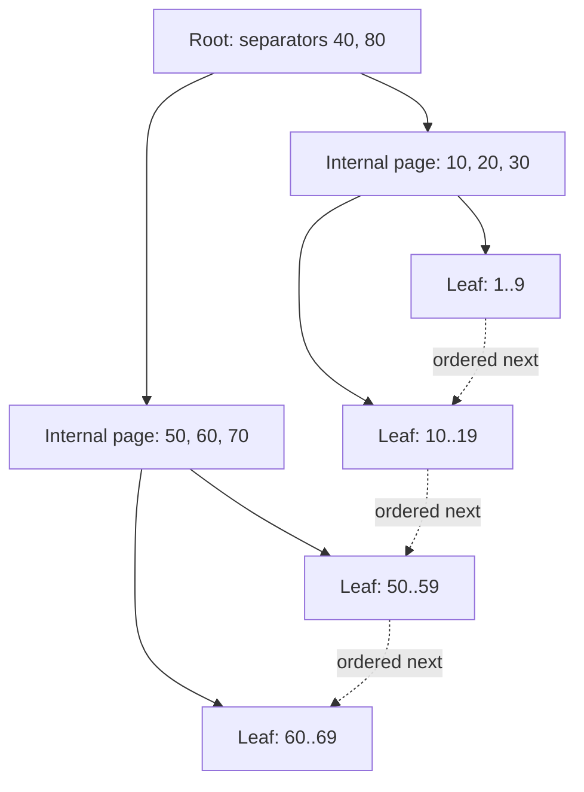

### Example 5 — one million entries can still mean three page levels

Assume, only for arithmetic, 200 entries per leaf and fan-out 200:

| Level | Calculation | Pages |
|---|---:|---:|
| Leaf | `ceil(1,000,000 / 200)` | 5,000 |
| Internal above leaves | `ceil(5,000 / 200)` | 25 |
| Root | `ceil(25 / 200)` | 1 |

That is three page levels: root → internal → leaf. The executable `capacityPlan` scenario derives the same result. It also tests boundaries such as one entry, an exact full leaf, and a fan-out smaller than two.

This does **not** promise three physical reads. Upper pages may already be in the buffer pool, a leaf may not be resident, a covering index may avoid a base-row read, and read-ahead can change the I/O pattern. Key width, row identifier width, tuple headers, page headers, free space, compression, deduplication, and occupancy all change effective fan-out.

## One descent, then an ordered leaf scan

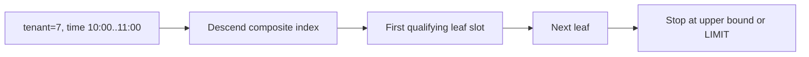

### Example 6 — composite range plus `ORDER BY ... LIMIT`

For an index on `(tenant_id, created_at DESC, order_id)`, the query below forms one ordered interval after tenant equality:

```sql
SELECT order_id, created_at
FROM orders
WHERE tenant_id = :tenant
  AND created_at >= :from
  AND created_at < :to
ORDER BY created_at DESC
LIMIT 20;
```

Trace for tenant 7:

| Step | Page action | Work avoided |
|---:|---|---|
| 1 | Use separators to descend to the first qualifying composite key | No full index scan |
| 2 | Lower-bound inside the leaf | No scan of earlier tenants/timestamps |
| 3 | Read forward through leaf entries and sibling pages | No root descent per row |
| 4 | Stop after 20 entries or at `:to` | No need to sort/consume the remaining interval when the plan matches |

PostgreSQL explicitly documents that B-tree is its index type capable of producing sorted output and that a matching index is especially valuable for `ORDER BY ... LIMIT`. The optimizer may still prefer a table scan plus sort when a query needs a large fraction of the table. Also, a suffix-only predicate on `created_at` lacks tenant equality and may not describe one narrow interval in this key order.

## Clustered and secondary layouts are not interchangeable

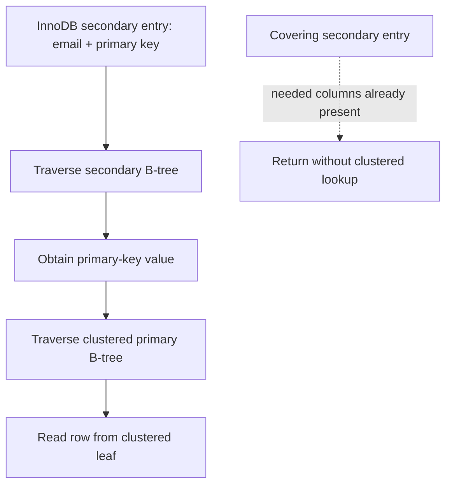

### Example 7 — a wide primary key multiplies secondary-index bytes

Consider 50 million rows and four secondary indexes. Ignoring headers, compression, free space, and included columns, replacing an 8-byte primary key with a 36-byte textual UUID adds:

\[
50{,}000{,}000 \times 4 \times (36 - 8) = 5.6\text{ GB}
\]

This is a deliberately narrow lower-bound model, not a storage forecast. The executable scenario verifies the arithmetic and rejects negative dimensions. Real capacity planning must measure encoded entries and page occupancy. MySQL documents the underlying reason: each InnoDB secondary record includes the primary-key columns, and a secondary lookup uses that value to search the clustered index.

PostgreSQL's ordinary layout differs: B-tree leaf tuples point to rows in a heap-organized table. A useful interview answer says which engine is being discussed instead of treating every “B-tree index” as clustered.

## Insert, split, and recovery-safe publication

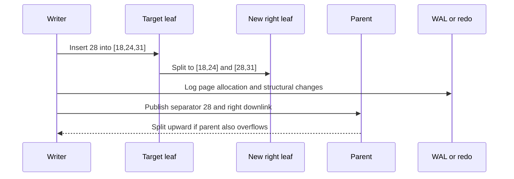

### Example 8 — split a full leaf without losing order

The Java teaching helper inserts 28 into a capacity-three leaf `[18,24,31]`, then returns:

| Output | Value | Invariant |
|---|---|---|
| left page | `[18,24]` | sorted and within old lower range |
| right page | `[28,31]` | sorted and within old upper range |
| promoted separator | `28` | minimum key of the new right page |

The scenario also inserts 32 into a non-full leaf and verifies that no split occurs. This is a structural teaching model only. A production split must allocate and initialize a sibling, preserve sibling links, log changes, make parent navigation safe for concurrent readers, and recover from crashes at intermediate moments. A **latch** briefly protects in-memory page structure; a **transaction lock** protects logical records or predicates across transaction work. They solve different problems.

PostgreSQL documents recursive split propagation and root splitting: only a root split adds a new level. It also performs implementation-specific deletion/deduplication work that can sometimes avoid a split. Do not infer that every full-looking logical insert allocates a page, or that every split immediately writes all touched pages to storage.

## Insert pattern and fill-factor trade-offs

| Pattern | Benefit | Dominant risk |
|---|---|---|
| Random keys | Distributes writers across key space | Scattered dirty pages, lower locality, more split opportunities |
| Sequential keys | High locality and compact right-edge growth | Rightmost-page latch contention at high concurrency |
| Lower fill factor | Leaves headroom for later inserts | Larger index, lower cache density, more scan I/O |
| Wider covering index | Avoids some base-row lookups | Lower fan-out and higher write/storage cost |

InnoDB documents that sequential insert builds tend toward about 15/16-full pages, while random insertion can yield pages between one-half and 15/16 full. PostgreSQL exposes B-tree `fillfactor`, but the right value is workload-specific. Measure instead of prescribing a magic percentage.

Useful signals include index bytes and growth, page split/merge rate where exposed, buffer-cache hit and residency, dirty-page and WAL/redo bytes, index scan versus table-fetch counts, query latency by plan, right-edge latch waits, and write latency. A logical `O(log n)` insertion can touch several pages yet still have fewer device operations because buffering coalesces writes.

## Complexity, failure boundaries, and review

| Operation | Logical CPU | Page-oriented shape | Important boundary |
|---|---:|---:|---|
| Point lookup | `O(log_F n)` levels | one page per level if cold | clustered/covering layout determines extra fetches |
| Range returning `k` rows | `O(log_F n + k)` | one descent plus leaf pages visited | output and base-row fetches still cost work |
| Insert without split | search plus in-page movement | leaf dirtied and logged | acknowledgement follows the durability policy |
| Split | search plus redistribution | new sibling + parent update; may cascade | concurrent visibility and crash recovery are engine-specific |

Review questions:

- What exactly lives in internal and leaf pages for this engine?
- Which separator convention routes equality left or right?
- Does the query describe one contiguous composite-key interval?
- Can index order satisfy the requested sort and limit?
- Does the read require a heap/clustered lookup, or is the index covering?
- How many times is the primary key replicated into secondary entries?
- Is a hotspot caused by poor locality or by too much right-edge locality?
- Are page latches, transaction locks, WAL/redo, and recovery described separately?
- Which measurements would prove that splits or cache misses are the bottleneck?

The earlier focused module remains the canonical place for separator invariants, immutable bulk loading, linked-leaf correctness proofs, deletion mechanics, and 150,000 randomized point/range oracle checks. This section supplies the complementary database-design and operational layer.

# Section 3 — LSM trees: moving write cost into compaction

An LSM tree turns many foreground random updates into WAL appends, in-memory sorted updates, sequential table flushes, and later background merges. That is a **scheduling trade**, not “write once.” The design can improve ingest throughput and locality while increasing version-resolution work, background I/O, temporary disk demand, and operational coupling between compaction and foreground latency.

## Learning and requirements contract

After this section you should be able to:

1. trace acknowledgement, crash recovery, freeze, flush, and manifest publication without treating them as one event;
2. resolve a point read by snapshot sequence across mutable memory and overlapping sorted tables;
3. explain why a Bloom-filter negative can skip a table while a positive cannot prove the key exists;
4. state the conditions under which a tombstone may be removed without resurrecting an older value;
5. compare leveled and universal/tiered compaction by write, read, and space amplification; and
6. calculate explicitly scoped amplification and disk-headroom estimates, then name the signals that warn of compaction debt.

State the workload before choosing an LSM policy:

| Question | Example requirement | Design consequence |
|---|---|---|
| What must survive acknowledgement? | process crash after a cart update | WAL must cross the configured durability boundary before success |
| Which snapshot semantics apply? | an iterator keeps sequence 80 | versions needed by that snapshot cannot be discarded |
| Are reads point-heavy or scan-heavy? | 95% absent point lookups | per-table filters and cached indexes matter |
| How bursty are writes? | 500 MB/s for 30 seconds | memtable, flush bandwidth, L0 limits, and backpressure need headroom |
| How much rewrite can storage sustain? | 1 GB/s background budget | compaction style and level sizing must fit the device budget |
| How much free disk is reserved? | compaction may overlap old and new files | live data alone is not a safe capacity target |

## Write acknowledgement, recovery, and flush are separate

RocksDB journals in-memory state changes in the WAL and on-disk file-set changes in the MANIFEST. A write normally reaches the WAL and mutable memtable; when a memtable becomes immutable, a background flush produces an SST file. Memtables can flush for several reasons, including memory pressure and WAL-size pressure, so “flushes only when exactly full” is false.

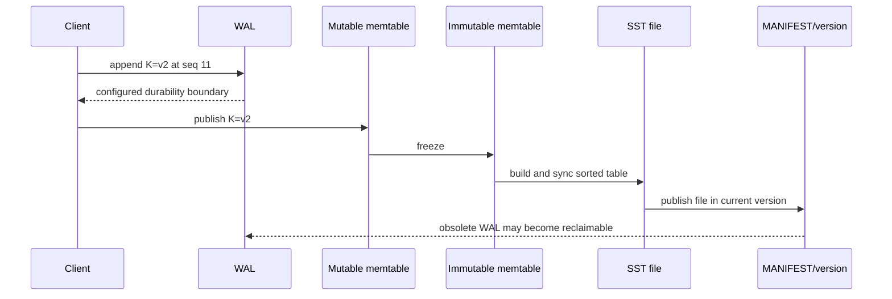

### Example 9 — recover the newest WAL update, then flush it

The Java `LsmBuffer` writes `cart:7=v1@10`, then `cart:7=v2@11`. A simulated crash retains the WAL and durable tables but loses the mutable map. Recovery replays both WAL entries and chooses sequence 11. After flush, the model has one immutable table and can clear its WAL because that table is the durable teaching-model state.

| Moment | WAL | Mutable state | Durable table | Read at snapshot 11 |
|---|---|---|---|---|
| first write | `v1@10` | `v1@10` | none | `v1` |
| overwrite | `v1@10, v2@11` | `v2@11` | none | `v2` |
| crash/replay | same records replayed | `v2@11` | none | `v2` |
| flush published | reclaimable in model | empty | `v2@11` | `v2` |

The order in this small model is intentionally strict: append the WAL record before exposing the memtable mutation. Production acknowledgement, batching, WAL sync options, atomic write batches, file syncing, and MANIFEST edits are engine-specific. Disabling or weakening WAL sync changes the failure contract; a memtable update alone is not durable.

## A read is version selection, not “check every file and return first”

The read path may consult the mutable memtable, immutable memtables, Level 0 files whose key ranges overlap, and at most the relevant file(s) in non-overlapping lower levels under leveled compaction. It must choose the newest sequence visible to the caller's snapshot. Block indexes narrow a file to likely blocks; Bloom filters can rule out definite absence for the represented key domain; caches can avoid device reads.

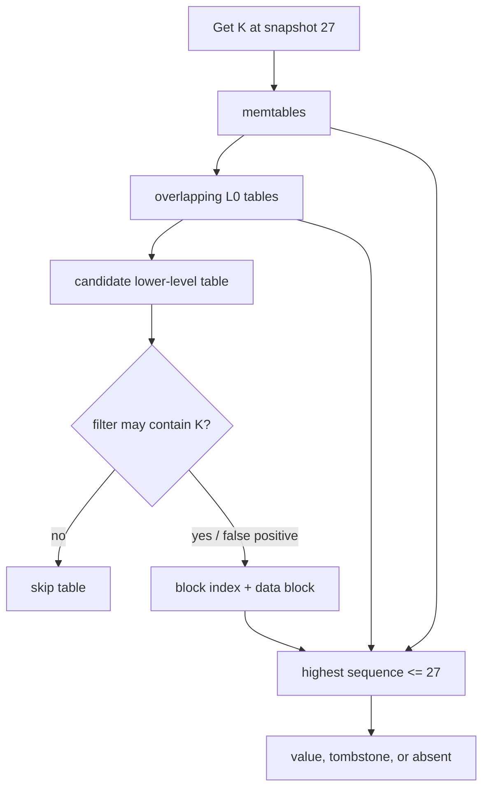

### Example 10 — one key, three snapshot answers

Candidate versions for `K` are tombstone `@30`, value `new@25`, and value `old@12`:

| Snapshot | Visible candidates | Selected result |
|---:|---|---|
| 20 | `old@12` | `old` |
| 27 | `new@25`, `old@12` | `new` |
| 30 | tombstone `@30`, both older values | absent |

The Java `newestVisible` scenario verifies all three results. It also models a Bloom negative as zero candidate probes. A real Bloom positive is only “maybe”: it can be a false positive and still require index/data-block work. A correctly built Bloom filter must not create false negatives for the key domain it covers.

For a range scan, the engine merges ordered iterators from participating structures, keeps the newest snapshot-visible version per key, and suppresses keys hidden by tombstones. If there are `r` runs, a heap-based merge is commonly described as `O(output_candidates log r)` CPU plus the blocks actually read; filters that help point absence do not erase the need to walk a requested range.

## Tombstones are promises that older values stay hidden

A delete writes a newer tombstone. Removing it too early can expose an older value in another table—a resurrection bug. Safe reclamation needs both visibility information and coverage information: no active snapshot may need the pre-delete version, and no older version capable of reappearing may remain outside the compaction's knowledge.

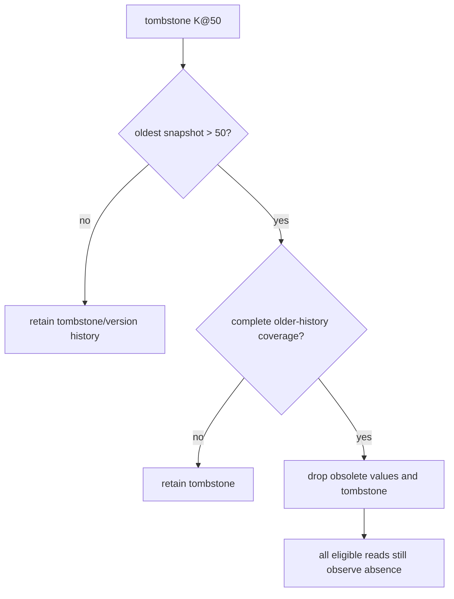

### Example 11 — both safety gates must pass

The executable teaching predicate accepts removal only when `tombstoneSequence < oldestSnapshotSequence` **and** the compaction covers all older history for that key:

| Tombstone | Oldest snapshot | Complete older-history coverage? | Decision |
|---:|---:|---|---|
| 50 | 40 | yes | keep; snapshot 40 may need the old value |
| 50 | 80 | no | keep; an older value might survive elsewhere |
| 50 | 80 | yes | safe in this deliberately complete model |

Real RocksDB compaction uses sequence numbers, snapshots, level placement, merge/range-deletion semantics, and file/version metadata rather than this one predicate. Distributed stores add repair and replica-retention constraints. An LSM tombstone is also not a certified secure-erasure mechanism; backups, logs, snapshots, replicas, and device behavior belong to a separate deletion policy.

## Compaction shapes the amplification trade

Leveled compaction aims for non-overlap in lower levels, usually reducing point-read candidates and steady-state space amplification at the cost of rewriting data as it moves through levels. Universal/tiered-style compaction keeps several sorted runs and merges selected runs, often reducing write amplification while increasing read candidates and temporary space. These are workload-dependent families, not universal rankings.

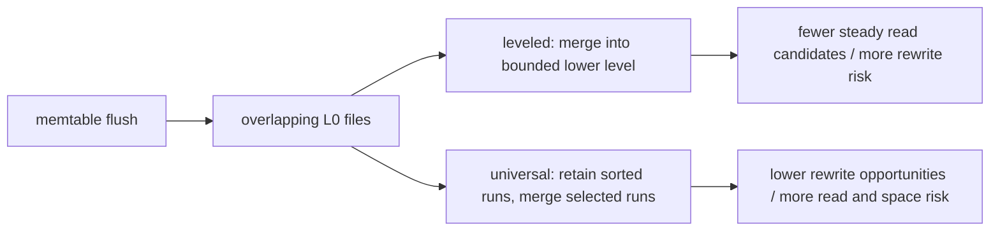

### Example 12 — define the accounting boundary before quoting a ratio

Suppose 100 MB of logical updates cause 100 MB of WAL writes, 100 MB of flush output, and 500 MB of compaction output:

\[
WA = \frac{100 + 100 + 500}{100} = 7
\]

If a lookup reads 64 KiB to return 8 KiB, byte-based read amplification is 8. That is not the same metric as “files probed per lookup.” The Java `amplification` scenario keeps these ratios separate and calculates required modeled disk occupancy:

\[
\text{headroom target} = \text{live} + \text{obsolete} + \text{compaction overlap}
\]

For `1000 + 120 + 300`, the result is 1420 units. This is an accounting example, not a promised RocksDB ratio or a complete capacity formula. State whether WAL, compression, replication, filesystem/device amplification, backups, and temporary outputs are included.

## Compaction debt becomes foreground backpressure

If flush or compaction bandwidth stays below incoming work, immutable memtables and L0 files accumulate. Reads face more candidates; background I/O competes with foreground work; eventually the engine delays or stops writes to protect memory and file-count bounds. More cache cannot repay insufficient compaction bandwidth.

| Signal | What it can reveal | Avoid this shortcut |
|---|---|---|
| pending compaction bytes / compaction score | queued rewrite work | one instant is not a trend |
| L0 file count | overlap and stall proximity | thresholds depend on configuration |
| write-stall count and duration | foreground impact | average write latency can hide stalls |
| flush/compaction read and write throughput | whether background work keeps pace | device bandwidth is shared with reads/WAL |
| block-cache and filter usefulness | avoided data-block reads | hit rate alone does not show tail latency |
| live, obsolete, and total SST bytes | space amplification and reclaim lag | filesystem free space may include other users |
| oldest snapshot/iterator age | why versions cannot be reclaimed | long scans can pin history intentionally |

Recovery planning must reserve space for the WAL and the published SST set, while compaction planning must additionally cover old inputs and new outputs until metadata publication makes inputs obsolete. If the disk fills, compaction may be unable to finish the very rewrite needed to reclaim space.

## Complexity, failure boundaries, and review

| Operation | Logical shape | Dominant physical risk |
|---|---|---|
| Write | WAL append + `O(log m)` memtable insert for a tree-backed memtable | sync policy and memtable contention |
| Point read | newest visible version across candidate structures | overlapping runs, cache misses, false-positive filters |
| Range read | ordered merge across `r` iterators | read amplification and obsolete versions |
| Flush | sort/encode mutable state into an immutable table | burst I/O and L0 growth |
| Compaction | merge selected inputs, rewrite surviving versions | write/space amplification and foreground interference |

Review questions:

- Which exact event makes a write acknowledged, recoverable, flushed, and visible in the current file version?
- Which sequence number defines the caller's snapshot?
- Can a filter skip the table, or does it only say “maybe”?
- Which older values might a tombstone still mask?
- Does the compaction input cover all relevant older history for the key?
- Which amplification numerator and denominator are being reported?
- How much temporary disk is required while old and new files coexist?
- Which queue, L0, throughput, stall, and snapshot-age signals show debt before outage?

### Primary references for Section 3

Accessed 2026-10-16.

12. [RocksDB overview](https://github.com/facebook/rocksdb/wiki): embedded LSM storage engine scope and RocksJava distinction.
13. [RocksDB Journal](https://github.com/facebook/rocksdb/wiki/Journal): WAL journals in-memory updates; MANIFEST journals on-disk state changes.
14. [RocksDB MemTable](https://github.com/facebook/rocksdb/wiki/MemTable): mutable/immutable memtables and flush triggers.
15. [RocksDB Compaction](https://github.com/facebook/rocksdb/wiki/Compaction): leveled/tiered trade-offs and workload-dependent write amplification.
16. [RocksDB Universal Compaction](https://github.com/facebook/rocksdb/wiki/Universal-Compaction): lower-write-amplification goal and read/space trade-offs.
17. [RocksDB Leveled Compaction](https://github.com/facebook/rocksdb/wiki/Leveled-Compaction): L0 overlap, lower-level organization, and compaction behavior.
18. [RocksDB Write Stalls](https://github.com/facebook/rocksdb/wiki/Write-Stalls): memtable, L0, and pending-compaction backpressure triggers.
19. [RocksDB Compaction Stats and DB Status](https://github.com/facebook/rocksdb/wiki/Compaction-Stats-and-DB-Status): bytes, amplification, stall, and per-level operational metrics.

# Section 4 — Row-oriented and column-oriented storage

Row and column layouts answer different access patterns. A row store keeps the attributes of one record near one another, which is useful when a request reads or changes most of one record. A column store keeps values of one attribute together, which lets an analytical scan read only selected columns, compress similar values, and process vectors of values. Neither layout is automatically faster: predicates, sort order, indexes, compression, partitioning, batch size, merge debt, and hardware still determine the physical work.

## Learning and requirements contract

After this section you should be able to:

1. estimate bytes requested by a full-row scan versus a selected-column scan without calling that estimate elapsed time;
2. trace a batch/vector aggregation over aligned columns and identify its null/type/overflow contracts;
3. explain immutable MergeTree parts, background merges, sparse primary-index marks, granules, and `ORDER BY` pruning;
4. distinguish a sorting key from a uniqueness constraint and a partition key from a primary index;
5. design an OLTP-to-OLAP path with a transactional outbox, stable event identity, per-aggregate versions, duplicate handling, gap detection, replay, and freshness reporting; and
6. keep order acceptance on the transactional system instead of treating an asynchronous analytical projection as the source of truth.

Write these requirements before choosing a layout:

| Question | Example requirement | Consequence |
|---|---|---|
| What is the unit of work? | fetch and update one order | row locality and transactional indexes are valuable |
| Which columns does the scan need? | `region_id`, `revenue_cents` from 10 million rows | column projection can avoid unrelated attributes |
| Which predicates dominate? | tenant plus event-day range | sort key should place useful pruning prefixes first |
| How fresh must analytics be? | dashboard may lag by 30 seconds | show a watermark; do not use it to confirm a just-written order |
| Can delivery repeat or reorder? | connector retry and partition failover | stable event IDs, versions, idempotent application, and replay |
| How are writes batched? | tens of thousands of facts per insert | fewer initial parts and less merge pressure |

## Example 13 — byte selection is a bound, not a benchmark

Assume 10,000,000 logical rows, an uncompressed modeled row width of 200 bytes, and a query that needs two 8-byte columns. The Java `scanEstimate` model calculates:

| Layout estimate | Arithmetic | Bytes |
|---|---:|---:|
| row-oriented input | `10,000,000 × 200` | 2,000,000,000 |
| selected columns | `10,000,000 × (8 + 8)` | 160,000,000 |
| modeled reduction | `2,000,000,000 / 160,000,000` | 12.5× |

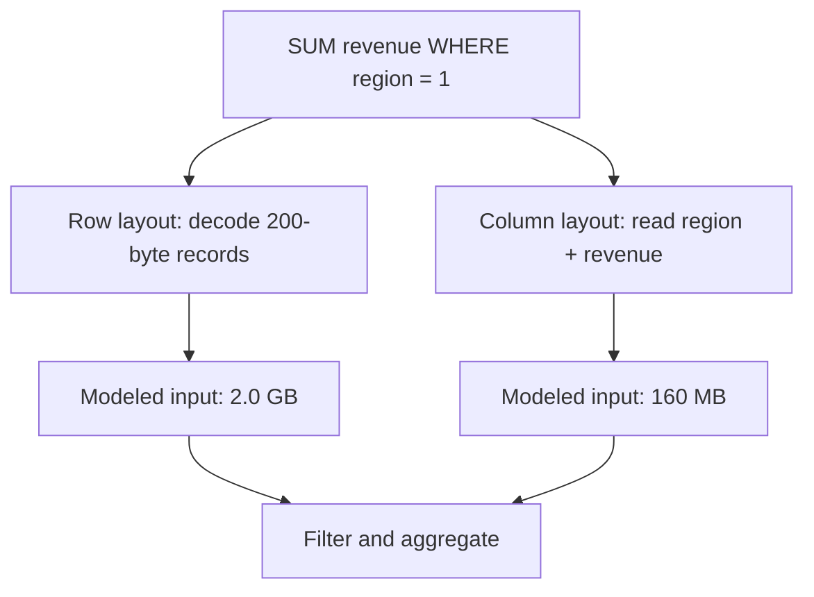

This is a logical input estimate. It deliberately excludes compression ratios, metadata, mark/index reads, caching, predicate selectivity, prefetching, decompression CPU, vectorization, parallelism, and storage bandwidth. Therefore **12.5× less selected input is not a claim of 12.5× lower latency**. Conversely, a point update may favor a row layout because all fields and transactional metadata for one record are already colocated instead of being spread across column files or rewritten immutable parts.

The model rejects zero/negative dimensions, integer overflow, and selected widths greater than the modeled row. Those checks matter: a capacity calculation that silently wraps is worse than no estimate.

## Example 14 — process aligned columns in bounded batches

The executable `sumRevenueForRegion` model receives aligned `regionIds` and `revenueCents` arrays. With regions `[1, 2, 1, 3, 1]`, revenues `[100, 200, 300, 400, 500]`, target `1`, and batch size `2`, it produces 900 cents across three batches.

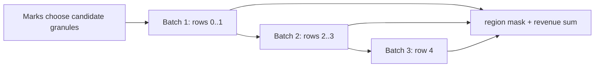

| Batch | Region vector | Revenue vector | Matching contribution | Running sum |
|---:|---|---|---:|---:|
| 1 | `[1, 2]` | `[100, 200]` | 100 | 100 |
| 2 | `[1, 3]` | `[300, 400]` | 300 | 400 |
| 3 | `[1]` | `[500]` | 500 | 900 |

The arrays are a teaching analogue for columnar batches, not an implementation of ClickHouse. Production engines use typed compressed streams, null maps, selection masks, specialized functions, multiple execution threads, and CPU-vector-friendly loops. Still, the model exposes real contracts: arrays must have equal row counts, batch size must be positive, and the sum must have a defined overflow policy. Java's `Math.addExact` makes overflow a failure instead of corrupting the aggregate.

## Example 15 — sparse marks prune granules, not individual rows

For the MergeTree family, each insert creates a sorted immutable data part. Background merges combine parts. Data is physically ordered by the sorting key; a sparse primary index stores marks for granules instead of one entry per row. A query uses key conditions to identify candidate granules, then reads those granules and applies the remaining predicate. The primary key is **not a uniqueness constraint**.

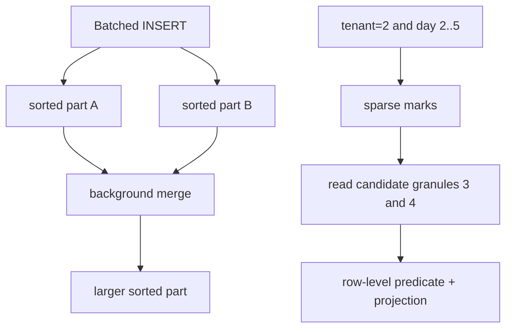

The Java scenario models six 8,192-row granules. Two can contain tenant 2 in day range 2–5, so the sparse filter selects granules 3 and 4: 16,384 candidate rows. It does **not** assert that every selected row matches or that all other engine-level skipping mechanisms have run.

| Granule | Tenant bounds | Day bounds | Candidate? | Reason |
|---:|---|---|---|---|
| 0 | 1..1 | 1..3 | no | tenant cannot match |
| 1 | 1..1 | 4..6 | no | tenant cannot match |
| 2 | 1..2 | 7..9 | no | day range cannot overlap |
| 3 | 2..2 | 1..3 | yes | both bounds may overlap |
| 4 | 2..2 | 4..6 | yes | both bounds may overlap |
| 5 | 3..3 | 1..9 | no | tenant cannot match |

Pruning quality depends on physical order. For frequent `tenant_id = ? AND event_day BETWEEN ? AND ?` queries, an `ORDER BY (tenant_id, event_day, event_id)` prefix can make tenant/day ranges adjacent. Reversing the first two fields changes which predicates form a useful contiguous range. Put high-cardinality IDs in `PARTITION BY` only with evidence; excessive partitions multiply parts and metadata. Wide and Compact are storage formats for parts selected by size/row thresholds, not row-store versus column-store product modes.

ClickHouse recommends batching inserts (at least 1,000 rows and ideally 10,000–100,000 in the cited guidance) because each insert otherwise creates a part and increases merge work. If client batching is impractical, asynchronous inserts can move batching to the server, but acknowledgement and retry settings still define the failure contract.

## Example 16 — an analytical projection is replayable, not authoritative

Use an OLTP transaction to change an order and insert its outbox event together. Logical decoding or a CDC connector publishes the committed outbox row. The analytical consumer applies events by stable `event_id` and per-order `version`. The dashboard reports its source watermark or lag; order confirmation reads the OLTP result, not the lagging projection.

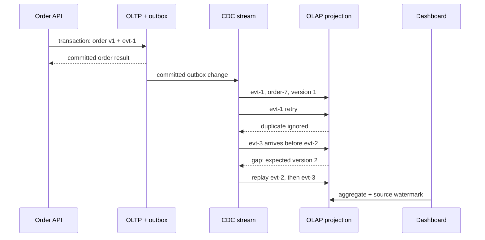

The Java `OrderProjection` proves this sequence:

| Delivery | Current version | Decision | Resulting version/value |
|---|---:|---|---|
| `evt-1`, v1, 1000 | 0 | apply | v1 / 1000 |
| same `evt-1` | 1 | duplicate | unchanged |
| `evt-3`, v3, 1200 | 1 | gap; expect v2 | unchanged |
| `evt-2`, v2, 1100 | 1 | apply | v2 / 1100 |
| retry `evt-3` | 2 | apply | v3 / 1200 |
| distinct old event, v2 | 3 | stale | unchanged |

The gap event is not recorded as consumed because it must be retried after replay. A stale event ID may be remembered to avoid repeated work. Production implementations need durable deduplication/version state, a dead-letter or quarantine policy, retained/reconstructable source history, alerting on gaps and lag, and a reconciliation job that compares source counts/sums or business invariants. If the projection cannot replay from a retained log or source snapshot, “eventual consistency” has no mechanism that guarantees eventual repair.

Debezium's outbox router uses the outbox `id` as an event identity suitable for duplicate removal and `aggregateid` as the message key, which is important for ordering within Kafka partitions. PostgreSQL logical decoding exposes committed row changes through replication slots; output plugins decode concurrent transactions in commit order and do not decode rolled-back transactions. Those facts do not make the entire end-to-end pipeline exactly once: connectors, brokers, consumers, and sinks still need explicit retry and idempotency behavior.

## Complexity, operations, and review

| Path | Useful model | Failure/latency risk |
|---|---|---|
| OLTP point read/write | indexed lookup plus transactional log work | lock/conflict retry, log sync, replica policy |
| column projection scan | selected compressed column chunks | decompression, bandwidth, weak pruning, skew |
| sparse-key pruning | index marks plus candidate granules | key order mismatch and granule over-read |
| insert | sort/encode one new immutable part | tiny batches create too many parts |
| merge | read input parts and write replacement part | disk/CPU pressure and temporary space |
| CDC projection | apply/reject by event ID and version | duplicates, gaps, lag, retention loss |

Operational signals should include parts per active partition, insert batch rows/bytes, merge backlog and throughput, bytes read after pruning, selected granules, compression ratio, query CPU and p95/p99 latency, CDC source position, consumer lag, oldest unprocessed event, gap/quarantine count, replay age, and reconciliation drift.

Review questions:

- Which fields does the query actually read, and what bytes are estimated before and after compression?
- Is the claimed speedup a byte estimate or a measured latency result?
- Does the sort-key prefix match equality and range predicates in order?
- How many granules remain after mark pruning, and how many rows are examined afterward?
- Are insert batches large enough to avoid part explosion, and can merges keep pace?
- Are event identity and aggregate ordering separate concepts?
- What happens to a duplicate, a stale version, and a forward version gap?
- Which source watermark tells a user how fresh the dashboard is?
- Which reconciliation process repairs a missed or poisoned event?
- Which user decisions must remain on the transactional source of truth?

### Primary references for Section 4

Accessed 2026-10-16.

20. [ClickHouse architecture overview](https://clickhouse.com/docs/development/architecture): column-oriented storage and vectorized/chunk-oriented execution.
21. [Understanding the ClickHouse primary index](https://clickhouse.com/docs/guides/best-practices/sparse-primary-indexes): physical sort order, sparse marks, granules, candidate-range pruning, and non-unique primary keys.
22. [MergeTree table engine](https://clickhouse.com/docs/engines/table-engines/mergetree-family/mergetree): sorted parts, marks, granule sizing, and Wide/Compact part formats.
23. [Selecting an insert strategy](https://clickhouse.com/docs/concepts/best-practices/selecting-an-insert-strategy): client/server batching, part creation, merge load, and acknowledgement trade-offs.
24. [ClickHouse data parts](https://clickhouse.com/docs/concepts/core-concepts/parts): immutable part creation and background merge mechanics.
25. [Debezium Outbox Event Router](https://debezium.io/documentation/reference/stable/transformations/outbox-event-router.html): event identity, aggregate key, payload routing, and duplicate-handling support.
26. [PostgreSQL logical decoding](https://www.postgresql.org/docs/current/logicaldecoding.html) and [output plugins](https://www.postgresql.org/docs/current/logicaldecoding-output-plugin.html): committed change streams, replication slots, transaction ordering, and rollback exclusion.

# Section 5 — Isolation: name the anomaly, snapshot, and repair

An isolation label is only the start of the contract. State which rows or predicates must remain stable, whether ordinary reads use a statement or transaction snapshot, which statements lock current index ranges, which conflicts can abort, and how the caller retries. The SQL-standard phenomenon table is a portable minimum; PostgreSQL and InnoDB deliberately implement stronger or different behavior in important cases.

## Learning and requirements contract

After this section you should be able to:

1. identify dirty reads, non-repeatable reads, phantoms, lost updates, and write skew from a two-transaction history;
2. distinguish a statement snapshot from a transaction snapshot and a snapshot read from a locking/current read;
3. explain why PostgreSQL Repeatable Read prevents phantoms yet can allow write skew, and why Serializable may abort a transaction;
4. explain why InnoDB Repeatable Read ordinary `SELECT` and locking DML can observe different effective states;
5. select an invariant repair: declarative constraint, atomic statement, version check, stable lock target, or Serializable retry; and
6. retry a complete transaction within a bound while keeping external effects idempotent and resolving unknown commit outcomes.

Write these requirements before choosing an isolation level:

| Question | Example requirement | Consequence |
|---|---|---|
| Which facts form the invariant? | at least one engineer remains on call | protecting only each engineer's own row is insufficient |
| Must a reread be stable? | one report uses one database snapshot | use a transaction snapshot or an explicitly exported snapshot |
| Must a predicate be stable for writes? | no new OPEN order may enter the selected range | use serializable validation or a locking design whose scanned index range is understood |
| May a conflict abort? | checkout may retry twice within 150 ms | retry the whole decision with jitter and a deadline |
| Can the operation be repeated? | payment operation ID is unique | store the operation result atomically; never replay an external effect blindly |
| How long may a snapshot live? | export finishes within five minutes | monitor oldest transaction age and vacuum/purge debt |

## Example 17 — classify the history before prescribing a level

“Possible” below means the standard-style minimum does not generally prohibit the phenomenon. It does not mean every engine or execution exhibits it. Write skew is a serialization anomaly across a predicate or invariant; it is not one of the original three phenomena used to summarize the weaker SQL levels.

| Isolation level: standard-style minimum | Dirty read | Non-repeatable read | Phantom | Write skew |
|---|---|---|---|---|
| Read Uncommitted | possible | possible | possible | possible |
| Read Committed | prevented | possible | possible | possible |
| Repeatable Read | prevented | prevented | possible | possible |
| Serializable | prevented | prevented | prevented | prevented among committed transactions |

Use a trace rather than a label:

| Phenomenon | Initial state | Interleaving | Broken assumption |
|---|---|---|---|
| dirty read | `price=10` | A writes 20; B reads 20; A rolls back | B treated uncommitted state as real |
| non-repeatable read | `price=10` | A reads 10; B commits 20; A rereads 20 | one row stayed stable across A's statements |
| phantom | two OPEN orders | A counts 2; B commits another OPEN order; A counts 3 | the predicate result stayed stable |
| lost update | `counter=10` | A and B read 10; each blindly writes 11 | both increments were preserved |
| write skew | Alice and Bob are on call | each sees two on call; each updates only self to off | stable snapshots preserved a cross-row invariant |

```mermaid
sequenceDiagram
    participant A as Transaction A
    participant D as Database
    participant B as Transaction B
    A->>D: SELECT price -> 10
    B->>D: UPDATE price=20; COMMIT
    A->>D: SELECT price
    D-->>A: RC -> 20; transaction snapshot -> 10
```

The Java `repeatReadAfterCommit` scenario makes only this visibility rule executable. Under a statement-snapshot policy it reads versions 1 then 2 and returns 10 then 20. Under a transaction-snapshot policy both reads use version 1 and return 10 then 10. It is a deterministic history model, not a substitute for an integration test against a selected engine and driver.

PostgreSQL maps Read Uncommitted to Read Committed. At Read Committed each command sees a snapshot as of that command's start. PostgreSQL Repeatable Read uses one transaction snapshot and does not allow phantom reads, which is stronger than the table's minimum, but serialization anomalies such as write skew can remain. PostgreSQL Serializable adds Serializable Snapshot Isolation monitoring and rejects dangerous histories so that only serializable transactions commit.

## Example 18 — stable snapshots do not protect a cross-row invariant

Suppose the rule is “at least one engineer is on call.” Alice and Bob each read the same snapshot containing `Alice=on, Bob=on`. Each changes a different row, so ordinary snapshot isolation finds no same-row write/write conflict. Both commits can leave zero engineers on call.

```mermaid
sequenceDiagram
    participant A as Alice transaction
    participant D as Snapshot database
    participant B as Bob transaction
    A->>D: read Alice=on, Bob=on
    B->>D: read Alice=on, Bob=on
    A->>D: set Alice=off; COMMIT
    B->>D: set Bob=off; COMMIT
    Note over A,B: different rows changed; invariant is false
```

The executable `concurrentOffCall(false)` trace commits both row changes and proves `onCallCount()==0`. With predicate-version validation enabled, Alice's commit changes the roster version, Bob's stale decision is rejected, and one engineer remains on call. This models the outcome of serializable conflict detection, not PostgreSQL's internal SSI graph.

Repair choices depend on the schema and workload:

- express the invariant as a database constraint when it can be represented and enforced atomically;
- route every decision through a roster guard row and lock it in a stable order;
- use Serializable for all participating reads and writes, then retry rejected transactions; or
- redesign the aggregate so the invariant is updated through one atomic record or command.

Locking only the row each transaction updates does not repair this history. Nor does a partial retry after the original reads: the decision must be recomputed from a new snapshot.

## Example 19 — InnoDB snapshot reads and current locking reads are different contracts

InnoDB Repeatable Read ordinary consistent reads use the snapshot established by the first such read. Locking reads, `UPDATE`, and `DELETE` instead operate with locking/current-read behavior. MySQL's own 8.4 manual cautions against mixing locking and nonlocking statements when the application expects one coherent view. Under Read Committed, each consistent read receives a fresh snapshot and ordinary gap locking is reduced, so phantoms may occur.

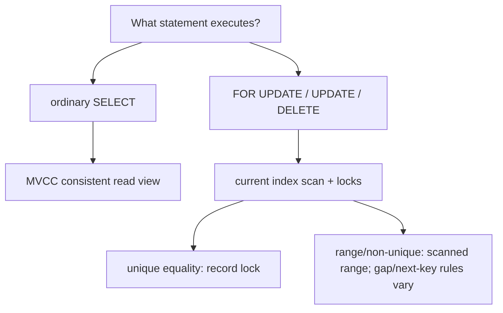

At InnoDB Repeatable Read, a suitable unique-index equality generally locks only the found index record. A range or non-unique search generally locks the scanned index range with gap or next-key locks. At Read Committed, InnoDB generally locks records rather than gaps except for foreign-key and duplicate-key checks. The actual plan therefore changes the lock footprint: without a useful index a locking statement can scan and lock far more records than the business predicate suggests.

Do not infer these details from JDBC's constants. `Connection.TRANSACTION_REPEATABLE_READ` describes portable phenomenon prohibitions, not PostgreSQL's stronger phantom behavior or InnoDB's statement-specific locking. Configure the connection before beginning work because JDBC declares changing isolation during a transaction implementation-defined:

```java
try (Connection connection = dataSource.getConnection()) {
    connection.setTransactionIsolation(Connection.TRANSACTION_SERIALIZABLE);
    connection.setAutoCommit(false);
    try {
        // Execute every read, validation, and write for one attempt here.
        connection.commit();
    } catch (SQLException failure) {
        connection.rollback();
        throw failure;
    }
}
```

An integration test should run the exact indexed predicate concurrently, capture SQLSTATEs and wait outcomes, and inspect the engine's lock/transaction diagnostics. A generic Java unit model cannot prove an engine's lock plan.

## Example 20 — prevent lost updates and retry the whole decision

Two clients that both read counter 10 and blindly assign 11 lose one increment. The Java `blindIncrement` trace makes that failure explicit. Prefer one atomic statement when the operation is commutative:

```sql
UPDATE counters SET value = value + 1 WHERE counter_id = :id;
```

For an optimistic edit, compare the version that was read:

```sql
UPDATE article
SET body = :body, version = version + 1
WHERE tenant_id = :tenant AND id = :id AND version = :expected;
-- 1 row: success. 0 rows: missing object or version conflict; reread before retry.
```

The executable `versionCheckedIncrement` trace lets the first writer move version 1 to 2 and rejects the second writer's expected version 1 rather than overwriting silently.

PostgreSQL documents SQLSTATE `40001` as a serialization failure and requires retrying the **complete transaction**, including the logic that selected SQL and values. More than one retry may be necessary, so production code needs an attempt bound, deadline, jittered backoff, metrics, and a non-retry path. The Java `incrementWithWholeTransactionRetry` scenario injects one concurrent increment: attempt 1 conflicts, attempt 2 rereads value 11, commits 12, and publishes one durable operation ID.

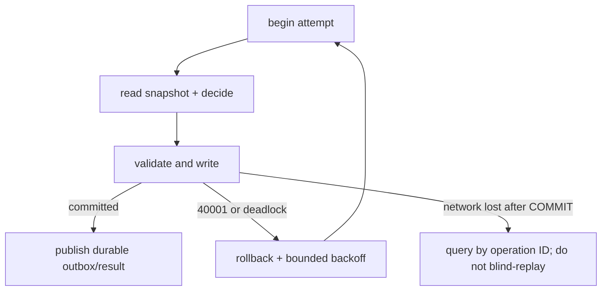

A deadlock victim or serialization failure says the attempt did not commit and may be retried when business effects are transactionally staged or idempotent. A network failure after `COMMIT` was sent is an **unknown outcome**: the server might have committed. Resolve it through a unique operation ID and stored result. Sending email, charging a card, or publishing directly inside a retriable body can duplicate the effect; write an outbox row in the transaction and dispatch it idempotently after commit.

## MVCC retention, operations, and review

Snapshot readers reduce reader/writer blocking, but old snapshots retain visibility requirements. PostgreSQL vacuum and InnoDB purge cannot reclaim every obsolete version while an eligible old transaction may still need it. A long export should not keep a broad transaction open across user interaction or network calls.

```mermaid
flowchart LR
    S["snapshot at version 100"] --> V["version 95 remains visible"]
    W["writer commits version 105"] --> N["new snapshots see 105"]
    V --> G["reclaim only after no required snapshot needs 95"]
```

Monitor oldest active transaction/snapshot age, dead tuples or undo history, vacuum/purge progress, serialization failures by operation, deadlocks, retry attempts, lock waits, transaction latency, and unknown-outcome resolutions. Correlate failures with the indexed statement and isolation level; an aggregate error rate alone does not reveal the dangerous history.

Review questions:

- Which exact history is disallowed: dirty read, reread change, phantom, lost update, or write skew?
- Is each read a statement snapshot, transaction snapshot, or locking/current read?
- Which rows or index ranges does the actual plan inspect and lock?
- Does the repair protect the invariant or only the row being updated?
- Is every read and decision rerun after a serialization failure?
- What attempt/deadline budget prevents retry storms?
- Which operation ID resolves an unknown commit result?
- Which external effects are staged transactionally or made idempotent?
- How old can a snapshot become before version retention threatens operations?

### Primary references for Section 5

Accessed 2026-10-16.

27. [PostgreSQL 18 transaction isolation](https://www.postgresql.org/docs/current/transaction-iso.html): standard phenomena, Read Committed command snapshots, Repeatable Read snapshot behavior, PostgreSQL's Read Uncommitted mapping, and Serializable conflict detection.
28. [PostgreSQL 18 serialization failure handling](https://www.postgresql.org/docs/current/mvcc-serialization-failure-handling.html): complete-transaction retry and the possibility of multiple attempts.
29. [PostgreSQL 18 application-level consistency](https://www.postgresql.org/docs/current/applevel-consistency.html): Serializable conflict monitoring and explicit-lock alternatives.
30. [MySQL 8.4 InnoDB transaction isolation levels](https://dev.mysql.com/doc/refman/8.4/en/innodb-transaction-isolation-levels.html): per-level snapshots, locking reads, gap behavior, and the warning about mixed read modes.
31. [MySQL 8.4 consistent nonlocking reads](https://dev.mysql.com/doc/refman/8.4/en/innodb-consistent-read.html): read views, Repeatable Read's first-read snapshot, Read Committed's fresh snapshots, and DML visibility caveats.
32. [MySQL 8.4 locks set by statements](https://dev.mysql.com/doc/refman/8.4/en/innodb-locks-set.html): unique equality, scanned ranges, missing-index effects, and next-key locks.
33. [Java SE 17 `Connection`](https://docs.oracle.com/en/java/javase/17/docs/api/java.sql/java/sql/Connection.html): auto-commit, commit/rollback boundaries, portable isolation constants, and isolation-configuration timing.

# Section 6 — Cache topology: local, distributed, and two-level

A cache topology is a placement and failure contract, not merely a latency choice. A JVM-local cache removes a network hop but creates one independent copy per process. A distributed cache shares values but adds routing, serialization, network tails, hot-key pressure, and failover behavior. An L1 + L2 design combines both and therefore has **two freshness boundaries** to bound and observe.

## Learning and requirements contract

After this section you should be able to:

1. choose local, distributed, or two-level caching from latency, capacity, failure, and freshness requirements;
2. separate maximum size, expiry, eviction, and admission instead of calling all four “LRU”;
3. quantify duplicated L1 memory and conditional L2/origin traffic before adding a tier;
4. explain why one JVM's loader, lock, or invalidation does not coordinate other JVMs;
5. handle missed or reordered invalidations, including flushing an untrusted local cache after a tracking connection is lost; and
6. design a cache key that preserves tenant, locale, schema, revision, and authorization boundaries.

Write the contract before selecting a product:

| Requirement | Example | Design consequence |
|---|---|---|
| Authority | PostgreSQL owns article version 6 | every cache copy is disposable and versioned |
| Freshness | ordinary article ≤30 s stale; permission revocation 0 s | TTL may cover the article; authorization is checked against current policy |
| Failure mode | Redis loss may increase latency, not corrupt results | bounded fallback and origin load shedding are mandatory |
| Capacity | 12 JVMs, 50,000 local entries each | local capacity is duplicated, not fleet-global |
| Key scope | tenant + article + locale + renderer version | a bare `articleId` is unsafe |
| Recovery | node may miss invalidations while disconnected | reconnect establishes a new trust boundary and flushes L1 |

| Topology | Placement and useful property | Dominant risk |
|---|---|---|
| Caffeine/Guava local | each JVM; no network or serialization on a hit | divergent nodes, duplicated heap, cold starts, GC pressure |
| Redis distributed | shared remote service with TTLs and atomic server commands | network tail, hot keys, memory pressure, failover semantics |
| Memcached distributed | client/proxy routes each key to an ephemeral server | node loss becomes misses/errors; servers do not synchronize or replicate |
| L1 local + L2 distributed | hot reads stop at the JVM; fleet shares the next tier | two invalidation races, two capacities, and ambiguous ownership if undocumented |

The focused examples below complement the repository's broader system-design caching chapter: they concentrate on JVM placement, admission, client tracking, and multi-tenant safety rather than repeating cache-aside strategy coverage.

## Example 21 — quantify topology before adding a tier

Assume 12 service instances, each allowing 50,000 L1 entries, one million L2 entries, and an estimated 1,024 bytes per serialized entry including key/value overhead for this planning model.

| Quantity | Calculation | Result |
|---|---:|---:|
| duplicated L1 bytes | `12 × 50,000 × 1,024` | 614,400,000 B ≈ 586 MiB |
| shared L2 bytes | `1,000,000 × 1,024` | 1,024,000,000 B ≈ 977 MiB |
| fleet entries represented by L1 | at most `12 × 50,000` physical copies | not necessarily 600,000 distinct keys |

For an arithmetic-mean teaching estimate, let the L1 hit rate be 90%, the conditional L2 hit rate after an L1 miss be 80%, and service times be 0.0001 ms, 1.2 ms, and 8 ms for L1, L2, and the authority:

`E = L1 + P(L1 miss) × [L2 + P(L2 miss | L1 miss) × authority]`

`E = 0.0001 + 0.10 × (1.2 + 0.20 × 8) = 0.2801 ms`

The executable `topologyEstimate` model in [ConsistencyContracts.java](ConsistencyContracts.java) checks those bytes and the conditional-probability formula. It is not a p99 prediction: correlated misses, retries, queueing, connection pools, payload size, failover, and hot-key skew dominate tails.

```mermaid
flowchart TD
    R["request on JVM A"] --> L1{"A's bounded L1"}
    L1 -->|hit| X["return versioned value"]
    L1 -->|miss| L2{"shared L2"}
    L2 -->|hit| F["fill A's L1"]
    L2 -->|miss| D["authoritative database"]
    D --> P["publish to L2, then L1 under version rules"]
    P --> X
    F --> X
```

Measure hit ratios **by tier and outcome**: L1 hit, L2 hit after L1 miss, authority fallback, timeout, rejected fallback, and stale/invalidated read. A 95% combined hit rate can still hide a useless L1 or an overloaded origin during synchronized expiry.

## Example 22 — admission is not eviction

Four different decisions are often collapsed into “LRU”:

- **capacity:** how much memory or how many weighted entries may be retained;
- **expiry:** when age makes an entry ineligible (`expireAfterWrite`, `expireAfterAccess`, or a per-entry policy);
- **eviction:** which resident becomes the victim when space is needed; and
- **admission:** whether the incoming candidate deserves to displace that victim.

Caffeine documents Window TinyLFU: a small admission window captures recency bursts, a frequency sketch estimates historic use, and a candidate competes for the main space. It is not a synchronized linked-list LRU. The following trace is deliberately a **simplified admission comparison**, not Caffeine's internal implementation:

| Candidate | Estimated frequency | Main victim | Victim frequency | Teaching decision |
|---|---:|---|---:|---|
| one-off scan key | 1 | hot profile | 8 | reject scan key; retain profile |
| popular article | 9 | warm profile | 8 | admit article; evict profile |

The Java `tinyLfuAdmissionModel` asserts both outcomes. A real sketch is approximate, ages history, and operates with window/main segments; tests should therefore evaluate the library with representative request traces rather than assert its private queue layout.

```mermaid
flowchart LR
    N["new candidate"] --> W["small recency window"]
    W --> C{"candidate estimate > victim estimate?"}
    C -->|yes| A["admit to main space"]
    C -->|no| R["reject candidate"]
    A --> E["evict selected resident"]
```

A Caffeine loading cache may coalesce compatible loads **inside one JVM**. It does not create a fleet-wide single-flight. Twelve cold JVMs may still issue twelve authority reads for the same key. Cross-process coordination needs a shared lease, request collapsing tier, prewarming plan, or an origin that safely absorbs the concurrency. Guava also supplies bounded/loading caches but separate JVM caches do not synchronize automatically; its maintenance and removal-listener timing must not be mistaken for a real-time coherence protocol.

## Example 23 — a two-level cache must distrust missed invalidations

Initial state: nodes A and B hold article version 5 in L1, and L2 also holds version 5. B commits version 6 to the authority. The application invalidates L2 and emits the L1 invalidation, but A's invalidation connection was lost.

| Step | Node A | Node B | L2 | Authority |
|---:|---|---|---|---|
| 1 | v5 | v5 | v5 | v5 |
| 2: A disconnects | v5, now untrusted | v5 | v5 | v5 |
| 3: commit v6 | v5, event missed | invalidates v5 | invalidated | v6 |
| 4: unsafe implementation | serves stale v5 | reloads v6 | may refill v6 | v6 |
| 5: safe reconnect | flush A; reload v6 | v6 | v6 | v6 |

```mermaid
sequenceDiagram
    participant A as JVM A L1
    participant R as Shared L2 / tracking
    participant B as Writer on JVM B
    participant D as Authority
    A->>R: read article -> v5; cache locally
    R--xA: invalidation connection lost
    B->>D: commit v6
    B->>R: replace/delete shared key
    R--xA: invalidation v5 missed
    Note over A: local v5 is no longer trustworthy
    A->>A: reconnect boundary: flush L1
    A->>R: miss and reload v6
```

Redis client-side caching calls this server-assisted mechanism **Tracking**. Default tracking remembers keys read by a client; broadcast mode trades server-side tracking memory for prefix invalidations. The Redis reference explicitly requires flushing the local cache when the invalidation connection is lost. With separate data and invalidation connections, an invalidation can also arrive before an older `GET` response; a “caching-in-progress” placeholder prevents that late response from repopulating the key. Same-connection RESP3 ordering avoids that particular two-connection race, but not every application-level DB/Redis race.

The Java `TwoLevelCache` scenario models the application boundary: A's ordinary read is rejected while invalidations are untrusted, `reconnectAndFlush` discards v5, and the next read loads v6. It does not pretend Redis queries the database; the application owns commit, L2 mutation, and repair ordering.

Use one explicit multi-node policy:

1. bounded local TTL with a stated staleness budget and bounded fill duration;
2. reliable invalidation delivery with per-node recovery/watermarks;
3. immutable revision keys plus a separately resolved current revision; or
4. no data cache for facts—such as current authorization revocations—that cannot tolerate stale reads.

A competing-consumer queue is not fan-out: if only one JVM receives each event, the other L1 copies remain stale. Pub/Sub-style delivery is a hint unless disconnect and replay semantics close that gap.

## Example 24 — key scope and authorization are correctness boundaries

Caching personalized HTML under `article:7` allows the first tenant, locale, renderer, or permission context to contaminate the next request. A safer logical key is:

`(tenantId, articleId, locale, rendererSchemaVersion, contentRevision or permissionEpoch)`

| Request difference | Unsafe result with `article:7` | Required treatment |
|---|---|---|
| tenant A vs tenant B | cross-tenant disclosure | tenant is mandatory in the key/namespace |
| `en-US` vs `fr-FR` | wrong language | locale is a key dimension |
| renderer v3 vs v4 | incompatible representation | version the key or invalidate the old schema |
| permission epoch 11 vs 12 | revoked user sees old personalized body | reauthorize each request or change the revision/epoch |

```mermaid
flowchart TD
    Q["incoming request"] --> A{"authorized now?"}
    A -->|no| D["deny; do not consult personalized value"]
    A -->|yes| K["build scoped key"]
    K --> C{"cache hit for exact scope?"}
    C -->|yes| S["serve versioned value"]
    C -->|no| O["load authority and publish safely"]
```

The Java `ScopedCacheKey` proves equal article IDs do not collide across tenants or permission epochs, and `mayServePersonalizedValue` refuses a cached value when current authorization fails. Prefer caching permission-independent article data and authorizing every request; putting a permission epoch in a key is useful only when that epoch itself is current and cannot be served from the stale object being protected.

## Distributed placement, failure, and operations

Memcached's official documentation makes the ownership boundary unusually clear: clients receive a server list, hash a key to a server, and decide what to do when that server is unreachable. Servers do not coordinate, broadcast, or replicate with each other. Losing a node therefore means errors or misses and origin reloads, not an automatic coherent failover. Client/proxy failover that remaps keys can cause a miss wave; it must not turn a disposable cache into a second authority.

For Redis or Memcached, monitor per-tier p50/p95/p99 latency, timeout/error rates, hit/miss/eviction/expiry counts, item and byte occupancy, hot keys, network bytes, connection-pool wait, backend-node distribution, failover/remap rate, origin fallback concurrency, loader coalescing, invalidation lag/disconnects, reconnect flushes, and value-version regressions. For JVM L1 add heap retained bytes, allocation/GC pressure, entry weight distribution, load success/failure time, and node-by-node hit-rate skew.

Review questions:

- Is L1 capacity stated per JVM, per pod, or for the whole fleet?
- Is L2 hit rate conditional on an L1 miss?
- Which tier owns expiry, admission, and version validation?
- Can an older fill arrive after invalidation and repopulate stale data?
- What exactly happens when the invalidation channel disconnects?
- Does every intended cache owner receive an event, or only one consumer?
- Are key routing and server membership consistent across clients?
- Which dimensions prevent tenant, locale, schema, and permission leakage?
- How much origin concurrency is allowed during cold start or node loss?
- Can the cache be deleted completely without losing committed business state?

### Primary references for Section 6

Accessed 2026-10-17.

34. [Caffeine efficiency](https://github.com/ben-manes/caffeine/wiki/Efficiency): Window TinyLFU's admission window, frequency sketch, recency/frequency trade-off, and comparison with plain LRU.
35. [Redis client-side caching reference](https://redis.io/docs/latest/develop/reference/client-side-caching/): tracking modes, invalidation delivery, separate-connection ordering race, reconnect flush, TTL, and client memory bounds.
36. [Redis client-side caching introduction](https://redis.io/docs/latest/develop/clients/client-side-caching/): supported-client behavior, disconnect flushing, suitable key workloads, and capacity estimation.
37. [Memcached documentation](https://docs.memcached.org/) and [FAQ](https://docs.memcached.org/userguide/faq/): client-side routing, disconnected servers, lack of replication, ephemeral failure semantics, and network round-trip costs.
38. [Guava cache guide](https://github.com/google/guava/wiki/cachesexplained): local cache population, size/time eviction, maintenance timing, and removal-listener behavior.

# Section 7 — Four read/write strategies: ownership, acknowledgement, and repair

Cache-aside, read-through, write-through, and write-behind are not interchangeable labels for “use a cache.” Each chooses who loads or writes, which component acknowledges success, and what must happen after a partial failure. The database remains authoritative in the first three strategies described here. Write-behind is safe only when a durable queue or log—not volatile cache memory—owns every acknowledged write until the database applies it.

## Learning and requirements contract

After this section you should be able to:

1. name the authority, acknowledgement boundary, freshness target, and repair owner for each strategy;
2. reproduce the cache-aside stale-resurrection race and reject an obsolete fill with a generation or version fence;
3. distinguish “not found” from “load failed” in a read-through API and limit same-key load coalescing to its actual scope;
4. handle database success followed by cache failure without claiming the entire write failed; and
5. design write-behind around durable enqueue-before-acknowledge, idempotent ordered replay, and explicit backpressure.

| Strategy | Read miss owner | Write/acknowledgement boundary | Required failure contract |
|---|---|---|---|
| Cache-aside | application reads authority, then attempts publication | database commit is durable; cache deletion/update is separate | obsolete fills cannot republish; cache failure degrades performance/freshness, not authority |
| Read-through | cache abstraction invokes a loader | normally same as the application's database write path | loader failure is not absence; coalescing scope and negative-cache policy are explicit |
| Write-through | miss still needs lazy/read-through loading | database commit, then cache mutation in this model | database success plus cache failure becomes “committed, repair pending” |
| Write-behind | cache usually serves the newly accepted value | durable queue/log append before success is returned | bounded queue, idempotent consumer, per-key order/version checks, lag and poison-message handling |

A useful review sentence is: **“This request is successful when ___ is durable; if the next step fails, ___ repairs it while reads follow ___.”** If those blanks are unclear, the strategy is incomplete.

## Example 25 — cache-aside can resurrect a value after deletion

Cache-aside usually reads `cache → database → cache` and writes `database commit → cache delete`. “Delete after commit” avoids invalidating for a transaction that later rolls back, but it does not close the race between a slow reader and a writer:

| Step | Reader | Writer | Cache | Authority |
|---:|---|---|---|---|
| 1 | misses and starts reading | — | empty | v5 |
| 2 | receives v5, pauses | commits v6 | empty | v6 |
| 3 | still paused | deletes key | empty | v6 |
| 4 | publishes its earlier result | — | **v5 resurrected** | v6 |

```mermaid
sequenceDiagram
    participant R as Reader
    participant C as Cache
    participant D as Authority
    participant W as Writer
    R->>C: GET key -> miss
    R->>D: read -> v5
    W->>D: commit v6
    W->>C: delete key
    R->>C: unsafe SET v5
    Note over C,D: cache regresses to v5 after invalidation
```

The executable `CacheAsideRace` reproduces that history, then repairs it with a per-key generation fence. A fill records the generation observed before loading and publishes only if the generation still matches and its version is not older than the authority:

```java
PendingFill fill = cache.beginMiss();       // captures v5, generation 0
cache.commitAndInvalidate(v6);              // authority v6, generation 1
boolean published = cache.publishIfCurrent(fill);
assert !published;                          // obsolete v5 cannot reappear
```

An immutable key such as `article:7:v6` also prevents v5 from overwriting v6, provided the separately resolved “current version” pointer is itself coherent. A compare-and-set, server-side script, or shared generation record can fence a distributed cache. A JVM-local counter does not coordinate other nodes. If generation metadata expires, is evicted, or resets to an old value, the same number can reappear—the ABA problem—so the fence must be monotonic and at least as durable as the race window it protects.

Delayed double-delete can reduce the probability that a slow fill survives, but the delay is a timing estimate, not a proof. TTL is also a bound from the **late insertion time**: if the stale fill lands 900 ms after the writer and receives a 30-second TTL, it may remain stale for almost another 30 seconds. Treat delete, expiry, and retry as repair tools unless a version/generation rule makes publication safe.

## Example 26 — read-through must represent value, absence, and failure separately

A read-through cache attaches the loader to the cache abstraction. Caffeine's population API can atomically compute an absent entry and offers synchronous and asynchronous loading caches. That removes duplicated loading code and can collapse compatible same-key work **inside that cache instance**; it does not turn twelve JVMs into one distributed single-flight.

```mermaid
flowchart TD
    Q["same-key requests in JVM A"] --> L{"local entry or in-flight load?"}
    L -->|present| V["return typed outcome"]
    L -->|absent| O["invoke one bounded loader"]
    O -->|value| P["cache value"]
    O -->|missing| N["optional short negative entry"]
    O -->|timeout/error| F["propagate failure; do not cache as missing"]
```

The loader result should be a sum type rather than a nullable value:

```java
enum LoadKind { VALUE, ABSENT, FAILURE }
record LoadOutcome(LoadKind kind, CacheValue value) {}
```

The Java `ReadThroughModel` sends a wave of 20 same-JVM callers through one modeled loader call. A value is cached; an explicit `ABSENT` may be negatively cached for a deliberately short policy; `FAILURE` is never converted to absence or retained. The next wave after a timeout therefore calls the loader again and may recover.

| Loader result | Client meaning | Cache action |
|---|---|---|
| `VALUE(v6)` | object exists | retain v6 under normal size/expiry policy |
| `ABSENT` | authoritative lookup completed and found no object | optionally retain a short negative entry if creation visibility permits it |
| `FAILURE(timeout)` | existence is unknown | surface/fallback according to policy; do not turn outage into a false 404 |

Bound the loader by timeout, origin concurrency, and caller deadline. Observe value, absence, failure, timeout, coalesced-waiter count, and load duration separately. Cross-JVM stampede control needs a shared lease/coordinator or an authority designed for the aggregate concurrency; a local `CacheLoader` is not that coordinator.

## Example 27 — write-through has a committed-but-not-cached outcome

In this guide, write-through means `commit authority → update or invalidate cache`. The order preserves the database as authority. It also creates an unavoidable partial-failure state because an ordinary SQL transaction and a remote cache command do not share one atomic commit:

| Step | Result |
|---:|---|
| 1 | operation `op-article-6` commits v6 in the database |
| 2 | cache write times out; its outcome may itself be unknown |
| 3 | old cache still contains v5 |
| 4 | service records a durable repair task and marks the key's coherence degraded |
| 5 | reads for that key route to the authority until idempotent repair installs v6 |

```mermaid
flowchart TD
    W["write with operation ID"] --> D{"database commit"}
    D -->|failed| X["rollback / report not committed"]
    D -->|succeeded| C{"cache mutation"}
    C -->|succeeded| S["committed and cached"]
    C -->|failed or unknown| R["durable repair + degraded key"]
    R --> A["read authority until repair catches up"]
```

The executable `WriteThroughStore` returns `COMMITTED_REPAIR_QUEUED`, not a generic error implying “nothing happened.” It preserves the operation ID and desired version in a repair outbox, routes reads to the authority while the key is degraded, and makes replay idempotent:

```java
WriteThroughStatus status = store.write(
    "op-article-6", "article:7", v6, true); // inject cache failure
assert status == COMMITTED_REPAIR_QUEUED;
assert store.read("article:7").version() == 6;
store.replayRepair("op-article-6");
store.replayRepair("op-article-6");          // duplicate is harmless
```

A transactional outbox written in the same database transaction as the business change is a common durable hand-off. Debezium's outbox event router documents a unique event ID for duplicate removal and uses the aggregate ID as the message key, which is important for partition ordering. Cache repair consumers should still compare versions because delivery can be duplicated, delayed, or reordered around deployment and recovery.

Do not blindly retry the whole client operation after an unknown response: the database may already contain v6. Query by operation ID or return a status endpoint. Also do not promise “cache is never stale” merely because the happy-path diagram has two arrows; that promise requires a defined partial-failure and read-routing contract.

## Example 28 — write-behind begins with a durable queue, not a dirty map

Write-behind acknowledges before the database applies the mutation. Therefore the acknowledged write must first survive process and cache-node loss. A volatile map plus a background thread is data loss with a delay; the safe boundary is a replicated durable queue/log or an equivalent persistent journal.

```mermaid
flowchart TD
    Q["write op ID + key version"] --> B{"durable queue has capacity?"}
    B -->|no| R["reject / backpressure; do not acknowledge"]
    B -->|yes| A["append durably, expose value, acknowledge"]
    A --> P["partitioned per-key worker"]
    P --> I{"duplicate or next version?"}
    I -->|duplicate| K["skip idempotently"]
    I -->|next| D["apply database transaction"]
    I -->|gap| G["pause key and repair/replay"]
```

The `WriteBehindStore` uses a bounded durable-queue model. It acknowledges only after enqueue, exposes the newest accepted version in the cache, rejects when capacity is full, deduplicates by operation ID, and requires the next per-key version at replay. Its trace accepts versions 1 and 2 plus a duplicate retry, rejects a fourth request while the queue is full, applies 1 then 2, skips the duplicate, and detects a later version-4 gap rather than silently jumping over version 3.

| Queue condition | Correct behavior | Incorrect shortcut |
|---|---|---|
| full or unavailable | block within a deadline or reject before acknowledgement | accept into process memory and hope |
| duplicate operation ID | return prior result or skip replay | apply mutation twice |
| version gap/out-of-order key | pause that key, replay/repair, alert | overwrite the authority with whichever arrived last |
| poison record | bounded retries, quarantine, preserve visibility | spin forever and block the whole partition invisibly |
| lag above freshness/SLO bound | shed writes, increase workers safely, or degrade feature | let an unbounded backlog become recovery time |

Kafka's producer configuration documents idempotent writes and ordering constraints for retries. Those producer guarantees do not make a database consumer idempotent: the worker still needs an operation-ID uniqueness rule or version-checked database mutation. Coalescing several queued assignments into the latest value is valid only when intermediate states are semantically disposable; increments, inventory reservations, audit transitions, and notifications usually are not.

## Strategy selection, operations, and review

Choose from the contract, not the shortest diagram:

- Use cache-aside when selective population and simple ownership matter and bounded staleness is acceptable, but fence publication when an obsolete fill can violate the freshness requirement.
- Use read-through when central loader behavior and typed miss/failure handling improve consistency, while documenting whether coalescing is local or distributed.
- Use write-through when a hotter post-write cache justifies extra write latency, and make “database committed, cache repair pending” a first-class outcome.
- Use write-behind only when lower foreground latency or write coalescing justifies durable-queue operations, replay semantics, and the period in which the cache/log is ahead of the database.

Monitor by state transition: stale-publication rejections, generation/version regressions, loader calls and coalesced waiters, negative-cache hits, load failures by cause, database-commit/cache-failure outcomes, repair backlog age, degraded-key reads, durable-queue depth/bytes/oldest age, enqueue rejections, replay duplicates, version gaps, poison records, per-key lag, and database apply latency.

Review questions:

- What exact component is authoritative before and after acknowledgement?
- Can a late fill publish an older value after an invalidation?
- Does “not found” mean a completed authoritative lookup or a swallowed timeout?
- Is same-key coalescing per thread, JVM, cache cluster, or fleet?
- How does the caller learn that the database committed but the cache did not?
- Where is repair intent durable, and what makes replay idempotent?
- Does write-behind preserve per-key order and detect missing versions?
- What happens before acknowledgement when the queue is full?
- Is coalescing legal for this business mutation, or are intermediate states meaningful?
- Which metrics prove the cache can still be deleted or rebuilt without losing acknowledged business data?

### Primary references for Section 7

Accessed 2026-10-17.

39. [AWS Database Caching Strategies Using Redis — caching patterns](https://docs.aws.amazon.com/whitepapers/latest/database-caching-strategies-using-redis/caching-patterns.html): cache-aside retrieval order, database-first write-through population, combined lazy loading, and expiry guidance.
40. [Amazon ElastiCache caching strategies](https://docs.aws.amazon.com/AmazonElastiCache/latest/dg/Strategies.html): lazy-loading miss steps, write-through steps and costs, empty-node behavior, and TTL limits.
41. [Caffeine population](https://github.com/ben-manes/caffeine/wiki/Population): atomic compute-if-absent, synchronous/asynchronous loading caches, computation failure behavior, and bulk-loading APIs.
42. [Debezium outbox event router](https://debezium.io/documentation/reference/transformations/outbox-event-router.html): durable outbox capture, event IDs for deduplication, aggregate keys, and ordering relevance.
43. [Apache Kafka 4.0 producer configuration](https://kafka.apache.org/40/configuration/producer-configs/): idempotent producer requirements, retry duplication risk, and ordering constraints for in-flight requests.

# Section 8 — Eviction internals: LRU, LFU, FIFO, and full 2Q

Expiration, eviction, and admission answer different questions. **Expiration** decides whether an entry is still eligible to serve. **Eviction** chooses a resident victim when the cache must free capacity. **Admission** decides whether a candidate deserves that space at all. A cache may expire entries without memory pressure, evict unexpired entries under pressure, and reject a candidate without ever making it resident.

## Learning and requirements contract

After this section you should be able to:

1. derive the exact victim and metadata mutation for LRU, LFU, FIFO, and full 2Q traces;
2. explain why an exact access-order LRU makes every hit a write to recency metadata;
3. apply an LFU tie-break and aging rule so old popularity does not become permanent;
4. distinguish FIFO's low hit-path churn from recency-aware eviction;
5. identify `A1in`, `A1out`, and `Am` in full 2Q and explain why the ghost queue holds keys but no values; and
6. compare a textbook model with Redis and Memcached implementations without promising an exact production eviction order.

Write the capacity contract before choosing a policy:

| Requirement | Example | Consequence |
|---|---|---|
| capacity unit | 100,000 entries or 512 MiB weighted | an entry-count model can exceed a byte budget when values vary |
| candidate set | all keys or only expiring keys | Redis `allkeys-*` and `volatile-*` policies protect different populations |
| hit metadata | synchronous move, counter increment, or no change | affects locks, CPU, and contention on a hot cache |
| tie-break | oldest access among equal frequencies | makes LFU victim selection deterministic |
| history aging | halve counters every epoch | lets a formerly hot key eventually leave |
| scan resistance | retain reused pages through a one-pass scan | may justify admission filtering or 2Q history |
| observability | evictions by reason/policy/size class | a hit ratio alone cannot reveal policy failure |

The Java models below are deterministic teaching implementations. They prove trace semantics, not production scalability: their LFU model scans residents to select a victim, while a production exact `O(1)` LFU can maintain a key map, frequency buckets with recency lists, and a minimum-frequency pointer.

## Example 29 — exact LRU: a hit mutates recency

Canonical exact LRU combines a key-to-node hash map with a doubly linked list ordered from least to most recently used. A hit locates the node in expected `O(1)`, unlinks it, and moves it to the most-recent end. Insertion into a full cache removes the least-recent end.

Capacity 3, trace `A, B, C, A, D`:

| Request | LRU → MRU after request | Event |
|---|---|---|
| `A` | `A` | insert |
| `B` | `A, B` | insert |
| `C` | `A, B, C` | insert; cache full |
| `A` | `B, C, A` | hit moves A to MRU |
| `D` | `C, A, D` | evict B, then insert D |

```mermaid
flowchart TD
    G["GET A"] --> H["hash map finds A"]
    H --> U["unlink A from recency list"]
    U --> M["append A at MRU end"]
    D["insert D at capacity"] --> E["remove LRU node B"]
    E --> N["append D at MRU end"]
```

The executable `ExactLruCache` uses Java 17 `LinkedHashMap` in access-order mode:

```java
ExactLruCache cache = new ExactLruCache(3);
cache.put("A", 1); cache.put("B", 2); cache.put("C", 3);
cache.get("A");
assert cache.put("D", 4).equals("B");
assert cache.orderLeastToMostRecent().equals(List.of("C", "A", "D"));
```

Java documents that access-order `LinkedHashMap` iteration runs from least- to most-recent access and that `get` changes access order. That convenience is not a concurrency guarantee: the class is unsynchronized, and in access-order mode even a `get` is a structural modification. A synchronized wrapper can protect correctness but may serialize hot hits; production libraries therefore use buffering, striping, sampling, or approximate policies to reduce metadata contention.

Pure LRU also confuses “recent once” with “likely reusable.” A scan longer than capacity can evict a stable working set because every scanned key becomes the newest resident. Section 6's admission discussion and Example 32's ghost history address that different problem; expiry alone does not.

## Example 30 — LFU needs a deterministic tie-break and aging

LFU retains keys with the highest observed frequency. One exact `O(1)` design keeps a map from key to node, one recency list per frequency, and a pointer to the minimum non-empty frequency. A hit moves a node from bucket `f` to `f + 1`; eviction chooses the oldest node in the minimum-frequency bucket.

Capacity 3, starting with `A`, `B`, and `C` at frequency 1:

| Action | Frequencies after action | Result |
|---|---|---|
| hit A twice | A=3, B=1, C=1 | A becomes established hot data |
| hit B once | A=3, B=2, C=1 | C is the unique minimum |
| insert D | A=3, B=2, D=1 | evict C |
| decay with `max(1, ceil(f/2))` | A=2, B=1, D=1 | historic counts lose dominance |
| hit D; insert E | A=2, D=2, E=1 | evict B, the remaining minimum |

```mermaid
flowchart TD
    K["hit key in bucket f"] --> R["remove from bucket f"]
    R --> A["append to bucket f + 1"]
    E["eviction required"] --> F["choose minimum-frequency bucket"]
    F --> T["evict oldest tied entry"]
    X["aging epoch"] --> D["decay or halve counters"]
```

The executable `ExactLfuModel` checks that trace, including the recency tie-break and explicit counter decay. Its victim scan is intentionally simple and `O(n)` so the invariant is visible. The bucketed production form avoids that scan but pays for more linked metadata and a mutation on every hit.

Without decay or saturation, yesterday's viral key can remain resident long after demand disappears. The aging interval is therefore part of the policy: too fast approximates recency; too slow preserves stale popularity. Counters also need overflow handling. Measure frequency distribution, victim frequency, counter-decay work, and hit rate after workload phase changes rather than selecting LFU from its name.

Redis does not maintain this textbook structure. Its documentation describes approximate LRU based on sampled candidates and compact LFU accounting with decay. The exact key removed is probabilistic, and increasing the sample count exchanges more CPU for closer approximation. Test the configured product with representative traces and memory pressure.

## Example 31 — FIFO: hits avoid recency churn but cannot protect reuse

FIFO keeps insertion order in a queue plus a lookup map. A hit returns the value without changing queue position. The same capacity-3 trace therefore differs from LRU:

| Request | oldest → newest | Event |
|---|---|---|
| `A` | `A` | insert |
| `B` | `A, B` | insert |
| `C` | `A, B, C` | insert; cache full |
| `A` | `A, B, C` | hit; position unchanged |
| `D` | `B, C, D` | evict A despite its recent hit |

```mermaid
flowchart TD
    N["new key"] --> Q["append queue tail"]
    Q --> C{"over capacity?"}
    C -->|yes| H["evict queue head"]
    C -->|no| V["retain residents"]
    G["hit existing key"] --> R["return value; no queue mutation"]
```

The Java `FifoCache` asserts that A remains the oldest after its hit and is the victim when D arrives. FIFO's advantage is predictable, low hit-path metadata churn. Its disadvantage is equally direct: a frequently reused old entry receives no protection. FIFO can still be valuable as a probationary queue—full 2Q uses this property for first-touch entries—even when it is a poor whole-cache policy.

Insertion-order does not mean “oldest value” or “closest to expiry.” Updating an existing mapping in this model preserves its original position. If the business meaning of an update should reset residency, that is a separate documented rule. Likewise, expired-entry reclamation should run before or alongside pressure eviction; otherwise the cache may evict a live FIFO head while unreachable expired objects consume memory elsewhere.

## Example 32 — full 2Q uses a ghost history to resist scans

Full 2Q separates first touches from demonstrated reuse with three bounded structures:

| Structure | Resident value? | Order | Purpose |
|---|---:|---|---|
| `A1in` | yes | FIFO | probation for first-touch pages |
| `A1out` | **no**—identifier only | FIFO ghost history | recognize a second request after probationary eviction |
| `Am` | yes | LRU | protect established reusable pages |

The executable `FullTwoQueueModel` uses `A1in=2`, `Am=2`, and `A1out=3`. Its trace is `A, B, C, A, D, E, F, G`:

| Request | `A1in` | `A1out` ghosts | `Am` | Explanation |
|---|---|---|---|---|
| A, B | A, B | — | — | first touches enter probation |
| C | B, C | A | — | A's value leaves; identifier remains |
| A | B, C | — | A | ghost hit reloads A into established LRU |
| D, E, F, G | F, G | C, D, E | A | one-pass scan churns probation, not A |

```mermaid
flowchart TD
    R["request key"] --> W{"where is it?"}
    W -->|Am| M["return and move to MRU"]
    W -->|A1in| I["return; keep FIFO position"]
    W -->|A1out ghost| P["reload and promote to Am"]
    W -->|new| N["load into A1in"]
    N --> E["probation eviction keeps bounded ghost ID"]
```

For comparison, exact LRU with total capacity 4 loses A under the same one-pass suffix `D, E, F, G`; 2Q retains A because A demonstrated reuse through a ghost hit. This is the mechanism behind scan resistance, not a magical second chance on every resident hit. A hit while a value is still in `A1in` preserves FIFO position in the full policy used here. Simplified “two-queue” variants that promote on a second resident hit are useful but should not be labeled as the exact full-2Q transition.

Ghost entries save value bytes, not all memory: keys, hashes, links, and allocator overhead remain. `A1in`, `A1out`, and `Am` therefore each need bounds. Fixed partitions can also underperform when the workload mix changes, so replay representative traces and measure resident hit rate, ghost-hit rate, promotion rate, probation churn, ghost metadata bytes, and established-queue evictions.

The original 2Q paper describes constant per-access overhead and evaluates scan-resistant behavior against LRU/2-style history. A production cache may instead use segmented LRU, TinyLFU admission, CLOCK variants, or sampling. Memcached, for example, documents HOT/WARM/COLD segments, asynchronous bumps, a maintainer thread, and tail reclamation by slab class—not a single textbook global LRU. Redis similarly samples candidates for approximate LRU. Product names must not substitute for deployed-policy documentation.

## Production selection, complexity, and review

| Policy | Lookup | Hit metadata | Victim choice | Characteristic failure |
|---|---:|---|---|---|
| exact LRU | expected `O(1)` | move list node | LRU tail in `O(1)` | sequential scan pollutes recency |
| exact bucketed LFU | expected `O(1)` | move frequency bucket | oldest in min-frequency bucket | stale popularity without aging |
| FIFO | expected `O(1)` | none | queue head in `O(1)` | evicts old but actively reused entries |
| full 2Q | expected `O(1)` | queue-specific move or none | bounded probation/established tails | partition and ghost-metadata sensitivity |

This table assumes entry-count capacity and hash/list operations. Byte-weighted values require weight accounting and may need several victims for one large candidate. Serialization size, object overhead, allocator fragmentation, per-shard/slab limits, and pinned entries can make “capacity 1,000” misleading. The policy also cannot repair an unsafe cache key or stale-publication race from earlier sections.

Review questions:

- Is the capacity by entries, bytes, weight, tenant, shard, or slab class?
- Are expired entries reclaimed before live entries are evicted?
- Does a hit synchronously mutate shared metadata?
- What deterministic tie-break applies when LFU frequencies match?
- How and when are frequency counters aged, saturated, or reset?
- Can a one-pass scan displace the working set?
- Does the implementation use exact order, sampling, segments, or admission filtering?
- In 2Q, are `A1out` entries ghosts only, and are all three queues bounded?
- Does a resident `A1in` hit preserve FIFO order, or is this a documented variant?
- Which trace suite and metrics demonstrate that the chosen policy beats a simpler baseline?

### Primary references for Section 8

Accessed 2026-10-17.

44. [Redis key eviction](https://redis.io/docs/latest/develop/reference/eviction/): memory-limit enforcement, policy populations, sampled approximate LRU, tunable sample count, and LFU policy behavior.
45. [Java SE 17 `LinkedHashMap`](https://docs.oracle.com/en/java/javase/17/docs/api/java.base/java/util/LinkedHashMap.html): access-order semantics, `removeEldestEntry`, expected basic-operation cost, structural access mutations, and synchronization requirements.
46. [Johnson and Shasha, “2Q: A Low Overhead High Performance Buffer Management Replacement Algorithm”](https://www.vldb.org/conf/1994/P439.PDF), VLDB 1994: original full-2Q motivation, queue/history design, constant-overhead goal, and trace evaluation.
47. [Memcached modern LRU](https://memcached.org/blog/modern-lru/): HOT/WARM/COLD/TEMP segments, asynchronous bumps, maintainer behavior, overload trade-offs, and live tuning.
48. [Memcached performance and memory guide](https://docs.memcached.org/serverguide/performance/): slab-class allocation, expiration reclamation, memory overhead, and tail eviction under pressure.

# Section 9 — Cache stampede: coordinate fills, bound fallback

A cache stampede is not simply “many misses.” It is a synchronized state transition in which many callers discover the same absent or expired key before any one refill becomes visible. If the origin service is already near its concurrency limit, adding a cache can make the expiry boundary more dangerous than running without one.

## Learning and requirements contract

After this section you should be able to:

1. estimate the number of duplicate loads released by one hot-key expiry;
2. implement per-key single-flight without running a slow loader inside `ConcurrentHashMap.computeIfAbsent`;
3. explain what a Redis fill lease suppresses across processes—and what lease expiry or asynchronous failover can still violate;
4. use an owner token and conditional publish/release so a paused former holder cannot overwrite or delete a successor's lease;
5. bound waiter time and database concurrency, then choose an explicit stale, fallback, or rejection outcome; and
6. distinguish duplicate-work suppression from business-operation mutual exclusion.

Write these requirements before implementation:

| Requirement | Example contract | Failure if omitted |
|---|---|---|
| coordination scope | same key inside one JVM, then optionally across the fleet | local coalescing is mistaken for global protection |
| wait bound | wait at most 80 ms, then choose a typed fallback | request threads accumulate behind a stuck leader |
| origin budget | at most 40 concurrent database fallbacks per instance | all timed-out waiters bypass the lease together |
| stale policy | serve at most 30 s stale for catalog reads, never for balances | “serve stale” becomes unbounded correctness drift |
| lease ownership | unique token, TTL, conditional publish and release | an expired holder deletes or overwrites a successor |
| overload result | explicit `503`/retryable result when no safe fallback exists | hidden retries amplify the incident |

TTL jitter and refresh-ahead reduce synchronized transitions, but neither proves that only one loader runs. Single-flight and leases reduce duplicate work; database permits and overload rejection protect the origin when coordination is unavailable.

## Example 33 — quantify the expiry burst before choosing a lock

Suppose one key receives 8,000 requests/s and its database load takes 150 ms. During a naive miss window, the expected concurrency released toward the database is approximately:

\[
8{,}000\;\text{requests/s} \times 0.150\;\text{s} = 1{,}200\;\text{loads}
\]

That is 180,000 ms of aggregate database work initiated inside one 150 ms wall-clock interval. The estimate is a concurrency bound, not a prediction of exact completed queries: connection pools, admission controls, network delay, and request cancellation change the observed count.

| Input | Value |
|---|---:|
| hot-key rate | 8,000 requests/s |
| origin latency | 150 ms |
| naive overlapping loads | 1,200 |
| desired fleet loaders | usually near 1 per key, plus explicitly bounded fallbacks |

```java
StampedeEstimate burst = naiveExpiryBurst(8_000, 150);
assert burst.concurrentLoads() == 1_200;
assert burst.aggregateDatabaseMillis() == 180_000;
```

```mermaid
flowchart TD
    E["hot key expires"] --> M["1,200 overlapping misses"]
    M --> U{"coordination and admission?"}
    U -->|none| D["origin saturation and rising latency"]
    U -->|bounded| L["one leader plus finite waiters"]
    L --> P["publish once; waiters reread"]
```

Measure hot-key request rate, origin latency distribution, loads started per cache miss, coalesced waiter count, and pool saturation. A cache-hit ratio can remain excellent while one synchronized key causes the outage.

## Example 34 — local single-flight shares one outcome, including failure

Inside one JVM, keep a map from key to an in-progress future. The first caller installs a placeholder and becomes leader; later callers receive the same future. The leader performs the database call outside the map mutation, completes the future, and conditionally removes exactly that future.

```java
LocalSingleFlight<String, String> flights = new LocalSingleFlight<>();
Flight<String> leader = flights.begin("article:7");
Flight<String> waiterA = flights.begin("article:7");
Flight<String> waiterB = flights.begin("article:7");

assert leader.leader();
assert leader.future() == waiterA.future();
assert waiterA.future() == waiterB.future();
flights.succeed("article:7", leader, "value-v6");
assert waiterA.future().join().equals("value-v6");
```

```mermaid
sequenceDiagram
    participant A as Caller A
    participant F as flight map
    participant B as Caller B
    participant DB as Database
    A->>F: install future for key
    F-->>A: leader
    B->>F: request same key
    F-->>B: existing future
    A->>DB: one load outside map mutation
    DB-->>A: value or failure
    A->>F: complete and conditional remove
    F-->>B: shared outcome
```

Java documents that `ConcurrentHashMap.computeIfAbsent` performs the invocation atomically but warns that its mapping function should be short and simple because competing updates may block. Installing an incomplete future is short; running a 150 ms database query inside that mapping function is not. `CompletableFuture` lets the leader complete normally or exceptionally, so every waiter observes the same failure rather than silently launching a second load.

Cleanup must occur on success, failure, timeout, and cancellation. Conditional `remove(key, sameFuture)` matters: an unconditional removal by an old completion can erase a newer flight. A production API should also prevent one impatient waiter from cancelling the shared leader future; give waiters dependent/read-only stages or isolate their timeout from the shared computation.

This mechanism is only per process. With 30 application instances, perfect local single-flight can still produce 30 origin loads for one key. That may be acceptable under an origin semaphore; otherwise add a cross-process fill lease.

## Example 35 — a fill lease needs ownership checks and honest failure semantics

Use one atomic acquisition such as `SET lockKey token NX PX ttl`. The token must be unique for this acquisition. A plain `DEL lockKey` is unsafe: loader A can pause beyond its TTL, loader B can acquire a successor lease, and then A can accidentally delete B's lease. Release—and any publish guarded by the lease—must compare the stored token atomically.

The executable `FillLeaseRegistry` exposes the race:

| Time | Event | Result |
|---:|---|---|
| 0 ms | A acquires token A with 5,000 ms TTL | A owns lease |
| 4,000 ms | B tries token B | rejected |
| 5,000 ms | B retries after A expires | B owns successor lease |
| 5,001 ms | paused A resumes | A may not publish and may not release B |

```java
FillLeaseRegistry leases = new FillLeaseRegistry();
assert leases.acquire("loader-A", 0, 5_000);
assert !leases.acquire("loader-B", 4_000, 5_000);
assert leases.acquire("loader-B", 5_000, 5_000);
assert !leases.mayPublish("loader-A", 5_001);
assert !leases.release("loader-A");
```

```mermaid
sequenceDiagram
    participant A as Loader A
    participant R as Redis
    participant B as Loader B
    A->>R: SET lock tokenA NX PX 5000
    R-->>A: acquired
    Note over A: process pause exceeds TTL
    B->>R: SET lock tokenB NX PX 5000
    R-->>B: acquired after expiry
    A->>R: publish or delete if token == tokenA
    R-->>A: rejected; tokenB owns lease
```

In Redis Cluster, a script that atomically checks the lock, writes the payload, and deletes the lease is a multi-key operation. Put both keys in the same hash slot, for example `cms:{tenant:id:revision}:lock` and `cms:{tenant:id:revision}:value`; Redis hash tags make the substring inside braces determine the slot.

Lease validity is a time window, not a cross-system transaction. Redis documents that asynchronous replication can lose a lock write during failover, allowing two clients to believe they hold the resource. Process pauses and lease expiry create another overlap. An owner-token check prevents a known stale holder from publishing in the same live Redis state, but it does not prove linearizability between Redis and SQL. Use this pattern to suppress duplicate reads. Payments, inventory reservations, and exclusive state transitions need an authoritative database invariant or a fencing token that the protected authority rejects when stale.

## Example 36 — waiters stop waiting, then use one bounded decision ladder

A non-leader should retry the value with bounded jitter, but it must have a deadline. When the wait ends, use one explicit order:

1. reread the cache because the leader may have published between polls;
2. serve a stale value only when its age and data class permit it;
3. otherwise acquire a bounded database permit for a direct load; or
4. reject/degrade when no safe capacity remains.

```java
assert afterBoundedWait(true, true, true) == FallbackDecision.VALUE_APPEARED;
assert afterBoundedWait(false, true, true) == FallbackDecision.SERVE_BOUNDED_STALE;
assert afterBoundedWait(false, false, true) == FallbackDecision.LOAD_WITH_DATABASE_PERMIT;
assert afterBoundedWait(false, false, false) == FallbackDecision.REJECT_OVERLOAD;
```

```mermaid
flowchart TD
    W["bounded jittered wait ends"] --> R{"value appeared?"}
    R -->|yes| V["return refreshed value"]
    R -->|no| S{"stale eligible by age and class?"}
    S -->|yes| T["serve stale and trigger one refresh"]
    S -->|no| P{"database permit available?"}
    P -->|yes| D["one bounded direct load"]
    P -->|no| O["reject or degrade explicitly"]
```

Java's `Semaphore.tryAcquire(timeout, unit)` models a finite origin-concurrency wait. The HTTP `stale-while-revalidate` standard similarly permits bounded stale serving while asynchronous validation runs; its time window is part of the correctness contract. Do not serve a stale authorization decision, balance, or inventory promise merely because stale catalog content is acceptable.

The direct-load permit is still per instance unless the database pool or another authority supplies the fleet-wide bound. Size all layers together: application permits, connection-pool maximum, database worker capacity, and retry policy. A client retry storm can otherwise recreate the stampede after the service returns `503`.

## Operations, failure boundaries, and review

| Failure | Required behavior | Useful signal |
|---|---|---|
| leader fails | complete waiters exceptionally, remove the exact flight, allow bounded retry | flight age, failure count, leaked-flight gauge |
| Redis unavailable | retain local single-flight; direct loads require origin permits | lease errors, permit exhaustion |
| lease expires mid-load | stale owner cannot publish under that token | expired-owner publish rejections |
| leader publishes before waiter poll | waiter reread returns value | cache reread hit after wait |
| stale window exhausted | direct load with permit or explicit rejection | stale served age, stale denied count |
| hot key never cools | refresh-ahead/jitter plus coordination; consider key sharding only if semantics allow | per-key request/load ratio |

Review questions:

- What is the uncoordinated duplicate-load estimate for the hottest key?
- Is single-flight local to a JVM, a cache node, or the whole fleet?
- Can loader work block inside a map-wide atomic callback?
- Do success, exception, timeout, and cancellation all remove the exact in-flight future?
- Is the lease acquired atomically with expiry and a unique owner token?
- Can an expired holder publish or delete a successor's lease?
- Do Redis Cluster keys used by one script share a hash slot?
- Which failure modes permit overlapping loaders despite the lease?
- How long can a waiter block, and what typed outcome follows the deadline?
- Is stale eligibility bounded by both age and data class?
- What caps database fallback when Redis and the leader both fail?
- Are retries themselves rate-limited and jittered?

### Primary references for Section 9

Accessed 2026-10-17.

49. [Redis distributed locks](https://redis.io/docs/latest/develop/clients/patterns/distributed-locks/): atomic `SET ... NX PX` acquisition, unique owner values, conditional release, lease validity, randomized retry, and asynchronous-replication safety limits.
50. [Redis Cluster specification](https://redis.io/docs/latest/operate/oss_and_stack/reference/cluster-spec/): multi-key same-slot requirement, hash-tag calculation, resharding behavior, and acknowledged-write loss windows under asynchronous replication.
51. [Java SE 17 `ConcurrentHashMap`](https://docs.oracle.com/en/java/javase/17/docs/api/java.base/java/util/concurrent/ConcurrentHashMap.html): atomic `computeIfAbsent` semantics and the requirement that its mapping function remain short and simple.
52. [Java SE 17 `CompletableFuture`](https://docs.oracle.com/en/java/javase/17/docs/api/java.base/java/util/concurrent/CompletableFuture.html): shared normal/exceptional completion, `join`, and finite timeout support.
53. [Java SE 17 `Semaphore`](https://docs.oracle.com/en/java/javase/17/docs/api/java.base/java/util/concurrent/Semaphore.html): bounded permits and timed `tryAcquire` behavior.
54. [RFC 5861 — HTTP Cache-Control Extensions for Stale Content](https://www.rfc-editor.org/rfc/rfc5861): bounded `stale-while-revalidate` and `stale-if-error` semantics.

# Section 10 — Cache penetration: absent keys and Bloom filters

Cache penetration is repeated work for keys that do not exist: the cache misses, the authority proves absence, and the next request repeats the same proof. It differs from a stampede. A stampede is many callers racing on one temporarily empty hot key; penetration may be a steady stream of invalid IDs, including millions of distinct guesses that local single-flight cannot combine.

Two controls solve different shapes of the problem:

- a **negative cache** remembers an authoritative absence for one exact, scoped key; and
- a **Bloom filter** cheaply rejects IDs that are definitely absent from a trusted inserted set, while allowing “maybe present” requests to continue.

Neither control authorizes a caller. Validate syntax, tenant, rate limit, and authenticate before using a probabilistic membership result. “Not authorized” and “does not exist” are different outcomes even if an external API intentionally renders both as `404`.

## Learning and requirements contract

After this section you should be able to:

1. distinguish penetration, stampede, and an ordinary cold miss from their request traces;
2. cache only typed, authoritative absence with tenant scope and a short expiry;
3. explain why a Bloom `false` means definitely absent only relative to an intact, complete inserted set;
4. derive bit count and hash count from expected insertions and a target false-positive probability;
5. quantify how false positives translate into remaining authority traffic;
6. explain why clearing ordinary Bloom bits can create false negatives; and
7. fail open during rebuild, change-stream lag, or uncertain completeness.

Write the contract before choosing a library or service:

| Requirement | Example contract | Failure if omitted |
|---|---|---|
| key scope | tenant + object type + normalized ID | one tenant's absence hides another tenant's object |
| typed outcome | cache `ABSENT`; never cache timeout, auth failure, or replica uncertainty as absence | an outage becomes a convincing `404` |
| negative TTL | 1–10 s, plus create-time invalidation where practical | a newly created object remains invisible |
| Bloom population | all committed IDs through watermark `W` | an uninserted valid ID is rejected |
| capacity and target FPP | 10 million insertions, 1% target | saturation silently increases database traffic |
| rebuild behavior | bypass negative Bloom answers until completeness is trusted | a partially loaded filter creates false negatives |
| deletion behavior | rebuild/epoch swap or a deletion-capable structure | clearing shared bits hides surviving keys |
| overload bound | Bloom “maybe” requests still use database admission controls | false positives can bypass protection during attack |

```mermaid
flowchart TD
    R["authenticated, tenant-scoped ID"] --> B{"trusted Bloom says definitely absent?"}
    B -->|yes| N["return typed absence"]
    B -->|no or rebuilding| C{"positive or negative cache hit?"}
    C -->|yes| H["return typed cached result"]
    C -->|no| D["rate-limited authority lookup"]
    D --> S["store value or short authoritative absence"]
```

## Example 37 — negative-cache only authoritative, tenant-scoped absence

Suppose `tenant-a/article/404` is missing. The first request queries the authority and stores `ABSENT` until 1,000 ms. A second request at 999 ms returns the negative entry without querying. `tenant-b/article/404` is a different key, and the tenant-A entry expires at 1,000 ms.

| Time | Scoped key | Authority outcome supplied by trace | Result | Cumulative authority calls |
|---:|---|---|---|---:|
| 0 ms | `tenant-a/404` | `ABSENT` | store short negative entry | 1 |
| 999 ms | `tenant-a/404` | not consulted | negative-cache hit | 1 |
| 999 ms | `tenant-b/404` | `VALUE` | return value | 2 |
| 1,000 ms | `tenant-a/404` | `VALUE` | expired negative; return value | 3 |
| 1,001 ms | `tenant-a/timeout` | `FAILURE` | propagate failure; store nothing | 4 |
| 1,002 ms | `tenant-a/timeout` | `ABSENT` | retry authority; now store absence | 5 |

```java
NegativeCache cache = new NegativeCache(1_000);
assert cache.lookup("tenant-a", "404", 0, LoadKind.ABSENT) == LoadKind.ABSENT;
assert cache.lookup("tenant-a", "404", 999, LoadKind.FAILURE) == LoadKind.ABSENT;
assert cache.authorityCalls() == 1;

assert cache.lookup("tenant-b", "404", 999, LoadKind.VALUE) == LoadKind.VALUE;
assert cache.lookup("tenant-a", "404", 1_000, LoadKind.VALUE) == LoadKind.VALUE;

assert cache.lookup("tenant-a", "timeout", 1_001, LoadKind.FAILURE) == LoadKind.FAILURE;
assert cache.lookup("tenant-a", "timeout", 1_002, LoadKind.ABSENT) == LoadKind.ABSENT;
```

```mermaid
sequenceDiagram
    participant A as Tenant A caller
    participant C as Negative cache
    participant DB as Authority
    A->>C: get tenant-a / 404
    C->>DB: miss; load
    DB-->>C: authoritative ABSENT
    C-->>A: ABSENT until 1000 ms
    A->>C: same key at 999 ms
    C-->>A: cached ABSENT; no DB call
    A->>C: same key at 1000 ms
    C->>DB: expired; load again
```

The executable model removes a negative entry on `VALUE` or `FAILURE`, and exposes explicit invalidation for a successful create. A production loader must classify “authoritative not found” separately from permission denial, timeout, cancellation, replica lag, and malformed input. Jitter a very popular negative entry's expiry if synchronized retries matter, and keep the Section 9 single-flight/origin permits because a negative entry can also stampede when it expires.

Expected lookup and insertion cost is `O(1)` for the backing hash map; space is `O(a)` for `a` live negative entries. The TTL bounds staleness, not memory by itself—expired entries still need lazy or scheduled removal in a real cache.

## Example 38 — a zero bit proves absence; all-one bits prove only “maybe”

Let a teaching filter have 16 bits and three derived positions per ID. Inserting object A sets positions `{1, 4, 11}`. A query mapped to `{1, 4, 12}` is definitely absent because bit 12 is zero. A different, never-inserted object that happens to map to `{1, 4, 11}` is a false positive and must continue to the cache or authority.

| Query | Bits read | Result | Safe action |
|---|---|---|---|
| inserted A | `1=1, 4=1, 11=1` | maybe present | check next layer |
| invalid B | `1=1, 4=1, 12=0` | definitely absent from inserted set | reject only if completeness is trusted |
| colliding C | `1=1, 4=1, 11=1` | false positive / maybe present | check next layer |

```java
BloomBitModel filter = new BloomBitModel(16);
filter.put(1, 4, 11);
assert filter.mightContain(1, 4, 11);
assert !filter.mightContain(1, 4, 12);
```

```mermaid
flowchart LR
    Q["query hash positions 1, 4, 12"] --> P1["bit 1 = 1"]
    P1 --> P4["bit 4 = 1"]
    P4 --> P12["bit 12 = 0"]
    P12 --> A["definitely absent from inserted set"]
```

For `k` positions, membership is `O(k)` time and `O(m)` bits for the filter. The executable model accepts positions directly so the bit invariant is visible. Production code should use a maintained implementation with a stable funnel/encoding; changing serialization, normalization, hash strategy, bit count, or hash count between writer and reader changes the set being tested.

Guava describes this as one-sided error: `mightContain` may return true for an object not inserted, while false means it definitely was not inserted into that filter. It also guarantees that after `put(x)`, subsequent `mightContain(x)` calls on that intact filter return true. That guarantee says nothing about objects a deployment forgot to add.

## Example 39 — size the filter and translate FPP into remaining load

For expected insertions `n`, bit count `m`, hash count `k`, and target false-positive probability `p`:

\[
p \approx \left(1-e^{-kn/m}\right)^k,\qquad
m = \left\lceil-\frac{n\ln p}{(\ln 2)^2}\right\rceil,\qquad
k \approx \operatorname{round}\left(\frac{m}{n}\ln 2\right)
\]

For `n = 10,000,000` and `p = 0.01`:

| Derived quantity | Result |
|---|---:|
| bits per expected item | 9.5850584 |
| total bits | 95,850,584 |
| packed bytes | 11,981,323 bytes |
| packed size | 11.981 MB decimal / 11.426 MiB |
| hash positions | 7 |
| ideal false positives from 100,000 distinct absent probes/s | about 1,000/s |

```java
BloomPlan plan = bloomPlan(10_000_000, 0.01);
assert plan.bits() == 95_850_584L;
assert plan.bytes() == 11_981_323L;
assert plan.hashFunctions() == 7;
assert Math.ceil(100_000 * 0.01) == 1_000;
```

The last row is an expectation under ideal hashing and the planned load, not a per-second ceiling. Burstiness and adversarial inputs still require rate limits. FPP measures Bloom mistakes among absent queries; it is not the overall cache-miss ratio. If only 20,000 of 100,000 probes are absent, the expected false-positive contribution is approximately `20,000 × 0.01 = 200`, not 1,000.

Redis documents 9.585 bits/item and seven hash functions for a 1% target. It also requires an expected capacity: undersizing either degrades the error rate for a fixed filter or introduces stacked subfilters in a scaling implementation, increasing membership-check work. Track inserted count, estimated/current FPP, bit occupancy, subfilter count, reject rate, and the observed fraction of Bloom “maybe” requests that the authority later reports absent.

## Example 40 — completeness and deletion are lifecycle invariants

A mathematically intact filter has no false negatives for inserted keys. An application can still create an operational false negative:

1. SQL commits object `X`.
2. The change event or filter update lags.
3. A request for `X` maps to at least one zero bit.
4. If the application treats that zero as authoritative, it incorrectly returns absent.

The gate therefore needs a completeness state, not only a membership bit:

```java
assert bloomGate(false, true, false) == BloomGateDecision.RETURN_ABSENT;
assert bloomGate(false, false, false) == BloomGateDecision.CHECK_NEXT_LAYER;
assert bloomGate(false, true, true) == BloomGateDecision.CHECK_NEXT_LAYER;
assert bloomGate(true, true, false) == BloomGateDecision.CHECK_NEXT_LAYER;
```

```mermaid
stateDiagram-v2
    [*] --> Rebuilding
    Rebuilding --> CatchingUp: snapshot loaded
    CatchingUp --> Trusted: applied through watermark W
    Trusted --> CatchingUp: consumer lag or gap
    CatchingUp --> Rebuilding: incompatible format or corruption
```

Only `Trusted` may turn a negative Bloom answer into a final absence. `Rebuilding` and `CatchingUp` fail open to the next layer. One safe publication order for new objects is insert membership first and expose the object second: premature membership causes only a false positive. If that order is impossible, expose a durable completeness watermark and bypass negative answers above it or while the change stream is unhealthy. Version the filter alongside the hash/funnel definition, expected capacity, snapshot watermark, and checksum; swap a complete new epoch atomically rather than mutating readers through a partial rebuild.

Ordinary deletion by clearing bits is unsafe because bits are shared. If A uses `{1,4}` and B uses `{4,7}`, clearing A's positions also clears bit 4 and makes B test negative:

```java
BloomBitModel shared = new BloomBitModel(8);
shared.put(1, 4); // A
shared.put(4, 7); // B shares bit 4
assert shared.mightContain(4, 7);
shared.unsafeClearForDemonstration(1, 4);
assert !shared.mightContain(4, 7); // false negative for surviving B
```

Use periodic rebuild/epoch swap when deleted IDs may remain “maybe” until the next rebuild, or choose a deletion-capable structure such as a counting Bloom or Cuckoo filter and account for its different memory/concurrency rules. Never expose the demonstration clear operation in a production ordinary Bloom API.

## Operations, complexity, and review

| Mechanism | Lookup | Insert | Space | Critical boundary |
|---|---:|---:|---:|---|
| negative hash cache | expected `O(1)` | expected `O(1)` | `O(a)` live absences | typed outcome, tenant scope, short TTL |
| Bloom filter | `O(k)` | `O(k)` | `m` bits | completeness, capacity, immutable hash contract |
| rebuild/epoch swap | `O(k)` after publish | `O(nk)` rebuild | old + new filters during swap | watermark and atomic publication |

Review questions:

- Is this traffic repeated identical misses, many distinct invalid IDs, or one expired hot key?
- Which exact authority outcome creates a negative entry, and which outcomes must never do so?
- Does the negative key include tenant and every visibility dimension that changes existence?
- What invalidates a negative entry when an object is created?
- What `n` and `p` were used to size the Bloom filter, and what happens beyond capacity?
- Does a negative answer apply only when the current filter's completeness is trusted?
- How are snapshot watermark, event-stream lag, hash version, and rebuild state observed?
- Can any code clear ordinary Bloom bits for deletion?
- Are Bloom “maybe” requests still protected by origin admission and rate limits?
- Is authorization checked independently from membership?

### Primary references for Section 10

Accessed 2026-10-18.

55. [Guava 33.4.8 `BloomFilter`](https://guava.dev/releases/33.4.8-jre/api/docs/com/google/common/hash/BloomFilter.html): one-sided membership error, expected FPP, post-`put` behavior, compatibility, saturation warnings, and stable funnel requirements.
56. [Redis Bloom filter guide](https://redis.io/docs/latest/develop/data-types/probabilistic/bloom-filter/): `BF.ADD`/`BF.EXISTS` semantics, false positives, capacity, scaling subfilters, and sizing formulas.
57. [Redis `BF.RESERVE`](https://redis.io/docs/latest/commands/bf.reserve/): explicit error-rate/capacity reservation, 1% sizing values, scaling cost, and `NONSCALING` behavior.
58. [Java SE 17 `BitSet`](https://docs.oracle.com/en/java/javase/17/docs/api/java.base/java/util/BitSet.html): the growable bit-vector operations used by the transparent executable model.

# Section 11 — Cache avalanche: TTL jitter, cold starts, and outage protection

A **cache avalanche** is a many-key or whole-tier loss of protection. Thousands of independently hot keys can expire together after a bulk load, a deployment can start with an empty local cache, or a shared cache can become unreachable. This differs from the Section 9 stampede on one hot key: per-key single-flight may reduce 100 callers for each key to one loader, yet 600,000 distinct keys can still create 600,000 concurrent origin loads.

TTL jitter reduces correlated expiry. It does not repair an unavailable Redis cluster, create origin capacity, or make stale data safe. Avalanche protection therefore needs three layers:

1. **shape normal operation** with independent expiry jitter and progressive warming;
2. **bound degradation** with soft/hard freshness rules, per-key coalescing, and bounded refresh workers; and
3. **protect the authority** with one global admission budget, retry limits, circuit state, and an explicit reject path.

## Learning and requirements contract

After this section you should be able to:

1. distinguish a many-key avalanche from a single-key stampede and from penetration by absent IDs;
2. choose symmetric or one-sided jitter without violating a maximum freshness age;
3. calculate average expiry or warm-up rate and compare it with reserved origin capacity;
4. define soft and hard TTLs per data class, including a no-stale policy for security decisions;
5. combine per-key coalescing with a global bulkhead rather than confusing the two controls;
6. quantify retry multiplication across layers; and
7. degrade to bounded stale data or a typed overload response instead of creating an unbounded origin bypass.

Write the operating contract before selecting cache settings:

| Requirement | Example contract | Failure if omitted |
|---|---|---|
| expiry distribution | stable, independent per-key sample in `[240 s, 300 s]` | a bulk load expires as one burst |
| freshness ceiling | hard TTL 300 s; no symmetric extension above it | jitter silently weakens the data contract |
| warm-up budget | at most 2,000 origin reads/s after 20% reserve | prewarming becomes the outage |
| stale eligibility | public article: bounded stale; entitlement: never stale | revoked access can be served |
| per-key control | one in-flight refresh per key | duplicate callers amplify each hot key |
| global control | one shared origin semaphore/rate budget | distinct keys bypass per-key protection |
| retry owner | one layer retries with token budget and deadline | nested retries multiply load |
| unavailable outcome | stale if eligible, otherwise `503`/typed overload | every request falls through to the database |

```mermaid
flowchart TD
    R["cache read"] --> H{"fresh hit?"}
    H -->|yes| V["serve value"]
    H -->|no| S{"bounded stale allowed?"}
    S -->|yes| C["serve stale; coalesce refresh"]
    S -->|no| A{"global origin permit?"}
    A -->|yes| L["one bounded load"]
    A -->|no| X["reject overload"]
```

## Example 41 — jitter expiry without extending a strict freshness ceiling

Let the base TTL be `T = 300 s` and the jitter fraction be `j = 0.20`. Symmetric jitter uses

\[
TTL = T \times (1-j+2ju), \quad u \in [0,1],
\]

which spreads expiry across `240–360 s`. That is valid only when 300 seconds is a target, not a strict maximum. If 300 seconds is the maximum allowed age, use one-sided jitter:

\[
TTL = T \times (1-j+ju),
\]

which spreads expiry across `240–300 s`.

| Unit sample `u` | One-sided strict maximum | Symmetric target |
|---:|---:|---:|
| 0.0 | 240 s | 240 s |
| 0.5 | 270 s | 300 s |
| 1.0 | 300 s | 360 s |

```java
assert jitteredTtlMillis(300_000, 0.20, 0.0, true) == 240_000;
assert jitteredTtlMillis(300_000, 0.20, 0.5, true) == 270_000;
assert jitteredTtlMillis(300_000, 0.20, 1.0, true) == 300_000;

assert jitteredTtlMillis(300_000, 0.20, 0.0, false) == 240_000;
assert jitteredTtlMillis(300_000, 0.20, 0.5, false) == 300_000;
assert jitteredTtlMillis(300_000, 0.20, 1.0, false) == 360_000;
```

```mermaid
flowchart LR
    K["base TTL 300 s"] --> M{"300 s is a hard maximum?"}
    M -->|yes| O["one-sided 240–300 s"]
    M -->|no| Y["symmetric 240–360 s"]
```

The sample must be independent enough to spread keys. Seeding every JVM identically and consuming random values in the same bulk-load order recreates the correlation. A stable hash of a versioned, tenant-scoped key is often operationally useful: it distributes keys while producing the same TTL after a restart, which makes patterns reproducible. Rotate the hash salt/version deliberately if the distribution must change.

Jitter applies to write-based freshness. Caffeine's `expireAfterAccess` is an inactivity policy: a frequently read mutable entry can remain resident indefinitely unless another mechanism enforces freshness. Prefer `expireAfterWrite` or a custom variable expiry when the contract is “refresh within N seconds of publication.”

Computation is `O(1)` time and space per insertion. Observe the expiry histogram rather than merely checking that jitter is configured: record assigned TTL, scheduled expirations per second, actual evictions, and refresh starts by key cohort.

## Example 42 — plan a cold start against origin capacity

Warming 600,000 keys uniformly over 60 seconds averages 10,000 loads/s. Suppose the authority can sustain 2,500 reads/s but 20% must remain available for live misses and unrelated work. The warm-up budget is only `2,500 × 0.80 = 2,000/s`; the minimum safe duration is therefore `ceil(600,000 / 2,000) = 300 s`.

| Scenario | Calculation | Result | Decision |
|---|---:|---:|---|
| requested bulk warm | `600,000 / 60` | 10,000/s | unsafe |
| origin budget after reserve | `2,500 × 0.80` | 2,000/s | hard warm limiter |
| minimum duration | `ceil(600,000 / 2,000)` | 300 s | stretch warm-up to at least 5 min |
| 10 keys over 3 s | `ceil(10 / 3)` | 4/s | ceiling avoids under-planning |

```java
WarmPlan plan = coldStartWarmPlan(600_000, 60, 2_500, 0.20);
assert plan.averagePerSecond() == 10_000;
assert plan.safePerSecond() == 2_000;
assert plan.minimumSeconds() == 300;
```

```mermaid
flowchart TD
    Q["600,000 candidate keys"] --> P["prioritize measured hot set"]
    P --> R["rate limit to 2,000 loads/s"]
    R --> J["assign independent TTL jitter"]
    J --> A["global origin admission"]
    A --> C["cache publish"]
```

Do not assume every key deserves prewarming. Rank by recent demand, warm the hottest cohort first, and let cold keys load on demand behind the same global admission control. Start workers gradually; pause or reduce the warm rate when origin latency, error rate, queue time, or connection-pool saturation crosses its guardrail. A deployment with many replicas should divide one shared warm budget rather than grant the full budget to every process.

The planner is `O(1)`; executing a warm of `n` keys is `O(n)` origin/cache operations. Its average is not a burst guarantee. Use a token bucket or paced queue to bound short windows, and make warm tasks idempotent and cancellable so rollout aborts do not leave uncontrolled work behind.

## Example 43 — soft TTL enables refresh; hard TTL forbids service

A soft TTL marks an entry eligible for asynchronous refresh. A hard TTL marks it unacceptable to serve. For a public article, choose soft `30 s` and hard `120 s`:

| Age | Data policy | Leader state | Decision |
|---:|---|---|---|
| 20 s | stale allowed | irrelevant | `FRESH` |
| 40 s | stale allowed | refresh leader | serve stale and start one refresh |
| 40 s | stale allowed | follower | serve stale; join/skip the in-flight refresh |
| 120 s | stale allowed | leader | `EXPIRED`; hard boundary is exclusive |
| 40 s | entitlement, stale forbidden | leader | `EXPIRED`; do not serve revoked state |

```java
assert freshnessDecision(20_000, 30_000, 120_000, true, false)
        == FreshnessDecision.FRESH;
assert freshnessDecision(40_000, 30_000, 120_000, true, true)
        == FreshnessDecision.STALE_REFRESH_LEADER;
assert freshnessDecision(40_000, 30_000, 120_000, true, false)
        == FreshnessDecision.STALE_REFRESH_FOLLOWER;
assert freshnessDecision(120_000, 30_000, 120_000, true, true)
        == FreshnessDecision.EXPIRED;
assert freshnessDecision(40_000, 30_000, 120_000, false, true)
        == FreshnessDecision.EXPIRED;
```

```mermaid
stateDiagram-v2
    [*] --> Fresh: age < soft TTL
    Fresh --> SoftStale: age >= soft TTL
    SoftStale --> Fresh: bounded refresh succeeds
    SoftStale --> Expired: age >= hard TTL
    Expired --> Fresh: admitted synchronous load succeeds
```

RFC 5861 separates `stale-while-revalidate` from `stale-if-error` and puts finite bounds on both. Apply the same discipline outside HTTP: store creation/version time separately from cache retention, check age against the data-class contract, and never reset age merely because a stale value was reread or copied between tiers.

The decision function is `O(1)`. The refresh path still needs Section 9's same-key coalescing, a finite worker queue, deadlines, and the global origin permit. “Async” without a worker bound can create the same avalanche on another executor. Observe fresh, soft-stale, hard-expired, refresh-leader, refresh-follower, refresh-failure, and stale-served counts by data class.

## Example 44 — contain a cache outage and retry amplification

When the cache tier is unavailable, bypassing it converts every request into origin traffic. Retries can make that worse. If an application layer makes three attempts and an SDK independently makes three attempts, 10,000 incoming requests can produce `10,000 × 3 × 3 = 90,000` downstream attempts. Five layers with three attempts each produce 243 attempts per request, or 2,430,000 downstream attempts for the same input.

```java
RetryAmplification twoLayers = retryAmplification(10_000, 3, 3);
assert twoLayers.attemptsPerRequest() == 9;
assert twoLayers.downstreamAttempts() == 90_000;
assert retryAmplification(10_000, 3, 3, 3, 3, 3).downstreamAttempts() == 2_430_000;

assert outageDecision(true, false, false, false) == OutageDecision.SERVE_STALE;
assert outageDecision(false, true, true, true) == OutageDecision.PROBE_ORIGIN;
assert outageDecision(false, false, true, true) == OutageDecision.REJECT_OVERLOAD;
assert outageDecision(false, true, false, true) == OutageDecision.REJECT_OVERLOAD;
assert outageDecision(false, true, true, false) == OutageDecision.REJECT_OVERLOAD;
```

```mermaid
flowchart TD
    M["cache miss or outage"] --> S{"bounded stale eligible?"}
    S -->|yes| V["serve stale"]
    S -->|no| C{"circuit permits probe?"}
    C -->|no| X["reject overload"]
    C -->|yes| T{"retry token and origin permit?"}
    T -->|yes| P["one deadline-bounded probe"]
    T -->|no| X
```

A circuit breaker decides whether calls should be attempted based on recent outcomes. It does **not** cap concurrent calls. Resilience4j explicitly separates that responsibility into a bulkhead, which may be semaphore-based or use a bounded thread-pool/queue. Use both concepts deliberately:

- one retrying layer owns the finite attempt budget and end-to-end deadline;
- exponential backoff includes jitter so attempts do not align;
- a token bucket limits retry volume even before the breaker opens;
- a bulkhead/global semaphore limits concurrent origin work across distinct keys;
- half-open probes are few and controlled; and
- callers that cannot obtain protection receive bounded stale data or a typed overload response.

The arithmetic function is `O(L)` for `L` retrying layers and uses checked multiplication. The decision is `O(1)`. Production metrics should expose cache connectivity, fallback rate, stale age, breaker state, half-open probe count, bulkhead occupancy/queue time, retry tokens consumed, attempts per request, rejections, origin latency, and origin saturation. Alert on the joint condition—cache degradation plus rising origin admission pressure—before the database exhausts its pools.

## Operations, complexity, and review

| Control | Scope | Cost | What it cannot replace |
|---|---|---:|---|
| TTL jitter | many expiry timestamps | `O(1)` per write | hard freshness policy or origin admission |
| progressive warm-up | selected key population | `O(n)` loads | live-miss capacity reserve |
| per-key single-flight | duplicate callers for one key | expected `O(1)` coordination | a cross-key/global bulkhead |
| soft/hard TTL | one cached value | `O(1)` decision | data-class stale eligibility |
| circuit breaker | outcome-based call permission | `O(1)` | concurrency limiting |
| bulkhead/token budget | all origin work in a scope | `O(1)` admission | retry deadline and idempotency |

Review questions:

- Is the observed event one key, many keys, many invalid IDs, or a whole unavailable tier?
- Does jitter ever extend an entry beyond its maximum legal freshness age?
- Are samples independent across keys and processes, and is the resulting expiry histogram measured?
- What is the origin's safe fallback rate after reserving capacity for critical work?
- Do all warmers, refreshers, misses, and retries share that budget?
- Which data classes may be stale, for how long, and under which errors?
- Can a hot entry live forever under access-based expiry?
- Does per-key coalescing feed a bounded global executor and bulkhead?
- Which one layer owns retries, and what is the maximum downstream amplification?
- What explicit result is returned when stale is forbidden and no origin permit is available?
- Does the circuit breaker have a separate concurrency control and a bounded half-open policy?
- Can a cache outage be tested without risking the production authority?

### Primary references for Section 11

Accessed 2026-10-18.

59. [Amazon Builders' Library — Timeouts, retries, and backoff with jitter](https://aws.amazon.com/builders-library/timeouts-retries-and-backoff-with-jitter/): retry multiplication, token-bucket limiting, exponential backoff, and jitter for correlated work.
60. [Caffeine wiki — Eviction](https://github.com/ben-manes/caffeine/wiki/Eviction): access-, write-, and variable-expiry semantics plus maintenance scheduling.
61. [RFC 5861 — HTTP Cache-Control Extensions for Stale Content](https://www.rfc-editor.org/rfc/rfc5861): finite `stale-while-revalidate` and `stale-if-error` windows.
62. [Resilience4j CircuitBreaker](https://resilience4j.readme.io/docs/circuitbreaker): closed/open/half-open states, failure/slow-call thresholds, and the explicit warning that a circuit breaker does not limit concurrency.
63. [Resilience4j Bulkhead](https://resilience4j.readme.io/docs/bulkhead): semaphore and fixed-thread-pool bulkheads, maximum concurrent calls, bounded queues, and maximum wait duration.

# Section 12 — Architecture: pool objects are not network proxies

“Connection pool” names two different boundaries in this architecture. HikariCP lives inside each Java process and lends the application a logical JDBC `Connection` backed by a reusable client session. PgBouncer is a separate PostgreSQL-speaking process: it accepts those client sessions and, depending on pooling mode, maps them onto a smaller set of PostgreSQL server sessions. They can be composed, but their capacities, queues, lifetimes, and correctness contracts do not collapse into one pool.

```mermaid
flowchart TD
    U["CMS requests"] --> A["CMS node A"]
    U --> B["CMS node B"]
    A --> HA["Hikari primary + replica pools"]
    B --> HB["Hikari primary + replica pools"]
    HA --> P["PgBouncer client sessions"]
    HB --> P
    P --> W["bounded PostgreSQL server sessions"]
```

## Learning and requirements contract

After this section you should be able to:

1. identify whether a count refers to application logical checkouts, PgBouncer clients, or PostgreSQL server sessions;
2. explain why closing a pooled JDBC proxy invalidates that handle but normally returns its physical session for reuse;
3. budget every application node and PgBouncer instance rather than sizing one process in isolation;
4. route writes and read-your-writes traffic explicitly instead of treating `setReadOnly(true)` as a replica router;
5. select session, transaction, or statement pooling from the PostgreSQL features the application actually uses;
6. distinguish protocol-level named prepared-statement tracking from SQL `PREPARE` and other session state; and
7. preserve one end-to-end deadline across Hikari checkout, PgBouncer waiting, and query execution.

Write down the boundaries before configuring either product:

| Boundary | Capacity/timeout | Required observation | Common mistake |
|---|---|---|---|
| request → Hikari | pool size and `connectionTimeout` per JVM/data source | active, idle, pending, checkout latency/timeouts | multiplying a “small” pool by many nodes without noticing |
| Hikari → PgBouncer | accepted client connections | connected/active/waiting clients by database and user | assuming every Hikari client owns a PostgreSQL backend |
| PgBouncer → PostgreSQL | server pool per database/user and global DB reserve | `sv_active`, `sv_idle`, `cl_waiting`, wait time | forgetting that users, databases and PgBouncer instances multiply pools |
| transaction → endpoint | explicit primary or replica data source | route reason and required/replayed position | assuming a read-only hint moves a live connection |
| request deadline | one remaining-time budget | time in both queues plus query/cancel time | configuring three independent full-length timeouts |

## Example 45 — budget logical clients separately from server sessions

Suppose 12 CMS nodes each configure 16 primary and 24 replica Hikari slots. That is `12 × (16 + 24) = 480` possible application-to-PgBouncer client sessions. Two PgBouncer instances each allow 50 server sessions, for 100 possible PostgreSQL sessions. If PostgreSQL permits 140 connections and 20 are reserved for administration, migrations, replication, and emergency work, the application budget is 120; 100 fits.

| Scenario | Application client slots | PgBouncer server slots | Usable PostgreSQL slots | Result |
|---|---:|---:|---:|---|
| 12 nodes, two PgBouncers | 480 | 100 | 120 | within budget |
| add a third PgBouncer at 50 | 480 | 150 | 120 | unsafe |
| deploy 20 app nodes, unchanged PgBouncer tier | 800 | 100 | 120 | DB budget still fits, but PgBouncer client/queue capacity must be checked |
| no PgBouncer multiplexing | up to 480 | up to 480 | 120 | cannot fit |

```java
PoolBudget safe = poolBudget(12, 16, 24, 2, 50, 140, 20);
assert safe.applicationClientSlots() == 480;
assert safe.pgbouncerServerSlots() == 100;
assert safe.usablePostgresSlots() == 120;
assert safe.withinBudget();

PoolBudget unsafe = poolBudget(12, 16, 24, 3, 50, 140, 20);
assert unsafe.pgbouncerServerSlots() == 150;
assert !unsafe.withinBudget();
```

This arithmetic is a ceiling, not a recommendation to fill every slot. HikariCP documents `maximumPoolSize` as the bound across idle and in-use connections and blocks `getConnection()` up to `connectionTimeout` when exhausted. PgBouncer's `default_pool_size` is per user/database pair, so calculate the actual number of pools and multiply by every PgBouncer instance. Also account for direct maintenance clients and any primary/replica PostgreSQL clusters separately.

The function is `O(1)` time and space. Recompute it during autoscaling and topology changes. Alert on ratios and waits—not only counts—because 480 idle clients multiplexed through 100 quiet server sessions is different from 100 saturated backends with a rising PgBouncer queue.

## Example 46 — a JDBC handle is a lease, not the network session

A pooled `DataSource.getConnection()` typically returns a logical wrapper. Calling `close()` is still mandatory: the wrapper becomes unusable and the backing session is returned to the pool instead of being treated as application-owned forever. The next checkout can reuse the same physical session under a new logical generation.

```java
LogicalConnectionPool pool = new LogicalConnectionPool(1);
LogicalLease first = pool.checkout();
pool.execute(first);
pool.close(first);

LogicalLease second = pool.checkout();
assert second.physicalSessionId() == first.physicalSessionId();
assert second.generation() > first.generation();

try {
    pool.execute(first);
    throw new AssertionError("closed logical connection remained usable");
} catch (IllegalStateException expected) {}
```

```mermaid
sequenceDiagram
    participant A as Request A
    participant H as Hikari logical pool
    participant S as Physical JDBC session
    participant B as Request B
    A->>H: checkout lease generation 1
    H->>S: assign session 0
    A->>H: close logical handle
    H-->>H: invalidate generation 1
    B->>H: checkout lease generation 2
    H->>S: reuse session 0
```

Use try-with-resources around every logical checkout. Do not retain a `Connection`, `Statement`, or transaction-bound ORM session beyond its scope, share it between concurrent requests, or use it after close. Return paths must roll back incomplete work and restore tracked connection properties before reuse; validate the real pool/driver behavior for schema, catalog, isolation, read-only, warnings, client info, temporary objects, session variables, and advisory locks.

PgBouncer adds a second reuse boundary. Under transaction pooling, even an open Hikari client session does not imply stable PostgreSQL backend identity across transactions. Session-specific assumptions that survive a Hikari logical close are already dangerous; assumptions that must survive multiple transactions are also incompatible with transaction pooling unless PgBouncer explicitly virtualizes that feature.

Checkout and release are expected `O(1)` control operations; the wait is workload-dependent. Observe checkout time, active/idle/pending counts, leak detection, connection age, validation failures, and unexpected rollbacks. A low connection-creation count is evidence of reuse, not proof that handles are correctly scoped.

## Example 47 — route primary versus replica before checkout

Neither HikariCP nor ordinary PgBouncer reads arbitrary SQL and performs transparent, correctness-preserving read/write splitting. The routing layer selects a primary or replica `DataSource` before starting work. JDBC `setReadOnly(true)` is documented as a driver optimization hint; pgJDBC can translate it into read-only transaction/session behavior, but the target host comes from the chosen URL/data source and its `targetServerType` policy.

After publishing revision 42 at replay position 700:

| Operation | Consistency | Replica replay | Route | Reason |
|---|---|---:|---|---|
| publish write | any | 695 | primary | writes require primary |
| public browse | eventual | 695 | replica | bounded lag is accepted |
| immediate preview | read-your-writes | 695 | primary | replica has not reached 700 |
| later preview | read-your-writes | 700 | replica | required position is visible |
| read while replica unavailable | eventual | n/a | primary | explicit availability fallback |

```java
assert routeDatabase(DatabaseOperation.WRITE, ReadConsistency.EVENTUAL, 0, 0, true)
        == DatabaseTarget.PRIMARY;
assert routeDatabase(DatabaseOperation.READ, ReadConsistency.EVENTUAL, 700, 695, true)
        == DatabaseTarget.REPLICA;
assert routeDatabase(DatabaseOperation.READ, ReadConsistency.READ_YOUR_WRITES, 700, 695, true)
        == DatabaseTarget.PRIMARY;
assert routeDatabase(DatabaseOperation.READ, ReadConsistency.READ_YOUR_WRITES, 700, 700, true)
        == DatabaseTarget.REPLICA;
```

```mermaid
flowchart TD
    O{"write operation?"} -->|yes| P["primary data source"]
    O -->|no| C{"read-your-writes required?"}
    C -->|no| R["available replica data source"]
    C -->|yes| L{"replica replay >= required position?"}
    L -->|yes| R
    L -->|no| P
```

The simple model uses a monotonic replay position. Production implementations can carry a WAL LSN/version token, wait on an explicitly bounded replica catch-up mechanism, or pin the user's subsequent read to primary for a short window. Do not compare wall clocks across machines as if they were replay order. A fallback from replica to primary changes load and must use the primary's admission budget.

Route selection is `O(1)`. Record endpoint, operation class, requested consistency, required position, observed replay position, fallback reason, and replica-lag distribution. Periodically prove that the “primary” pool refuses secondaries and that the “replica” pool follows the intended fallback policy; pgJDBC documents separate write and read data sources using `targetServerType=primary` and `preferSecondary`.

## Example 48 — choose PgBouncer mode by features and spend one deadline

Pooling mode defines when PgBouncer may reassign a server session:

| Feature | Session | Transaction | Statement |
|---|---|---|---|
| one autocommit statement | yes | yes | yes |
| explicit multi-statement transaction | yes | yes | no |
| `LISTEN` or session advisory lock | yes | no | no |
| protocol-level named prepared statement | yes | only with nonzero tracking configuration | configuration/version-dependent; validate |
| SQL `PREPARE` / `DEALLOCATE` session behavior | yes | no | no |
| stable backend identity across transactions | yes | no | no |

```java
assert poolingModeSupports(
        PgBouncerMode.TRANSACTION, DatabaseFeature.MULTI_STATEMENT_TRANSACTION, 0);
assert !poolingModeSupports(
        PgBouncerMode.TRANSACTION, DatabaseFeature.SESSION_ADVISORY_LOCK, 200);
assert !poolingModeSupports(
        PgBouncerMode.TRANSACTION, DatabaseFeature.PROTOCOL_PREPARED_STATEMENT, 0);
assert poolingModeSupports(
        PgBouncerMode.TRANSACTION, DatabaseFeature.PROTOCOL_PREPARED_STATEMENT, 200);
assert !poolingModeSupports(
        PgBouncerMode.TRANSACTION, DatabaseFeature.SQL_PREPARE, 200);
assert !poolingModeSupports(
        PgBouncerMode.STATEMENT, DatabaseFeature.MULTI_STATEMENT_TRANSACTION, 200);
```

Current PgBouncer can track protocol-level named prepared statements when `max_prepared_statements` is nonzero and prepare them on whichever server session is assigned. Its documentation explicitly says this does not make SQL-level `PREPARE`, `EXECUTE`, and ordinary `DEALLOCATE` portable session state. Verify the deployed PgBouncer version, driver protocol mode, migration behavior, and feature matrix rather than copying old advice that all prepared statements are always broken—or new advice that all session semantics are repaired.

Two pools also mean two queues. A 200 ms service budget might spend 30 ms waiting for Hikari and 70 ms waiting for a PgBouncer server session, leaving 100 ms for execution and response. A “fast” 10 ms Hikari checkout can hide a 160 ms PgBouncer wait and leave only 30 ms:

```java
DeadlineBudget normal = deadlineAfterQueues(200, 30, 70);
assert !normal.exhausted() && normal.queryMillisRemaining() == 100;

DeadlineBudget hiddenQueue = deadlineAfterQueues(200, 10, 160);
assert !hiddenQueue.exhausted() && hiddenQueue.queryMillisRemaining() == 30;
assert deadlineAfterQueues(200, 50, 150).exhausted();
```

```mermaid
flowchart LR
    D["200 ms request budget"] --> H["Hikari wait 30 ms"]
    H --> P["PgBouncer wait 70 ms"]
    P --> Q["100 ms remains for query + response"]
```

Pass an absolute deadline or remaining budget down the stack. Configure Hikari checkout, PgBouncer `query_wait_timeout`, JDBC network/query timeouts, transaction timeout, and cancellation so no lower layer can outlive the caller's useful work. PgBouncer exposes `cl_waiting` and wait time; monitor them alongside Hikari pending/checkout latency and PostgreSQL active/lock wait/query time.

The compatibility decision is `O(1)`; the deadline calculation is `O(1)` with checked arithmetic. Failure tests should exhaust Hikari, saturate PgBouncer servers, pause a replica, run a migration that invalidates plans, and verify typed timeout/cancellation behavior without leaking transactions.

## Operations, complexity, and review

| Question | Hikari boundary | PgBouncer boundary | PostgreSQL boundary |
|---|---|---|---|
| what is leased? | logical JDBC handle/client session | server session for connection, transaction, or statement | backend process/session resources |
| what queues? | `getConnection()` callers | clients waiting for server assignment | locks, CPU, I/O and executor work |
| what controls lifetime? | idle/max lifetime and logical close | pool mode and server/client lifetime settings | server/process/session policies |
| what must be measured? | active/idle/pending, checkout and timeout | clients/servers by state, wait time | active sessions, locks, query/transaction latency |
| what chooses primary/replica? | application-selected data source/URL | configured destination | topology/role; not SQL inspection by these pools |

Review questions:

- Are connection counts labeled as Hikari logical/client sessions or PostgreSQL server sessions?
- Does the budget multiply every app node, data source, database/user pair, and PgBouncer instance?
- Are PostgreSQL slots reserved for administration, replication, migrations, and recovery?
- Is every logical `Connection` closed with bounded scope, including exceptional paths?
- Which connection/session properties are reset or forbidden before reuse?
- Is primary/replica selection explicit and made before connection checkout?
- How is read-your-writes represented: primary pin, replay token, or bounded replica wait?
- Which session features require session pooling, and are they covered by integration tests?
- Is prepared-statement guidance tied to protocol mode, PgBouncer version, and nonzero tracking configuration?
- Can Hikari be healthy while `cl_waiting` grows in PgBouncer?
- Does one caller deadline bound both queues, execution, cancellation, and retry?

### Primary references for Section 12

Accessed 2026-10-18.

64. [HikariCP README and configuration](https://github.com/brettwooldridge/HikariCP): `maximumPoolSize`, `connectionTimeout`, connection lifecycle, metrics, leak detection, and sizing guidance.
65. [Java SE 17 `Connection`](https://docs.oracle.com/en/java/javase/17/docs/api/java.sql/java/sql/Connection.html): JDBC connection/session semantics, close behavior, network timeout, and the read-only optimization hint.
66. [PgBouncer feature matrix](https://www.pgbouncer.org/features.html): session, transaction, and statement assignment boundaries plus session-feature compatibility.
67. [PgBouncer configuration](https://www.pgbouncer.org/config.html): per-user/database server pools, database/user limits, prepared-statement tracking, and wait/query timeouts.
68. [PgBouncer administration and `SHOW` fields](https://www.pgbouncer.org/usage): active/waiting client and server states, wait time, prepared-statement counts, and lifecycle commands.
69. [pgJDBC connection and failover properties](https://jdbc.postgresql.org/documentation/use/): read-only modes, `targetServerType`, host selection, and separate write/read pool examples.

# Section 13 — What a physical connection costs

A physical database connection is a protocol session, not merely a Java object. Depending on cache state and configuration, creation can include name resolution, local socket allocation, TCP establishment, PostgreSQL SSL negotiation, a TLS handshake, a startup message, authentication exchanges, backend/session allocation, parameter status, and initialization SQL before `ReadyForQuery`. A no-argument Java `Socket` is explicitly unconnected; the network operation occurs when code calls `connect` or uses a connecting constructor.

Pooling amortizes those steps and puts a concurrency gate in front of the database. It does **not** make an individual SQL statement execute faster. When the database's safe concurrent-work limit is 24, enlarging the pool from 24 to 120 permits more simultaneous pressure; it does not create five times the CPU, memory bandwidth, locks, or I/O capacity.

```mermaid
sequenceDiagram
    participant App as Java request
    participant Net as TCP and TLS
    participant Auth as PostgreSQL startup
    participant DB as Backend session
    App->>Net: resolve and connect
    Net->>Net: TCP plus optional TLS
    Net->>Auth: StartupMessage and authentication
    Auth->>DB: allocate and initialize session
    DB-->>App: ParameterStatus and ReadyForQuery
```

## Learning and requirements contract

After this section you should be able to:

1. separate Java object allocation from DNS, TCP, TLS, authentication, backend startup, and session initialization;
2. measure cold physical creation separately from warm logical checkout;
3. estimate connection churn and retained TCP close state without assuming one universal operating-system timeout;
4. explain why the pool size is a database concurrency limit, not a desired number of always-running queries;
5. preserve reserved PostgreSQL connection slots and avoid treating `max_connections` as free capacity;
6. keep a JDBC connection scoped to one borrower at a time; and
7. decide whether a returned physical session is reusable, must be rolled back/reset, or must be evicted.

Measure at these boundaries rather than reporting one ambiguous “connection latency”:

| Boundary | Start | Completion | Useful metric |
|---|---|---|---|
| pool checkout | caller invokes `getConnection()` | logical handle returned | checkout histogram, pending callers, timeout count |
| physical creation | pool decides to grow/replace | physical session becomes pool-ready | creation histogram and failures by phase |
| PostgreSQL startup | frontend sends startup/auth traffic | `ReadyForQuery` received | authentication method, startup latency, failure class |
| borrow interval | logical handle returned | handle closed | hold-time histogram and leak count |
| database work | first command begins | command/transaction completes | active queries, lock/I/O waits, service time |

## Example 49 — account for the cold-start phases

Assume an observed cold creation trace records 2 ms for name resolution, 8 ms for TCP, 16 ms for TLS, 9 ms for authentication, 6 ms for backend startup, and 4 ms for initialization. The illustrative total is 45 ms. A reused physical connection may need only a 2 ms logical checkout and validation path, but that does not mean TLS or authentication became intrinsically faster; the request avoided repeating them.

| Phase | Observed duration | Network/protocol event |
|---|---:|---|
| DNS/cache lookup | 2 ms | resolve configured host when necessary |
| TCP establishment | 8 ms | create a connected byte stream |
| PostgreSQL SSL + TLS | 16 ms | negotiate encryption; traditional SSLRequest adds protocol work |
| authentication | 9 ms | one or more method-specific exchanges |
| backend/startup | 6 ms | establish session and emit initial status |
| initialization | 4 ms | driver/pool application settings |
| **total** | **45 ms** | usable only after startup completes |

```java
ConnectionStartupCost cold = connectionStartupCost(2, 8, 16, 9, 6, 4);
assert cold.totalMillis() == 45;

ConnectionStartupCost noDnsOrTls = connectionStartupCost(0, 8, 0, 9, 6, 4);
assert noDnsOrTls.totalMillis() == 27;
```

```mermaid
flowchart LR
    D["DNS 2 ms"] --> T["TCP 8 ms"]
    T --> S["TLS 16 ms"]
    S --> A["auth 9 ms"]
    A --> B["backend 6 ms"]
    B --> I["init 4 ms = 45 ms total"]
```

The numbers are measurements, not constants. DNS can be cached, Unix-domain sockets omit TCP, TLS versions and resumption change the handshake, authentication methods may require multiple exchanges, and infrastructure can add proxies. PostgreSQL's current protocol documents startup parameters, method-dependent authentication, backend initialization, `ParameterStatus`, `BackendKeyData`, and the final `ReadyForQuery`. It also documents both the traditional SSLRequest negotiation and a controlled-environment direct TLS mode that can avoid one round trip.

The cost function is `O(p)` for `p` measured phases—six here—and uses checked addition. Record connection-attempt outcome and time for resolve, TCP, TLS, authentication, startup, and initialization independently. Do not infer phase time by subtracting unrelated request metrics.

## Example 50 — quantify connection churn and TIME-WAIT pressure

Suppose a service opens and actively closes 400 TCP database connections per second. If the measured effective retained-close window on that host is 60 seconds, a steady-state estimate is `400 × 60 = 24,000` retained sockets and 24,000 new connections per minute. A pool replacing two physical sessions per second under the same assumption estimates 120 retained sockets.

```java
ConnectionChurn perRequest = connectionChurn(400, 60);
assert perRequest.estimatedRetainedSockets() == 24_000;
assert perRequest.opensPerMinute() == 24_000;

ConnectionChurn pooledRefresh = connectionChurn(2, 60);
assert pooledRefresh.estimatedRetainedSockets() == 120;
```

```mermaid
flowchart TD
    R["400 requests each second"] --> O["400 physical opens and closes"]
    O --> W["retained close state"]
    W --> P["24,000 sockets at a measured 60 s window"]
    R --> H["pooled logical borrows"]
    H --> F["2 physical refreshes each second"]
    F --> Q["120 sockets at the same window"]
```

RFC 9293 requires the active closer to linger in TIME-WAIT for 2×MSL while also describing timestamp-based support for higher establishment rates. Actual ephemeral-port ranges, MSL choices, NAT/proxy ownership, reuse rules, and telemetry are platform-specific. Therefore the Java model accepts a measured retention value rather than hard-coding 60 seconds. Inspect the application host, sidecar, load balancer, NAT, and database endpoint that actually owns the active close.

The estimate is `O(1)` time and space. Monitor physical opens/closes, establishment failures, TCP states, ephemeral-port usage, file descriptors, NAT table pressure, TLS/authentication CPU, Hikari creation failures, and database backend churn. If churn suddenly rises, investigate connection lifetime alignment, mass retirement, network idle limits, authentication failures, and health-check behavior before raising limits.

## Example 51 — use the pool as a concurrency gate

For 120 simultaneous requests, assume the database has been load-tested for 24 concurrent queries. A service gate permits 24 holders, allows 60 callers to wait within their deadlines, and rejects or sheds the remaining 36. This example uses an explicit caller-wait limit around the pool; Hikari itself waits for availability until `connectionTimeout` and then throws `SQLException`.

| Plan | Running | Waiting | Rejected | DB safe concurrency | Interpretation |
|---|---:|---:|---:|---:|---|
| bounded gate | 24 | 60 | 36 | 24 | DB work stays within tested limit |
| pool enlarged to 120 | 120 | 0 | 0 | 24 | 5× oversubscribed; no extra DB resources appeared |
| pool 24, no wait budget | 24 | 0 | 96 | 24 | protects DB but sheds aggressively |
| pool 12, wait 60 | 12 | 60 | 48 | 24 | underuses tested concurrency; may be intentional during degradation |

```java
ConcurrencyGate bounded = concurrencyGate(120, 24, 60, 24);
assert bounded.running() == 24;
assert bounded.waiting() == 60;
assert bounded.rejected() == 36;
assert !bounded.databaseOversubscribed();

ConcurrencyGate oversized = concurrencyGate(120, 120, 0, 24);
assert oversized.running() == 120;
assert oversized.databaseOversubscribed();
```

```mermaid
flowchart TD
    B["120 simultaneous callers"] --> G{"bounded admission"}
    G -->|24| X["execute within tested DB concurrency"]
    G -->|60| W["wait within caller deadline"]
    G -->|36| R["typed overload or retry-later"]
```

Hikari defines `maximumPoolSize` as the total idle-plus-in-use physical connections and blocks checkout callers up to `connectionTimeout` when all are busy. Its sizing guidance emphasizes that excess connections can reduce performance and recommends testing around a small starting point instead of mapping front-end users one-to-one onto backends. PostgreSQL also sizes resources from `max_connections`, including shared memory, and provides reserved and superuser-reserved slots; those slots are emergency capacity, not normal pool headroom.

The gate is `O(1)`. Tune with a workload representative of query mix, transaction length, cache hit rate, locks, CPU, I/O, and replicas. Plot throughput and p50/p95/p99 service time while sweeping concurrency. A rising checkout wait with stable database latency suggests admission pressure; rising database latency/locks with high active sessions suggests the pool may already be too large.

## Example 52 — one borrower owns the connection until clean return

A JDBC connection is a stateful protocol stream. pgJDBC states that the driver is not thread-safe, gives no guarantee that connection methods are synchronized, and notes that concurrent requests to one PostgreSQL backend must be serialized. Scope one logical lease to one request or transaction, close it on every path, and never retain it in a singleton or hand it to parallel tasks.

```java
ConnectionUseGuard lease = new ConnectionUseGuard("request-A");
lease.execute("request-A");

try {
    lease.execute("request-B");
    throw new AssertionError("concurrent borrower accepted");
} catch (IllegalStateException expected) {}

lease.close("request-A");
assert connectionReturnAction(true, false) == ConnectionReturnAction.REUSE;
assert connectionReturnAction(true, true) == ConnectionReturnAction.ROLLBACK_THEN_REUSE;
assert connectionReturnAction(false, false) == ConnectionReturnAction.EVICT;
```

```mermaid
stateDiagram-v2
    [*] --> Borrowed: checkout to request A
    Borrowed --> Reusable: healthy and clean
    Borrowed --> Reset: transaction still open
    Reset --> Reusable: rollback and restore state
    Borrowed --> Evicted: broken protocol or network
    Reusable --> [*]: return to pool
    Evicted --> [*]: close physical session
```

Use try-with-resources for the logical handle. On return, the real pool/driver must decide from actual state and exceptions: unfinished work requires rollback/reset, a broken network/protocol session must be evicted, and only a healthy clean session is reusable. Test state restoration for auto-commit, isolation, read-only, schema/catalog, warnings, session variables, temporary objects, and advisory locks used by the application. Hikari's `maxLifetime` retires a connection only after it is no longer in use and applies negative attenuation to avoid synchronized mass retirement.

The guard and return decision are `O(1)`. Production evidence is borrow/hold histograms, active/idle/pending counts, rollback-on-return count, evictions by cause, validation failures, leak detections, maximum-age retirements, and physical creations. A low average checkout time does not excuse a connection leaked for minutes in the tail.

## Operations, complexity, and review

| Risk | Measurement | Control | Failure signal |
|---|---|---|---|
| slow physical setup | creation phases and failure class | reuse, warm minimum only when justified, bounded connect timeout | cold creation tail exceeds caller budget |
| connection churn | opens/closes, TCP states, ports, FDs | pooling and staggered lifetime | TIME-WAIT/port/NAT pressure rises |
| database oversubscription | active sessions, CPU, locks, I/O, service time | small load-tested pool and bounded admission | more concurrency reduces throughput |
| dirty return | open transactions and changed session state | try-with-resources, rollback/reset, eviction | next borrower observes previous state |
| concurrent handle use | ownership and transaction scope | one borrower per connection | interleaved protocol/state failures |
| exhausted server slots | normal and reserved slot usage | budget below usable `max_connections` | emergency/admin connection unavailable |

Review questions:

- Is “connection latency” split into checkout and physical-creation measurements?
- Which startup phases are skipped on a warm borrow, and which validations still run?
- Does the active closer own TIME-WAIT on the host being monitored?
- Are ephemeral ports, file descriptors, NAT state, TLS CPU, and authentication CPU included in incident dashboards?
- Was the database's safe concurrency found by load testing, or copied from `max_connections`?
- Are PostgreSQL reserved slots excluded from every application pool budget?
- Does every checkout inherit one caller deadline and one owner?
- Can parallel tasks accidentally share the same JDBC connection or ORM session?
- Which session mutations are reset, forbidden, or made transaction-local?
- Are broken sessions evicted and incomplete transactions rolled back before reuse?
- Are connection lifetime settings staggered relative to proxy/database/network limits?
- Can the system shed overload before database work becomes slower for everyone?

### Primary references for Section 13

Accessed 2026-10-18.

70. [PostgreSQL 18 frontend/backend protocol — message flow](https://www.postgresql.org/docs/current/protocol-flow.html): startup, authentication exchanges, backend initialization, `ReadyForQuery`, SSL negotiation, cancellation, and termination.
71. [PostgreSQL 18 connections and authentication settings](https://www.postgresql.org/docs/current/runtime-config-connection.html): `max_connections`, resource allocation, reserved slots, TCP and SSL settings.
72. [HikariCP README and configuration](https://github.com/brettwooldridge/HikariCP): checkout timeout, maximum pool size, connection lifetime, keepalive, metrics, and leak detection.
73. [HikariCP wiki — About Pool Sizing](https://github.com/brettwooldridge/HikariCP/wiki/About-Pool-Sizing): resource-bound concurrency, small-pool guidance, workload testing, and mixed-duration caveats.
74. [Java SE 17 `Socket`](https://docs.oracle.com/en/java/javase/17/docs/api/java.base/java/net/Socket.html): unconnected constructors, connecting constructors, `connect`, socket options, and close behavior.
75. [pgJDBC multithreaded environment guidance](https://jdbc.postgresql.org/documentation/thread/): driver thread-safety and serialization expectations for one backend connection.
76. [RFC 9293 — Transmission Control Protocol](https://www.rfc-editor.org/rfc/rfc9293.html): TCP establishment/close state and TIME-WAIT requirements.

+
# Section 14 — HikariCP controls and pool metrics

`minimumIdle`, `maximumPoolSize`, `connectionTimeout`, and `idleTimeout` are **configuration controls**. They describe desired bounds and waiting behavior; they do not prove that a pool is healthy. Evidence comes from active, idle, total and pending-connection gauges plus acquisition, usage/hold, creation and timeout measurements over time.

HikariCP uses milliseconds for its time-valued properties. `connectionTimeout` bounds how long a caller waits for a logical checkout, not TCP establishment or SQL execution. `maximumPoolSize` caps idle plus in-use physical connections. `idleTimeout` applies only to surplus idle connections when `minimumIdle < maximumPoolSize`, and retirement is deliberately not an exact wall-clock event.

```mermaid
flowchart TD
    C["configuration controls"] --> B["pool behavior"]
    B --> M["active, idle, pending and total"]
    B --> H["acquisition, hold and creation histograms"]
    M --> D{"evidence over a time window"}
    H --> D
    D --> A["keep, shrink, investigate or load-test"]
```

## Learning and requirements contract

After this section you should be able to:

1. distinguish a configured bound from an observed gauge, counter or latency distribution;
2. explain the interaction among `minimumIdle`, `maximumPoolSize`, `connectionTimeout`, `idleTimeout`, `maxLifetime`, `keepaliveTime` and leak detection;
3. propagate one caller deadline across pool checkout, physical connection, authentication and query work;
4. use Little's Law only as an average-occupancy baseline, then load-test burst and tail behavior;
5. budget the sum of every instance and destination rather than copying an HTTP thread count;
6. diagnose a queue, slow physical creation, a long holder and database saturation from correlated metrics; and
7. avoid using ephemeral JMX snapshots as an automatic scale controller.

## Example 53 — controls define eligibility, not an exact retirement instant

Consider an elastic pool with `minimumIdle=4`, `maximumPoolSize=16`, `connectionTimeout=750 ms`, and `idleTimeout=120,000 ms`.

| Observation | Decision | Why |
|---|---|---|
| eight idle, one surplus session idle for 60 s | keep for now | it has not reached idle-timeout eligibility |
| eight idle, one surplus session idle for 120 s | eligible for retirement | idle exceeds the minimum and reached the configured threshold |
| four idle, session idle for 300 s | keep minimum | retiring it would go below the idle target |
| borrowed session older than 120 s idle timeout | keep borrowed | `idleTimeout` does not retire in-use connections |
| `minimumIdle=maximumPoolSize=16` | fixed-size behavior | no surplus exists for idle-timeout shrinkage |

```java
assert idleRetirementDecision(false, 8, 4, 16, 60_000, 120_000)
        == IdleRetirementDecision.KEEP_YOUNG_IDLE;
assert idleRetirementDecision(false, 8, 4, 16, 120_000, 120_000)
        == IdleRetirementDecision.ELIGIBLE_SURPLUS_IDLE;
assert idleRetirementDecision(true, 8, 4, 16, 300_000, 120_000)
        == IdleRetirementDecision.KEEP_BORROWED;
assert idleRetirementDecision(false, 4, 4, 16, 300_000, 120_000)
        == IdleRetirementDecision.KEEP_MINIMUM_IDLE;
```

```mermaid
stateDiagram-v2
    [*] --> Idle
    Idle --> Borrowed: checkout
    Borrowed --> Idle: logical close
    Idle --> Idle: age below threshold
    Idle --> Idle: at minimumIdle
    Idle --> RetireEligible: surplus and old enough
    Borrowed --> RetireOnReturn: maxLifetime reached
```

“Eligible” is intentional: Hikari documents positive scheduling variation for idle retirement. Do not write an assertion that a connection disappears at exactly 120,000 ms. `maxLifetime` is different: it limits physical age, but an in-use connection is removed only after return, with per-connection negative attenuation to avoid mass retirement. `keepaliveTime` operates only on idle connections and must be below `maxLifetime`; it is not OS TCP keepalive. With a JDBC4 driver, prefer `Connection.isValid()` rather than inventing a `connectionTestQuery`.

Leak detection is also observational. It logs when a borrow exceeds the configured threshold; it neither proves the handle is permanently leaked nor forcibly reclaims it. Set the threshold above legitimate p99 hold time, and investigate the trace and transaction boundary behind every warning.

The teaching decision is `O(1)` time and space. Production retirement remains asynchronous pool behavior and must be verified with total/idle gauges and physical create/close rates.

## Example 54 — make the timeout stack spend one request budget

Suppose the application has a 2,000 ms end-to-end database budget. A successful trace spends 180 ms waiting for the pool, 90 ms connecting, 130 ms authenticating/setup, and 900 ms executing. It uses 1,300 ms and leaves 700 ms. Each later timeout must be capped by the **remaining** deadline, not reset to its full configuration value.

| Boundary | This trace | Remaining after boundary | Control/evidence |
|---|---:|---:|---|
| request budget | 0 ms | 2,000 ms | gateway/application deadline |
| pool checkout | 180 ms | 1,820 ms | Hikari acquisition timer and pending callers |
| TCP connect | 90 ms | 1,730 ms | pgJDBC `connectTimeout` |
| login/setup | 130 ms | 1,600 ms | pgJDBC/JDBC login timeout and creation timer |
| query/transaction | 900 ms | 700 ms | JDBC/server statement and lock timeouts |
| socket reads/cancel | not spent here | 700 ms | pgJDBC `socketTimeout` and cancel timeout |

```java
TimeoutTrace ok = timeoutTrace(2_000, 180, 90, 130, 900);
assert ok.exhaustedAt() == TimeoutBoundary.NONE;
assert ok.spentMillis() == 1_300;
assert ok.remainingMillis() == 700;

assert timeoutTrace(750, 750, 0, 0, 0).exhaustedAt()
        == TimeoutBoundary.POOL_ACQUISITION;
assert timeoutTrace(750, 300, 450, 0, 0).exhaustedAt()
        == TimeoutBoundary.CONNECT;
assert timeoutTrace(750, 100, 50, 50, 600).exhaustedAt()
        == TimeoutBoundary.QUERY;
```

```mermaid
sequenceDiagram
    participant R as Request deadline
    participant P as Hikari checkout
    participant C as Driver connect/login
    participant Q as SQL and transaction
    R->>P: remaining 2000 ms
    P-->>C: remaining 1820 ms
    C-->>Q: remaining 1600 ms
    Q-->>R: complete with 700 ms left
```

The boundaries have different meanings:

- Hikari `connectionTimeout` waits for a pool lease. It is not a driver socket-connect timeout.
- pgJDBC `connectTimeout` bounds socket connection, while `loginTimeout` bounds establishment of the database connection.
- pgJDBC `socketTimeout` bounds socket reads and closes the connection on an overrun; it is a coarse transport guard, not a transaction policy.
- JDBC `Statement.setQueryTimeout` requires the driver to attempt cancellation and raise `SQLTimeoutException`; it does not prove every server-side effect was rolled back.
- PostgreSQL `statement_timeout` measures server command execution, while `lock_timeout` applies separately to each lock wait. A shorter statement timeout can make a same-or-longer lock timeout ineffective.

DNS, thread scheduling, result consumption, transaction cleanup, cancel delivery and retries can fall outside a single layer's timer. Therefore classify the terminal outcome and roll back or evict as required. The model is `O(b)` for `b` timeout boundaries—four here—and uses checked addition.

## Example 55 — size from connection hold time, then enforce the global budget

Little's Law gives average in-use connections as:

\[
L = \lambda W
\]

At 1,000 database transactions/s and 12 ms mean checkout-to-return time, average global occupancy is \(1000 \times 0.012 = 12\) sessions. This is a baseline, **not** a recommendation for `maximumPoolSize=12`: p99 hold time, bursts, locks, failover, background jobs and database capacity still matter.

Now assume 20 application instances:

| Per-instance maximum | Global client potential | Usable DB slots | Result |
|---:|---:|---:|---|
| 16 | 320 | 280 | exceeds destination budget by 40 |
| 12 | 240 | 280 | leaves 40 slots for explicitly budgeted non-app work |
| 8 primary + 8 replica | 160 per destination if pools target different endpoints | endpoint-specific | add by actual destination, not as one interchangeable pool |

```java
WorkloadPoolPlan oversized = workloadPoolPlan(1_000, 12, 20, 16, 280);
assert oversized.averageGlobalInUseCeiling() == 12;
assert Math.abs(oversized.averagePerInstanceInUse() - 0.6) < 0.0000001;
assert oversized.configuredGlobalMaximum() == 320;
assert !oversized.configuredMaximumWithinBudget();

WorkloadPoolPlan bounded = workloadPoolPlan(1_000, 12, 20, 12, 280);
assert bounded.configuredGlobalMaximum() == 240;
assert bounded.configuredMaximumWithinBudget();
```

```mermaid
flowchart TD
    W["1000 tx/s x 12 ms"] --> A["12 average sessions globally"]
    I["20 instances x max 16"] --> G["320 possible client sessions"]
    A --> L["load-test burst and p99 behavior"]
    G --> B{"usable destination budget 280"}
    B -->|exceeds by 40| R["reduce, shard by endpoint or gate work"]
    L --> R
```

Do not derive a pool from Tomcat threads, simultaneous users, or `max_connections`. Hikari's sizing guidance explicitly favors a small pool near the database's useful concurrency and warns that excess connections can reduce throughput. Sweep pool size under a representative workload and plot throughput with p50/p95/p99 checkout, hold and SQL time plus database CPU, I/O and locks. Stop increasing when throughput flattens or tail latency worsens.

Measure checkout-to-return separately from SQL execution. A 20 ms query inside a 900 ms transaction holds the scarce connection for 900 ms. Never hold it while waiting on Redis fill leases, HTTP calls, user input or a remote payment API.

The plan is `O(1)` time and space. It uses a ceiling only for average occupancy reporting; the global maximum remains a hard potential-demand budget.

## Example 56 — diagnose from correlated metrics, not one red gauge

A high `ActiveConnections` value is ambiguous. It may be healthy utilization, a slow database, long application-held transactions, or a traffic burst. Correlate a time window and traces:

| Evidence over the same window | Teaching diagnosis | First action |
|---|---|---|
| active 16/16, pending 20, acquisition p99 700 ms, DB healthy | acquisition queue | inspect burst/hold time; load-test before enlarging |
| active 16/16, pending 20, DB CPU/I/O/locks saturated | database saturated | reduce concurrency or fix DB work; do not enlarge |
| active 4/16, pending 20, creation p99 1,200 ms | slow creation/validation | inspect DNS, TLS, auth, DB capacity and creation failures |
| pending 0, usage p99 500 ms, SQL p99 80 ms | holder outside SQL | trace transaction scope and external waits |
| pending 0, usage p99 80 ms, SQL p99 60 ms | no indicated pool bottleneck | keep watching tails and errors |

```java
assert poolSignal(16, 16, 20, 700, 40, 30, 25, false)
        == PoolSignal.ACQUISITION_QUEUE;
assert poolSignal(16, 16, 20, 700, 250, 220, 25, true)
        == PoolSignal.DATABASE_SATURATED;
assert poolSignal(4, 16, 20, 900, 50, 40, 1_200, false)
        == PoolSignal.SLOW_CONNECTION_CREATION;
assert poolSignal(6, 16, 0, 4, 500, 80, 30, false)
        == PoolSignal.LONG_HOLD_OUTSIDE_SQL;
```

```mermaid
flowchart TD
    P{"pending borrowers?"} -->|no| H{"hold p99 much larger than SQL p99?"}
    H -->|yes| O["find work outside SQL"]
    H -->|no| N["no indicated pool bottleneck"]
    P -->|yes| D{"database saturated?"}
    D -->|yes| S["reduce pressure or fix DB"]
    D -->|no| C{"active below max and creation slow?"}
    C -->|yes| F["investigate physical creation"]
    C -->|no| Q["acquisition queue; test capacity"]
```

Hikari's JMX pool bean exposes idle, active, total and waiting-thread counts, but its documentation warns that these independently collected values are ephemeral and might not add up at an instant. Use them for monitoring, not a programmatic auto-scaling decision. Export histograms/counters through a supported metrics tracker, tag only by bounded dimensions such as pool and endpoint class, and keep tenant IDs and raw SQL out of metric labels.

Required operational views:

- **checkout:** acquisition duration p50/p95/p99, pending borrowers, timeouts;
- **ownership:** usage/hold duration, transactions, leak warnings, rollback-on-return;
- **physical lifecycle:** creation duration/failures, validations, evictions, idle/max-lifetime retirements;
- **database:** active work, CPU, I/O, locks, statement and transaction latency;
- **proxy:** PgBouncer waiting clients, active backends and pinned/long transactions when present.

The teaching classifier is `O(1)`. It intentionally returns one first-investigation signal; a real incident can have several simultaneous causes.

## Operations, complexity, and review

| Mistake | Why it fails | Better contract |
|---|---|---|
| treating `maximumPoolSize` as a metric target | a full pool can be healthy or overloaded | correlate queue, hold, SQL and DB saturation |
| setting `minimumIdle` from peak users | reserves physical sessions without proving value | measure creation latency and burst response |
| expecting exact `idleTimeout` retirement | housekeeping is asynchronous and minimum idle is protected | reason in eligibility and observe lifecycle rates |
| setting every timeout to 30 s | independent timers can multiply beyond caller deadline | cap each phase by remaining request budget |
| increasing pool when pending rises | can push an already-saturated DB harder | load-test and inspect DB CPU/I/O/locks first |
| equating leak warning with proven leak | a legitimate long borrow also crosses the threshold | trace checkout-to-return and transaction ownership |
| autoscaling from one JMX snapshot | gauges are independently sampled and ephemeral | use windows, histograms, counters and traces |

Review questions:

- Which values are controls, and which are measured outcomes?
- Is `minimumIdle` intentionally elastic or implicitly fixed at `maximumPoolSize`?
- Does `idleTimeout` apply in the chosen configuration?
- Are `maxLifetime` and `keepaliveTime` staggered below known infrastructure limits?
- Does pool checkout consume the same caller deadline as connect, login and query execution?
- Are pgJDBC `connectTimeout`, `loginTimeout`, `socketTimeout` and cancel timeout assigned distinct roles?
- Is statement cancellation followed by transaction cleanup and an outcome decision?
- Was average occupancy calculated from checkout-to-return hold time?
- Does the global budget multiply every service instance and pool by its actual endpoint?
- Are acquisition, usage and creation distributions available, not only averages?
- Can the dashboard distinguish a full healthy pool from a saturated database?
- Are metric tags bounded and safe?

### Primary references for Section 14

Accessed 2026-10-18.

77. [HikariCP README and configuration](https://github.com/brettwooldridge/HikariCP): millisecond units, checkout/idle/lifetime/keepalive controls, maximum/minimum sizing, metrics, JMX and leak detection.
78. [HikariCP wiki — About Pool Sizing](https://github.com/brettwooldridge/HikariCP/wiki/About-Pool-Sizing): resource-limited concurrency, small-pool guidance, representative load tests and mixed-duration workloads.
79. [HikariCP wiki — JMX monitoring and management](https://github.com/brettwooldridge/HikariCP/wiki/MBean-%28JMX%29-Monitoring-and-Management): active, idle, total and awaiting-thread gauges plus the warning that they are ephemeral monitoring snapshots.
80. [pgJDBC connection parameters](https://jdbc.postgresql.org/documentation/use/): distinct login, connect, socket-read, query and cancel timeouts.
81. [Java SE 17 `Statement`](https://docs.oracle.com/en/java/javase/17/docs/api/java.sql/java/sql/Statement.html): query timeout behavior and attempted cancellation.
82. [Java SE 17 `DriverManager`](https://docs.oracle.com/en/java/javase/17/docs/api/java.sql/java/sql/DriverManager.html): login-timeout scope during connection establishment.
83. [PostgreSQL 18 client connection defaults](https://www.postgresql.org/docs/current/runtime-config-client.html): statement, transaction, lock and idle-in-transaction timeout semantics.


# Section 15 — JDBC is an API, not a network protocol

JDBC standardizes Java-facing interfaces such as `Driver`, `DataSource`, `Connection`, `Statement`, and `ResultSet`. It does **not** define the bytes sent on the network. `DriverManager.getConnection(url, properties)` asks registered drivers which one accepts the URL; the selected vendor driver then implements connection establishment and database protocol behavior. A PostgreSQL URL normally selects pgJDBC and PostgreSQL's frontend/backend protocol. A MySQL URL normally selects Connector/J and the MySQL protocol. Neither is HTTP by default.

Keep these layers separate when debugging:

```mermaid
flowchart TD
    A["application and ORM"] --> J["JDBC API"]
    J --> D{"selected driver or DataSource"}
    D -->|jdbc:postgresql| P["pgJDBC and PostgreSQL protocol"]
    D -->|jdbc:mysql| M["Connector/J and MySQL protocol"]
    P --> T["TCP, optional TLS or alternate local transport"]
    M --> U["TCP and optional TLS"]
```

## Learning and requirements contract

After this section you should be able to:

1. distinguish the JDBC API, a JDBC URL, a driver implementation, a connection pool, a wire protocol, and a transport;
2. explain how `DriverManager` chooses a driver that understands a URL without claiming that JDBC specifies the packet sequence;
3. distinguish a basic vendor `DataSource` that creates a physical connection from a pooling `DataSource` that usually returns a logical lease;
4. prove that a warm pool checkout normally performs no DNS, TCP, TLS, or database-authentication handshake;
5. map pgJDBC and Connector/J to their vendor protocols rather than to HTTP;
6. state the assumptions behind a PostgreSQL startup trace, including transport, encryption negotiation, TLS resumption, authentication, proxies, and pool state; and
7. capture evidence at the correct layer: checkout, physical creation, driver/protocol messages, transport, or server session.

## Example 57 — the JDBC URL selects an implementation, not a packet format

`DriverManager` iterates accessible registered drivers and asks for one that understands a URL. The portable contract says the URL has the form `jdbc:subprotocol:subname`; the driver owns what that subprotocol means. Treat an unsupported scheme as configuration failure rather than silently rewriting it.

| Call | Teaching selection | What is *not* implied |
|---|---|---|
| `jdbc:postgresql://db.example/app` | pgJDBC | one universal JDBC handshake |
| `jdbc:mysql://db.example/app` | Connector/J | HTTP to port 3306 |
| `jdbc:mysql:replication://...` | Connector/J multi-host mode | transparent correctness for every read |
| `https://db.example/app` | no JDBC driver in this model | a JDBC connection merely because it is a URL |

```java
assert jdbcDriverForUrl("jdbc:postgresql://db.example/app")
        == JdbcDriverKind.POSTGRESQL;
assert jdbcDriverForUrl("jdbc:mysql://db.example/app")
        == JdbcDriverKind.MYSQL;
assert jdbcDriverForUrl("jdbc:mysql:replication://primary,replica/app")
        == JdbcDriverKind.MYSQL;
assert jdbcDriverForUrl("https://db.example/app")
        == JdbcDriverKind.UNSUPPORTED;
```

```mermaid
sequenceDiagram
    participant A as Application
    participant M as DriverManager
    participant P as pgJDBC
    participant Y as Connector/J
    A->>M: getConnection(jdbc:postgresql:...)
    M->>P: acceptsURL?
    P-->>M: yes
    M-->>A: PostgreSQL Connection
    Note over Y: not selected for this URL
```

The teaching selector is `O(1)` because it recognizes two prefixes. A real `DriverManager` search is `O(d)` for `d` accessible registered drivers. Driver discovery can depend on service providers and class-loader visibility, so “the dependency exists somewhere” is weaker than “the intended driver is visible and accepts this URL.” Record the actual driver name/version and sanitized endpoint at startup; never log credentials embedded in URLs or properties.

## Example 58 — `DataSource.getConnection()` can mean create or borrow

The Java `DataSource` contract deliberately supports basic, pooled, and distributed-transaction implementations. Therefore the method name alone cannot tell an operator whether a physical network session was created. With a basic vendor `DataSource`, a successful call establishes a physical connection. With Hikari, the same Java call normally borrows an existing idle physical session through a logical proxy; the pool opens a fresh session only for initial fill, growth, or replacement. At capacity with no idle session, the caller waits up to the checkout timeout.

| Data source and state | Result | Fresh physical handshake? |
|---|---|---|
| basic vendor source | create physical connection | yes |
| Hikari: 3 idle, 5 total, max 8 | borrow idle | no |
| Hikari: 0 idle, 5 total, max 8 | grow pool | yes |
| Hikari: 0 idle, 8 total, max 8 | wait or timeout | no new session until capacity changes |

```java
assert acquisitionPath(DataSourceKind.BASIC_VENDOR, 0, 0, 8)
        == AcquisitionPath.FRESH_PHYSICAL;
assert acquisitionPath(DataSourceKind.HIKARI_POOL, 3, 5, 8)
        == AcquisitionPath.BORROW_IDLE;
assert acquisitionPath(DataSourceKind.HIKARI_POOL, 0, 5, 8)
        == AcquisitionPath.GROW_PHYSICAL;
assert acquisitionPath(DataSourceKind.HIKARI_POOL, 0, 8, 8)
        == AcquisitionPath.WAIT_OR_TIMEOUT;
```

```mermaid
stateDiagram-v2
    [*] --> Checkout
    Checkout --> LogicalLease: idle physical session exists
    Checkout --> PhysicalCreate: pool may grow
    PhysicalCreate --> LogicalLease: driver startup succeeds
    Checkout --> Waiting: pool at maximum
    Waiting --> LogicalLease: borrower returns session
    Waiting --> Timeout: checkout budget expires
```

A checkout trace should therefore carry two identities: the logical lease/request ID and the underlying physical-session ID or pool lifecycle event. A latency spike in `getConnection()` can be a checkout queue, slow validation, or physical creation; packet capture alone misses warm borrows, while a checkout timer alone cannot explain TLS or authentication delay. The teaching decision is `O(1)`. Production correlation needs acquisition, creation, validation, active/idle/pending, and hold-time measurements.

## Example 59 — name every layer before saying “the protocol”

“JDBC protocol” is usually a category error. JDBC is the Java API. pgJDBC is a Type 4 driver speaking PostgreSQL frontend/backend protocol; Connector/J is a Type 4 driver implemented in Java for the MySQL protocol. Both commonly use TCP and can add TLS, but that does not turn either database protocol into HTTPS.

```java
JdbcLayerStack postgres = jdbcLayerStack("jdbc:postgresql://db.example/app");
assert postgres.jdbcApi().equals("JDBC");
assert postgres.wireProtocol().equals("PostgreSQL frontend/backend v3");
assert postgres.defaultTransport().equals("TCP");
assert !postgres.httpByDefault();

JdbcLayerStack mysql = jdbcLayerStack("jdbc:mysql://db.example/app");
assert mysql.wireProtocol().equals("MySQL classic protocol");
assert !mysql.httpByDefault();
```

```mermaid
flowchart LR
    J["JDBC call"] --> R["vendor driver"]
    R --> W["vendor wire messages"]
    W --> E["optional encryption"]
    E --> X["transport and network path"]
```

Use a five-column incident note:

| Layer | Example evidence | Typical failure |
|---|---|---|
| API/caller | `getConnection`, `execute`, logical deadline | wrong ownership or timeout budget |
| pool | pending, acquisition, validation, physical create | queue or stale session |
| driver | accepted URL, mode, driver version | property or compatibility mismatch |
| database protocol | Startup/Authentication/ReadyForQuery or MySQL handshake | authentication or state-machine failure |
| transport/path | DNS, socket, TLS, proxy, NAT | resolution, refusal, certificate, reset |

Do not infer protocol from a port alone: proxies can listen on nonstandard ports, and a TLS record does not identify the encrypted application protocol without configuration or negotiated metadata. Redact passwords, tokens, certificate private material, and sensitive SQL from traces.

## Example 60 — a PostgreSQL startup trace is conditional evidence

For the next section, use one explicit baseline: TCP, a fresh physical connection, traditional PostgreSQL `SSLRequest` negotiation, a full TLS handshake with server-certificate validation, and SCRAM-SHA-256 authentication. Under that baseline the high-level phases are:

1. resolve/connect TCP;
2. send `SSLRequest`, receive exactly the server's one-byte response;
3. perform the TLS handshake;
4. send `StartupMessage` inside TLS;
5. complete SCRAM authentication; and
6. receive startup state ending in `ReadyForQuery`.

That is not the only valid trace. Direct TLS omits the `SSLRequest` exchange; TLS resumption changes the handshake; a Unix-domain socket omits TCP; GSSAPI adds a different negotiation; client-certificate authentication can remove the SCRAM exchange; and a proxy can terminate one connection while opening or reusing another. A warm Hikari checkout can omit the entire physical startup path.

```java
PgHandshakePlan traditional = pgHandshakePlan(
        PgTransport.TCP,
        PgEncryption.SSL_REQUEST_TLS,
        PgAuthentication.SCRAM_SHA_256,
        false);
assert traditional.sendsSslRequest();
assert traditional.performsTlsHandshake();
assert traditional.performsScramExchange();

PgHandshakePlan direct = pgHandshakePlan(
        PgTransport.TCP,
        PgEncryption.DIRECT_TLS,
        PgAuthentication.CLIENT_CERTIFICATE,
        true);
assert !direct.sendsSslRequest();
assert direct.performsTlsHandshake();
assert !direct.performsScramExchange();
```

```mermaid
flowchart TD
    F{"fresh physical session?"} -->|no| B["borrow; no startup trace"]
    F -->|yes| T{"transport"}
    T -->|TCP| S{"encryption mode"}
    T -->|Unix socket| A["StartupMessage and configured auth"]
    S -->|postgres negotiation| Q["SSLRequest, TLS, StartupMessage"]
    S -->|direct TLS| D["TLS, then StartupMessage"]
    S -->|GSSAPI or plaintext| V["different startup path"]
```

The model is `O(p)` time and space for `p` recorded phases—seven or fewer here. It is intentionally qualitative: exact packets and round trips depend on DNS caching, address attempts, TCP/TLS versions, session resumption, certificate chain, channel binding, authentication method, protocol version, proxy behavior, driver version, and server policy. Capture the sanitized JDBC properties and pool event beside any packet trace so the assumptions are reproducible.

## Operations, complexity, and review

| Misdiagnosis | Why it fails | Better evidence |
|---|---|---|
| “`getConnection()` always opens a socket” | a pool normally returns a logical lease | separate acquisition from physical creation |
| “JDBC uses HTTP” | JDBC is an API; the vendor driver chooses a database protocol | record driver and wire protocol |
| “the JDBC URL is sent to the server” | it is client configuration parsed by driver/pool | inspect sanitized effective properties |
| “TLS proves PostgreSQL” | TLS can carry many protocols | combine endpoint, driver, ALPN/config, and protocol messages |
| “every PostgreSQL connection starts with `SSLRequest`” | direct TLS, GSSAPI, plaintext, local sockets, and proxies differ | state negotiation assumptions |
| “one packet trace explains pool latency” | warm borrow and pool queues may have no new packets | join pool and network timelines |

Review questions:

- Which concrete `Driver` accepted the URL, and which version is running?
- Is the application using `DriverManager`, a basic vendor `DataSource`, or a pooling `DataSource`?
- Did this logical checkout reuse, create, validate, wait, or time out?
- Which endpoint and protocol does the driver actually target?
- Is TLS negotiated through PostgreSQL `SSLRequest`, direct TLS, or a proxy-specific path?
- Is the connection fresh, resumed, local-socket, proxied, or already pooled?
- Which authentication method and channel-binding policy are configured?
- Do logs and traces redact secrets while retaining request, lease, and physical-session correlation?
- Does the next packet-level diagram label its assumptions rather than presenting one universal JDBC trace?

### Primary references for Section 15

Accessed 2026-10-18.

84. [Java SE 17 `DriverManager`](https://docs.oracle.com/en/java/javase/17/docs/api/java.sql/java/sql/DriverManager.html): driver discovery, URL acceptance, `getConnection`, and the `jdbc:subprotocol:subname` form.
85. [Java SE 17 `DataSource`](https://docs.oracle.com/en/java/javase/17/docs/api/java.sql/javax/sql/DataSource.html): basic, pooling, and distributed-transaction implementations and connection-factory semantics.
86. [HikariCP README and configuration](https://github.com/brettwooldridge/HikariCP): DriverManager- versus DataSource-backed configuration, logical connection cycles, physical pool growth, and checkout waiting.
87. [pgJDBC connection documentation](https://jdbc.postgresql.org/documentation/use/): PostgreSQL JDBC URLs, V3 frontend/backend protocol support, SSL negotiation, and query modes.
88. [MySQL Connector/J overview and URL syntax](https://dev.mysql.com/doc/connector-j/en/connector-j-overview.html): Type 4 MySQL-protocol implementation; `jdbc:mysql`, load-balancing, replication, and X DevAPI scheme distinctions.
89. [PostgreSQL 18 frontend/backend protocol — message flow](https://www.postgresql.org/docs/current/protocol-flow.html): startup completion, `SSLRequest`, direct TLS, GSSAPI alternatives, and `ReadyForQuery`.
90. [PostgreSQL 18 connection control — `sslnegotiation`](https://www.postgresql.org/docs/current/libpq-connect.html): traditional PostgreSQL negotiation versus direct TLS and their constraints.


# Section 16 — Full chronological PostgreSQL trace

This section follows one deliberately explicit branch: a **fresh physical** pgJDBC connection over TCP, traditional PostgreSQL `SSLRequest` negotiation, a full TLS 1.3 server-authenticated handshake, SCRAM-SHA-256, startup completion, and pool registration. It is a protocol-state trace, not a promise that each arrow is one socket read, TLS record, TCP segment, packet, or round trip.

```mermaid
sequenceDiagram
    participant A as Application
    participant H as HikariCP
    participant J as pgJDBC and JSSE
    participant O as Client TCP stack
    participant D as PostgreSQL endpoint
    A->>H: DataSource.getConnection
    H->>J: create physical connection because no idle lease exists
    J->>J: resolve configured hostname
    J->>O: connect selected address and port
    O->>D: SYN
    D-->>O: SYN-ACK
    O->>D: ACK
    O-->>J: connected byte stream
    J->>D: SSLRequest: length 8, code 80877103
    D-->>J: exactly one S byte
    J->>D: TLS ClientHello
    D-->>J: ServerHello, encrypted handshake, certificate, Finished
    J->>J: verify chain, hostname, CertificateVerify and Finished
    J->>D: client Finished
    Note over J,D: PostgreSQL messages below are TLS-protected
    J->>D: StartupMessage with user, database and parameters
    D-->>J: AuthenticationSASL mechanism list
    J->>D: SASLInitialResponse and client-first
    D-->>J: AuthenticationSASLContinue and server-first
    J->>D: SASLResponse and client-final proof
    D-->>J: AuthenticationSASLFinal and AuthenticationOk
    J->>J: verify SCRAM server signature
    D-->>J: ParameterStatus and BackendKeyData
    D-->>J: ReadyForQuery
    J-->>H: physical JDBC connection established
    H->>J: configured baseline and validation work
    J-->>H: usable physical pool entry
    H-->>A: logical Connection proxy
```

## Learning and requirements contract

After this section you should be able to:

1. narrate the chosen fresh-connection path from logical checkout through pool usability without collapsing API, pool, driver, TLS, PostgreSQL and TCP states;
2. use protocol evidence—rather than elapsed time alone—to classify the last completed phase;
3. explain why TCP reads, TLS records and PostgreSQL messages have independent boundaries;
4. distinguish encrypted transport, verified server identity, authenticated database user, startup completion and pool readiness;
5. treat `ReadyForQuery`, not `AuthenticationOk`, as the normal PostgreSQL startup-completion signal;
6. distinguish a full TLS 1.3 handshake from a resumed one and SCRAM-SHA-256 from its channel-binding `-PLUS` variant;
7. correlate one logical lease with an optional physical-creation trace; and
8. reject packet-count claims that do not account for buffering, segmentation, retransmission, coalescing and optional protocol branches.

## Example 61 — make each completion boundary monotonic

Model startup as monotonic state, because an error after one boundary changes both diagnosis and cleanup. A completed TCP handshake proves only a connected byte stream. Successful TLS proves confidentiality and, with full verification, endpoint identity. `AuthenticationOk` completes the authentication exchange, but the client must still consume startup messages until `ReadyForQuery`. Only after driver construction plus configured pool baseline/validation work is the session ready for a logical borrower.

| Last durable evidence | State reached | What is still unproved |
|---|---|---|
| connected socket | `TCP_CONNECTED` | TLS, server identity, database authentication |
| verified TLS `Finished` | `TLS_NEGOTIATED` | PostgreSQL startup and database user |
| complete `StartupMessage` sent | `STARTUP_SENT` | server acceptance and authentication |
| `AuthenticationOk` | `AUTHENTICATED` | backend startup completion |
| `ReadyForQuery` | `READY_FOR_QUERY` | pool-specific setup and validation |
| pool registration succeeds | `POOL_USABLE` | future network health; failures remain possible |

```java
PgStartupState state = PgStartupState.SOCKET_CREATED;
state = advancePgStartup(state, PgStartupState.TCP_CONNECTED);
state = advancePgStartup(state, PgStartupState.TLS_NEGOTIATED);
state = advancePgStartup(state, PgStartupState.STARTUP_SENT);
state = advancePgStartup(state, PgStartupState.AUTHENTICATED);
state = advancePgStartup(state, PgStartupState.READY_FOR_QUERY);
state = advancePgStartup(state, PgStartupState.POOL_USABLE);
assert state == PgStartupState.POOL_USABLE;
```

```mermaid
stateDiagram-v2
    [*] --> TCPConnected: TCP handshake
    TCPConnected --> TLSNegotiated: verified Finished
    TLSNegotiated --> StartupSent: StartupMessage
    StartupSent --> Authenticated: AuthenticationOk
    Authenticated --> Ready: ReadyForQuery
    Ready --> PoolUsable: setup and validation
    TCPConnected --> Failed: refusal, reset or TLS error
    TLSNegotiated --> Failed: startup or auth error
    StartupSent --> Failed: ErrorResponse or close
    Authenticated --> Failed: startup ErrorResponse
```

This is deliberately stricter than a boolean `connected`. The executable transition function rejects skipped and reversed phases. Its time is `O(1)` per transition and its state is `O(1)`. In production, attach monotonic timestamps and a terminal reason, but do not log passwords, SASL material, private keys or unsanitized startup parameters.

The traditional encryption prelude is exact: the frontend sends an eight-byte `SSLRequest` whose two 32-bit fields are length `8` and request code `80877103`. The server's successful reply is exactly one `S` byte before TLS begins. Reading ahead as though more PostgreSQL bytes belong to that reply is a protocol violation and can undermine the intended boundary. A required-encryption policy must reject `N`; it must not quietly continue in plaintext.

## Example 62 — reassemble PostgreSQL messages from a byte stream

TCP provides an ordered reliable **byte stream**. It does not preserve application writes as receive boundaries. TLS adds its own record layer, and PostgreSQL adds message framing inside it. One PostgreSQL message can span several socket reads; several messages can arrive in one read. Retransmission can change observed packets without changing the logical byte stream.

Most post-startup PostgreSQL messages have a one-byte type followed by a 32-bit length that includes the length field itself but excludes the type byte. For example:

| Logical message | Type | Length field | Total encoded bytes |
|---|---:|---:|---:|
| `AuthenticationOk` | `R` | 8 | 9 |
| `ReadyForQuery` with status `I` | `Z` | 5 | 6 |

```java
byte[] authenticationOk = typedPgMessage('R', new byte[] {0, 0, 0, 0});
byte[] ready = typedPgMessage('Z', (byte) 'I');
// The executable scenario decodes the same 15 logical bytes as one read
// and as three reads split in the middle of headers/messages.
List<PgFrame> frames = decodeTypedPgMessages(List.of(authenticationOk, ready));
assert frames.equals(List.of(new PgFrame('R', 8, 9), new PgFrame('Z', 5, 6)));
```

```mermaid
flowchart TD
    B["ordered TCP bytes"] --> R["arbitrary socket reads"]
    R --> T["TLS record decryption"]
    T --> A["application byte stream"]
    A --> H{"complete PostgreSQL header?"}
    H -->|no| W["buffer and read more"]
    H -->|yes| L["parse type and length"]
    L --> P{"complete payload?"}
    P -->|no| W
    P -->|yes| E["emit one protocol message"]
    E --> H
```

The teaching decoder is `O(n)` time and `O(n)` space for `n` received bytes because it first joins the supplied reads. A real incremental decoder keeps a bounded receive buffer, validates lengths before allocation, imposes configured maximums, and retains partial headers/payloads across reads. Never derive message count from packet count, and never assume a grouped sequence-diagram arrow means one TCP segment.

`StartupMessage` is special because there is no leading type byte: its 32-bit length is followed by the protocol version and zero-terminated name/value pairs. The standard version-3 startup message requires `user`; other parameters such as `database` and `application_name` are optional. This is why a decoder needs a connection-state machine as well as a generic typed-message parser.

## Example 63 — prove transport, endpoint, user and readiness separately

TLS and SCRAM answer different questions:

- TLS encryption protects bytes in transit, but encryption alone does not prove which server received them.
- pgJDBC `sslmode=verify-full` validates the certificate chain and verifies the requested hostname, establishing server identity under the configured trust anchors.
- TLS `CertificateVerify` proves possession of the certificate's signing key; `Finished` authenticates the handshake transcript.
- SCRAM authenticates the database user without sending the password as plaintext. The client must verify the server-final signature.
- `SCRAM-SHA-256-PLUS` additionally binds the SCRAM exchange to the TLS channel. Plain `SCRAM-SHA-256` over TLS is encrypted but does not mean channel binding was selected.
- `AuthenticationOk` is not command readiness. Startup can still fail before `ReadyForQuery`.

```java
StartupAssurance encryptedOnly = startupAssurance(
        true, false, false, false, false, false);
assert encryptedOnly.encrypted();
assert !encryptedOnly.serverIdentityVerified();

StartupAssurance verified = startupAssurance(
        true, true, true, true, true, true);
assert verified.serverIdentityVerified();
assert verified.databaseUserAuthenticated();
assert verified.commandReady();
```

```mermaid
flowchart TD
    T{"TLS active?"} -->|no| U["transport unencrypted"]
    T -->|yes| V{"trusted chain and hostname?"}
    V -->|no| E["encrypted, identity unverified"]
    V -->|yes| I["server identity verified"]
    I --> S{"SCRAM proof and AuthenticationOk?"}
    S -->|no| F["database user not authenticated"]
    S -->|yes| A["database user authenticated"]
    A --> R{"ReadyForQuery?"}
    R -->|yes| C["command cycle may begin"]
    R -->|no| W["continue startup or fail"]
```

A full TLS 1.3 handshake commonly carries the server certificate and `CertificateVerify`; a resumed PSK handshake can omit them because prior key material authenticates the resumption. Therefore “I did not see a certificate in this connection” is not by itself proof that TLS validation was disabled. Capture whether the handshake was full or resumed and record the negotiated TLS version, cipher suite, peer identity result, SCRAM mechanism, channel-binding policy and PostgreSQL terminal message.

## Example 64 — join logical checkout and physical startup traces

Only a physical-creation path has this chronological network trace. A warm Hikari checkout maps a new logical lease to an already established physical session. A saturated pool may wait or time out without opening a new socket. Correlation therefore needs at least a request/checkout ID, a logical lease ID, a pool name, an endpoint class, and—when creation occurs—a physical-session/creation ID.

```java
ConnectionTracePlan warm = connectionTracePlan(3, 5, 8);
assert warm.acquisitionPath() == AcquisitionPath.BORROW_IDLE;
assert !warm.physicalHandshake();

ConnectionTracePlan growth = connectionTracePlan(0, 5, 8);
assert growth.acquisitionPath() == AcquisitionPath.GROW_PHYSICAL;
assert growth.physicalHandshake();
assert growth.correlationEvents().contains("ReadyForQuery");

ConnectionTracePlan full = connectionTracePlan(0, 8, 8);
assert full.acquisitionPath() == AcquisitionPath.WAIT_OR_TIMEOUT;
assert !full.physicalHandshake();
```

```mermaid
sequenceDiagram
    participant R as Request and lease trace
    participant H as Hikari pool
    participant P as Physical creation trace
    participant D as PostgreSQL
    R->>H: checkout lease L-42
    alt idle session P-7 exists
        H-->>R: map L-42 to P-7
    else pool may grow
        H->>P: create P-8
        P->>D: TCP, TLS, Startup, SCRAM
        D-->>P: ReadyForQuery
        P-->>H: register P-8
        H-->>R: map L-42 to P-8
    else pool at maximum
        H-->>R: wait, then lease or timeout
    end
```

For a fresh path, time these spans independently: address resolution, TCP connect, encryption negotiation, TLS handshake, `StartupMessage` to `AuthenticationOk`, backend startup to `ReadyForQuery`, driver construction, pool initialization/validation, and checkout return. The sum explains creation latency; the checkout span can additionally include queue time. A packet trace can explain only the network-visible subset.

Do not put tenant IDs, credentials, SQL text or certificate secrets into high-cardinality tracing labels. Use bounded attributes such as driver version, transport/encryption/authentication mode, pool, endpoint class, creation-versus-borrow, terminal phase and failure family. Keep unique request/lease/physical IDs in trace context rather than metric labels.

## Operations, complexity, and review

| Incorrect conclusion | Why it fails | Required evidence |
|---|---|---|
| “SYN-ACK means the database connection succeeded” | TCP does not authenticate PostgreSQL or complete startup | TLS, auth and `ReadyForQuery` phases |
| “TLS means the server identity was verified” | encryption modes can accept unverified certificates | trust-chain and hostname result |
| “AuthenticationOk means SQL can start” | backend startup continues until `ReadyForQuery` | terminal startup message |
| “one arrow equals one packet” | TCP/TLS/application boundaries are independent | byte offsets and decoded lengths |
| “certificate absence means no authentication” | TLS 1.3 resumption can use PSK and omit certificate exchange | full-versus-resumed handshake metadata |
| “slow getConnection means slow TLS” | checkout can queue or borrow without creating a session | joined pool and physical-creation spans |
| “SCRAM over TLS implies channel binding” | only the selected `-PLUS` mechanism supplies that property | negotiated SASL mechanism |
| “ReadyForQuery makes the socket permanently healthy” | failure can occur immediately afterward | normal execution error handling and eviction policy |

Review questions:

- Is this trace definitely for a fresh physical connection rather than a warm logical checkout?
- Does it state TCP, traditional `SSLRequest`, full TLS 1.3, server verification and SCRAM-SHA-256 as assumptions?
- Was exactly one `S` byte consumed before the TLS library took over?
- Are TLS records, TCP segments and PostgreSQL message frames kept conceptually separate?
- Does the decoder validate the 32-bit length before allocation and retain partial data safely?
- Were certificate chain, hostname, `CertificateVerify` and `Finished` results recorded without secrets?
- Which SASL mechanism was selected, and was channel binding required or merely available?
- Did the client verify the SCRAM server-final signature?
- Was `AuthenticationOk` followed by `ParameterStatus`, `BackendKeyData` and `ReadyForQuery`?
- Did pool setup/validation finish before the logical connection was returned?
- Can one timeline join request, logical lease and physical creation without high-cardinality metrics?

### Primary references for Section 16

Accessed 2026-10-18.

91. [PostgreSQL 18 frontend/backend protocol — message flow](https://www.postgresql.org/docs/current/protocol-flow.html): startup/authentication sequencing, `AuthenticationOk`, startup state, `ReadyForQuery`, traditional `SSLRequest` and direct TLS.
92. [PostgreSQL 18 frontend/backend protocol — message formats](https://www.postgresql.org/docs/current/protocol-message-formats.html): exact `SSLRequest`, `StartupMessage`, SASL and `ReadyForQuery` fields and length semantics.
93. [PostgreSQL 18 SASL authentication](https://www.postgresql.org/docs/current/sasl-authentication.html): SASL exchange, SCRAM-SHA-256, `SCRAM-SHA-256-PLUS`, channel binding and server-final verification.
94. [RFC 8446 — TLS 1.3](https://www.rfc-editor.org/rfc/rfc8446): full and resumed handshake message flows, certificate possession proof and `Finished` transcript authentication.
95. [RFC 9293 — TCP](https://www.rfc-editor.org/rfc/rfc9293.html): reliable in-order byte-stream semantics, segmentation, sequence numbers and retransmission.
96. [pgJDBC SSL configuration](https://jdbc.postgresql.org/documentation/ssl/): `ssl=true`, `verify-full`, trust/hostname validation and direct versus PostgreSQL encryption negotiation.


# Section 17 — Stage-by-stage PostgreSQL connection mechanics

Section 16 established the chronology. This section turns each stage into a decision surface: which timeout owns a wait, which identity evidence a TLS mode requires, when SCRAM is actually complete, and where session configuration remains valid under pooling. The examples model policy and observable state; production drivers, JSSE, PostgreSQL and poolers must continue to implement the cryptography and wire protocol.

```mermaid
flowchart TD
    U["JDBC URL and properties"] --> D["driver discovery"]
    D --> N["DNS and address attempts"]
    N --> T["TCP byte stream"]
    T --> L["TLS policy and identity"]
    L --> P["StartupMessage"]
    P --> S["SCRAM exchange"]
    S --> R["ReadyForQuery"]
    R --> B["pool baseline and validation"]
    B --> C["logical Connection"]
```

## Learning and requirements contract

After this section you should be able to:

1. distinguish driver discovery, DNS resolution, each socket-connect attempt, socket reads and cancellation as separately timed work;
2. explain why `connectTimeout`, `socketTimeout` and `cancelSignalTimeout` cannot substitute for one another;
3. classify `require`, `verify-ca` and `verify-full` by the evidence each policy accepts;
4. distinguish a full TLS handshake, resumption and mutual TLS without treating a certificate as a transported symmetric key;
5. select `SCRAM-SHA-256-PLUS` only when the channel-binding policy and TLS evidence permit it;
6. require both server-final signature verification and `AuthenticationOk` before declaring SCRAM complete;
7. separate startup parameters, role/database defaults, physical-connection initialization and transaction-local state; and
8. reject session-scoped features that cannot survive transaction pooling safely.

## Example 65 — assign address attempts and timeouts to the right operation

Modern name resolution can yield several addresses. A driver may attempt more than one before it either connects or reports exhaustion. Preserve the address and outcome of every attempt; otherwise a successful IPv4 fallback can hide a consistently timing-out IPv6 path.

| Operation | pgJDBC control | What expiry means | What it does not prove |
|---|---|---|---|
| open one socket | `connectTimeout` | that socket connect exceeded its budget | authentication failure or query timeout |
| read from established socket | `socketTimeout` | no readable server data arrived in budget; driver closes connection | server rejected credentials |
| send out-of-band cancel | `cancelSignalTimeout` | cancel connection/read exceeded its own budget | original statement was rolled back |
| wait for a pool lease | Hikari `connectionTimeout` | no logical connection became available | a TCP attempt necessarily occurred |

```java
PgTimeouts timeouts = new PgTimeouts(3, 30, 5);
assert timeouts.forOperation(PgIoOperation.CONNECT) == 3;
assert timeouts.forOperation(PgIoOperation.READ) == 30;
assert timeouts.forOperation(PgIoOperation.CANCEL) == 5;

AddressAttemptTrace trace = attemptAddresses(
        List.of("2001:db8::10", "192.0.2.10"),
        List.of(AddressOutcome.TIMEOUT, AddressOutcome.CONNECTED));
assert trace.selectedAddress().equals("192.0.2.10");
assert trace.attemptedAddresses() == 2;
```

Trace:

| Step | Evidence | Classification |
|---:|---|---|
| 1 | URL accepted by pgJDBC | driver selected; network untouched |
| 2 | DNS returns two addresses | resolution succeeded; database untouched |
| 3 | `2001:db8::10` reaches its connect timeout | first address attempt failed |
| 4 | `192.0.2.10` connects | TCP exists; TLS/authentication still unproved |
| 5 | later read expires | established connection is closed; do not relabel it a connect timeout |

```mermaid
stateDiagram-v2
    [*] --> Resolve
    Resolve --> DnsFailed: no address
    Resolve --> TryAddress: address list
    TryAddress --> TryAddress: timeout or refusal and more remain
    TryAddress --> Connected: TCP established
    TryAddress --> Exhausted: no address remains
    Connected --> ReadWait: wait for protocol bytes
    ReadWait --> Closed: socket read timeout
```

The executable address walker is `O(a)` time and `O(a)` trace space for `a` candidate addresses. It deliberately does not promise parallel versus serial attempts; that is driver/runtime behavior. Record DNS duration, each target address family, connect duration, selected endpoint and terminal exception family, but keep credentials and full connection strings out of logs. `ApplicationName` is useful bounded server-side attribution, not a secret carrier.

## Example 66 — make TLS admission evidence explicit

TLS encryption and endpoint authentication are separate properties. pgJDBC documents `require` as encrypted but accepting server certificates, `verify-ca` as chain validation, and `verify-full` as chain plus hostname verification. For an Internet-style endpoint, `verify-full` is the normal secure default.

| Mode | TLS required | Trusted chain required | Hostname required | Teaching result |
|---|---:|---:|---:|---|
| `require` | yes | no | no | encrypted, identity unverified |
| `verify-ca` | yes | yes | no | CA-trusted peer; endpoint-name assurance depends on CA policy |
| `verify-full` | yes | yes | yes | verified endpoint |

```java
TlsEvidence encryptedOnly = new TlsEvidence(true, false, false, false, false);
assert tlsAdmission(PgSslMode.REQUIRE, encryptedOnly)
        == TlsAdmission.ENCRYPTED_UNVERIFIED;
assert tlsAdmission(PgSslMode.VERIFY_CA, encryptedOnly) == TlsAdmission.REJECT;

TlsEvidence trustedWrongName = new TlsEvidence(true, true, false, false, false);
assert tlsAdmission(PgSslMode.VERIFY_FULL, trustedWrongName) == TlsAdmission.REJECT;

TlsEvidence resumedMutual = new TlsEvidence(true, true, true, true, true);
assert tlsAdmission(PgSslMode.VERIFY_FULL, resumedMutual)
        == TlsAdmission.VERIFIED_ENDPOINT;
```

```mermaid
flowchart TD
    A{"TLS established?"} -->|no| X["reject"]
    A -->|yes| M{"sslmode"}
    M -->|require| E["encrypted only"]
    M -->|verify-ca| C{"trusted chain?"}
    M -->|verify-full| H{"trusted chain and hostname?"}
    C -->|yes| V["CA-trusted"]
    C -->|no| X
    H -->|yes| F["verified endpoint"]
    H -->|no| X
```

A full TLS 1.3 handshake derives traffic secrets from key agreement and the transcript; the server certificate authenticates a signing key and `CertificateVerify` proves possession. Resumption can authenticate with a previously established PSK and omit the normal certificate flight. Mutual TLS adds a client-certificate path; it does not replace PostgreSQL authorization or automatically prove the database role unless server policy maps it that way.

For a TLS-terminating proxy, run this admission test independently on the application-to-proxy and proxy-to-database legs. A verified first leg says nothing about the second. Store `resumed`, negotiated version/cipher, trust result, matched server name and client-certificate presence as bounded trace attributes; never log private keys or certificate passwords.

## Example 67 — negotiate SCRAM policy, then verify completion

The server advertises SASL mechanisms in preference order. The client chooses one it supports. `SCRAM-SHA-256-PLUS` is the channel-binding variant; PostgreSQL uses `tls-server-end-point`. A policy requiring channel binding must fail closed when `-PLUS` is unavailable or the TLS channel cannot supply acceptable binding evidence.

```java
Set<String> both = Set.of("SCRAM-SHA-256", "SCRAM-SHA-256-PLUS");
assert selectScramMechanism(both, ChannelBindingPolicy.REQUIRE, true)
        == ScramMechanism.SCRAM_SHA_256_PLUS;
assert selectScramMechanism(both, ChannelBindingPolicy.PREFER, false)
        == ScramMechanism.SCRAM_SHA_256;
assert selectScramMechanism(
        Set.of("SCRAM-SHA-256"), ChannelBindingPolicy.REQUIRE, true)
        == ScramMechanism.REJECT;

ScramCompletion completion = completeScram(true, true, true);
assert completion.authenticated();
assert !completeScram(true, false, true).authenticated();
```

The last assertion matters: receiving `AuthenticationOk` is not permission to ignore a failed or missing server-final verification. The model requires the client proof, a verified server signature and `AuthenticationOk`. PostgreSQL startup still continues until `ReadyForQuery`.

```mermaid
sequenceDiagram
    participant C as Client
    participant S as PostgreSQL
    S-->>C: AuthenticationSASL and mechanisms
    C->>C: apply disable, prefer or require policy
    alt acceptable mechanism exists
        C->>S: SASLInitialResponse and client-first
        S-->>C: salt, iterations and combined nonce
        C->>S: client-final proof
        S-->>C: server-final signature
        C->>C: verify server signature
        S-->>C: AuthenticationOk
    else policy cannot be met
        C->>C: reject before authentication
    end
```

Do not implement PBKDF/HMAC/proof construction in application code; use the maintained driver. Operational evidence should include the offered and selected mechanism, channel-binding policy, terminal PostgreSQL message and a coarse failure family. Never log the password, salted password, client proof, server signature, nonce transcript or `BackendKeyData` secret.

## Example 68 — place session baselines where their lifetime is valid

There is no universal registration packet that safely carries every session preference. Startup parameters are limited protocol name/value pairs. PostgreSQL can publish initial values through `ParameterStatus`. Hikari `connectionInitSql` runs after each **new physical connection** before it enters the pool; it is not a per-checkout hook. PgBouncer transaction pooling can assign a different server session to the next transaction, so client session state is not stable there.

```java
assert baselinePlacement(PoolingMode.SESSION, SessionNeed.STABLE_DEFAULT, true)
        == BaselinePlacement.ROLE_OR_DATABASE_DEFAULT;
assert baselinePlacement(PoolingMode.SESSION, SessionNeed.CUSTOM_SESSION_STATE, false)
        == BaselinePlacement.PHYSICAL_INIT_SQL;
assert baselinePlacement(PoolingMode.TRANSACTION, SessionNeed.PER_TRANSACTION, false)
        == BaselinePlacement.TRANSACTION_LOCAL;
assert baselinePlacement(PoolingMode.TRANSACTION, SessionNeed.TEMPORARY_OBJECT, false)
        == BaselinePlacement.REJECT;
```

| Requirement | Session pool | Transaction pool |
|---|---|---|
| stable timezone or statement policy | prefer role/database default | prefer role/database default |
| transaction-specific timeout/isolation | transaction-local setting | transaction-local setting |
| physical initialization known to pool | `connectionInitSql` can apply | insufficient for every backend assignment |
| temporary table, custom session variable, mutable `search_path` | only with strict ownership/reset | reject or redesign |
| JDBC-tracked state on logical close | pool can restore known fields | still cannot preserve arbitrary backend session state |

```mermaid
flowchart TD
    N{"needed across sessions?"} -->|yes| R["role or database default"]
    N -->|no| T{"needed for one transaction?"}
    T -->|yes| L["SET LOCAL or transaction API"]
    T -->|no| P{"session pooling with reset contract?"}
    P -->|yes| I["physical init plus deliberate reset"]
    P -->|no| X["reject or redesign"]
```

Trace two reuse cases separately:

1. Hikari creates physical session `P-8`, runs initialization and validation, then returns logical lease `L-42`; closing `L-42` restores tracked JDBC state before reuse.
2. PgBouncer transaction pooling binds client `C-3` to backend `B-9` for one transaction and may use `B-4` next time; an initialization statement once observed by `C-3` is not a durable backend guarantee.

PgBouncer's default reset query applies when releasing session-pooled server connections, but transaction pooling deliberately does not use it by default because clients must avoid session-based features. Resetting only JDBC-tracked fields cannot discover arbitrary SQL state, temporary objects or every custom variable. When state cleanliness cannot be proved, close/evict the physical connection or redesign the requirement.

## Operations, complexity, and review

All four executable decision functions are `O(1)` time and space except the address walker, which is `O(a)` for `a` candidates. The models are deterministic policy checks; they do not open sockets, perform TLS, derive SCRAM secrets or execute SQL.

| Failure symptom | First boundary to inspect | Required discriminator |
|---|---|---|
| no address attempted | driver URL and DNS | accepted URL, DNS result/error |
| repeated SYN without completion | per-address connect | address family, target, connect duration |
| TLS alert after TCP | TLS policy | chain, hostname, protocol and handshake mode |
| SASL mechanism rejected | SCRAM policy | offered mechanisms and channel-binding requirement |
| `AuthenticationOk` then disconnect | backend startup | later `ErrorResponse` versus `ReadyForQuery` |
| configuration disappears next transaction | pool lifetime | session versus transaction pooling |
| dirty state appears on reuse | reset/ownership | tracked JDBC state versus arbitrary session SQL |

Review questions:

- Can you identify whether the wait occurred in pool acquisition, DNS, socket connect, socket read, TLS, authentication or pool initialization?
- Are timeout values recorded with their driver-specific units and zero/disabled semantics?
- Does every failed address attempt remain visible even if a later address succeeds?
- Does TLS policy require the chain and hostname evidence the deployment actually needs?
- Is each TLS-terminating hop validated independently?
- Does a channel-binding `REQUIRE` policy fail rather than silently downgrade?
- Does authentication completion require server-final verification as well as `AuthenticationOk`?
- Are startup completion and pool usability still gated on `ReadyForQuery` and initialization?
- Is every session setting placed at a scope that survives the configured pool mode?
- Are unsafe session features rejected under transaction pooling instead of patched with optimistic reset SQL?

### Primary references for Section 17

Accessed 2026-10-18.

97. [pgJDBC connection properties](https://jdbc.postgresql.org/documentation/use/): service-provider driver loading, `connectTimeout`, `socketTimeout`, `cancelSignalTimeout`, `ApplicationName`, V3 protocol and related connection controls.
98. [pgJDBC SSL configuration](https://jdbc.postgresql.org/documentation/ssl/): `require`, `verify-ca`, `verify-full`, trust/hostname validation, client certificates and direct TLS negotiation.
99. [PostgreSQL 18 protocol message flow](https://www.postgresql.org/docs/current/protocol-flow.html): startup parameters, authentication exchanges, `ParameterStatus`, `BackendKeyData`, `ReadyForQuery`, SSL and GSS negotiation.
100. [PostgreSQL 18 protocol message formats](https://www.postgresql.org/docs/current/protocol-message-formats.html): `SSLRequest`, `StartupMessage`, SASL and startup-message layouts.
101. [PostgreSQL 18 SASL authentication](https://www.postgresql.org/docs/current/sasl-authentication.html): advertised mechanisms, SCRAM exchange order, `SCRAM-SHA-256-PLUS` and `tls-server-end-point` channel binding.
102. [RFC 8446 — TLS 1.3](https://www.rfc-editor.org/rfc/rfc8446): key schedule, certificate authentication, `CertificateVerify`, `Finished`, resumption and client authentication.
103. [HikariCP configuration](https://github.com/brettwooldridge/HikariCP): connection initialization, validation and JDBC default controls for new physical connections.
104. [PgBouncer configuration](https://www.pgbouncer.org/config.html): session reset behavior, transaction-pooling restrictions, server checks and connection/login timeouts.


# Section 18 — MySQL has a different authentication order

The MySQL classic protocol is server-first. After TCP connects, the server sends `HandshakeV10` with its version, connection ID, capability flags, status, character-set identifier, authentication-plugin name and challenge data. Only then can the client intersect capabilities, send an `SSLRequest`, complete TLS, and send the full `HandshakeResponse`. Reusing PostgreSQL's client-first `SSLRequest` chronology would put evidence in the wrong order.

```mermaid
sequenceDiagram
    participant H as HikariCP
    participant J as Connector/J
    participant M as MySQL server
    H->>J: create physical connection
    J->>M: TCP connect
    M-->>J: HandshakeV10 greeting
    J->>J: intersect capabilities and choose TLS policy
    J->>M: SSLRequest with CLIENT_SSL
    J->>M: TLS ClientHello
    M-->>J: TLS handshake
    J->>J: verify chain and server identity
    J->>M: encrypted HandshakeResponse
    M-->>J: AuthMoreData, AuthSwitchRequest, OK or ERR
    J->>M: required session initialization
    J-->>H: validated physical session
```

## Learning and requirements contract

After this section you should be able to:

1. narrate MySQL's server-first greeting, capability negotiation, optional TLS and authentication order without importing PostgreSQL assumptions;
2. prove that `CLIENT_SSL` was mutually supported before treating a connection as encrypted;
3. distinguish the greeting's optimistic authentication plugin from the account's required plugin and handle `AuthSwitchRequest`;
4. separate `caching_sha2_password` fast authentication from full authentication;
5. explain why full authentication needs verified TLS or a deliberately trusted RSA-key path;
6. identify password-change, user-rename, `FLUSH PRIVILEGES` and restart events that can turn a formerly fast path into a full path;
7. keep the authentication plugin's server cache conceptually separate from an application Redis/cache tier; and
8. verify character set, collation, SQL mode, time zone and isolation before admitting a physical session to the pool.

## Example 69 — negotiate capabilities before sending credentials

The server greeting is evidence, not a command to accept every advertised feature. The client response must announce only capabilities supported by both sides. For TLS, the client sends a short `SSLRequest` carrying `CLIENT_SSL`; TLS is established before the full `HandshakeResponse`, which contains the username and authentication response.

```java
Set<MySqlCapability> modern = Set.of(
        MySqlCapability.PROTOCOL_41,
        MySqlCapability.SECURE_CONNECTION,
        MySqlCapability.PLUGIN_AUTH,
        MySqlCapability.SSL);

MySqlHandshakePlan secure = mysqlHandshakePlan(modern, modern, true, true);
assert secure.tls() && secure.identityVerified();
assert secure.events().indexOf("server HandshakeV10 greeting")
        < secure.events().indexOf("client SSLRequest with CLIENT_SSL");
assert secure.events().indexOf("TLS established")
        < secure.events().indexOf("client HandshakeResponse");
```

Trace:

| Step | Direction | Durable evidence | Still unproved |
|---:|---|---|---|
| 1 | server → client | protocol 10 greeting, capabilities, plugin guess, scramble | TLS and account identity |
| 2 | client → server | `SSLRequest` with intersected `CLIENT_SSL` | TLS completion and certificate validity |
| 3 | both | TLS handshake completes and identity is verified | database user authentication |
| 4 | client → server | protected `HandshakeResponse` | server acceptance |
| 5 | server → client | terminal `OK` | application session contract |

```mermaid
stateDiagram-v2
    [*] --> TCPConnected
    TCPConnected --> GreetingReceived: HandshakeV10
    GreetingReceived --> SSLRequested: CLIENT_SSL intersected
    SSLRequested --> TLSVerified: TLS plus identity checks
    TLSVerified --> ResponseSent: HandshakeResponse
    GreetingReceived --> ResponseSent: plaintext policy permits
    ResponseSent --> Authenticated: OK
    ResponseSent --> Failed: ERR
```

The executable planner rejects a required-TLS connection when the mutual capability set lacks `SSL`. That prevents the dangerous interpretation “the client requested TLS, therefore TLS happened.” Connector/J currently documents `PREFERRED` as its default `sslMode`, which can fall back to plaintext; production contracts that require endpoint identity should select `VERIFY_IDENTITY` explicitly and configure trust material.

The set intersection is `O(c)` time and space for `c` requested capabilities. Real protocol libraries also validate packet sequence numbers, lengths and capability-dependent fields. Applications should not construct these packets themselves.

## Example 70 — treat the greeting plugin as an optimistic guess

The greeting supplies authentication data for the server's default plugin before the server knows the requested user. The full `HandshakeResponse` identifies the account. If that account requires a different compatible method, the server can issue `AuthSwitchRequest`, and the client answers with plugin-specific data.

```java
MySqlAuthNegotiation guessed = mysqlAuthNegotiation(
        "caching_sha2_password", "caching_sha2_password");
assert guessed.path() == MySqlAuthPath.OPTIMISTIC_PLUGIN;
assert !guessed.messages().contains("AuthSwitchRequest");

MySqlAuthNegotiation switched = mysqlAuthNegotiation(
        "caching_sha2_password", "authentication_ldap_sasl");
assert switched.path() == MySqlAuthPath.AUTH_SWITCH;
assert switched.messages().equals(List.of(
        "HandshakeResponse", "AuthSwitchRequest", "AuthSwitchResponse",
        "AuthMoreData or OK"));
```

```mermaid
flowchart TD
    G["greeting plugin and challenge"] --> R["HandshakeResponse with user and client plugin"]
    R --> Q{"account plugin compatible?"}
    Q -->|yes| C["continue optimistic exchange"]
    Q -->|no| S["AuthSwitchRequest"]
    S --> A["plugin-specific response"]
    C --> T{"terminal packet"}
    A --> T
    T -->|OK| O["authenticated"]
    T -->|ERR| F["reject"]
```

Do not label every post-response packet as an error. `AuthMoreData` can carry a legitimate plugin-specific continuation, while `OK` and `ERR` are terminal. Log the greeting plugin, selected/account plugin, whether a switch occurred and the terminal packet family; never log scramble bytes, password material or plugin responses.

## Example 71 — separate `caching_sha2_password` fast and full paths

The server-side plugin keeps an in-memory account/password-hash cache. A matching entry enables a challenge-response fast path. A miss requires credential verification against account data and, after success, warms the cache. Password changes, account renames and `FLUSH PRIVILEGES` clear affected entries; restart empties the non-persistent cache. Latency can therefore change without an application deployment.

```java
assert cachingSha2Outcome(true, Sha2FullAuthChannel.NONE, false)
        == CachingSha2Outcome.FAST_CHALLENGE_RESPONSE;
assert cachingSha2Outcome(false, Sha2FullAuthChannel.VERIFIED_TLS, false)
        == CachingSha2Outcome.FULL_OVER_TLS;
assert cachingSha2Outcome(false, Sha2FullAuthChannel.PINNED_RSA_PUBLIC_KEY, false)
        == CachingSha2Outcome.FULL_WITH_PINNED_RSA;
assert cachingSha2Outcome(
        false, Sha2FullAuthChannel.RETRIEVED_RSA_PUBLIC_KEY, false)
        == CachingSha2Outcome.REJECT;
```

| Cache state | Transport/key evidence | Outcome |
|---|---|---|
| hit | challenge-response fields | fast authentication; no full password exchange |
| miss | verified TLS | full authentication inside protected channel |
| miss | trusted local server RSA public key | RSA-protected password exchange without TLS |
| miss | server key retrieval disabled | reject rather than improvise |
| miss | server key retrieval explicitly allowed | extra key-retrieval round trip; weaker identity story than verified TLS or a pinned key |

```mermaid
flowchart TD
    H{"server auth-cache hit?"} -->|yes| F["fast challenge-response"]
    H -->|no| T{"verified TLS?"}
    T -->|yes| P["full authentication over TLS"]
    T -->|no| K{"trusted local RSA key?"}
    K -->|yes| R["RSA-protected password exchange"]
    K -->|no| G{"public-key retrieval explicitly allowed?"}
    G -->|yes| E["retrieve key then RSA exchange"]
    G -->|no| X["reject"]
    F --> O["OK or ERR"]
    P --> O
    R --> O
    E --> O
```

On a secure connection the password can be sent in clear form **inside TLS**; it is not clear on the network. On an unencrypted TCP connection the plugin uses RSA for password exchange, not for encrypting the rest of the database session. Connector/J leaves `allowPublicKeyRetrieval` false by default. Prefer `VERIFY_IDENTITY`; if TLS is genuinely unavailable, prefer a securely distributed/pinned server public key over reflexively retrieving one during the handshake.

This authentication cache belongs to MySQL server authentication. It does not contain application query values, does not replace Redis, and should not be included in application cache hit-rate metrics.

## Example 72 — validate the session contract after authentication

An `OK` packet proves connection acceptance, not that application semantics match. The greeting's one-byte character-set field describes a protocol collation identifier; Connector/J and initialization can still negotiate or issue session statements. Before a new physical connection enters the pool, validate the properties whose drift can alter parsing, comparisons, temporal values or transaction behavior.

```java
MySqlSessionContract expected = new MySqlSessionContract(
        "utf8mb4", "utf8mb4_0900_ai_ci", "STRICT_TRANS_TABLES",
        "UTC", "READ_COMMITTED");
MySqlSessionContract actual = new MySqlSessionContract(
        "utf8mb4", "utf8mb4_general_ci", "STRICT_TRANS_TABLES",
        "America/New_York", "REPEATABLE_READ");

assert mysqlSessionMismatches(expected, actual).equals(
        List.of("collation", "timeZone", "isolation"));
```

| Contract field | Failure if it drifts | Example admission check |
|---|---|---|
| character set | encoding error or lossy conversion | expected client/session character set |
| collation | different equality/sort behavior | expected connection collation |
| SQL mode | silent coercion versus rejection | required strict-mode set |
| time zone | shifted temporal interpretation | explicit application zone/UTC |
| isolation | different visibility/locking | JDBC isolation after initialization |

```mermaid
sequenceDiagram
    participant J as Connector/J
    participant M as MySQL session
    participant H as HikariCP
    M-->>J: authentication OK
    J->>M: apply required connection properties
    J->>M: read observable session variables
    M-->>J: charset, collation, SQL mode, zone, isolation
    J->>J: compare with application contract
    alt exact match
        J-->>H: register physical connection
    else mismatch or initialization error
        J-->>H: reject and close physical connection
    end
```

The comparison is `O(1)` for this fixed contract and returns every mismatch so diagnosis is not limited to the first difference. Do not run expensive validation SQL on every warm checkout unless the risk model requires it; initialize and validate new physical sessions, reset tracked state on return, and use bounded health checks for reuse.

## Operations, complexity, and review

| Symptom | Likely stage | Evidence to capture |
|---|---|---|
| immediate server packet before client startup | greeting | packet type, protocol version, server capabilities |
| TLS required but handshake never starts | capability negotiation | server/client `CLIENT_SSL` intersection and `sslMode` |
| authentication adds a round trip | plugin mismatch | greeting plugin, account plugin, `AuthSwitchRequest` |
| first connection after restart is slower | SHA-2 cache cold/full auth | server restart/cache event and chosen secure channel |
| public-key retrieval error | full auth without TLS | pinned-key configuration and retrieval policy |
| `OK` followed by semantic failures | session initialization | charset, collation, SQL mode, zone, isolation |
| `getConnection()` slow only during pool growth | physical creation | joined checkout/handshake/auth/init spans |

Review questions:

- Does the trace show the server greeting before any client `SSLRequest`?
- Are negotiated capabilities the intersection rather than a copy of one side's flags?
- Is the `HandshakeResponse` protected when the policy requires TLS?
- Does `sslMode` require certificate and hostname checks, rather than encryption alone?
- Is an authentication-plugin switch treated as a valid branch?
- Can telemetry distinguish fast SHA-2 authentication, full TLS authentication and RSA fallback?
- Which cache-clearing event explains a sudden full-authentication path?
- Is public-key retrieval disabled unless explicitly justified?
- Are authentication cache metrics kept separate from application-cache metrics?
- Does the pool reject a new session when character set, collation, SQL mode, time zone or isolation violates the contract?

### Primary references for Section 18

Accessed 2026-10-18.

105. [MySQL classic protocol connection phase](https://dev.mysql.com/doc/dev/mysql-server/latest/page_protocol_connection_phase.html): server-first greeting, capability negotiation, optional `SSLRequest`, TLS-before-`HandshakeResponse`, plugin selection/switching and terminal `OK`/`ERR` packets.
106. [MySQL `HandshakeV10` packet](https://dev.mysql.com/doc/dev/mysql-server/latest/page_protocol_connection_phase_packets_protocol_handshake_v10.html): protocol/server version, connection ID, scramble, capability/status/character-set fields and authentication-plugin name.
107. [MySQL `SSLRequest` packet](https://dev.mysql.com/doc/dev/mysql-server/latest/page_protocol_connection_phase_packets_protocol_ssl_request.html): `CLIENT_SSL`, maximum packet size, character set and the truncated pre-username request structure.
108. [MySQL 8.4 `caching_sha2_password`](https://dev.mysql.com/doc/refman/8.4/en/caching-sha2-pluggable-authentication.html): secure/RSA full authentication, server-side cache behavior, invalidation events and non-persistence across restart.
109. [Connector/J security properties](https://dev.mysql.com/doc/connector-j/en/connector-j-connp-props-security.html): `sslMode`, certificate/hostname verification, trust stores, `serverRSAPublicKeyFile`, and default-disabled `allowPublicKeyRetrieval`.


# Section 19 — From connection to prepared query

Once a physical session reaches `ReadyForQuery`, JDBC calls still have to become protocol messages, server objects and result rows. `PreparedStatement` is the application API; it does not promise that every call creates or reuses a named server-side prepared statement. With pgJDBC, the PreparedStatement API normally uses PostgreSQL's extended-query protocol, initially through an unnamed statement. Repeated executions can cross `prepareThreshold` and become a named server-prepared statement.

```mermaid
sequenceDiagram
    participant A as Java application
    participant J as pgJDBC
    participant P as PostgreSQL
    A->>J: prepareStatement(sql)
    A->>J: setLong(1, tenantId); setTimestamp(2, cutoff)
    J->>P: Parse when required
    J->>P: Bind values and result formats
    J->>P: Describe portal when metadata is required
    J->>P: Execute portal
    P-->>J: RowDescription and DataRow batches
    J->>P: Sync
    P-->>J: CommandComplete and ReadyForQuery
    J-->>A: ResultSet rows
```

## Learning and requirements contract

After this section you should be able to:

1. distinguish JDBC `PreparedStatement`, PostgreSQL extended-query messages, unnamed statements, named prepared statements and portals;
2. narrate `Parse → Bind → Describe → Execute → Sync` and identify the exact resynchronization point after an error;
3. explain why bound values are separated from SQL syntax while dynamic table, column and direction choices still require an allowlist;
4. predict when pgJDBC uses an unnamed extended statement versus a named server-prepared statement;
5. explain why server preparation is connection-local and can conflict with transaction-pooling proxies or result-shape-changing DDL;
6. derive when `fetchSize` creates cursor-backed incremental retrieval and when rows are buffered instead;
7. close `ResultSet`, statement, transaction and pooled connection lease in a failure-safe order; and
8. locate failures using the last completed network, authentication, initialization, borrow, query or commit stage.

## Example 73 — separate JDBC API choice from pgJDBC query mode

`prepareStatement(...)` is not equivalent to “the server already owns a durable named plan.” pgJDBC uses the extended protocol for `PreparedStatement`; before the threshold it can repeatedly replace an unnamed statement. At the threshold (five executions by default), it can create a named prepared statement whose handle, plan and metadata may be reused on that physical connection.

```java
assert pgQueryMode(false, 0, 5, false) == PgQueryMode.SIMPLE_QUERY;
assert pgQueryMode(true, 0, 5, false) == PgQueryMode.UNNAMED_EXTENDED;
assert pgQueryMode(true, 3, 5, false) == PgQueryMode.UNNAMED_EXTENDED;
assert pgQueryMode(true, 4, 5, false) == PgQueryMode.NAMED_PREPARED;

// Disables named server preparation, not the PreparedStatement API itself.
assert pgQueryMode(true, 99, 0, false) == PgQueryMode.UNNAMED_EXTENDED;
```

Trace for a threshold of five:

| Application execution | Protocol statement identity | Parse text sent? | Reusable server object afterward? |
|---:|---|---|---|
| 1 | unnamed | yes | replaced by a later unnamed `Parse` |
| 2–4 | unnamed | yes per modeled execution | no stable named handle |
| 5 | named, for example `S_1` | yes | yes, on this physical session |
| 6+ | `S_1` | normally no new `Parse` | bind/execute can reuse handle, plan and metadata |

```mermaid
stateDiagram-v2
    [*] --> JDBCPrepared
    JDBCPrepared --> UnnamedExtended: execution below threshold
    UnnamedExtended --> UnnamedExtended: replace unnamed statement
    UnnamedExtended --> NamedPrepared: threshold reached
    NamedPrepared --> NamedPrepared: reuse on same physical session
    NamedPrepared --> Invalid: DDL changes result shape
    NamedPrepared --> Gone: physical session closes
```

This optimization trades memory for fewer SQL-text/metadata transfers and possible plan reuse. pgJDBC bounds its per-connection statement cache; a large pool multiplies both driver-side and server-side prepared-state cost. Use explicit projection columns rather than `SELECT *` when DDL might change a cached result shape. With a transaction-pooling proxy, verify that named prepared statements are tracked safely or disable named server preparation rather than assuming the next logical checkout reaches the same backend session.

## Example 74 — model the extended-query cycle and its error boundary

The extended protocol gives distinct lifetimes to statements and portals. `Parse` creates a statement. `Bind` combines a statement with parameter values and result-format choices to create a portal. `Execute` runs that portal. A nonzero maximum row count can end with `PortalSuspended`; another `Execute` continues it. `Sync` ends the command segment and produces `ReadyForQuery`.

```java
ExtendedQueryCycle first = extendedQueryCycle(false, true, 0);
assert first.frontendMessages().equals(List.of(
        "Parse", "Bind", "Describe portal", "Execute(maxRows=0)", "Sync"));
assert first.readyForQueryAfterSync();

ExtendedQueryCycle pagedReuse = extendedQueryCycle(true, false, 50);
assert !pagedReuse.frontendMessages().contains("Parse");
assert pagedReuse.possibleExecuteTerminals().contains("PortalSuspended");
```

| Message | Creates/uses | Important outcome |
|---|---|---|
| `Parse` | prepared-statement object | `ParseComplete` or `ErrorResponse` |
| `Bind` | portal plus parameter values | `BindComplete` or `ErrorResponse` |
| `Describe portal` | result metadata request | `RowDescription`, `NoData`, or error |
| `Execute` | runs portal | rows then `CommandComplete`, `PortalSuspended`, or error |
| `Sync` | recovery/transaction boundary | exactly one `ReadyForQuery` for the sync |

```mermaid
flowchart TD
    P["Parse statement"] --> B["Bind values into portal"]
    B --> D["Describe portal"]
    D --> E["Execute portal"]
    E --> C{"execution terminal"}
    C -->|CommandComplete| S["Sync"]
    C -->|PortalSuspended| E
    C -->|ErrorResponse| X["discard until Sync"]
    X --> S
    S --> R["ReadyForQuery with transaction status"]
```

After an extended-query error, PostgreSQL discards messages until `Sync`, then emits `ReadyForQuery`. Therefore `CommandComplete` is not the whole-cycle boundary, and an absent `CommandComplete` does not by itself prove which later pipelined commands ran. Track each `Sync` and its matching `ReadyForQuery`; for a pipeline, count synchronization points rather than assuming every command returns a completion message.

## Example 75 — bind data values; allowlist SQL structure

Binding prevents a value such as a tenant ID or timestamp from being parsed as SQL syntax. It does not make arbitrary identifiers safe: a placeholder occupies a parameter/value position, not a table name, column name, keyword or `ASC`/`DESC` token. Select structural fragments from code-owned allowlists and keep user data in placeholders.

```java
String sql = safeOrderQuery("total_cents", true);
assert sql.equals("SELECT id, total_cents FROM orders "
        + "WHERE tenant_id = ? AND created_at >= ? ORDER BY total_cents DESC");

try {
    safeOrderQuery("total_cents DESC; DROP TABLE orders; --", true);
    throw new AssertionError("unapproved identifier entered SQL text");
} catch (IllegalArgumentException expected) {}
```

Corresponding JDBC use:

```java
try (PreparedStatement ps = connection.prepareStatement(sql)) {
    ps.setLong(1, tenantId);
    ps.setObject(2, cutoffInstant);
    try (ResultSet rs = ps.executeQuery()) {
        while (rs.next()) {
            consume(rs.getLong("id"), rs.getLong("total_cents"));
        }
    }
}
```

```mermaid
flowchart LR
    U["request: sort field and values"] --> A{"structure allowlisted?"}
    A -->|no| R["reject request"]
    A -->|yes| Q["assemble fixed SQL shape"]
    Q --> B["Bind tenant and cutoff values"]
    B --> P["Parse SQL; values stay data"]
```

The allowlist lookup is `O(1)` average time for a fixed hash set. The security invariant matters more than that cost: no request-controlled text reaches an identifier or grammar slot unless it maps to one exact code-owned fragment. Also bind with a type-specific setter when practical; type ambiguity can change inferred parameter types and prepared-plan reuse.

## Example 76 — fetch incrementally and close in ownership order

A returned `ResultSet` does not prove constant-memory retrieval. In pgJDBC, cursor-backed fetching requires a positive fetch size, autocommit disabled, and a forward-only result set. The default fetch size of zero buffers all rows. A fetch size without the other preconditions is not a streaming guarantee.

```java
FetchPlan buffered = fetchPlan(true, true, 0, 10_000, 200, true);
assert buffered.mode() == RetrievalMode.BUFFER_ALL_DEFAULT;
assert buffered.estimatedPeakPayloadBytes() == 2_000_000;

FetchPlan cursor = fetchPlan(false, true, 250, 10_000, 200, true);
assert cursor.mode() == RetrievalMode.CURSOR_BATCHED;
assert cursor.estimatedPeakPayloadBytes() == 50_000;
assert cursor.executeCycles() == 40;
```

The payload estimate is a lower-bound teaching model: `rows held × average row bytes`. Driver objects, decoded strings, TLS/network buffers and application collections add memory. Smaller fetch batches reduce live row payload but increase `Execute`/response cycles; choose a size through load tests, latency targets and row-width measurements.

Failure-safe resource structure:

```java
try (Connection connection = dataSource.getConnection()) {
    connection.setAutoCommit(false);
    try (PreparedStatement ps = connection.prepareStatement(sql)) {
        ps.setFetchSize(250);
        try (ResultSet rs = ps.executeQuery()) {
            while (rs.next()) consume(rs);
        }
        connection.commit();
    } catch (SQLException | RuntimeException failure) {
        connection.rollback();
        throw failure;
    }
} // returns the logical lease only after result, statement and transaction cleanup
```

```mermaid
sequenceDiagram
    participant A as Application
    participant J as pgJDBC
    participant P as PostgreSQL portal
    A->>J: executeQuery with fetchSize 250
    J->>P: Execute maxRows 250
    P-->>J: 250 rows plus PortalSuspended
    loop while rows remain
        J->>P: Execute maxRows 250
        P-->>J: next batch or CommandComplete
    end
    A->>J: close ResultSet and statement
    A->>J: commit or rollback
    A->>J: close pooled connection lease
```

`ResultSet.close()` releases JDBC/database resources promptly; closing or re-executing its generating statement also closes it automatically. Explicit nested scopes still make the ownership boundary reviewable and keep rollback inside the outer connection scope before the lease returns to the pool.

## Failure-location map and review

| Last successful stage | Candidate causes | Safe first evidence |
|---|---|---|
| name resolution | wrong endpoint, resolver timeout | resolved addresses and configured host |
| TCP SYN sent | firewall, route, listener, accept pressure | timed socket attempt and server accept telemetry |
| TCP established | TLS policy or certificate mismatch | negotiated protocol, trust and hostname result |
| TLS established | account policy, password, SCRAM/plugin mismatch | authentication method and server auth log without secrets |
| authentication passed | bad initialization SQL or unsupported setting | initialization SQLSTATE and proxy pooling mode |
| borrow succeeded, query failed | permission, syntax, constraint, lock timeout, stale socket | SQLSTATE, transaction state and query correlation ID |
| `COMMIT` sent, response absent | durable outcome unknown | operation-ID/status reconciliation; never blind replay |

Review questions:

- Is the code discussing a JDBC object, an unnamed protocol statement, a named server statement or a portal?
- At which execution does `prepareThreshold` create named prepared state, and on which physical connection does it live?
- Can a transaction-pooling proxy preserve or track that state?
- Are all request-controlled values bound, and are every dynamic identifier/direction choices allowlisted?
- Does an error path still send/reach `Sync` and observe `ReadyForQuery` before reuse?
- Does incremental retrieval satisfy all three pgJDBC cursor conditions: autocommit off, forward-only result, positive fetch size?
- Are row width, batch count and peak application memory measured rather than inferred from `ResultSet` alone?
- Are result, statement, transaction and pooled lease closed or resolved in that ownership order?

### Primary references for Section 19

Accessed 2026-10-18.

110. [PostgreSQL 18 frontend/backend message flow](https://www.postgresql.org/docs/current/protocol-flow.html): extended-query `Parse`, `Bind`, portals, `Execute`, `PortalSuspended`, `Sync`, error discard and `ReadyForQuery` semantics.
111. [pgJDBC server-prepared statements](https://jdbc.postgresql.org/documentation/server-prepare/): extended protocol for `PreparedStatement`, default `prepareThreshold`, named-statement reuse, binary transfer, per-connection cache limits and DDL/result-shape caveats.
112. [pgJDBC query and result processing](https://jdbc.postgresql.org/documentation/query/): cursor requirements, positive fetch size, autocommit-off and forward-only result behavior.
113. [Java 17 `PreparedStatement`](https://docs.oracle.com/en/java/javase/17/docs/api/java.sql/java/sql/PreparedStatement.html): prepared statement API, typed parameter binding, execution and metadata contracts.
114. [Java 17 `ResultSet`](https://docs.oracle.com/en/java/javase/17/docs/api/java.sql/java/sql/ResultSet.html): cursor movement, prompt close behavior, statement-owned automatic closure and holdability.


# Section 20 — Explicit production contract

This section turns earlier cache, pool and protocol mechanics into one deployable boundary for **immutable CMS article revisions**. It is not a claim that a particular deployment is production-ready. That claim requires integration, failure and load tests against the exact Spring Boot, driver, Redis, PostgreSQL, proxy and infrastructure versions selected for release.

```mermaid
flowchart TD
    R["request for tenant/article/revision"] --> A{"authorized and published?"}
    A -->|no| D["deny before cache access"]
    A -->|yes| C{"immutable body cached?"}
    C -->|yes| H["serve exact revision"]
    C -->|no or Redis failure| B{"DB bulkhead permit?"}
    B -->|no| U["retryable unavailable"]
    B -->|yes| P["primary point read with deadline"]
    P -->|found| W["publish bounded body TTL"]
    P -->|absent| N["publish 2–3 s negative TTL"]
```

## Learning and requirements contract

After this section you should be able to:

1. define `(tenantId, articleId, revision)` as an immutable identity and keep authorization outside cache truth;
2. produce tenant-scoped Redis body, negative and lease keys that share one intentional cluster hash slot;
3. explain why a mutable “current revision” pointer must not be hidden inside the immutable-body cache;
4. bypass or invalidate a prior negative entry when publication requires immediate visibility;
5. fall back to PostgreSQL only through a finite bulkhead and return a retryable failure when it is full;
6. enforce immutability with database privileges or controlled write APIs, not merely a primary key;
7. distinguish pool checkout, connection establishment, command read, SQL statement and caller deadlines; and
8. prove the contract with authorization, failure, concurrency, timeout and deletion/takedown tests.

The four examples below are executable in `ConsistencyContracts.java` and raise the suite from 76 to 80 scenario groups.

## Example 77 — make immutable identity visible in schema and cache keys

The database key and every Redis key carry the same exact identity. The braces are a Redis Cluster hash tag: the body, negative marker and owner lease for one revision land in one slot, allowing a script to touch those keys together. Delimiter-safe validated components prevent two logical identities from aliasing the same encoded key.

```java
RevisionKeys keys = revisionKeys(new RevisionIdentity("tenant-a", "article-42", 7));
assert keys.body().equals("cms:revision:{tenant-a|article-42|7}:body");
assert keys.absent().equals("cms:revision:{tenant-a|article-42|7}:absent");
assert keys.lease().equals("cms:revision:{tenant-a|article-42|7}:lease");
```

```sql
CREATE TABLE cms_article_revision (
    tenant_id UUID NOT NULL,
    article_id UUID NOT NULL,
    revision BIGINT NOT NULL CHECK (revision > 0),
    body TEXT NOT NULL CHECK (octet_length(body) <= 524288),
    created_at TIMESTAMPTZ NOT NULL DEFAULT now(),
    PRIMARY KEY (tenant_id, article_id, revision)
);

GRANT SELECT ON cms_article_revision TO cms_reader;
-- Do not grant cms_reader INSERT, UPDATE, DELETE, or schema ownership.
```

The primary key prevents duplicate identities; it does **not** prevent `UPDATE body`. A separate writer role or controlled write API must permit inserts of new revisions while rejecting mutation of published revisions. Physical deletion, retention and emergency takedown remain separate policies. The authorization/publication authority must deny access even if old bytes are still cached; a regulatory or emergency purge additionally deletes cached bytes.

| Identity decision | Safe result | Unsafe shortcut |
|---|---|---|
| tenant differs | different database row and Redis key | global `articleId:revision` key |
| revision differs | new immutable row and key | overwrite cached body in place |
| current publication changes | resolve pointer separately | cache mutable pointer as immutable content |
| deletion/takedown | deny at authority; purge if required | trust cache presence as permission |

Key creation is `O(1)` in the number of components and `O(k)` in encoded key length. More importantly, the invariant is reviewable: one key denotes one tenant, article and immutable revision.

## Example 78 — authorize first, then degrade through a finite bulkhead

Authorization and publication status are checked before Redis, including on a cache hit. Redis is disposable: a miss or failure may use PostgreSQL only while a database permit remains. A full bulkhead returns a retryable service-unavailable outcome instead of converting a cache outage into an unbounded database surge.

```java
RevisionReadDecision denied = revisionReadDecision(
        false, true, false, false, true, true, true);
assert denied.outcome() == RevisionReadOutcome.DENIED;
assert denied.events().equals(List.of(
        "authorize and verify publication status", "deny before cache access"));

RevisionReadDecision overloaded = revisionReadDecision(
        true, false, false, false, false, false, true);
assert overloaded.outcome() == RevisionReadOutcome.RETRYABLE_UNAVAILABLE;
assert !overloaded.events().contains("query exact revision on primary");
```

| Trace | Authorization | Redis | DB permit | Terminal outcome |
|---:|---|---|---|---|
| A | denied | body happens to exist | available | deny; Redis is never read |
| B | allowed | immutable body hit | unused | serve cached body |
| C | allowed | unavailable | available | query exact revision on primary |
| D | allowed | unavailable | full | retryable unavailable; no query admitted |

```mermaid
sequenceDiagram
    participant Q as Request
    participant A as Authority
    participant R as Redis
    participant G as DB bulkhead
    participant P as PostgreSQL primary
    Q->>A: authorize tenant/article/revision
    A-->>Q: allowed
    Q->>R: GET immutable body
    R--xQ: timeout
    Q->>G: tryAcquire before deadline
    alt permit acquired
        G->>P: bounded point read
        P-->>Q: body or definite absence
    else bulkhead full
        G-->>Q: retryable unavailable
    end
```

Do not silently retry the whole fallback chain past the caller deadline. Record the terminal reason (`cache_hit`, `negative_hit`, `db_fallback`, `bulkhead_reject`, `auth_denied`) without logging secrets, bodies or Redis credentials.

## Example 79 — negative caching is a bounded visibility trade-off

A definite absence can be cached briefly, but an absent lookup racing a new publication can temporarily hide that revision. For eventual visibility, a 2–3 second negative TTL bounds the delay. For immediate post-publish visibility, commit the new revision, invalidate its exact negative key and bypass negative caching on the strict read path. In-flight negative fillers can still race the invalidation, so bypass—not invalidation alone—is the strict guarantee.

```java
PublicationPlan strict = publicationPlan(true, true);
assert strict.steps().equals(List.of(
        "authorize writer",
        "insert new immutable revision",
        "commit database transaction",
        "delete exact revision negative key",
        "resolve published-revision pointer on primary",
        "serve exact revision while bypassing negative cache"));

RevisionReadDecision strictRead = revisionReadDecision(
        true, false, true, true, true, true, true);
assert strictRead.outcome() == RevisionReadOutcome.DATABASE_BODY;
```

| Time | Filler/publisher event | Negative key | Strict reader rule |
|---:|---|---|---|
| `t0` | filler queries before insert; row absent | none | n/a |
| `t1` | publisher inserts revision and commits | none | primary now has row |
| `t2` | publisher deletes negative key | absent | invalidation succeeds |
| `t3` | old filler publishes short negative | present again | bypass negative and query primary |
| `t4` | negative TTL expires | absent | ordinary readers converge |

```mermaid
sequenceDiagram
    participant F as Old miss filler
    participant P as Publisher
    participant D as PostgreSQL primary
    participant R as Redis
    participant S as Strict reader
    F->>D: SELECT revision
    D-->>F: absent
    P->>D: INSERT revision; COMMIT
    P->>R: DEL exact negative key
    F->>R: SET negative PX 2500
    S->>R: ignore negative on strict path
    S->>D: SELECT exact revision
    D-->>S: immutable body
```

For owner leases, acquire with `SET key token NX PX ttl` and release with an owner-checking script. Pass every script key explicitly; in clustered Redis all keys a script touches must be in the same slot. A plain `DEL lease` by a timed-out former owner can delete a successor's lease and is not safe.

## Example 80 — join timeout layers; do not rename them “request timeout”

Spring Boot 3.5 exposes Hikari settings under `spring.datasource.hikari.*`, Redis connection and read timeouts separately, and `JdbcTemplate` query timeout separately. pgJDBC properties use seconds for `connectTimeout` and `socketTimeout`, while Hikari values shown below are milliseconds. The units are part of the contract.

```yaml
spring:
  datasource:
    url: ${DB_JDBC_URL}
    username: ${DB_USERNAME}
    password: ${DB_PASSWORD}
    hikari:
      pool-name: cms-primary
      maximum-pool-size: 16
      minimum-idle: 4
      connection-timeout: 750
      validation-timeout: 500
      idle-timeout: 120000
      max-lifetime: 1500000
      keepalive-time: 120000
      data-source-properties:
        sslmode: verify-full
        sslrootcert: ${DB_CA_FILE}
        connectTimeout: 3
        socketTimeout: 3
        cancelSignalTimeout: 1
        ApplicationName: cms-reader
        options: "-c timezone=UTC -c statement_timeout=1000 -c lock_timeout=250"
  jdbc:
    template:
      query-timeout: 1s
  data:
    redis:
      host: ${REDIS_HOST}
      port: ${REDIS_PORT}
      username: ${REDIS_USERNAME}
      password: ${REDIS_PASSWORD}
      connect-timeout: 300ms
      timeout: 150ms
      ssl:
        enabled: true
```

These are reviewable starting bounds for short point reads, not universal tuning advice. `validation-timeout` must be less than Hikari's `connection-timeout`. TLS enablement does not install a private CA or prove hostname validation by itself; provision trust material and test identity failure. A single Redis host does not provide Sentinel or Cluster discovery. The PostgreSQL `options` parameter must be validated against any session/transaction pooling proxy or replaced by supported role/database defaults.

```java
ProductionBudget budget = productionBudget(
        750, 500, 300, 150, 3_000, 3_000, 1_000, 100, 5_500);
assert budget.steadyFallbackMillis() == 2_150;
assert budget.coldFallbackMillis() == 5_150;
assert budget.validationBelowCheckout();
assert budget.socketOutlivesStatement();
assert budget.callerCoversColdFallback();
```

The teaching model pessimistically joins `max(redis connect, redis read) + pool checkout + statement + response reserve`; a cold path additionally includes physical PostgreSQL connect time. It is a feasibility bound, not a latency prediction. Hikari checkout timeout alone is never the overall request deadline.

| Boundary | Example limit | Starts when | Failure action |
|---|---:|---|---|
| Redis connect | 300 ms | new Redis connection begins | abandon cache path |
| Redis read | 150 ms | command waits for response | abandon cache path |
| Hikari checkout | 750 ms | logical connection requested | reject/fallback terminal |
| pgJDBC connect | 3 s | new physical DB connection begins | fail connection creation |
| SQL statement | 1 s | statement executes | cancel statement/transaction |
| pgJDBC socket read | 3 s | network read stalls | close physical connection |
| HTTP caller | deployment-specific | request admitted | cancel downstream; never retry past remainder |

## Release tests and observability contract

Before release, test the real deployment rather than only these teaching models:

- authorize-denied requests with a populated body key and prove Redis is untouched;
- race an absent filler with publication and prove the strict path still reads the committed body;
- kill or delay Redis and prove DB concurrency never exceeds the bulkhead;
- exhaust Hikari and verify checkout rejection arrives inside the caller budget;
- inject statement, socket, TLS-hostname and certificate failures and classify the boundary correctly;
- restart or fail over Redis/PostgreSQL and verify discovery, stale connection eviction and recovery;
- exercise owner lease expiry/reacquisition and prove an old owner cannot release the new token;
- revoke/takedown content and prove authority denies it despite cached bytes; and
- load test body-size limits, pool size, TTL/jitter and negative TTL using production-like distributions.

Expose counters and histograms for authorization outcome, cache body/negative hit, Redis failure, bulkhead rejection, pool checkout, SQL latency and terminal response. Keep labels bounded: use route/outcome classes, not tenant IDs, article IDs, SQL text, tokens or exception messages containing endpoints and credentials.

### Primary references for Section 20

Accessed 2026-10-18.

115. [Spring Boot 3.5.16 SQL databases](https://docs.spring.io/spring-boot/3.5/reference/data/sql.html): external `spring.datasource.*` configuration, pool-specific prefixes, Hikari selection and JDBC-starter dependency behavior.
116. [Spring Boot 3.5.16 application properties](https://docs.spring.io/spring-boot/3.5/appendix/application-properties/index.html): Redis connection/read timeout, SSL, client and discovery property names.
117. [HikariCP configuration](https://github.com/brettwooldridge/HikariCP): checkout, validation, idle, lifetime and keepalive semantics and constraints.
118. [pgJDBC connection properties](https://jdbc.postgresql.org/documentation/use/): `sslmode`, connection, socket, cancel, application-name and startup-option properties and units.
119. [Redis `SET`](https://redis.io/docs/latest/commands/set/): conditional `NX` acquisition and `EX`/`PX` expiry options.
120. [Redis `EVAL`](https://redis.io/docs/latest/commands/eval/): explicit key arguments and clustered-script key restrictions.


# Section 21 — Complete Java cache-aside component

Section 20 fixed the production contract; this section maps it onto a blocking Spring service. The component targets a servlet worker or a Java virtual thread. `StringRedisTemplate` and `JdbcTemplate` are blocking APIs, so calling this code on a Reactor event-loop thread would stall unrelated work. A reactive application needs reactive Redis/database clients or an explicitly bounded scheduler boundary.

```mermaid
flowchart TD
    G["get immutable revision"] --> L1{"envelope hit?"}
    L1 -->|yes| R["return body or absence"]
    L1 -->|no| A{"lease acquired?"}
    A -->|yes| L2["second envelope lookup"]
    L2 -->|miss| DB["DB bulkhead + exact SQL"]
    DB --> PUB["owner-checked Lua publish"]
    A -->|no| P["at most three jittered polls"]
    P -->|still miss| F["DB read without publish"]
```

## Learning and requirements contract

After this section you should be able to:

1. distinguish a missing key, a cached empty body, a definite-absence envelope and an unknown schema version;
2. acquire a short owner lease with `SET ... NX PX`, then publish or unlock only when the stored token still matches;
3. repeat the cache lookup after acquiring the lease so a winner that filled between the first lookup and lease acquisition is not overwritten;
4. bound waiters to three jittered polls and allow their final database read without granting publication rights;
5. acquire the database semaphore on **every** SQL miss path, including the waiter fallback;
6. use a short monotonic Redis cooldown to stop each instance repeatedly paying a known-broken cache timeout;
7. catch only cache-client failures at the cache boundary while allowing SQL failures and interrupts to retain their meaning; and
8. label metrics by stable outcome classes rather than tenant, article, revision, token, body or exception message.

The four examples below are executable in `ConsistencyContracts.java` and raise the suite from 80 to 84 scenario groups.

## Example 81 — decode typed envelopes without collapsing states

A cache entry is a small versioned protocol. `v1:` carries a body, including the valid empty string; `n1` represents a definite database absence. Missing and unknown bytes are both treated as cache misses by the integration, but remain distinct in instrumentation so a partial schema rollout is visible.

```java
assert decodeEnvelope(null).kind() == EnvelopeKind.MISS;
assert decodeEnvelope("n1").kind() == EnvelopeKind.ABSENT;

DecodedEnvelope empty = decodeEnvelope(encodeBodyEnvelope(""));
assert empty.kind() == EnvelopeKind.BODY;
assert empty.body().isEmpty();

assert decodeEnvelope("v2:future-format").kind() == EnvelopeKind.UNKNOWN;
```

| Raw value | Decode | Read action | Metric |
|---|---|---|---|
| key absent | `MISS` | coordinate a fill | `cache.miss` |
| `v1:` | body `""` | return empty body | `cache.hit` |
| `v1:hello` | body `"hello"` | return body | `cache.hit` |
| `n1` | definite absence | return empty result | `cache.hit` |
| any other prefix | `UNKNOWN` | treat as miss; do not guess | `cache.unknown_format` |

The format check is `O(k)` in the envelope length because the body is sliced into a Java `String`. Put a body-size limit at the write boundary. Java object deserialization is unnecessary here; Spring Data Redis explicitly supports configurable serializers, and string serialization makes the wire format reviewable.

## Example 82 — publication and release require token ownership

Lease expiry does not cancel the old fill. If owner A stalls, its lease can expire and owner B can acquire a new lease. A plain `SET value` followed by `DEL lease`, or a plain `DEL lease` in `finally`, lets A overwrite B or delete B's lease. One Redis script must compare the token, publish the envelope with its TTL and delete the lease atomically. A second script performs owner-checked cleanup when no publication occurs.

```lua
-- KEYS[1] = lease, KEYS[2] = value; ARGV = token, envelope, ttlMillis
if redis.call('GET', KEYS[1]) == ARGV[1] then
  redis.call('SET', KEYS[2], ARGV[2], 'PX', ARGV[3])
  redis.call('DEL', KEYS[1])
  return 1
end
return 0
```

```lua
-- KEYS[1] = lease; ARGV[1] = token
if redis.call('GET', KEYS[1]) == ARGV[1] then
  return redis.call('DEL', KEYS[1])
end
return 0
```

```java
OwnerCheckedCache cache = new OwnerCheckedCache();
assert cache.acquire("owner-a");
cache.expireLease();
assert cache.acquire("owner-b");
assert !cache.publish("owner-a", encodeBodyEnvelope("stale"));
assert !cache.release("owner-a");
assert cache.publish("owner-b", encodeBodyEnvelope("fresh"));
```

```mermaid
sequenceDiagram
    participant A as Filler A
    participant R as Redis
    participant B as Filler B
    A->>R: SET lease A NX PX
    R-->>A: acquired
    Note over R: lease A expires
    B->>R: SET lease B NX PX
    R-->>B: acquired
    A->>R: publish script with token A
    R-->>A: 0, ownership lost
    B->>R: publish script with token B
    R-->>B: 1, value stored and lease deleted
```

Create each `DefaultRedisScript` once and reuse it; Spring Data Redis uses the script SHA where possible and falls back to evaluation when needed. Both script keys must share the revision hash tag introduced in Section 20. A `0` result is a lost lease, not a Redis failure and not permission to retry publication.

## Example 83 — one coordinator, two miss paths, bounded waiting

The winner performs a second lookup after lease acquisition, then reads the database through the bulkhead only if that lookup still misses. A loser polls at most three times with jitter. If no envelope appears, it also reads through the bulkhead but does **not** publish: it never owned the lease.

```java
CacheAsideDecision owner = cacheAsideDecision(
        false, true, false, List.of(), true);
assert owner.outcome() == CacheAsideOutcome.OWNER_DATABASE_BODY;
assert owner.databaseRead() && owner.publishAttempted();

CacheAsideDecision waiter = cacheAsideDecision(
        false, false, false, List.of(false, false, false), true);
assert waiter.outcome() == CacheAsideOutcome.WAITER_DATABASE_BODY_NO_PUBLISH;
assert waiter.databaseRead() && !waiter.publishAttempted();
```

| Trace | First lookup | Lease | Second/polls | DB | Publish |
|---:|---|---|---|---|---|
| A | body hit | unused | unused | no | no |
| B | miss | acquired | second lookup hit | no | no; release own lease |
| C | miss | acquired | second miss | yes, permit required | owner-checking script |
| D | miss | lost | poll 2 hits | no | no |
| E | miss | lost | three misses | yes, permit required | never |

The production-shaped blocking adapter can keep framework concerns narrow:

```java
@Service
final class ArticleRevisionCache {
  private static final int MAX_POLLS = 3;
  private static final Duration LEASE_TTL = Duration.ofSeconds(2);
  private static final Duration REDIS_COOLDOWN = Duration.ofSeconds(2);

  private final JdbcTemplate jdbc;
  private final StringRedisTemplate redis;
  private final Semaphore databaseLoads = new Semaphore(8);
  private final AtomicLong redisRetryAtNanos = new AtomicLong();
  private final DefaultRedisScript<Long> publishScript;
  private final DefaultRedisScript<Long> unlockScript;

  Optional<String> get(String tenant, String article, long revision) {
    RevisionKeys keys = validatedKeys(tenant, article, revision);
    Lookup first = safeLookup(keys.value());
    if (first.terminal()) return first.body();

    String token = UUID.randomUUID().toString();
    if (safeAcquire(keys.lease(), token, LEASE_TTL)) {
      boolean published = false;
      try {
        Lookup second = safeLookup(keys.value());
        if (second.terminal()) return second.body();
        Optional<String> body = loadThroughBulkhead(tenant, article, revision);
        String envelope = body.map(v -> "v1:" + v).orElse("n1");
        Duration ttl = body.isPresent() ? positiveTtlWithJitter() : negativeTtlWithJitter();
        published = safePublish(keys, token, envelope, ttl); // Lua compare + SET + DEL
        return body; // lost ownership changes caching, not the authoritative DB result
      } finally {
        if (!published) safeUnlock(keys.lease(), token); // Lua compare + DEL
      }
    }

    for (int attempt = 0; attempt < MAX_POLLS; attempt++) {
      sleepInterruptibly(waiterJitter(attempt));
      Lookup observed = safeLookup(keys.value());
      if (observed.terminal()) return observed.body();
    }
    return loadThroughBulkhead(tenant, article, revision); // no publication rights
  }

  private Optional<String> loadThroughBulkhead(
      String tenant, String article, long revision) {
    if (!databaseLoads.tryAcquire()) throw new BusyException("database load limit reached");
    try {
      List<String> rows = jdbc.query(
          "SELECT body FROM cms_article_revision " +
          "WHERE tenant_id = ? AND article_id = ? AND revision = ?",
          (rs, n) -> rs.getString(1), tenant, article, revision);
      if (rows.size() > 1) throw new IllegalStateException("identity is not unique");
      return rows.stream().findFirst();
    } finally {
      databaseLoads.release();
    }
  }
}
```

The omitted helpers are policy boundaries, not hidden correctness: key validation uses the Section 20 identity rules; `safeLookup`, `safeAcquire`, `safePublish` and `safeUnlock` catch `DataAccessException` from Redis, increment the appropriate bounded counter and open the cooldown; `loadThroughBulkhead` deliberately does not turn SQL exceptions into absence. `sleepInterruptibly` restores the interrupt flag and aborts the request rather than swallowing cancellation. Map `BusyException` to HTTP 503 and optionally `Retry-After`; clients use bounded exponential backoff with jitter.

## Example 84 — a local cooldown protects the database bulkhead

After a Redis connection/command failure, an instance records `System.nanoTime() + 2s`. Calls inside that interval skip Redis. Monotonic time measures elapsed duration and is immune to wall-clock corrections. Skipping Redis does not skip the database gate: every SQL fallback must still acquire a permit.

```java
long retryAt = redisCooldownUntil(10_000, 2_000);

CacheAdmission cooling = cacheAdmission(11_500, retryAt, true, true);
assert cooling.outcome() == DegradedAdmission.DATABASE_FALLBACK;
assert !cooling.redisAttempted() && cooling.databasePermitAcquired();

CacheAdmission saturated = cacheAdmission(12_000, retryAt, false, false);
assert saturated.outcome() == DegradedAdmission.REJECTED;
```

```mermaid
stateDiagram-v2
    [*] --> Closed
    Closed --> Cooling: Redis DataAccessException
    Cooling --> Cooling: request skips Redis
    Cooling --> Probe: monotonic deadline reached
    Probe --> Closed: Redis command succeeds
    Probe --> Cooling: Redis command fails
```

This is deliberately a small per-instance cooldown, not a distributed circuit breaker. A single probe may still fan out across instances, and a two-second window is a starting assumption to load-test. Use compare/update logic on the `AtomicLong` so a later failure cannot shorten an existing window. Cache errors are counted; database failures escape unchanged; bulkhead rejection is counted separately.

## Integration contract and failure boundaries

Wire the two scripts as singleton beans with `Long.class` result types and execute them through `StringRedisTemplate`. Use string serializers for keys and arguments. The positive TTL should be jittered across 240–300 seconds; the negative TTL across 2–3 seconds. Randomize expiry, not correctness: the SQL result remains authoritative, and a lost publish merely reduces cache efficiency.

| Boundary | Catch locally? | Result |
|---|---|---|
| Redis `GET`, lease `SET`, or script raises `DataAccessException` | yes | count Redis error, open cooldown, continue to gated SQL |
| script returns `0` | yes, as a normal state | count lost lease; never publish/unlock without ownership |
| semaphore unavailable | no retry loop | throw `BusyException`, map to retryable 503 |
| JDBC/SQL exception | no conversion to absence | propagate through application error policy |
| SQL returns no row | yes | authoritative absence; owner may publish `n1` briefly |
| waiter interrupted | restore interrupt and abort | preserve cancellation/deadline semantics |
| unknown envelope version | treat as miss | count schema mismatch; do not misdecode |

Counters should cover body hits, negative hits, misses, unknown formats, Redis errors, rejected database loads and lost leases. Time the cache lookup, waiter interval and database read separately. Do not place tenant/article/revision IDs in metric tags. `Counter` records monotonically increasing event totals; use a `Timer` for latency distributions rather than attempting to encode duration into a counter.

## Release verification and limitations

The executable file verifies the framework-independent state transitions. Before release, add integration tests with the chosen Spring Boot/Spring Data Redis versions and real isolated Redis/PostgreSQL instances:

- expire owner A's lease, let B acquire it, then prove A can neither publish nor unlock B;
- race the first miss with another winner and prove the second lookup avoids duplicate SQL;
- force all three waiter polls to miss and prove the final SQL path acquires the same semaphore and never publishes;
- cache an empty body, a negative, an unknown prefix and an absent key and prove all four states remain distinct;
- inject Redis connect/read/script failures and prove the cooldown reduces Redis attempts while DB concurrency remains at most eight;
- inject JDBC exceptions and prove they are not converted into `n1`;
- run against Redis Cluster and verify the value and lease keys share one slot;
- verify positive and negative TTL bounds statistically without asserting one exact randomized value; and
- test cancellation during wait, pool checkout and SQL so the caller deadline is not silently exceeded.

The lease is load coordination, not a correctness mutex across Redis failover. This component does not make mutable balances, inventory or permissions safe to cache, does not create an overall request deadline, and does not make a mutable “current revision” pointer linearizable. Negative caching still creates a short visibility window unless the strict publication path from Section 20 bypasses it.

### Primary references for Section 21

Accessed 2026-10-18.

121. [Spring Data Redis 4.1.1 scripting](https://docs.spring.io/spring-data/redis/reference/redis/scripting.html): `RedisScript`, script-cache execution, result typing, singleton `DefaultRedisScript` reuse and atomic check-and-set patterns.
122. [Spring Data Redis 4.1.1 template and serializers](https://docs.spring.io/spring-data/redis/reference/redis/template.html): thread-safe templates, configurable key/value serializers and `StringRedisTemplate` string serialization.
123. [Java 17 `Semaphore`](https://docs.oracle.com/en/java/javase/17/docs/api/java.base/java/util/concurrent/Semaphore.html): permit acquisition/release and the concurrency-gate contract.
124. [Micrometer counters](https://docs.micrometer.io/micrometer/reference/concepts/counters.html): monotonically increasing event counts and the recommendation to observe rates.
125. [Micrometer timers](https://docs.micrometer.io/micrometer/reference/concepts/timers.html): latency/count measurement and time-unit handling.
126. [Reactor threading and schedulers](https://projectreactor.io/docs/core/release/reference/coreFeatures/schedulers.html): execution context, bounded elastic work and the non-blocking scheduler boundary.


# Section 22 — If you cache mutable rows instead

Immutable revision keys make stale overwrite impossible because version 7 and version 8 have different identities. A mutable key such as `cms:article:{tenant|article}` removes that protection. Correctness now needs three durable facts: the database row's version, an outbox event committed with the update, and a cache generation that never moves backward.

```mermaid
flowchart TD
    W["writer"] --> TX["one DB transaction"]
    TX --> ROW["row body + version"]
    TX --> OUT["durable outbox event"]
    OUT --> RELAY["claim, publish, acknowledge"]
    RELAY --> GEN["advance cache generation"]
    GEN --> FENCE["reject older reader publication"]
```

## Learning and requirements contract

After this section you should be able to:

1. update a mutable row with optimistic version checking and insert its uniquely identified outbox event in the **same** database transaction;
2. explain why “update database, then publish an event” and best-effort pub/sub both have crash windows;
3. claim queue-like outbox rows concurrently without treating `SKIP LOCKED` as a general consistent read;
4. recover abandoned claims from durable state and acknowledge only the worker that owns a claim;
5. make duplicate and out-of-order events harmless by advancing the cache generation monotonically;
6. prevent an in-flight reader that loaded version 7 from repopulating a cache after version 8 invalidated it;
7. distinguish cache invalidation from generation-aware publication; and
8. bypass the mutable cache when strict correctness is required but version validation is not yet established.

The four examples below are executable in `ConsistencyContracts.java` and raise the suite from 84 to 88 scenario groups.

## Example 85 — commit the row and outbox event together

The writer uses compare-and-set semantics: update only when the stored version equals the caller's expected version, increment it, return the new version, then insert one outbox event before committing. Zero updated rows means a version conflict, not success. A failure before commit leaves neither the new row nor the event visible.

```java
MutableDocument before = new MutableDocument("article-42", 7, "old");
CommittedMutation committed = mutateWithOutbox(
        before, 7, "new", "event-8", false);
assert committed.document().version() == 8;
assert committed.event().version() == 8;

try {
    mutateWithOutbox(before, 7, "not committed", "event-fail", true);
} catch (InjectedFailure expected) {
    assert before.version() == 7 && before.body().equals("old");
}
```

```sql
CREATE TABLE article (
    tenant_id UUID NOT NULL,
    article_id UUID NOT NULL,
    version BIGINT NOT NULL CHECK (version > 0),
    body TEXT NOT NULL,
    PRIMARY KEY (tenant_id, article_id)
);

CREATE TABLE cache_outbox (
    event_id UUID PRIMARY KEY,
    aggregate_key TEXT NOT NULL,
    aggregate_version BIGINT NOT NULL CHECK (aggregate_version > 0),
    event_type TEXT NOT NULL,
    payload JSONB NOT NULL,
    created_at TIMESTAMPTZ NOT NULL DEFAULT clock_timestamp(),
    claimed_by TEXT,
    claim_until TIMESTAMPTZ,
    delivered_at TIMESTAMPTZ
);
CREATE INDEX cache_outbox_pending
    ON cache_outbox (created_at, event_id)
    WHERE delivered_at IS NULL;
```

```java
CommittedMutation updateArticle(
        UUID tenant, UUID article, long expectedVersion, String body, UUID eventId) {
    return transactionTemplate.execute(status -> {
        List<Long> versions = jdbc.query(
            """
            UPDATE article
               SET body = ?, version = version + 1
             WHERE tenant_id = ? AND article_id = ? AND version = ?
             RETURNING version
            """,
            (rs, row) -> rs.getLong(1), body, tenant, article, expectedVersion);
        if (versions.size() != 1) throw new OptimisticConflict();
        long version = versions.get(0);
        jdbc.update(
            """
            INSERT INTO cache_outbox
              (event_id, aggregate_key, aggregate_version, event_type, payload)
            VALUES (?, ?, ?, 'article-updated', jsonb_build_object('version', ?))
            """,
            eventId, tenant + "|" + article, version, version);
        return new CommittedMutation(
            new MutableDocument(article.toString(), version, body),
            new MutationEvent(eventId.toString(), article.toString(), version, body));
    });
}
```

Do not catch the outbox insert failure and commit the article anyway. The unique `event_id` gives downstream consumers a deduplication key; the aggregate key keeps related events ordered when a broker supports keyed partitioning. Debezium's outbox event router likewise defines a unique event ID and aggregate key, and expects outbox records to be inserts.

| Failure point | Row visible? | Event visible? | Required result |
|---|---:|---:|---|
| version predicate matches, all statements commit | yes, version 8 | yes, version 8 | relay may proceed |
| stale expected version | no change | no | report conflict |
| event insert fails | no change | no | roll back transaction |
| process dies after commit | yes | yes | recovered relay resumes |

## Example 86 — claim durably, skip work owned by another relay

Multiple relays can claim different pending events with `FOR UPDATE SKIP LOCKED`. PostgreSQL explicitly describes this as useful for queue-like tables and unsuitable for a general consistent view. Keep the claim transaction short: mark ownership and a lease deadline, commit, perform the external cache call, then acknowledge in another transaction only if ownership still matches.

```sql
WITH candidates AS (
    SELECT event_id
      FROM cache_outbox
     WHERE delivered_at IS NULL
       AND (claim_until IS NULL OR claim_until < clock_timestamp())
     ORDER BY created_at, event_id
     FOR UPDATE SKIP LOCKED
     LIMIT 50
)
UPDATE cache_outbox AS o
   SET claimed_by = :worker,
       claim_until = clock_timestamp() + interval '30 seconds'
  FROM candidates AS c
 WHERE o.event_id = c.event_id
RETURNING o.event_id, o.aggregate_key, o.aggregate_version, o.payload;
```

```java
DurableOutbox outbox = new DurableOutbox();
outbox.append(new MutationEvent("e8", "article-42", 8, "v8"));
outbox.append(new MutationEvent("e9", "article-42", 9, "v9"));

assert outbox.claim("worker-a", 1).get(0).eventId().equals("e8");
assert outbox.claim("worker-b", 2).get(0).eventId().equals("e9");
assert outbox.recoverClaims("worker-a") == 1;
assert outbox.claim("worker-c", 1).get(0).eventId().equals("e8");
assert outbox.acknowledge("worker-c", "e8");
```

```mermaid
sequenceDiagram
    participant A as Relay A
    participant DB as PostgreSQL outbox
    participant B as Relay B
    participant C as Cache
    A->>DB: claim e8; commit
    B->>DB: claim skips e8, gets e9; commit
    A-xC: crashes before acknowledgement
    Note over DB: e8 claim lease expires
    B->>DB: reclaim e8
    B->>C: repeat version-aware operation
    B->>DB: acknowledge if owner still B
```

Exactly-once delivery is not required here. A crash after the cache operation but before acknowledgement causes redelivery; idempotent handling makes that safe. Monitor oldest pending age, claim age, attempts and dead-letter count—not only queue depth.

## Example 87 — duplicates and stale events cannot move generation backward

The cache maintains a generation per mutable aggregate. Applying event 9 advances the generation and invalidates any older cached body. Reapplying the same event is a duplicate; receiving event 8 afterward is stale. Neither may lower generation 9.

```java
VersionedCacheGeneration cache = new VersionedCacheGeneration();
assert cache.publishLoaded(7, "v7");

MutationEvent v9 = new MutationEvent("e9", "article-42", 9, "v9");
assert cache.apply(v9) == EventApplication.APPLIED;
assert cache.generation() == 9 && cache.cachedBody() == null;
assert cache.apply(v9) == EventApplication.DUPLICATE;

MutationEvent v8 = new MutationEvent("e8", "article-42", 8, "v8");
assert cache.apply(v8) == EventApplication.STALE;
assert cache.generation() == 9;
```

One Redis script can compare and advance generation atomically:

```lua
-- KEYS[1] generation, KEYS[2] mutable value; ARGV[1] fixed-width version
local current = redis.call('GET', KEYS[1]) or '00000000000000000000'
if ARGV[1] <= current then return 0 end
redis.call('SET', KEYS[1], ARGV[1])
redis.call('DEL', KEYS[2])
return 1
```

Encode nonnegative `BIGINT` versions as identical-width decimal strings before lexical comparison. Do not use Lua `tonumber` for arbitrary 64-bit versions: Lua 5.1 numbers are doubles and cannot represent every integer above \(2^{53}\) exactly. Pass both keys explicitly and place them in the same Redis Cluster hash slot. The event operation is `O(1)`; the durable relay, not Redis pub/sub, owns replay progress.

| Incoming event | Stored generation | Result | New generation |
|---:|---:|---|---:|
| 9 / new ID | 7 | apply and invalidate value | 9 |
| 9 / same ID | 9 | duplicate no-op | 9 |
| 8 / unseen ID | 9 | stale no-op | 9 |
| 10 / new ID | 9 | apply and invalidate value | 10 |

## Example 88 — invalidation alone does not fence an in-flight reader

Reader R can load version 7, pause, then race an update to version 8. Deleting the value on the version-8 event is insufficient: R can wake afterward and put version 7 back. Publication must include the loaded version and atomically compare it with the current generation.

```java
VersionedCacheGeneration cache = new VersionedCacheGeneration();
assert cache.publishLoaded(7, "loaded before update");
assert cache.apply(new MutationEvent("e8", "article-42", 8, "v8"))
        == EventApplication.APPLIED;
assert !cache.publishLoaded(7, "late stale publication");
assert cache.cachedBody() == null;
assert cache.publishLoaded(8, "current publication");

assert mutableReadPath(false) == MutableReadPath.BYPASS_CACHE;
```

```mermaid
sequenceDiagram
    participant R as Reader R
    participant DB as PostgreSQL
    participant O as Outbox relay
    participant C as Versioned cache
    R->>DB: read body and version 7
    DB-->>R: v7 body
    Note over DB: writer commits row v8 + event v8
    O->>C: advance generation to 8; delete old value
    R->>C: publish loaded v7 if generation <= 7
    C-->>R: rejected, generation is 8
    R->>DB: retry or return authoritative v7 per API contract
```

The read API must define its consistency contract. A snapshot reader may legitimately return the version it read but must not publish it after a newer generation exists. A strict “latest” read retries or rechecks the database version within its deadline. Until generation validation is deployed and tested, bypass the mutable cache for strict paths.

## Production checklist and observability

- Enforce `(aggregate_key, aggregate_version)` uniqueness when one version should emit one event; always keep `event_id` unique.
- Keep row update and outbox insert in one local database transaction; a broker call is never part of that atomic boundary.
- Bound relay batch size, claim lease and retries; use a dead-letter state with an operator-visible reason after a finite policy.
- Order by aggregate where required. Global outbox creation order does not imply cross-partition delivery order.
- Make acknowledge ownership-checked and never mark delivered before the cache/broker operation succeeds.
- Treat cache publication as optional; database commit is authoritative.
- Prefer immutable version addressing when history is acceptable—it removes this mutable-key race entirely.
- Test duplicate, reversed, gapped and replayed event sequences plus crashes before/after claim, cache update and acknowledgement.

Expose update conflicts, outbox insert failures, pending age, claim recovery, delivery attempts, duplicate/stale/applied events, rejected stale publications and strict-cache bypass. Tags stay bounded (`event_type`, result, relay shard), never event IDs, aggregate IDs, bodies or worker UUIDs.

### Primary references for Section 22

Accessed 2026-10-18.

127. [Debezium stable outbox event router](https://debezium.io/documentation/reference/stable/transformations/outbox-event-router.html): reliable outbox capture, unique event IDs, aggregate keys/order and insert-only outbox expectations.
128. [PostgreSQL 18 `UPDATE`](https://www.postgresql.org/docs/current/sql-update.html): predicate-controlled updates and `RETURNING` of post-update values.
129. [PostgreSQL 18 `SELECT` locking clause](https://www.postgresql.org/docs/current/sql-select.html#SQL-FOR-UPDATE-SHARE): `FOR UPDATE`, `NOWAIT`, `SKIP LOCKED`, and the queue-consumer suitability caveat.
130. [PostgreSQL 18 explicit locking](https://www.postgresql.org/docs/current/explicit-locking.html): row-lock lifetime, conflicts, deadlock behavior and transaction-end release.
131. [Redis Lua scripting](https://redis.io/docs/latest/develop/programmability/eval-intro/): explicit `KEYS`/`ARGV`, script-cache volatility and atomic server-side commands.


# Section 23 — Fault-injection and integration test matrix

A unit test can prove a decision function. It cannot prove that Redis executes a Lua script atomically, that Redis Cluster accepts a multi-key script, that PostgreSQL aborts a dangerous serializable schedule, that pgJDBC rejects a wrong-host certificate, or that a JDBC lease returns to a real pool after cancellation. Those claims need the real protocol and server state machines.

Use three complementary layers:

1. **deterministic model tests** enumerate states, boundaries and forbidden outcomes quickly;
2. **real isolated dependencies** verify Redis, PostgreSQL, TLS, pool and driver semantics; and
3. **a controllable TCP proxy** injects latency, half-path cuts, connection loss and response ambiguity without replacing the dependency.

```mermaid
flowchart TD
    U["deterministic model"] --> C["real Redis and PostgreSQL containers"]
    C --> P["Toxiproxy-controlled network path"]
    P --> O["observable application contract"]
    O --> A{"required state and forbidden state asserted?"}
    A -->|yes| R["release evidence"]
    A -->|no| F["test is incomplete"]
```

## Learning and requirements contract

After this section you should be able to:

1. turn each failure claim into an injected fault, a required observation and a forbidden observation;
2. choose the minimum honest test layer instead of claiming distributed behavior from mocks;
3. barrier-start concurrency tests so the dangerous schedule is reproduced rather than merely hoped for;
4. inject failure between every externally visible step of a cache lease and keep owner checks as the oracle;
5. reproduce PostgreSQL write skew under Repeatable Read and verify whole-transaction retry under Serializable;
6. distinguish a failed command from an unknown outcome when the response path disappears;
7. assert bounded fallback, pool-resource return, certificate identity, cluster-slot and schema-rollout behavior; and
8. record a replayable seed, versions, timings and terminal state without treating timing alone as correctness.

The four executable examples below raise `ConsistencyContracts.java` from 88 to 92 scenario groups. They model the application oracles; release tests must still exercise real isolated services.

## Core integration matrix

| Contract | Injection and synchronization | Required observation | Forbidden observation |
|---|---|---|---|
| cold then warm immutable read | empty Redis; exact row exists | first path reads SQL; later path returns identical body without SQL | different content or repeated authoritative reads in the healthy steady state |
| positive empty body | store `v1:` | present empty string | collapse to miss or negative |
| authoritative absence | SQL returns zero rows | bounded `n1`; repeated calls suppress SQL until expiry | permanent absence or SQL error converted to `n1` |
| concurrent cold key | barrier many callers on one key | one healthy owner path; all callers get the same answer | correctness depends on exactly one SQL read |
| Redis unavailable | cut traffic through proxy | SQL fallback never exceeds eight permits per JVM; excess is rejected | unbounded fallback, hung request or negative poisoning |
| lease expires mid-load | pause A beyond lease, let B acquire | A cannot publish; B remains owner | stale A overwrites B |
| successor cleanup race | expire A; acquire B; run A cleanup | B's token remains | unconditional `DEL` removes B's lease |
| real Redis Cluster | matched hash tag, then deliberate mismatch | matched script succeeds; mismatch fails visibly | client decomposes one atomic operation across slots |
| negative creation race | read absent; insert exact revision | documented short stale absence; strict path bypasses it | claim of immediate visibility without a fence |
| authorization revocation | warm body; revoke permission | deny before cache read | cached bytes bypass current authorization |
| wrong-host certificate | trusted chain for another host | `verify-full` fails | insecure fallback |
| JDBC lifecycle | success, exception and cancellation paths | active count and transaction state return to baseline | leaked lease or dirty pooled session |
| serialization conflict | two barriered transactions read both on-call rows and update different rows | Repeatable Read reproduces skew; Serializable aborts one | testing only sequential transactions |
| lost `COMMIT` response | cut response path after server processes commit | same operation ID resolves or safely replays | new operation ID duplicates the business effect |
| schema rollout | mix `v1`, `n1` and unknown prefixes | unknown version is miss/separate namespace | future bytes decoded as current schema |

Never assert “the request failed” when the actual contract is “the result is unknown.” Also avoid exact sleep-based expectations. Synchronize entry with barriers or database locks, inject at a named boundary, and assert durable state plus bounded timing.

## Example 89 — specify the oracle before choosing the tool

Every failure test needs four fields: real layer, injected fault, required observation and forbidden observation. The executable `faultOracle` table makes omissions visible during review.

```java
FaultOracle lease = faultOracle(FaultProbe.LUA_OWNER_CHECK);
assert lease.layer() == RequiredTestLayer.REAL_REDIS;
assert lease.requiredObservation().contains("B remains owner");

FaultOracle cluster = faultOracle(FaultProbe.REDIS_CLUSTER_SLOT);
assert cluster.layer() == RequiredTestLayer.REAL_REDIS_CLUSTER;

FaultOracle serialization = faultOracle(FaultProbe.POSTGRES_SERIALIZATION);
assert serialization.forbiddenObservation().contains("final UPDATE");
```

Testcontainers can start isolated PostgreSQL instances; its PostgreSQL module does not add a JDBC driver automatically, so the tested driver remains an explicit dependency. Route the application through Toxiproxy when the fault is on the network path. Toxiproxy can add latency/jitter, slice TCP data, delay close, time out a direction, limit bytes or cut traffic. That lets one test distinguish a server error from a missing response.

```java
@Testcontainers
final class FaultMatrixIT {
    @Container
    static final PostgreSQLContainer<?> postgres =
            new PostgreSQLContainer<>("postgres:18");

    @Container
    static final GenericContainer<?> redis =
            new GenericContainer<>("redis:8").withExposedPorts(6379);

    @Container
    static final ToxiproxyContainer toxiproxy =
            new ToxiproxyContainer("ghcr.io/shopify/toxiproxy:2.12.0");

    // In real test setup, put dependencies on one Network, create proxies,
    // and configure the application exclusively with the proxied endpoints.
}
```

Pin image versions in the real build rather than copying example tags blindly. Record PostgreSQL, Redis, pgJDBC, pool, client and Testcontainers versions in failure output. A green test against an unspecified moving environment is weak release evidence.

```mermaid
flowchart LR
    T["test thread"] --> A["application"]
    A --> X["fault proxy"]
    X --> D{"real dependency"}
    D -->|PostgreSQL| P["durable SQL state"]
    D -->|Redis| R["keys, TTL and owner token"]
    A --> M["metrics and pool state"]
```

The model lookup is `O(1)`. The integration suite cost is dominated by container startup and real I/O; reuse may improve speed but must not leak state across tests. Give each test unique keys/schema, reset durable state explicitly and never make ordering between tests part of correctness.

## Example 90 — inject between every lease transition

The lease safety claim is a state machine, not one happy-path assertion. Pause A after its database load until its lease expires; let B acquire; then separately run A's publish and cleanup. Both stale operations must fail, B's token must remain, and only B may publish.

```java
LeaseFaultTrace trace = leaseExpiryFaultTrace();
assert trace.stalePublishRejected();
assert trace.staleCleanupRejected();
assert trace.successorOwnerBeforePublish().equals("owner-b");
assert trace.finalValue().equals("fresh");
```

```mermaid
stateDiagram-v2
    [*] --> Missing
    Missing --> OwnedA: A SET NX PX
    OwnedA --> Missing: lease expires
    Missing --> OwnedB: B SET NX PX
    OwnedB --> OwnedB: A publish rejected
    OwnedB --> OwnedB: A cleanup rejected
    OwnedB --> Cached: B publishes
    Cached --> Missing: TTL or invalidation
```

| Injection point | Retried action | Oracle |
|---|---|---|
| before lease acquisition response | reacquire/observe | at most one current token owns publication |
| after A reads SQL | hold A past TTL | B may become owner; A loses rights |
| after script executes but before response | reread value/token | timeout does not prove non-execution |
| after publish but before caller response | decode cache value | valid value may already be present |
| during stale A cleanup | owner-checked release | B's token survives |
| Redis restart/failover | reload script or function | missing script cache is operational, not data absence |

Redis guarantees that a script executes atomically on the server, but the client can still lose the reply after execution. Therefore assert **state**, not “the call returned success.” Run the same tests against the deployment topology: standalone tests do not prove Cluster rules. In Redis Cluster, every key named by the multi-key script must land in one slot; use the production hash tag and add a deliberately mismatched case that must fail.

The state-space enumeration is `O(s × f)` for `s` meaningful lease states and `f` injection boundaries; both are small here. Prefer explicit transitions over random sleeps. Property-based schedules can supplement, but not replace, the named crash windows required by the design.

## Example 91 — reproduce write skew, then retry the entire decision

Create two rows, both on call. Barrier two transactions after each reads both rows. Under PostgreSQL Repeatable Read, Alice updates Alice and Bob updates Bob; both can commit, leaving nobody on call. Under Serializable, the same dependency cycle causes one transaction to fail with `serialization_failure` (`SQLSTATE 40001`).

```sql
CREATE TABLE on_call (
    engineer TEXT PRIMARY KEY,
    on_call BOOLEAN NOT NULL
);
INSERT INTO on_call VALUES ('alice', true), ('bob', true);

-- In both sessions, after BEGIN ISOLATION LEVEL REPEATABLE READ:
SELECT count(*) FROM on_call WHERE on_call; -- both observe 2
-- session A: UPDATE on_call SET on_call = false WHERE engineer = 'alice';
-- session B: UPDATE on_call SET on_call = false WHERE engineer = 'bob';
-- release a test barrier, then COMMIT both.
```

```java
OnCallSchedule repeatable = onCallSchedule(IsolationHarness.REPEATABLE_READ, false);
assert repeatable.committedTransactions() == 2;
assert !repeatable.invariantPreserved();

OnCallSchedule retried = onCallSchedule(IsolationHarness.SERIALIZABLE, true);
assert retried.serializationFailures() == 1;
assert retried.decisionEvaluations() == 3;
assert retried.invariantPreserved();
```

```mermaid
sequenceDiagram
    participant A as Alice transaction
    participant B as Bob transaction
    participant DB as PostgreSQL
    A->>DB: read two on-call rows
    B->>DB: read same two-row snapshot
    A->>DB: set Alice off call
    B->>DB: set Bob off call
    A->>DB: COMMIT succeeds
    B->>DB: COMMIT gets 40001
    B->>DB: begin new transaction and reread
    DB-->>B: only Bob remains on call
    B->>DB: keep Bob on call; COMMIT
```

PostgreSQL explicitly permits serialization anomalies at Repeatable Read and prevents them at Serializable. Its retry guidance requires retrying the **complete transaction**, including the logic that decides which SQL and values to use. Retrying only Bob's old `UPDATE ... false` would recreate the invalid decision under a new snapshot.

Bound retries by the caller deadline, roll back before reacquiring a pooled connection, add jitter where contention warrants it, and expose attempts plus terminal SQLSTATE. Do not assert which named transaction must lose: the invariant is that a dangerous pair does not both commit at Serializable.

## Example 92 — resolve an unknown commit by operation identity

A cut after PostgreSQL receives `COMMIT` but before the application receives the response produces an unknown outcome. Blindly issuing a new command can duplicate the effect. Give the business operation a unique ID, commit the effect and stored outcome together, then resolve by that same ID.

```java
AtomicLedger ledger = new AtomicLedger(500, 200);
IdempotentTransferService service = new IdempotentTransferService(ledger);
try {
    service.transfer("op-fault-23", 100, true); // commit, then lose response
} catch (ResponseLost expected) {
    assert unknownCommitAction(service.status("op-fault-23") != null, true)
            == UnknownCommitAction.RETURN_STORED_OUTCOME;
}
Receipt first = service.status("op-fault-23");
Receipt retry = service.transfer("op-fault-23", 100, false);
assert first.equals(retry);
assert ledger.balance("A") == 400 && ledger.balance("B") == 300;
```

```sql
CREATE TABLE operation_result (
    operation_id UUID PRIMARY KEY,
    status TEXT NOT NULL CHECK (status IN ('committed', 'rejected')),
    response JSONB NOT NULL,
    created_at TIMESTAMPTZ NOT NULL DEFAULT clock_timestamp()
);
-- The domain mutation and this result row commit in one transaction.
```

```mermaid
flowchart TD
    X["COMMIT response missing"] --> Q["query result by operation ID"]
    Q -->|committed| R["return stored response"]
    Q -->|rejected| E["return stored rejection"]
    Q -->|absent and deadline remains| S["retry same operation ID"]
    Q -->|absent and deadline exhausted| U["return unknown or retryable"]
    S --> Q
```

The operation ID protects only if uniqueness, mutation and outcome are one atomic database contract. “No row found” can also be uncertain during failover or replica lag, so query the authoritative endpoint defined by the API. The application must not translate an unknown outcome into a negative cache entry.

Use the same compatibility discipline for cache rollout: `v1:` is a body, `n1` is absence, and an unknown prefix is a miss or a separately versioned namespace—never a guessed current value. Run mixed-version clients against real Redis during rolling-deployment tests.

## Harness discipline, observability, and release gate

- Use a start barrier and a completion timeout; log the seed, injection boundary and sanitized terminal states.
- Assert both the required and forbidden states. “An exception occurred” is not enough.
- Count authoritative SQL reads, cache hits/misses, database permits, lost leases, serialization retries and unknown outcomes.
- Snapshot pool active/idle/pending counts before and after success, SQL failure, interruption and cancellation; also verify transaction cleanup.
- Exercise `sslmode=verify-full` with a trusted wrong-host certificate and assert connection failure. `sslmode=require` encrypts but does not provide the same hostname guarantee.
- Make Redis outage tests fail fast within the caller budget. Restore the proxy and prove recovery rather than leaving the suite in a degraded state.
- Keep fixtures tenant-scoped and use unique operation/key IDs, but do not put those high-cardinality IDs into metrics.
- Never run destructive fault tests against shared production infrastructure.

A release claim should name what was actually executed. The four framework-independent Java groups prove the application-level oracles. They do **not** replace the real PostgreSQL/Redis/Cluster/TLS/pool suite described above.

### Primary references for Section 23

Accessed 2026-10-18.

132. [Testcontainers for Java — PostgreSQL module](https://java.testcontainers.org/modules/databases/postgres/): isolated PostgreSQL containers, JDBC URL support and the explicit requirement to supply a compatible driver.
133. [Testcontainers for Java — Toxiproxy module](https://java.testcontainers.org/modules/toxiproxy/): proxied endpoints plus latency, jitter, slicing, delayed-close, timeout, byte-limit and connection-cut fault controls.
134. [PostgreSQL 18 transaction isolation](https://www.postgresql.org/docs/current/transaction-iso.html): Repeatable Read serialization anomalies, Serializable dependency detection, abort behavior and validity only after commit.
135. [PostgreSQL 18 serialization failure handling](https://www.postgresql.org/docs/current/mvcc-serialization-failure-handling.html): unconditional handling of `serialization_failure`, complete-transaction retry and the possibility of multiple attempts.
136. [Redis Lua scripting](https://redis.io/docs/latest/develop/programmability/eval-intro/): atomic server-side script execution, blocking semantics, explicit script loading and reload after restart/failover.
137. [Redis Cluster specification](https://redis.io/docs/latest/operate/oss_and_stack/reference/cluster-spec/): hash slots/tags, single-slot multi-key operations, redirections, asynchronous replication and failover write-loss windows.
138. [pgJDBC SSL documentation](https://jdbc.postgresql.org/documentation/ssl/): certificate-chain and hostname verification, `verify-full`, and the weaker identity guarantees of `require`.


# Section 24 — Recovery runbooks

A recovery runbook is an executable decision contract, not a list that begins with “restart it.” It must state the evidence required to move forward, the unsafe action that remains forbidden, the capacity gate for each recovery step, and the invariant that proves recovery is complete.

The four incidents in this section share one rule:

> Restore **one authoritative path under bounded load**, prove it with fresh work, and only then increase traffic.

```mermaid
flowchart TD
    D["detect and classify"] --> F["freeze unsafe automation"]
    F --> E["collect minimum evidence"]
    E --> R{"safe recovery gate satisfied?"}
    R -->|no| B["remain degraded or shed load"]
    R -->|yes| C["restore one bounded path"]
    C --> V["verify fresh work and invariants"]
    V -->|healthy| X["expand gradually"]
    V -->|regression| B
```

## Learning and requirements contract

After this section you should be able to:

1. classify a database incident as process, storage or network-partition failure before choosing promotion or restore;
2. require fencing before a replacement primary accepts authoritative writes;
3. resolve ambiguous commit outcomes by operation identity instead of assuming rollback;
4. recover from an empty or failed cache without turning every JVM into an unbounded loader;
5. diagnose pool exhaustion from wait, usage, database, lock and proxy evidence before changing pool size;
6. rotate certificates or credentials using overlap, forced new-connection canaries and drain gates; and
7. separate **service restored** from **incident closed** by requiring invariant checks, backlog drain and stable saturation signals.

The four executable examples below raise `ConsistencyContracts.java` from 92 to 96 scenario groups. They are decision oracles; real failover, cache, pool and TLS exercises still require the production topology or an isolated equivalent.

## The minimum incident record

Every runbook invocation should capture the following without placing secrets, full SQL text, tenant IDs or operation IDs in low-cardinality metrics:

| Field | Why it matters |
|---|---|
| incident ID and UTC timestamps | joins application, database, cache, pool and proxy evidence |
| last known good deployment/configuration | prevents unrelated rollback guesses |
| failure class and confidence | keeps process restart, storage restore and partition fencing distinct |
| current write authority | makes split-brain risk explicit |
| RPO/RTO and last replayed position | defines acceptable promotion/restore boundary |
| unknown operation count | prevents ambiguous commits from being silently duplicated |
| admission limit and current saturation | makes recovery traffic part of the plan |
| entry, abort and completion gates | stops improvised “looks better” decisions |

## Example 93 — database crash: fence, promote or restore

### Requirement and four concrete cases

| Case | Evidence | Safe action | Forbidden action |
|---|---|---|---|
| process died; replica is caught up | host/process failure, storage healthy, eligible standby | fence old writer, promote once, resolve unknown operations, reconnect in batches | let every application race through DNS and refill its pool |
| network partition | old primary cannot be proved stopped | stop authoritative routing and fence first | promote while both sides might accept writes |
| primary storage corruption | checksums/I/O evidence; trustworthy backup and WAL exist | restore base backup and replay WAL to selected target | repeatedly restart against suspect storage |
| response lost during outage | operation ID exists; commit result unknown | query authoritative operation result and retry the **same** ID only when absent and within deadline | create a fresh ID and duplicate the effect |

PostgreSQL streaming replication is asynchronous by default, so “a replica exists” does not prove zero data loss. Record the replay position and the intended RPO. A high-availability standby must also be provisioned with the connections, authentication and WAL behavior it needs after promotion.

```java
DatabaseRecoveryPlan partition = databaseRecoveryPlan(
        DatabaseFailureKind.NETWORK_PARTITION, false, true, 4);
assert partition.action() == DatabaseRecoveryAction.FENCE_BEFORE_FAILOVER;
assert !partition.writesAllowed();

DatabaseRecoveryPlan promoted = databaseRecoveryPlan(
        DatabaseFailureKind.PROCESS, true, true, 4);
assert promoted.action() == DatabaseRecoveryAction.PROMOTE_ELIGIBLE_REPLICA;
assert promoted.reconcileUnknownOutcomes();
assert promoted.steps().indexOf("promote once")
        < promoted.steps().indexOf("open reconnect batches");

DatabaseRecoveryPlan restored = databaseRecoveryPlan(
        DatabaseFailureKind.STORAGE, true, false, 2);
assert restored.action() == DatabaseRecoveryAction.RESTORE_AND_REPLAY_WAL;
```

### Recovery trace

| Time | Gate | Evidence/action | Traffic state |
|---:|---|---|---|
| 00:00 | classify | primary unreachable; standby replay lag 240 ms | writes stopped; reads use documented degraded policy |
| 00:20 | fence | old primary write endpoint removed and independently fenced | promotion still blocked until fencing is confirmed |
| 00:35 | promote | one eligible standby promoted; new timeline recorded | one canary writer only |
| 00:50 | resolve | query durable result rows for timed-out operation IDs | no blind mutation replay |
| 01:10 | reconnect | four connections admitted per application wave | watch creation failures, active sessions and buffer-cache pressure |
| 03:00 | expand | fresh write/read invariant passes; lag and saturation stable | raise traffic one step at a time |

```mermaid
stateDiagram-v2
    [*] --> WritesStopped: primary unavailable
    WritesStopped --> Fencing: classify failure
    Fencing --> WritesStopped: fence not proved
    Fencing --> Promoting: old primary fenced and replica eligible
    Fencing --> Restoring: no eligible replica
    Promoting --> Canary: one writer authority
    Restoring --> Canary: WAL replay and validation complete
    Canary --> Expanding: fresh invariant passes
    Expanding --> Recovered: saturation remains stable
```

**Correctness invariant:** at most one system is authorized to accept authoritative writes. The algorithm is operationally `O(u + b)`, where `u` is the number of ambiguous operations to resolve and `b` is the number of reconnect batches; WAL replay cost is proportional to the log range replayed.

## Example 94 — cache flush or failover: warm demand, not the entire keyspace

A cache recovery is a database-capacity incident in disguise. Hit ratio falls before SQL often reaches its limit. The safe response is to preserve database headroom, re-establish client connectivity, and warm only demonstrably hot keys under one global budget.

### Requirement and examples

1. **Flush, healthy database:** Redis is reachable, hit ratio is 12%, database has 4 of 40 permits free, 20 JVMs request warmers, and the global warming budget is 6. Admit only 4 warmers.
2. **Flush, saturated database:** database is already 40/40. Admit zero warmers and shed nonessential work.
3. **Failover in progress:** Redis is unreachable but the database has headroom. Use the bounded SQL fallback and client reconnect policy; do not start warming until the cache endpoint is healthy.
4. **Recovered steady state:** connectivity is healthy and hit ratio is 94%. Stop proactive warming; demand traffic maintains the hot set.

```java
CacheRecoveryPlan warm = cacheRecoveryPlan(true, 0.12, 36, 40, 20, 6);
assert warm.action() == CacheRecoveryAction.WARM_HOT_KEYS_WITH_BUDGET;
assert warm.allowedWarmers() == 4; // min(requested, warm budget, DB headroom)
assert !warm.fullKeyspaceReloadAllowed();

CacheRecoveryPlan saturated = cacheRecoveryPlan(true, 0.05, 40, 40, 20, 6);
assert saturated.action() == CacheRecoveryAction.SHED_LOAD_TO_PROTECT_DATABASE;
assert saturated.allowedWarmers() == 0;
```

```mermaid
flowchart TD
    O["flush or failover observed"] --> K{"Redis endpoint healthy?"}
    K -->|no| P["bounded SQL fallback plus reconnect"]
    K -->|yes| H{"database headroom available?"}
    H -->|no| S["shed load; zero warmers"]
    H -->|yes| W["warm ranked hot keys within global permits"]
    W --> M["observe hit ratio, DB active, pool pending, miss-load p99"]
    M -->|stable| N["remove proactive warming"]
    M -->|saturation rises| S
```

### Trace the coupled signals

| Phase | Hit ratio | Redis connection churn | DB active / cap | Pool pending | Decision |
|---|---:|---:|---:|---:|---|
| failover | 91% → 62% | rising | 18/40 | 0 | reconnect, retain DB bulkhead |
| cold cache | 12% | stable | 36/40 | 9 | four global warmers; prioritize top keys |
| unsafe edge | 5% | stable | 40/40 | 80 | zero warmers; reject/shed low-priority work |
| recovered | 94% | flat | 14/40 | 0 | stop proactive warming |

Redis documents reconnect behavior and failover testing, and its observability model includes connection closures, request/hit data and evictions. Those signals must be joined with database sessions and Hikari pending/usage metrics. A high Redis hit ratio by itself does not prove the fallback path is safe.

If there are `n` known hot keys and the warming budget admits `w` concurrent loads, scheduling is `O(n log n)` when keys are ranked at incident time, or `O(n)` when a precomputed heavy-hitter list exists; concurrency stays `O(w)`. Never multiply `w` by the number of JVMs accidentally—use a shared admission budget, partitions, or deterministic ownership.

## Example 95 — pool exhaustion: locate the queue before enlarging it

“All connections active” is a symptom. The cause may be a long holder, a database lock, external network work inside a transaction, database saturation, a second PgBouncer queue, a leak, or a legitimate pool/database capacity mismatch.

Start with **oldest connection holders and oldest transactions**, then correlate:

- Hikari `Usage` p99: how long leases stay out of the pool;
- Hikari `Wait` p99 and pending threads: checkout pressure;
- database active sessions, CPU/I/O and lock waits;
- PgBouncer client-waiting versus server-active state; and
- request traces showing external calls inside transaction scope.

```java
PoolDiagnosis locks = diagnosePoolExhaustion(
        600, 900, true, false, false, 18, 40);
assert locks.cause() == PoolExhaustionCause.DATABASE_LOCK_WAIT;
assert !locks.increasePoolNow();

PoolDiagnosis holder = diagnosePoolExhaustion(
        4_500, 800, false, true, false, 18, 40);
assert holder.cause() == PoolExhaustionCause.LONG_CONNECTION_HOLD;

PoolDiagnosis secondQueue = diagnosePoolExhaustion(
        250, 900, false, false, true, 18, 40);
assert secondQueue.cause() == PoolExhaustionCause.PGBOUNCER_SECOND_QUEUE;
```

| Evidence | Most likely branch | First safe action | Why “add connections” is unsafe |
|---|---|---|---|
| usage p99 rises before wait p99; external span inside transaction | long holder | move external work outside transaction; bound query/lock time | more holders amplify downstream work |
| lock wait and old transaction | database blocker | identify blocker; cancel only under approved policy; fix transaction scope | more sessions wait on the same lock |
| Hikari pending plus PgBouncer clients waiting | second queue | inspect proxy mode/backend cap and session-feature pinning | expands the first queue into the second |
| DB active at global capacity | database saturation | shed work or reduce per-request DB cost | increases context switching and tail latency |
| short usage, no locks/proxy wait, DB headroom | capacity mismatch | validate fleet-wide budget, then test a bounded change | local `maximumPoolSize` ignores total instances |

```mermaid
flowchart TD
    P["pool pending rises"] --> U{"usage p99 or oldest holder high?"}
    U -->|yes| H["shorten holder; find leak/external work"]
    U -->|no| L{"database lock wait?"}
    L -->|yes| B["resolve blocker and transaction scope"]
    L -->|no| G{"PgBouncer waiting?"}
    G -->|yes| Q["inspect second queue and backend cap"]
    G -->|no| C{"database has measured headroom?"}
    C -->|no| S["shed or reduce work"]
    C -->|yes| T["bounded capacity experiment"]
```

Hikari defines `maximumPoolSize` as the cap on actual database connections and makes callers wait up to `connectionTimeout` when the pool is full. Its metrics distinguish checkout wait, lease usage, active, idle and pending counts. The Hikari sizing guidance explicitly warns that a smaller pool can improve latency and advises application-level analysis before enlargement.

Diagnosis is `O(1)` for aggregated metrics but `O(h + t)` when inspecting `h` holders and `t` active transactions. Prefer top-k/oldest queries and traces over high-cardinality metric labels.

## Example 96 — certificate or credential rotation: prove replacement connections

Existing pooled sessions can remain healthy after the server certificate, trust bundle, password or database role has changed. Active-query success therefore proves only that **old sessions still work**. The rotation is safe only when controlled new connections succeed through the same hostname, trust, authentication and session-initialization path production will use.

### Safe overlap sequence

1. install a trust/credential overlap that accepts old and new material where the platform supports it;
2. canary the exact production endpoint with a deliberately new physical connection and `verify-full` identity checks;
3. watch **connection-creation failures**, not only current active queries;
4. roll the client configuration gradually and keep the previous material available during the abort window;
5. force controlled churn below the thundering-herd threshold, or wait for old sessions to retire;
6. remove old material only after old-session count reaches zero and fresh canaries remain healthy.

```java
RotationPlan hiddenFailure = rotationPlan(18, 10, 7, true);
assert hiddenFailure.action() == RotationAction.ABORT_AND_RESTORE_OLD_MATERIAL;
assert hiddenFailure.creationFailurePercent() == 30;
assert !hiddenFailure.activeQueriesProveRotation();

RotationPlan overlap = rotationPlan(18, 10, 10, true);
assert overlap.action() == RotationAction.CONTINUE_OVERLAP_AND_CANARY;

RotationPlan complete = rotationPlan(0, 50, 50, true);
assert complete.action() == RotationAction.COMPLETE_AFTER_OLD_SESSIONS_DRAIN;
```

```mermaid
sequenceDiagram
    participant O as old pooled sessions
    participant R as rotation controller
    participant C as new-connection canary
    participant D as database endpoint
    R->>D: install overlap/new material
    R->>C: create fresh physical connection
    C->>D: TLS verify-full + database authentication
    D-->>C: success or explicit failure
    R->>O: drain with bounded churn
    R->>C: repeat fresh canaries
    R->>D: remove old material only after zero old sessions
```

| Observation | Meaning | Gate |
|---|---|---|
| active queries pass; no new attempts measured | inconclusive | do not continue |
| fresh connection has certificate/hostname failure | trust/identity path broken | abort and restore overlap |
| TLS succeeds; authentication fails | credential/role path broken | abort and diagnose auth separately |
| 50/50 fresh creations pass; old sessions remain | new path healthy, drain incomplete | continue overlap |
| fresh creations pass; old sessions zero | replacement path proved | remove old material under rollback window |

pgJDBC `sslmode=verify-full` checks both the trust chain and hostname; certificate verification failure closes the new connection. Do not “recover” by weakening verification to `require`. Also account for Hikari `maxLifetime`: a rotation that works only because the pool has not yet replaced old sessions can fail gradually, then sharply as many sessions retire together.

The decision is `O(a)` over `a` sampled connection attempts; the implementation should aggregate counts rather than retain credential details. Keep audit events for configuration version, target endpoint, result category and rollback action—never the secret itself.

## Cross-runbook release gate

Do not close the incident until all applicable checks are true:

- exactly one authoritative database writer exists and fresh write/read verification passes;
- ambiguous operations are resolved by durable operation ID;
- Redis clients reconnect and hit ratio recovers without exhausting the SQL admission budget;
- Hikari pending/usage and database/proxy queues return to stable ranges;
- a fresh physical connection succeeds through current TLS identity and credential checks;
- reconnect/warming/backlog work is bounded and draining;
- the degraded mode is removed deliberately, not left as a silent permanent configuration; and
- a fault rehearsal reproduces the trigger and proves the abort gate.

### Primary references for Section 24

Accessed 2026-10-18.

139. [PostgreSQL 18 log-shipping standby servers](https://www.postgresql.org/docs/current/warm-standby.html): standby preparation, WAL/timeline behavior, promotion readiness and asynchronous streaming-replication lag.
140. [PostgreSQL 18 continuous archiving and PITR](https://www.postgresql.org/docs/current/continuous-archiving.html): base backups, WAL replay and consistent point-in-time recovery.
141. [Redis resilient application guidance](https://redis.io/docs/latest/operate/rc/resilient-apps/): reconnect behavior, DNS refresh and controlled failover testing.
142. [Redis client observability](https://redis.io/docs/latest/develop/clients/observability/): connection-close, cache-request and eviction signals.
143. [Redis monitoring guidance](https://redis.io/docs/latest/operate/rs/monitoring/get-started/): hit ratio, connection establishment failures, eviction/expiry and authentication/certificate signals.
144. [HikariCP configuration](https://github.com/brettwooldridge/HikariCP): `maximumPoolSize`, `connectionTimeout`, initialization, metrics and failover-related controls.
145. [HikariCP pool-sizing guidance](https://github.com/brettwooldridge/HikariCP/wiki/About-Pool-Sizing): database-aware sizing and the latency cost of oversized pools.
146. [HikariCP Dropwizard metrics](https://github.com/brettwooldridge/HikariCP/wiki/Dropwizard-Metrics): checkout wait, connection usage, active, idle and pending measurements.
147. [pgJDBC SSL documentation](https://jdbc.postgresql.org/documentation/ssl/): certificate-chain/hostname verification and failure of unverifiable `verify-full` connections.


# Section 25 — Senior-engineer review drills

A senior answer is not a product slogan. It names the guarantee, the boundary where that guarantee ends, the evidence needed to choose a branch, and the unsafe shortcut that has been ruled out. The twelve source questions become four decision drills here so that every answer can be tested against concrete evidence.

## Learning and requirements contract

After this section you should be able to:

1. distinguish primary transaction visibility from cache and replica freshness;
2. explain why sequential logical writes do not remove LSM compaction cost;
3. qualify a Repeatable Read phantom claim by engine and read type;
4. reject stale cache repopulation and CDC-lagged Bloom negatives;
5. bound SQL fallback with database admission rather than assuming every miss can query;
6. separate per-process JDBC reuse from cross-client backend multiplexing;
7. assign checkout, statement, socket and end-to-end timeouts to their actual boundaries;
8. treat a connection health check as point-in-time evidence;
9. order PostgreSQL and MySQL TLS startup correctly;
10. separate transport identity from database-principal authentication; and
11. resolve an unknown commit result by durable operation identity.

The four executable examples below raise `ConsistencyContracts.java` from 96 to 100 scenario groups.

## Example 97 — visibility, LSM headroom and Repeatable Read

### Three interview cases

| Prompt | Evidence | Correct answer |
|---|---|---|
| “The update committed under ACID; why did the next request read article v11 instead of v12?” | primary has v12, cache has v11, replica replay is v11 | ACID governs the primary transaction. A cache entry and asynchronous replica are separate visibility systems; route to a path known to cover v12 or accept documented staleness. |
| “Writes are sequential, so why did the LSM stall?” | logical write rate 80 MB/s, measured write amplification 4×, sustainable disk budget 300 MB/s | compaction needs about 320 MB/s before reads and flush overhead; sorted runs, tombstones and insufficient level/space headroom can make the disk the limiter. |
| “Does Repeatable Read prevent phantoms?” | only the isolation name is known | the SQL minimum permits phantoms. PostgreSQL Repeatable Read uses one transaction snapshot for ordinary reads; InnoDB locking/current range reads use next-key locking. Name the engine and read type. |

```java
assert freshnessVerdict(SeniorReadPath.CACHE, 12, 11, 12, 12)
        == FreshnessVerdict.MAY_BE_STALE;
assert freshnessVerdict(SeniorReadPath.REPLICA, 12, 12, 11, 12)
        == FreshnessVerdict.MAY_BE_STALE;
assert freshnessVerdict(SeniorReadPath.PRIMARY, 12, 10, 10, 12)
        == FreshnessVerdict.FRESH_FOR_REQUIRED_VERSION;

assert !lsmHasWriteHeadroom(80, 4.0, 300); // 320 MB/s > 300 MB/s
assert lsmHasWriteHeadroom(60, 4.0, 300);  // 240 MB/s <= 300 MB/s

assert !phantomPrevented(RepeatableReadCase.SQL_STANDARD_MINIMUM);
assert phantomPrevented(RepeatableReadCase.POSTGRESQL_SNAPSHOT_READ);
assert phantomPrevented(RepeatableReadCase.INNODB_LOCKING_RANGE_READ);
```

### Visibility trace

```mermaid
sequenceDiagram
    participant W as writer
    participant P as primary
    participant R as replica
    participant C as cache
    participant Q as next request
    W->>P: commit article v12
    P-->>W: success
    Note over R,C: replica and cache still expose v11
    Q->>C: read article
    C-->>Q: v11
    Q->>P: read requiring version 12
    P-->>Q: v12
```

The required version can come from a successful mutation response, a session token, or a monotonic generation—not from wall-clock guessing. The teaching function is `O(1)`. Real replica routing must compare a database-native replay position, and a real LSM capacity model must include flush, compaction, read, metadata and free-space safety margins.

## Example 98 — cache deletion, Bloom coverage and bounded fallback

Deleting a Redis key after a commit is useful, but it is not a publication fence. A reader may have loaded v11 before the commit, pause, observe the deletion, and then publish v11 after it. Likewise, a Bloom filter has no false negatives only for the population it actually covers. A row committed at position 120 is outside a filter applied only through position 119.

### Three concrete cases

1. **CDC behind:** row commit position is 120, Bloom applied position is 119, and three database permits remain. The negative is not authoritative; query SQL with one permit.
2. **Covered and no stale publisher:** both positions are 120 and no pre-delete reader can publish. The negative may be trusted for that versioned filter contract.
3. **No database headroom:** CDC is behind, a stale reader may still publish, and zero permits remain. Reject or shed the request; do not turn filter uncertainty into an unbounded SQL surge.

```java
assert cacheMissRoute(120, 119, false, 3)
        == CacheMissRoute.QUERY_SQL_WITH_PERMIT;
assert cacheMissRoute(120, 120, false, 3)
        == CacheMissRoute.TRUST_FILTER_NEGATIVE;
assert cacheMissRoute(120, 120, true, 3)
        == CacheMissRoute.QUERY_SQL_WITH_PERMIT;
assert cacheMissRoute(120, 119, true, 0)
        == CacheMissRoute.REJECT_TO_PROTECT_DATABASE;
```

```mermaid
flowchart TD
    M["cache miss or Bloom negative"] --> C{"filter covers row commit?"}
    C -->|yes| F{"stale publisher fenced?"}
    F -->|yes| N["accept versioned negative"]
    C -->|no| P{"SQL permit available?"}
    F -->|no| P
    P -->|yes| D["query primary within deadline"]
    P -->|no| R["reject or serve declared degraded result"]
```

The missing production ingredient is a publication protocol: owner-checked fill leases, generation/version compare-and-set, or an equivalent fence. A second deletion can reduce the race window but does not establish a proof by itself. SQL fallback must be charged against one fleet-wide database budget and the request deadline.

## Example 99 — two pools, four timeout boundaries, one health instant

HikariCP and PgBouncer solve different reuse problems. Hikari lends JDBC connections inside one application process and caps that process's physical connections. PgBouncer accepts many client connections and assigns PostgreSQL server connections according to database/user pools and pooling mode. Combining them can be useful, but it also creates two admission queues and transaction-pooling compatibility constraints.

| Question | Correct boundary | Common wrong inference |
|---|---|---|
| Why both Hikari and PgBouncer? | local JDBC-object reuse plus cross-client backend-session multiplexing | “two pools double capacity” |
| What does Hikari `connectionTimeout` bound? | waiting to borrow from Hikari | query execution time |
| What bounds a statement? | JDBC/database statement timeout plus cancellation behavior | socket connect timeout |
| What bounds a blocked network read? | driver socket/read timeout | pool checkout timeout |
| What bounds the whole operation? | caller deadline propagated across checkout, query and response | any one lower-layer timeout by itself |
| Is a returned connection healthy? | it passed a check at one instant | it cannot fail on the next packet |

```java
assert timeoutOwner(SeniorTimeoutBoundary.POOL_CHECKOUT)
        .equals("Hikari connectionTimeout");
assert timeoutOwner(SeniorTimeoutBoundary.STATEMENT_EXECUTION).contains("query timeout");
assert timeoutOwner(SeniorTimeoutBoundary.SOCKET_READ).contains("socket timeout");
assert timeoutOwner(SeniorTimeoutBoundary.END_TO_END_DEADLINE).contains("caller");

assert connectionHealthVerdict(false) == ConnectionHealthVerdict.REJECT_NOW;
assert connectionHealthVerdict(true) == ConnectionHealthVerdict.VALID_AT_CHECK_ONLY;
```

### Deadline trace

| Elapsed | Stage | Remaining caller budget | Governing limit | Result |
|---:|---|---:|---|---|
| 0 ms | request enters | 800 ms | caller deadline | begin |
| 70 ms | Hikari checkout succeeds | 730 ms | `connectionTimeout` was 100 ms | connection leased |
| 120 ms | statement sent | 680 ms | statement timeout 600 ms | database work begins |
| 700 ms | statement completes | 100 ms | query stayed inside its bound | result decode begins |
| 800 ms | caller deadline | 0 ms | outer deadline | cancel/stop remaining work |

The arithmetic is `O(1)`, but a production timeout stack must reserve cleanup time and avoid equal nested timeouts. A successful `Connection.isValid(...)` or validation query can reject a connection that is already bad; it cannot promise the network, server or credentials will remain valid after the check.

## Example 100 — TLS chronology, identity layers and an unknown COMMIT

PostgreSQL and MySQL both can negotiate TLS before database authentication, but their bytes are ordered differently:

| Protocol | Three decisive startup facts |
|---|---|
| PostgreSQL | client sends `SSLRequest`; server answers `S` or `N`; after TLS the client sends `StartupMessage` and authentication follows |
| MySQL | server first sends its initial handshake; the client can send an `SSLRequest`; after TLS the client sends the full handshake response and authentication continues |
| Both | TLS protects the transport and verifies the configured peer identity; database authentication establishes the database principal unless client-certificate authentication is explicitly configured to do so |

```java
assert tlsStartupOrder(WireProtocol.POSTGRESQL).equals(List.of(
        "client SSLRequest", "server S", "TLS handshake",
        "StartupMessage", "authentication"));
assert tlsStartupOrder(WireProtocol.MYSQL).equals(List.of(
        "server initial handshake", "client SSLRequest", "TLS handshake",
        "HandshakeResponse", "authentication"));

assert !layerAuthenticatesDatabasePrincipal(
        IdentityLayer.TLS_SERVER_IDENTITY, false);
assert layerAuthenticatesDatabasePrincipal(
        IdentityLayer.TLS_SERVER_IDENTITY, true);
```

Now add the failure that TLS cannot resolve: the server durably commits operation `op-47`, but the connection disappears before the client receives `COMMIT` success.

| Observation after reconnect | Safe action |
|---|---|
| durable result for `op-47` exists | return that stored outcome |
| no result exists and deadline remains | retry the **same** operation ID through the idempotent transaction |
| no result exists and deadline expired | stop and surface unresolved status; do not invent success or a fresh ID |

```java
assert unknownCommitAction(true, false)
        == UnknownCommitAction.RETURN_STORED_OUTCOME;
assert unknownCommitAction(false, true)
        == UnknownCommitAction.RETRY_SAME_OPERATION_ID;
assert unknownCommitAction(false, false)
        == UnknownCommitAction.STOP_AT_DEADLINE;
```

The decisive distinction is **unknown to the client** versus **rolled back by the database**. A missing response proves neither commit nor rollback. The operation table, business uniqueness constraint or equivalent durable idempotency record must be part of the same authoritative transaction as the effect.

## Review rubric

A strong answer to any of the twelve questions contains four parts:

- **guarantee:** the exact property supplied by the transaction, filter, pool, timeout or protocol;
- **boundary:** cache, replica, compaction, proxy, socket, identity or response-loss point outside that guarantee;
- **evidence:** version/LSN, applied position, write-amplification measurement, queue metric, startup bytes or durable operation result;
- **action:** route, fence, admit, reject, retry the same identity, or stop at the deadline.

An answer that says only “ACID,” “Repeatable Read,” “Bloom filters have no false negatives,” “the pool validates it,” or “TLS authenticates it” is incomplete until those four parts are explicit.

### Primary references for Section 25

Accessed 2026-10-19.

148. [PostgreSQL 18 transaction isolation](https://www.postgresql.org/docs/current/transaction-iso.html): SQL-level phenomena, PostgreSQL Repeatable Read snapshot behavior and serialization anomalies.
149. [PostgreSQL 18 warm standby](https://www.postgresql.org/docs/current/warm-standby.html): asynchronous replication and the possibility that standby data lags the primary.
150. [RocksDB write stalls](https://github.com/facebook/rocksdb/wiki/Write-Stalls): write throttling/stalls when flush or compaction cannot keep up and the relationship to space/read amplification.
151. [RocksDB tuning guide](https://github.com/facebook/rocksdb/wiki/RocksDB-Tuning-Guide): measured write amplification, compaction tradeoffs, disk bandwidth and block-cache pressure.
152. [Redis cache-aside](https://redis.io/docs/latest/develop/clients/patterns/cache-aside/): application-managed reads, invalidation and TTL-bounded staleness.
153. [Redis data prefetching](https://redis.io/docs/latest/integrate/redis-data-integration/data-pipelines/transform-examples/redis-data-prefetching/): CDC synchronization lag and fallback to a primary database.
154. [HikariCP configuration](https://github.com/brettwooldridge/HikariCP): `connectionTimeout`, `maximumPoolSize`, JDBC4 validation and pool metrics.
155. [PgBouncer configuration](https://www.pgbouncer.org/config.html): client limits, per-database/user server pools and pooling-mode controls.
156. [pgJDBC connection properties](https://jdbc.postgresql.org/documentation/use/): connect, socket and query-related driver settings.
157. [PostgreSQL 18 protocol flow](https://www.postgresql.org/docs/current/protocol-flow.html): `SSLRequest`, server response, TLS negotiation, startup and authentication chronology.
158. [MySQL 8.4 connection phase](https://dev.mysql.com/doc/dev/mysql-server/latest/page_protocol_connection_phase.html): server initial handshake, client `SSLRequest`, TLS and client handshake response order.
159. [Java SE 17 `Connection`](https://docs.oracle.com/en/java/javase/17/docs/api/java.sql/java/sql/Connection.html): `isValid` and network-timeout connection semantics.
160. [PostgreSQL 18 certificate authentication](https://www.postgresql.org/docs/current/auth-cert.html): explicit client-certificate mapping to database authentication.


# Section 26 — Production acceptance gates

A production checklist is useful only when every item names **evidence**, a **decision owner**, and a **blocking outcome**. “Reviewed” is not evidence. A representative `EXPLAIN (ANALYZE, BUFFERS)` result, a measured restore time, an enforced database privilege, or a failed canary that stopped rollout is evidence.

This section converts the source checklist into four release gates. Each gate returns either `accepted` or a concrete blocker list. A release cannot average its way to safety: one missing correctness boundary, one unbounded miss path, or one untested restore keeps the gate closed.

## Gate 101 — Transaction and storage acceptance

The storage gate combines four claims that must agree:

1. **Transaction contract:** each mutation names its invariants, transaction boundary, failure-domain durability and post-write replica rule.
2. **Representative access paths:** plans are captured with production-like cardinality and skew, not an empty schema or evenly distributed toy data.
3. **Maintenance headroom:** foreground writes plus index maintenance, vacuum or compaction remain inside the disk, CPU and space budget at the tested peak.
4. **Enforced immutability:** revision-addressed data cannot be changed through ordinary write APIs or database privileges.

```java
AcceptanceResult result = storageAcceptance(
        transactionContractWritten,
        representativePlansVerified,
        maintenanceHeadroomMeasured,
        immutableWritesEnforced);

if (!result.accepted()) {
    throw new IllegalStateException("release blocked: " + result.blockers());
}
```

PostgreSQL recommends examining index usage with real workload statistics and using `EXPLAIN ANALYZE` on representative data. That matters because a plan proven on uniform test rows can fail after one tenant owns most of a table. `VACUUM` also has an operational budget: routine vacuum reclaims reusable space while `VACUUM FULL` rewrites the table, needs extra disk and takes an exclusive lock.

| Case | Evidence | Decision |
|---|---|---|
| A — ready | invariants and replica routing documented; skewed plans captured; vacuum/compaction peak measured; immutable role tested | accept |
| B — synthetic plans | plan captured only on 10,000 uniform rows | block: representative query plans not verified |
| C — comments-only immutability | revision is called immutable, but the application role can still `UPDATE` it; maintenance lag was not loaded | block on both controls |

```mermaid
flowchart TD
    A["Write contract"] --> B["Representative plans"]
    B --> C["Maintenance headroom"]
    C --> D["Immutable privilege test"]
    D -->|all pass| E["Storage accepted"]
    A -->|missing| F["Release blocked"]
    B -->|missing| F
    C -->|missing| F
    D -->|missing| F
```

**Trace C:** a deployment writes revision `r42`; an admin test connects as the production application role; `UPDATE artifact_revision SET payload = ... WHERE revision = 'r42'` succeeds. The cache key may still say `r42`, so readers can observe two values under one supposedly immutable identity. The gate fails before rollout; a comment or Java `final` field cannot repair the database authority boundary.

## Gate 102 — Cache acceptance

The cache gate rejects the idea that “Redis is optional” is a complete outage design. The release evidence must define the cached object, key namespace and tenant scope, maximum entry and aggregate size, hard/soft freshness, negative-cache semantics, and privacy/retention rule. Then it must prove that both misses and outages have bounded concurrency, finite waits and an explicit overload outcome.

Two further boundaries are non-negotiable:

- a cache fill lease may reduce duplicate work, but it is not a financial or inventory correctness lock;
- every cache hit is authorized against the current request context; cached bytes are not a permissions oracle.

```java
AcceptanceResult cache = cacheAcceptance(
        dataContractExplicit,
        missAndOutagePathBounded,
        cacheLeaseNotCorrectnessLock,
        authorizationCheckedOnEveryHit);
```

| Case | Trace | Decision |
|---|---|---|
| A — bounded miss | 500 requests miss one key → one fill owner, 39 bounded waiters, 460 early overload responses | accept if the measured SQL admission budget survives |
| B — cache outage | Redis is unavailable → every request immediately queries SQL with no semaphore | block: miss or outage path unbounded |
| C — unsafe hit | tenant B guesses tenant A's key and the handler returns the cached value before authorization | block: cache hit bypasses authorization |

Redis `maxmemory` and an eviction policy bound memory behavior, but eviction is not a correctness or retention proof. Likewise, Redis ACLs can constrain commands and key patterns, but application authorization still belongs on the request path.

```mermaid
flowchart TD
    R["Request + principal"] --> A{"Authorized?"}
    A -->|no| X["Deny"]
    A -->|yes| C{"Cache hit?"}
    C -->|yes| V["Validate envelope and freshness"]
    C -->|no| P{"DB permit?"}
    P -->|yes| Q["Bounded SQL read"]
    P -->|no| O["Overload response"]
```

The authorization check occurs before both the hit return and the database fallback. Negative entries carry the same tenant/key scope and a finite lifetime; otherwise an absence learned in one context can suppress a valid lookup in another.

## Gate 103 — Connectivity and security acceptance

Pool sizing is a fleet equation, not a per-process guess:

\[
\text{application connections} =
\text{maximum replicas} \times \text{pools per replica} \times \text{maximumPoolSize}
\]

The value must fit below the database connection ceiling after subtracting administration, migration, monitoring and surge reserve. For example, `6 × 1 × 12 = 72` application connections fit a 100-connection database with a reserve of 20. `8 × 2 × 10 = 160` does not, even though a pool size of ten looks small in one JVM.

```java
AcceptanceResult connectionGate = connectivitySecurityAcceptance(
        6, 1, 12,     // fleet replicas, pools per replica, maximumPoolSize
        100, 20,      // database limit, non-application reserve
        timeoutStackTested,
        tlsIdentityAndCaVerified,
        leastPrivilegeRolesAndAclsVerified);
```

Timeouts are separate controls with separate owners:

| Boundary | Example control | Acceptance evidence |
|---|---|---|
| pool checkout | HikariCP `connectionTimeout` | callers stop waiting before the end-to-end deadline |
| statement execution | JDBC `Statement.setQueryTimeout` | driver cancellation behavior observed under a slow query |
| network I/O | JDBC `Connection.setNetworkTimeout` and driver socket settings | a partitioned socket cannot hang past the request budget |
| proxy / database | proxy queue and server statement/lock controls | lower layers do not outlive the caller and consume hidden capacity |
| HTTP request | caller deadline | one finite budget covers retries and cleanup |

HikariCP's `maximumPoolSize` is the maximum number of actual backend connections, while `connectionTimeout` bounds pool acquisition. JDBC's query timeout and network timeout cover different waits; setting one does not silently configure the other.

**Three security cases:**

1. Server TLS validates the expected hostname against the trusted CA bundle, the database authenticates a least-privilege application role, and Redis ACLs restrict both commands and key patterns: accept.
2. Traffic is encrypted but hostname verification is disabled: block, because encryption without peer identity permits the wrong endpoint.
3. The database role is scoped, but Redis uses a shared unrestricted credential: block, because the least-privilege claim is incomplete.

## Gate 104 — Release and recovery acceptance

The last gate asks whether the system can change and fail safely, not whether its happy path works once. Evidence must cover rolling deployment, credential and CA rotation, an unknown transaction outcome, and restoration from a real backup.

```java
AcceptanceResult releaseGate = releaseRecoveryAcceptance(
        rollingDeployAndRollbackExercised,
        credentialRotationExercised,
        unknownCommitOutcomeProved,
        backupRestoreMeasured);
```

Kubernetes rolling updates replace pods incrementally. A readiness failure removes an unready pod from Service endpoints, so acceptance should prove that a new revision becomes ready only after its dependencies and compatibility checks pass, and that rollback does not require the old schema or credential to have already disappeared.

```mermaid
sequenceDiagram
    participant D as Deployment
    participant N as New pod
    participant S as Service
    participant O as Old pod
    D->>N: start new revision
    N->>N: startup and readiness checks
    alt ready
        N-->>S: eligible endpoint
        D->>O: drain then terminate
    else not ready
        S-->>N: no production traffic
        D->>D: pause or roll back
    end
```

| Case | Required trace | Decision |
|---|---|---|
| A — controlled change | mixed-version canary, readiness exclusion, rollback, overlapping credential trust, stored idempotent outcome, timed restore | accept |
| B — no restore | backups exist, but nobody restored one into an isolated environment or measured RTO/RPO | block: backup restore not exercised and measured |
| C — happy path only | rollout, rotation and commit all tested only when responses arrive normally | block on rollout, rotation and unknown-outcome evidence |

PostgreSQL point-in-time recovery depends on a working base backup plus an unbroken, tested WAL archive. A backup job reporting success is therefore only an input. Acceptance requires restoring, replaying to a chosen target, checking application invariants, recording recovery time and proving the recovered data meets the promised recovery point.

## One release record

Store the four gate results with the artifact revision, schema revision, test-data profile, environment, evidence links, owners and expiry date. Evidence expires when a relevant assumption changes—for example fleet size, pool topology, data skew, index set, Redis policy, trust store, backup mechanism or rollout strategy.

The final release predicate is deliberately strict:

```text
release = storage.accepted
       && cache.accepted
       && connectivitySecurity.accepted
       && releaseRecovery.accepted
```

This does not claim that a checklist eliminates incidents. It makes each accepted risk and each unproved boundary visible before production traffic discovers it.

### Primary references for Section 26

Accessed 2026-10-19.

161. [PostgreSQL 18 — Examining index usage](https://www.postgresql.org/docs/current/indexes-examine.html): representative data, workload statistics and `EXPLAIN ANALYZE` for plan verification.
162. [PostgreSQL 18 — `VACUUM`](https://www.postgresql.org/docs/current/sql-vacuum.html): dead-tuple cleanup, index cleanup, locking and disk implications of routine and full vacuum.
163. [Redis — Key eviction](https://redis.io/docs/latest/develop/reference/eviction/): `maxmemory`, eviction policies and memory-pressure behavior.
164. [Redis — ACL](https://redis.io/docs/latest/operate/oss_and_stack/management/security/acl/): command and key-pattern permissions for least-privilege cache identities.
165. [HikariCP configuration](https://github.com/brettwooldridge/HikariCP): pool acquisition timeout, maximum pool size, connection lifetime and metrics.
166. [Java SE 17 — `Statement`](https://docs.oracle.com/en/java/javase/17/docs/api/java.sql/java/sql/Statement.html): query-timeout semantics and cancellation attempt.
167. [Java SE 17 — `Connection`](https://docs.oracle.com/en/java/javase/17/docs/api/java.sql/java/sql/Connection.html): network-timeout semantics for connection requests.
168. [PostgreSQL 18 — SSL support](https://www.postgresql.org/docs/current/ssl-tcp.html): TLS, certificate authorities, client certificates and identity configuration.
169. [Kubernetes — Deployments](https://kubernetes.io/docs/concepts/workloads/controllers/deployment/): rolling-update behavior, rollout status and rollback.
170. [Kubernetes — Pod lifecycle](https://kubernetes.io/docs/concepts/workloads/pods/pod-lifecycle/): readiness and removal of unready pods from Service endpoints.
171. [PostgreSQL 18 — Backup and restore](https://www.postgresql.org/docs/current/backup.html): backup approaches and recovery foundations.
172. [PostgreSQL 18 — Continuous archiving and point-in-time recovery](https://www.postgresql.org/docs/current/continuous-archiving.html): base backups, WAL archiving, replay and recovery targets.


# Section 27 — Follow one database read all the way to a row

Consider one authenticated request:

```http
GET /tenants/7/articles/42/revisions/9
```

The authorization check for tenant 7 has passed and Redis has no entry, so the service binds three values and executes:

```sql
SELECT body
FROM article_revision_demo
WHERE tenant_id = ? AND article_id = ? AND revision = ?;
```

Assume the table has `PRIMARY KEY (tenant_id, article_id, revision)`. “The database uses the index and returns the row” hides the useful part. The read crosses logical SQL processing, a physical access method, memory and storage ownership, MVCC visibility, wire encoding and JDBC materialization. Any one of those stages can dominate.

## Example 105 — Logical request-to-row pipeline

The responsibilities are ordered, but they are not necessarily repeated from scratch for every execution:

| Stage | Input | Responsibility | Evidence to inspect |
|---|---|---|---|
| parse | SQL text | recognize grammar and create a raw statement tree | parse or syntax error |
| analyze/bind | tree plus catalogs | resolve tables, columns, types and permissions | resolved object/type and authorization error |
| plan | bound query plus statistics and parameters | choose access paths and operator tree | `EXPLAIN`, estimates, generic/custom plan |
| execute | plan and bound values | request tuples from operators | actual rows, loops and timing |
| index access | composite search key | descend to matching leaf entry | index buffers and returned tuple identifier |
| heap/buffer/visibility | tuple identifier plus snapshot | pin the page, locate the slot and accept a visible version | heap fetches, buffer hits/reads, visible row |
| protocol | typed result | emit metadata, row values and completion | `RowDescription`, `DataRow`, `CommandComplete` |
| JDBC | protocol values | expose and decode the current row | `ResultSet` access/materialization time |

```mermaid
flowchart TD
    A["SQL + bound tenant/article/revision"] --> B["Parse and bind"]
    B --> C["Plan or reuse plan"]
    C --> D["Execute index operator"]
    D --> E["Pin heap page + resolve slot"]
    E --> F{"Visible to snapshot?"}
    F -->|yes| G["Encode DataRow → JDBC"]
    F -->|no| H["Follow or reject version"]
```

PostgreSQL documents the parser, planner and executor as distinct backend stages. The executor recursively processes the chosen plan to produce rows. The following Java model deliberately records responsibilities, not private timing assumptions:

```java
List<String> trace = logicalReadPipeline(
        PlanWork.GENERIC_PLAN_CANDIDATE);

assert trace.equals(List.of(
        "bind names, types and permissions",
        "compare or reuse generic plan",
        "execute plan operators",
        "locate index entry and heap tuple",
        "pin page and test snapshot visibility",
        "encode RowDescription and DataRow"));
```

### Three request traces

1. **First parameterized execution:** bind types and permissions, build a parameter-aware custom plan, execute, visit index and heap, test visibility, encode the row.
2. **Repeated prepared execution:** reuse prepared analysis and compare or use a generic plan when the engine's heuristic permits it; do not claim that parsing and planning consume the same work on every call.
3. **Invalidated preparation:** a relevant DDL/statistics or `search_path` change causes re-analysis or replanning before execution.

PostgreSQL's automatic prepared-plan rule starts with custom plans, then compares their average estimated cost with a generic plan. `EXPLAIN EXECUTE` reveals parameter symbols for a generic plan and substituted values for a custom one. That is an implementation policy to measure—not a reason to force a plan mode globally.

## Example 106 — From a composite index leaf to a slotted heap page

The composite key supplies an ordered search path. A matching B-tree leaf entry normally identifies a heap tuple; it does not by itself contain every selected value. PostgreSQL's usual heap page is 8 KiB and has five logical regions:

```mermaid
block-beta
  columns 1
  H["Page header: free-space and WAL/checksum metadata"]
  S["Item identifiers: slot → byte offset + length"]
  F["Free space"]
  T["Tuple bytes grow backward from page end"]
  X["Special space: empty for ordinary heap pages"]
```

An `ItemPointer`/`CTID` is `(page number, item-identifier index)`. The item identifier remains in its slot while within-page compaction can move the tuple bytes and update the slot's byte offset. Therefore the stable reference is not a raw byte offset.

| Moment | Pointer | Slot 1 contents | Resolved tuple offset |
|---|---|---|---:|
| before compaction | `(18, 1)` | offset `7000`, length `400`, used | `7000` |
| tuple relocated | `(18, 1)` | offset `7480`, length `400`, used | `7480` |
| slot released | `(18, 1)` | unused | reject; there is no tuple to decode |

```java
List<PageSlot> page = List.of(
        new PageSlot(7000, 400, true),
        new PageSlot(7600, 120, true));
TuplePointer tid = new TuplePointer(18, 1);

assert resolveTupleOffset(page, tid) == 7000;
page = relocateTupleWithinPage(page, 1, 7480);
assert resolveTupleOffset(page, tid) == 7480; // same page and slot
```

The tuple header supplies visibility metadata such as inserting/deleting transaction IDs, while catalog metadata is needed to decode column layout. Variable-length `body` data may also be compressed or stored out of line by TOAST, so finding the heap tuple can begin another access path.

## Example 107 — Buffer frame, pin, latch and transaction lock

These words answer different ownership questions:

| Mechanism | Protects | Typical lifetime | It does **not** mean |
|---|---|---|---|
| buffer frame | the memory container for one database page | while cached; frame may later hold another page | the row is visible to this snapshot |
| pin | frame identity while a backend uses it | tuple/page operation | the application owns the row until commit |
| content latch | short structural read/write of in-memory page data | critical section | business serialization across a transaction |
| transaction row/range lock | logical concurrent operation | statement or transaction | the underlying frame cannot be evicted without a pin |

```mermaid
sequenceDiagram
    participant E as Executor
    participant B as Buffer manager
    participant F as Frame 200
    participant V as MVCC/lock layer
    E->>B: request heap page 18
    B->>F: map page; increment pin
    E->>F: latch, resolve slot, copy tuple state
    E->>F: release latch
    E->>V: test snapshot / acquire logical lock if requested
    E->>B: release pin after page use
```

Three cases from the executable model make the separation concrete:

```java
assert bufferAccess(true, true, false).source()
        == PageSource.SHARED_BUFFER;
assert bufferAccess(false, true, false).source()
        == PageSource.OPERATING_SYSTEM_CACHE;
assert bufferAccess(false, false, true).transactionLockHeld();
```

- A PostgreSQL shared-buffer hit needs no file read, but the reader still pins the frame while decoding.
- A shared-buffer miss can be satisfied by the operating-system page cache; “database buffer miss” does not prove a physical device read.
- A locking read can acquire a transaction lock after the page is found; that logical lifetime is distinct from the frame pin and latch.

PostgreSQL explicitly relies on both `shared_buffers` and the operating-system cache. Diagnose the named layer rather than reporting one ambiguous “cache hit rate.”

## Example 108 — Visibility, wire bytes and the slow `body`

An index entry and slot can identify a physical row version that is not visible to the statement's snapshot. PostgreSQL MVCC lets each statement see a database snapshot; normal readers and writers do not simply serialize on the same row lock. The engine uses tuple/version state and transaction status to decide whether to return, follow or reject a version.

This executable predicate is intentionally simplified—it demonstrates interval reasoning, not PostgreSQL's complete commit-status and active-XID algorithm:

```java
List<TupleVersion> newestFirst = List.of(
        new TupleVersion("new body", 20, null),
        new TupleVersion("old body", 10, 20L));

assert newestVisible(newestFirst, 19).body().equals("old body");
assert newestVisible(newestFirst, 20).body().equals("new body");
```

An index-only scan may avoid the heap only when the query is covered and the visibility map says the relevant page is all-visible. Otherwise the heap visit remains necessary even if the index contains the selected column.

After visibility succeeds, PostgreSQL emits a `RowDescription` containing field metadata and a `DataRow` containing a length plus bytes for every value. A `NULL` uses length `-1`. For a `DataRow` alone, the model counts:

\[
7 + \sum_{i=1}^{n}(4 + \text{nonNullBytes}_i)
\]

where 7 bytes are the message type, message length and column count. Thus two non-null values of 4 and 10 bytes require 29 bytes before transport framing or `RowDescription`; one `NULL` requires 11.

```java
assert dataRowWireBytes(4, 10) == 29;
assert dataRowWireBytes(-1) == 11;
```

If the B-tree lookup is fast but selecting `body` is slow, do not keep tuning tree height. Compare these three traces:

| Trace | Index | Heap/TOAST | Protocol | JDBC | Diagnosis |
|---|---:|---:|---:|---:|---|
| A | 30 µs | 900 µs | 80 µs | 120 µs | heap fetch, visibility or TOAST dominates |
| B | 30 µs | 100 µs | 800 µs | 120 µs | result encoding/network transfer dominates |
| C | 30 µs | 100 µs | 80 µs | 900 µs | client decoding/materialization dominates |

Use `EXPLAIN (ANALYZE, BUFFERS, SERIALIZE)` where safe: `BUFFERS` distinguishes buffer hits/reads per plan node, and `SERIALIZE` measures conversion of output to transportable form without sending the result to the client. Then combine it with payload size, JDBC timing and request tracing. Java's `ResultSet` also owns database/JDBC resources and should be closed promptly; streaming access may avoid eagerly materializing a very large value, depending on the driver and type.

## The complete mental model

The correct explanation is not “Redis miss → index hit → row.” It is:

```text
authorized request
  → prepared statement / bind
  → parse-analysis-plan work that is new, reused or invalidated
  → executor and composite-index access
  → heap tuple identifier
  → buffer frame + pin + short structural latch
  → slot resolution and possibly TOAST access
  → MVCC visibility decision
  → typed protocol metadata and value bytes
  → JDBC ResultSet decoding/materialization
  → bounded cache publication
```

This model tells you where to measure and which optimization is relevant. A Redis cache, a covering index, a larger buffer pool, a custom plan, smaller selected columns and streaming JDBC each remove different work; none is a universal “database read optimization.”

### Primary references for Section 27

Accessed 2026-10-19.

173. [PostgreSQL 18 — Overview of PostgreSQL internals](https://www.postgresql.org/docs/18/overview.html): the query path through parser, planner/optimizer and executor.
174. [PostgreSQL 18 — `PREPARE`](https://www.postgresql.org/docs/18/sql-prepare.html): generic versus custom plans, automatic selection and invalidation/replanning.
175. [PostgreSQL 18 — `EXPLAIN`](https://www.postgresql.org/docs/18/sql-explain.html): plan operators plus `ANALYZE`, `BUFFERS`, `SERIALIZE` and generic-plan inspection.
176. [PostgreSQL 18 — Database page layout](https://www.postgresql.org/docs/18/storage-page-layout.html): 8 KiB pages, headers, item identifiers, stable slot indexes, heap tuple headers and variable-length attributes.
177. [PostgreSQL 18 — MVCC introduction](https://www.postgresql.org/docs/18/mvcc-intro.html): statement snapshots and the read/write concurrency model.
178. [PostgreSQL 18 — Visibility map](https://www.postgresql.org/docs/18/storage-vm.html): all-visible/all-frozen bits and index-only-scan heap avoidance.
179. [PostgreSQL 18 — Resource consumption](https://www.postgresql.org/docs/18/runtime-config-resource.html): shared buffers and the operating-system cache.
180. [PostgreSQL 18 — Protocol message formats](https://www.postgresql.org/docs/18/protocol-message-formats.html): `RowDescription`, `DataRow`, lengths, nulls and format codes.
181. [PostgreSQL 18 — TOAST](https://www.postgresql.org/docs/18/storage-toast.html): compression and out-of-line storage for oversized variable-length values.
182. [Java SE 17 — `ResultSet`](https://docs.oracle.com/en/java/javase/17/docs/api/java.sql/java/sql/ResultSet.html): row access, metadata, stream getters and prompt resource release.


# Section 28 — Follow one committed edit and three crash points

Start with one concrete state:

```text
article(tenant_id=7, id=42, title="Old title", version=9)
operation_id = "edit-7-42-10-a8f1"
```

The editor submits `"New title"` with expected version 9. The durable business contract is larger than one `UPDATE`: the new article version, its outbox event and the result used to resolve an ambiguous client retry must agree. Redis invalidation is deliberately **after** this transaction; it is not made atomic by wishful thinking.

## Example 109 — One optimistic update, outbox event and operation result

### Requirements and four outcomes

| Case | `UPDATE` count | Transaction action | Durable result |
|---|---:|---|---|
| current version is 9 | 1 | insert outbox and operation result, then commit | article v10 plus one v10 event/result |
| current version is already 10 | 0 | roll back or return a conflict; insert nothing | existing state remains authoritative |
| failure after update but before commit | 1 so far | transaction aborts | no partial article, event or result |
| same operation ID is replayed | do not create a second edit | return the recorded result | exactly one business effect |

PostgreSQL's command tag reports the number of rows actually updated, and `RETURNING` can expose the new values. JDBC's update methods expose a DML row count. The application must therefore treat `count != 1` as a failed optimistic transition before inserting dependent records.

```sql
BEGIN;

UPDATE article
SET title = :new_title,
    version = version + 1
WHERE tenant_id = :tenant
  AND id = :id
  AND version = :expected_version
RETURNING version;                 -- must return exactly one row: version 10

INSERT INTO outbox(
    event_id, aggregate_type, aggregate_id, aggregate_version, event_type)
VALUES (
    :operation_id, 'article', :id, 10, 'ARTICLE_UPDATED');

INSERT INTO operation_result(operation_id, aggregate_version, result_code)
VALUES (:operation_id, 10, 'UPDATED');

COMMIT;
```

The three statements are one transaction. A unique key on `operation_id` prevents a replay from representing a new business operation. A unique event ID also gives the outbox consumer a deduplication key; the aggregate ID can be the partition key for per-article ordering.

```java
EditTxnResult committed = editTransaction(9, 9, false);
assert committed.updateCount() == 1;
assert committed.storedVersion() == 10;
assert committed.outboxInserted();
assert committed.operationResultInserted();

EditTxnResult conflict = editTransaction(10, 9, false);
assert conflict.decision() == EditTxnDecision.ROLLBACK_VERSION_CONFLICT;
assert !conflict.outboxInserted();
```

### Transaction trace

| Step | Article | Outbox | Operation result | Externally committed? |
|---:|---|---|---|---|
| t0 | v9 | absent | absent | yes, old state |
| t1 | v10 staged | absent | absent | no |
| t2 | v10 staged | v10 event staged | absent | no |
| t3 | v10 staged | v10 event staged | `UPDATED` staged | no |
| t4 | v10 | v10 event | `UPDATED` | yes, one atomic state |

```mermaid
sequenceDiagram
    participant A as API
    participant DB as PostgreSQL transaction
    participant O as Outbox relay
    A->>DB: update where version = 9
    DB-->>A: one row, new version 10
    A->>DB: insert event + operation result
    A->>DB: COMMIT
    DB-->>A: success after configured durability boundary
    O->>DB: read committed outbox row
    O->>O: invalidate version pointer idempotently
```

**Invariant:** a committed v10 article has its v10 event and operation result; a failed version predicate or aborted transaction has none of the three. The model is `O(1)` business work plus index costs for the article and unique operation/event keys.

## Example 110 — WAL orders durability; a page flush is not the commit boundary

Write-ahead logging requires the log records describing a data-page change to reach durable storage before the corresponding dirty data page. With normal durable settings, PostgreSQL can acknowledge commit after the required WAL is flushed without forcing every heap and index page immediately. Recovery replays committed changes whose pages had not yet been written.

| Moment | Shared-buffer page | WAL state | Crash result |
|---|---|---|---|
| t0 | article v9 | prior committed prefix | recover v9 |
| t1 | v10 tuple and outbox being built | records may only be buffered | transaction is not yet durable |
| t2 | v10 state dirty | commit record/prefix durable | REDO can recover v10 and outbox |
| t3 | article/outbox pages flushed | durable WAL retained as required | recover v10 with less REDO work |

```mermaid
flowchart TD
    S["stage article v10 + outbox"] --> W["append WAL records"]
    W --> F{"required WAL durable?"}
    F -->|no, crash| R9["discard uncommitted work; recover v9"]
    F -->|yes| C["commit is recoverable"]
    C --> A["acknowledge according to synchronous_commit"]
    C --> P["flush heap/index pages later"]
    P --> K["checkpoint advances REDO start"]
```

```java
CrashOutcome before = recoverEdit(CrashPoint.BEFORE_DURABLE_COMMIT);
assert before.recoveredVersion() == 9;
assert !before.outboxRecovered();

CrashOutcome after = recoverEdit(
        CrashPoint.AFTER_DURABLE_COMMIT_BEFORE_PAGE_FLUSH);
assert after.recoveredVersion() == 10;
assert after.outboxRecovered();
assert after.walRedoRequired();
```

The phrase “commit returned” must include the configured durability policy:

```java
assert durabilityBoundary(true, true)
        == DurabilityBoundary.DURABLE_BEFORE_SUCCESS;
assert durabilityBoundary(true, false)
        == DurabilityBoundary.SUCCESS_CAN_PRECEDE_DURABILITY;
assert durabilityBoundary(false, true)
        == DurabilityBoundary.CRASH_RECOVERY_UNSAFE;
```

- With `fsync=on` and non-`off` local `synchronous_commit`, success waits for the local WAL flush.
- With `synchronous_commit=off`, PostgreSQL can report success before crash-safe durability; a database crash may lose a recent acknowledged transaction without corrupting transactional consistency.
- With `fsync=off`, the server cannot promise consistent recovery from an operating-system or hardware crash; production reasoning must not call that durable.

Do not turn this into a byte-level universal claim. WAL record formats and storage stacks vary; the portable reasoning is the ordering guarantee and the selected acknowledgement boundary.

## Example 111 — A lost response creates an unknown outcome, not a rollback

Suppose the WAL flush and commit complete, but the TCP connection breaks before the API receives the response. Database recovery yields article v10 and its outbox/result rows. The client's knowledge is still **unknown**.

```mermaid
sequenceDiagram
    participant E as Editor
    participant API as Edit API
    participant DB as Database
    E->>API: PUT expected=9, operation=edit-a8f1
    API->>DB: article + outbox + result transaction
    DB->>DB: durable commit of v10
    DB--xAPI: success response lost
    API--xE: timeout
    E->>API: resolve/retry same operation ID
    API->>DB: SELECT operation_result
    DB-->>API: UPDATED, version 10
    API-->>E: original result, no second edit
```

| Retry evidence | Safe decision | Unsafe shortcut |
|---|---|---|
| recorded result exists for same operation ID | return it | apply another update |
| no result; same ID; deadline remains | retry the same atomic transaction | invent a new ID |
| new ID presented for the timed-out action | reject or require explicit new user intent | treat it as an automatic retry |
| result absent and deadline exhausted | stop with unresolved/retryable status | loop forever |

```java
CrashOutcome lost = recoverEdit(
        CrashPoint.RESPONSE_LOST_AFTER_DURABLE_COMMIT);
assert lost.recoveredVersion() == 10;
assert lost.clientKnowledge() == ClientKnowledge.UNKNOWN_QUERY_OPERATION_ID;

assert resolveEditRetry(true, true, true)
        == EditRetryDecision.RETURN_RECORDED_RESULT;
assert resolveEditRetry(false, false, true)
        == EditRetryDecision.REJECT_NEW_OPERATION_ID;
```

A retry with expected version 9 may now receive an optimistic conflict, but that fact alone cannot prove *which* actor wrote v10. The operation-result row answers the business question directly. Cache invalidation remains an idempotent downstream action keyed by event ID/version; it is not part of the editor's database commit.

## Example 112 — Checkpoint and vacuum solve different problems

A checkpoint writes dirty buffers and establishes the WAL position from which REDO must begin after a crash. Vacuum handles MVCC lifecycle: it reclaims obsolete row versions when no relevant transaction can still see them, refreshes visibility information and protects against transaction-ID wraparound. Neither operation is a backup.

| Symptom | Evidence to join | Likely subsystem | First investigation |
|---|---|---|---|
| restart recovery time grows | WAL generated since redo point, checkpoint frequency/time, storage throughput | checkpoint/WAL | inspect `pg_stat_checkpointer`, WAL volume and I/O headroom |
| table/index size grows after many updates | dead tuples, oldest snapshot/XID, autovacuum progress | MVCC/vacuum | find old transactions/slots; verify autovacuum can keep up |
| checkpoint spikes latency | checkpoint write/sync timing and dirty buffers | checkpoint I/O | tune with measured headroom; do not merely checkpoint more often |
| index-only scans perform heap fetches | visibility-map coverage and recent page changes | vacuum/visibility | inspect all-visible coverage and vacuum activity |

```java
assert diagnoseMaintenance(true, true, false, false)
        == MaintenanceDiagnosis.VACUUM_RETENTION_PRESSURE;
assert diagnoseMaintenance(false, false, true, true)
        == MaintenanceDiagnosis.CHECKPOINT_RECOVERY_PRESSURE;
assert diagnoseMaintenance(true, true, true, true)
        == MaintenanceDiagnosis.BOTH_SIGNAL_FAMILIES;
```

```mermaid
flowchart TD
    I["incident: disk growth or slow restart"] --> Q{"old snapshots + dead versions growing?"}
    Q -->|yes| V["vacuum retention investigation"]
    Q -->|no| W{"recovery time + WAL since checkpoint growing?"}
    W -->|yes| C["checkpoint/WAL investigation"]
    W -->|no| M["collect both signal families"]
    V --> B["backups remain a separate restore contract"]
    C --> B
    M --> B
```

The important diagnostic rule is causal: a long reader can hold old versions even when checkpoints are healthy, while a long REDO interval can slow restart even when vacuum is healthy. Similar “disk is growing” or “database is slow” reports therefore require different metrics and remedies.

## The complete write-side mental model

```text
authenticated editor intent + stable operation ID
  → optimistic UPDATE where version = expected
  → require exactly one updated row
  → stage outbox event and operation result in the same transaction
  → append WAL before dirty article/index/outbox pages may reach storage
  → cross the configured durable commit boundary
  → acknowledge, or record an unknown client outcome if the response is lost
  → recover committed-but-unflushed pages with REDO after a crash
  → relay the committed outbox event idempotently
  → invalidate/fence cache state by monotonic version
  → checkpoint bounds later REDO work
  → vacuum eventually reclaims obsolete MVCC versions
```

### Primary references for Section 28

Accessed 2026-10-19.

183. [PostgreSQL 18 — Write-ahead logging](https://www.postgresql.org/docs/current/wal-intro.html): WAL-before-data ordering, commit without immediate data-page flush and REDO recovery.
184. [PostgreSQL 18 — WAL configuration](https://www.postgresql.org/docs/current/wal-configuration.html): checkpoints, redo records, dirty-page flushing and checkpoint/recovery trade-offs.
185. [PostgreSQL 18 — WAL server configuration](https://www.postgresql.org/docs/current/runtime-config-wal.html): `fsync`, `synchronous_commit`, local/standby durability and acknowledgement behavior.
186. [PostgreSQL 18 — `UPDATE`](https://www.postgresql.org/docs/current/sql-update.html): affected-row command count plus old/new values through `RETURNING`.
187. [Java SE 17 — `Statement`](https://docs.oracle.com/en/java/javase/17/docs/api/java.sql/java/sql/Statement.html): JDBC DML update counts and timeout behavior.
188. [Debezium — Outbox event router](https://debezium.io/documentation/reference/stable/transformations/outbox-event-router.html): unique event IDs for deduplication and aggregate keys for ordered routing.
189. [PostgreSQL 18 — Routine vacuuming](https://www.postgresql.org/docs/current/routine-vacuuming.html): dead-version reuse, visibility-map maintenance, old transactions and wraparound protection.


# Section 29 — B+ tree dry run: insert, split, range query and secondary lookup

Section 2 remains the canonical explanation of page capacity, fan-out, composite-key design and production split costs. This bounded section supplies the missing **worked state transition**: start from one tiny leaf, perform three inserts, follow one bounded range across leaf links, and then compare two engines' base-row lookup rules. The toy capacity of four keys exists only to make splits visible; production indexes pack encoded tuples into pages and apply engine-specific concurrency, logging and cleanup rules.

## Requirements and declared separator rule

Use a two-level teaching tree whose leaves hold at most four distinct integer keys. Every internal separator `s` means **the child to its right begins at `s`**. Therefore equality with a separator routes right, while the record itself remains in a leaf.

The executable model must preserve these invariants after every insert:

1. keys are globally distinct and increasing across all leaves;
2. each separator equals the minimum key of its right child;
3. every leaf stays within the declared capacity after the operation;
4. a range search descends once, then advances through ordered leaf siblings; and
5. engine-specific base-row work is counted separately from index navigation.

## Example 113 — Insert 25, 35 and 45; recompute routing separators

Start with `[10,20,30,40]`. Inserting 25 produces five ordered keys, so split at the model's deterministic midpoint:

```text
[10,20,30,40] + 25
  → merged [10,20,25,30,40]
  → leaves [10,20] and [25,30,40]
  → root separator [25]
```

The separator is copied routing information, not the only stored copy of 25. Insert 35 into the right leaf without a split. Inserting 45 then overflows that leaf and produces a second separator.

| Operation | Routed leaf before insert | Root separators after | Ordered leaves after |
|---|---|---|---|
| start | — | `[]` | `[10,20,30,40]` |
| insert 25 | only leaf | `[25]` | `[10,20]`; `[25,30,40]` |
| insert 35 | right of 25 | `[25]` | `[10,20]`; `[25,30,35,40]` |
| insert 45 | right of 25 | `[25,35]` | `[10,20]`; `[25,30]`; `[35,40,45]` |

```mermaid
flowchart TD
    A["Leaf 10,20,30,40"] --> B["Insert 25; overflow"]
    B --> R1["Root separator 25"]
    R1 --> L1["Leaf 10,20"]
    R1 --> L2["Leaf 25,30,40"]
    L2 --> C["Insert 35, then 45; overflow"]
    C --> R2["Root separators 25,35"]
    R2 --> L3["Leaves: 10,20 | 25,30 | 35,40,45"]
```

```java
TinyBPlusTree tree = new TinyBPlusTree(
        List.of(), List.of(List.of(10, 20, 30, 40)));
tree = insertTinyBPlus(tree, 25, 4);
tree = insertTinyBPlus(tree, 35, 4);
tree = insertTinyBPlus(tree, 45, 4);

assert tree.separators().equals(List.of(25, 35));
assert tree.leaves().equals(List.of(
        List.of(10, 20), List.of(25, 30), List.of(35, 40, 45)));
```

The helper validates every reconstructed tree, so an empty leaf, unsorted key, duplicate key or separator that differs from the next leaf's minimum is rejected. It intentionally stops at one internal level; recursive internal-page splits and crash-safe publication remain engine responsibilities described in Section 2.

## Example 114 — One descent, then scan sideways for `22 <= key <= 41`

The lower bound 22 routes to the leftmost interval. A lower-bound search finds no qualifying entry there, so the scan follows the next-leaf link, returns 25 and 30, follows one more link, returns 35 and 40, and stops immediately when it encounters 45.

| Leaf visited | Keys inspected | Result accumulated | Stop decision |
|---:|---|---|---|
| 1 | 10, 20 | `[]` | continue to next leaf |
| 2 | 25, 30 | `[25,30]` | upper bound not crossed |
| 3 | 35, 40, 45 | `[25,30,35,40]` | 45 is greater than 41 |

```mermaid
flowchart LR
    Q["Range 22..41"] --> R["Route once to candidate leaf"]
    R --> A["10,20: no match"]
    A -.-> B["25,30: emit both"]
    B -.-> C["35,40: emit; see 45"]
    C --> S["Stop at upper bound"]
```

```java
LinkedRangeScan scan = linkedRangeScan(tree, 22, 41);
assert scan.keys().equals(List.of(25, 30, 35, 40));
assert scan.leavesVisited() == 3;
assert scan.firstRejectedKey() == 45;
```

The logical cost is `O(log_F n + k)` plus boundary entries and leaf pages visited, where `F` is fan-out and `k` is returned entries. That expression is not a physical-I/O promise: internal pages may be cached, leaf pages can span storage reads, and a non-covering query can add one base-row lookup per candidate. PostgreSQL documents B-tree support for equality, inequalities, `BETWEEN`, and sorted retrieval; the plan still depends on statistics and cost estimates.

For a composite B-tree, the same dry run applies to tuples rather than single integers. Equality constraints on leading columns plus a range on the first non-equality column describe the narrowest guaranteed scan interval. A suffix-only predicate may require skip scan, a broader index scan, a different index or a sequential plan.

## Example 115 — InnoDB secondary matches can trigger three clustered lookups

Assume an InnoDB table with clustered primary key `order_id` and secondary index `(tenant_id, status)`. The secondary entries matching `(7,'OPEN')` carry primary keys 901, 905 and 912. If the query requests `shipping_address` and that value is not held in the secondary index, each candidate primary key is used to search the clustered index.

```sql
SELECT order_id, shipping_address
FROM orders
WHERE tenant_id = 7 AND status = 'OPEN';
```

```mermaid
flowchart TD
    Q["tenant 7, status OPEN"] --> S["Secondary B-tree range"]
    S --> K["Primary keys 901,905,912"]
    K --> P1["Clustered lookup 901"]
    K --> P2["Clustered lookup 905"]
    K --> P3["Clustered lookup 912"]
    P1 --> O["Return full rows"]
    P2 --> O
    P3 --> O
```

```java
SecondaryLookupPlan nonCovering =
        secondaryLookupPlan(List.of(901, 905, 912), false);
assert nonCovering.clusteredLookups() == 3;

SecondaryLookupPlan covering =
        secondaryLookupPlan(List.of(901, 905, 912), true);
assert covering.clusteredLookups() == 0;
```

The second result models a covering secondary index: all requested values are present in the matched index entries, so the teaching plan needs no clustered-row retrieval. This is a workload trade-off, not a free optimization. Wider secondary entries lower fan-out, consume buffer and storage space, and increase write cost. InnoDB also stores primary-key columns in every secondary entry, which is why primary-key width affects every secondary index.

## Example 116 — PostgreSQL “columns are covered” is necessary but not sufficient

PostgreSQL's ordinary B-tree leaf entry identifies a heap tuple rather than storing the full clustered row. An index-only scan is physically possible when the index type supports it and every referenced column is stored in the index. MVCC visibility adds another condition: for each candidate heap page, the all-visible bit determines whether the executor can skip that heap visit.

Model three candidates whose heap pages have visibility states `[true,false,true]`:

```java
IndexOnlyVisibilityPlan eligible =
        indexOnlyVisibilityPlan(true, true, false, true);
assert eligible.physicallyEligible();
assert eligible.heapFetches() == 1;

IndexOnlyVisibilityPlan missingColumn =
        indexOnlyVisibilityPlan(false, true, true, true);
assert !missingColumn.physicallyEligible();
assert missingColumn.heapFetches() == 3;
```

```mermaid
flowchart TD
    I["Candidate index tuple"] --> C{"All referenced columns stored?"}
    C -->|no| H["Visit heap for row data and visibility"]
    C -->|yes| V{"Heap page all-visible?"}
    V -->|yes| R["Return from index"]
    V -->|no| H
```

`INCLUDE` columns can make the query physically eligible without changing the search key, but wide payload columns duplicate data and can bloat the index. On a frequently updated table, many visibility-map bits may be unset, so a nominal `Index Only Scan` can still report heap fetches. Confirm the real plan with representative `EXPLAIN (ANALYZE, BUFFERS)` evidence instead of inferring zero heap work from the index definition.

## What to say in an interview

Use the memory line **route high, store low, scan sideways** and then qualify it by engine:

- internal separators route; leaf entries preserve sorted key order;
- one lower-bound descent starts a range, linked leaves continue it;
- an InnoDB secondary leaf includes the primary key and may cause a clustered lookup;
- a PostgreSQL B-tree leaf points toward a heap tuple, while an index-only scan still depends on stored columns and visibility information; and
- sequential identifiers improve locality but can concentrate writers on the right edge, whereas random identifiers distribute positions while increasing page churn.

### Primary references for Section 29

Accessed 2026-10-20.

190. [PostgreSQL 18 — Index types](https://www.postgresql.org/docs/current/indexes-types.html): B-tree equality/range predicates and ordered retrieval.
191. [PostgreSQL 18 — Multicolumn indexes](https://www.postgresql.org/docs/current/indexes-multicolumn.html): leading equality, first inequality and skip-scan boundaries.
192. [PostgreSQL 18 — Index-only scans and covering indexes](https://www.postgresql.org/docs/current/indexes-index-only-scans.html): stored-column eligibility, visibility-map checks, heap visits and `INCLUDE` trade-offs.
193. [PostgreSQL 18 — Using `EXPLAIN`](https://www.postgresql.org/docs/current/using-explain.html): index searches, heap fetches, buffer evidence and representative plan interpretation.
194. [MySQL 8.4 — Clustered and secondary indexes](https://dev.mysql.com/doc/refman/8.4/en/innodb-index-types.html): clustered row storage, primary-key payload in secondary records and the second lookup.
195. [MySQL 8.4 — Optimizing InnoDB queries](https://dev.mysql.com/doc/refman/8.4/en/optimizing-innodb-queries.html): short primary keys, concatenated indexes and covering-index trade-offs.


# Section 30 — LSM dry run: the same key exists in three places

Section 3 remains the canonical explanation of the WAL, memtable, immutable flush, sorted runs, read/write/space amplification and compaction styles. This bounded section adds the missing **one-key state machine**. It follows product `P7` through two flushed values and one in-memory deletion, then makes the reader and compactor prove which versions they may return or discard.

The sequence numbers below are simplified visibility/order identifiers. They are not wall-clock timestamps, and this model does not claim that every LSM engine exposes RocksDB's exact API.

## Requirements and invariants

The executable model must keep these rules explicit:

1. a point read gathers candidates from every relevant mutable/immutable structure and chooses the newest version not newer than its snapshot;
2. a visible tombstone means **absent**, not “continue until an older value is found”;
3. compaction may discard an old value only when required snapshots no longer need it;
4. a tombstone may disappear only when the compaction has enough history coverage to prove that no masked value can resurface;
5. a negative Bloom-filter answer can avoid a data-block probe, while a positive answer is only “may contain”; and
6. sustained compaction demand above sustainable device throughput accumulates debt and eventually forces throttling or stalls.

RocksDB snapshots are associated with internal sequence numbers, and compaction tracks live snapshot boundaries when deciding which versions remain necessary. That is the production analogue of the teaching model's `snapshotSequence` and `oldestSnapshotSequence` inputs.

## Example 117 — `P7` is deleted now, worth 120 at snapshot 25 and worth 100 at snapshot 15

Build this concrete history:

| Step | Operation | Mutable memory | Immutable files |
|---:|---|---|---|
| 1 | `PUT P7=100 @10` | `P7@10=100` | none |
| 2 | flush | empty new memtable | SST-A: `P7@10=100` |
| 3 | `PUT P7=120 @20` | `P7@20=120` | SST-A unchanged |
| 4 | flush | empty new memtable | SST-B: `P7@20=120`; SST-A: `P7@10=100` |
| 5 | `DELETE P7 @30` | `P7@30=TOMBSTONE` | SST-B and SST-A still hold old values |

A latest read at sequence 30 must stop logically at the tombstone and return absent. A snapshot read at 25 ignores the future deletion and returns 120. A snapshot at 15 ignores both newer entries and returns 100.

```mermaid
flowchart TD
    Q["Read P7 at snapshot S"] --> M["Memtable: tombstone @30"]
    Q --> B["SST-B: 120 @20"]
    Q --> A["SST-A: 100 @10"]
    M --> V["Keep candidates with sequence <= S"]
    B --> V
    A --> V
    V --> N["Choose greatest visible sequence"]
    N --> O["S=30 absent; S=25 120; S=15 100"]
```

```java
List<LsmCandidate> p7 = List.of(
        new LsmCandidate("mutable memtable", new LsmVersion(30, null, true)),
        new LsmCandidate("SST-B", new LsmVersion(20, "120", false)),
        new LsmCandidate("SST-A", new LsmVersion(10, "100", false)));

assert !visibleAcrossPlaces(p7, 30).read().found();
assert visibleAcrossPlaces(p7, 25).read().value().equals("120");
assert visibleAcrossPlaces(p7, 15).read().value().equals("100");
```

| Snapshot | Visible candidates | Winner | Result |
|---:|---|---|---|
| 30 | tombstone@30, 120@20, 100@10 | tombstone@30 | absent |
| 25 | 120@20, 100@10 | 120@20 | 120 |
| 15 | 100@10 | 100@10 | 100 |
| 5 | none | none | absent / not found |

This is why “find the key in an SSTable” is not a read algorithm. The reader needs file/range selection, filter/index checks, internal-key ordering, snapshot visibility and tombstone semantics. A real engine may avoid touching candidates through metadata and filters, but any skipped source must be eliminated by a correctness-preserving rule rather than search order alone.

## Example 118 — Merge streams without resurrecting the deleted value

Suppose a compaction merges the three versions for `P7` with other sorted keys. For this key, the input streams are logically:

```text
memtable/flush input: P7@30=TOMBSTONE
SST-B:               P7@20=120
SST-A:               P7@10=100
```

The merge order is newest sequence first within the user key. What may be removed depends on both snapshot retention and coverage:

| Oldest required snapshot | Coverage includes all older places? | Minimum conservative output for `P7` | Why |
|---:|---|---|---|
| 15 | yes | tombstone@30, 120@20, 100@10 | snapshots 15 and 25 still need both values |
| 25 | yes | tombstone@30, 120@20 | snapshot 25 needs 120; 100 is obsolete |
| 31 | yes | nothing | deletion is older than every required snapshot and no hidden older value remains |
| 31 | no | tombstone@30 | dropping it could expose 100 in an unmerged run |

```mermaid
flowchart TD
    I["Merge P7 versions: 30 delete, 20 value, 10 value"] --> S{"Old snapshots still required?"}
    S -->|yes| K["Keep one visible floor per snapshot stripe"]
    S -->|no| C{"Complete older-history coverage?"}
    C -->|no| T["Retain tombstone"]
    C -->|yes| D["Drop tombstone and masked values"]
    T --> P["Prevent resurrection"]
    D --> P
```

```java
List<LsmVersion> history = List.of(
        new LsmVersion(30, null, true),
        new LsmVersion(20, "120", false),
        new LsmVersion(10, "100", false));

assert compactKeyHistory(history, 25, true).retained().stream()
        .map(LsmVersion::sequence).toList().equals(List.of(30L, 20L));

assert compactKeyHistory(history, 31, true).retained().isEmpty();
assert compactKeyHistory(history, 31, true).tombstoneDropped();

assert compactKeyHistory(history, 31, false).retained().get(0).tombstone();
```

The last assertion is the safety line. If SST-A remains outside the compaction and the deletion marker is dropped, a later read can rediscover `P7@10=100`. RocksDB's range-deletion implementation describes snapshot stripes and atomic compaction units because tombstone boundaries and visibility are correctness problems, not merely space-reclamation details. Application compaction filters add another contract: filtering values can affect snapshot repeatability, so retention policy must be explicit and tested.

The model intentionally uses a conservative “retain all versions at or newer than the oldest snapshot plus one visible floor” rule. A real engine can perform tighter garbage collection using every active snapshot boundary, level topology, merge semantics and bottommost-file knowledge.

## Example 119 — Eight candidate files at 1% false-positive rate do not mean eight data reads

Assume file-range metadata leaves eight SSTables that could contain a missing key. Each file has a filter with a modeled 1% false-positive probability. The expected unnecessary **data-block** probes are:

```text
8 candidate files × 0.01 false-positive probability = 0.08 probes per lookup
```

That expectation is an average under the model's assumptions, not a promise that every 100 requests performs exactly eight probes. One request can see zero false positives; another can see one or more. Filter and index checks still consume CPU and may themselves miss in cache.

```java
BloomProbeBudget noFalsePositive = bloomProbeBudget(
        8, 0.01,
        false, false, false, false, false, false, false, false);
assert noFalsePositive.expectedDataBlockProbes() == 0.08;
assert noFalsePositive.observedDataBlockProbes() == 0;

BloomProbeBudget oneFalsePositive = bloomProbeBudget(
        8, 0.01,
        false, false, true, false, false, false, false, false);
assert oneFalsePositive.observedDataBlockProbes() == 1;
```

```mermaid
flowchart LR
    Q["Missing-key lookup"] --> R["Range metadata: 8 candidates"]
    R --> F["Check 8 filters"]
    F -->|definitely absent| X["Skip data block"]
    F -->|may contain| B["Probe candidate block"]
    B --> N["Confirm absent"]
```

RocksDB's full-filter documentation describes one Bloom filter per SST file: a negative result avoids searching the data block, while “may exist” continues the lookup. Its tuning guide separately notes that point lookups can use filters to reduce read amplification, whereas range scans cannot be summarized by the same point-filter arithmetic.

Measure at least these separately:

- candidate files after range/level metadata;
- filter checks and filter-block cache misses;
- true and false positives;
- index/data-block reads and bytes;
- block-cache hit/miss state; and
- end-to-end point-read latency.

Without those dimensions, a low storage-read count can hide high CPU/filter work, while a hot block cache can hide an inefficient candidate set.

## Example 120 — Convert write amplification into a compaction-debt rate

Assume the workload ingests 50 MB/s and measured compaction output is 6 bytes for every logical byte ingested. The background output demand is approximately 300 MB/s. If the storage path sustainably delivers 250 MB/s to this work, debt grows by 50 MB every second—about 3,000 MB in one minute.

```java
CompactionDebtBudget overloaded = compactionDebtBudget(50, 6, 250, 60);
assert overloaded.compactionDemandMbPerSecond() == 300;
assert overloaded.debtMbPerSecond() == 50;
assert overloaded.debtAfterWindowMb() == 3_000;
assert overloaded.stallsExpected();

CompactionDebtBudget sustainable = compactionDebtBudget(40, 4, 250, 60);
assert sustainable.debtMbPerSecond() == 0;
assert !sustainable.stallsExpected();
```

```mermaid
flowchart TD
    I["Ingest 50 MB/s"] --> A["Compaction output ratio 6x"]
    A --> D["Demand 300 MB/s"]
    S["Sustainable device 250 MB/s"] --> G["Gap 50 MB/s"]
    D --> G
    G --> B["Debt after 60 s: 3000 MB"]
    B --> W["Throttle or write stall eventually"]
```

Memory and additional Level-0 files can absorb a mismatch temporarily; they do not make a sustained negative budget stable. RocksDB documents slowdowns/stops when flushes, Level-0 file counts or estimated pending compaction bytes exceed thresholds. Its compaction statistics expose compaction bytes, write amplification and stall time, so diagnose the budget with measured interval data rather than one theoretical multiplier.

Useful remedies change different terms:

| Action | Primary term changed | Qualification |
|---|---|---|
| batch or reshape writes | logical ingest/overlap | validate latency and durability requirements |
| reduce write amplification | output per input | depends on compaction style, key distribution and level sizing |
| increase background jobs | usable compaction parallelism | only helps until CPU/storage saturates |
| add storage bandwidth | sustainable throughput | include WAL, flush, reads and other tenants |
| shard | per-node ingest and working set | adds routing, rebalancing and operational cost |
| enlarge buffers | burst absorption and flush shape | delays pressure; does not cure a permanent throughput deficit |

## What to say in an interview

Use the memory line **newest visible wins; tombstones hide; compaction proves**:

- a key may have versions in mutable memory, immutable memory and several SSTables;
- snapshot sequence determines which version is eligible, and a visible tombstone returns absent;
- compaction is a sorted merge plus a garbage-collection proof over snapshots and remaining history;
- Bloom filters reduce unnecessary point-read probes but do not eliminate filter/index CPU or govern range-scan cost; and
- compaction debt is a rate mismatch, so compare measured background byte demand with sustainable throughput and stall thresholds.

### Primary references for Section 30

Accessed 2026-10-20.

196. [RocksDB — Snapshot](https://github.com/facebook/rocksdb/wiki/Snapshot): internal snapshot sequence numbers and snapshot-aware flush/compaction decisions.
197. [RocksDB — Architecture Guide](https://github.com/facebook/rocksdb/wiki/Rocksdb-Architecture-Guide): immutable data files and preservation of keys visible to active snapshots during compaction.
198. [RocksDB — DeleteRange implementation](https://github.com/facebook/rocksdb/wiki/DeleteRange-Implementation): snapshot stripes, range-tombstone compaction and atomic compaction units.
199. [RocksDB — Compaction filter](https://github.com/facebook/rocksdb/wiki/Compaction-Filter): application filtering semantics and snapshot-repeatability caveats.
200. [RocksDB — New Bloom Filter Format](https://rocksdb.org/blog/2014/09/12/new-bloom-filter-format.html): per-SST filters, negative avoidance and “may exist” continuation for point lookups.
201. [RocksDB — Tuning Guide](https://github.com/facebook/rocksdb/wiki/RocksDB-Tuning-Guide): read/write/space amplification, point-versus-range lookup cost and compaction sizing.
202. [RocksDB — Write Stalls](https://github.com/facebook/rocksdb/wiki/Write-Stalls): pending flush, Level-0 and pending-compaction-byte slowdown/stop conditions.
203. [RocksDB — Compaction Stats and DB Status](https://github.com/facebook/rocksdb/wiki/Compaction-Stats-and-DB-Status): interval compaction I/O, write amplification and stall evidence.


# Section 31 — Design an index for an actual slow endpoint

This section starts with the request contract, not with an index-shaped guess:

```http
GET /tenants/7/orders?status=PAID&limit=20
```

The endpoint must return the newest 20 paid orders for one tenant, in a deterministic order that can continue with an opaque cursor. Assume 100 million orders overall, 100,000 for tenant 7 and 30,000 paid orders for that tenant.

```sql
SELECT id, created_at, total_cents
FROM orders
WHERE tenant_id = 7 AND status = 'PAID'
ORDER BY created_at DESC, id DESC
LIMIT 20;
```

The design target is therefore not merely “find paid orders.” It is **seek to one equality prefix, read in the required order and stop after 20**:

```sql
CREATE INDEX orders_tenant_status_recent
ON orders (tenant_id, status, created_at DESC, id DESC)
INCLUDE (total_cents);
```

`tenant_id,status` form the equality prefix. `created_at,id` form the descending order and stable tie-break. `total_cents` is payload: it can make an index-only plan physically eligible, but it does not route the scan and does not guarantee zero heap visits. PostgreSQL still checks the heap unless the relevant heap page is marked all-visible.

## Requirements and invariants

1. the response is scoped by both tenant and status;
2. `(created_at DESC, id DESC)` is a total order for this endpoint—`created_at` alone is not enough when timestamps tie;
3. the first page and every continuation page use the same filter and order;
4. an opaque cursor binds the tenant, status, order version and last `(created_at,id)` tuple, and is rejected if its scope differs from the request;
5. the proposed index is judged with representative parameters and `EXPLAIN (ANALYZE, BUFFERS)`, not by its name or a development-sized table; and
6. write cost, index size, page visibility and the rest of the workload remain part of the decision.

The Java model below treats its list as already ordered like the composite B-tree. It demonstrates the contract; it is not a PostgreSQL cost model.

## Example 121 — Equality prefix, descending suffix and a deterministic tie

Consider this slice of the index for tenant 7 and status `PAID`:

| Index position | `created_at` | `id` | `total_cents` | Returned for `LIMIT 3`? |
|---:|---:|---:|---:|---|
| 1 | 300 | 73 | 9,900 | yes |
| 2 | 300 | 72 | 8,500 | yes |
| 3 | 290 | 71 | 7,200 | yes; stop |
| 4 | 280 | 70 | 6,100 | no; parent `LIMIT` has enough rows |

The two rows at time 300 prove why `id DESC` belongs in both the SQL order and the cursor tuple. Relying on the B-tree's internal tuple identifier as an unstated tie-break would not make the API contract portable or stable.

```mermaid
flowchart TD
    Q["tenant=7, status=PAID, limit=3"] --> S["Seek equality prefix (7, PAID)"]
    S --> A["300 / id 73"]
    A --> B["300 / id 72"]
    B --> C["290 / id 71"]
    C --> L["Limit satisfied; stop"]
```

```java
List<EndpointOrder> indexOrder = List.of(
        new EndpointOrder(7, "PAID", 300, 73, 9_900),
        new EndpointOrder(7, "PAID", 300, 72, 8_500),
        new EndpointOrder(7, "PAID", 290, 71, 7_200),
        new EndpointOrder(7, "PAID", 280, 70, 6_100));

EndpointPage page = endpointPage(indexOrder, 7, "PAID", null, 3);
assert page.rows().stream().map(EndpointOrder::id).toList()
        .equals(List.of(73, 72, 71));
assert page.matchingEntriesExamined() == 3;
```

PostgreSQL can use a B-tree to produce sorted output. The `ORDER BY ... LIMIT 20` case is especially important: an aligned index can supply the first 20 entries directly, whereas an explicit sort must first process its input to determine which 20 come first. The planner may still choose another plan when its cost model predicts that plan is cheaper; this is a candidate to measure, not a hint to force.

`INCLUDE (total_cents)` changes a different dimension. All requested columns are stored in the index, so an index-only scan becomes possible. On frequently modified order pages, however, unset visibility-map bits can still produce heap fetches. Adding every response column also enlarges and increases the maintenance cost of the index. Cover only narrow, frequently needed payload after measuring.

## Example 122 — Two single-column indexes can filter, but their bitmap loses order

Suppose the database instead has one index on `tenant_id` and another on `status`. PostgreSQL may combine their bitmaps to find the 30,000 matching heap locations. Bitmap heap access visits table rows in physical location order, so the source index ordering is lost and this query still needs a sort for `(created_at DESC,id DESC)`.

| Candidate shape | Matching candidates | Rows explicitly sorted | Rows returned | Required order produced by access path? |
|---|---:|---:|---:|---|
| aligned composite B-tree | up to the first 20 needed | 0 | 20 | yes |
| bitmap-AND of separate indexes | 30,000 | 30,000 | 20 | no |
| broad scan plus filter | workload-dependent | 30,000 matches | 20 | no |

Those numbers are a teaching workload trace, not promised PostgreSQL counters. The actual planner can use top-N sorting and stop behavior, and its choice depends on statistics, caching, row widths and cost settings. The point is that candidate combination and output ordering are separate properties.

```mermaid
flowchart TD
    T["tenant_id index"] --> B["Bitmap AND"]
    S["status index"] --> B
    B --> H["Heap rows in physical order"]
    H --> O["Sort 30,000 matches"]
    O --> L["Return newest 20"]
```

```java
EndpointPlanChoice aligned = endpointPlanChoice(true, true, 30_000, 20);
assert aligned.kind() == EndpointPlanKind.ORDERED_COMPOSITE_INDEX;
assert aligned.candidateRows() == 20 && aligned.rowsSorted() == 0;

EndpointPlanChoice separate = endpointPlanChoice(false, true, 30_000, 20);
assert separate.kind() == EndpointPlanKind.BITMAP_AND_THEN_SORT;
assert separate.candidateRows() == 30_000 && separate.rowsSorted() == 30_000;
```

Do not infer that the composite index is universally superior. A global operations query with no tenant equality, a query for every status, or an aggregation over old orders has a different access pattern. PostgreSQL 18 can sometimes use B-tree skip scan when a leading column is unconstrained and has few distinct values, but that possibility is cost-based; it does not erase the need to design each high-value query from its predicates, order and result size.

## Example 123 — Read the plan as evidence, then locate the endpoint gap

Run the representative read in an isolated or explicitly safe environment:

```sql
EXPLAIN (ANALYZE, BUFFERS)
SELECT id, created_at, total_cents
FROM orders
WHERE tenant_id = 7 AND status = 'PAID'
ORDER BY created_at DESC, id DESC
LIMIT 20;
```

`ANALYZE` executes the statement. It is safe here only because the statement is a read; for a mutating statement its effects occur unless an explicit rollback strategy is used. Planner costs are arbitrary cost units, not milliseconds. Parent node costs, times and buffers include descendant work, so do not add every line as if the values were disjoint.

Use a before/after comparison with the same parameters and realistic cache conditions:

| Observation | What it establishes | Next bounded check |
|---|---|---|
| estimated 50 rows, actual 30,000 | the selectivity estimate is badly low | statistics freshness, tenant/status correlation and skew |
| 70,000 rows removed by filter | the chosen access path finds too broad a set | predicate-aligned composite or justified partial index |
| sort method reports disk use | the sort crossed its memory budget | test order alignment before globally raising memory |
| index-only node reports 18 heap fetches | columns are stored, but pages were not all-visible | update/vacuum pattern and visibility map |
| database 12 ms, endpoint 190 ms | this query plan cannot explain most wall time | pool wait, extra queries, serialization and network |

```mermaid
flowchart TD
    E["EXPLAIN evidence"] --> R{"Estimate close to actual?"}
    R -->|no| ST["Statistics and correlation"]
    R -->|yes| P["Sort, filter, buffers, heap fetches"]
    P --> G{"Database explains endpoint time?"}
    G -->|no| A["Pool, N+1, serialization, network"]
    G -->|yes| D["Tune measured database path"]
```

```java
List<String> findings = diagnoseEndpointPlan(new EndpointPlanEvidence(
        50, 30_000, 70_000, true, 18, 12, 190));
assert findings.size() == 5;
assert findings.get(0).startsWith("row-estimate skew");
assert findings.get(4).startsWith("endpoint gap");
```

For repeatable automation, prefer `FORMAT JSON` and compare named fields instead of parsing aligned text. Keep the full query and bind values with the evidence; a plan captured for an unrepresentative tenant can hide skew. Also separate database execution from pool checkout and application work—`EXPLAIN` does not measure queueing before the query or network delivery to the client.

## Example 124 — Keyset pagination across tied timestamps without cross-scope replay

If page 1 ends at `(created_at=300,id=72)`, the next request adds a strict row comparison:

```sql
SELECT id, created_at, total_cents
FROM orders
WHERE tenant_id = 7
  AND status = 'PAID'
  AND (created_at, id) < (300, 72)
ORDER BY created_at DESC, id DESC
LIMIT 20;
```

For `<`, PostgreSQL compares row-constructor elements left to right and stops at the first unequal pair. Thus `(300,71)` is after the cursor in this descending feed, while `(300,73)` and `(300,72)` are not. Keep both ordering columns non-null, or define explicit null placement and cursor semantics; a decisive row comparison involving null can evaluate to unknown.

```mermaid
flowchart TD
    C["Cursor: tenant 7, PAID, last=(300,72)"] --> V{"Scope and signature valid?"}
    V -->|no| X["Reject cursor"]
    V -->|yes| K["Seek tuple strictly less than (300,72)"]
    K --> A["Return (300,71), then (290,70)"]
    A --> N["Issue next opaque cursor"]
```

```java
EndpointPage first = endpointPage(indexOrder, 7, "PAID", null, 2);
EndpointOrder last = first.rows().get(first.rows().size() - 1);
EndpointCursor cursor = new EndpointCursor(
        last.tenantId(), last.status(), last.createdAt(), last.id());
EndpointPage second = endpointPage(indexOrder, 7, "PAID", cursor, 2);

assert first.rows().stream().map(EndpointOrder::id).toList().equals(List.of(73, 72));
assert second.rows().stream().map(EndpointOrder::id).toList().equals(List.of(71, 70));
```

The production cursor should also carry an order/schema version and integrity protection so clients cannot silently alter its scope. Decode it into typed bind parameters; never splice cursor text into SQL. A cursor from tenant 7 or status `PAID` must not be accepted for tenant 8 or another filter.

Keyset pagination avoids walking and discarding an ever-growing `OFFSET`, but it does **not** create a snapshot across separate HTTP requests. A row inserted before page 2 may appear only in a refreshed first page, and a row whose status changes may enter or leave the feed. Define the product contract:

- **live feed:** monotonic cursor movement, with documented membership changes; or
- **consistent export:** one database snapshot/transaction or a materialized export identity with bounded lifetime.

## What to say in an interview

Use the memory line **filter prefix, order suffix, evidence, cursor**:

- start from the exact predicates, order, projection, limit and pagination contract;
- align leading equality keys, then the ordered tuple and explicit unique tie-break;
- treat `INCLUDE` as narrow payload that permits—but does not guarantee—an index-only scan;
- distinguish filtering via multiple indexes from producing ordered output;
- verify estimates, actual rows, loops, filters, sort method, buffers and heap fetches; and
- bind the cursor to request scope while distinguishing keyset stability from snapshot consistency.

### Primary references for Section 31

Accessed 2026-10-20.

204. [PostgreSQL 18 — Multicolumn indexes](https://www.postgresql.org/docs/18/indexes-multicolumn.html): leading equality/inequality behavior and cost-based skip scan.
205. [PostgreSQL 18 — Indexes and `ORDER BY`](https://www.postgresql.org/docs/18/indexes-ordering.html): B-tree ordering, multicolumn direction and the `ORDER BY ... LIMIT` stop advantage.
206. [PostgreSQL 18 — Combining multiple indexes](https://www.postgresql.org/docs/18/indexes-bitmap-scans.html): bitmap combination, physical heap order and loss of source-index ordering.
207. [PostgreSQL 18 — Index-only scans and covering indexes](https://www.postgresql.org/docs/18/indexes-index-only-scans.html): `INCLUDE` payload, visibility-map checks, heap visits and index-bloat trade-offs.
208. [PostgreSQL 18 — `EXPLAIN`](https://www.postgresql.org/docs/18/sql-explain.html): execution semantics, buffers, machine-readable output and profiling caveats.
209. [PostgreSQL 18 — Using `EXPLAIN`](https://www.postgresql.org/docs/18/using-explain.html): cost units, inclusive nodes, row estimates and actual execution evidence.
210. [PostgreSQL 18 — Row and array comparisons](https://www.postgresql.org/docs/18/functions-comparisons.html#ROW-WISE-COMPARISON): left-to-right row-constructor ordering and null behavior.


# Section 32 — Isolation laboratory with two sessions

Isolation claims become useful only when the schedule is explicit. This lab fixes the engine to PostgreSQL 18, names sessions A and B, records the value each statement can see, and distinguishes three different mechanisms:

- **MVCC snapshot visibility:** which committed row versions a statement may read;
- **blocking locks:** which transaction must wait before it can change a protected resource; and
- **Serializable validation:** which apparently successful transaction is rolled back because the combined history has no safe serial order.

The distinction matters. PostgreSQL Read Committed starts each command with a fresh snapshot, so two reads in one transaction can differ. Repeatable Read holds the snapshot established by the first non-transaction-control statement and prevents that non-repeatable read, but its snapshot-isolation semantics can still admit a cross-row serialization anomaly. Serializable adds dependency monitoring and rejects an unsafe history with SQLSTATE `40001`. Explicit row locks can serialize a chosen business resource, but they can also deadlock when callers acquire multiple locks in inconsistent order.

## Requirements and invariants

1. every trace names the isolation level, session, statement order and commit boundary;
2. “same snapshot” is not confused with “business invariant preserved”;
3. a roster change commits only if at least one engineer remains on call;
4. a guard-row design acquires the guard **before** reading the roster it protects;
5. every transfer locks accounts in one global order, regardless of transfer direction;
6. `40001` and selected `40P01` failures trigger a rollback and bounded retry of the **whole** transaction, including reads and decisions; and
7. retries are deadline- and attempt-bounded, and non-transient errors are not reclassified merely to make progress.

## Example 125 — Read Committed changes; Repeatable Read stays on one snapshot

Prepare a disposable table outside the two transactions:

```sql
CREATE TEMP TABLE isolation_price_demo (
    id integer PRIMARY KEY,
    price integer NOT NULL CHECK (price >= 0)
);
INSERT INTO isolation_price_demo VALUES (1, 100);
```

The conceptual two-session trace is:

| Step | Session A | Session B | A reads | Why |
|---:|---|---|---:|---|
| 1 | `BEGIN ISOLATION LEVEL READ COMMITTED` | — | — | no data snapshot is fixed by `BEGIN` |
| 2 | `SELECT price ...` | — | 100 | A's first statement snapshot |
| 3 | — | `UPDATE ... SET price=120; COMMIT` | — | version 120 becomes committed |
| 4 | `SELECT price ...` | — | 120 | a new Read Committed statement snapshot |
| 5 | `COMMIT` | — | — | A observed a non-repeatable read |

Reset the row to 100, begin A at Repeatable Read and repeat the schedule. A's first `SELECT` establishes its transaction snapshot; the second returns 100 even after B commits 120. That stability is a visibility guarantee, not a promise that every multi-row business rule is safe.

```mermaid
sequenceDiagram
    participant A as Session A
    participant B as Session B
    A->>A: Read 100 on snapshot 1
    B->>B: Update 120 and commit
    A->>A: RC reads 120 on snapshot 2
    A->>A: RR reads 100 on snapshot 1
```

```java
PriceReadTrace readCommitted = twoSessionPriceTrace(
        LabIsolation.READ_COMMITTED, 100, 120);
assert readCommitted.firstRead() == 100;
assert readCommitted.secondRead() == 120;
assert readCommitted.nonRepeatableRead();

PriceReadTrace repeatableRead = twoSessionPriceTrace(
        LabIsolation.REPEATABLE_READ, 100, 120);
assert repeatableRead.firstRead() == 100;
assert repeatableRead.secondRead() == 100;
assert repeatableRead.firstSnapshot() == repeatableRead.secondSnapshot();
```

The Java snapshots are deterministic teaching tokens, not PostgreSQL transaction IDs. A real verification should use two independent database sessions, preserve the command order, and capture server version, isolation setting, SQLSTATE and results.

## Example 126 — Stable snapshots still permit write skew

Start with two independent rows:

| engineer | on_call |
|---|---:|
| A | true |
| B | true |

Both Repeatable Read transactions evaluate `SELECT count(*) ... WHERE on_call` against the same two-person snapshot. A updates only row A; B updates only row B. There is no same-row write/write conflict, so both can commit and leave zero engineers on call.

| Step | Transaction A | Transaction B | Roster visible to that transaction |
|---:|---|---|---|
| 1 | read count = 2 | read count = 2 | A=true, B=true |
| 2 | set A=false | set B=false | each still reasons from its stable snapshot |
| 3 | commit | commit | durable result A=false, B=false |

```mermaid
flowchart TD
    S["Snapshot: A and B on call"] --> TA["Tx A decides A may leave"]
    S --> TB["Tx B decides B may leave"]
    TA --> CA["Commit A=false"]
    TB --> CB["Commit B=false"]
    CA --> X["Invariant broken: zero on call"]
    CB --> X
```

At Serializable, PostgreSQL monitors the read/write dependency pattern. In this deterministic schedule A commits and B receives `40001`; the application rolls B back and reruns its read and decision. The retry now sees only one engineer on call and leaves B unchanged.

```java
OnCallSchedule repeatable = onCallSchedule(
        IsolationHarness.REPEATABLE_READ, false);
assert repeatable.committedTransactions() == 2;
assert !repeatable.invariantPreserved();

OnCallSchedule retried = onCallSchedule(
        IsolationHarness.SERIALIZABLE, true);
assert retried.serializationFailures() == 1;
assert retried.decisionEvaluations() == 3; // the decision was rerun
assert retried.invariantPreserved();
assert retryAfterRollback("40001", true, 1, 3)
        == TransactionRetryAction.RETRY_WHOLE_TRANSACTION;
```

Do not retry only the final `UPDATE`: its values were chosen from the failed snapshot. PostgreSQL deliberately leaves whole-transaction retry to the application because only the application can repeat its decision logic correctly. Any external side effect should either commit atomically through an outbox/idempotency record or happen after the database outcome is known.

## Example 127 — Serialize the business resource, then re-read current state

When every roster mutation is for one shift, a guard row can turn a cross-row predicate into one lockable resource:

```sql
BEGIN ISOLATION LEVEL READ COMMITTED;

SELECT shift_id
FROM shift_guard
WHERE shift_id = 42
FOR UPDATE;

-- Run only after the guard is acquired. Under Read Committed this statement
-- sees commits completed while this transaction was waiting for the guard.
SELECT count(*)
FROM shift_roster
WHERE shift_id = 42 AND on_call;

UPDATE shift_roster
SET on_call = false
WHERE shift_id = 42 AND engineer = 'A';

COMMIT;
```

Every code path that changes membership must lock the same guard first. If A holds it, B waits. After A commits, B acquires the guard, re-reads the roster on a new Read Committed statement snapshot, sees only one remaining engineer, and rejects B's request.

```mermaid
sequenceDiagram
    participant A as Request A off
    participant G as Shift 42 guard
    participant B as Request B off
    A->>G: Lock, read 2, set A off
    B->>G: Wait for same guard
    A->>G: Commit and unlock
    G-->>B: Acquire, re-read 1
    B->>B: Reject change; keep B on
```

```java
GuardedRosterOutcome guarded = guardedOffCall(List.of("A", "B"));
assert guarded.guardAcquisitions() == 2;
assert guarded.acceptedOffCall().equals(List.of("A"));
assert guarded.onCallCount() == 1;
assert !guarded.aliceOnCall() && guarded.bobOnCall();
```

Do not bolt this lock onto a Repeatable Read transaction after that transaction has already established an old snapshot: obtaining the lock does not make the earlier snapshot current. PostgreSQL's application-consistency guidance explicitly calls for locks before queries in that mode. Read Committed plus “lock guard, then read” is easier to reason about for this protocol.

A single-authority design is the same serialization idea at a service boundary: route every change for shift 42 to one active owner, which evaluates one request at a time against current durable state. A queue name alone is not the invariant. Partition ownership, fencing and failover must prevent two consumers from acting as the authority for the same shift.

## Example 128 — Break the deadlock cycle with a global lock order

Transfers expose a different failure mode. Suppose A locks account 10 and then waits for 20, while B locks 20 and then waits for 10:

| Transaction | Holds | Waits for | Wait edge |
|---|---:|---:|---|
| A | 10 | 20 | A → B |
| B | 20 | 10 | B → A |

That cycle cannot make progress. PostgreSQL detects it and aborts one participant with `40P01`; which participant is not a contract. The primary prevention is a global acquisition order: every transfer touching accounts 10 and 20 locks 10 first and 20 second, even when money moves from 20 to 10.

```mermaid
flowchart TD
    U["Unordered: A holds 10; B holds 20"] --> W["A waits 20; B waits 10"]
    W --> D["Deadlock: abort one transaction"]
    O["Ordered: both request 10 then 20"] --> Q["One waits before holding 20"]
    Q --> C["First commits; second continues"]
```

```java
assert oppositeOrderCreatesWaitCycle(List.of(10, 20), List.of(20, 10));

TransferLockPlan a = canonicalTransferLocks(10, 20);
TransferLockPlan b = canonicalTransferLocks(20, 10);
assert a.accountOrder().equals(List.of(10, 20));
assert a.equals(b);
assert !oppositeOrderCreatesWaitCycle(a.accountOrder(), b.accountOrder());

assert retryAfterRollback("40P01", true, 1, 3)
        == TransactionRetryAction.RETRY_WHOLE_TRANSACTION;
assert retryAfterRollback("40P01", false, 1, 3)
        == TransactionRetryAction.STOP;
assert retryAfterRollback("23505", true, 1, 3)
        == TransactionRetryAction.STOP;
```

Retry deadlocks only after the failed transaction has rolled back, with a bounded attempt count, jittered backoff and the original operation identity. Do not retry every SQLSTATE indiscriminately: a uniqueness violation or invalid input can be persistent. PostgreSQL recommends unconditional retry for `40001`; retrying `40P01` is often appropriate but still belongs to an application policy.

Ordinary MVCC reads without a locking clause do not join this row-lock wait graph. `SELECT ... FOR UPDATE` does: it waits on conflicting row changes and returns the updated row under Read Committed, while Repeatable Read or Serializable can instead fail if the row changed after the transaction snapshot.

## What to say in an interview

Use the memory line **snapshot, invariant, coordinator, order, retry**:

- Read Committed refreshes visibility per statement; Repeatable Read stabilizes one transaction snapshot;
- a stable snapshot prevents non-repeatable reads but does not alone protect a cross-row invariant;
- Serializable rejects unsafe dependency cycles, so `40001` is an expected control path, not an impossible outage;
- a guard row or properly fenced single authority serializes one named business resource;
- consistent multi-resource lock order prevents the classic deadlock cycle; and
- after `40001` or a retryable `40P01`, roll back and rerun the complete decision within an explicit retry budget.

### Primary references for Section 32

Accessed 2026-10-20.

211. [PostgreSQL 18 — Transaction isolation](https://www.postgresql.org/docs/18/transaction-iso.html): statement versus transaction snapshots, PostgreSQL Repeatable Read, serialization anomalies and Serializable dependency monitoring.
212. [PostgreSQL 18 — Explicit locking](https://www.postgresql.org/docs/18/explicit-locking.html): `SELECT FOR UPDATE`, row-lock waits, deadlock detection and consistent acquisition order.
213. [PostgreSQL 18 — Serialization failure handling](https://www.postgresql.org/docs/18/mvcc-serialization-failure-handling.html): SQLSTATE `40001`, `40P01`, complete-transaction retry and the absence of an automatic retry facility.
214. [PostgreSQL 18 — Application-level consistency](https://www.postgresql.org/docs/18/applevel-consistency.html): cross-row consistency, Serializable enforcement, explicit blocking locks and lock-before-query snapshot cautions.
215. [PostgreSQL 18 — Error codes](https://www.postgresql.org/docs/18/errcodes-appendix.html): canonical names for `40001` (`serialization_failure`) and `40P01` (`deadlock_detected`).


# Section 33 — Eviction dry runs: identical requests, different survivors

An eviction policy is a state machine, not a label. For every request, write down whether it is a resident hit, a ghost hit or a miss; which metadata changes; which key is selected when capacity is full; and the exact order after the transition. This lab uses a three-entry resident cache unless stated otherwise. In every order below, the **leftmost key is the next victim**.

The policies answer different questions:

- **LRU:** which resident was accessed least recently?
- **FIFO:** which resident was admitted earliest?
- **exact LFU:** which resident has the smallest counter, with LRU as the explicit tie-break here?
- **2Q:** has a recently evicted identity proved reuse strongly enough to enter the protected queue?
- **admission-aware cache:** should this miss displace anything at all?

## Requirements and invariants

1. capacity means resident entries; a 2Q ghost queue stores identifiers only and is accounted separately;
2. LRU hits change recency, while FIFO hits do not change insertion order;
3. this exact LFU lab increments a counter on every resident access and breaks equal-frequency ties by least recent access;
4. decay is a named policy operation, not an invisible correction applied only when a test fails;
5. a 2Q ghost hit is still a backing-store miss: the identifier survives, but the value must be reloaded before admission to `Am`;
6. one-pass batch reads have a declared admission path—shared, bypassed, or isolated—rather than silently polluting an online cache; and
7. production claims distinguish exact teaching models from sampled or probabilistic implementations.

## Example 129 — One trace, two different survivors: LRU versus FIFO

Run the identical request trace `A, B, C, A, D, B` at capacity three. A request inserts on miss. The LRU and FIFO states agree until the second `A`; that hit changes only LRU's order.

| Step | Request | LRU outcome and order | FIFO outcome and order |
|---:|---|---|---|
| 1 | A | miss → `A` | miss → `A` |
| 2 | B | miss → `A B` | miss → `A B` |
| 3 | C | miss → `A B C` | miss → `A B C` |
| 4 | A | hit → `B C A` | hit → `A B C` |
| 5 | D | miss, evict B → `C A D` | miss, evict A → `B C D` |
| 6 | B | miss, evict C → `A D B` | hit → `B C D` |

```mermaid
flowchart TD
    T["Trace A B C A D B"] --> L["LRU: hit A moves it right"]
    T --> F["FIFO: hit A leaves order unchanged"]
    L --> LS["Survivors A D B"]
    F --> FS["Survivors B C D"]
```

```java
ExactLruCache lru = new ExactLruCache(3);
FifoCache fifo = new FifoCache(3);
for (String key : List.of("A", "B", "C")) {
    lru.put(key, 1);
    fifo.put(key, 1);
}

assert lru.get("A") == 1;
assert fifo.get("A") == 1;
assert lru.orderLeastToMostRecent().equals(List.of("B", "C", "A"));
assert fifo.orderOldestToNewest().equals(List.of("A", "B", "C"));

assert lru.put("D", 1).equals("B");
assert fifo.put("D", 1).equals("A");
assert lru.put("B", 1).equals("C");
assert fifo.get("B") == 1;
```

Java's access-order `LinkedHashMap` is a convenient exact LRU teaching primitive: documented access methods move an existing entry from least to most recent. The class is not synchronized, and an access changes iteration order, so it is not by itself a production concurrent cache. Insertion-order mode supplies the FIFO order used here.

## Example 130 — Exact LFU needs both a tie-break and an aging story

First, trace `A, B, C, A, D, B` with `(frequency, recency)` metadata:

| Step | Request | Decision | Resident state after request |
|---:|---|---|---|
| 1–3 | A, B, C | three misses | A:1, B:1, C:1 |
| 4 | A | resident hit | A:2, B:1, C:1 |
| 5 | D | B and C tie at 1; B is older | evict B → A:2, C:1, D:1 |
| 6 | B | C and D tie at 1; C is older | evict C → A:2, D:1, B:1 |

```mermaid
flowchart TD
    M["Miss at full capacity"] --> C["Choose minimum frequency"]
    C --> T{"One candidate?"}
    T -->|yes| E["Evict it"]
    T -->|no| R["Evict least recent among the tie"]
```

```java
ExactLfuModel trace = new ExactLfuModel(3);
for (String key : List.of("A", "B", "C")) trace.put(key, 1);
trace.get("A");
assert trace.put("D", 1).equals("B");
assert trace.put("B", 1).equals("C");
```

Now add 10,000 accesses to D, followed by a new phase with 100 accesses each to A and B. Without aging, inactive D still has frequency 10,001 and survives the next admission while one of the currently active keys loses. With fourteen explicit half-decays, all three counters reach one; LRU tie-breaking then evicts D because its last access predates the new A/B phase.

```java
ExactLfuModel aged = new ExactLfuModel(3);
for (String key : List.of("A", "B", "D")) aged.put(key, 1);
for (int i = 0; i < 10_000; i++) aged.get("D");
for (int i = 0; i < 100; i++) aged.get("A");
for (int i = 0; i < 100; i++) aged.get("B");
for (int i = 0; i < 14; i++) aged.decay();
assert aged.put("E", 1).equals("D");
```

Do not transfer those exact numbers to Redis. Redis documents an **approximated** LFU: a small probabilistic counter, periodic decay and sampled eviction candidates. TinyLFU is different again: its frequency sketch primarily decides whether a candidate deserves admission over a resident; it is not the exact-counter resident policy above. State the product and configuration before promising “LFU behavior.”

## Example 131 — Full 2Q: a ghost hit is evidence, not a cached value

Use one resident slot in `A1in`, two resident slots in protected `Am`, and two identifier slots in ghost queue `A1out`. `A1in` overflow moves only the evicted identifier into `A1out`. A request for a ghost identifier reloads its value and admits it to `Am`.

| Request | Classification | `A1in` resident | `A1out` ghost IDs | `Am` resident |
|---|---|---|---|---|
| A | new miss | A | — | — |
| B | new miss; evict A's value | B | A | — |
| A | ghost hit; reload A | B | — | A |
| C | new miss; evict B's value | C | B | A |
| D | new miss; evict C's value | D | B C | A |
| A | protected resident hit | D | B C | A |

```mermaid
flowchart TD
    N["New identity"] --> I["A1in resident probation"]
    I -->|overflow| G["A1out identifier only"]
    G -->|second reference + reload| A["Am protected resident"]
    A -->|resident hit| A
```

```java
FullTwoQueueModel cache = new FullTwoQueueModel(1, 2, 2);
assert cache.request("A").hit() == TwoQHit.NEW;
assert cache.request("B").evictedResident().equals("A");

TwoQResult reload = cache.request("A");
assert reload.hit() == TwoQHit.GHOST_HIT;
assert cache.ghostOrder().isEmpty();
assert cache.amLeastToMostRecent().equals(List.of("A"));

cache.request("C");
cache.request("D");
assert cache.ghostOrder().equals(List.of("B", "C"));
assert cache.request("A").hit() == TwoQHit.AM_HIT;
```

The distinction is operational: a resident hit can return a value immediately; a ghost hit must budget backing-store latency and can fail during reload. The original 2Q paper describes `A1out` as tags and uses it to filter admission to `Am`; its scan experiments show why not granting long-lived privilege on a first reference helps resist sequential pollution.

## Example 132 — A CMS rebuild can erase the online working set

Suppose a shared three-entry LRU holds homepage articles `H1,H2,H3`. A nightly search-index rebuild reads `S1,S2,S3,S4` exactly once each. If every scan miss is admitted, the state moves as follows:

| Phase | LRU order after phase | Immediate homepage misses |
|---|---|---:|
| hot set warmed | `H1 H2 H3` | 0 |
| shared scan admits S1–S4 | `S2 S3 S4` | 3 |
| scan bypasses online cache | `H1 H2 H3` | 0 |

```mermaid
flowchart TD
    J["One-pass CMS rebuild"] --> D{"Admission path"}
    D -->|shared LRU| P["S2 S3 S4 replace hot articles"]
    D -->|bypass| H["H1 H2 H3 remain resident"]
    D -->|separate cache| B["Batch pressure isolated"]
```

```java
ScanPollutionResult shared = searchRebuildScan(ScanAdmission.SHARED_LRU);
assert shared.postScanResidents().equals(List.of("S2", "S3", "S4"));
assert shared.hotMissesAfterScan() == 3;

ScanPollutionResult bypass = searchRebuildScan(ScanAdmission.BYPASS_ONE_PASS);
assert bypass.postScanResidents().equals(List.of("H1", "H2", "H3"));
assert bypass.hotMissesAfterScan() == 0;
```

Three defensible designs change different boundaries:

- **bypass:** the batch reads the authority without populating the online cache;
- **separate cache:** batch and interactive traffic have independent capacity and eviction telemetry; or
- **admission-aware shared cache:** a frequency/admission policy can reject one-pass candidates that are unlikely to beat residents.

Adding capacity only postpones pollution when the scan cardinality can still exceed the enlarged cache. Validate with a trace or shadow policy and record online hit ratio, scan admissions/rejections, evictions by workload, backing-store load and post-job recovery time.

## What to say in an interview

Use the memory line **hit mutation, tie-break, ghost reload, admission**:

- run the exact trace because LRU and FIFO can produce different survivors from the same requests;
- define LFU's counter, tie-break and decay rather than saying only “least frequent”;
- treat a 2Q ghost as reuse evidence whose value still requires reload;
- separate resident capacity from identifier-history capacity;
- protect interactive locality from one-pass jobs with bypass, isolation or admission control; and
- name whether the production implementation is exact, sampled, approximate or sketch-based.

### Primary references for Section 33

Accessed 2026-10-20.

216. [Java SE 21 — `LinkedHashMap`](https://docs.oracle.com/en/java/javase/21/docs/api/java.base/java/util/LinkedHashMap.html): insertion order, access order, eldest-entry removal and synchronization caveats.
217. [Redis — Key eviction](https://redis.io/docs/latest/develop/reference/eviction/): sampled LRU, probabilistic LFU counters, decay and configuration controls.
218. [Johnson and Shasha — 2Q: A Low Overhead High Performance Buffer Management Replacement Algorithm](https://www.vldb.org/conf/1994/P439.PDF): `A1in`, identifier-only `A1out`, protected `Am`, admission filtering and scan-resistance experiments.
219. [Caffeine — Eviction](https://github.com/ben-manes/caffeine/wiki/Eviction): size-based eviction and a production Java policy that considers both recency and frequency.


# Section 34 — Cache concurrency lab: three races and a precise contract {#section-34-cache-concurrency-lab}

A cache TTL is an expiry policy, not proof that a loader stopped executing. A delete is an operation, not proof that the caller still owns the lease. An invalidation is an event, not proof that an older reader cannot publish afterward. This lab turns those distinctions into one explicit contract and four executable traces.

## Requirements and invariants {#section-34-requirements-and-invariants}

The examples use a single Redis authority for each related set of keys. A production design must state the following before implementation:

1. **Lease identity:** every acquisition receives a unique, unpredictable token; release or extension succeeds only when the stored token still matches.
2. **Lease scope:** the lease reduces duplicate work for one key. It does not authorize a database write and, after expiry, it does not fence a paused process from an external resource.
3. **Publication fence:** a loader records generation \(g\), reads the database, then compares \(g\) and publishes the value in one atomic cache-side operation. Separate compare and set commands recreate the race.
4. **Negative entries:** absence is typed data with its own TTL, but it obeys the same generation fence as a positive value.
5. **Visibility source:** a fill that follows a committed write reads from a source whose visibility contract includes that write—normally the primary or a replica guarded by a replay position. A generation check cannot repair an old replica result.
6. **Failure policy:** losing the cache or its generation state must have an explicit behavior: bypass, rebuild from a durable epoch, or reject strict reads. Silent reset to an older generation is not safe.
7. **Load budget:** admission is sized at maximum fleet width, separately from an operations-per-second limit. Waiting is bounded by the request deadline; saturation rejects, serves an eligible stale value, or enters a declared fallback.

The model below is deliberately small. Redis's current lock guidance uses atomic `SET ... NX PX` acquisition and owner-checked release (`DELEX ... IFEQ` in Redis 8.4, or a Lua comparison on earlier versions). Redis scripts execute atomically on one server, which is the property needed for generation compare-and-publish. Those facts do not by themselves supply cross-region consensus, durable generations, database fencing, or a fleet budget.

## Example 133 — Lease expiry: loader A must not delete loader B's lease {#example-133-lease-expiry}

Use the source trace exactly:

| Time | Loader A | Loader B | Cache lease |
|---:|---|---|---|
| 0 ms | acquires token `A`, TTL 100 ms | — | `A` |
| 20 ms | begins slow database load | — | `A` |
| 100 ms | still paused | — | expired |
| 110 ms | still paused | acquires token `B` | `B` |
| 130 ms | resumes and cleans up | still loading | must remain `B` |

An unconditional `DEL` at 130 ms erases B's live lease. Owner-checked release compares the stored token and A's token atomically, returns “not released,” and leaves B in place.

```java
CacheRaceLeaseCleanup unsafe =
        cacheRaceReleaseLease("B", "A", false);
assert unsafe.deleted();
assert unsafe.ownerAfterCleanup() == null; // A destroyed B's lease

CacheRaceLeaseCleanup safe =
        cacheRaceReleaseLease("B", "A", true);
assert !safe.deleted();
assert safe.ownerAfterCleanup().equals("B");
```

```mermaid
sequenceDiagram
    participant A as Loader A
    participant C as Cache lease
    participant B as Loader B
    A->>C: SET lease A NX PX 100
    Note over A: database load exceeds TTL
    C-->>B: A expired
    B->>C: SET lease B NX PX 100
    A->>C: release only if token equals A
    C-->>A: reject; current token is B
```

The release rule protects B's coordination state; it does not make A harmless after expiry. If loaders can mutate another resource, that resource must reject stale fencing tokens or the operation must be intrinsically idempotent. Lease extension is also owner-checked and bounded—an unlimited renewal loop can damage liveness.

## Example 134 — A writer invalidates while an older value load is in flight {#example-134-generation-fenced-value}

Reader R observes generation 5 and starts a database read. Writer W commits version 6, atomically advances the cache generation to 6, and removes the cached value. R then returns with version 5. A plain `SET` resurrects stale data; an atomic compare-and-publish rejects it because \(5 \ne 6\).

| Step | R's observation | Cache generation | Cache value |
|---:|---|---:|---|
| 1 | records \(g=5\) | 5 | miss |
| 2 | loads database version 5 | 5 | miss |
| 3 | writer commits version 6 | 6 | invalidated |
| 4 | R tries `publish(expected=5, value=v5)` | 6 | reject; keep `v6` or miss |

```java
CacheRaceEntry current =
        new CacheRaceEntry(CacheRaceEntryKind.VALUE, "profile-v6");
CacheRacePublish stale =
        cacheRacePublishIfGenerationUnchanged(
                5, 6, current,
                new CacheRaceEntry(CacheRaceEntryKind.VALUE, "profile-v5"));

assert !stale.published();
assert stale.entryAfter().payload().equals("profile-v6");

CacheRacePublish fresh =
        cacheRacePublishIfGenerationUnchanged(
                6, 6, current,
                new CacheRaceEntry(CacheRaceEntryKind.VALUE, "profile-v6"));
assert fresh.published();
```

```mermaid
sequenceDiagram
    participant R as Reader
    participant DB as Primary database
    participant W as Writer
    participant C as Cache and generation
    R->>C: read generation 5
    R->>DB: load version 5
    W->>DB: commit version 6
    W->>C: advance to 6 and invalidate
    R->>C: atomically compare 5 and publish v5
    C-->>R: reject; current generation is 6
```

The writer-to-cache transition still needs a delivery contract. A transactional outbox can make invalidation retriable, and monotonic events can prevent an old invalidation from moving the generation backward. The cache script must never manufacture “next generation” from a stale event; it should apply a version/epoch only when it advances the current state.

## Example 135 — Negative resurrection after create uses the same fence {#example-135-generation-fenced-negative}

A negative entry is a cached claim that a lookup was complete and absent. It can race just like a value:

1. R records generation 8 and queries a not-yet-created revision.
2. R receives absent.
3. W creates the revision, commits it, advances the generation to 9, and invalidates.
4. R publishes its older `ABSENT` result.

A short negative TTL only bounds how long the bug survives. It does not make step 4 correct. The same atomic generation predicate must guard both `VALUE` and `ABSENT`.

```java
CacheRaceEntry created =
        new CacheRaceEntry(CacheRaceEntryKind.VALUE, "revision-9");
CacheRacePublish negativeResurrection =
        cacheRacePublishIfGenerationUnchanged(
                8, 9, created,
                new CacheRaceEntry(CacheRaceEntryKind.ABSENT, ""));

assert !negativeResurrection.published();
assert negativeResurrection.entryAfter().kind()
        == CacheRaceEntryKind.VALUE;
assert negativeResurrection.entryAfter().payload().equals("revision-9");
```

```mermaid
sequenceDiagram
    participant R as Reader
    participant DB as Primary database
    participant W as Creator
    participant C as Cache and generation
    R->>C: read generation 8
    R->>DB: revision absent
    W->>DB: create and commit revision 9
    W->>C: advance to 9 and invalidate
    R->>C: publish ABSENT only if generation is 8
    C-->>R: reject; generation is 9
```

For a just-published immutable revision, an even simpler strict contract is to bypass negative caching and read the primary until publication visibility is established. If replica reads are allowed, bind the request to a required replay position or accept/document bounded staleness. Generation equality and database visibility are two independent predicates.

## Example 136 — Convert a per-JVM bulkhead into a fleet contract {#example-136-fleet-load-budget}

Assume 40 JVMs and eight concurrent cache-miss loads per JVM. The fleet can create 320 simultaneous database loads. If the database's measured safe miss-path budget is 100, “eight is small” is false at fleet scale. A conservative equal allocation at 40 instances is \(\lfloor100/40\rfloor=2\) permits per JVM, leaving 20 shared permits unallocated unless a shared admission controller can lend them safely.

Concurrency and rate are also different controls. With eight slots and 5 ms average service time, a continuously saturated JVM can complete about \(8 \times 1000/5 = 1{,}600\) operations/s; 40 such JVMs can attempt about 64,000 operations/s in this simplified model.

```java
CacheRaceLoadBudget overloaded =
        cacheRaceLoadBudget(40, 8, 100, 5);
assert overloaded.fleetConcurrentPotential() == 320;
assert overloaded.safeStaticPermitsPerInstance() == 2;
assert overloaded.overConcurrencyBudget();
assert overloaded.fleetRatePerSecond() == 64_000;

CacheRaceContract contract = new CacheRaceContract(
        true, true, true, true, true, 100, 100);
assert contract.strictEnough();
```

```mermaid
flowchart TD
    F["40 JVMs × 8 miss permits"] --> P["Potential concurrency: 320"]
    D["Measured database budget: 100"] --> G{"Admission gate"}
    P --> G
    G -->|permit| L["Load primary and publish with generation fence"]
    G -->|no permit| X["Bounded wait, eligible stale, or reject"]
    R["Separate rate budget"] --> G
```

Resilience4j exposes a semaphore bulkhead for maximum parallel executions and a fixed-thread-pool bulkhead with a bounded queue. Its rate limiter controls permissions per refresh period. Combining them is intentional: the bulkhead caps in-flight work; the rate limiter caps arrival/completion pressure. A local implementation must be recalculated for maximum autoscale, while a shared gate must define failure behavior so losing the admission service does not fail open into an origin outage.

A precise cache-concurrency contract can now be reviewed as predicates:

| Boundary | Required predicate | Evidence |
|---|---|---|
| lease release/extension | stored token equals caller token | forced expiry and late-cleanup test |
| value publication | observed generation equals current generation | writer-between-read-and-publish test |
| negative publication | same generation predicate | create-between-absent-and-publish test |
| database visibility | fill source includes required commit | primary read or replay-position test |
| cache recovery | generation cannot silently move backward | failover/restart monotonicity test |
| miss admission | fleet concurrency and rate remain within budgets | max-scale load test and saturation metrics |

## What to say in an interview {#section-34-interview-answer}

Use the memory line **own, fence, see, admit**:

- **own:** a unique token controls lease cleanup; expiry alone never proves ownership;
- **fence:** value and absent results publish only under one atomic generation comparison;
- **see:** the database read source must include the write whose generation was observed;
- **admit:** size concurrency and rate at fleet scale, with bounded saturation behavior; and
- state the residual contract: cache failover, delayed invalidation and replica lag determine whether the system is strict, bounded-stale or best effort.

### Primary references for Section 34 {#section-34-primary-references}

Accessed 2026-10-20.

220. [Redis — Distributed locks](https://redis.io/docs/latest/develop/clients/patterns/distributed-locks/): atomic `SET ... NX PX` acquisition, unique ownership tokens, owner-checked release, lease-validity limits and the need for fencing tokens.
221. [Redis — Scripting with Lua](https://redis.io/docs/latest/develop/programmability/eval-intro/): atomic script execution and conditional multi-key updates on one Redis server.
222. [Resilience4j — Bulkhead](https://resilience4j.readme.io/docs/bulkhead): semaphore concurrency limits and fixed-thread-pool bulkheads with bounded queues.
223. [Resilience4j — RateLimiter](https://resilience4j.readme.io/docs/ratelimiter): permission budgets over refresh periods, separate from concurrent-execution limits.

---

# Section 35 — Connection pooling with real queue arithmetic {#section-35-connection-pooling-queue-arithmetic}

A pool is a **bounded queue in front of a bounded execution resource**. Size it from measured connection residency, database-safe concurrency, maximum fleet width and an explicit waiting deadline. Query time alone is insufficient: a connection remains unavailable while application code holds its lease, even when no SQL is executing.

Use two related models:

\[
L = \lambda W
\]

- \(L\): mean borrowed connections;
- \(\lambda\): completed database work items per second; and
- \(W\): mean connection hold time in seconds.

And, for a pool with \(C\) connections and mean hold time \(W\):

\[
\text{idealized service ceiling} = C/W
\]

These are arithmetic checks, not a sizing oracle. Means hide bursts and tail latency; the database may saturate before every connection is busy; locks can extend \(W\); and several application pools can compete for one server budget. Measure acquisition wait, hold time, database execution, proxy wait where observable, timeout count and database saturation together.

## Example 137 — Eight milliseconds of SQL can consume 216 milliseconds of pool residency {#example-137-pool-residency}

A request performs this sequence:

| Segment | Duration | Connection borrowed? |
|---|---:|---|
| first SQL statement | 8 ms | yes |
| remote API call | 200 ms | yes |
| second SQL statement | 8 ms | yes |
| total | 216 ms | yes |

At 100 requests/s, mean occupancy is \(100 \times 0.216 = 21.6\) connections. A 16-connection pool cannot sustain that mean without queueing. The SQL engine was active for only 16 ms, but the scarce lease was resident for 216 ms.

```java
PoolResidency heldAcrossRemote =
        poolResidency(100, 8, 200, 8, 16);
assert heldAcrossRemote.holdMillis() == 216;
assert heldAcrossRemote.averageBorrowed() == 21.6;
assert heldAcrossRemote.meanDemandExceedsPool();

PoolResidency splitBoundary =
        poolResidency(100, 8, 0, 8, 16);
assert splitBoundary.holdMillis() == 16;
assert splitBoundary.averageBorrowed() == 1.6;
assert !splitBoundary.meanDemandExceedsPool();
```

Moving the remote call outside the transaction is safe only if the business invariant is redesigned. A typical shape is:

1. commit an intent or outbox record in the first transaction;
2. call the remote dependency without holding a database connection;
3. apply the result in a second idempotent transaction using a stable operation ID; and
4. expose a pending state rather than pretending the three steps are atomic.

```mermaid
sequenceDiagram
    participant R as Request
    participant P as Pool
    participant DB as Database
    participant API as Remote API
    R->>P: borrow
    P-->>R: connection
    R->>DB: 8 ms SQL and durable intent
    R->>P: return
    R->>API: 200 ms call
    R->>P: borrow again
    R->>DB: 8 ms idempotent apply
    R->>P: return
```

The revised boundary trades one long lease for two short leases. It does **not** promise the same atomicity as a single local transaction; the durable state machine and idempotency key are the correctness mechanism.

## Example 138 — Same QPS, ten times the hold time, ten times the occupancy {#example-138-pool-queue-stability}

For 200 operations/s:

| Mean hold | Mean occupancy \(L\) | Idealized ceiling of pool 16 | Mean-state result |
|---:|---:|---:|---|
| 25 ms | 5 | 640 ops/s | 11 connections of mean headroom |
| 250 ms | 50 | 64 ops/s | demand exceeds capacity by 34 connections |

Incoming QPS did not change. Lock waiting, remote work inside a transaction, result streaming, slow consumers or leaked ownership can increase hold time and create a queue.

```java
PoolQueueArithmetic healthy =
        poolQueueArithmetic(200, 25, 16, 150, 80, 40);
assert healthy.averageBorrowed() == 5.0;
assert healthy.idealizedServiceCeilingPerSecond() == 640.0;
assert healthy.meanHeadroomConnections() == 11.0;
assert healthy.deadlineOrderValid();

PoolQueueArithmetic unstable =
        poolQueueArithmetic(200, 250, 16, 150, 80, 40);
assert unstable.averageBorrowed() == 50.0;
assert unstable.idealizedServiceCeilingPerSecond() == 64.0;
assert unstable.meanHeadroomConnections() == -34.0;
assert unstable.queuesAtMean();
```

Here the request leaves 80 ms for connection acquisition and 40 ms for database work. Acquisition must fail before the request deadline has no useful work budget left. A retry that starts after the remaining deadline is smaller than acquisition plus execution cannot succeed honestly; reject it instead of feeding the queue.

```mermaid
flowchart TD
    A["200 operations/s"] --> H{"Measured hold time"}
    H -->|"25 ms"| O1["Mean occupancy 5"]
    H -->|"250 ms"| O2["Mean occupancy 50"]
    O1 --> C["Pool capacity 16"]
    O2 --> C
    C -->|"capacity available"| X["Execute within DB budget"]
    C -->|"saturated"| Q["Bounded acquisition wait"]
    Q -->|"deadline remains"| X
    Q -->|"budget exhausted"| R["Reject; do not amplify with retries"]
```

Do not “fix” this graph by making the application pool larger until database-safe concurrency and fleet totals are known. HikariCP's sizing guidance explicitly favors a small pool near the database's effective parallel-work limit and recommends right-sizing an outside job queue to the pool for long-running work.

## Example 139 — Hikari and PgBouncer are two distinct waiting rooms {#example-139-two-pooler-waiting-rooms}

Assume:

- 20 application instances;
- Hikari `maximumPoolSize=16` per instance, so 320 client sessions can exist;
- PgBouncer transaction pooling with 80 usable server connections for the applicable database/user pools; and
- each local pool reports only 8 active connections.

“50% active locally” is not spare database capacity. Fleet demand can be \(20 \times 8 = 160\) active client transactions competing for 80 server sessions. PgBouncer can queue 80 of them while every Hikari pool looks half empty.

```java
LayeredPoolArithmetic layered =
        layeredPoolArithmetic(20, 16, 8, 80);
assert layered.maxClientSessions() == 320;
assert layered.activeClientDemand() == 160;
assert layered.proxyQueuedAtSnapshot() == 80;
assert layered.localActiveFraction() == 0.5;
assert layered.proxySaturated();
```

In transaction pooling, PgBouncer assigns a server connection only for a transaction and returns it when the transaction ends. Its server limits and client limits are separate; current PgBouncer configuration documentation explicitly describes the difference between them as queue capacity. Therefore collect a correlated trace:

| Timestamp | Boundary | What the delta means |
|---|---|---|
| \(t_0\) | request admitted | application queue starts |
| \(t_1\) | Hikari borrow begins | local acquisition starts |
| \(t_2\) | Hikari borrow returns | local wait is \(t_2-t_1\) |
| \(t_3\) | transaction begins at server | proxy/network/startup interval is bounded by \(t_3-t_2\) |
| \(t_4\) | SQL execution finishes | database work is \(t_4-t_3\) |
| \(t_5\) | connection closes logically | application hold is \(t_5-t_2\) |
| \(t_6\) | response completes | non-database tail is \(t_6-t_5\) |

```mermaid
flowchart TD
    I["20 JVMs × max 16 clients"] --> H["Hikari waiting rooms"]
    H --> D["160 active clients at 50% local utilization"]
    D --> B["PgBouncer: 80 server sessions"]
    B -->|"80 execute"| DB["PostgreSQL"]
    B -->|"80 wait"| W["Proxy queue"]
```

Tag metrics by service, pool name, database and user without placing raw tenant IDs in unbounded labels. Inspect PgBouncer wait and server activity beside Hikari active/idle/pending values. A Hikari acquisition timer alone cannot distinguish local scarcity from time spent after the client session reaches a downstream pooler.

## Example 140 — Configuration meanings and deadline ownership must be explicit {#example-140-pool-config-deadline-contract}

For this configuration:

```properties
minimumIdle=4
maximumPoolSize=16
connectionTimeout=80
idleTimeout=600000
```

the correct interpretation is:

- `minimumIdle=4` is a target number of idle connections Hikari tries to maintain, not four reserved connections unavailable to borrowers;
- `maximumPoolSize=16` includes idle plus in-use physical connections;
- when 16 connections exist and none is idle, `getConnection()` waits up to `connectionTimeout`;
- `idleTimeout` applies only when `minimumIdle < maximumPoolSize` and only to idle surplus; it does not cancel an active query or report; and
- Hikari documents that an in-use connection is not retired merely because `maxLifetime` expires.

```java
PoolConfiguration config =
        interpretPoolConfiguration(4, 16, 80, 600_000);
assert config.borrowableCapacity() == 16;
assert config.minimumIdleIsReservation() == false;
assert config.idleTimeoutAppliesToActive() == false;

PoolDeadlineContract deadlines =
        poolDeadlineContract(150, 80, 60, 30);
assert deadlines.ordered();
assert deadlines.remainingAfterAcquireAndSqlMillis() == 10;
```

`socketTimeout` is a different boundary. pgJDBC documents it as a socket-read timeout that closes the connection if a server read takes too long. If a COMMIT was sent and the connection closes before the response arrives, the caller does not know from the timeout alone whether the commit happened. Resolve with a stable operation ID and durable result lookup; do not issue the business action under a new ID.

```java
assert poolCommitTimeoutDecision(false, false, false)
        == PoolCommitTimeoutDecision.SAFE_TO_RETRY_TRANSACTION;
assert poolCommitTimeoutDecision(true, false, false)
        == PoolCommitTimeoutDecision.QUERY_STABLE_OPERATION_ID;
assert poolCommitTimeoutDecision(true, false, true)
        == PoolCommitTimeoutDecision.RETURN_RECORDED_RESULT;
```

```mermaid
stateDiagram-v2
    [*] --> NotSent
    NotSent --> SafeRetry: acquire/query fails before COMMIT send
    NotSent --> CommitSent: COMMIT bytes sent
    CommitSent --> Known: response received
    CommitSent --> Unknown: socket closes first
    Unknown --> Known: lookup stable operation ID
    Unknown --> Reject: deadline expires without evidence
```

Change one hypothesis at a time. If pool size, SQL, cache TTL and proxy limits change together, the experiment cannot identify which boundary improved or regressed.

A reviewable pool contract is now concrete:

| Boundary | Required evidence | Unsafe shortcut |
|---|---|---|
| connection residency | borrow-to-close histogram, not SQL time alone | size from average query time |
| local pool | active, idle, pending, acquisition timeout | enlarge every instance independently |
| fleet | maximum instances × per-instance maximum | inspect one JVM |
| proxy | client/server counts and wait time by DB/user pool | infer proxy health from Hikari utilization |
| database | measured safe concurrency, locks, CPU/I/O, latency | equate open sessions with useful parallelism |
| deadline | request > acquisition + execution + response margin | retries after useful budget is gone |
| ambiguous commit | stable operation ID and result query | retry with a new operation ID |

## What to say in an interview {#section-35-interview-answer}

Use the memory line **residency, rooms, limits, outcome**:

- **residency:** apply \(L=\lambda W\) to borrow-to-close time, then inspect tails and bursts;
- **rooms:** model each application pool and PgBouncer as separate queues;
- **limits:** cap fleet connections by database-safe concurrency and order every timeout beneath the request deadline; and
- **outcome:** a socket timeout after COMMIT is an unknown result, recovered by operation identity rather than blind retry.

### Primary references for Section 35 {#section-35-primary-references}

Accessed 2026-10-20.

224. [HikariCP — README configuration](https://github.com/brettwooldridge/HikariCP): `minimumIdle`, `maximumPoolSize`, `connectionTimeout`, `idleTimeout` and `maxLifetime` semantics.
225. [HikariCP — About Pool Sizing](https://github.com/brettwooldridge/HikariCP/wiki/About-Pool-Sizing): small-pool rationale, database parallelism limits, pool-locking arithmetic and matching outside job queues to long-running work.
226. [PgBouncer — Features and pooling modes](https://www.pgbouncer.org/features.html) and [configuration](https://www.pgbouncer.org/config): transaction-pool server assignment plus distinct client/server connection limits and their queue interpretation.
227. [pgJDBC — Initializing the driver](https://jdbc.postgresql.org/documentation/use/): `connectTimeout`, `socketTimeout` and `cancelSignalTimeout` boundaries.

# Section 36 — Protocol walkthrough with actual framing examples {#section-36-protocol-framing-walkthrough}

PostgreSQL is a byte-stream protocol layered on TCP. Correctness therefore depends on parsing protocol-declared lengths, not on assuming that one socket read equals one message. The four examples below keep three boundaries distinct: **frame bytes**, **connection-admission latency**, and **security authorization**.

## Example 141 — Encode the eight-byte SSLRequest exactly {#example-141-sslrequest-bytes}

Before sending a startup packet on a direct SSL-negotiated connection, the client sends two network-byte-order 32-bit integers:

| Offset | Field | Decimal | Hex bytes |
|---:|---|---:|---|
| 0 | request length | 8 | `00 00 00 08` |
| 4 | SSL request code | 80,877,103 | `04 D2 16 2F` |

The entire request is therefore `00 00 00 08 04 D2 16 2F`. The server answers with one byte: `S` (`0x53`) means start TLS; `N` means the server rejects SSL. If policy requires TLS, `N` is a hard failure. Any unexpected byte is a protocol failure rather than permission to downgrade.

```java
byte[] expected = new byte[] {
        0x00, 0x00, 0x00, 0x08,
        0x04, (byte) 0xD2, 0x16, 0x2F
};
assert Arrays.equals(protocolSslRequest(), expected);
assert sslNegotiationDecision((byte) 'S', true)
        == SslNegotiationDecision.START_TLS;
assert sslNegotiationDecision((byte) 'N', true)
        == SslNegotiationDecision.REJECT_TLS_REQUIRED;
```

Only after `S` does the client perform the TLS handshake. The PostgreSQL startup message, authentication exchange and query traffic then travel inside the encrypted channel.

```mermaid
sequenceDiagram
    participant C as Client
    participant S as PostgreSQL
    C->>S: SSLRequest (8 clear bytes)
    S-->>C: S (0x53)
    C->>S: TLS handshake
    C->>S: encrypted StartupMessage
    S-->>C: encrypted authentication and ReadyForQuery
```

An SSLRequest is not itself proof of peer identity. With libpq-style policy, certificate-chain verification is supplied by `verify-ca`; `verify-full` additionally checks that the certificate matches the requested host. Production clients should use hostname verification rather than treating encryption alone as server authentication.

## Example 142 — Decode `SELECT 1;` across arbitrary TCP chunks {#example-142-simple-query-framing}

A simple Query message contains a one-byte type `Q`, a four-byte length that includes the length field but excludes the type byte, and a NUL-terminated query string. `SELECT 1;` is nine UTF-8 bytes, so its declared length is (4 + 9 + 1 = 14), and its full frame is 15 bytes:

```text
51 00 00 00 0E 53 45 4C 45 43 54 20 31 3B 00
 Q   declared 14      S  E  L  E  C  T     1  ; NUL
```

```java
byte[] frame = simpleQueryFrame("SELECT 1;");
assert frame.length == 15;

ProtocolQueryDecode partial = decodeSimpleQuery(
        Arrays.copyOf(frame, 9), 1_048_576);
assert !partial.complete();
assert partial.declaredLength() == 14;

ProtocolQueryDecode complete = decodeSimpleQuery(frame, 1_048_576);
assert complete.complete();
assert complete.query().equals("SELECT 1;");
```

TCP may split this frame after any byte, or coalesce it with later frames. An incremental decoder must therefore:

1. retain bytes until the type and four-byte length are available;
2. reject a declared Query length below 5 or above a configured maximum;
3. wait for `1 + declaredLength` total bytes;
4. require the terminal NUL and reject embedded NULs for this teaching model; and
5. leave any following bytes in the accumulator for the next frame.

```mermaid
flowchart TD
    R["Arbitrary socket-read chunks"] --> A["Accumulator"]
    A --> H{"Type + 4-byte length ready?"}
    H -->|no| R
    H -->|yes| V{"Length valid and bounded?"}
    V -->|no| X["Close as protocol error"]
    V -->|yes| F{"Complete frame buffered?"}
    F -->|no| R
    F -->|yes| D["Decode one frame; retain remainder"]
```

Do not allocate directly from an untrusted length without a maximum. A declared length is a framing claim, not permission to reserve arbitrary memory.

## Example 143 — Compare handshake time with pool wait, then keep admission bounded {#example-143-handshake-latency-admission}

Suppose the network round-trip time is 5 ms and connection establishment has six sequential network waits across TCP, TLS, startup and authentication. The network component of a fresh path is approximately:

\[
6 \times 5\text{ ms} = 30\text{ ms}
\]

That estimate excludes CPU, certificate validation, server scheduling and database work. Still, waiting 200 ms for a pooled connection can be slower than a 30 ms fresh network path. The conclusion is **not** “open unlimited connections”: a fresh connection is an alternate admission path only while an explicit database-safe connection slot is available.

```java
ProtocolHandshakeBudget coldWins = protocolHandshakeBudget(
        5, 6, 200, true);
assert coldWins.coldNetworkMillis() == 30;
assert coldWins.decision()
        == HandshakeAdmissionDecision.OPEN_BOUNDED_FRESH_CONNECTION;

ProtocolHandshakeBudget bounded = protocolHandshakeBudget(
        5, 6, 200, false);
assert bounded.decision()
        == HandshakeAdmissionDecision.REJECT_CAPACITY;
```

The six waits are a scenario input, not a universal PostgreSQL constant. Authentication can add exchanges—for example, SASL/SCRAM has multiple messages—and network behavior varies. Trace the actual chronology and measure each boundary.

```mermaid
flowchart TD
    A["Request needs a database session"] --> P{"Pool wait ≤ estimated cold network?"}
    P -->|yes| U["Reuse pooled connection"]
    P -->|no| C{"Fresh-connection slot available?"}
    C -->|yes| N["Open one bounded fresh connection"]
    C -->|no| R["Reject capacity within deadline"]
```

A successful fresh handshake should normally replenish or join the managed pool rather than create an untracked ownership path. Admission, server session limits and request deadlines remain authoritative.

## Example 144 — Encrypt, authenticate, and authorize are three separate gates {#example-144-protocol-security-contract}

A production operation should pass three independent checks:

| Gate | Question | Example evidence |
|---|---|---|
| server identity | Did the client reach the intended PostgreSQL server? | TLS certificate chain plus hostname verification |
| database principal | Which role authenticated? | successful SCRAM exchange for the service role |
| operation authorization | May this principal touch this tenant and object? | tenant predicate, ownership check and/or row security policy |

```java
ProtocolSecurityContract authorized = new ProtocolSecurityContract(
        true, true, true, true);
assert authorized.operationAllowed();

ProtocolSecurityContract wrongTenant = new ProtocolSecurityContract(
        true, true, true, false);
assert !wrongTenant.operationAllowed();
```

A CMS service credential can prove “this is the CMS service” without proving “this request may edit tenant B's article.” PostgreSQL row security can restrict which rows a command returns or modifies; when row security is enabled and no applicable policy exists, the default is deny. Table owners and roles with `BYPASSRLS` normally bypass those policies, so deployment-role design and integration tests must verify the intended enforcement path.

```mermaid
flowchart TD
    T["TLS: intended server?"] -->|verified| P["Authentication: intended DB principal?"]
    T -->|no| D["Deny"]
    P -->|authenticated| A["Authorization: tenant and object allowed?"]
    P -->|no| D
    A -->|yes| O["Execute operation"]
    A -->|no| D
```

Test the negative path with a real authenticated service principal: an allowed tenant/object succeeds, a different tenant/object is denied, and a privileged migration owner is never used as the application runtime identity.

## What to say in an interview {#section-36-interview-answer}

Use the memory line **length, chunks, waits, gates**:

- **length:** parse network-byte-order protocol lengths and bound them before allocation;
- **chunks:** TCP read boundaries do not define PostgreSQL message boundaries;
- **waits:** compare measured pool delay with fresh-handshake chronology, but admit only within a finite server budget; and
- **gates:** encryption, server identity, principal authentication and tenant/object authorization answer different questions.

### Primary references for Section 36 {#section-36-primary-references}

Accessed 2026-10-20.

228. [PostgreSQL 18 — Message Formats](https://www.postgresql.org/docs/18/protocol-message-formats.html): network framing for `SSLRequest`, `StartupMessage` and the simple `Query` message.
229. [PostgreSQL 18 — Message Flow](https://www.postgresql.org/docs/18/protocol-flow.html): startup, authentication exchanges, command cycles and `ReadyForQuery` boundaries.
230. [PostgreSQL 18 — SSL Support](https://www.postgresql.org/docs/18/libpq-ssl.html): certificate-chain and hostname verification semantics for `verify-ca` and `verify-full`.
231. [PostgreSQL 18 — Row Security Policies](https://www.postgresql.org/docs/18/ddl-rowsecurity.html): row-level command restrictions, default-deny behavior and owner/`BYPASSRLS` caveats.

# Section 37 — Read the Java component as execution stories {#section-37-cache-component-execution-stories}

The cache-aside component is easier to verify as a set of observable stories than as one long method. Each story names the authoritative result, who owns the fill lease, whether a JDBC checkout may occur, which metric increments, and what must happen on failure. The central rule is: **cache transport state, database result state, and lease ownership are different facts**.

## Example 145 — A body hit, an absence hit, and a miss are three different outcomes {#example-145-first-probe-envelope-semantics}

The cache envelope is a versioned serialization contract:

| Redis value | Meaning | First-probe metric | JDBC checkout? |
|---|---|---|---|
| `v1:hello` | present body `hello` | hit | no |
| `n1` | known absence | hit | no |
| no key | unknown; load may be required | miss | not yet |
| Redis exception | transport failure | error | only through the database budget |

An empty article body can be encoded as `v1:` and remains distinct from `n1`. An unknown prefix is rejected instead of being reinterpreted as a miss; otherwise a rolling deployment could silently turn incompatible data into database load.

```java
FirstProbe body = firstProbe("v1:hello", true);
assert body.kind() == FirstProbeKind.BODY_HIT;
assert body.body().equals("hello") && !body.jdbcCheckout();

FirstProbe absent = firstProbe("n1", true);
assert absent.kind() == FirstProbeKind.ABSENT_HIT;
assert absent.countsAsFirstProbeHit();

FirstProbe miss = firstProbe(null, true);
assert miss.kind() == FirstProbeKind.MISS;
assert miss.countsAsFirstProbeMiss() && !miss.jdbcCheckout();
```

The existing `cms.cache.hits` and `cms.cache.misses` describe the initial probe. A value discovered by the second lookup after lease acquisition is a coalesced hit, but it does not retroactively change the first probe. Either name dashboards as `first.probe.*` or add a separate `coalesced.hit` counter; do not present unlike events as one ambiguous ratio. Micrometer's portable convention uses lowercase dot-separated meter names, while backends translate that convention as needed.

```mermaid
flowchart TD
    G["Initial Redis GET"] --> E{"Envelope"}
    E -->|"v1:body"| B["Body hit; return without JDBC"]
    E -->|"n1"| N["Absence hit; return not found"]
    E -->|"missing"| M["First-probe miss; enter coordination"]
    E -->|"exception"| R["Redis error; enter cooldown boundary"]
```

## Example 146 — The second lookup closes the lease-acquisition race {#example-146-owner-safe-miss-coalescing}

Assume node A misses. Between that miss and A's successful lease acquisition, node B may finish a load and publish. A must therefore check Redis again after acquiring the lease and before using a database permit.

```java
HealthyMissStory coalesced = healthyMissStory(true, true, true);
assert !coalesced.databaseRead();
assert !coalesced.publishAttempted();
assert coalesced.steps().get(2).equals("second lookup");

HealthyMissStory owner = healthyMissStory(false, true, true);
assert owner.databaseRead() && owner.publishAttempted();
assert owner.leaseOwnedAtPublish();

HealthyMissStory saturated = healthyMissStory(false, false, true);
assert !saturated.databaseRead();
assert saturated.steps().contains("reject database load budget");
```

The complete owner path is:

1. initial lookup misses;
2. acquire a unique-token lease with finite TTL;
3. perform the second lookup;
4. acquire one bounded database-load permit;
5. execute SQL;
6. atomically verify ownership, store the envelope with TTL, and delete the lease; and
7. in final cleanup, delete only if the token still matches.

Redis documents token-checked release because plain `DEL` can erase a successor's lock after the original lease expires. Redis scripts/functions execute atomically, so ownership comparison, publication and lease deletion can form one server-side state transition. Keep scripts short because their atomicity also blocks conflicting server activity while they run.

```mermaid
sequenceDiagram
    participant A as Node A
    participant R as Redis
    participant P as DB permit
    participant D as Database
    A->>R: first GET = miss
    A->>R: acquire unique-token lease
    A->>R: second GET
    alt another loader already published
        R-->>A: envelope; skip JDBC
    else still missing
        A->>P: try acquire
        A->>D: bounded SQL read
        A->>R: compare owner + publish + unlock atomically
    end
```

A nonowner may wait and recheck only a bounded number of times. If policy allows a fallback database read, it consumes the same global database-load budget and must not publish without lease ownership. Rejection or allowed stale data may be safer for expensive reads.

## Example 147 — Redis failure and database failure must take different paths {#example-147-cache-database-failure-boundaries}

Catching the entire service method and translating every exception to “cache miss” is dangerous. It can turn a database permission error into a false not-found response. Keep Redis access in a narrow boundary, and represent a successful empty query separately from a failed query.

| Event | Correct action | Forbidden shortcut |
|---|---|---|
| Redis access fails | count Redis error, enter short cooldown, attempt SQL only with a permit | spin on Redis or open unbounded SQL |
| database returns a row | release permit, return row; cache only under valid ownership | hold permit during unrelated work |
| database returns empty successfully | release permit; eligible for `n1` publication | equate every exception with empty |
| database throws | release permit in `finally`, propagate failure, attempt owner-safe cleanup | publish `n1` |
| no database permit | reject or serve explicitly allowed stale data | queue forever |

```java
FailureBoundaryStory redisDown = failureBoundaryStory(
        false, true, DatabaseResultKind.BODY);
assert redisDown.redisErrorCounted() && redisDown.cooldownEntered();
assert redisDown.sqlAttempted() && redisDown.sqlPermitReleased();

FailureBoundaryStory databaseDown = failureBoundaryStory(
        true, true, DatabaseResultKind.FAILURE);
assert databaseDown.databaseFailurePropagated();
assert databaseDown.sqlPermitReleased();
assert !databaseDown.negativePublished();

FailureBoundaryStory knownAbsent = failureBoundaryStory(
        true, true, DatabaseResultKind.ABSENT);
assert knownAbsent.negativePublished();
```

Resilience4j's semaphore bulkhead expresses the two relevant controls directly: a maximum concurrent-call count and a bounded maximum wait. A cooldown and a bulkhead solve different problems—the cooldown suppresses repeated Redis attempts, while the bulkhead protects database concurrency.

```mermaid
flowchart TD
    A["Cache access"] -->|"Redis exception"| C["Count error + short cooldown"]
    A -->|"miss"| P{"DB permit available?"}
    C --> P
    P -->|no| R["Reject or allowed stale"]
    P -->|yes| D{"Database result"}
    D -->|body| B["Return body; publish only if owner"]
    D -->|successful empty| N["Return absent; owner may publish n1"]
    D -->|exception| X["Release permit; propagate failure"]
```

## Example 148 — Lease expiry changes publication rights, not immutable truth {#example-148-expired-lease-data-contract}

Node A owns a lease and begins SQL. It pauses beyond the lease TTL; node B acquires the successor lease. A then receives revision 7 from the database.

- If revision 7 is immutable and authorization was independently checked, A may return those bytes to its caller.
- A must not publish because it no longer owns the lease; the compare-owner operation rejects it.
- If the data means “current stock,” “current permissions,” or another mutable fact, the old read is not automatically safe. The component must reload, compare a version/generation, or use a stronger authority contract.
- Lease ownership never substitutes for user authorization.

```java
ExpiredLeaseStory immutable = expiredLeaseStory(true, true, false);
assert immutable.returnRevisionToCaller();
assert !immutable.publishAccepted() && !immutable.mustReloadAuthority();

ExpiredLeaseStory mutable = expiredLeaseStory(false, true, false);
assert !mutable.returnRevisionToCaller();
assert !mutable.publishAccepted() && mutable.mustReloadAuthority();

ExpiredLeaseStory unauthorized = expiredLeaseStory(true, false, true);
assert !unauthorized.returnRevisionToCaller();
assert !unauthorized.publishAccepted();
```

```mermaid
sequenceDiagram
    participant A as Loader A
    participant R as Redis
    participant B as Loader B
    participant D as Database
    A->>R: acquire token A
    A->>D: read immutable revision 7
    Note over A,R: token A expires
    B->>R: acquire token B
    D-->>A: revision 7
    A->>R: publish with token A
    R-->>A: rejected; B remains owner
    A-->>A: return only if immutable + authorized
```

The method responsibility map makes code review concrete:

| Method boundary | Owns | Must not silently do |
|---|---|---|
| `get` | cache-aside coordination | authorize users or retry without a bound |
| `lookup` | envelope decoding | convert transport failure to known absence |
| `acquire` | one lease attempt | infer success from an ambiguous timeout |
| `loadDatabase` | bounded SQL lookup | cache a database failure |
| `publish` | owner-checked insertion | claim SQL and Redis are one transaction |
| `unlock` | conditional cleanup | delete a successor's lease |

## What to say in an interview {#section-37-interview-answer}

Use the memory line **decode, recheck, separate, qualify**:

- **decode:** typed envelopes distinguish value, absence, miss and corruption;
- **recheck:** a successful lease acquisition is followed by a second cache lookup;
- **separate:** Redis transport failure, database failure and successful absence have different outcomes and metrics; and
- **qualify:** expired ownership may still allow an immutable authorized result to return, but never stale publication or mutable-value assumptions.

### Primary references for Section 37 {#section-37-primary-references}

Accessed 2026-10-20.

232. [Redis — Distributed locks](https://redis.io/docs/latest/develop/clients/patterns/distributed-locks/): unique lease tokens, TTL validity and owner-checked release after expiry races.
233. [Redis — Programmability](https://redis.io/docs/latest/develop/programmability/) and [Lua scripting](https://redis.io/docs/latest/develop/programmability/eval-intro/): atomic server-side script execution for conditional publication and cleanup.
234. [Resilience4j — Bulkhead](https://resilience4j.readme.io/docs/bulkhead): bounded concurrent calls and maximum wait duration for protecting database loads.
235. [Micrometer — Naming meters](https://docs.micrometer.io/micrometer/reference/concepts/naming.html): portable lowercase dot-separated meter naming conventions.

# Section 38 — Design case A: a multi-tenant publishing CMS {#section-38-multi-tenant-publishing-cms}

This case joins the earlier storage, cache, transaction and security contracts into one design. Editors create drafts and publish immutable revisions; anonymous readers browse current public content; explicit revision previews must be immediate but permission checked; and search may lag without changing whether publication committed. The important split is **mutable authority, immutable bytes, and asynchronous projections**.

## Example 149 — Start with bandwidth and separate the two cache hit ratios {#example-149-cms-traffic-arithmetic}

Assume 20,000 public reads/s, mean article payload 30 KB, 20 application instances, a 90% CDN hit rate and a 95% Redis hit rate for immutable revision bodies.

| Stage | Calculation | Result |
|---|---:|---:|
| Uncached response bandwidth | `20,000 × 30,000 bytes` | 600 MB/s before compression/overhead |
| Requests reaching origin | `20,000 × (1 - 0.90)` | 2,000/s |
| Revision-body loads | `2,000 × (1 - 0.95)` | 100/s |
| Pointer/authorization checks | not covered by the body hit rate | as many as 2,000/s |

```java
CmsTrafficPlan plan = cmsTrafficPlan(20_000, 30_000, 0.90, 0.95);
assert plan.uncachedBytesPerSecond() == 600_000_000;
assert plan.originReadsPerSecond() == 2_000;
assert plan.revisionBodyLoadsPerSecond() == 100;
assert plan.pointerChecksPerSecond() == 2_000;
```

Do not multiply unrelated hit ratios and claim the database sees only 100 reads/s. The revision cache avoids repeated body retrieval, while `article.published_revision`, tenant eligibility and revocation are separate authority lookups. They need their own cache, consistency and invalidation contract.

```mermaid
flowchart TD
    R["20,000 public reads/s"] --> C{"CDN 90% hit"}
    C -->|"18,000/s"| E["Edge responses"]
    C -->|"2,000/s"| A["Origin authority check"]
    A --> B{"Revision cache 95% hit"}
    B -->|"1,900/s"| H["Cached immutable body"]
    B -->|"100/s"| S["Backing-store body load"]
```

The first capacity question is therefore edge locality and response bandwidth, not metadata sharding. At 10× QPS, CDN policy and hot-object protection dominate; at 10× tenants with the same QPS, partition placement and tenant isolation may dominate. Dataset growth and request growth are different forces.

## Example 150 — Publish the pointer and outbox record in one transaction {#example-150-cms-publish-transaction}

Use separate tables for the mutable decision and immutable bytes:

```sql
article(tenant_id, id, published_revision, version)
article_revision(tenant_id, article_id, revision, body, created_at)
outbox(event_id, tenant_id, article_id, version, event_type, payload)
```

The publish transaction first verifies that the selected revision belongs to the same tenant and is eligible. It then performs an optimistic pointer update such as `UPDATE article SET published_revision = ?, version = version + 1 WHERE tenant_id = ? AND id = ? AND version = ? RETURNING version`. Exactly one matching row means success; zero rows means conflict or invisibility, not permission to overwrite. PostgreSQL documents that the `WHERE` condition selects updated rows and `RETURNING` exposes values from rows actually updated.

```java
CmsPublishStory success = cmsPublishStory(7, 7, true, 11, 11);
assert success.outcome() == CmsPublishOutcome.PUBLISHED;
assert success.pointerChanged() && success.outboxInserted();
assert success.newVersion() == 12;

CmsPublishStory conflict = cmsPublishStory(7, 7, true, 12, 11);
assert conflict.outcome() == CmsPublishOutcome.VERSION_CONFLICT;
assert !conflict.pointerChanged() && !conflict.outboxInserted();

CmsPublishStory crossTenant = cmsPublishStory(7, 8, true, 11, 11);
assert crossTenant.outcome() == CmsPublishOutcome.WRONG_TENANT;
```

Insert the outbox row in the same database transaction as the pointer update. A relay may deliver later or more than once, so consumers deduplicate by event ID and reject older aggregate versions. Debezium's outbox router can use aggregate identity as the event key and route the committed payload without inventing a second publication decision.

```mermaid
sequenceDiagram
    participant E as Editor API
    participant D as SQL transaction
    participant O as Outbox relay
    participant X as Search and purge consumers
    E->>D: verify tenant + revision eligibility
    E->>D: conditional pointer UPDATE by version
    alt one row updated
        E->>D: INSERT outbox event
        D-->>E: COMMIT new version
        O->>D: read committed event
        O->>X: deliver at least once
    else zero rows updated
        D-->>E: conflict or not visible; rollback
    end
```

PostgreSQL row-level security can provide defense in depth: when enabled, normal reads and writes require an applicable policy, with default deny when no policy applies. Application authorization is still required; table ownership or `BYPASSRLS` can bypass policy enforcement and must not be used as the ordinary request role.

## Example 151 — Current public reads and explicit editor previews need different policies {#example-151-cms-read-and-cache-policy}

The public route resolves the current eligible revision and then retrieves immutable bytes under a key such as `tenant:article:revision`. The editor preview route receives an explicit committed revision ID, checks tenant and editor authorization, and reads that immutable revision directly. It does not wait for the current-pointer cache or search projection.

```java
CmsReadStory publicRead = cmsReadStory(true, false, true, true);
assert publicRead.authorizationChecked() && publicRead.pointerResolved();
assert publicRead.sharedCacheAllowed();
assert publicRead.cacheControl().contains("s-maxage=300");

CmsReadStory editorPreview = cmsReadStory(false, true, true, true);
assert editorPreview.authorizationChecked();
assert !editorPreview.pointerResolved();
assert editorPreview.immutableRevisionRead();
assert !editorPreview.sharedCacheAllowed();

CmsReadStory revoked = cmsReadStory(false, true, false, true);
assert !revoked.immutableRevisionRead();
assert revoked.cacheControl().equals("private, no-store");
```

RFC 9111 forbids a shared cache from reusing an authenticated response unless an explicit directive permits it, and `Vary` only separates variants named by the response. For this design, anonymous public content can use an audited public policy; authenticated previews default to `private, no-store`. Do not forward `Authorization` while omitting it from a CDN cache key and still rely on it for access control—CloudFront explicitly warns that this can serve one cached response to authorized and unauthorized viewers. Also keep a CDN minimum TTL at zero for private paths, because a positive configured minimum can override restrictive origin directives.

```mermaid
flowchart TD
    Q{"Request class"} -->|"Anonymous current"| P["Resolve public pointer + eligibility"]
    P --> I["Fetch immutable revision"]
    I --> C["Audited public shared-cache policy"]
    Q -->|"Editor explicit revision"| A["Check tenant + editor permission"]
    A -->|allowed| V["Fetch committed revision directly"]
    V --> N["private, no-store"]
    A -->|revoked or denied| D["Deny before returning cached bytes"]
```

Revocation applies to the decision to reveal bytes, not only to storage. Keeping immutable content cached is acceptable only if every protected retrieval rechecks the mutable access decision before returning it.

## Example 152 — Rehearse CDN collapse and revision-cache collapse independently {#example-152-cms-layer-collapse}

The two cache layers fail at different magnitudes. With the normal assumptions, origin demand is 2,000/s and body-load demand is 100/s. Redis loss raises potential body loads toward 2,000/s. CDN loss raises origin demand toward 20,000/s even when Redis remains healthy. One shared “cache unavailable” alert hides which protection is needed.

```java
CmsCollapsePlan healthy = cmsCollapsePlan(
        20_000, true, 0.90, true, 0.95, 4_000, 500);
assert healthy.originDemand() == 2_000;
assert healthy.potentialBodyLoadDemand() == 100;

CmsCollapsePlan redisDown = cmsCollapsePlan(
        20_000, true, 0.90, false, 0.95, 4_000, 500);
assert redisDown.potentialBodyLoadDemand() == 2_000;
assert redisDown.databaseLoadsAdmitted() == 500;
assert redisDown.databaseGateActive();

CmsCollapsePlan cdnDown = cmsCollapsePlan(
        20_000, false, 0.90, true, 0.95, 4_000, 500);
assert cdnDown.originDemand() == 20_000;
assert cdnDown.originAdmitted() == 4_000;
assert cdnDown.originGateActive();
```

```mermaid
flowchart TD
    T["Public demand"] --> O{"CDN healthy?"}
    O -->|yes| H["Origin sees misses only"]
    O -->|no| G["Origin admission gate"]
    H --> R{"Revision cache healthy?"}
    G --> R
    R -->|yes| M["Body misses use DB budget"]
    R -->|no| B["All admitted reads seek DB budget"]
    M --> F["Bounded load or explicit failure"]
    B --> F
```

When outbox delivery is delayed, the publication transaction remains authoritative even if search and purge lag. Expose projection lag and a clear publication state instead of reporting that the publish failed. Consumers must be idempotent, and pointer/purge events must carry a version so delayed events cannot restore an older decision.

## What to say in an interview {#section-38-interview-answer}

Use the memory line **edge, authority, revision, projection**:

- **edge:** absorb reusable public bandwidth close to readers;
- **authority:** resolve tenant access and the mutable published pointer;
- **revision:** cache immutable content under a versioned tenant key; and
- **projection:** publish search and purge changes from the transactional outbox with idempotent, version-aware consumers.

### Primary references for Section 38 {#section-38-primary-references}

Accessed 2026-10-20.

236. [RFC 9111 — HTTP Caching](https://www.rfc-editor.org/rfc/rfc9111): shared-cache storage/reuse rules for authenticated requests, `private`, `public`, `s-maxage`, freshness and `Vary`.
237. [Amazon CloudFront — HTTP 401 and Authorization](https://docs.aws.amazon.com/AmazonCloudFront/latest/DeveloperGuide/http-401-unauthorized.html) and [cache policy configuration](https://docs.aws.amazon.com/cloudfront/latest/APIReference/API_CachePolicyConfig.html): authorization-header cache-key hazards and minimum-TTL overrides.
238. [PostgreSQL 18 — UPDATE](https://www.postgresql.org/docs/18/sql-update.html): conditional row updates, affected-row count and `RETURNING` semantics for optimistic publication.
239. [PostgreSQL 18 — Row Security Policies](https://www.postgresql.org/docs/18/ddl-rowsecurity.html): per-row policy enforcement, default deny and bypass caveats.
240. [Debezium — Outbox Event Router](https://debezium.io/documentation/reference/stable/transformations/outbox-event-router.html): aggregate-key routing, event identity and payload handling for committed outbox records.

# Section 39 — Design case B: flash-sale inventory with one item left {#section-39-flash-sale-inventory}

A flash sale is not primarily a cache problem. It is a contention and ownership problem around one scarce, mutable fact. The safety invariant is **confirmed reservations never exceed stock**. A cached display count may be approximate, but a confirmation must cross one authoritative atomic boundary. Assume one SKU receives 50,000 attempts/s while only 1,000 units remain.

## Example 153 — Admit work before the one hot row {#example-153-flash-sale-admission-arithmetic}

An index locates the inventory row; it does not make conflicting updates independent. If the database budget allows 2,000 reservation attempts/s, admitting all 50,000 requests merely moves a 48,000-request/s queue to the most expensive layer. Admission should shed excess work before SQL, while the database condition remains the final stock authority.

| Stage | Calculation | Result |
|---|---:|---:|
| Incoming attempts | given | 50,000/s |
| Remaining units | given | 1,000 |
| Database attempt budget | measured/configured | 2,000/s |
| Useful admission ceiling | `min(50,000, 2,000, 1,000)` | 1,000 attempts in this stock window |
| Early rejection | `50,000 - 1,000` | 49,000 attempts |

```java
FlashSaleAdmission burst = flashSaleAdmission(50_000, 1_000, 2_000);
assert burst.admitted() == 1_000;
assert burst.rejected() == 49_000;
assert burst.stockSerializationPoint();

FlashSaleAdmission soldOut = flashSaleAdmission(50_000, 0, 2_000);
assert soldOut.admitted() == 0;
```

The rate limiter is load protection, not proof of availability. A request admitted at the edge can still lose to an earlier transaction. Conversely, a stale “sold out” cache must not become the durable business decision unless that false-negative trade-off is explicit.

```mermaid
flowchart TD
    A["50,000 attempts/s"] --> G{"Per-SKU admission"}
    G -->|"bounded candidates"| S["Reservation service"]
    G -->|"excess"| R["Fast retryable rejection"]
    S --> D["Atomic inventory transaction"]
    D --> C["Confirmed reservation or sold out"]
    D --> V["Eventually refreshed display count"]
```

Sharding by SKU helps many independent products, but every request for this one SKU still meets the same logical counter. Capacity planning must distinguish broad catalog throughput from hot-key throughput.

## Example 154 — Claim one operation, conditionally decrement, and write the reservation plus outbox together {#example-154-flash-sale-atomic-reservation}

Use an operation scope such as `(tenant_id, operation_id)` with the request hash and recorded result. A repeated key with the same hash replays the committed result; the same key with a different hash is an error. Validate quantity and authorization before claiming the operation.

The stock-changing statement is conditional and exposes only rows actually updated:

```sql
WITH changed AS (
    UPDATE inventory
       SET available = available - :quantity
     WHERE sku = :sku
       AND available >= :quantity
 RETURNING sku, available
)
INSERT INTO reservation(id, sku, quantity, status, expires_at, operation_id)
SELECT :reservation_id, sku, :quantity, 'RESERVED', :expires_at, :operation_id
  FROM changed
RETURNING id;
```

In the same transaction, insert the operation result and an outbox event only when the reservation exists. Zero returned rows means sold out; it is not permission to decrement elsewhere. PostgreSQL `RETURNING` derives its result from rows actually changed. Under Read Committed, an updater that waits for another writer can re-evaluate its search condition against the committed row, so the losing buyer can correctly update zero rows.

```java
ReservationAttempt winner = flashSaleReserve(1, 1, false, true);
assert winner.outcome() == ReservationOutcome.RESERVED;
assert winner.newAvailable() == 0;
assert winner.reservationInserted() && winner.outboxInserted();

ReservationAttempt loser = flashSaleReserve(0, 1, false, true);
assert loser.outcome() == ReservationOutcome.SOLD_OUT;
assert !loser.reservationInserted() && !loser.outboxInserted();

ReservationAttempt replay = flashSaleReserve(0, 1, true, true);
assert replay.outcome() == ReservationOutcome.IDEMPOTENT_REPLAY;
```

```mermaid
sequenceDiagram
    participant A as Buyer A
    participant B as Buyer B
    participant D as PostgreSQL row
    A->>D: UPDATE where available >= 1
    B->>D: same conditional UPDATE; waits
    D-->>A: one row; insert reservation + outbox; commit
    D-->>B: recheck committed row; zero rows
    B-->>B: record or return sold out
```

Do not commit the decrement without the reservation, and do not publish the business event as a separate dual write. The outbox event ID supports consumer deduplication; it does not replace the operation key that protects the purchase command.

## Example 155 — Let confirmation and expiry race on reservation state, not wall-clock guesses {#example-155-flash-sale-payment-expiry-race}

Payment can take seconds, so holding an inventory-row lock and JDBC connection for the entire provider call creates a fragile distributed transaction without making the provider atomic with SQL. Commit a time-limited `RESERVED` row first, then call the provider with its own idempotency key. Stripe documents that an idempotency key permits safe retries and rejects reuse with different parameters.

Confirmation and expiry must serialize a state transition:

```sql
UPDATE reservation
   SET status = 'RELEASED'
 WHERE id = :id AND status = 'RESERVED'
RETURNING quantity;
```

Only the worker receiving a returned row restores inventory, in the same transaction as the `RELEASED` transition and outbox event. A repeated expiry changes zero rows and adds no stock. Confirmation similarly updates only `RESERVED`; if payment succeeds after release already won, enter an explicit compensation/refund workflow rather than resurrecting the old reservation.

```java
ReservationTransition confirmed = flashSaleTransition(
        ReservationState.RESERVED, true, false);
assert confirmed.next() == ReservationState.CONFIRMED;
assert !confirmed.restoreInventory();

ReservationTransition expired = flashSaleTransition(
        ReservationState.RESERVED, false, true);
assert expired.next() == ReservationState.RELEASED;
assert expired.restoreInventory();

ReservationTransition latePayment = flashSaleTransition(
        ReservationState.RELEASED, true, false);
assert latePayment.next() == ReservationState.REFUND_PENDING;
assert !latePayment.restoreInventory();
```

```mermaid
stateDiagram-v2
    [*] --> RESERVED
    RESERVED --> CONFIRMED: payment wins conditional transition
    RESERVED --> RELEASED: expiry wins conditional transition
    RELEASED --> RELEASED: repeated expiry; no restock
    RELEASED --> REFUND_PENDING: late payment observed
    REFUND_PENDING --> REFUNDED: idempotent refund confirmed
```

Provider acknowledgement, database confirmation and customer response are three different observations. Persist provider identifiers and reconciliation state so an unknown network outcome can be queried instead of guessed.

## Example 156 — Preallocate bounded tokens only with explicit conservation and recovery {#example-156-flash-sale-token-conservation}

When one SQL row is measurably the bottleneck, stock can be preallocated into spendable tokens owned by partitions. For 1,000 units, allocations of 400, 350 and 200 leave 50 units unallocated; the conserved upper bound is still 1,000. An allocation of 400, 350 and 300 is invalid even if every partition is individually healthy.

```java
StockTokenPlan safe = stockTokenPlan(1_000, 400, 350, 200);
assert safe.totalAllocated() == 950;
assert safe.unallocated() == 50;
assert safe.conservesStock();

StockTokenPlan oversubscribed = stockTokenPlan(1_000, 400, 350, 300);
assert oversubscribed.totalAllocated() == 1_050;
assert !oversubscribed.conservesStock();
```

```mermaid
flowchart TD
    I["1,000 authoritative units"] --> L["Allocation ledger"]
    L --> A["Owner A: 400 tokens"]
    L --> B["Owner B: 350 tokens"]
    L --> C["Owner C: 200 tokens"]
    L --> U["Unallocated: 50"]
    A --> R["Local reservations spend unique tokens"]
    B --> R
    C --> R
    R --> Q{"Owner failed?"}
    Q -->|yes| F["Fence owner; reconcile spent tokens; recover remainder"]
```

Failover requires fencing the old owner before unused tokens are reassigned, plus a durable ledger that distinguishes allocated, spent, returned and indeterminate tokens. A distributed Redis lock alone adds another authority and lease-failure protocol while the stock update still needs to be safe. Start with the conditional SQL transition; adopt token allocation only after evidence shows that hot-row throughput, rather than upstream admission or downstream payment, is the limiting resource.

## What to say in an interview {#section-39-interview-answer}

Use the memory line **admit, decrement, transition, conserve**:

- **admit:** shed hot-SKU excess before consuming SQL connections;
- **decrement:** claim the operation and conditionally change stock with the reservation and outbox in one transaction;
- **transition:** confirm or release exactly once by competing on reservation state, with idempotent payment and compensation; and
- **conserve:** if stock is tokenized, prove that all spendable tokens plus unallocated stock never exceed the authoritative total, including failover.

### Primary references for Section 39 {#section-39-primary-references}

Accessed 2026-10-20.

241. [PostgreSQL 18 — `UPDATE`](https://www.postgresql.org/docs/18/sql-update.html): conditional updates and `RETURNING` values from rows actually changed.
242. [PostgreSQL 18 — Transaction Isolation](https://www.postgresql.org/docs/18/transaction-iso.html) and [Explicit Locking](https://www.postgresql.org/docs/18/explicit-locking.html): Read Committed predicate re-evaluation, row-update conflicts and transaction-scoped locking behavior.
243. [Stripe — Idempotent requests](https://docs.stripe.com/api/idempotent_requests): safe request retries, stable keys and parameter-mismatch protection for external payment operations.
244. [Debezium — Outbox Event Router](https://debezium.io/documentation/reference/stable/transformations/outbox-event-router.html): reliable state/event exchange, unique event identifiers and aggregate-key routing for committed outbox rows.

## Source provenance and verification

- Confirmed Library source: `database_internals_caching_java_master_guide.md`
- Library file ID: `libfile_969515775294819195d90fe08e46b7be`
- Backing file ID: `file_00000000dadc81f59cf6b82ca990a48a`
- Version: `1`
- Whole-file SHA-256: `ec8a88daa8b9d26be7c7817f20e8d0e1c8f0ef1697c5bbf8cd7cb1e4a703f34a`
- Processed bounded ranges: source lines **62–133**, “ACID, BASE, and the misleading SQL/NoSQL split”; lines **134–176**, “B+ trees: pages, fan-out, and write cost”; lines **177–230**, “LSM trees: moving write cost into compaction”; lines **231–286**, “Row-oriented versus column-oriented storage”; lines **287–356**, “Isolation: exact anomalies and engine-specific differences”; lines **357–396**, “Local, distributed, and two-level caches”; lines **397–493**, “Four read/write strategies”; lines **494–556**, “Eviction internals: LRU, LFU, FIFO and 2Q”; lines **557–588**, “Cache stampede: coordinate fills, bound fallback”; lines **589–615**, “Cache penetration: absent keys and Bloom filters”; lines **616–637**, “Cache avalanche: TTL jitter, cold starts and outage protection”; lines **638–687**, “Architecture: pool objects are not network proxies”; lines **688–718**, “What a physical connection costs”; lines **719–768**, “HikariCP controls and pool metrics”; lines **769–774**, “JDBC is an API, not a network protocol”; lines **775–819**, “Full chronological PostgreSQL trace”; lines **820–906**, “Stage-by-stage mechanics”; lines **907–941**, “MySQL has a different authentication order”; lines **942–974**, “From connection to prepared query”; lines **975–1090**, “Explicit production contract”; lines **1091–1340**, “Complete Java cache-aside component”; lines **1341–1364**, “If you cache mutable rows instead”; lines **1365–1409**, “Fault-injection and integration test matrix”; lines **1410–1427**, “Recovery runbooks”; lines **1428–1442**, “Senior-engineer review questions”; lines **1443–1456**, “Production-readiness checklist”; lines **1457–1532**, “Follow a single database read all the way to a row”; lines **1533–1595**, “Follow one committed edit and three crash points”; lines **1596–1643**, “B+ tree dry run: insert, split, range query and secondary lookup”; lines **1644–1690**, “LSM dry run: the same key exists in three places”; lines **1691–1760**, “Design an index for an actual slow endpoint”; lines **1761–1816**, “Isolation laboratory with two sessions”; lines **1817–1863**, “Eviction dry runs: identical requests, different survivors”; lines **1864–1909**, “Cache concurrency lab: three races and a precise contract”; lines **1910–1945**, “Connection pooling with real queue arithmetic”; lines **1946–1983**, “Protocol walkthrough with actual framing examples”; lines **1984–2038**, “Read the Java component as six execution stories”; lines **2039–2102**, “Design case A: a multi-tenant publishing CMS”; and lines **2103–2169**, “Design case B: flash-sale inventory with one item left”
- Deliberate continuation: Section 40 starts at source line **2170**; it remains unprocessed.

Validation commands:

```bash
python3 build_reader.py
node validate_reader.mjs
javac ConsistencyContracts.java
java -ea ConsistencyContracts
```

The Markdown is canonical. `guide.html` is generated deterministically and embeds the exact Markdown bytes for synchronization checks.


