# Database Internals, Caching, and Java Connectivity

> **Incremental canonical guide.** This publication deepens source Sections 1–3: **ACID/BASE contracts**, **B+ tree page economics**, and **LSM write/read/compaction mechanics**. Later source sections are deliberately queued rather than summarized prematurely.

## Learning contract

After this section you should be able to:

1. state each ACID property without turning it into a promise about replicas, caches, or external side effects;
2. distinguish serializability, strict serializability, linearizability, read-your-writes, and eventual convergence;
3. explain why a commit acknowledgement depends on the configured log/replication durability boundary, not on every data page being flushed;
4. design a transfer that preserves an invariant and survives an unknown commit outcome; and
5. explain why `R + W > N` is not, by itself, a proof of linearizability.

### Requirements before product names

Write the contract before selecting an engine:

| Question | Example requirement | Mechanism to investigate |
|---|---|---|
| What must be atomic? | Debit A and credit B commit together | One database transaction; otherwise an explicit distributed protocol |
| What invariant must survive? | `balance >= 0` and total money is conserved | Constraint plus conditional write inside the transaction |
| Which histories are allowed? | Concurrent transfers behave like some serial order | Serializable transaction or explicit locking/validation |
| How fresh must a read be? | The writer must immediately see its own committed transfer | Primary/session routing, replay token, or a documented strong-read option |
| What failure must an acknowledgement survive? | Process crash and loss of one node | Durable WAL plus the required replica acknowledgement policy |
| What happens after a timeout? | Retrying a transfer must not apply it twice | Durable idempotency key and stored outcome |

The words **SQL**, **NoSQL**, **ACID**, and **BASE** do not answer these questions. A relational primary may expose stale asynchronous-replica reads. A key-value service may provide atomic transactions and optional strongly consistent reads. DynamoDB, for example, offers strong reads on tables and local secondary indexes, while global secondary indexes remain eventually consistent.

## ACID: property, mechanism, and boundary

| Property | Typical mechanism | It does **not** promise |
|---|---|---|
| Atomicity | Commit record, rollback/undo, version visibility, recovery | Atomicity across SQL + Redis + email without another protocol |
| Consistency | Constraints and correctly designed transactions preserve invariants | Every replica or cache immediately sees the commit |
| Isolation | Locks, snapshots, predicate protection, conflict validation | Serializable execution merely because code uses `BEGIN` |
| Durability | WAL/redo reaches the configured durable boundary before acknowledgement | Survival beyond the chosen media/node/region failure domain |

**ACID consistency** is application validity: a valid state transitions to another valid state. The application still has to state the invariant. A database cannot infer that two ledger entries must net to zero.

**Serializability** means the committed transaction history is equivalent to some serial order. **Strict serializability** additionally respects real-time order. **Linearizability** is a per-operation real-time guarantee: each operation appears to take effect at one instant between invocation and response. A transaction can be serializable without a lagging replica offering linearizable reads.

PostgreSQL's current documentation makes the isolation boundary concrete: `READ COMMITTED` takes a new snapshot for each statement; `REPEATABLE READ` keeps a stable transaction snapshot but can still permit serialization anomalies; `SERIALIZABLE` detects histories that cannot match any serial execution and requires clients to retry rejected transactions.

## Example 1 — atomic transfer with an invariant

**Requirement.** Transfer 100 from A to B, never let A become negative, and conserve the total. The balance check must not come from a cache because it must participate in the same atomic decision as both writes.

Production SQL usually uses a stable lock order and a conditional debit:

```sql
BEGIN TRANSACTION ISOLATION LEVEL SERIALIZABLE;
-- lock account rows in stable account_id order
SELECT account_id FROM account
WHERE account_id IN (:from, :to)
ORDER BY account_id
FOR UPDATE;

UPDATE account
SET balance = balance - :amount
WHERE account_id = :from AND balance >= :amount;
-- require exactly one affected row

UPDATE account SET balance = balance + :amount
WHERE account_id = :to;
INSERT INTO transfer(operation_id, from_id, to_id, amount, status)
VALUES (:operationId, :from, :to, :amount, 'COMMITTED');
COMMIT;
```

The runnable Java model stages both balances and publishes them only on commit. Its injected failure after the debit proves that partial state is not visible.

| Step | Staged A | Staged B | Published A | Published B | Invariant |
|---:|---:|---:|---:|---:|---|
| Start | 500 | 200 | 500 | 200 | total = 700 |
| Conditional debit | 400 | 200 | 500 | 200 | staged A is non-negative |
| Injected failure | discarded | discarded | 500 | 200 | no partial transfer |
| Successful retry | 400 | 300 | 400 | 300 | total = 700 |

Run [the Java scenarios](ConsistencyContracts.java):

```bash
javac ConsistencyContracts.java
java -ea ConsistencyContracts
```

## Commit path: WAL first, pages later

```mermaid
sequenceDiagram
    participant App as Transfer service
    participant Tx as Transaction manager
    participant WAL as Durable WAL
    participant Pages as Data pages
    App->>Tx: BEGIN; conditional debit; credit
    Tx->>WAL: Append row changes + commit record
    WAL-->>Tx: Configured durable flush completes
    Tx-->>App: COMMIT acknowledged
    Tx->>Pages: Flush dirty pages later
    Note over WAL,Pages: Recovery replays committed changes not yet in pages
```

The write-ahead rule is an ordering rule: log records describing a data-page change must reach durable storage before that changed page. Therefore commit need not flush every table and index page. PostgreSQL documents that only WAL must be flushed to guarantee a normal durable commit; one WAL sync can cover many small concurrent commits. A checkpoint bounds recovery work by flushing dirty state and recording a restart position—it is not the commit of an ordinary user transaction.

**Configured boundary matters.** A local WAL flush can survive a process crash and still fail to survive loss of the primary disk. Synchronous replica acknowledgement can enlarge the failure domain, at latency and availability cost. An asynchronous replica can miss an already acknowledged commit if the primary is lost before shipping it.

## Example 2 — timeout after commit is an unknown outcome

The client can lose the response after the database commits. Treating every timeout as failure and blindly retrying duplicates the effect.

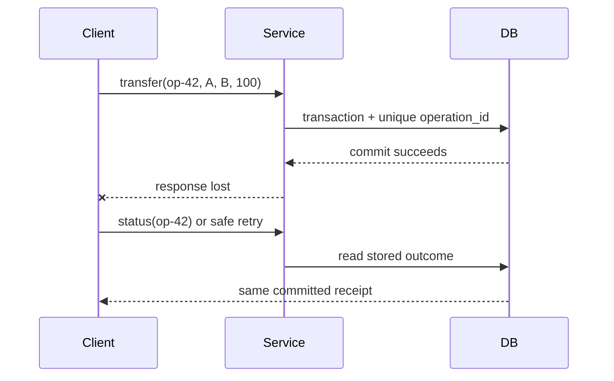

| Attempt | Durable `operation_id` row | Balance effect | Client observation |
|---|---|---|---|
| First `op-42` | Inserted and committed with transfer | Applied once | Response lost |
| Status query | Existing committed outcome | None | Learns success |
| Retry `op-42` | Uniqueness conflict/read existing row | None | Receives same receipt |

The key and outcome must live in the same atomic boundary as the effect. A process-local set, a short-lived cache entry, or “check then insert” outside the transaction reopens the duplicate window.

## Recovery is not replication

| Failure | Correct response |
|---|---|
| Process crash; durable log intact | Replay committed changes and discard/undo incomplete work according to the engine |
| Torn data-page write | Use engine-specific page protection plus recovery |
| Primary disk lost | Restore/fail over from a surviving replica or backup and logs |
| Async failover before replica receives commit | Acknowledged work may be lost |
| Client response lost after commit | Query by operation ID; do not blindly repeat the effect |

MySQL 8.4 documents InnoDB crash recovery as redo application followed by rollback of incomplete transactions, with purge of delete-marked records that are no longer visible. Do not generalize that exact undo/purge implementation to PostgreSQL: PostgreSQL uses tuple-version visibility and vacuum, and its recovery vocabulary and mechanics differ.

## Example 3 — ACID primary, stale replica

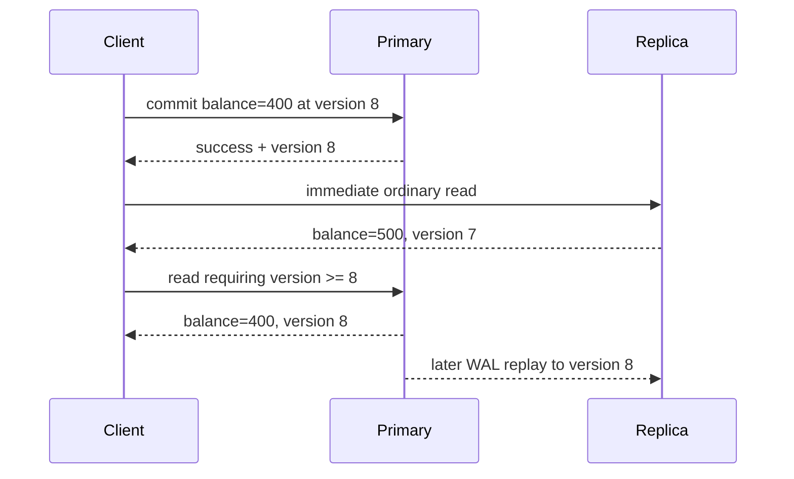

This is not a violation of primary transaction atomicity. It is a mismatch between the caller's **read-your-writes** requirement and an eventually consistent routing choice. PostgreSQL hot standby explicitly allows a measurable delay: a commit becomes visible to new standby snapshots only after its commit record is replayed.

Useful policies include:

1. pin the writer's session to the primary for a bounded interval;
2. return a commit/replay token and use a replica only after its applied position reaches that token;
3. choose a service's documented strong-read mode where supported; or
4. accept staleness for endpoints whose product contract permits it.

The Java model returns a stale value from an ordinary replica read, routes a read-your-writes request to the primary while the replica lags, then returns to the replica after replay.

## BASE: convergence is a designed mechanism

BASE—Basically Available, Soft state, Eventually consistent—is a design stance, not a fixed convergence deadline. Convergence requires communication to recover, updates to remain available for repair, and a deterministic conflict rule whose repeated merge reaches the same state.

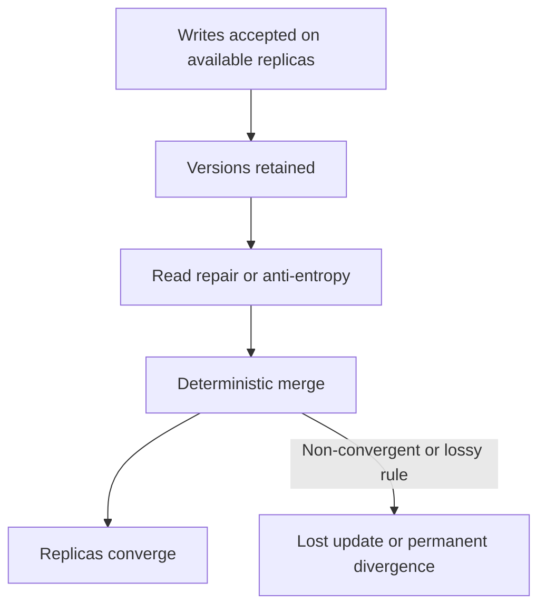

Amazon's original Dynamo paper describes object versioning with application-assisted conflict resolution and trades consistency under some failures for availability. Its concrete mechanisms include configurable replica participation, hinted handoff, and anti-entropy repair. That historical design must not be presented as a complete description of today's DynamoDB service.

## Example 4 — a convergent cart needs removal semantics

“Union both carts” preserves concurrent additions but resurrects removed items. The Java example stores, per item, the maximum observed add and remove logical versions. Merge is component-wise `max`; an item is present when `addVersion >= removeVersion`, an explicit add-wins tie policy.

| Event | Replica A | Replica B | After merge |
|---|---|---|---|
| Concurrent adds | mug@1 | pen@1 | `{mug, pen}` |
| Remove mug | remove(mug)@2 | still mug@1 | `{pen}` after merge |
| Late old add | add(mug)@1 | remove(mug)@2 | mug stays removed |

Why it converges: `max` is associative, commutative, and idempotent. Reordering, duplicating, or regrouping repair messages therefore yields the same per-item state. The example is a teaching model, not a full production CRDT: a real system must define logical-clock allocation, metadata compaction, identity, and behavior for truly concurrent add/remove operations.

## The quorum trap

`R + W > N` proves read/write-set overlap only under stated membership assumptions. Linearizability additionally depends on which replicas count as a completed write, how the read chooses among versions, what happens during membership changes or sloppy quorum substitution, how concurrent writes are ordered, and how failover treats acknowledged state.

| Claim | Missing question |
|---|---|
| “`R + W > N`, so reads are fresh” | Does the reader select the newest causally valid version from the overlap? |
| “We wrote to any `W` reachable nodes” | Are these the same membership set from which `R` is later chosen? |
| “Last-write-wins resolves conflicts” | Are clocks trustworthy, and can a valid concurrent write be discarded? |
| “Read repair eventually fixes it” | What guarantee applies before repair completes? |

Never infer linearizability from one inequality. State the full read, write, membership, version, and failover protocol.

## Complexity and cost boundaries

| Operation in the Java model | Time | Space | Production cost that dominates |
|---|---:|---:|---|
| Two-account transfer | `O(1)` | `O(1)` staged state | Lock/conflict waits and durable commit latency |
| Idempotency lookup | expected `O(1)` | `O(k)` retained operation IDs | Unique-index I/O and retention/partition strategy |
| Read-your-writes routing | `O(1)` | `O(1)` token | Replica apply lag or primary load |
| Cart merge | `O(a + b)` | `O(a + b)` | Version metadata, repair bandwidth, compaction |

The asymptotic notation describes the small teaching structures. It does not erase network round trips, fsync latency, conflict retries, replication lag, or storage-engine page access.

## Review checklist

- Is each invariant written and enforced inside the transaction boundary?
- Can the client distinguish rejection, committed success, and unknown outcome?
- Is the idempotency record atomic with the effect and retained long enough?
- Does the read path state primary/replica/cache freshness semantics?
- What exact failure domain does “durable” cover?
- Does the conflict rule converge under duplicate and reordered messages?
- Are quorum membership, version selection, repair, and failover specified?
- Are retries for serialization failures bounded, observable, and jittered?

## Primary references used across Sections 1–3

Accessed 2026-10-16.

1. [PostgreSQL 18 — Write-Ahead Logging](https://www.postgresql.org/docs/current/wal-intro.html): WAL-before-data ordering, redo, and group commit.
2. [PostgreSQL 18 — Transaction Isolation](https://www.postgresql.org/docs/current/transaction-iso.html): statement snapshots, repeatable read, serializable histories, and required retries.
3. [PostgreSQL 18 — Hot Standby](https://www.postgresql.org/docs/current/hot-standby.html): read-only standby visibility and replay lag.
4. [MySQL 8.4 — InnoDB Recovery](https://dev.mysql.com/doc/refman/8.4/en/innodb-recovery.html): redo application, incomplete-transaction rollback, and purge.
5. [Amazon DynamoDB — Read consistency](https://docs.aws.amazon.com/amazondynamodb/latest/developerguide/HowItWorks.ReadConsistency.html): eventual and strong read scopes, including GSI limitations.
6. DeCandia et al., [Dynamo: Amazon's Highly Available Key-value Store](https://www.amazon.science/publications/dynamo-amazons-highly-available-key-value-store), SOSP 2007: versioning, availability trade-offs, and application-assisted conflict resolution.
7. [PostgreSQL 18 — B-Tree Indexes](https://www.postgresql.org/docs/current/btree.html): page-level structure, recursive splits, root growth, and implementation-specific deletion.
8. [PostgreSQL 18 — Indexes and `ORDER BY`](https://www.postgresql.org/docs/current/indexes-ordering.html): ordered B-tree scans, planner trade-offs, and `ORDER BY ... LIMIT`.
9. [PostgreSQL 18 — `CREATE INDEX`](https://www.postgresql.org/docs/current/sql-createindex.html): B-tree fill factor and covering/index-construction options.
10. [MySQL 8.4 — Clustered and Secondary Indexes](https://dev.mysql.com/doc/refman/8.4/en/innodb-index-types.html): clustered row storage and primary-key payload in secondary entries.
11. [MySQL 8.4 — Physical Structure of an InnoDB Index](https://dev.mysql.com/doc/refman/8.4/en/innodb-physical-structure.html): 16 KiB default pages, occupancy, fill factor, and merge threshold.

# Section 2 — B+ trees: shallow indexes, ordered leaves, and write cost

The repository already contains a focused [B+ tree algorithm guide](../../local-project-notes/advanced-trees/b-plus-tree-database-index.md) and its heavily randomized immutable read model. This section does not create a second copy of that guide. It adds the storage-engine and schema-design questions the earlier module deliberately omits: page capacity, clustered versus heap organization, secondary-index amplification, online splits, fill factor, and what to measure in production.

## Learning and requirements contract

After this section you should be able to:

1. derive an illustrative tree height from entry count, leaf capacity, and internal fan-out without calling the estimate a product guarantee;
2. trace equality, bounded range, and `ORDER BY ... LIMIT` access through internal pages and linked leaves;
3. explain why an InnoDB secondary lookup normally carries the primary key and can require a second tree traversal;
4. explain why random and sequential inserts create different locality and contention profiles; and
5. distinguish a short structural latch from a transaction lock, then name the logging/recovery work a real split needs.

Before creating an index, state the workload contract:

| Question | Example requirement | Consequence |
|---|---|---|
| Which predicates must be fast? | `tenant_id = ? AND created_at BETWEEN ? AND ?` | Order the composite key so the required interval is contiguous |
| Is ordered output needed? | newest 20 orders per tenant | A matching B-tree order may avoid a separate sort |
| Must the query fetch base rows? | list needs status and total only | A covering index can save lookups but makes leaves wider |
| What is the write pattern? | random UUID inserts at 10k/s | Expect dispersed dirty pages and possible splits |
| What is the concurrency hotspot? | monotonically increasing IDs | Good locality can concentrate writers on the right edge |
| Which engine layout applies? | InnoDB clustered primary index | Primary-key width is repeated in secondary entries |

## Page anatomy and the height calculation

Internal pages store routing separators and child page identifiers. Leaves store ordered index entries and are connected for ordered traversal. PostgreSQL describes each level as a doubly linked list of pages; its leaf tuples point to table rows, while its internal tuples point down one level. InnoDB uses B-tree index pages, with a default 16 KiB page size, but its clustered-index leaves hold row data and its secondary entries include the primary-key columns.

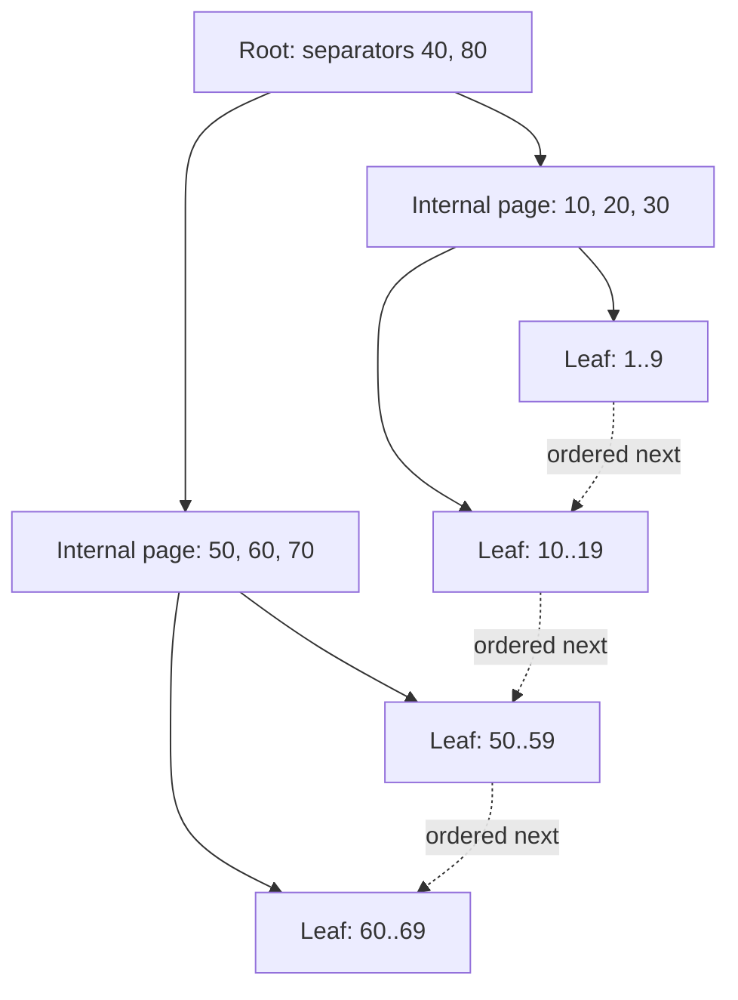

### Example 5 — one million entries can still mean three page levels

Assume, only for arithmetic, 200 entries per leaf and fan-out 200:

| Level | Calculation | Pages |
|---|---:|---:|
| Leaf | `ceil(1,000,000 / 200)` | 5,000 |
| Internal above leaves | `ceil(5,000 / 200)` | 25 |
| Root | `ceil(25 / 200)` | 1 |

That is three page levels: root → internal → leaf. The executable `capacityPlan` scenario derives the same result. It also tests boundaries such as one entry, an exact full leaf, and a fan-out smaller than two.

This does **not** promise three physical reads. Upper pages may already be in the buffer pool, a leaf may not be resident, a covering index may avoid a base-row read, and read-ahead can change the I/O pattern. Key width, row identifier width, tuple headers, page headers, free space, compression, deduplication, and occupancy all change effective fan-out.

## One descent, then an ordered leaf scan

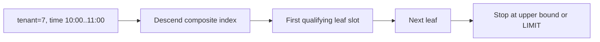

### Example 6 — composite range plus `ORDER BY ... LIMIT`

For an index on `(tenant_id, created_at DESC, order_id)`, the query below forms one ordered interval after tenant equality:

```sql
SELECT order_id, created_at
FROM orders
WHERE tenant_id = :tenant
  AND created_at >= :from
  AND created_at < :to
ORDER BY created_at DESC
LIMIT 20;
```

Trace for tenant 7:

| Step | Page action | Work avoided |
|---:|---|---|
| 1 | Use separators to descend to the first qualifying composite key | No full index scan |
| 2 | Lower-bound inside the leaf | No scan of earlier tenants/timestamps |
| 3 | Read forward through leaf entries and sibling pages | No root descent per row |
| 4 | Stop after 20 entries or at `:to` | No need to sort/consume the remaining interval when the plan matches |

PostgreSQL explicitly documents that B-tree is its index type capable of producing sorted output and that a matching index is especially valuable for `ORDER BY ... LIMIT`. The optimizer may still prefer a table scan plus sort when a query needs a large fraction of the table. Also, a suffix-only predicate on `created_at` lacks tenant equality and may not describe one narrow interval in this key order.

## Clustered and secondary layouts are not interchangeable

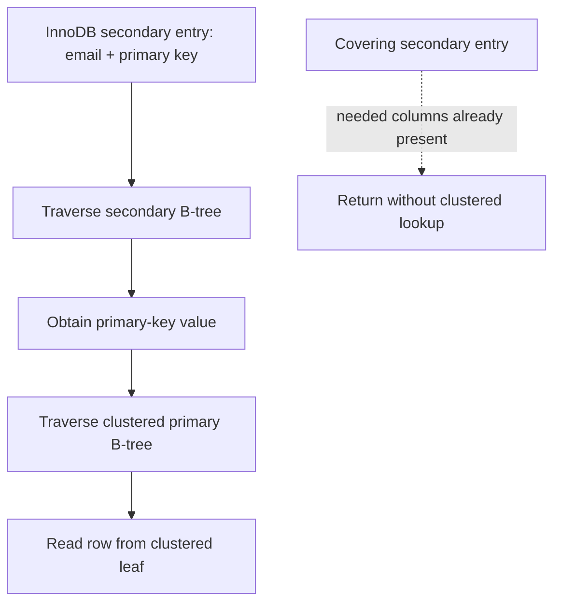

### Example 7 — a wide primary key multiplies secondary-index bytes

Consider 50 million rows and four secondary indexes. Ignoring headers, compression, free space, and included columns, replacing an 8-byte primary key with a 36-byte textual UUID adds:

\[
50{,}000{,}000 \times 4 \times (36 - 8) = 5.6\text{ GB}
\]

This is a deliberately narrow lower-bound model, not a storage forecast. The executable scenario verifies the arithmetic and rejects negative dimensions. Real capacity planning must measure encoded entries and page occupancy. MySQL documents the underlying reason: each InnoDB secondary record includes the primary-key columns, and a secondary lookup uses that value to search the clustered index.

PostgreSQL's ordinary layout differs: B-tree leaf tuples point to rows in a heap-organized table. A useful interview answer says which engine is being discussed instead of treating every “B-tree index” as clustered.

## Insert, split, and recovery-safe publication

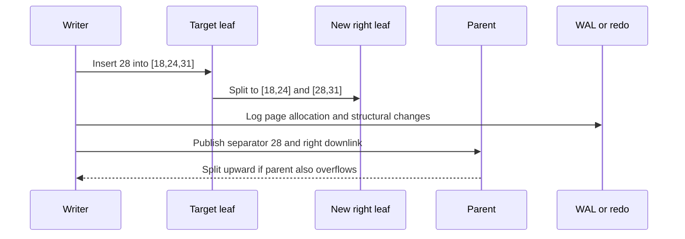

### Example 8 — split a full leaf without losing order

The Java teaching helper inserts 28 into a capacity-three leaf `[18,24,31]`, then returns:

| Output | Value | Invariant |
|---|---|---|
| left page | `[18,24]` | sorted and within old lower range |
| right page | `[28,31]` | sorted and within old upper range |
| promoted separator | `28` | minimum key of the new right page |

The scenario also inserts 32 into a non-full leaf and verifies that no split occurs. This is a structural teaching model only. A production split must allocate and initialize a sibling, preserve sibling links, log changes, make parent navigation safe for concurrent readers, and recover from crashes at intermediate moments. A **latch** briefly protects in-memory page structure; a **transaction lock** protects logical records or predicates across transaction work. They solve different problems.

PostgreSQL documents recursive split propagation and root splitting: only a root split adds a new level. It also performs implementation-specific deletion/deduplication work that can sometimes avoid a split. Do not infer that every full-looking logical insert allocates a page, or that every split immediately writes all touched pages to storage.

## Insert pattern and fill-factor trade-offs

| Pattern | Benefit | Dominant risk |
|---|---|---|
| Random keys | Distributes writers across key space | Scattered dirty pages, lower locality, more split opportunities |
| Sequential keys | High locality and compact right-edge growth | Rightmost-page latch contention at high concurrency |
| Lower fill factor | Leaves headroom for later inserts | Larger index, lower cache density, more scan I/O |
| Wider covering index | Avoids some base-row lookups | Lower fan-out and higher write/storage cost |

InnoDB documents that sequential insert builds tend toward about 15/16-full pages, while random insertion can yield pages between one-half and 15/16 full. PostgreSQL exposes B-tree `fillfactor`, but the right value is workload-specific. Measure instead of prescribing a magic percentage.

Useful signals include index bytes and growth, page split/merge rate where exposed, buffer-cache hit and residency, dirty-page and WAL/redo bytes, index scan versus table-fetch counts, query latency by plan, right-edge latch waits, and write latency. A logical `O(log n)` insertion can touch several pages yet still have fewer device operations because buffering coalesces writes.

## Complexity, failure boundaries, and review

| Operation | Logical CPU | Page-oriented shape | Important boundary |
|---|---:|---:|---|
| Point lookup | `O(log_F n)` levels | one page per level if cold | clustered/covering layout determines extra fetches |
| Range returning `k` rows | `O(log_F n + k)` | one descent plus leaf pages visited | output and base-row fetches still cost work |
| Insert without split | search plus in-page movement | leaf dirtied and logged | acknowledgement follows the durability policy |
| Split | search plus redistribution | new sibling + parent update; may cascade | concurrent visibility and crash recovery are engine-specific |

Review questions:

- What exactly lives in internal and leaf pages for this engine?
- Which separator convention routes equality left or right?
- Does the query describe one contiguous composite-key interval?
- Can index order satisfy the requested sort and limit?
- Does the read require a heap/clustered lookup, or is the index covering?
- How many times is the primary key replicated into secondary entries?
- Is a hotspot caused by poor locality or by too much right-edge locality?
- Are page latches, transaction locks, WAL/redo, and recovery described separately?
- Which measurements would prove that splits or cache misses are the bottleneck?

The earlier focused module remains the canonical place for separator invariants, immutable bulk loading, linked-leaf correctness proofs, deletion mechanics, and 150,000 randomized point/range oracle checks. This section supplies the complementary database-design and operational layer.

# Section 3 — LSM trees: moving write cost into compaction

An LSM tree turns many foreground random updates into WAL appends, in-memory sorted updates, sequential table flushes, and later background merges. That is a **scheduling trade**, not “write once.” The design can improve ingest throughput and locality while increasing version-resolution work, background I/O, temporary disk demand, and operational coupling between compaction and foreground latency.

## Learning and requirements contract

After this section you should be able to:

1. trace acknowledgement, crash recovery, freeze, flush, and manifest publication without treating them as one event;
2. resolve a point read by snapshot sequence across mutable memory and overlapping sorted tables;
3. explain why a Bloom-filter negative can skip a table while a positive cannot prove the key exists;
4. state the conditions under which a tombstone may be removed without resurrecting an older value;
5. compare leveled and universal/tiered compaction by write, read, and space amplification; and
6. calculate explicitly scoped amplification and disk-headroom estimates, then name the signals that warn of compaction debt.

State the workload before choosing an LSM policy:

| Question | Example requirement | Design consequence |
|---|---|---|
| What must survive acknowledgement? | process crash after a cart update | WAL must cross the configured durability boundary before success |
| Which snapshot semantics apply? | an iterator keeps sequence 80 | versions needed by that snapshot cannot be discarded |
| Are reads point-heavy or scan-heavy? | 95% absent point lookups | per-table filters and cached indexes matter |
| How bursty are writes? | 500 MB/s for 30 seconds | memtable, flush bandwidth, L0 limits, and backpressure need headroom |
| How much rewrite can storage sustain? | 1 GB/s background budget | compaction style and level sizing must fit the device budget |
| How much free disk is reserved? | compaction may overlap old and new files | live data alone is not a safe capacity target |

## Write acknowledgement, recovery, and flush are separate

RocksDB journals in-memory state changes in the WAL and on-disk file-set changes in the MANIFEST. A write normally reaches the WAL and mutable memtable; when a memtable becomes immutable, a background flush produces an SST file. Memtables can flush for several reasons, including memory pressure and WAL-size pressure, so “flushes only when exactly full” is false.

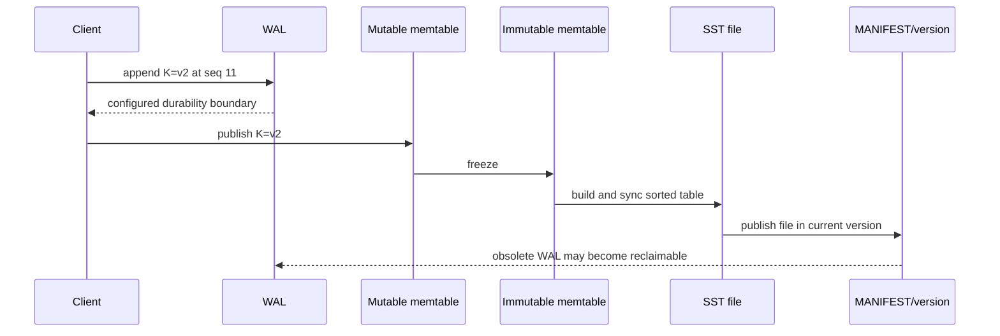

### Example 9 — recover the newest WAL update, then flush it

The Java `LsmBuffer` writes `cart:7=v1@10`, then `cart:7=v2@11`. A simulated crash retains the WAL and durable tables but loses the mutable map. Recovery replays both WAL entries and chooses sequence 11. After flush, the model has one immutable table and can clear its WAL because that table is the durable teaching-model state.

| Moment | WAL | Mutable state | Durable table | Read at snapshot 11 |
|---|---|---|---|---|
| first write | `v1@10` | `v1@10` | none | `v1` |
| overwrite | `v1@10, v2@11` | `v2@11` | none | `v2` |
| crash/replay | same records replayed | `v2@11` | none | `v2` |
| flush published | reclaimable in model | empty | `v2@11` | `v2` |

The order in this small model is intentionally strict: append the WAL record before exposing the memtable mutation. Production acknowledgement, batching, WAL sync options, atomic write batches, file syncing, and MANIFEST edits are engine-specific. Disabling or weakening WAL sync changes the failure contract; a memtable update alone is not durable.

## A read is version selection, not “check every file and return first”

The read path may consult the mutable memtable, immutable memtables, Level 0 files whose key ranges overlap, and at most the relevant file(s) in non-overlapping lower levels under leveled compaction. It must choose the newest sequence visible to the caller's snapshot. Block indexes narrow a file to likely blocks; Bloom filters can rule out definite absence for the represented key domain; caches can avoid device reads.

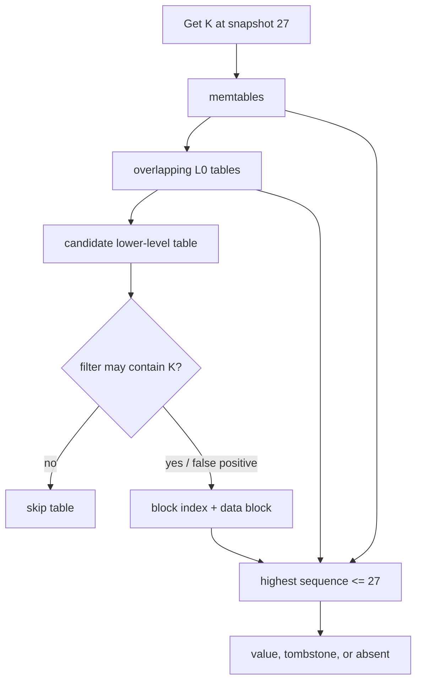

### Example 10 — one key, three snapshot answers

Candidate versions for `K` are tombstone `@30`, value `new@25`, and value `old@12`:

| Snapshot | Visible candidates | Selected result |
|---:|---|---|
| 20 | `old@12` | `old` |
| 27 | `new@25`, `old@12` | `new` |
| 30 | tombstone `@30`, both older values | absent |

The Java `newestVisible` scenario verifies all three results. It also models a Bloom negative as zero candidate probes. A real Bloom positive is only “maybe”: it can be a false positive and still require index/data-block work. A correctly built Bloom filter must not create false negatives for the key domain it covers.

For a range scan, the engine merges ordered iterators from participating structures, keeps the newest snapshot-visible version per key, and suppresses keys hidden by tombstones. If there are `r` runs, a heap-based merge is commonly described as `O(output_candidates log r)` CPU plus the blocks actually read; filters that help point absence do not erase the need to walk a requested range.

## Tombstones are promises that older values stay hidden

A delete writes a newer tombstone. Removing it too early can expose an older value in another table—a resurrection bug. Safe reclamation needs both visibility information and coverage information: no active snapshot may need the pre-delete version, and no older version capable of reappearing may remain outside the compaction's knowledge.

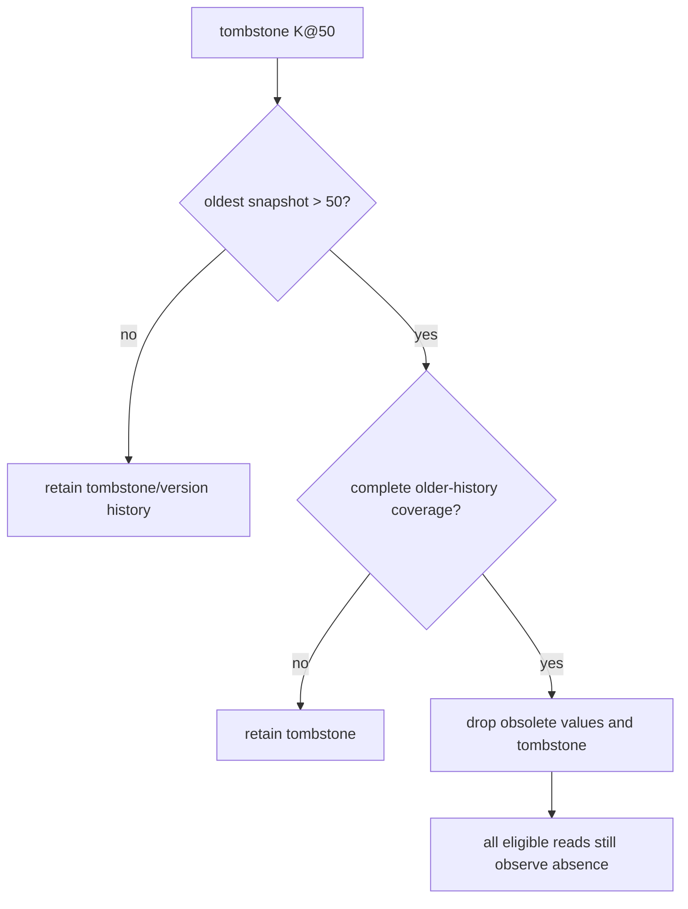

### Example 11 — both safety gates must pass

The executable teaching predicate accepts removal only when `tombstoneSequence < oldestSnapshotSequence` **and** the compaction covers all older history for that key:

| Tombstone | Oldest snapshot | Complete older-history coverage? | Decision |
|---:|---:|---|---|
| 50 | 40 | yes | keep; snapshot 40 may need the old value |
| 50 | 80 | no | keep; an older value might survive elsewhere |
| 50 | 80 | yes | safe in this deliberately complete model |

Real RocksDB compaction uses sequence numbers, snapshots, level placement, merge/range-deletion semantics, and file/version metadata rather than this one predicate. Distributed stores add repair and replica-retention constraints. An LSM tombstone is also not a certified secure-erasure mechanism; backups, logs, snapshots, replicas, and device behavior belong to a separate deletion policy.

## Compaction shapes the amplification trade

Leveled compaction aims for non-overlap in lower levels, usually reducing point-read candidates and steady-state space amplification at the cost of rewriting data as it moves through levels. Universal/tiered-style compaction keeps several sorted runs and merges selected runs, often reducing write amplification while increasing read candidates and temporary space. These are workload-dependent families, not universal rankings.

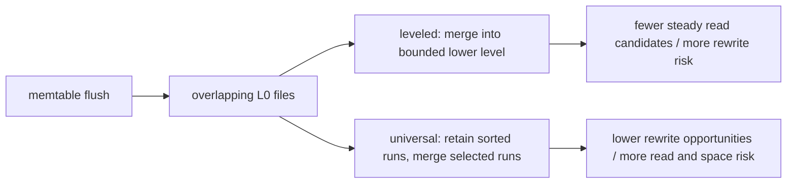

### Example 12 — define the accounting boundary before quoting a ratio

Suppose 100 MB of logical updates cause 100 MB of WAL writes, 100 MB of flush output, and 500 MB of compaction output:

\[
WA = \frac{100 + 100 + 500}{100} = 7
\]

If a lookup reads 64 KiB to return 8 KiB, byte-based read amplification is 8. That is not the same metric as “files probed per lookup.” The Java `amplification` scenario keeps these ratios separate and calculates required modeled disk occupancy:

\[
\text{headroom target} = \text{live} + \text{obsolete} + \text{compaction overlap}
\]

For `1000 + 120 + 300`, the result is 1420 units. This is an accounting example, not a promised RocksDB ratio or a complete capacity formula. State whether WAL, compression, replication, filesystem/device amplification, backups, and temporary outputs are included.

## Compaction debt becomes foreground backpressure

If flush or compaction bandwidth stays below incoming work, immutable memtables and L0 files accumulate. Reads face more candidates; background I/O competes with foreground work; eventually the engine delays or stops writes to protect memory and file-count bounds. More cache cannot repay insufficient compaction bandwidth.

| Signal | What it can reveal | Avoid this shortcut |
|---|---|---|
| pending compaction bytes / compaction score | queued rewrite work | one instant is not a trend |
| L0 file count | overlap and stall proximity | thresholds depend on configuration |
| write-stall count and duration | foreground impact | average write latency can hide stalls |
| flush/compaction read and write throughput | whether background work keeps pace | device bandwidth is shared with reads/WAL |
| block-cache and filter usefulness | avoided data-block reads | hit rate alone does not show tail latency |
| live, obsolete, and total SST bytes | space amplification and reclaim lag | filesystem free space may include other users |
| oldest snapshot/iterator age | why versions cannot be reclaimed | long scans can pin history intentionally |

Recovery planning must reserve space for the WAL and the published SST set, while compaction planning must additionally cover old inputs and new outputs until metadata publication makes inputs obsolete. If the disk fills, compaction may be unable to finish the very rewrite needed to reclaim space.

## Complexity, failure boundaries, and review

| Operation | Logical shape | Dominant physical risk |
|---|---|---|
| Write | WAL append + `O(log m)` memtable insert for a tree-backed memtable | sync policy and memtable contention |
| Point read | newest visible version across candidate structures | overlapping runs, cache misses, false-positive filters |
| Range read | ordered merge across `r` iterators | read amplification and obsolete versions |
| Flush | sort/encode mutable state into an immutable table | burst I/O and L0 growth |
| Compaction | merge selected inputs, rewrite surviving versions | write/space amplification and foreground interference |

Review questions:

- Which exact event makes a write acknowledged, recoverable, flushed, and visible in the current file version?
- Which sequence number defines the caller's snapshot?
- Can a filter skip the table, or does it only say “maybe”?
- Which older values might a tombstone still mask?
- Does the compaction input cover all relevant older history for the key?
- Which amplification numerator and denominator are being reported?
- How much temporary disk is required while old and new files coexist?
- Which queue, L0, throughput, stall, and snapshot-age signals show debt before outage?

### Primary references for Section 3

Accessed 2026-10-16.

12. [RocksDB overview](https://github.com/facebook/rocksdb/wiki): embedded LSM storage engine scope and RocksJava distinction.
13. [RocksDB Journal](https://github.com/facebook/rocksdb/wiki/Journal): WAL journals in-memory updates; MANIFEST journals on-disk state changes.
14. [RocksDB MemTable](https://github.com/facebook/rocksdb/wiki/MemTable): mutable/immutable memtables and flush triggers.
15. [RocksDB Compaction](https://github.com/facebook/rocksdb/wiki/Compaction): leveled/tiered trade-offs and workload-dependent write amplification.
16. [RocksDB Universal Compaction](https://github.com/facebook/rocksdb/wiki/Universal-Compaction): lower-write-amplification goal and read/space trade-offs.
17. [RocksDB Leveled Compaction](https://github.com/facebook/rocksdb/wiki/Leveled-Compaction): L0 overlap, lower-level organization, and compaction behavior.
18. [RocksDB Write Stalls](https://github.com/facebook/rocksdb/wiki/Write-Stalls): memtable, L0, and pending-compaction backpressure triggers.
19. [RocksDB Compaction Stats and DB Status](https://github.com/facebook/rocksdb/wiki/Compaction-Stats-and-DB-Status): bytes, amplification, stall, and per-level operational metrics.

## Source provenance and verification

- Confirmed Library source: `database_internals_caching_java_master_guide.md`
- Library file ID: `libfile_969515775294819195d90fe08e46b7be`
- Backing file ID: `file_00000000dadc81f59cf6b82ca990a48a`
- Version: `1`
- Whole-file SHA-256: `ec8a88daa8b9d26be7c7817f20e8d0e1c8f0ef1697c5bbf8cd7cb1e4a703f34a`
- Processed bounded ranges: source lines **62–133**, “ACID, BASE, and the misleading SQL/NoSQL split”; lines **134–176**, “B+ trees: pages, fan-out, and write cost”; and lines **177–230**, “LSM trees: moving write cost into compaction”
- Deliberate continuation: Section 4, “Row-oriented versus column-oriented storage,” begins at source line 231; resolve its exact end before processing.

Validation commands:

```bash
python3 build_reader.py
node validate_reader.mjs
javac ConsistencyContracts.java
java -ea ConsistencyContracts
```

The Markdown is canonical. `guide.html` is generated deterministically and embeds the exact Markdown bytes for synchronization checks.

