# Database Internals, Caching, and Java Connectivity

> **Incremental canonical guide.** This publication deepens source Sections 1–5: **ACID/BASE contracts**, **B+ tree page economics**, **LSM write/read/compaction mechanics**, **row/column storage with CDC-fed analytics**, and **isolation anomalies with engine-specific semantics**. Later source sections are deliberately queued rather than summarized prematurely.

## Learning contract

After this section you should be able to:

1. state each ACID property without turning it into a promise about replicas, caches, or external side effects;
2. distinguish serializability, strict serializability, linearizability, read-your-writes, and eventual convergence;
3. explain why a commit acknowledgement depends on the configured log/replication durability boundary, not on every data page being flushed;
4. design a transfer that preserves an invariant and survives an unknown commit outcome; and
5. explain why `R + W > N` is not, by itself, a proof of linearizability.

### Requirements before product names

Write the contract before selecting an engine:

| Question | Example requirement | Mechanism to investigate |
|---|---|---|
| What must be atomic? | Debit A and credit B commit together | One database transaction; otherwise an explicit distributed protocol |
| What invariant must survive? | `balance >= 0` and total money is conserved | Constraint plus conditional write inside the transaction |
| Which histories are allowed? | Concurrent transfers behave like some serial order | Serializable transaction or explicit locking/validation |
| How fresh must a read be? | The writer must immediately see its own committed transfer | Primary/session routing, replay token, or a documented strong-read option |
| What failure must an acknowledgement survive? | Process crash and loss of one node | Durable WAL plus the required replica acknowledgement policy |
| What happens after a timeout? | Retrying a transfer must not apply it twice | Durable idempotency key and stored outcome |

The words **SQL**, **NoSQL**, **ACID**, and **BASE** do not answer these questions. A relational primary may expose stale asynchronous-replica reads. A key-value service may provide atomic transactions and optional strongly consistent reads. DynamoDB, for example, offers strong reads on tables and local secondary indexes, while global secondary indexes remain eventually consistent.

## ACID: property, mechanism, and boundary

| Property | Typical mechanism | It does **not** promise |
|---|---|---|
| Atomicity | Commit record, rollback/undo, version visibility, recovery | Atomicity across SQL + Redis + email without another protocol |
| Consistency | Constraints and correctly designed transactions preserve invariants | Every replica or cache immediately sees the commit |
| Isolation | Locks, snapshots, predicate protection, conflict validation | Serializable execution merely because code uses `BEGIN` |
| Durability | WAL/redo reaches the configured durable boundary before acknowledgement | Survival beyond the chosen media/node/region failure domain |

**ACID consistency** is application validity: a valid state transitions to another valid state. The application still has to state the invariant. A database cannot infer that two ledger entries must net to zero.

**Serializability** means the committed transaction history is equivalent to some serial order. **Strict serializability** additionally respects real-time order. **Linearizability** is a per-operation real-time guarantee: each operation appears to take effect at one instant between invocation and response. A transaction can be serializable without a lagging replica offering linearizable reads.

PostgreSQL's current documentation makes the isolation boundary concrete: `READ COMMITTED` takes a new snapshot for each statement; `REPEATABLE READ` keeps a stable transaction snapshot but can still permit serialization anomalies; `SERIALIZABLE` detects histories that cannot match any serial execution and requires clients to retry rejected transactions.

## Example 1 — atomic transfer with an invariant

**Requirement.** Transfer 100 from A to B, never let A become negative, and conserve the total. The balance check must not come from a cache because it must participate in the same atomic decision as both writes.

Production SQL usually uses a stable lock order and a conditional debit:

```sql
BEGIN TRANSACTION ISOLATION LEVEL SERIALIZABLE;
-- lock account rows in stable account_id order
SELECT account_id FROM account
WHERE account_id IN (:from, :to)
ORDER BY account_id
FOR UPDATE;

UPDATE account
SET balance = balance - :amount
WHERE account_id = :from AND balance >= :amount;
-- require exactly one affected row

UPDATE account SET balance = balance + :amount
WHERE account_id = :to;
INSERT INTO transfer(operation_id, from_id, to_id, amount, status)
VALUES (:operationId, :from, :to, :amount, 'COMMITTED');
COMMIT;
```

The runnable Java model stages both balances and publishes them only on commit. Its injected failure after the debit proves that partial state is not visible.

| Step | Staged A | Staged B | Published A | Published B | Invariant |
|---:|---:|---:|---:|---:|---|
| Start | 500 | 200 | 500 | 200 | total = 700 |
| Conditional debit | 400 | 200 | 500 | 200 | staged A is non-negative |
| Injected failure | discarded | discarded | 500 | 200 | no partial transfer |
| Successful retry | 400 | 300 | 400 | 300 | total = 700 |

Run [the Java scenarios](ConsistencyContracts.java):

```bash
javac ConsistencyContracts.java
java -ea ConsistencyContracts
```

## Commit path: WAL first, pages later

```mermaid
sequenceDiagram
    participant App as Transfer service
    participant Tx as Transaction manager
    participant WAL as Durable WAL
    participant Pages as Data pages
    App->>Tx: BEGIN; conditional debit; credit
    Tx->>WAL: Append row changes + commit record
    WAL-->>Tx: Configured durable flush completes
    Tx-->>App: COMMIT acknowledged
    Tx->>Pages: Flush dirty pages later
    Note over WAL,Pages: Recovery replays committed changes not yet in pages
```

The write-ahead rule is an ordering rule: log records describing a data-page change must reach durable storage before that changed page. Therefore commit need not flush every table and index page. PostgreSQL documents that only WAL must be flushed to guarantee a normal durable commit; one WAL sync can cover many small concurrent commits. A checkpoint bounds recovery work by flushing dirty state and recording a restart position—it is not the commit of an ordinary user transaction.

**Configured boundary matters.** A local WAL flush can survive a process crash and still fail to survive loss of the primary disk. Synchronous replica acknowledgement can enlarge the failure domain, at latency and availability cost. An asynchronous replica can miss an already acknowledged commit if the primary is lost before shipping it.

## Example 2 — timeout after commit is an unknown outcome

The client can lose the response after the database commits. Treating every timeout as failure and blindly retrying duplicates the effect.

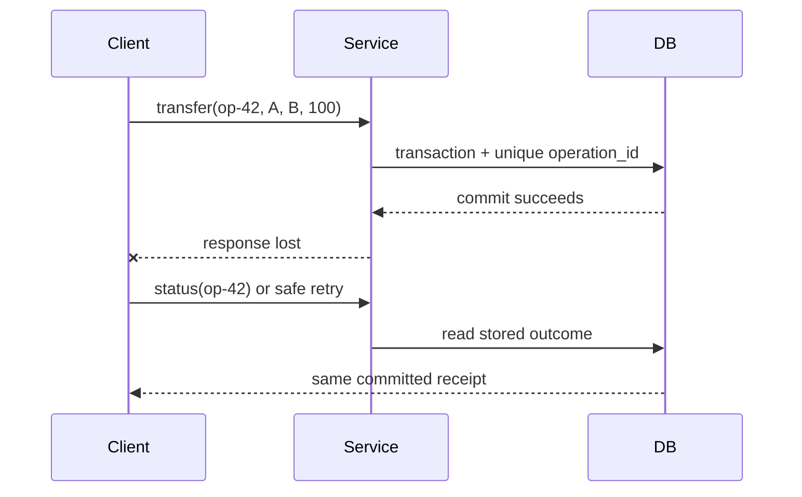

| Attempt | Durable `operation_id` row | Balance effect | Client observation |
|---|---|---|---|
| First `op-42` | Inserted and committed with transfer | Applied once | Response lost |
| Status query | Existing committed outcome | None | Learns success |
| Retry `op-42` | Uniqueness conflict/read existing row | None | Receives same receipt |

The key and outcome must live in the same atomic boundary as the effect. A process-local set, a short-lived cache entry, or “check then insert” outside the transaction reopens the duplicate window.

## Recovery is not replication

| Failure | Correct response |
|---|---|
| Process crash; durable log intact | Replay committed changes and discard/undo incomplete work according to the engine |
| Torn data-page write | Use engine-specific page protection plus recovery |
| Primary disk lost | Restore/fail over from a surviving replica or backup and logs |
| Async failover before replica receives commit | Acknowledged work may be lost |
| Client response lost after commit | Query by operation ID; do not blindly repeat the effect |

MySQL 8.4 documents InnoDB crash recovery as redo application followed by rollback of incomplete transactions, with purge of delete-marked records that are no longer visible. Do not generalize that exact undo/purge implementation to PostgreSQL: PostgreSQL uses tuple-version visibility and vacuum, and its recovery vocabulary and mechanics differ.

## Example 3 — ACID primary, stale replica

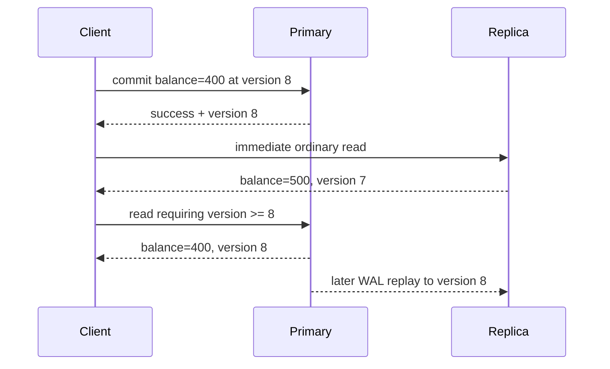

This is not a violation of primary transaction atomicity. It is a mismatch between the caller's **read-your-writes** requirement and an eventually consistent routing choice. PostgreSQL hot standby explicitly allows a measurable delay: a commit becomes visible to new standby snapshots only after its commit record is replayed.

Useful policies include:

1. pin the writer's session to the primary for a bounded interval;
2. return a commit/replay token and use a replica only after its applied position reaches that token;
3. choose a service's documented strong-read mode where supported; or
4. accept staleness for endpoints whose product contract permits it.

The Java model returns a stale value from an ordinary replica read, routes a read-your-writes request to the primary while the replica lags, then returns to the replica after replay.

## BASE: convergence is a designed mechanism

BASE—Basically Available, Soft state, Eventually consistent—is a design stance, not a fixed convergence deadline. Convergence requires communication to recover, updates to remain available for repair, and a deterministic conflict rule whose repeated merge reaches the same state.

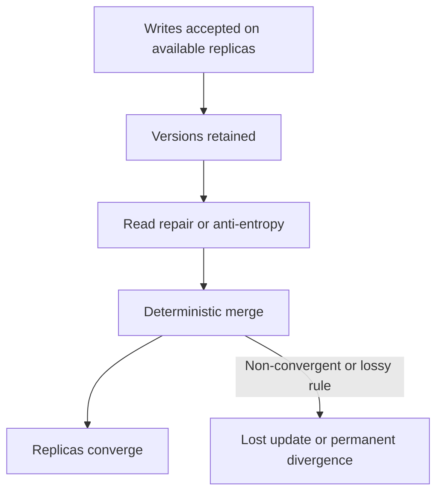

Amazon's original Dynamo paper describes object versioning with application-assisted conflict resolution and trades consistency under some failures for availability. Its concrete mechanisms include configurable replica participation, hinted handoff, and anti-entropy repair. That historical design must not be presented as a complete description of today's DynamoDB service.

## Example 4 — a convergent cart needs removal semantics

“Union both carts” preserves concurrent additions but resurrects removed items. The Java example stores, per item, the maximum observed add and remove logical versions. Merge is component-wise `max`; an item is present when `addVersion >= removeVersion`, an explicit add-wins tie policy.

| Event | Replica A | Replica B | After merge |
|---|---|---|---|
| Concurrent adds | mug@1 | pen@1 | `{mug, pen}` |
| Remove mug | remove(mug)@2 | still mug@1 | `{pen}` after merge |
| Late old add | add(mug)@1 | remove(mug)@2 | mug stays removed |

Why it converges: `max` is associative, commutative, and idempotent. Reordering, duplicating, or regrouping repair messages therefore yields the same per-item state. The example is a teaching model, not a full production CRDT: a real system must define logical-clock allocation, metadata compaction, identity, and behavior for truly concurrent add/remove operations.

## The quorum trap

`R + W > N` proves read/write-set overlap only under stated membership assumptions. Linearizability additionally depends on which replicas count as a completed write, how the read chooses among versions, what happens during membership changes or sloppy quorum substitution, how concurrent writes are ordered, and how failover treats acknowledged state.

| Claim | Missing question |
|---|---|
| “`R + W > N`, so reads are fresh” | Does the reader select the newest causally valid version from the overlap? |
| “We wrote to any `W` reachable nodes” | Are these the same membership set from which `R` is later chosen? |
| “Last-write-wins resolves conflicts” | Are clocks trustworthy, and can a valid concurrent write be discarded? |
| “Read repair eventually fixes it” | What guarantee applies before repair completes? |

Never infer linearizability from one inequality. State the full read, write, membership, version, and failover protocol.

## Complexity and cost boundaries

| Operation in the Java model | Time | Space | Production cost that dominates |
|---|---:|---:|---|
| Two-account transfer | `O(1)` | `O(1)` staged state | Lock/conflict waits and durable commit latency |
| Idempotency lookup | expected `O(1)` | `O(k)` retained operation IDs | Unique-index I/O and retention/partition strategy |
| Read-your-writes routing | `O(1)` | `O(1)` token | Replica apply lag or primary load |
| Cart merge | `O(a + b)` | `O(a + b)` | Version metadata, repair bandwidth, compaction |

The asymptotic notation describes the small teaching structures. It does not erase network round trips, fsync latency, conflict retries, replication lag, or storage-engine page access.

## Review checklist

- Is each invariant written and enforced inside the transaction boundary?
- Can the client distinguish rejection, committed success, and unknown outcome?
- Is the idempotency record atomic with the effect and retained long enough?
- Does the read path state primary/replica/cache freshness semantics?
- What exact failure domain does “durable” cover?
- Does the conflict rule converge under duplicate and reordered messages?
- Are quorum membership, version selection, repair, and failover specified?
- Are retries for serialization failures bounded, observable, and jittered?

## Primary references used across Sections 1–3

Accessed 2026-10-16.

1. [PostgreSQL 18 — Write-Ahead Logging](https://www.postgresql.org/docs/current/wal-intro.html): WAL-before-data ordering, redo, and group commit.
2. [PostgreSQL 18 — Transaction Isolation](https://www.postgresql.org/docs/current/transaction-iso.html): statement snapshots, repeatable read, serializable histories, and required retries.
3. [PostgreSQL 18 — Hot Standby](https://www.postgresql.org/docs/current/hot-standby.html): read-only standby visibility and replay lag.
4. [MySQL 8.4 — InnoDB Recovery](https://dev.mysql.com/doc/refman/8.4/en/innodb-recovery.html): redo application, incomplete-transaction rollback, and purge.
5. [Amazon DynamoDB — Read consistency](https://docs.aws.amazon.com/amazondynamodb/latest/developerguide/HowItWorks.ReadConsistency.html): eventual and strong read scopes, including GSI limitations.
6. DeCandia et al., [Dynamo: Amazon's Highly Available Key-value Store](https://www.amazon.science/publications/dynamo-amazons-highly-available-key-value-store), SOSP 2007: versioning, availability trade-offs, and application-assisted conflict resolution.
7. [PostgreSQL 18 — B-Tree Indexes](https://www.postgresql.org/docs/current/btree.html): page-level structure, recursive splits, root growth, and implementation-specific deletion.
8. [PostgreSQL 18 — Indexes and `ORDER BY`](https://www.postgresql.org/docs/current/indexes-ordering.html): ordered B-tree scans, planner trade-offs, and `ORDER BY ... LIMIT`.
9. [PostgreSQL 18 — `CREATE INDEX`](https://www.postgresql.org/docs/current/sql-createindex.html): B-tree fill factor and covering/index-construction options.
10. [MySQL 8.4 — Clustered and Secondary Indexes](https://dev.mysql.com/doc/refman/8.4/en/innodb-index-types.html): clustered row storage and primary-key payload in secondary entries.
11. [MySQL 8.4 — Physical Structure of an InnoDB Index](https://dev.mysql.com/doc/refman/8.4/en/innodb-physical-structure.html): 16 KiB default pages, occupancy, fill factor, and merge threshold.

# Section 2 — B+ trees: shallow indexes, ordered leaves, and write cost

The repository already contains a focused [B+ tree algorithm guide](../../local-project-notes/advanced-trees/b-plus-tree-database-index.md) and its heavily randomized immutable read model. This section does not create a second copy of that guide. It adds the storage-engine and schema-design questions the earlier module deliberately omits: page capacity, clustered versus heap organization, secondary-index amplification, online splits, fill factor, and what to measure in production.

## Learning and requirements contract

After this section you should be able to:

1. derive an illustrative tree height from entry count, leaf capacity, and internal fan-out without calling the estimate a product guarantee;
2. trace equality, bounded range, and `ORDER BY ... LIMIT` access through internal pages and linked leaves;
3. explain why an InnoDB secondary lookup normally carries the primary key and can require a second tree traversal;
4. explain why random and sequential inserts create different locality and contention profiles; and
5. distinguish a short structural latch from a transaction lock, then name the logging/recovery work a real split needs.

Before creating an index, state the workload contract:

| Question | Example requirement | Consequence |
|---|---|---|
| Which predicates must be fast? | `tenant_id = ? AND created_at BETWEEN ? AND ?` | Order the composite key so the required interval is contiguous |
| Is ordered output needed? | newest 20 orders per tenant | A matching B-tree order may avoid a separate sort |
| Must the query fetch base rows? | list needs status and total only | A covering index can save lookups but makes leaves wider |
| What is the write pattern? | random UUID inserts at 10k/s | Expect dispersed dirty pages and possible splits |
| What is the concurrency hotspot? | monotonically increasing IDs | Good locality can concentrate writers on the right edge |
| Which engine layout applies? | InnoDB clustered primary index | Primary-key width is repeated in secondary entries |

## Page anatomy and the height calculation

Internal pages store routing separators and child page identifiers. Leaves store ordered index entries and are connected for ordered traversal. PostgreSQL describes each level as a doubly linked list of pages; its leaf tuples point to table rows, while its internal tuples point down one level. InnoDB uses B-tree index pages, with a default 16 KiB page size, but its clustered-index leaves hold row data and its secondary entries include the primary-key columns.

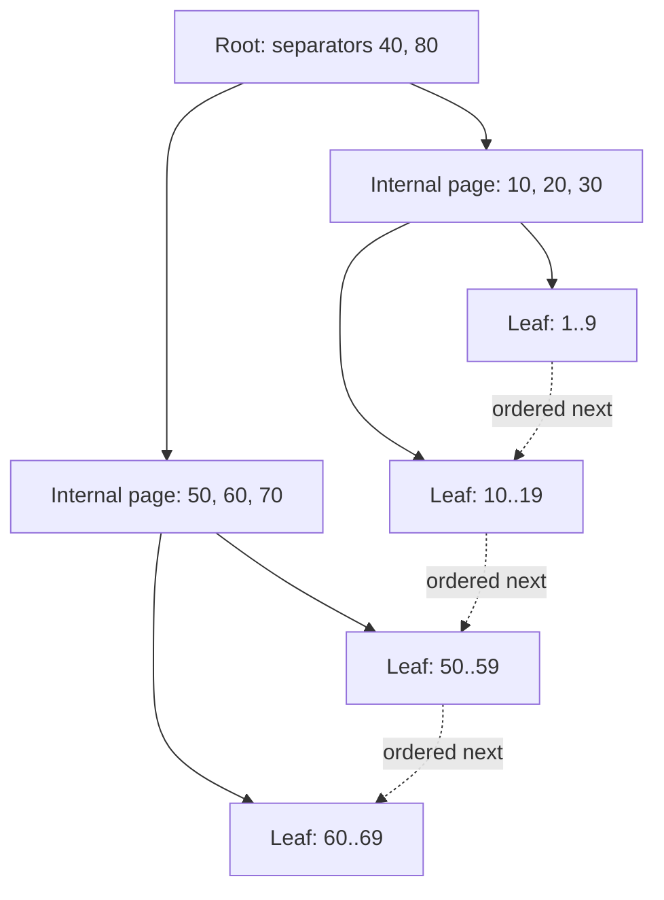

### Example 5 — one million entries can still mean three page levels

Assume, only for arithmetic, 200 entries per leaf and fan-out 200:

| Level | Calculation | Pages |
|---|---:|---:|
| Leaf | `ceil(1,000,000 / 200)` | 5,000 |
| Internal above leaves | `ceil(5,000 / 200)` | 25 |
| Root | `ceil(25 / 200)` | 1 |

That is three page levels: root → internal → leaf. The executable `capacityPlan` scenario derives the same result. It also tests boundaries such as one entry, an exact full leaf, and a fan-out smaller than two.

This does **not** promise three physical reads. Upper pages may already be in the buffer pool, a leaf may not be resident, a covering index may avoid a base-row read, and read-ahead can change the I/O pattern. Key width, row identifier width, tuple headers, page headers, free space, compression, deduplication, and occupancy all change effective fan-out.

## One descent, then an ordered leaf scan

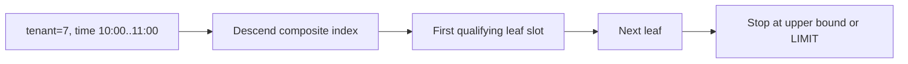

### Example 6 — composite range plus `ORDER BY ... LIMIT`

For an index on `(tenant_id, created_at DESC, order_id)`, the query below forms one ordered interval after tenant equality:

```sql
SELECT order_id, created_at
FROM orders
WHERE tenant_id = :tenant
  AND created_at >= :from
  AND created_at < :to
ORDER BY created_at DESC
LIMIT 20;
```

Trace for tenant 7:

| Step | Page action | Work avoided |
|---:|---|---|
| 1 | Use separators to descend to the first qualifying composite key | No full index scan |
| 2 | Lower-bound inside the leaf | No scan of earlier tenants/timestamps |
| 3 | Read forward through leaf entries and sibling pages | No root descent per row |
| 4 | Stop after 20 entries or at `:to` | No need to sort/consume the remaining interval when the plan matches |

PostgreSQL explicitly documents that B-tree is its index type capable of producing sorted output and that a matching index is especially valuable for `ORDER BY ... LIMIT`. The optimizer may still prefer a table scan plus sort when a query needs a large fraction of the table. Also, a suffix-only predicate on `created_at` lacks tenant equality and may not describe one narrow interval in this key order.

## Clustered and secondary layouts are not interchangeable

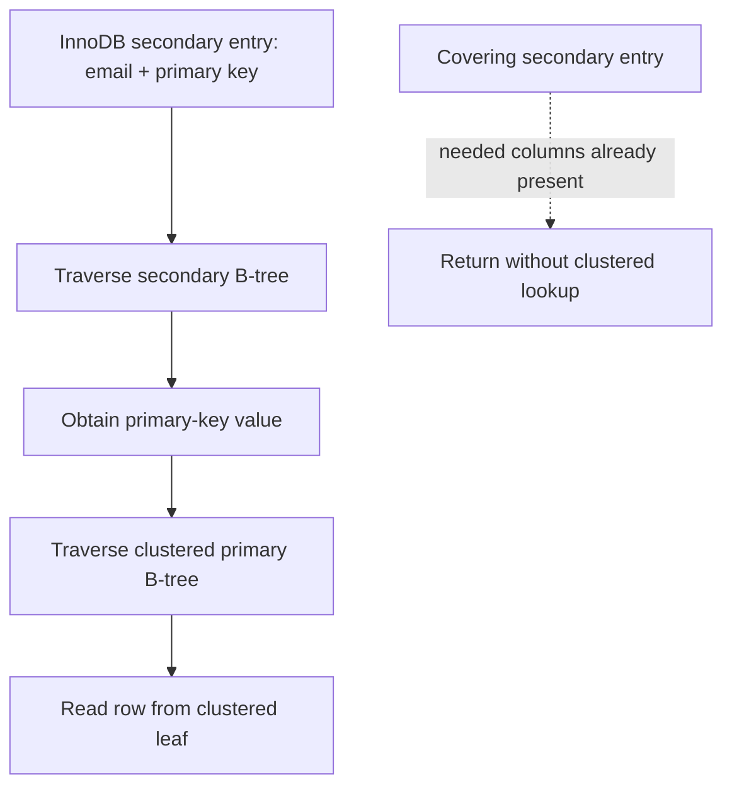

### Example 7 — a wide primary key multiplies secondary-index bytes

Consider 50 million rows and four secondary indexes. Ignoring headers, compression, free space, and included columns, replacing an 8-byte primary key with a 36-byte textual UUID adds:

\[
50{,}000{,}000 \times 4 \times (36 - 8) = 5.6\text{ GB}
\]

This is a deliberately narrow lower-bound model, not a storage forecast. The executable scenario verifies the arithmetic and rejects negative dimensions. Real capacity planning must measure encoded entries and page occupancy. MySQL documents the underlying reason: each InnoDB secondary record includes the primary-key columns, and a secondary lookup uses that value to search the clustered index.

PostgreSQL's ordinary layout differs: B-tree leaf tuples point to rows in a heap-organized table. A useful interview answer says which engine is being discussed instead of treating every “B-tree index” as clustered.

## Insert, split, and recovery-safe publication

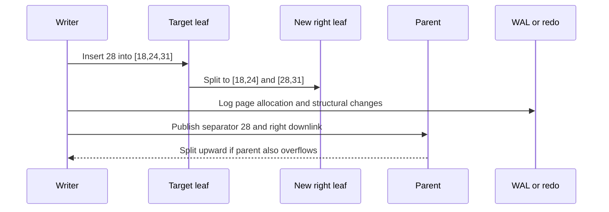

### Example 8 — split a full leaf without losing order

The Java teaching helper inserts 28 into a capacity-three leaf `[18,24,31]`, then returns:

| Output | Value | Invariant |
|---|---|---|
| left page | `[18,24]` | sorted and within old lower range |
| right page | `[28,31]` | sorted and within old upper range |
| promoted separator | `28` | minimum key of the new right page |

The scenario also inserts 32 into a non-full leaf and verifies that no split occurs. This is a structural teaching model only. A production split must allocate and initialize a sibling, preserve sibling links, log changes, make parent navigation safe for concurrent readers, and recover from crashes at intermediate moments. A **latch** briefly protects in-memory page structure; a **transaction lock** protects logical records or predicates across transaction work. They solve different problems.

PostgreSQL documents recursive split propagation and root splitting: only a root split adds a new level. It also performs implementation-specific deletion/deduplication work that can sometimes avoid a split. Do not infer that every full-looking logical insert allocates a page, or that every split immediately writes all touched pages to storage.

## Insert pattern and fill-factor trade-offs

| Pattern | Benefit | Dominant risk |
|---|---|---|
| Random keys | Distributes writers across key space | Scattered dirty pages, lower locality, more split opportunities |
| Sequential keys | High locality and compact right-edge growth | Rightmost-page latch contention at high concurrency |
| Lower fill factor | Leaves headroom for later inserts | Larger index, lower cache density, more scan I/O |
| Wider covering index | Avoids some base-row lookups | Lower fan-out and higher write/storage cost |

InnoDB documents that sequential insert builds tend toward about 15/16-full pages, while random insertion can yield pages between one-half and 15/16 full. PostgreSQL exposes B-tree `fillfactor`, but the right value is workload-specific. Measure instead of prescribing a magic percentage.

Useful signals include index bytes and growth, page split/merge rate where exposed, buffer-cache hit and residency, dirty-page and WAL/redo bytes, index scan versus table-fetch counts, query latency by plan, right-edge latch waits, and write latency. A logical `O(log n)` insertion can touch several pages yet still have fewer device operations because buffering coalesces writes.

## Complexity, failure boundaries, and review

| Operation | Logical CPU | Page-oriented shape | Important boundary |
|---|---:|---:|---|
| Point lookup | `O(log_F n)` levels | one page per level if cold | clustered/covering layout determines extra fetches |
| Range returning `k` rows | `O(log_F n + k)` | one descent plus leaf pages visited | output and base-row fetches still cost work |
| Insert without split | search plus in-page movement | leaf dirtied and logged | acknowledgement follows the durability policy |
| Split | search plus redistribution | new sibling + parent update; may cascade | concurrent visibility and crash recovery are engine-specific |

Review questions:

- What exactly lives in internal and leaf pages for this engine?
- Which separator convention routes equality left or right?
- Does the query describe one contiguous composite-key interval?
- Can index order satisfy the requested sort and limit?
- Does the read require a heap/clustered lookup, or is the index covering?
- How many times is the primary key replicated into secondary entries?
- Is a hotspot caused by poor locality or by too much right-edge locality?
- Are page latches, transaction locks, WAL/redo, and recovery described separately?
- Which measurements would prove that splits or cache misses are the bottleneck?

The earlier focused module remains the canonical place for separator invariants, immutable bulk loading, linked-leaf correctness proofs, deletion mechanics, and 150,000 randomized point/range oracle checks. This section supplies the complementary database-design and operational layer.

# Section 3 — LSM trees: moving write cost into compaction

An LSM tree turns many foreground random updates into WAL appends, in-memory sorted updates, sequential table flushes, and later background merges. That is a **scheduling trade**, not “write once.” The design can improve ingest throughput and locality while increasing version-resolution work, background I/O, temporary disk demand, and operational coupling between compaction and foreground latency.

## Learning and requirements contract

After this section you should be able to:

1. trace acknowledgement, crash recovery, freeze, flush, and manifest publication without treating them as one event;
2. resolve a point read by snapshot sequence across mutable memory and overlapping sorted tables;
3. explain why a Bloom-filter negative can skip a table while a positive cannot prove the key exists;
4. state the conditions under which a tombstone may be removed without resurrecting an older value;
5. compare leveled and universal/tiered compaction by write, read, and space amplification; and
6. calculate explicitly scoped amplification and disk-headroom estimates, then name the signals that warn of compaction debt.

State the workload before choosing an LSM policy:

| Question | Example requirement | Design consequence |
|---|---|---|
| What must survive acknowledgement? | process crash after a cart update | WAL must cross the configured durability boundary before success |
| Which snapshot semantics apply? | an iterator keeps sequence 80 | versions needed by that snapshot cannot be discarded |
| Are reads point-heavy or scan-heavy? | 95% absent point lookups | per-table filters and cached indexes matter |
| How bursty are writes? | 500 MB/s for 30 seconds | memtable, flush bandwidth, L0 limits, and backpressure need headroom |
| How much rewrite can storage sustain? | 1 GB/s background budget | compaction style and level sizing must fit the device budget |
| How much free disk is reserved? | compaction may overlap old and new files | live data alone is not a safe capacity target |

## Write acknowledgement, recovery, and flush are separate

RocksDB journals in-memory state changes in the WAL and on-disk file-set changes in the MANIFEST. A write normally reaches the WAL and mutable memtable; when a memtable becomes immutable, a background flush produces an SST file. Memtables can flush for several reasons, including memory pressure and WAL-size pressure, so “flushes only when exactly full” is false.

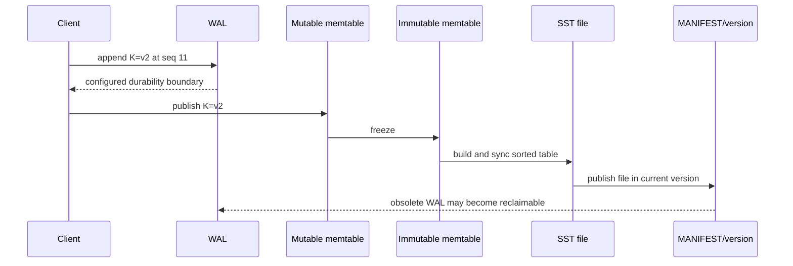

### Example 9 — recover the newest WAL update, then flush it

The Java `LsmBuffer` writes `cart:7=v1@10`, then `cart:7=v2@11`. A simulated crash retains the WAL and durable tables but loses the mutable map. Recovery replays both WAL entries and chooses sequence 11. After flush, the model has one immutable table and can clear its WAL because that table is the durable teaching-model state.

| Moment | WAL | Mutable state | Durable table | Read at snapshot 11 |
|---|---|---|---|---|
| first write | `v1@10` | `v1@10` | none | `v1` |
| overwrite | `v1@10, v2@11` | `v2@11` | none | `v2` |
| crash/replay | same records replayed | `v2@11` | none | `v2` |
| flush published | reclaimable in model | empty | `v2@11` | `v2` |

The order in this small model is intentionally strict: append the WAL record before exposing the memtable mutation. Production acknowledgement, batching, WAL sync options, atomic write batches, file syncing, and MANIFEST edits are engine-specific. Disabling or weakening WAL sync changes the failure contract; a memtable update alone is not durable.

## A read is version selection, not “check every file and return first”

The read path may consult the mutable memtable, immutable memtables, Level 0 files whose key ranges overlap, and at most the relevant file(s) in non-overlapping lower levels under leveled compaction. It must choose the newest sequence visible to the caller's snapshot. Block indexes narrow a file to likely blocks; Bloom filters can rule out definite absence for the represented key domain; caches can avoid device reads.

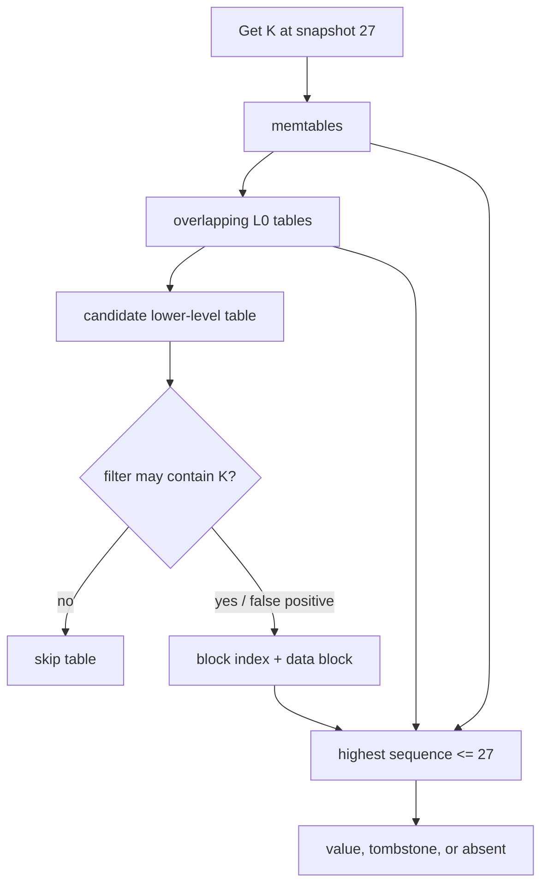

### Example 10 — one key, three snapshot answers

Candidate versions for `K` are tombstone `@30`, value `new@25`, and value `old@12`:

| Snapshot | Visible candidates | Selected result |
|---:|---|---|
| 20 | `old@12` | `old` |
| 27 | `new@25`, `old@12` | `new` |
| 30 | tombstone `@30`, both older values | absent |

The Java `newestVisible` scenario verifies all three results. It also models a Bloom negative as zero candidate probes. A real Bloom positive is only “maybe”: it can be a false positive and still require index/data-block work. A correctly built Bloom filter must not create false negatives for the key domain it covers.

For a range scan, the engine merges ordered iterators from participating structures, keeps the newest snapshot-visible version per key, and suppresses keys hidden by tombstones. If there are `r` runs, a heap-based merge is commonly described as `O(output_candidates log r)` CPU plus the blocks actually read; filters that help point absence do not erase the need to walk a requested range.

## Tombstones are promises that older values stay hidden

A delete writes a newer tombstone. Removing it too early can expose an older value in another table—a resurrection bug. Safe reclamation needs both visibility information and coverage information: no active snapshot may need the pre-delete version, and no older version capable of reappearing may remain outside the compaction's knowledge.

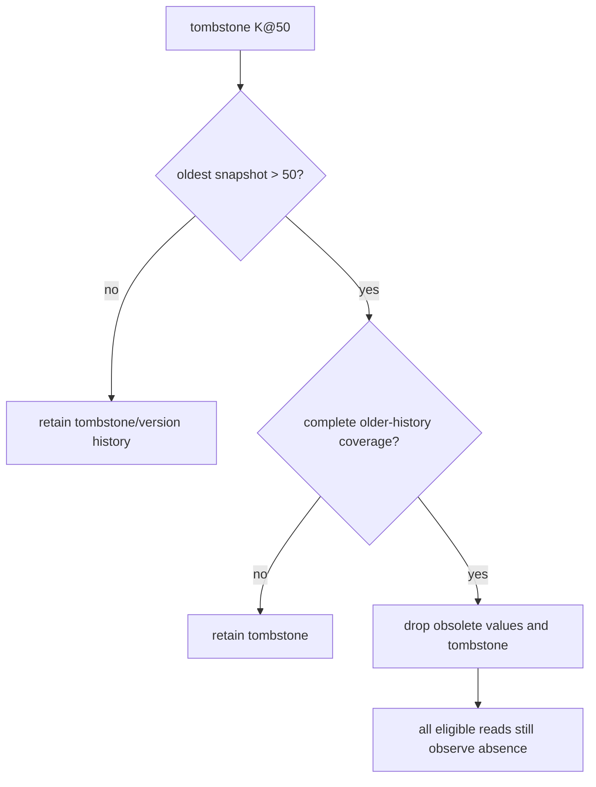

### Example 11 — both safety gates must pass

The executable teaching predicate accepts removal only when `tombstoneSequence < oldestSnapshotSequence` **and** the compaction covers all older history for that key:

| Tombstone | Oldest snapshot | Complete older-history coverage? | Decision |
|---:|---:|---|---|
| 50 | 40 | yes | keep; snapshot 40 may need the old value |
| 50 | 80 | no | keep; an older value might survive elsewhere |
| 50 | 80 | yes | safe in this deliberately complete model |

Real RocksDB compaction uses sequence numbers, snapshots, level placement, merge/range-deletion semantics, and file/version metadata rather than this one predicate. Distributed stores add repair and replica-retention constraints. An LSM tombstone is also not a certified secure-erasure mechanism; backups, logs, snapshots, replicas, and device behavior belong to a separate deletion policy.

## Compaction shapes the amplification trade

Leveled compaction aims for non-overlap in lower levels, usually reducing point-read candidates and steady-state space amplification at the cost of rewriting data as it moves through levels. Universal/tiered-style compaction keeps several sorted runs and merges selected runs, often reducing write amplification while increasing read candidates and temporary space. These are workload-dependent families, not universal rankings.

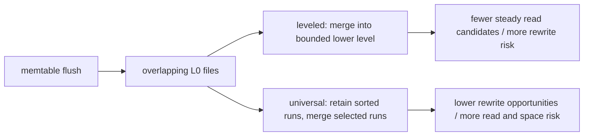

### Example 12 — define the accounting boundary before quoting a ratio

Suppose 100 MB of logical updates cause 100 MB of WAL writes, 100 MB of flush output, and 500 MB of compaction output:

\[
WA = \frac{100 + 100 + 500}{100} = 7
\]

If a lookup reads 64 KiB to return 8 KiB, byte-based read amplification is 8. That is not the same metric as “files probed per lookup.” The Java `amplification` scenario keeps these ratios separate and calculates required modeled disk occupancy:

\[
\text{headroom target} = \text{live} + \text{obsolete} + \text{compaction overlap}
\]

For `1000 + 120 + 300`, the result is 1420 units. This is an accounting example, not a promised RocksDB ratio or a complete capacity formula. State whether WAL, compression, replication, filesystem/device amplification, backups, and temporary outputs are included.

## Compaction debt becomes foreground backpressure

If flush or compaction bandwidth stays below incoming work, immutable memtables and L0 files accumulate. Reads face more candidates; background I/O competes with foreground work; eventually the engine delays or stops writes to protect memory and file-count bounds. More cache cannot repay insufficient compaction bandwidth.

| Signal | What it can reveal | Avoid this shortcut |
|---|---|---|
| pending compaction bytes / compaction score | queued rewrite work | one instant is not a trend |
| L0 file count | overlap and stall proximity | thresholds depend on configuration |
| write-stall count and duration | foreground impact | average write latency can hide stalls |
| flush/compaction read and write throughput | whether background work keeps pace | device bandwidth is shared with reads/WAL |
| block-cache and filter usefulness | avoided data-block reads | hit rate alone does not show tail latency |
| live, obsolete, and total SST bytes | space amplification and reclaim lag | filesystem free space may include other users |
| oldest snapshot/iterator age | why versions cannot be reclaimed | long scans can pin history intentionally |

Recovery planning must reserve space for the WAL and the published SST set, while compaction planning must additionally cover old inputs and new outputs until metadata publication makes inputs obsolete. If the disk fills, compaction may be unable to finish the very rewrite needed to reclaim space.

## Complexity, failure boundaries, and review

| Operation | Logical shape | Dominant physical risk |
|---|---|---|
| Write | WAL append + `O(log m)` memtable insert for a tree-backed memtable | sync policy and memtable contention |
| Point read | newest visible version across candidate structures | overlapping runs, cache misses, false-positive filters |
| Range read | ordered merge across `r` iterators | read amplification and obsolete versions |
| Flush | sort/encode mutable state into an immutable table | burst I/O and L0 growth |
| Compaction | merge selected inputs, rewrite surviving versions | write/space amplification and foreground interference |

Review questions:

- Which exact event makes a write acknowledged, recoverable, flushed, and visible in the current file version?
- Which sequence number defines the caller's snapshot?
- Can a filter skip the table, or does it only say “maybe”?
- Which older values might a tombstone still mask?
- Does the compaction input cover all relevant older history for the key?
- Which amplification numerator and denominator are being reported?
- How much temporary disk is required while old and new files coexist?
- Which queue, L0, throughput, stall, and snapshot-age signals show debt before outage?

### Primary references for Section 3

Accessed 2026-10-16.

12. [RocksDB overview](https://github.com/facebook/rocksdb/wiki): embedded LSM storage engine scope and RocksJava distinction.
13. [RocksDB Journal](https://github.com/facebook/rocksdb/wiki/Journal): WAL journals in-memory updates; MANIFEST journals on-disk state changes.
14. [RocksDB MemTable](https://github.com/facebook/rocksdb/wiki/MemTable): mutable/immutable memtables and flush triggers.
15. [RocksDB Compaction](https://github.com/facebook/rocksdb/wiki/Compaction): leveled/tiered trade-offs and workload-dependent write amplification.
16. [RocksDB Universal Compaction](https://github.com/facebook/rocksdb/wiki/Universal-Compaction): lower-write-amplification goal and read/space trade-offs.
17. [RocksDB Leveled Compaction](https://github.com/facebook/rocksdb/wiki/Leveled-Compaction): L0 overlap, lower-level organization, and compaction behavior.
18. [RocksDB Write Stalls](https://github.com/facebook/rocksdb/wiki/Write-Stalls): memtable, L0, and pending-compaction backpressure triggers.
19. [RocksDB Compaction Stats and DB Status](https://github.com/facebook/rocksdb/wiki/Compaction-Stats-and-DB-Status): bytes, amplification, stall, and per-level operational metrics.

# Section 4 — Row-oriented and column-oriented storage

Row and column layouts answer different access patterns. A row store keeps the attributes of one record near one another, which is useful when a request reads or changes most of one record. A column store keeps values of one attribute together, which lets an analytical scan read only selected columns, compress similar values, and process vectors of values. Neither layout is automatically faster: predicates, sort order, indexes, compression, partitioning, batch size, merge debt, and hardware still determine the physical work.

## Learning and requirements contract

After this section you should be able to:

1. estimate bytes requested by a full-row scan versus a selected-column scan without calling that estimate elapsed time;
2. trace a batch/vector aggregation over aligned columns and identify its null/type/overflow contracts;
3. explain immutable MergeTree parts, background merges, sparse primary-index marks, granules, and `ORDER BY` pruning;
4. distinguish a sorting key from a uniqueness constraint and a partition key from a primary index;
5. design an OLTP-to-OLAP path with a transactional outbox, stable event identity, per-aggregate versions, duplicate handling, gap detection, replay, and freshness reporting; and
6. keep order acceptance on the transactional system instead of treating an asynchronous analytical projection as the source of truth.

Write these requirements before choosing a layout:

| Question | Example requirement | Consequence |
|---|---|---|
| What is the unit of work? | fetch and update one order | row locality and transactional indexes are valuable |
| Which columns does the scan need? | `region_id`, `revenue_cents` from 10 million rows | column projection can avoid unrelated attributes |
| Which predicates dominate? | tenant plus event-day range | sort key should place useful pruning prefixes first |
| How fresh must analytics be? | dashboard may lag by 30 seconds | show a watermark; do not use it to confirm a just-written order |
| Can delivery repeat or reorder? | connector retry and partition failover | stable event IDs, versions, idempotent application, and replay |
| How are writes batched? | tens of thousands of facts per insert | fewer initial parts and less merge pressure |

## Example 13 — byte selection is a bound, not a benchmark

Assume 10,000,000 logical rows, an uncompressed modeled row width of 200 bytes, and a query that needs two 8-byte columns. The Java `scanEstimate` model calculates:

| Layout estimate | Arithmetic | Bytes |
|---|---:|---:|
| row-oriented input | `10,000,000 × 200` | 2,000,000,000 |
| selected columns | `10,000,000 × (8 + 8)` | 160,000,000 |
| modeled reduction | `2,000,000,000 / 160,000,000` | 12.5× |

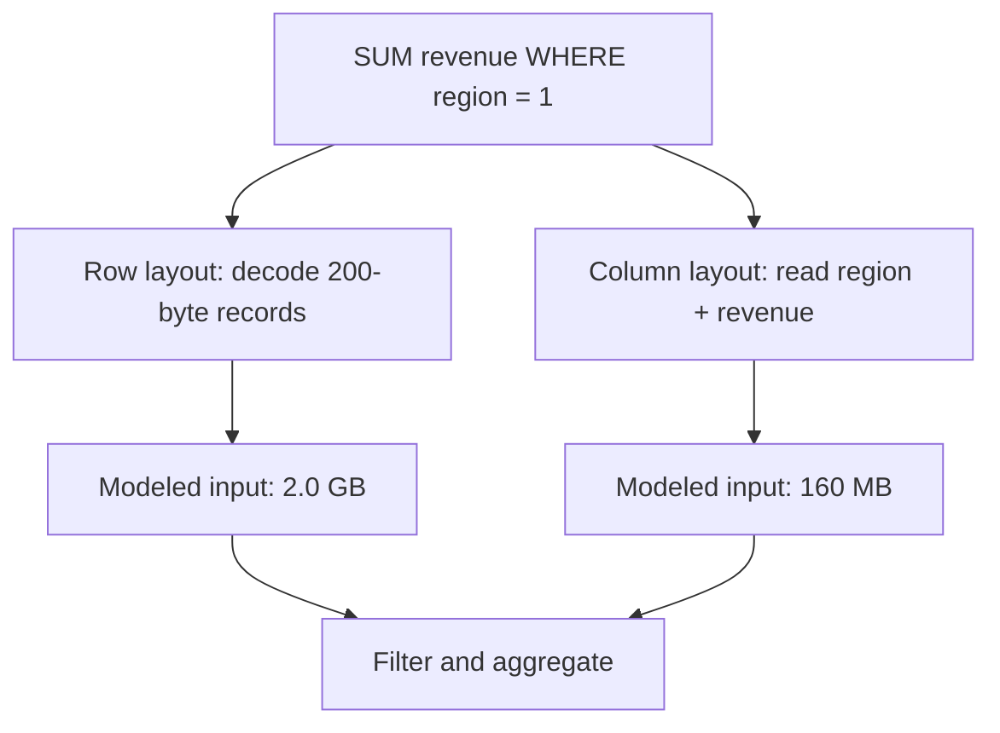

This is a logical input estimate. It deliberately excludes compression ratios, metadata, mark/index reads, caching, predicate selectivity, prefetching, decompression CPU, vectorization, parallelism, and storage bandwidth. Therefore **12.5× less selected input is not a claim of 12.5× lower latency**. Conversely, a point update may favor a row layout because all fields and transactional metadata for one record are already colocated instead of being spread across column files or rewritten immutable parts.

The model rejects zero/negative dimensions, integer overflow, and selected widths greater than the modeled row. Those checks matter: a capacity calculation that silently wraps is worse than no estimate.

## Example 14 — process aligned columns in bounded batches

The executable `sumRevenueForRegion` model receives aligned `regionIds` and `revenueCents` arrays. With regions `[1, 2, 1, 3, 1]`, revenues `[100, 200, 300, 400, 500]`, target `1`, and batch size `2`, it produces 900 cents across three batches.

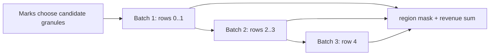

| Batch | Region vector | Revenue vector | Matching contribution | Running sum |
|---:|---|---|---:|---:|
| 1 | `[1, 2]` | `[100, 200]` | 100 | 100 |
| 2 | `[1, 3]` | `[300, 400]` | 300 | 400 |
| 3 | `[1]` | `[500]` | 500 | 900 |

The arrays are a teaching analogue for columnar batches, not an implementation of ClickHouse. Production engines use typed compressed streams, null maps, selection masks, specialized functions, multiple execution threads, and CPU-vector-friendly loops. Still, the model exposes real contracts: arrays must have equal row counts, batch size must be positive, and the sum must have a defined overflow policy. Java's `Math.addExact` makes overflow a failure instead of corrupting the aggregate.

## Example 15 — sparse marks prune granules, not individual rows

For the MergeTree family, each insert creates a sorted immutable data part. Background merges combine parts. Data is physically ordered by the sorting key; a sparse primary index stores marks for granules instead of one entry per row. A query uses key conditions to identify candidate granules, then reads those granules and applies the remaining predicate. The primary key is **not a uniqueness constraint**.

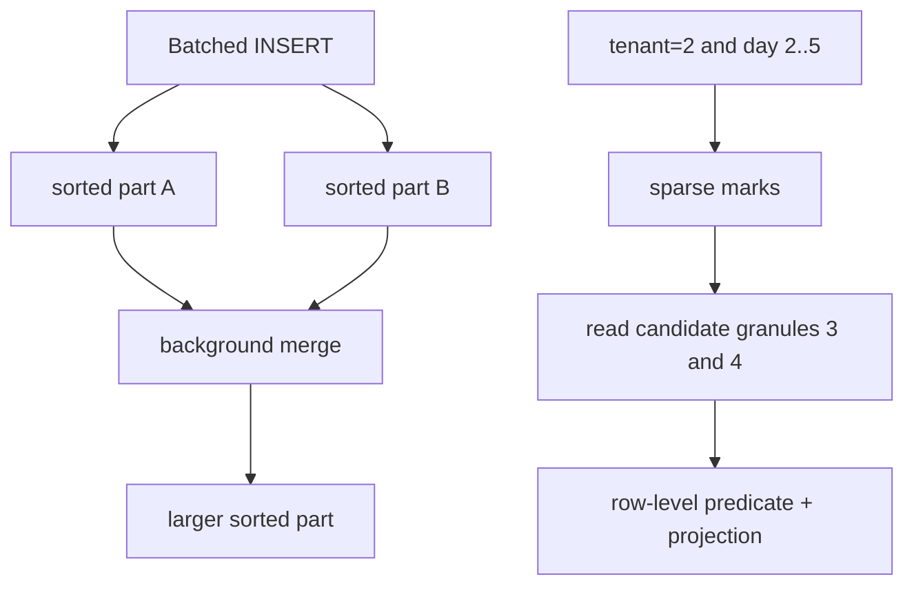

The Java scenario models six 8,192-row granules. Two can contain tenant 2 in day range 2–5, so the sparse filter selects granules 3 and 4: 16,384 candidate rows. It does **not** assert that every selected row matches or that all other engine-level skipping mechanisms have run.

| Granule | Tenant bounds | Day bounds | Candidate? | Reason |
|---:|---|---|---|---|
| 0 | 1..1 | 1..3 | no | tenant cannot match |
| 1 | 1..1 | 4..6 | no | tenant cannot match |
| 2 | 1..2 | 7..9 | no | day range cannot overlap |
| 3 | 2..2 | 1..3 | yes | both bounds may overlap |
| 4 | 2..2 | 4..6 | yes | both bounds may overlap |
| 5 | 3..3 | 1..9 | no | tenant cannot match |

Pruning quality depends on physical order. For frequent `tenant_id = ? AND event_day BETWEEN ? AND ?` queries, an `ORDER BY (tenant_id, event_day, event_id)` prefix can make tenant/day ranges adjacent. Reversing the first two fields changes which predicates form a useful contiguous range. Put high-cardinality IDs in `PARTITION BY` only with evidence; excessive partitions multiply parts and metadata. Wide and Compact are storage formats for parts selected by size/row thresholds, not row-store versus column-store product modes.

ClickHouse recommends batching inserts (at least 1,000 rows and ideally 10,000–100,000 in the cited guidance) because each insert otherwise creates a part and increases merge work. If client batching is impractical, asynchronous inserts can move batching to the server, but acknowledgement and retry settings still define the failure contract.

## Example 16 — an analytical projection is replayable, not authoritative

Use an OLTP transaction to change an order and insert its outbox event together. Logical decoding or a CDC connector publishes the committed outbox row. The analytical consumer applies events by stable `event_id` and per-order `version`. The dashboard reports its source watermark or lag; order confirmation reads the OLTP result, not the lagging projection.

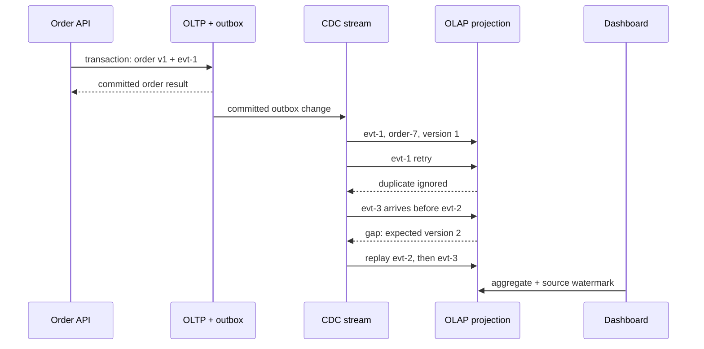

The Java `OrderProjection` proves this sequence:

| Delivery | Current version | Decision | Resulting version/value |
|---|---:|---|---|
| `evt-1`, v1, 1000 | 0 | apply | v1 / 1000 |
| same `evt-1` | 1 | duplicate | unchanged |
| `evt-3`, v3, 1200 | 1 | gap; expect v2 | unchanged |
| `evt-2`, v2, 1100 | 1 | apply | v2 / 1100 |
| retry `evt-3` | 2 | apply | v3 / 1200 |
| distinct old event, v2 | 3 | stale | unchanged |

The gap event is not recorded as consumed because it must be retried after replay. A stale event ID may be remembered to avoid repeated work. Production implementations need durable deduplication/version state, a dead-letter or quarantine policy, retained/reconstructable source history, alerting on gaps and lag, and a reconciliation job that compares source counts/sums or business invariants. If the projection cannot replay from a retained log or source snapshot, “eventual consistency” has no mechanism that guarantees eventual repair.

Debezium's outbox router uses the outbox `id` as an event identity suitable for duplicate removal and `aggregateid` as the message key, which is important for ordering within Kafka partitions. PostgreSQL logical decoding exposes committed row changes through replication slots; output plugins decode concurrent transactions in commit order and do not decode rolled-back transactions. Those facts do not make the entire end-to-end pipeline exactly once: connectors, brokers, consumers, and sinks still need explicit retry and idempotency behavior.

## Complexity, operations, and review

| Path | Useful model | Failure/latency risk |
|---|---|---|
| OLTP point read/write | indexed lookup plus transactional log work | lock/conflict retry, log sync, replica policy |
| column projection scan | selected compressed column chunks | decompression, bandwidth, weak pruning, skew |
| sparse-key pruning | index marks plus candidate granules | key order mismatch and granule over-read |
| insert | sort/encode one new immutable part | tiny batches create too many parts |
| merge | read input parts and write replacement part | disk/CPU pressure and temporary space |
| CDC projection | apply/reject by event ID and version | duplicates, gaps, lag, retention loss |

Operational signals should include parts per active partition, insert batch rows/bytes, merge backlog and throughput, bytes read after pruning, selected granules, compression ratio, query CPU and p95/p99 latency, CDC source position, consumer lag, oldest unprocessed event, gap/quarantine count, replay age, and reconciliation drift.

Review questions:

- Which fields does the query actually read, and what bytes are estimated before and after compression?
- Is the claimed speedup a byte estimate or a measured latency result?
- Does the sort-key prefix match equality and range predicates in order?
- How many granules remain after mark pruning, and how many rows are examined afterward?
- Are insert batches large enough to avoid part explosion, and can merges keep pace?
- Are event identity and aggregate ordering separate concepts?
- What happens to a duplicate, a stale version, and a forward version gap?
- Which source watermark tells a user how fresh the dashboard is?
- Which reconciliation process repairs a missed or poisoned event?
- Which user decisions must remain on the transactional source of truth?

### Primary references for Section 4

Accessed 2026-10-16.

20. [ClickHouse architecture overview](https://clickhouse.com/docs/development/architecture): column-oriented storage and vectorized/chunk-oriented execution.
21. [Understanding the ClickHouse primary index](https://clickhouse.com/docs/guides/best-practices/sparse-primary-indexes): physical sort order, sparse marks, granules, candidate-range pruning, and non-unique primary keys.
22. [MergeTree table engine](https://clickhouse.com/docs/engines/table-engines/mergetree-family/mergetree): sorted parts, marks, granule sizing, and Wide/Compact part formats.
23. [Selecting an insert strategy](https://clickhouse.com/docs/concepts/best-practices/selecting-an-insert-strategy): client/server batching, part creation, merge load, and acknowledgement trade-offs.
24. [ClickHouse data parts](https://clickhouse.com/docs/concepts/core-concepts/parts): immutable part creation and background merge mechanics.
25. [Debezium Outbox Event Router](https://debezium.io/documentation/reference/stable/transformations/outbox-event-router.html): event identity, aggregate key, payload routing, and duplicate-handling support.
26. [PostgreSQL logical decoding](https://www.postgresql.org/docs/current/logicaldecoding.html) and [output plugins](https://www.postgresql.org/docs/current/logicaldecoding-output-plugin.html): committed change streams, replication slots, transaction ordering, and rollback exclusion.

# Section 5 — Isolation: name the anomaly, snapshot, and repair

An isolation label is only the start of the contract. State which rows or predicates must remain stable, whether ordinary reads use a statement or transaction snapshot, which statements lock current index ranges, which conflicts can abort, and how the caller retries. The SQL-standard phenomenon table is a portable minimum; PostgreSQL and InnoDB deliberately implement stronger or different behavior in important cases.

## Learning and requirements contract

After this section you should be able to:

1. identify dirty reads, non-repeatable reads, phantoms, lost updates, and write skew from a two-transaction history;
2. distinguish a statement snapshot from a transaction snapshot and a snapshot read from a locking/current read;
3. explain why PostgreSQL Repeatable Read prevents phantoms yet can allow write skew, and why Serializable may abort a transaction;
4. explain why InnoDB Repeatable Read ordinary `SELECT` and locking DML can observe different effective states;
5. select an invariant repair: declarative constraint, atomic statement, version check, stable lock target, or Serializable retry; and
6. retry a complete transaction within a bound while keeping external effects idempotent and resolving unknown commit outcomes.

Write these requirements before choosing an isolation level:

| Question | Example requirement | Consequence |
|---|---|---|
| Which facts form the invariant? | at least one engineer remains on call | protecting only each engineer's own row is insufficient |
| Must a reread be stable? | one report uses one database snapshot | use a transaction snapshot or an explicitly exported snapshot |
| Must a predicate be stable for writes? | no new OPEN order may enter the selected range | use serializable validation or a locking design whose scanned index range is understood |
| May a conflict abort? | checkout may retry twice within 150 ms | retry the whole decision with jitter and a deadline |
| Can the operation be repeated? | payment operation ID is unique | store the operation result atomically; never replay an external effect blindly |
| How long may a snapshot live? | export finishes within five minutes | monitor oldest transaction age and vacuum/purge debt |

## Example 17 — classify the history before prescribing a level

“Possible” below means the standard-style minimum does not generally prohibit the phenomenon. It does not mean every engine or execution exhibits it. Write skew is a serialization anomaly across a predicate or invariant; it is not one of the original three phenomena used to summarize the weaker SQL levels.

| Isolation level: standard-style minimum | Dirty read | Non-repeatable read | Phantom | Write skew |
|---|---|---|---|---|
| Read Uncommitted | possible | possible | possible | possible |
| Read Committed | prevented | possible | possible | possible |
| Repeatable Read | prevented | prevented | possible | possible |
| Serializable | prevented | prevented | prevented | prevented among committed transactions |

Use a trace rather than a label:

| Phenomenon | Initial state | Interleaving | Broken assumption |
|---|---|---|---|
| dirty read | `price=10` | A writes 20; B reads 20; A rolls back | B treated uncommitted state as real |
| non-repeatable read | `price=10` | A reads 10; B commits 20; A rereads 20 | one row stayed stable across A's statements |
| phantom | two OPEN orders | A counts 2; B commits another OPEN order; A counts 3 | the predicate result stayed stable |
| lost update | `counter=10` | A and B read 10; each blindly writes 11 | both increments were preserved |
| write skew | Alice and Bob are on call | each sees two on call; each updates only self to off | stable snapshots preserved a cross-row invariant |

```mermaid
sequenceDiagram
    participant A as Transaction A
    participant D as Database
    participant B as Transaction B
    A->>D: SELECT price -> 10
    B->>D: UPDATE price=20; COMMIT
    A->>D: SELECT price
    D-->>A: RC -> 20; transaction snapshot -> 10
```

The Java `repeatReadAfterCommit` scenario makes only this visibility rule executable. Under a statement-snapshot policy it reads versions 1 then 2 and returns 10 then 20. Under a transaction-snapshot policy both reads use version 1 and return 10 then 10. It is a deterministic history model, not a substitute for an integration test against a selected engine and driver.

PostgreSQL maps Read Uncommitted to Read Committed. At Read Committed each command sees a snapshot as of that command's start. PostgreSQL Repeatable Read uses one transaction snapshot and does not allow phantom reads, which is stronger than the table's minimum, but serialization anomalies such as write skew can remain. PostgreSQL Serializable adds Serializable Snapshot Isolation monitoring and rejects dangerous histories so that only serializable transactions commit.

## Example 18 — stable snapshots do not protect a cross-row invariant

Suppose the rule is “at least one engineer is on call.” Alice and Bob each read the same snapshot containing `Alice=on, Bob=on`. Each changes a different row, so ordinary snapshot isolation finds no same-row write/write conflict. Both commits can leave zero engineers on call.

```mermaid
sequenceDiagram
    participant A as Alice transaction
    participant D as Snapshot database
    participant B as Bob transaction
    A->>D: read Alice=on, Bob=on
    B->>D: read Alice=on, Bob=on
    A->>D: set Alice=off; COMMIT
    B->>D: set Bob=off; COMMIT
    Note over A,B: different rows changed; invariant is false
```

The executable `concurrentOffCall(false)` trace commits both row changes and proves `onCallCount()==0`. With predicate-version validation enabled, Alice's commit changes the roster version, Bob's stale decision is rejected, and one engineer remains on call. This models the outcome of serializable conflict detection, not PostgreSQL's internal SSI graph.

Repair choices depend on the schema and workload:

- express the invariant as a database constraint when it can be represented and enforced atomically;
- route every decision through a roster guard row and lock it in a stable order;
- use Serializable for all participating reads and writes, then retry rejected transactions; or
- redesign the aggregate so the invariant is updated through one atomic record or command.

Locking only the row each transaction updates does not repair this history. Nor does a partial retry after the original reads: the decision must be recomputed from a new snapshot.

## Example 19 — InnoDB snapshot reads and current locking reads are different contracts

InnoDB Repeatable Read ordinary consistent reads use the snapshot established by the first such read. Locking reads, `UPDATE`, and `DELETE` instead operate with locking/current-read behavior. MySQL's own 8.4 manual cautions against mixing locking and nonlocking statements when the application expects one coherent view. Under Read Committed, each consistent read receives a fresh snapshot and ordinary gap locking is reduced, so phantoms may occur.

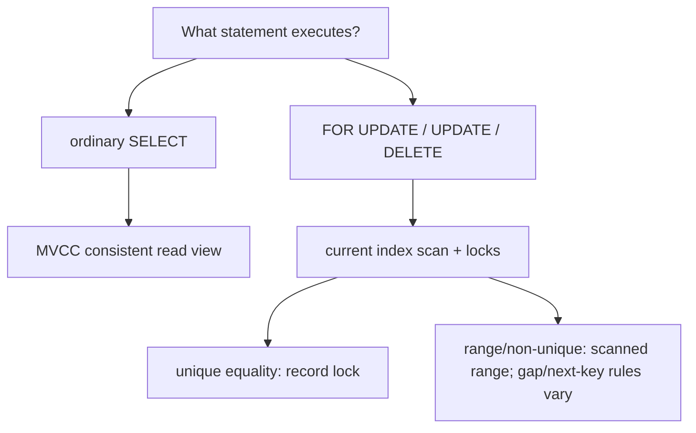

At InnoDB Repeatable Read, a suitable unique-index equality generally locks only the found index record. A range or non-unique search generally locks the scanned index range with gap or next-key locks. At Read Committed, InnoDB generally locks records rather than gaps except for foreign-key and duplicate-key checks. The actual plan therefore changes the lock footprint: without a useful index a locking statement can scan and lock far more records than the business predicate suggests.

Do not infer these details from JDBC's constants. `Connection.TRANSACTION_REPEATABLE_READ` describes portable phenomenon prohibitions, not PostgreSQL's stronger phantom behavior or InnoDB's statement-specific locking. Configure the connection before beginning work because JDBC declares changing isolation during a transaction implementation-defined:

```java
try (Connection connection = dataSource.getConnection()) {
    connection.setTransactionIsolation(Connection.TRANSACTION_SERIALIZABLE);
    connection.setAutoCommit(false);
    try {
        // Execute every read, validation, and write for one attempt here.
        connection.commit();
    } catch (SQLException failure) {
        connection.rollback();
        throw failure;
    }
}
```

An integration test should run the exact indexed predicate concurrently, capture SQLSTATEs and wait outcomes, and inspect the engine's lock/transaction diagnostics. A generic Java unit model cannot prove an engine's lock plan.

## Example 20 — prevent lost updates and retry the whole decision

Two clients that both read counter 10 and blindly assign 11 lose one increment. The Java `blindIncrement` trace makes that failure explicit. Prefer one atomic statement when the operation is commutative:

```sql
UPDATE counters SET value = value + 1 WHERE counter_id = :id;
```

For an optimistic edit, compare the version that was read:

```sql
UPDATE article
SET body = :body, version = version + 1
WHERE tenant_id = :tenant AND id = :id AND version = :expected;
-- 1 row: success. 0 rows: missing object or version conflict; reread before retry.
```

The executable `versionCheckedIncrement` trace lets the first writer move version 1 to 2 and rejects the second writer's expected version 1 rather than overwriting silently.

PostgreSQL documents SQLSTATE `40001` as a serialization failure and requires retrying the **complete transaction**, including the logic that selected SQL and values. More than one retry may be necessary, so production code needs an attempt bound, deadline, jittered backoff, metrics, and a non-retry path. The Java `incrementWithWholeTransactionRetry` scenario injects one concurrent increment: attempt 1 conflicts, attempt 2 rereads value 11, commits 12, and publishes one durable operation ID.

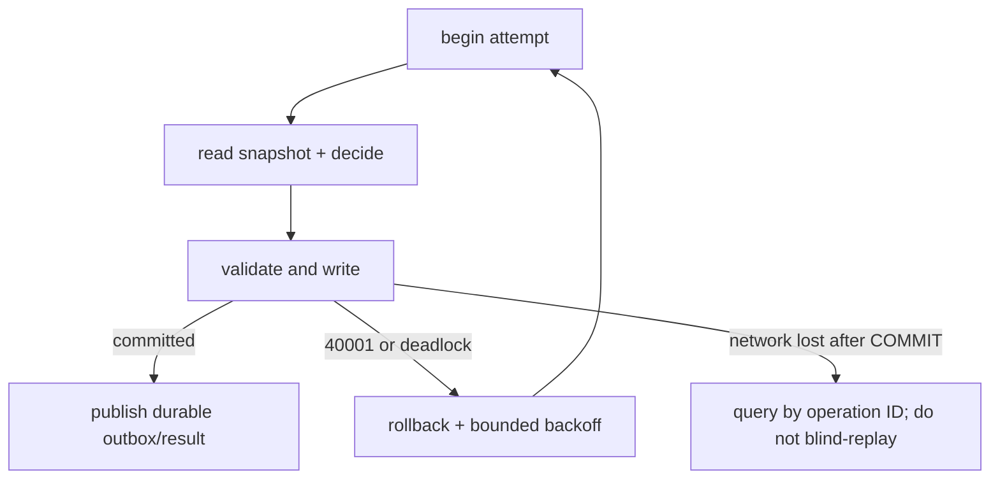

A deadlock victim or serialization failure says the attempt did not commit and may be retried when business effects are transactionally staged or idempotent. A network failure after `COMMIT` was sent is an **unknown outcome**: the server might have committed. Resolve it through a unique operation ID and stored result. Sending email, charging a card, or publishing directly inside a retriable body can duplicate the effect; write an outbox row in the transaction and dispatch it idempotently after commit.

## MVCC retention, operations, and review

Snapshot readers reduce reader/writer blocking, but old snapshots retain visibility requirements. PostgreSQL vacuum and InnoDB purge cannot reclaim every obsolete version while an eligible old transaction may still need it. A long export should not keep a broad transaction open across user interaction or network calls.

```mermaid
flowchart LR
    S["snapshot at version 100"] --> V["version 95 remains visible"]
    W["writer commits version 105"] --> N["new snapshots see 105"]
    V --> G["reclaim only after no required snapshot needs 95"]
```

Monitor oldest active transaction/snapshot age, dead tuples or undo history, vacuum/purge progress, serialization failures by operation, deadlocks, retry attempts, lock waits, transaction latency, and unknown-outcome resolutions. Correlate failures with the indexed statement and isolation level; an aggregate error rate alone does not reveal the dangerous history.

Review questions:

- Which exact history is disallowed: dirty read, reread change, phantom, lost update, or write skew?
- Is each read a statement snapshot, transaction snapshot, or locking/current read?
- Which rows or index ranges does the actual plan inspect and lock?
- Does the repair protect the invariant or only the row being updated?
- Is every read and decision rerun after a serialization failure?
- What attempt/deadline budget prevents retry storms?
- Which operation ID resolves an unknown commit result?
- Which external effects are staged transactionally or made idempotent?
- How old can a snapshot become before version retention threatens operations?

### Primary references for Section 5

Accessed 2026-10-16.

27. [PostgreSQL 18 transaction isolation](https://www.postgresql.org/docs/current/transaction-iso.html): standard phenomena, Read Committed command snapshots, Repeatable Read snapshot behavior, PostgreSQL's Read Uncommitted mapping, and Serializable conflict detection.
28. [PostgreSQL 18 serialization failure handling](https://www.postgresql.org/docs/current/mvcc-serialization-failure-handling.html): complete-transaction retry and the possibility of multiple attempts.
29. [PostgreSQL 18 application-level consistency](https://www.postgresql.org/docs/current/applevel-consistency.html): Serializable conflict monitoring and explicit-lock alternatives.
30. [MySQL 8.4 InnoDB transaction isolation levels](https://dev.mysql.com/doc/refman/8.4/en/innodb-transaction-isolation-levels.html): per-level snapshots, locking reads, gap behavior, and the warning about mixed read modes.
31. [MySQL 8.4 consistent nonlocking reads](https://dev.mysql.com/doc/refman/8.4/en/innodb-consistent-read.html): read views, Repeatable Read's first-read snapshot, Read Committed's fresh snapshots, and DML visibility caveats.
32. [MySQL 8.4 locks set by statements](https://dev.mysql.com/doc/refman/8.4/en/innodb-locks-set.html): unique equality, scanned ranges, missing-index effects, and next-key locks.
33. [Java SE 17 `Connection`](https://docs.oracle.com/en/java/javase/17/docs/api/java.sql/java/sql/Connection.html): auto-commit, commit/rollback boundaries, portable isolation constants, and isolation-configuration timing.

# Section 6 — Cache topology: local, distributed, and two-level

A cache topology is a placement and failure contract, not merely a latency choice. A JVM-local cache removes a network hop but creates one independent copy per process. A distributed cache shares values but adds routing, serialization, network tails, hot-key pressure, and failover behavior. An L1 + L2 design combines both and therefore has **two freshness boundaries** to bound and observe.

## Learning and requirements contract

After this section you should be able to:

1. choose local, distributed, or two-level caching from latency, capacity, failure, and freshness requirements;
2. separate maximum size, expiry, eviction, and admission instead of calling all four “LRU”;
3. quantify duplicated L1 memory and conditional L2/origin traffic before adding a tier;
4. explain why one JVM's loader, lock, or invalidation does not coordinate other JVMs;
5. handle missed or reordered invalidations, including flushing an untrusted local cache after a tracking connection is lost; and
6. design a cache key that preserves tenant, locale, schema, revision, and authorization boundaries.

Write the contract before selecting a product:

| Requirement | Example | Design consequence |
|---|---|---|
| Authority | PostgreSQL owns article version 6 | every cache copy is disposable and versioned |
| Freshness | ordinary article ≤30 s stale; permission revocation 0 s | TTL may cover the article; authorization is checked against current policy |
| Failure mode | Redis loss may increase latency, not corrupt results | bounded fallback and origin load shedding are mandatory |
| Capacity | 12 JVMs, 50,000 local entries each | local capacity is duplicated, not fleet-global |
| Key scope | tenant + article + locale + renderer version | a bare `articleId` is unsafe |
| Recovery | node may miss invalidations while disconnected | reconnect establishes a new trust boundary and flushes L1 |

| Topology | Placement and useful property | Dominant risk |
|---|---|---|
| Caffeine/Guava local | each JVM; no network or serialization on a hit | divergent nodes, duplicated heap, cold starts, GC pressure |
| Redis distributed | shared remote service with TTLs and atomic server commands | network tail, hot keys, memory pressure, failover semantics |
| Memcached distributed | client/proxy routes each key to an ephemeral server | node loss becomes misses/errors; servers do not synchronize or replicate |
| L1 local + L2 distributed | hot reads stop at the JVM; fleet shares the next tier | two invalidation races, two capacities, and ambiguous ownership if undocumented |

The focused examples below complement the repository's broader system-design caching chapter: they concentrate on JVM placement, admission, client tracking, and multi-tenant safety rather than repeating cache-aside strategy coverage.

## Example 21 — quantify topology before adding a tier

Assume 12 service instances, each allowing 50,000 L1 entries, one million L2 entries, and an estimated 1,024 bytes per serialized entry including key/value overhead for this planning model.

| Quantity | Calculation | Result |
|---|---:|---:|
| duplicated L1 bytes | `12 × 50,000 × 1,024` | 614,400,000 B ≈ 586 MiB |
| shared L2 bytes | `1,000,000 × 1,024` | 1,024,000,000 B ≈ 977 MiB |
| fleet entries represented by L1 | at most `12 × 50,000` physical copies | not necessarily 600,000 distinct keys |

For an arithmetic-mean teaching estimate, let the L1 hit rate be 90%, the conditional L2 hit rate after an L1 miss be 80%, and service times be 0.0001 ms, 1.2 ms, and 8 ms for L1, L2, and the authority:

`E = L1 + P(L1 miss) × [L2 + P(L2 miss | L1 miss) × authority]`

`E = 0.0001 + 0.10 × (1.2 + 0.20 × 8) = 0.2801 ms`

The executable `topologyEstimate` model in [ConsistencyContracts.java](ConsistencyContracts.java) checks those bytes and the conditional-probability formula. It is not a p99 prediction: correlated misses, retries, queueing, connection pools, payload size, failover, and hot-key skew dominate tails.

```mermaid
flowchart TD
    R["request on JVM A"] --> L1{"A's bounded L1"}
    L1 -->|hit| X["return versioned value"]
    L1 -->|miss| L2{"shared L2"}
    L2 -->|hit| F["fill A's L1"]
    L2 -->|miss| D["authoritative database"]
    D --> P["publish to L2, then L1 under version rules"]
    P --> X
    F --> X
```

Measure hit ratios **by tier and outcome**: L1 hit, L2 hit after L1 miss, authority fallback, timeout, rejected fallback, and stale/invalidated read. A 95% combined hit rate can still hide a useless L1 or an overloaded origin during synchronized expiry.

## Example 22 — admission is not eviction

Four different decisions are often collapsed into “LRU”:

- **capacity:** how much memory or how many weighted entries may be retained;
- **expiry:** when age makes an entry ineligible (`expireAfterWrite`, `expireAfterAccess`, or a per-entry policy);
- **eviction:** which resident becomes the victim when space is needed; and
- **admission:** whether the incoming candidate deserves to displace that victim.

Caffeine documents Window TinyLFU: a small admission window captures recency bursts, a frequency sketch estimates historic use, and a candidate competes for the main space. It is not a synchronized linked-list LRU. The following trace is deliberately a **simplified admission comparison**, not Caffeine's internal implementation:

| Candidate | Estimated frequency | Main victim | Victim frequency | Teaching decision |
|---|---:|---|---:|---|
| one-off scan key | 1 | hot profile | 8 | reject scan key; retain profile |
| popular article | 9 | warm profile | 8 | admit article; evict profile |

The Java `tinyLfuAdmissionModel` asserts both outcomes. A real sketch is approximate, ages history, and operates with window/main segments; tests should therefore evaluate the library with representative request traces rather than assert its private queue layout.

```mermaid
flowchart LR
    N["new candidate"] --> W["small recency window"]
    W --> C{"candidate estimate > victim estimate?"}
    C -->|yes| A["admit to main space"]
    C -->|no| R["reject candidate"]
    A --> E["evict selected resident"]
```

A Caffeine loading cache may coalesce compatible loads **inside one JVM**. It does not create a fleet-wide single-flight. Twelve cold JVMs may still issue twelve authority reads for the same key. Cross-process coordination needs a shared lease, request collapsing tier, prewarming plan, or an origin that safely absorbs the concurrency. Guava also supplies bounded/loading caches but separate JVM caches do not synchronize automatically; its maintenance and removal-listener timing must not be mistaken for a real-time coherence protocol.

## Example 23 — a two-level cache must distrust missed invalidations

Initial state: nodes A and B hold article version 5 in L1, and L2 also holds version 5. B commits version 6 to the authority. The application invalidates L2 and emits the L1 invalidation, but A's invalidation connection was lost.

| Step | Node A | Node B | L2 | Authority |
|---:|---|---|---|---|
| 1 | v5 | v5 | v5 | v5 |
| 2: A disconnects | v5, now untrusted | v5 | v5 | v5 |
| 3: commit v6 | v5, event missed | invalidates v5 | invalidated | v6 |
| 4: unsafe implementation | serves stale v5 | reloads v6 | may refill v6 | v6 |
| 5: safe reconnect | flush A; reload v6 | v6 | v6 | v6 |

```mermaid
sequenceDiagram
    participant A as JVM A L1
    participant R as Shared L2 / tracking
    participant B as Writer on JVM B
    participant D as Authority
    A->>R: read article -> v5; cache locally
    R--xA: invalidation connection lost
    B->>D: commit v6
    B->>R: replace/delete shared key
    R--xA: invalidation v5 missed
    Note over A: local v5 is no longer trustworthy
    A->>A: reconnect boundary: flush L1
    A->>R: miss and reload v6
```

Redis client-side caching calls this server-assisted mechanism **Tracking**. Default tracking remembers keys read by a client; broadcast mode trades server-side tracking memory for prefix invalidations. The Redis reference explicitly requires flushing the local cache when the invalidation connection is lost. With separate data and invalidation connections, an invalidation can also arrive before an older `GET` response; a “caching-in-progress” placeholder prevents that late response from repopulating the key. Same-connection RESP3 ordering avoids that particular two-connection race, but not every application-level DB/Redis race.

The Java `TwoLevelCache` scenario models the application boundary: A's ordinary read is rejected while invalidations are untrusted, `reconnectAndFlush` discards v5, and the next read loads v6. It does not pretend Redis queries the database; the application owns commit, L2 mutation, and repair ordering.

Use one explicit multi-node policy:

1. bounded local TTL with a stated staleness budget and bounded fill duration;
2. reliable invalidation delivery with per-node recovery/watermarks;
3. immutable revision keys plus a separately resolved current revision; or
4. no data cache for facts—such as current authorization revocations—that cannot tolerate stale reads.

A competing-consumer queue is not fan-out: if only one JVM receives each event, the other L1 copies remain stale. Pub/Sub-style delivery is a hint unless disconnect and replay semantics close that gap.

## Example 24 — key scope and authorization are correctness boundaries

Caching personalized HTML under `article:7` allows the first tenant, locale, renderer, or permission context to contaminate the next request. A safer logical key is:

`(tenantId, articleId, locale, rendererSchemaVersion, contentRevision or permissionEpoch)`

| Request difference | Unsafe result with `article:7` | Required treatment |
|---|---|---|
| tenant A vs tenant B | cross-tenant disclosure | tenant is mandatory in the key/namespace |
| `en-US` vs `fr-FR` | wrong language | locale is a key dimension |
| renderer v3 vs v4 | incompatible representation | version the key or invalidate the old schema |
| permission epoch 11 vs 12 | revoked user sees old personalized body | reauthorize each request or change the revision/epoch |

```mermaid
flowchart TD
    Q["incoming request"] --> A{"authorized now?"}
    A -->|no| D["deny; do not consult personalized value"]
    A -->|yes| K["build scoped key"]
    K --> C{"cache hit for exact scope?"}
    C -->|yes| S["serve versioned value"]
    C -->|no| O["load authority and publish safely"]
```

The Java `ScopedCacheKey` proves equal article IDs do not collide across tenants or permission epochs, and `mayServePersonalizedValue` refuses a cached value when current authorization fails. Prefer caching permission-independent article data and authorizing every request; putting a permission epoch in a key is useful only when that epoch itself is current and cannot be served from the stale object being protected.

## Distributed placement, failure, and operations

Memcached's official documentation makes the ownership boundary unusually clear: clients receive a server list, hash a key to a server, and decide what to do when that server is unreachable. Servers do not coordinate, broadcast, or replicate with each other. Losing a node therefore means errors or misses and origin reloads, not an automatic coherent failover. Client/proxy failover that remaps keys can cause a miss wave; it must not turn a disposable cache into a second authority.

For Redis or Memcached, monitor per-tier p50/p95/p99 latency, timeout/error rates, hit/miss/eviction/expiry counts, item and byte occupancy, hot keys, network bytes, connection-pool wait, backend-node distribution, failover/remap rate, origin fallback concurrency, loader coalescing, invalidation lag/disconnects, reconnect flushes, and value-version regressions. For JVM L1 add heap retained bytes, allocation/GC pressure, entry weight distribution, load success/failure time, and node-by-node hit-rate skew.

Review questions:

- Is L1 capacity stated per JVM, per pod, or for the whole fleet?
- Is L2 hit rate conditional on an L1 miss?
- Which tier owns expiry, admission, and version validation?
- Can an older fill arrive after invalidation and repopulate stale data?
- What exactly happens when the invalidation channel disconnects?
- Does every intended cache owner receive an event, or only one consumer?
- Are key routing and server membership consistent across clients?
- Which dimensions prevent tenant, locale, schema, and permission leakage?
- How much origin concurrency is allowed during cold start or node loss?
- Can the cache be deleted completely without losing committed business state?

### Primary references for Section 6

Accessed 2026-10-17.

34. [Caffeine efficiency](https://github.com/ben-manes/caffeine/wiki/Efficiency): Window TinyLFU's admission window, frequency sketch, recency/frequency trade-off, and comparison with plain LRU.
35. [Redis client-side caching reference](https://redis.io/docs/latest/develop/reference/client-side-caching/): tracking modes, invalidation delivery, separate-connection ordering race, reconnect flush, TTL, and client memory bounds.
36. [Redis client-side caching introduction](https://redis.io/docs/latest/develop/clients/client-side-caching/): supported-client behavior, disconnect flushing, suitable key workloads, and capacity estimation.
37. [Memcached documentation](https://docs.memcached.org/) and [FAQ](https://docs.memcached.org/userguide/faq/): client-side routing, disconnected servers, lack of replication, ephemeral failure semantics, and network round-trip costs.
38. [Guava cache guide](https://github.com/google/guava/wiki/cachesexplained): local cache population, size/time eviction, maintenance timing, and removal-listener behavior.

# Section 7 — Four read/write strategies: ownership, acknowledgement, and repair

Cache-aside, read-through, write-through, and write-behind are not interchangeable labels for “use a cache.” Each chooses who loads or writes, which component acknowledges success, and what must happen after a partial failure. The database remains authoritative in the first three strategies described here. Write-behind is safe only when a durable queue or log—not volatile cache memory—owns every acknowledged write until the database applies it.

## Learning and requirements contract

After this section you should be able to:

1. name the authority, acknowledgement boundary, freshness target, and repair owner for each strategy;
2. reproduce the cache-aside stale-resurrection race and reject an obsolete fill with a generation or version fence;
3. distinguish “not found” from “load failed” in a read-through API and limit same-key load coalescing to its actual scope;
4. handle database success followed by cache failure without claiming the entire write failed; and
5. design write-behind around durable enqueue-before-acknowledge, idempotent ordered replay, and explicit backpressure.

| Strategy | Read miss owner | Write/acknowledgement boundary | Required failure contract |
|---|---|---|---|
| Cache-aside | application reads authority, then attempts publication | database commit is durable; cache deletion/update is separate | obsolete fills cannot republish; cache failure degrades performance/freshness, not authority |
| Read-through | cache abstraction invokes a loader | normally same as the application's database write path | loader failure is not absence; coalescing scope and negative-cache policy are explicit |
| Write-through | miss still needs lazy/read-through loading | database commit, then cache mutation in this model | database success plus cache failure becomes “committed, repair pending” |
| Write-behind | cache usually serves the newly accepted value | durable queue/log append before success is returned | bounded queue, idempotent consumer, per-key order/version checks, lag and poison-message handling |

A useful review sentence is: **“This request is successful when ___ is durable; if the next step fails, ___ repairs it while reads follow ___.”** If those blanks are unclear, the strategy is incomplete.

## Example 25 — cache-aside can resurrect a value after deletion

Cache-aside usually reads `cache → database → cache` and writes `database commit → cache delete`. “Delete after commit” avoids invalidating for a transaction that later rolls back, but it does not close the race between a slow reader and a writer:

| Step | Reader | Writer | Cache | Authority |
|---:|---|---|---|---|
| 1 | misses and starts reading | — | empty | v5 |
| 2 | receives v5, pauses | commits v6 | empty | v6 |
| 3 | still paused | deletes key | empty | v6 |
| 4 | publishes its earlier result | — | **v5 resurrected** | v6 |

```mermaid
sequenceDiagram
    participant R as Reader
    participant C as Cache
    participant D as Authority
    participant W as Writer
    R->>C: GET key -> miss
    R->>D: read -> v5
    W->>D: commit v6
    W->>C: delete key
    R->>C: unsafe SET v5
    Note over C,D: cache regresses to v5 after invalidation
```

The executable `CacheAsideRace` reproduces that history, then repairs it with a per-key generation fence. A fill records the generation observed before loading and publishes only if the generation still matches and its version is not older than the authority:

```java
PendingFill fill = cache.beginMiss();       // captures v5, generation 0
cache.commitAndInvalidate(v6);              // authority v6, generation 1
boolean published = cache.publishIfCurrent(fill);
assert !published;                          // obsolete v5 cannot reappear
```

An immutable key such as `article:7:v6` also prevents v5 from overwriting v6, provided the separately resolved “current version” pointer is itself coherent. A compare-and-set, server-side script, or shared generation record can fence a distributed cache. A JVM-local counter does not coordinate other nodes. If generation metadata expires, is evicted, or resets to an old value, the same number can reappear—the ABA problem—so the fence must be monotonic and at least as durable as the race window it protects.

Delayed double-delete can reduce the probability that a slow fill survives, but the delay is a timing estimate, not a proof. TTL is also a bound from the **late insertion time**: if the stale fill lands 900 ms after the writer and receives a 30-second TTL, it may remain stale for almost another 30 seconds. Treat delete, expiry, and retry as repair tools unless a version/generation rule makes publication safe.

## Example 26 — read-through must represent value, absence, and failure separately

A read-through cache attaches the loader to the cache abstraction. Caffeine's population API can atomically compute an absent entry and offers synchronous and asynchronous loading caches. That removes duplicated loading code and can collapse compatible same-key work **inside that cache instance**; it does not turn twelve JVMs into one distributed single-flight.

```mermaid
flowchart TD
    Q["same-key requests in JVM A"] --> L{"local entry or in-flight load?"}
    L -->|present| V["return typed outcome"]
    L -->|absent| O["invoke one bounded loader"]
    O -->|value| P["cache value"]
    O -->|missing| N["optional short negative entry"]
    O -->|timeout/error| F["propagate failure; do not cache as missing"]
```

The loader result should be a sum type rather than a nullable value:

```java
enum LoadKind { VALUE, ABSENT, FAILURE }
record LoadOutcome(LoadKind kind, CacheValue value) {}
```

The Java `ReadThroughModel` sends a wave of 20 same-JVM callers through one modeled loader call. A value is cached; an explicit `ABSENT` may be negatively cached for a deliberately short policy; `FAILURE` is never converted to absence or retained. The next wave after a timeout therefore calls the loader again and may recover.

| Loader result | Client meaning | Cache action |
|---|---|---|
| `VALUE(v6)` | object exists | retain v6 under normal size/expiry policy |
| `ABSENT` | authoritative lookup completed and found no object | optionally retain a short negative entry if creation visibility permits it |
| `FAILURE(timeout)` | existence is unknown | surface/fallback according to policy; do not turn outage into a false 404 |

Bound the loader by timeout, origin concurrency, and caller deadline. Observe value, absence, failure, timeout, coalesced-waiter count, and load duration separately. Cross-JVM stampede control needs a shared lease/coordinator or an authority designed for the aggregate concurrency; a local `CacheLoader` is not that coordinator.

## Example 27 — write-through has a committed-but-not-cached outcome

In this guide, write-through means `commit authority → update or invalidate cache`. The order preserves the database as authority. It also creates an unavoidable partial-failure state because an ordinary SQL transaction and a remote cache command do not share one atomic commit:

| Step | Result |
|---:|---|
| 1 | operation `op-article-6` commits v6 in the database |
| 2 | cache write times out; its outcome may itself be unknown |
| 3 | old cache still contains v5 |
| 4 | service records a durable repair task and marks the key's coherence degraded |
| 5 | reads for that key route to the authority until idempotent repair installs v6 |

```mermaid
flowchart TD
    W["write with operation ID"] --> D{"database commit"}
    D -->|failed| X["rollback / report not committed"]
    D -->|succeeded| C{"cache mutation"}
    C -->|succeeded| S["committed and cached"]
    C -->|failed or unknown| R["durable repair + degraded key"]
    R --> A["read authority until repair catches up"]
```

The executable `WriteThroughStore` returns `COMMITTED_REPAIR_QUEUED`, not a generic error implying “nothing happened.” It preserves the operation ID and desired version in a repair outbox, routes reads to the authority while the key is degraded, and makes replay idempotent:

```java
WriteThroughStatus status = store.write(
    "op-article-6", "article:7", v6, true); // inject cache failure
assert status == COMMITTED_REPAIR_QUEUED;
assert store.read("article:7").version() == 6;
store.replayRepair("op-article-6");
store.replayRepair("op-article-6");          // duplicate is harmless
```

A transactional outbox written in the same database transaction as the business change is a common durable hand-off. Debezium's outbox event router documents a unique event ID for duplicate removal and uses the aggregate ID as the message key, which is important for partition ordering. Cache repair consumers should still compare versions because delivery can be duplicated, delayed, or reordered around deployment and recovery.

Do not blindly retry the whole client operation after an unknown response: the database may already contain v6. Query by operation ID or return a status endpoint. Also do not promise “cache is never stale” merely because the happy-path diagram has two arrows; that promise requires a defined partial-failure and read-routing contract.

## Example 28 — write-behind begins with a durable queue, not a dirty map

Write-behind acknowledges before the database applies the mutation. Therefore the acknowledged write must first survive process and cache-node loss. A volatile map plus a background thread is data loss with a delay; the safe boundary is a replicated durable queue/log or an equivalent persistent journal.

```mermaid
flowchart TD
    Q["write op ID + key version"] --> B{"durable queue has capacity?"}
    B -->|no| R["reject / backpressure; do not acknowledge"]
    B -->|yes| A["append durably, expose value, acknowledge"]
    A --> P["partitioned per-key worker"]
    P --> I{"duplicate or next version?"}
    I -->|duplicate| K["skip idempotently"]
    I -->|next| D["apply database transaction"]
    I -->|gap| G["pause key and repair/replay"]
```

The `WriteBehindStore` uses a bounded durable-queue model. It acknowledges only after enqueue, exposes the newest accepted version in the cache, rejects when capacity is full, deduplicates by operation ID, and requires the next per-key version at replay. Its trace accepts versions 1 and 2 plus a duplicate retry, rejects a fourth request while the queue is full, applies 1 then 2, skips the duplicate, and detects a later version-4 gap rather than silently jumping over version 3.

| Queue condition | Correct behavior | Incorrect shortcut |
|---|---|---|
| full or unavailable | block within a deadline or reject before acknowledgement | accept into process memory and hope |
| duplicate operation ID | return prior result or skip replay | apply mutation twice |
| version gap/out-of-order key | pause that key, replay/repair, alert | overwrite the authority with whichever arrived last |
| poison record | bounded retries, quarantine, preserve visibility | spin forever and block the whole partition invisibly |
| lag above freshness/SLO bound | shed writes, increase workers safely, or degrade feature | let an unbounded backlog become recovery time |

Kafka's producer configuration documents idempotent writes and ordering constraints for retries. Those producer guarantees do not make a database consumer idempotent: the worker still needs an operation-ID uniqueness rule or version-checked database mutation. Coalescing several queued assignments into the latest value is valid only when intermediate states are semantically disposable; increments, inventory reservations, audit transitions, and notifications usually are not.

## Strategy selection, operations, and review

Choose from the contract, not the shortest diagram:

- Use cache-aside when selective population and simple ownership matter and bounded staleness is acceptable, but fence publication when an obsolete fill can violate the freshness requirement.
- Use read-through when central loader behavior and typed miss/failure handling improve consistency, while documenting whether coalescing is local or distributed.
- Use write-through when a hotter post-write cache justifies extra write latency, and make “database committed, cache repair pending” a first-class outcome.
- Use write-behind only when lower foreground latency or write coalescing justifies durable-queue operations, replay semantics, and the period in which the cache/log is ahead of the database.

Monitor by state transition: stale-publication rejections, generation/version regressions, loader calls and coalesced waiters, negative-cache hits, load failures by cause, database-commit/cache-failure outcomes, repair backlog age, degraded-key reads, durable-queue depth/bytes/oldest age, enqueue rejections, replay duplicates, version gaps, poison records, per-key lag, and database apply latency.

Review questions:

- What exact component is authoritative before and after acknowledgement?
- Can a late fill publish an older value after an invalidation?
- Does “not found” mean a completed authoritative lookup or a swallowed timeout?
- Is same-key coalescing per thread, JVM, cache cluster, or fleet?
- How does the caller learn that the database committed but the cache did not?
- Where is repair intent durable, and what makes replay idempotent?
- Does write-behind preserve per-key order and detect missing versions?
- What happens before acknowledgement when the queue is full?
- Is coalescing legal for this business mutation, or are intermediate states meaningful?
- Which metrics prove the cache can still be deleted or rebuilt without losing acknowledged business data?

### Primary references for Section 7

Accessed 2026-10-17.

39. [AWS Database Caching Strategies Using Redis — caching patterns](https://docs.aws.amazon.com/whitepapers/latest/database-caching-strategies-using-redis/caching-patterns.html): cache-aside retrieval order, database-first write-through population, combined lazy loading, and expiry guidance.
40. [Amazon ElastiCache caching strategies](https://docs.aws.amazon.com/AmazonElastiCache/latest/dg/Strategies.html): lazy-loading miss steps, write-through steps and costs, empty-node behavior, and TTL limits.
41. [Caffeine population](https://github.com/ben-manes/caffeine/wiki/Population): atomic compute-if-absent, synchronous/asynchronous loading caches, computation failure behavior, and bulk-loading APIs.
42. [Debezium outbox event router](https://debezium.io/documentation/reference/transformations/outbox-event-router.html): durable outbox capture, event IDs for deduplication, aggregate keys, and ordering relevance.
43. [Apache Kafka 4.0 producer configuration](https://kafka.apache.org/40/configuration/producer-configs/): idempotent producer requirements, retry duplication risk, and ordering constraints for in-flight requests.

# Section 8 — Eviction internals: LRU, LFU, FIFO, and full 2Q

Expiration, eviction, and admission answer different questions. **Expiration** decides whether an entry is still eligible to serve. **Eviction** chooses a resident victim when the cache must free capacity. **Admission** decides whether a candidate deserves that space at all. A cache may expire entries without memory pressure, evict unexpired entries under pressure, and reject a candidate without ever making it resident.

## Learning and requirements contract

After this section you should be able to:

1. derive the exact victim and metadata mutation for LRU, LFU, FIFO, and full 2Q traces;
2. explain why an exact access-order LRU makes every hit a write to recency metadata;
3. apply an LFU tie-break and aging rule so old popularity does not become permanent;
4. distinguish FIFO's low hit-path churn from recency-aware eviction;
5. identify `A1in`, `A1out`, and `Am` in full 2Q and explain why the ghost queue holds keys but no values; and
6. compare a textbook model with Redis and Memcached implementations without promising an exact production eviction order.

Write the capacity contract before choosing a policy:

| Requirement | Example | Consequence |
|---|---|---|
| capacity unit | 100,000 entries or 512 MiB weighted | an entry-count model can exceed a byte budget when values vary |
| candidate set | all keys or only expiring keys | Redis `allkeys-*` and `volatile-*` policies protect different populations |
| hit metadata | synchronous move, counter increment, or no change | affects locks, CPU, and contention on a hot cache |
| tie-break | oldest access among equal frequencies | makes LFU victim selection deterministic |
| history aging | halve counters every epoch | lets a formerly hot key eventually leave |
| scan resistance | retain reused pages through a one-pass scan | may justify admission filtering or 2Q history |
| observability | evictions by reason/policy/size class | a hit ratio alone cannot reveal policy failure |

The Java models below are deterministic teaching implementations. They prove trace semantics, not production scalability: their LFU model scans residents to select a victim, while a production exact `O(1)` LFU can maintain a key map, frequency buckets with recency lists, and a minimum-frequency pointer.

## Example 29 — exact LRU: a hit mutates recency

Canonical exact LRU combines a key-to-node hash map with a doubly linked list ordered from least to most recently used. A hit locates the node in expected `O(1)`, unlinks it, and moves it to the most-recent end. Insertion into a full cache removes the least-recent end.

Capacity 3, trace `A, B, C, A, D`:

| Request | LRU → MRU after request | Event |
|---|---|---|
| `A` | `A` | insert |
| `B` | `A, B` | insert |
| `C` | `A, B, C` | insert; cache full |
| `A` | `B, C, A` | hit moves A to MRU |
| `D` | `C, A, D` | evict B, then insert D |

```mermaid
flowchart TD
    G["GET A"] --> H["hash map finds A"]
    H --> U["unlink A from recency list"]
    U --> M["append A at MRU end"]
    D["insert D at capacity"] --> E["remove LRU node B"]
    E --> N["append D at MRU end"]
```

The executable `ExactLruCache` uses Java 17 `LinkedHashMap` in access-order mode:

```java
ExactLruCache cache = new ExactLruCache(3);
cache.put("A", 1); cache.put("B", 2); cache.put("C", 3);
cache.get("A");
assert cache.put("D", 4).equals("B");
assert cache.orderLeastToMostRecent().equals(List.of("C", "A", "D"));
```

Java documents that access-order `LinkedHashMap` iteration runs from least- to most-recent access and that `get` changes access order. That convenience is not a concurrency guarantee: the class is unsynchronized, and in access-order mode even a `get` is a structural modification. A synchronized wrapper can protect correctness but may serialize hot hits; production libraries therefore use buffering, striping, sampling, or approximate policies to reduce metadata contention.

Pure LRU also confuses “recent once” with “likely reusable.” A scan longer than capacity can evict a stable working set because every scanned key becomes the newest resident. Section 6's admission discussion and Example 32's ghost history address that different problem; expiry alone does not.

## Example 30 — LFU needs a deterministic tie-break and aging

LFU retains keys with the highest observed frequency. One exact `O(1)` design keeps a map from key to node, one recency list per frequency, and a pointer to the minimum non-empty frequency. A hit moves a node from bucket `f` to `f + 1`; eviction chooses the oldest node in the minimum-frequency bucket.

Capacity 3, starting with `A`, `B`, and `C` at frequency 1:

| Action | Frequencies after action | Result |
|---|---|---|
| hit A twice | A=3, B=1, C=1 | A becomes established hot data |
| hit B once | A=3, B=2, C=1 | C is the unique minimum |
| insert D | A=3, B=2, D=1 | evict C |
| decay with `max(1, ceil(f/2))` | A=2, B=1, D=1 | historic counts lose dominance |
| hit D; insert E | A=2, D=2, E=1 | evict B, the remaining minimum |

```mermaid
flowchart TD
    K["hit key in bucket f"] --> R["remove from bucket f"]
    R --> A["append to bucket f + 1"]
    E["eviction required"] --> F["choose minimum-frequency bucket"]
    F --> T["evict oldest tied entry"]
    X["aging epoch"] --> D["decay or halve counters"]
```

The executable `ExactLfuModel` checks that trace, including the recency tie-break and explicit counter decay. Its victim scan is intentionally simple and `O(n)` so the invariant is visible. The bucketed production form avoids that scan but pays for more linked metadata and a mutation on every hit.

Without decay or saturation, yesterday's viral key can remain resident long after demand disappears. The aging interval is therefore part of the policy: too fast approximates recency; too slow preserves stale popularity. Counters also need overflow handling. Measure frequency distribution, victim frequency, counter-decay work, and hit rate after workload phase changes rather than selecting LFU from its name.

Redis does not maintain this textbook structure. Its documentation describes approximate LRU based on sampled candidates and compact LFU accounting with decay. The exact key removed is probabilistic, and increasing the sample count exchanges more CPU for closer approximation. Test the configured product with representative traces and memory pressure.

## Example 31 — FIFO: hits avoid recency churn but cannot protect reuse

FIFO keeps insertion order in a queue plus a lookup map. A hit returns the value without changing queue position. The same capacity-3 trace therefore differs from LRU:

| Request | oldest → newest | Event |
|---|---|---|
| `A` | `A` | insert |
| `B` | `A, B` | insert |
| `C` | `A, B, C` | insert; cache full |
| `A` | `A, B, C` | hit; position unchanged |
| `D` | `B, C, D` | evict A despite its recent hit |

```mermaid
flowchart TD
    N["new key"] --> Q["append queue tail"]
    Q --> C{"over capacity?"}
    C -->|yes| H["evict queue head"]
    C -->|no| V["retain residents"]
    G["hit existing key"] --> R["return value; no queue mutation"]
```

The Java `FifoCache` asserts that A remains the oldest after its hit and is the victim when D arrives. FIFO's advantage is predictable, low hit-path metadata churn. Its disadvantage is equally direct: a frequently reused old entry receives no protection. FIFO can still be valuable as a probationary queue—full 2Q uses this property for first-touch entries—even when it is a poor whole-cache policy.

Insertion-order does not mean “oldest value” or “closest to expiry.” Updating an existing mapping in this model preserves its original position. If the business meaning of an update should reset residency, that is a separate documented rule. Likewise, expired-entry reclamation should run before or alongside pressure eviction; otherwise the cache may evict a live FIFO head while unreachable expired objects consume memory elsewhere.

## Example 32 — full 2Q uses a ghost history to resist scans

Full 2Q separates first touches from demonstrated reuse with three bounded structures:

| Structure | Resident value? | Order | Purpose |
|---|---:|---|---|
| `A1in` | yes | FIFO | probation for first-touch pages |
| `A1out` | **no**—identifier only | FIFO ghost history | recognize a second request after probationary eviction |
| `Am` | yes | LRU | protect established reusable pages |

The executable `FullTwoQueueModel` uses `A1in=2`, `Am=2`, and `A1out=3`. Its trace is `A, B, C, A, D, E, F, G`:

| Request | `A1in` | `A1out` ghosts | `Am` | Explanation |
|---|---|---|---|---|
| A, B | A, B | — | — | first touches enter probation |
| C | B, C | A | — | A's value leaves; identifier remains |
| A | B, C | — | A | ghost hit reloads A into established LRU |
| D, E, F, G | F, G | C, D, E | A | one-pass scan churns probation, not A |

```mermaid
flowchart TD
    R["request key"] --> W{"where is it?"}
    W -->|Am| M["return and move to MRU"]
    W -->|A1in| I["return; keep FIFO position"]
    W -->|A1out ghost| P["reload and promote to Am"]
    W -->|new| N["load into A1in"]
    N --> E["probation eviction keeps bounded ghost ID"]
```

For comparison, exact LRU with total capacity 4 loses A under the same one-pass suffix `D, E, F, G`; 2Q retains A because A demonstrated reuse through a ghost hit. This is the mechanism behind scan resistance, not a magical second chance on every resident hit. A hit while a value is still in `A1in` preserves FIFO position in the full policy used here. Simplified “two-queue” variants that promote on a second resident hit are useful but should not be labeled as the exact full-2Q transition.

Ghost entries save value bytes, not all memory: keys, hashes, links, and allocator overhead remain. `A1in`, `A1out`, and `Am` therefore each need bounds. Fixed partitions can also underperform when the workload mix changes, so replay representative traces and measure resident hit rate, ghost-hit rate, promotion rate, probation churn, ghost metadata bytes, and established-queue evictions.

The original 2Q paper describes constant per-access overhead and evaluates scan-resistant behavior against LRU/2-style history. A production cache may instead use segmented LRU, TinyLFU admission, CLOCK variants, or sampling. Memcached, for example, documents HOT/WARM/COLD segments, asynchronous bumps, a maintainer thread, and tail reclamation by slab class—not a single textbook global LRU. Redis similarly samples candidates for approximate LRU. Product names must not substitute for deployed-policy documentation.

## Production selection, complexity, and review

| Policy | Lookup | Hit metadata | Victim choice | Characteristic failure |
|---|---:|---|---|---|
| exact LRU | expected `O(1)` | move list node | LRU tail in `O(1)` | sequential scan pollutes recency |
| exact bucketed LFU | expected `O(1)` | move frequency bucket | oldest in min-frequency bucket | stale popularity without aging |
| FIFO | expected `O(1)` | none | queue head in `O(1)` | evicts old but actively reused entries |
| full 2Q | expected `O(1)` | queue-specific move or none | bounded probation/established tails | partition and ghost-metadata sensitivity |

This table assumes entry-count capacity and hash/list operations. Byte-weighted values require weight accounting and may need several victims for one large candidate. Serialization size, object overhead, allocator fragmentation, per-shard/slab limits, and pinned entries can make “capacity 1,000” misleading. The policy also cannot repair an unsafe cache key or stale-publication race from earlier sections.

Review questions:

- Is the capacity by entries, bytes, weight, tenant, shard, or slab class?
- Are expired entries reclaimed before live entries are evicted?
- Does a hit synchronously mutate shared metadata?
- What deterministic tie-break applies when LFU frequencies match?
- How and when are frequency counters aged, saturated, or reset?
- Can a one-pass scan displace the working set?
- Does the implementation use exact order, sampling, segments, or admission filtering?
- In 2Q, are `A1out` entries ghosts only, and are all three queues bounded?
- Does a resident `A1in` hit preserve FIFO order, or is this a documented variant?
- Which trace suite and metrics demonstrate that the chosen policy beats a simpler baseline?

### Primary references for Section 8

Accessed 2026-10-17.

44. [Redis key eviction](https://redis.io/docs/latest/develop/reference/eviction/): memory-limit enforcement, policy populations, sampled approximate LRU, tunable sample count, and LFU policy behavior.
45. [Java SE 17 `LinkedHashMap`](https://docs.oracle.com/en/java/javase/17/docs/api/java.base/java/util/LinkedHashMap.html): access-order semantics, `removeEldestEntry`, expected basic-operation cost, structural access mutations, and synchronization requirements.
46. [Johnson and Shasha, “2Q: A Low Overhead High Performance Buffer Management Replacement Algorithm”](https://www.vldb.org/conf/1994/P439.PDF), VLDB 1994: original full-2Q motivation, queue/history design, constant-overhead goal, and trace evaluation.
47. [Memcached modern LRU](https://memcached.org/blog/modern-lru/): HOT/WARM/COLD/TEMP segments, asynchronous bumps, maintainer behavior, overload trade-offs, and live tuning.
48. [Memcached performance and memory guide](https://docs.memcached.org/serverguide/performance/): slab-class allocation, expiration reclamation, memory overhead, and tail eviction under pressure.

# Section 9 — Cache stampede: coordinate fills, bound fallback

A cache stampede is not simply “many misses.” It is a synchronized state transition in which many callers discover the same absent or expired key before any one refill becomes visible. If the origin service is already near its concurrency limit, adding a cache can make the expiry boundary more dangerous than running without one.

## Learning and requirements contract

After this section you should be able to:

1. estimate the number of duplicate loads released by one hot-key expiry;
2. implement per-key single-flight without running a slow loader inside `ConcurrentHashMap.computeIfAbsent`;
3. explain what a Redis fill lease suppresses across processes—and what lease expiry or asynchronous failover can still violate;
4. use an owner token and conditional publish/release so a paused former holder cannot overwrite or delete a successor's lease;
5. bound waiter time and database concurrency, then choose an explicit stale, fallback, or rejection outcome; and
6. distinguish duplicate-work suppression from business-operation mutual exclusion.

Write these requirements before implementation:

| Requirement | Example contract | Failure if omitted |
|---|---|---|
| coordination scope | same key inside one JVM, then optionally across the fleet | local coalescing is mistaken for global protection |
| wait bound | wait at most 80 ms, then choose a typed fallback | request threads accumulate behind a stuck leader |
| origin budget | at most 40 concurrent database fallbacks per instance | all timed-out waiters bypass the lease together |
| stale policy | serve at most 30 s stale for catalog reads, never for balances | “serve stale” becomes unbounded correctness drift |
| lease ownership | unique token, TTL, conditional publish and release | an expired holder deletes or overwrites a successor |
| overload result | explicit `503`/retryable result when no safe fallback exists | hidden retries amplify the incident |

TTL jitter and refresh-ahead reduce synchronized transitions, but neither proves that only one loader runs. Single-flight and leases reduce duplicate work; database permits and overload rejection protect the origin when coordination is unavailable.

## Example 33 — quantify the expiry burst before choosing a lock

Suppose one key receives 8,000 requests/s and its database load takes 150 ms. During a naive miss window, the expected concurrency released toward the database is approximately:

\[
8{,}000\;\text{requests/s} \times 0.150\;\text{s} = 1{,}200\;\text{loads}
\]

That is 180,000 ms of aggregate database work initiated inside one 150 ms wall-clock interval. The estimate is a concurrency bound, not a prediction of exact completed queries: connection pools, admission controls, network delay, and request cancellation change the observed count.

| Input | Value |
|---|---:|
| hot-key rate | 8,000 requests/s |
| origin latency | 150 ms |
| naive overlapping loads | 1,200 |
| desired fleet loaders | usually near 1 per key, plus explicitly bounded fallbacks |

```java
StampedeEstimate burst = naiveExpiryBurst(8_000, 150);
assert burst.concurrentLoads() == 1_200;
assert burst.aggregateDatabaseMillis() == 180_000;
```

```mermaid
flowchart TD
    E["hot key expires"] --> M["1,200 overlapping misses"]
    M --> U{"coordination and admission?"}
    U -->|none| D["origin saturation and rising latency"]
    U -->|bounded| L["one leader plus finite waiters"]
    L --> P["publish once; waiters reread"]
```

Measure hot-key request rate, origin latency distribution, loads started per cache miss, coalesced waiter count, and pool saturation. A cache-hit ratio can remain excellent while one synchronized key causes the outage.

## Example 34 — local single-flight shares one outcome, including failure

Inside one JVM, keep a map from key to an in-progress future. The first caller installs a placeholder and becomes leader; later callers receive the same future. The leader performs the database call outside the map mutation, completes the future, and conditionally removes exactly that future.

```java
LocalSingleFlight<String, String> flights = new LocalSingleFlight<>();
Flight<String> leader = flights.begin("article:7");
Flight<String> waiterA = flights.begin("article:7");
Flight<String> waiterB = flights.begin("article:7");

assert leader.leader();
assert leader.future() == waiterA.future();
assert waiterA.future() == waiterB.future();
flights.succeed("article:7", leader, "value-v6");
assert waiterA.future().join().equals("value-v6");
```

```mermaid
sequenceDiagram
    participant A as Caller A
    participant F as flight map
    participant B as Caller B
    participant DB as Database
    A->>F: install future for key
    F-->>A: leader
    B->>F: request same key
    F-->>B: existing future
    A->>DB: one load outside map mutation
    DB-->>A: value or failure
    A->>F: complete and conditional remove
    F-->>B: shared outcome
```

Java documents that `ConcurrentHashMap.computeIfAbsent` performs the invocation atomically but warns that its mapping function should be short and simple because competing updates may block. Installing an incomplete future is short; running a 150 ms database query inside that mapping function is not. `CompletableFuture` lets the leader complete normally or exceptionally, so every waiter observes the same failure rather than silently launching a second load.

Cleanup must occur on success, failure, timeout, and cancellation. Conditional `remove(key, sameFuture)` matters: an unconditional removal by an old completion can erase a newer flight. A production API should also prevent one impatient waiter from cancelling the shared leader future; give waiters dependent/read-only stages or isolate their timeout from the shared computation.

This mechanism is only per process. With 30 application instances, perfect local single-flight can still produce 30 origin loads for one key. That may be acceptable under an origin semaphore; otherwise add a cross-process fill lease.

## Example 35 — a fill lease needs ownership checks and honest failure semantics

Use one atomic acquisition such as `SET lockKey token NX PX ttl`. The token must be unique for this acquisition. A plain `DEL lockKey` is unsafe: loader A can pause beyond its TTL, loader B can acquire a successor lease, and then A can accidentally delete B's lease. Release—and any publish guarded by the lease—must compare the stored token atomically.

The executable `FillLeaseRegistry` exposes the race:

| Time | Event | Result |
|---:|---|---|
| 0 ms | A acquires token A with 5,000 ms TTL | A owns lease |
| 4,000 ms | B tries token B | rejected |
| 5,000 ms | B retries after A expires | B owns successor lease |
| 5,001 ms | paused A resumes | A may not publish and may not release B |

```java
FillLeaseRegistry leases = new FillLeaseRegistry();
assert leases.acquire("loader-A", 0, 5_000);
assert !leases.acquire("loader-B", 4_000, 5_000);
assert leases.acquire("loader-B", 5_000, 5_000);
assert !leases.mayPublish("loader-A", 5_001);
assert !leases.release("loader-A");
```

```mermaid
sequenceDiagram
    participant A as Loader A
    participant R as Redis
    participant B as Loader B
    A->>R: SET lock tokenA NX PX 5000
    R-->>A: acquired
    Note over A: process pause exceeds TTL
    B->>R: SET lock tokenB NX PX 5000
    R-->>B: acquired after expiry
    A->>R: publish or delete if token == tokenA
    R-->>A: rejected; tokenB owns lease
```

In Redis Cluster, a script that atomically checks the lock, writes the payload, and deletes the lease is a multi-key operation. Put both keys in the same hash slot, for example `cms:{tenant:id:revision}:lock` and `cms:{tenant:id:revision}:value`; Redis hash tags make the substring inside braces determine the slot.

Lease validity is a time window, not a cross-system transaction. Redis documents that asynchronous replication can lose a lock write during failover, allowing two clients to believe they hold the resource. Process pauses and lease expiry create another overlap. An owner-token check prevents a known stale holder from publishing in the same live Redis state, but it does not prove linearizability between Redis and SQL. Use this pattern to suppress duplicate reads. Payments, inventory reservations, and exclusive state transitions need an authoritative database invariant or a fencing token that the protected authority rejects when stale.

## Example 36 — waiters stop waiting, then use one bounded decision ladder

A non-leader should retry the value with bounded jitter, but it must have a deadline. When the wait ends, use one explicit order:

1. reread the cache because the leader may have published between polls;
2. serve a stale value only when its age and data class permit it;
3. otherwise acquire a bounded database permit for a direct load; or
4. reject/degrade when no safe capacity remains.

```java
assert afterBoundedWait(true, true, true) == FallbackDecision.VALUE_APPEARED;
assert afterBoundedWait(false, true, true) == FallbackDecision.SERVE_BOUNDED_STALE;
assert afterBoundedWait(false, false, true) == FallbackDecision.LOAD_WITH_DATABASE_PERMIT;
assert afterBoundedWait(false, false, false) == FallbackDecision.REJECT_OVERLOAD;
```

```mermaid
flowchart TD
    W["bounded jittered wait ends"] --> R{"value appeared?"}
    R -->|yes| V["return refreshed value"]
    R -->|no| S{"stale eligible by age and class?"}
    S -->|yes| T["serve stale and trigger one refresh"]
    S -->|no| P{"database permit available?"}
    P -->|yes| D["one bounded direct load"]
    P -->|no| O["reject or degrade explicitly"]
```

Java's `Semaphore.tryAcquire(timeout, unit)` models a finite origin-concurrency wait. The HTTP `stale-while-revalidate` standard similarly permits bounded stale serving while asynchronous validation runs; its time window is part of the correctness contract. Do not serve a stale authorization decision, balance, or inventory promise merely because stale catalog content is acceptable.

The direct-load permit is still per instance unless the database pool or another authority supplies the fleet-wide bound. Size all layers together: application permits, connection-pool maximum, database worker capacity, and retry policy. A client retry storm can otherwise recreate the stampede after the service returns `503`.

## Operations, failure boundaries, and review

| Failure | Required behavior | Useful signal |
|---|---|---|
| leader fails | complete waiters exceptionally, remove the exact flight, allow bounded retry | flight age, failure count, leaked-flight gauge |
| Redis unavailable | retain local single-flight; direct loads require origin permits | lease errors, permit exhaustion |
| lease expires mid-load | stale owner cannot publish under that token | expired-owner publish rejections |
| leader publishes before waiter poll | waiter reread returns value | cache reread hit after wait |
| stale window exhausted | direct load with permit or explicit rejection | stale served age, stale denied count |
| hot key never cools | refresh-ahead/jitter plus coordination; consider key sharding only if semantics allow | per-key request/load ratio |

Review questions:

- What is the uncoordinated duplicate-load estimate for the hottest key?
- Is single-flight local to a JVM, a cache node, or the whole fleet?
- Can loader work block inside a map-wide atomic callback?
- Do success, exception, timeout, and cancellation all remove the exact in-flight future?
- Is the lease acquired atomically with expiry and a unique owner token?
- Can an expired holder publish or delete a successor's lease?
- Do Redis Cluster keys used by one script share a hash slot?
- Which failure modes permit overlapping loaders despite the lease?
- How long can a waiter block, and what typed outcome follows the deadline?
- Is stale eligibility bounded by both age and data class?
- What caps database fallback when Redis and the leader both fail?
- Are retries themselves rate-limited and jittered?

### Primary references for Section 9

Accessed 2026-10-17.

49. [Redis distributed locks](https://redis.io/docs/latest/develop/clients/patterns/distributed-locks/): atomic `SET ... NX PX` acquisition, unique owner values, conditional release, lease validity, randomized retry, and asynchronous-replication safety limits.
50. [Redis Cluster specification](https://redis.io/docs/latest/operate/oss_and_stack/reference/cluster-spec/): multi-key same-slot requirement, hash-tag calculation, resharding behavior, and acknowledged-write loss windows under asynchronous replication.
51. [Java SE 17 `ConcurrentHashMap`](https://docs.oracle.com/en/java/javase/17/docs/api/java.base/java/util/concurrent/ConcurrentHashMap.html): atomic `computeIfAbsent` semantics and the requirement that its mapping function remain short and simple.
52. [Java SE 17 `CompletableFuture`](https://docs.oracle.com/en/java/javase/17/docs/api/java.base/java/util/concurrent/CompletableFuture.html): shared normal/exceptional completion, `join`, and finite timeout support.
53. [Java SE 17 `Semaphore`](https://docs.oracle.com/en/java/javase/17/docs/api/java.base/java/util/concurrent/Semaphore.html): bounded permits and timed `tryAcquire` behavior.
54. [RFC 5861 — HTTP Cache-Control Extensions for Stale Content](https://www.rfc-editor.org/rfc/rfc5861): bounded `stale-while-revalidate` and `stale-if-error` semantics.

# Section 10 — Cache penetration: absent keys and Bloom filters

Cache penetration is repeated work for keys that do not exist: the cache misses, the authority proves absence, and the next request repeats the same proof. It differs from a stampede. A stampede is many callers racing on one temporarily empty hot key; penetration may be a steady stream of invalid IDs, including millions of distinct guesses that local single-flight cannot combine.

Two controls solve different shapes of the problem:

- a **negative cache** remembers an authoritative absence for one exact, scoped key; and
- a **Bloom filter** cheaply rejects IDs that are definitely absent from a trusted inserted set, while allowing “maybe present” requests to continue.

Neither control authorizes a caller. Validate syntax, tenant, rate limit, and authenticate before using a probabilistic membership result. “Not authorized” and “does not exist” are different outcomes even if an external API intentionally renders both as `404`.

## Learning and requirements contract

After this section you should be able to:

1. distinguish penetration, stampede, and an ordinary cold miss from their request traces;
2. cache only typed, authoritative absence with tenant scope and a short expiry;
3. explain why a Bloom `false` means definitely absent only relative to an intact, complete inserted set;
4. derive bit count and hash count from expected insertions and a target false-positive probability;
5. quantify how false positives translate into remaining authority traffic;
6. explain why clearing ordinary Bloom bits can create false negatives; and
7. fail open during rebuild, change-stream lag, or uncertain completeness.

Write the contract before choosing a library or service:

| Requirement | Example contract | Failure if omitted |
|---|---|---|
| key scope | tenant + object type + normalized ID | one tenant's absence hides another tenant's object |
| typed outcome | cache `ABSENT`; never cache timeout, auth failure, or replica uncertainty as absence | an outage becomes a convincing `404` |
| negative TTL | 1–10 s, plus create-time invalidation where practical | a newly created object remains invisible |
| Bloom population | all committed IDs through watermark `W` | an uninserted valid ID is rejected |
| capacity and target FPP | 10 million insertions, 1% target | saturation silently increases database traffic |
| rebuild behavior | bypass negative Bloom answers until completeness is trusted | a partially loaded filter creates false negatives |
| deletion behavior | rebuild/epoch swap or a deletion-capable structure | clearing shared bits hides surviving keys |
| overload bound | Bloom “maybe” requests still use database admission controls | false positives can bypass protection during attack |

```mermaid
flowchart TD
    R["authenticated, tenant-scoped ID"] --> B{"trusted Bloom says definitely absent?"}
    B -->|yes| N["return typed absence"]
    B -->|no or rebuilding| C{"positive or negative cache hit?"}
    C -->|yes| H["return typed cached result"]
    C -->|no| D["rate-limited authority lookup"]
    D --> S["store value or short authoritative absence"]
```

## Example 37 — negative-cache only authoritative, tenant-scoped absence

Suppose `tenant-a/article/404` is missing. The first request queries the authority and stores `ABSENT` until 1,000 ms. A second request at 999 ms returns the negative entry without querying. `tenant-b/article/404` is a different key, and the tenant-A entry expires at 1,000 ms.

| Time | Scoped key | Authority outcome supplied by trace | Result | Cumulative authority calls |
|---:|---|---|---|---:|
| 0 ms | `tenant-a/404` | `ABSENT` | store short negative entry | 1 |
| 999 ms | `tenant-a/404` | not consulted | negative-cache hit | 1 |
| 999 ms | `tenant-b/404` | `VALUE` | return value | 2 |
| 1,000 ms | `tenant-a/404` | `VALUE` | expired negative; return value | 3 |
| 1,001 ms | `tenant-a/timeout` | `FAILURE` | propagate failure; store nothing | 4 |
| 1,002 ms | `tenant-a/timeout` | `ABSENT` | retry authority; now store absence | 5 |

```java
NegativeCache cache = new NegativeCache(1_000);
assert cache.lookup("tenant-a", "404", 0, LoadKind.ABSENT) == LoadKind.ABSENT;
assert cache.lookup("tenant-a", "404", 999, LoadKind.FAILURE) == LoadKind.ABSENT;
assert cache.authorityCalls() == 1;

assert cache.lookup("tenant-b", "404", 999, LoadKind.VALUE) == LoadKind.VALUE;
assert cache.lookup("tenant-a", "404", 1_000, LoadKind.VALUE) == LoadKind.VALUE;

assert cache.lookup("tenant-a", "timeout", 1_001, LoadKind.FAILURE) == LoadKind.FAILURE;
assert cache.lookup("tenant-a", "timeout", 1_002, LoadKind.ABSENT) == LoadKind.ABSENT;
```

```mermaid
sequenceDiagram
    participant A as Tenant A caller
    participant C as Negative cache
    participant DB as Authority
    A->>C: get tenant-a / 404
    C->>DB: miss; load
    DB-->>C: authoritative ABSENT
    C-->>A: ABSENT until 1000 ms
    A->>C: same key at 999 ms
    C-->>A: cached ABSENT; no DB call
    A->>C: same key at 1000 ms
    C->>DB: expired; load again
```

The executable model removes a negative entry on `VALUE` or `FAILURE`, and exposes explicit invalidation for a successful create. A production loader must classify “authoritative not found” separately from permission denial, timeout, cancellation, replica lag, and malformed input. Jitter a very popular negative entry's expiry if synchronized retries matter, and keep the Section 9 single-flight/origin permits because a negative entry can also stampede when it expires.

Expected lookup and insertion cost is `O(1)` for the backing hash map; space is `O(a)` for `a` live negative entries. The TTL bounds staleness, not memory by itself—expired entries still need lazy or scheduled removal in a real cache.

## Example 38 — a zero bit proves absence; all-one bits prove only “maybe”

Let a teaching filter have 16 bits and three derived positions per ID. Inserting object A sets positions `{1, 4, 11}`. A query mapped to `{1, 4, 12}` is definitely absent because bit 12 is zero. A different, never-inserted object that happens to map to `{1, 4, 11}` is a false positive and must continue to the cache or authority.

| Query | Bits read | Result | Safe action |
|---|---|---|---|
| inserted A | `1=1, 4=1, 11=1` | maybe present | check next layer |
| invalid B | `1=1, 4=1, 12=0` | definitely absent from inserted set | reject only if completeness is trusted |
| colliding C | `1=1, 4=1, 11=1` | false positive / maybe present | check next layer |

```java
BloomBitModel filter = new BloomBitModel(16);
filter.put(1, 4, 11);
assert filter.mightContain(1, 4, 11);
assert !filter.mightContain(1, 4, 12);
```

```mermaid
flowchart LR
    Q["query hash positions 1, 4, 12"] --> P1["bit 1 = 1"]
    P1 --> P4["bit 4 = 1"]
    P4 --> P12["bit 12 = 0"]
    P12 --> A["definitely absent from inserted set"]
```

For `k` positions, membership is `O(k)` time and `O(m)` bits for the filter. The executable model accepts positions directly so the bit invariant is visible. Production code should use a maintained implementation with a stable funnel/encoding; changing serialization, normalization, hash strategy, bit count, or hash count between writer and reader changes the set being tested.

Guava describes this as one-sided error: `mightContain` may return true for an object not inserted, while false means it definitely was not inserted into that filter. It also guarantees that after `put(x)`, subsequent `mightContain(x)` calls on that intact filter return true. That guarantee says nothing about objects a deployment forgot to add.

## Example 39 — size the filter and translate FPP into remaining load

For expected insertions `n`, bit count `m`, hash count `k`, and target false-positive probability `p`:

\[
p \approx \left(1-e^{-kn/m}\right)^k,\qquad
m = \left\lceil-\frac{n\ln p}{(\ln 2)^2}\right\rceil,\qquad
k \approx \operatorname{round}\left(\frac{m}{n}\ln 2\right)
\]

For `n = 10,000,000` and `p = 0.01`:

| Derived quantity | Result |
|---|---:|
| bits per expected item | 9.5850584 |
| total bits | 95,850,584 |
| packed bytes | 11,981,323 bytes |
| packed size | 11.981 MB decimal / 11.426 MiB |
| hash positions | 7 |
| ideal false positives from 100,000 distinct absent probes/s | about 1,000/s |

```java
BloomPlan plan = bloomPlan(10_000_000, 0.01);
assert plan.bits() == 95_850_584L;
assert plan.bytes() == 11_981_323L;
assert plan.hashFunctions() == 7;
assert Math.ceil(100_000 * 0.01) == 1_000;
```

The last row is an expectation under ideal hashing and the planned load, not a per-second ceiling. Burstiness and adversarial inputs still require rate limits. FPP measures Bloom mistakes among absent queries; it is not the overall cache-miss ratio. If only 20,000 of 100,000 probes are absent, the expected false-positive contribution is approximately `20,000 × 0.01 = 200`, not 1,000.

Redis documents 9.585 bits/item and seven hash functions for a 1% target. It also requires an expected capacity: undersizing either degrades the error rate for a fixed filter or introduces stacked subfilters in a scaling implementation, increasing membership-check work. Track inserted count, estimated/current FPP, bit occupancy, subfilter count, reject rate, and the observed fraction of Bloom “maybe” requests that the authority later reports absent.

## Example 40 — completeness and deletion are lifecycle invariants

A mathematically intact filter has no false negatives for inserted keys. An application can still create an operational false negative:

1. SQL commits object `X`.
2. The change event or filter update lags.
3. A request for `X` maps to at least one zero bit.
4. If the application treats that zero as authoritative, it incorrectly returns absent.

The gate therefore needs a completeness state, not only a membership bit:

```java
assert bloomGate(false, true, false) == BloomGateDecision.RETURN_ABSENT;
assert bloomGate(false, false, false) == BloomGateDecision.CHECK_NEXT_LAYER;
assert bloomGate(false, true, true) == BloomGateDecision.CHECK_NEXT_LAYER;
assert bloomGate(true, true, false) == BloomGateDecision.CHECK_NEXT_LAYER;
```

```mermaid
stateDiagram-v2
    [*] --> Rebuilding
    Rebuilding --> CatchingUp: snapshot loaded
    CatchingUp --> Trusted: applied through watermark W
    Trusted --> CatchingUp: consumer lag or gap
    CatchingUp --> Rebuilding: incompatible format or corruption
```

Only `Trusted` may turn a negative Bloom answer into a final absence. `Rebuilding` and `CatchingUp` fail open to the next layer. One safe publication order for new objects is insert membership first and expose the object second: premature membership causes only a false positive. If that order is impossible, expose a durable completeness watermark and bypass negative answers above it or while the change stream is unhealthy. Version the filter alongside the hash/funnel definition, expected capacity, snapshot watermark, and checksum; swap a complete new epoch atomically rather than mutating readers through a partial rebuild.

Ordinary deletion by clearing bits is unsafe because bits are shared. If A uses `{1,4}` and B uses `{4,7}`, clearing A's positions also clears bit 4 and makes B test negative:

```java
BloomBitModel shared = new BloomBitModel(8);
shared.put(1, 4); // A
shared.put(4, 7); // B shares bit 4
assert shared.mightContain(4, 7);
shared.unsafeClearForDemonstration(1, 4);
assert !shared.mightContain(4, 7); // false negative for surviving B
```

Use periodic rebuild/epoch swap when deleted IDs may remain “maybe” until the next rebuild, or choose a deletion-capable structure such as a counting Bloom or Cuckoo filter and account for its different memory/concurrency rules. Never expose the demonstration clear operation in a production ordinary Bloom API.

## Operations, complexity, and review

| Mechanism | Lookup | Insert | Space | Critical boundary |
|---|---:|---:|---:|---|
| negative hash cache | expected `O(1)` | expected `O(1)` | `O(a)` live absences | typed outcome, tenant scope, short TTL |
| Bloom filter | `O(k)` | `O(k)` | `m` bits | completeness, capacity, immutable hash contract |
| rebuild/epoch swap | `O(k)` after publish | `O(nk)` rebuild | old + new filters during swap | watermark and atomic publication |

Review questions:

- Is this traffic repeated identical misses, many distinct invalid IDs, or one expired hot key?
- Which exact authority outcome creates a negative entry, and which outcomes must never do so?
- Does the negative key include tenant and every visibility dimension that changes existence?
- What invalidates a negative entry when an object is created?
- What `n` and `p` were used to size the Bloom filter, and what happens beyond capacity?
- Does a negative answer apply only when the current filter's completeness is trusted?
- How are snapshot watermark, event-stream lag, hash version, and rebuild state observed?
- Can any code clear ordinary Bloom bits for deletion?
- Are Bloom “maybe” requests still protected by origin admission and rate limits?
- Is authorization checked independently from membership?

### Primary references for Section 10

Accessed 2026-10-18.

55. [Guava 33.4.8 `BloomFilter`](https://guava.dev/releases/33.4.8-jre/api/docs/com/google/common/hash/BloomFilter.html): one-sided membership error, expected FPP, post-`put` behavior, compatibility, saturation warnings, and stable funnel requirements.
56. [Redis Bloom filter guide](https://redis.io/docs/latest/develop/data-types/probabilistic/bloom-filter/): `BF.ADD`/`BF.EXISTS` semantics, false positives, capacity, scaling subfilters, and sizing formulas.
57. [Redis `BF.RESERVE`](https://redis.io/docs/latest/commands/bf.reserve/): explicit error-rate/capacity reservation, 1% sizing values, scaling cost, and `NONSCALING` behavior.
58. [Java SE 17 `BitSet`](https://docs.oracle.com/en/java/javase/17/docs/api/java.base/java/util/BitSet.html): the growable bit-vector operations used by the transparent executable model.

## Source provenance and verification

- Confirmed Library source: `database_internals_caching_java_master_guide.md`
- Library file ID: `libfile_969515775294819195d90fe08e46b7be`
- Backing file ID: `file_00000000dadc81f59cf6b82ca990a48a`
- Version: `1`
- Whole-file SHA-256: `ec8a88daa8b9d26be7c7817f20e8d0e1c8f0ef1697c5bbf8cd7cb1e4a703f34a`
- Processed bounded ranges: source lines **62–133**, “ACID, BASE, and the misleading SQL/NoSQL split”; lines **134–176**, “B+ trees: pages, fan-out, and write cost”; lines **177–230**, “LSM trees: moving write cost into compaction”; lines **231–286**, “Row-oriented versus column-oriented storage”; lines **287–356**, “Isolation: exact anomalies and engine-specific differences”; lines **357–396**, “Local, distributed, and two-level caches”; lines **397–493**, “Four read/write strategies”; lines **494–556**, “Eviction internals: LRU, LFU, FIFO and 2Q”; lines **557–588**, “Cache stampede: coordinate fills, bound fallback”; and lines **589–615**, “Cache penetration: absent keys and Bloom filters”
- Deliberate continuation: Section 11, “Cache avalanche: TTL jitter, cold starts and outage protection,” is source lines **616–637**, bounded by the Section 12 heading, and remains unprocessed.

Validation commands:

```bash
python3 build_reader.py
node validate_reader.mjs
javac ConsistencyContracts.java
java -ea ConsistencyContracts
```

The Markdown is canonical. `guide.html` is generated deterministically and embeds the exact Markdown bytes for synchronization checks.

