# Angular 22 — Interview Foundations (Q1–Q34)

> **Current bounded edition, 2026-10-11.** Reconciled `Angular_Interview_Mermaid_Workbook.md` Q1–Q34 (Q33–Q34 are lines 800–830) with the corresponding `Angular_Interview_Workbook.docx` text (Q33–Q34 are extracted lines 515–534). The paired sources agree; this edition adds explicit contracts, scenario families, reactive state and subscription traces, modern signal/resource and DI APIs, zoneless migration guidance, diagrams, costs and caveats. It is **not** a claim that an Angular application was compiled. Angular 22 is the current major release; earlier decorator and NgModule APIs remain supported.

## Contents

- [Q1: Why Angular?](#q1)
- [Q2: Standalone components](#q2)
- [Q3: Bootstrapping](#q3)
- [Q4: AOT and template checking](#q4)
- [Q5: Binding directions](#q5)
- [Q6: Built-in control flow](#q6)
- [Q7: Component lifecycle](#q7)
- [Q8: Constructor vs ngOnInit](#q8)
- [Q9: Parent/child communication](#q9)
- [Q10: View and content queries](#q10)
- [Q11: Content projection](#q11)
- [Q12: Directive vs component](#q12)
- [Q13: Pure vs impure pipes](#q13)
- [Q14: Angular signals](#q14)
- [Q15: signal vs computed vs effect](#q15)
- [Q16: Dynamic dependency tracking](#q16)
- [Q17: linkedSignal](#q17)
- [Q18: resource and httpResource](#q18)
- [Q19: Change detection](#q19)
- [Q20: OnPush today](#q20)
- [Q21: Zoneless Angular](#q21)
- [Q22: ChangeDetectorRef](#q22)
- [Q23: Dependency injection](#q23)
- [Q24: inject vs constructor injection](#q24)
- [Q25: Provider recipes](#q25)
- [Q26: Multi providers](#q26)
- [Q27: Host metadata](#q27)
- [Q28: Observable vs Promise](#q28)
- [Q29: Subject families](#q29)
- [Q30: Higher-order mapping](#q30)
- [Q31: combineLatest vs forkJoin](#q31)
- [Q32: Subscription ownership](#q32)
- [Q33: Cold vs hot Observables](#q33)
- [Q34: AsyncPipe lifecycle](#q34)
- [Integrated exercise and references](#exercise)

## The architecture at a glance

Angular links component state, dependency injection, router, HTTP and forms with a compiled template system. A component **owns UI behavior**, a service typically owns reusable API/business coordination, and a template **projects state into the view**. Their exact ownership depends on the application architecture.

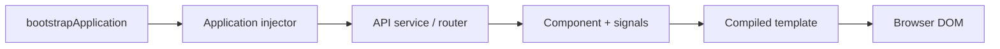

<a id="q1"></a>
## Q1. What does Angular solve?

**Requirement:** Explain what is gained by adopting a complete application framework rather than assembling unrelated libraries. Angular provides component templates, DI, routing, forms, HTTP, compilation/tooling, SSR/hydration integration and consistent patterns.

| Scenario | Expected architecture | Mistake to avoid |
|---|---|---|
| Many teams own screens | Shared conventions and testable components | One giant app component |
| Edit an order | Form with validation and API service | Trusting browser validation on the server |
| Navigate to a report | Router and lazy feature | Loading all features on startup |
| Search orders | Service fetches; component owns filter state | HTTP calls directly from template expressions |

**Step-by-step request trace:** (1) URL matches a route. (2) Angular loads the route component. (3) The injector resolves its dependencies. (4) The service requests data. (5) State updates, and Angular schedules the bound view to refresh. If a user leaves the route, async operations need cancellation/ownership handling.

**Invariant:** a view displays state, but rendering is not authorization. Protect data in the backend. **Trade-off:** conventions reduce design churn but add framework concepts and opinionated defaults. **Complexity:** no meaningful fixed Big-O for framework choice; measure route bundle weight, API latency and affected DOM updates separately.

**Interview follow-ups:** Angular vs React; route/component/service responsibilities; SSR; hydration and lazy loading.

<a id="q2"></a>
## Q2. Standalone component vs NgModule

**Requirement:** Define a required typed input and use a pipe without declaring the component in an NgModule.

```typescript
import {Component, input} from '@angular/core';
import {DatePipe} from '@angular/common';

type User = { id: number; name: string; joined: Date };

@Component({
  selector: 'app-user-card',
  imports: [DatePipe],
  template: `<h3>{{ user().name }}</h3>
             <time>{{ user().joined | date:'mediumDate' }}</time>`
})
export class UserCard {
  readonly user = input.required<User>();
}
```

**Examples:** input `{id:1,name:'Asha',joined:new Date('2026-01-01')}` renders Asha and a date; replacing it with Ravi updates the view; omitting `[user]` on a template usage gives a required-input compiler diagnostic; passing an incompatible type gives a template type-checking diagnostic under strict typing.

**How it works:** (1) the parent supplies `[user]="selectedUser()"`; (2) Angular writes the signal input binding; (3) the child reads `user()`; (4) `DatePipe` is in this component's template scope because of `imports`. Angular 19+ components default to standalone; `standalone: true` remains allowed; `standalone: false` opts into NgModule declaration.

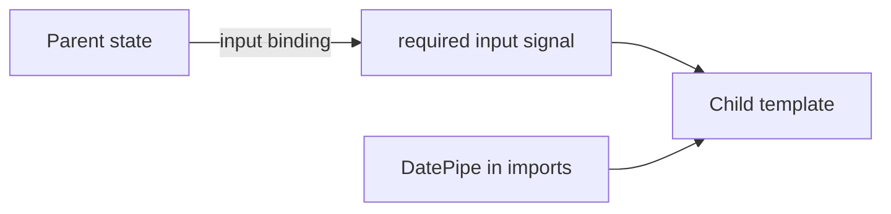

**Invariant:** the parent owns the supplied value; a child input signal is read-only. **Edges:** delayed data should be narrowed with an outer `@if` rather than forced via unsafe non-null assertions. **Complexity:** binding a reference is O(1), but rendering depends on the subtree. **Mistakes:** claiming NgModules are removed; forgetting a pipe/directive in imports.

**Follow-ups:** `@Input` vs `input()`; two-way `model()`; content projection; provider scopes.

<a id="q3"></a>
## Q3. Bootstrap a modern application

**Requirement:** Start a standalone root and register a router and HTTP interceptor.

```typescript
import {bootstrapApplication} from '@angular/platform-browser';
import {provideRouter, Routes} from '@angular/router';
import {provideHttpClient, withInterceptors} from '@angular/common/http';
import {AppComponent} from './app.component';
import {authInterceptor} from './auth.interceptor';

const routes: Routes = [{
  path: 'orders',
  loadComponent: () => import('./orders.component')
    .then(m => m.OrdersComponent)
}];

bootstrapApplication(AppComponent, {
  providers: [
    provideRouter(routes),
    provideHttpClient(withInterceptors([authInterceptor]))
  ]
}).catch(console.error);
```

**Four examples:** opening `/orders` loads the lazily declared route; an HTTP request made by injected HttpClient uses registered interceptors; missing `provideHttpClient` produces an injection problem; a failed lazy import causes a route-loading error.

**Trace:** application platform starts → providers registered in application injector → root component created → router resolves URL → route chunk imported → feature component instantiated → service injects HttpClient → outbound HTTP request flows through interceptors. The code assumes `authInterceptor` and `OrdersComponent` exist in a real app.

**Invariant:** importing a TypeScript symbol alone does **not** register its provider. **Security:** client route guards and interceptors do not replace server authorization. **Complexity:** lazy loading shifts network/bundle costs to route entry; it does not remove them. **Follow-ups:** root vs child injectors, SSR bootstrapping, OIDC tokens.

<a id="q4"></a>
## Q4. AOT and template type checking

**Requirement:** Detect a binding error before running the corresponding browser path.

| Input | Declared contract | Expected |
|---|---|---|
| `{{ user.name }}` | User has string name | Valid binding |
| `{{ user.addresss }}` | User has `address` only | Template diagnostic |
| `<app-user-card />` | `user` required | Missing-input diagnostic |
| `[user]="123"` | expects User | Type mismatch diagnostic |

**How it works:** Angular parses component metadata/template → resolves import scopes → constructs typed representations of bindings → asks TypeScript to check them → produces build diagnostics and rendering instructions. The compiler handles more than minification and can catch invalid property access.

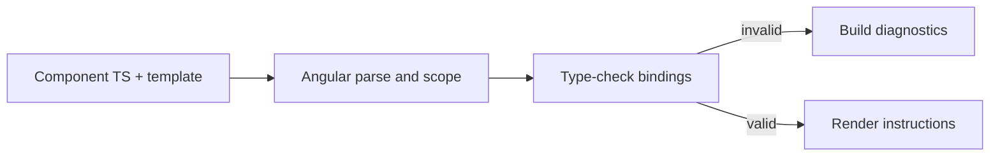

**Invariant:** build-time validity says nothing about the shape of untrusted runtime JSON. Validate backend data at trust boundaries. **Boundary:** `any` and weakened template options erase useful checks. **Cost:** depends on codebase size and type complexity; no universal O(n) claim for a full compiler. **Follow-ups:** strictTemplates, JIT vs AOT, SSR builds.

<a id="q5"></a>
## Q5. Data-binding directions

**Requirement:** Support an editable search term, a clear button and an avatar URL.

```typescript
import {Component, signal} from '@angular/core';
import {FormsModule} from '@angular/forms';

@Component({
  selector: 'app-search',
  imports: [FormsModule],
  template: `<input [(ngModel)]="search" aria-label="Search">
    <button (click)="clear()">Clear</button>
    <p>{{ search }}</p>
    `
})
export class SearchComponent {
  search = '';
  readonly avatarUrl = signal('/assets/avatar.png');
  clear() { this.search = ''; }
}
```

**Four examples:**

| Binding | Example | Direction |
|---|---|---|
| Interpolation | `{{ search }}` | Component → text |
| Property | `[src]="avatarUrl()"` | Component → DOM property |
| Event | `(click)="clear()"` | DOM event → component |
| Two-way | `[(ngModel)]="search"` | Both via directive |

**Dry run:** initial empty → user types "ab" → NgModel updates `search` → interpolation displays "ab" → click Clear → `search` becomes empty and the form view synchronizes.

**Invariant:** data down, events up; two-way syntax combines the two directions. **Pitfalls:** missing FormsModule, writing `(click)="clear"` instead of invocation, conflating DOM attributes and properties. **Cost:** this tiny example's handlers perform O(1) work, while resulting DOM updates depend on affected content. **Follow-ups:** model inputs, reactive forms, zoneless notifications, sanitization.

<a id="q6"></a>
## Q6. Built-in control flow and identity

**Requirement:** Render an order list, keep row identity during reorder and display an empty state.

```typescript
import {Component, signal} from '@angular/core';
type Order = {id: string; amount: number};

@Component({
  selector: 'app-orders',
  template: `
    @for (order of orders(); track order.id) {
      <p>{{ order.id }}: {{ order.amount }}</p>
    } @empty {
      <p>No orders</p>
    }
  `
})
export class OrdersComponent {
  readonly orders = signal<Order[]>([]);
}
```

| Input `orders()` | Expected rendered view |
|---|---|
| `[]` | No orders |
| `[{id:'a',amount:10}]` | a: 10 |
| `[a,b]` → `[b,a]` | Rows reorder, stable IDs reused |
| `[a,b]` → `[b,c]` | a removed, c created, b retained |

**Detailed trace:** `orders()` signal changes → Angular re-evaluates the loop → compares tracking keys to prior iteration → reuses/moves/removes/creates rows → updates bindings. A unique stable entity key is the essential invariant; changing keys or using indices for reordering lists can mix up component state.

**Original state diagram:**

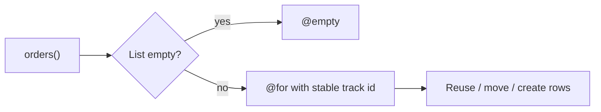

**Boundaries:** duplicate IDs break the intended stable identity mapping; Angular `@switch` does not fall through; choose `@if` for conditional content and `@for` for iteration. **Complexity:** n rows require O(n) output DOM capacity; no claim that keyed list rendering is O(1). **Follow-ups:** `@if` aliases, `@defer`, immutable lists and signals.

## Components, lifecycle and communication

The next seven questions share one mental model: Angular creates a component instance, binds inputs, checks and renders its view, lets it communicate through explicit APIs, and eventually destroys the instance. Keep **ownership** visible: a parent owns input state, a child emits an event describing what happened, and a two-way `model()` is justified only when both sides intentionally share one component-level value.

| Scenario | Primary mechanism | Why | Boundary |
|---|---|---|---|
| Parent supplies an immutable order | `input.required<Order>()` | Typed data flows down | Child cannot write the input signal |
| Child reports Save | `output<OrderDraft>()` | Event flows up | Custom outputs do not bubble through DOM ancestors |
| Reusable slider edits a value | `model(0)` | Deliberate two-way component API | Avoid for unrelated multi-field state |
| Card accepts caller-defined body | `<ng-content>` + `contentChild` if inspection is required | Caller supplies content; card owns layout | Projection is compiled, not a run-time DOM portal |

<a id="q7"></a>
## Q7. Describe the component lifecycle

**Requirement:** Fetch data for a required `userId` input, perform a DOM measurement only after rendering, and cancel owned asynchronous work on destruction.

Angular walks the application tree top-to-bottom while checking bindings. An instance is visited once per traversal, so changing more state halfway through check hooks is unsafe. The useful phases are:

| Phase | Hook/API | Precise use |
|---|---|---|
| Construct | `constructor` / `inject()` | Establish dependencies and input-independent fields |
| Bind/update | `ngOnChanges` | React to one or more changed inputs; first call precedes `ngOnInit` |
| Initialize | `ngOnInit` | One-time work after initial inputs exist, before this view initializes |
| Content/view | `ngAfterContentInit`, `ngAfterViewInit` | Read initialized query results; do not casually mutate checked state |
| Render DOM | `afterNextRender`, `afterEveryRender` | Application-wide post-render callback; DOM write/read phasing |
| Destroy | `ngOnDestroy` or `DestroyRef` | Release timers, observers and owned subscriptions |

```typescript
import {
  Component, DestroyRef, ElementRef, afterNextRender,
  inject, input
} from '@angular/core';
import {takeUntilDestroyed} from '@angular/core/rxjs-interop';
import {UserApi} from './user-api';

@Component({
  selector: 'app-user-panel',
  template: `<section>{{ status }}</section>`
})
export class UserPanel {
  readonly userId = input.required<string>();
  private readonly api = inject(UserApi);
  private readonly host = inject(ElementRef<HTMLElement>);
  private readonly destroyRef = inject(DestroyRef);
  status = 'idle';

  constructor() {
    // Render callbacks require an injection context; the constructor provides one.
    afterNextRender({
      write: () => this.host.nativeElement.classList.add('measured'),
      read: () => this.host.nativeElement.getBoundingClientRect().height
    });
  }

  ngOnInit() {
    this.status = 'loading';
    this.api.load(this.userId())
      .pipe(takeUntilDestroyed(this.destroyRef))
      .subscribe({
        next: () => this.status = 'ready',
        error: () => this.status = 'error'
      });
  }
}
```

**Initial dry run:** instantiate → inject dependencies → set `userId='u7'` → first `ngOnChanges` (if implemented) → `ngOnInit` subscribes → template initializes/checks → DOM render finishes → write phase adds class → read phase measures. **Update:** parent changes `userId`; Angular calls `ngOnChanges`, not `ngOnInit` again. The example therefore demonstrates one initial load; a production component that reloads on every ID needs `ngOnChanges` or a reactive effect/switching pipeline. **Destroy:** route leaves → `DestroyRef` signals → `takeUntilDestroyed` unsubscribes.

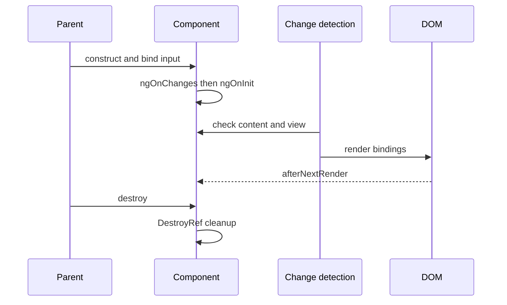

**Four boundaries:** empty/invalid IDs must be rejected by the API contract; `afterNextRender` does not run during SSR or build-time prerender; `ngDoCheck` and checked hooks are frequent and can become hot paths; an async callback should not write after destruction. **Correctness invariant:** each acquired resource has exactly one owner and cleanup path. **Cost:** a hook body costs whatever work it performs; putting O(n) work in a hook executed c times costs O(cn), while one subscription occupies O(1) framework references plus stream-specific state.

<a id="q8"></a>
## Q8. `constructor` vs `ngOnInit`

**Requirement:** explain why `userId()` should not be read as if bound inside the constructor.

| Property | Constructor | `ngOnInit` |
|---|---|---|
| Owner | JavaScript/TypeScript class creation | Angular lifecycle |
| Inputs guaranteed initialized | No | Yes, initial values are set |
| Runs | Once per instance | Once per instance |
| Good work | DI, cheap field setup, registering APIs that require injection context | Input-dependent initialization |
| Testing concern | Heavy side effects make construction hard to test | Still avoid hidden global side effects |

```typescript
import {input} from '@angular/core';

export class ProfileComponent {
  readonly userId = input.required<string>();
  initialUserId = '';

  constructor() {
    // Do not read this.userId() as though the parent has bound it here.
  }

  ngOnInit() {
    this.initialUserId = this.userId(); // initial input is available
  }
}
```

**Examples:** inject a logger in a field initializer; create an `AbortController` in construction and abort it through `DestroyRef`; derive initial state from a bound ID in `ngOnInit`; react to later ID changes with `ngOnChanges` rather than expecting `ngOnInit` to repeat. **Common error:** saying constructors are “not Angular.” Angular invokes the class constructor, but the language owns its semantics; Angular owns input binding and lifecycle timing. **Cost:** both callbacks are O(1) unless application work inside them changes that.

<a id="q9"></a>
## Q9. Parent and child communication

**Requirement:** a parent passes a draft to an editor; the editor reports Save without mutating the parent-owned object.

```typescript
import {Component, input, output} from '@angular/core';

type Draft = Readonly<{id: string; title: string}>;
type SaveEvent = {id: string; title: string};

@Component({
  selector: 'app-draft-editor',
  template: `<button (click)="save('Reviewed')">Save</button>`
})
export class DraftEditor {
  readonly draft = input.required<Draft>();
  readonly saved = output<SaveEvent>();

  save(title: string) {
    this.saved.emit({id: this.draft().id, title});
  }
}
```

```html
<app-draft-editor
  [draft]="selectedDraft()"
  (saved)="replaceDraft($event)" />
```

**Event trace:** parent evaluates input → child reads a read-only `InputSignal` → user clicks → child constructs a new event value → `emit` invokes the bound parent listener → parent replaces owned state → bindings refresh. Angular custom outputs are case-sensitive and do not bubble through the DOM.

**Choosing a channel:** input/output for direct ownership across one component edge; `model()` for a true two-way value such as a custom control; DI service/store for many unrelated consumers with an explicit lifetime; router state for navigable state. Do not reach into a child with a query just to bypass a clear input/output API.

**Four examples:** required input omitted produces a build diagnostic; a Save output carries a typed payload; a slider `model()` automatically has a matching `valueChange` output; a shared feature store coordinates siblings without chaining events through every intermediate component. **Invariant:** there is one authoritative owner for each mutable state value. **Cost:** passing/emitting a reference is O(1); copying a draft with k fields is O(k); rendering downstream output is additional.

<a id="q10"></a>
## Q10. `viewChild` vs `contentChild`

**Requirement:** a card focuses a button declared in its own template and optionally inspects a title projected by its caller.

```typescript
import {Component, ElementRef, contentChild, viewChild} from '@angular/core';

@Component({selector: 'card-title', template: `<ng-content />`})
export class CardTitle {}

@Component({
  selector: 'app-card',
  imports: [CardTitle],
  template: `
    <header><ng-content select="card-title">Untitled</ng-content></header>
    <ng-content />
    <button #close type="button">Close</button>`
})
export class Card {
  readonly closeButton = viewChild.required<ElementRef<HTMLButtonElement>>('close');
  readonly projectedTitle = contentChild(CardTitle);

  focusClose() { this.closeButton().nativeElement.focus(); }
}
```

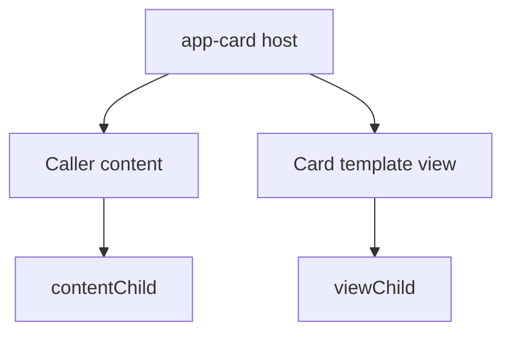

**Four examples:** `viewChild('close')` finds the local template reference; it does not search projected content; `contentChild(CardTitle)` finds the caller's projected title; an optional query returns `undefined` when no result exists; a required query reports failure if the promised result is absent. Query functions return signals and update as conditional content changes.

**Boundaries:** a query never pierces another component's template; use `read: ElementRef` or `TemplateRef` only when that is the actual contract; DOM access requires browser/SSR care; content query descendant behavior differs between `contentChild` and `contentChildren`. **Invariant:** view = nodes declared by this template; content = nodes supplied between this component's host tags. **Cost:** framework query maintenance depends on the candidate subtree; reading the returned signal is O(1), while processing m query results is O(m).

<a id="q11"></a>
## Q11. Content projection

**Requirement:** build one card shell with named title content, arbitrary body content, and sensible fallbacks.

```typescript
import {Component} from '@angular/core';

@Component({
  selector: 'app-card',
  template: `
    <article class="card">
      <header><ng-content select="[card-title]">Untitled</ng-content></header>
      <section><ng-content>No content</ng-content></section>
    </article>`
})
export class Card {}
```

```html
<app-card>
  <h2 card-title>Orders</h2>
  <app-order-list />
</app-card>
```

**Projection trace:** Angular compiles each `<ng-content>` slot → at use-site it classifies host children by selector → matching title goes to the named slot → unmatched nodes go to the catch-all slot → card template supplies surrounding DOM. `<ng-content>` itself is not emitted as a DOM node.

**Four examples:** title and body both supplied; title missing uses fallback title; unmatched content goes to the unqualified slot; without an unqualified slot, unmatched nodes are not rendered. **Common errors:** treating `<ng-content>` like a run-time element, adding directives/attributes to it, or conditionally adding/removing the placeholder. Use template fragments for genuinely dynamic template composition.

**Trade-off:** projection gives flexible composition without duplicating layout, but too many selector slots create a fragile mini-language. **Output cost:** rendering p projected DOM nodes requires O(p) output space; selector matching and rendering are framework concerns, not “free” because the shell is reusable.

<a id="q12"></a>
## Q12. Directive vs component

**Requirement:** add reusable focus behavior without introducing an unnecessary wrapper component.

```typescript
import {Directive, ElementRef, HostListener, inject} from '@angular/core';

@Directive({selector: '[focusOnInvalid]'})
export class FocusOnInvalidDirective {
  private readonly host = inject(ElementRef<HTMLElement>);

  @HostListener('submit')
  focusFirstInvalid() {
    this.host.nativeElement
      .querySelector<HTMLElement>(':invalid')
      ?.focus();
  }
}
```

Use a **component** when the feature owns a UI template, styles and a meaningful public UI API. Use an **attribute directive** for cross-cutting behavior on an existing host, and a structural/template mechanism when behavior controls embedded views. A component is a directive with a template, but not every directive should become a component.

**Examples:** order card → component; permission tooltip behavior → directive; autofocus/validation behavior → directive; complex date picker with its own DOM → component. **Boundaries:** direct DOM APIs need platform/accessibility care; directives on the same element must not depend on an undocumented lifecycle ordering; host directives can compose behavior when their public API remains intentional. **Complexity:** the selector attachment is framework work; this example's `querySelector` is up to O(d) in the host descendant count.

<a id="q13"></a>
## Q13. Pure vs impure pipes

**Requirement:** format an immutable list of names without re-running an O(n) transformation on every unrelated check.

```typescript
import {Pipe, PipeTransform} from '@angular/core';

@Pipe({name: 'joinNames'})
export class JoinNamesPipe implements PipeTransform {
  transform(names: readonly string[], separator = ', '): string {
    return names.join(separator);
  }
}
```

A pipe is pure by default. Angular re-executes it when a primitive input changes or an object/array **reference** changes. Mutating `names.push('Meera')` preserves the reference, so a pure pipe may not run; replace it with `names = [...names, 'Meera']`. Setting `pure: false` lets a pipe observe internal mutation but can invoke it much more frequently.

| Input transition | Pure pipe runs? | Resulting lesson |
|---|---|---|
| `'a'` → `'b'` | Yes | Primitive changed |
| `[A]` → `[A,B]` new array | Yes | Reference changed |
| Same array, `push(B)` | No guarantee of desired recomputation | Prefer immutable replacement |
| Unrelated component state changes | Usually skipped for same pure inputs | Pure pipe saves repeated work |

**Trace and cost:** for n names, `join` consumes O(n) element visits and O(L) output characters, where L is the produced string length. Across c checks, an impure version can cost O(c(n + L)); a pure version performs that cost only when its inputs change, plus framework comparison overhead. The output string itself requires O(L) space.

**Invariant:** `transform` is deterministic and side-effect free for the same inputs. **Never:** start HTTP calls, mutate application state, or hide subscriptions in a pipe. Extract reusable transformation logic into a standalone function for services/non-template callers rather than injecting the pipe class. **Follow-ups:** AsyncPipe ownership, memoized `computed`, immutable data, pipe arguments and operator precedence.

<a id="q14"></a>
## Q14. What is an Angular signal?

**Requirement:** hold a counter as component-owned state, expose it read-only, and derive a value without storing a second mutable copy.

```typescript
import {computed, signal} from '@angular/core';

export class Counter {
  private readonly countState = signal(0);
  readonly count = this.countState.asReadonly();
  readonly doubled = computed(() => this.count() * 2);

  increment() { this.countState.update(value => value + 1); }
  reset() { this.countState.set(0); }
}
```

A signal is a value wrapper that notifies tracked consumers when its value changes. Call it to read: `count()`. A writable signal adds `set` and `update`; `asReadonly()` removes that write API from consumers, but does **not** deep-freeze an object held inside it.

**Four examples:** a boolean controls a panel; a number drives a counter; a new immutable order object updates an order view; setting the same primitive again produces no downstream change under the default `Object.is` equality. For arrays and objects, replace rather than mutate when consumers depend on a new reference:

```typescript
readonly names = signal<readonly string[]>(['Asha']);

addRavi() {
  this.names.update(current => [...current, 'Ravi']); // new reference
}
```

**State trace:** read in a template → Angular records the template consumer → `set`/`update` produces a non-equal value → dependents are invalidated and the view is marked for synchronization → the next render reads the current value. Signals do not themselves make a mutable object immutable.

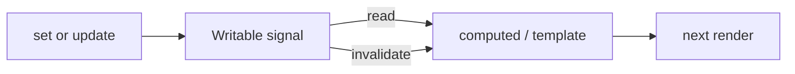

**Invariant:** one owner writes the state; consumers read it. **Cost:** reading or writing the signal container is conceptually O(1); a copied array update is O(n) time and O(n) space; rendering and each dependent derivation add their own work. **Common errors:** forgetting `()`, changing a nested property in place, using a signal as a security boundary, or promising that a write immediately mutates the DOM synchronously.

<a id="q15"></a>
## Q15. `signal` vs `computed` vs `effect`

**Requirement:** represent editable price and quantity, derive a total, and synchronize only the finished total to a non-reactive browser API.

```typescript
import {computed, effect, signal} from '@angular/core';

export class Basket {
  readonly price = signal(25);
  readonly quantity = signal(2);
  readonly total = computed(() => this.price() * this.quantity());

  constructor() {
    effect(() => localStorage.setItem('basket-total', String(this.total())));
  }
}
```

| Primitive | Owns writable state? | Cached derivation? | Intended job |
|---|---:|---:|---|
| `signal` | Yes | No | source state |
| `computed` | No | Yes, lazy and memoized | pure derived state |
| `effect` | No | No returned state | synchronize with a non-reactive API |

**Examples:** `quantity.set(3)` owns a new fact; `total()` derives `75`; a filtered list belongs in `computed`; logging, storage, a canvas or another imperative boundary can justify an `effect`. Do not use an effect to copy `total()` into another signal—two mutable representations can disagree.

**Trace:** first `total()` read runs the computation and caches 50 → a second read returns the cache → `quantity.set(3)` invalidates the cache → the next read computes 75 → the effect observes its dependency and eventually synchronizes `"75"`. Dependencies are determined by signal reads during the reactive execution.

**Invariant:** computed functions are pure and return the entire derived value; effects own only their external side effect and cleanup. A signal read after an `await` is outside the original synchronous tracking context, so capture tracked inputs before the async boundary. **Cost:** if derivation work is O(n), each invalidated-and-read computation is O(n), but repeated reads before invalidation are O(1); output construction still costs O(L) for L output units.

<a id="q16"></a>
## Q16. How dynamic dependency tracking works

**Requirement:** do not refilter a list while its results are hidden, but resume tracking when the panel becomes visible.

```typescript
import {computed, signal} from '@angular/core';

type Product = Readonly<{name: string}>;

export class SearchState {
  readonly visible = signal(false);
  readonly query = signal('');
  readonly products = signal<readonly Product[]>([]);

  readonly matches = computed(() => {
    if (!this.visible()) return [];
    const needle = this.query().trim().toLowerCase();
    return this.products().filter(p => p.name.toLowerCase().includes(needle));
  });
}
```

Angular tracks only signals actually read during the current reactive execution. The dependency set can add and remove edges on later executions.

| Step | State/change | Signals read by `matches` | Result |
|---:|---|---|---|
| 1 | read with `visible=false` | `visible` | `[]` cached |
| 2 | `query.set('cam')` | none rerun | cached result stays valid |
| 3 | `visible.set(true)` then read | `visible`, `query`, `products` | matching products |
| 4 | replace products | same three on next read | result recomputed |
| 5 | hide and read | `visible` only | query/products edges removed |

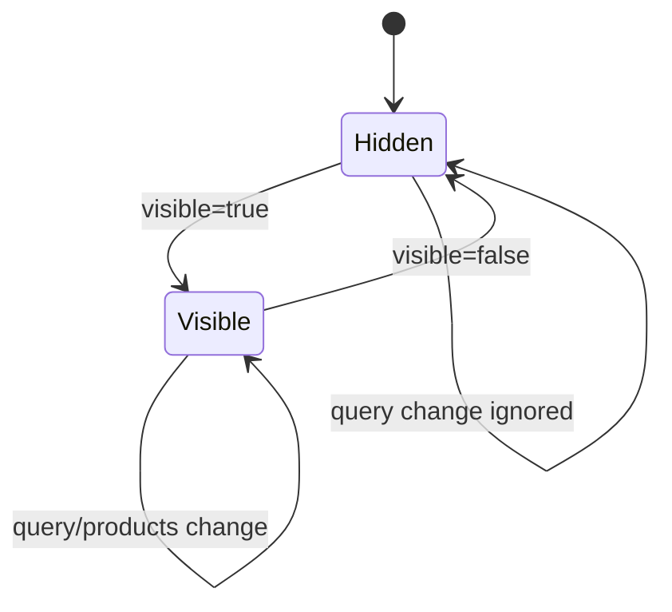

**Four examples:** a hidden expensive chart stops depending on samples; a selected account adds an account-details dependency; changing an unexecuted branch's signal does not invalidate the computed; `untracked` can intentionally read incidental data without adding an edge. **Boundary:** tracking is synchronous; a signal read only after `await` does not become a dependency of the original reactive context.

**Correctness invariant:** after every execution, the recorded dependencies are exactly the producers read on that execution. **Cost:** rebuilding the edge set is O(d) for d tracked reads; filtering n products costs O(n) time and O(k) result space for k matches, including constructing the output array.

<a id="q17"></a>
## Q17. When to use `linkedSignal`

**Requirement:** let a user override a selected shipping method, retain it when still valid, and fall back when server options change.

```typescript
import {linkedSignal, signal} from '@angular/core';

type Method = Readonly<{id: number; label: string}>;

export class ShippingPicker {
  readonly methods = signal<readonly Method[]>([
    {id: 1, label: 'Ground'},
    {id: 2, label: 'Air'}
  ]);

  readonly selected = linkedSignal<readonly Method[], Method | undefined>({
    source: this.methods,
    computation: (next, previous) =>
      next.find(method => method.id === previous?.value?.id) ?? next[0]
  });

  choose(method: Method) { this.selected.set(method); }
}
```

Unlike `computed`, a linked signal is writable. Unlike an independent `signal`, it recomputes from a source relationship. Here is the dry run:

| Action | Methods | Selected | Why |
|---|---|---|---|
| initialize | Ground, Air | Ground | first valid default |
| user chooses Air | Ground, Air | Air | local write allowed |
| server adds Sea | Ground, Air, Sea | Air | previous ID remains valid |
| server removes Air | Ground, Sea | Ground | fallback restores invariant |

**Examples:** valid selection in changing options; editable draft derived from the current record; unit view linked to a canonical value; resettable pagination linked to filters. Use `computed` if callers must never override the result, and a plain signal if no source relationship exists.

**Invariant:** `selected()` is either `undefined` for no options or belongs to the current option set. **Cost:** the `find` reconciliation is O(n) time and O(1) extra space; indexing methods by ID could make lookup expected O(1) at O(n) index space. **Common errors:** preserving an object by stale reference rather than stable ID, assuming `linkedSignal` is two-way persistence, or using it for every writable value.

<a id="q18"></a>
## Q18. `resource` and `httpResource`

**Requirement:** fetch a user reactively from a signal ID, cancel obsolete work, and render loading, error and value states without reading a failed value.

```typescript
import {computed, input} from '@angular/core';
import {httpResource} from '@angular/common/http';

type User = Readonly<{id: string; name: string}>;

export class UserPanel {
  readonly userId = input.required<string>();
  readonly user = httpResource<User>(() => `/api/users/${this.userId()}`);
  readonly heading = computed(() =>
    this.user.hasValue() ? `User: ${this.user.value().name}` : 'User');
}
```

```html
@if (user.hasValue()) {
  <h2>{{ heading() }}</h2>
} @else if (user.error()) {
  <p role="alert">Could not load this user.</p>
} @else if (user.isLoading()) {
  <p>Loading…</p>
}
```

`resource` connects reactive params to a general async loader; the loader receives an `AbortSignal`. `httpResource` is an eager reactive wrapper over `HttpClient`, including interceptor support. A dependency change starts a new request and cancels an outstanding one. A plain `HttpClient` observable is cold and starts on subscription.

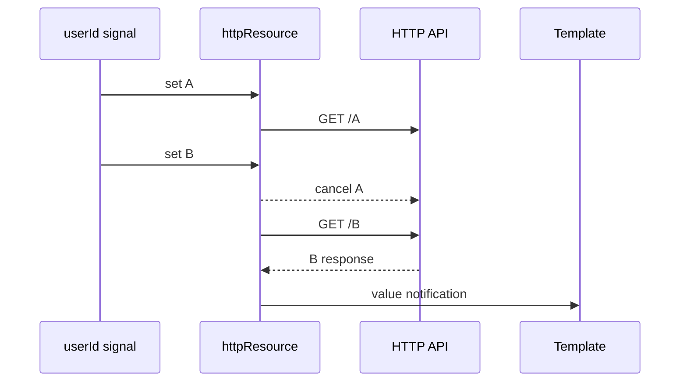

**Four examples:** reactive GET by ID; general `resource` loader for non-HTTP async work; an RxJS pipeline for debouncing and multi-source event orchestration; direct `HttpClient.post` for a mutation. Avoid `httpResource` for POST/PUT mutations, and guard `value()` with `hasValue()` because reading a resource value in an error state throws.

**Invariant:** only the latest active parameter set may publish its result; every UI path distinguishes idle/loading/value/error as needed. **Cost:** client bookkeeping is O(1) per active request plus the response and parsed object size O(b) for b bytes; network latency and server work dominate; rendering r returned records costs at least O(r) time and output space. **Testing:** exercise success, error, rapid A→B changes, empty response, teardown and interceptor behavior.

<a id="q19"></a>
## Q19. Change detection at a high level

**Requirement:** explain how a click that updates a template-read signal reaches the DOM in a zoneless Angular 22 application.

1. A bound listener runs for the click.
2. Application code writes the signal.
3. The signal invalidates tracked consumers; Angular knows the template view needs synchronization.
4. Angular schedules change detection from the framework notification.
5. The view reevaluates affected bindings and applies necessary DOM changes.

```typescript
import {Component, signal} from '@angular/core';

@Component({
  selector: 'app-votes',
  template: `<button (click)="upvote()">{{ votes() }} votes</button>`
})
export class Votes {
  readonly votes = signal(0);
  upvote() { this.votes.update(v => v + 1); }
}
```

The modern mental model is **notification-driven synchronization**, not “ZoneJS always scans because anything async happened.” Zoneless is the default in Angular 21+. Useful notifications include a template-read signal update, a bound template/host listener, `ComponentRef.setInput`, attaching a dirty view, and `ChangeDetectorRef.markForCheck` (which `AsyncPipe` invokes).

| Scenario | Notification present? | Expected result |
|---|---:|---|
| bound click updates template signal | Yes | view refresh scheduled |
| `AsyncPipe` receives value | Yes | marks view for check |
| external callback changes plain field only | Not necessarily | stale view risk |
| external callback sets template signal | Yes | view refresh scheduled |

**Invariant:** every state transition visible to a template must flow through an Angular-recognized notification. Zoneless does not mean “no change detection”; it removes ZoneJS patching as the trigger mechanism. **Cost:** a check costs roughly the evaluated binding/subtree work plus DOM writes; Big-O is application-specific. Use profiling before adding manual change-detector calls. **Errors:** mutating a plain field in an unintegrated callback, confusing detection with browser painting, or calling `detectChanges()` everywhere and masking missing notifications.

<a id="q20"></a>
## Q20. What `OnPush` means today

**Requirement:** make a row component safe for immutable inputs and signal state, and explain every normal path that can cause it to be checked.

```typescript
import {ChangeDetectionStrategy, Component, input, signal} from '@angular/core';

type Order = Readonly<{id: string; total: number}>;

@Component({
  selector: 'app-order-row',
  changeDetection: ChangeDetectionStrategy.OnPush,
  template: `
    <button (click)="expanded.update(v => !v)">{{ order().id }}</button>
    @if (expanded()) { <span>{{ order().total }}</span> }`
})
export class OrderRow {
  readonly order = input.required<Order>();
  readonly expanded = signal(false);
}
```

In Angular 22, `OnPush` is the default component strategy. It lets Angular skip a subtree lacking a relevant notification. New bound inputs are compared with `Object.is`; an event handled in the subtree causes relevant checks; a template-read signal update marks the component; `AsyncPipe`/`markForCheck` and framework input/view APIs also provide notifications. Therefore “OnPush only reacts to new `@Input` references” is incomplete.

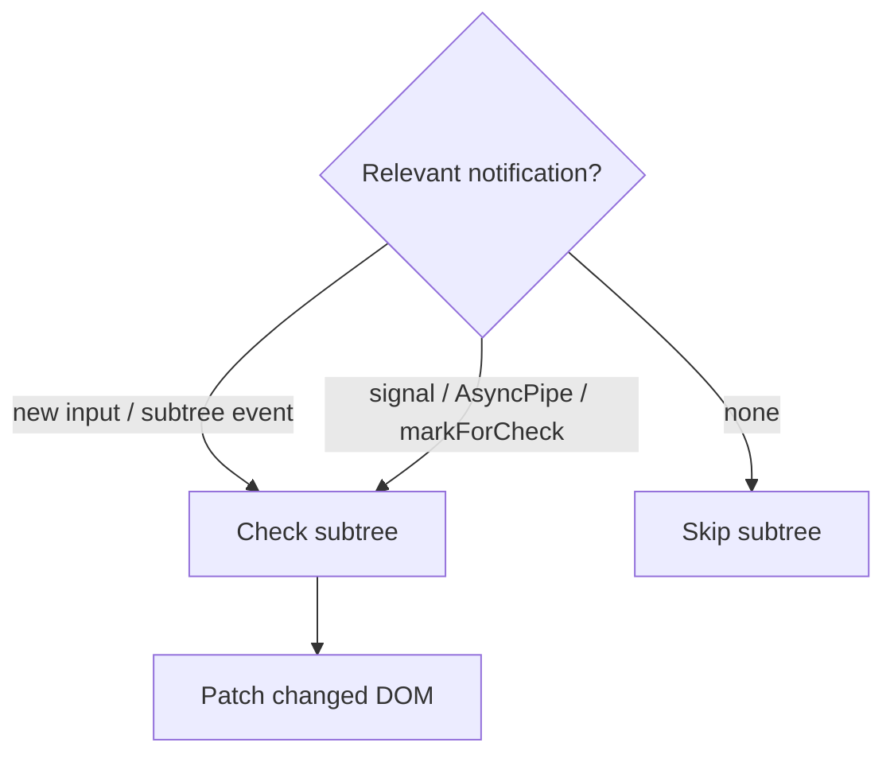

**Four examples:** replacing `order` checks the row; mutating the same object can leave a stale binding because its identity did not change; clicking the row checks its subtree and ancestors as required; a signal read by its template marks it when updated. An unrelated event outside an unmarked OnPush subtree permits that subtree to be skipped.

**Invariant:** parent-owned input values are replaced immutably, and every internal visible update emits a recognized notification. **Trade-off:** skipping can reduce work in large trees, but does not make an expensive checked template cheap. Memoize expensive pure derivations, track list items by stable identity, and measure. **Complexity:** if a full tree has V binding views but only an affected subtree has S, skipping may reduce binding work from O(V) toward O(S); actual cost depends on ancestors, events, dirty views and DOM updates, so this is a model—not a fixed guarantee.

<a id="q21"></a>
## Q21. What zoneless means in Angular 21+

**Requirement:** migrate an application from ZoneJS without losing updates from timers, third-party callbacks, forms, or server-side rendering.

Zoneless Angular still performs change detection. The difference is **how Angular learns that a view may need synchronization**. ZoneJS patched browser async APIs and treated many tasks as possible state changes. Zoneless Angular relies on explicit framework notifications: template-read signal writes, bound listeners, input updates, `AsyncPipe`/`markForCheck`, and attaching a dirty view. Zoneless is the default from Angular 21 onward; an application can still opt back into zone-based scheduling with `provideZoneChangeDetection`.

```typescript
import {Component, signal} from '@angular/core';

@Component({
  selector: 'app-clock',
  template: `<p>Ticks: {{ ticks() }}</p>`
})
export class Clock {
  readonly ticks = signal(0);
  private readonly timer = setInterval(
    () => this.ticks.update(value => value + 1),
    1000
  );

  ngOnDestroy() { clearInterval(this.timer); }
}
```

The timer itself is not a notification; the write to a signal consumed by the template is. Compare that with a plain field changed by an unintegrated callback: the value can change while no view synchronization is scheduled.

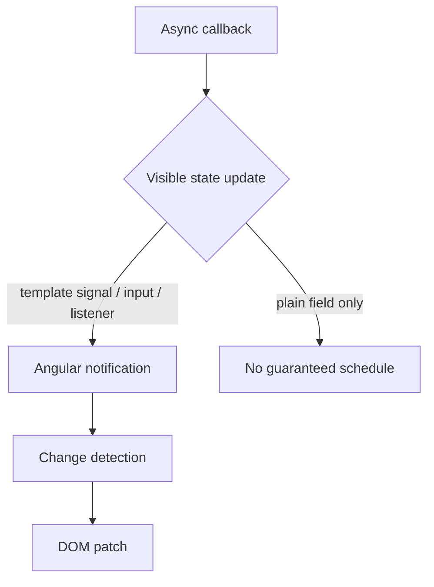

### Migration trace

| Step | Check | Failure signal | Repair |
|---:|---|---|---|
| 1 | Remove `zone.js` and `zone.js/testing` from build/test polyfills | app still bundles ZoneJS | remove dependency/imports |
| 2 | Audit visible state writes | callback changes a plain field with no notification | use a template-read signal or `markForCheck()` |
| 3 | Replace `NgZone.onStable` timing | post-render work never runs | use `afterNextRender`/`afterEveryRender` |
| 4 | Audit SSR work | HTML serializes before custom async work finishes | register work with `PendingTasks` |
| 5 | Test like production | forced `detectChanges()` hides missing notification | wait for stability and assert rendered output |

**Four scenarios:** a template signal updated by `setTimeout` schedules rendering; an `AsyncPipe` emission calls `markForCheck`; `FormControl.setValue` changes form state but may need a signal/mark when a template depends on unnotified reactive-form state; custom SSR work must participate in `PendingTasks`. `NgZone.run` and `runOutsideAngular` can remain for library compatibility—they are not proof that ZoneJS is active.

**Invariant:** every user-visible state transition has a recognized notification path. **Benefits:** fewer speculative synchronizations, no async-API monkey patching, smaller payload/startup overhead, and clearer native stack traces. **Boundary:** zoneless does not guarantee a fast app; expensive bindings, large DOM updates and excessive notifications remain expensive.

**Cost model:** let A be all async tasks and U be tasks that actually cause visible updates. Zone-based scheduling can react to work closer to A; notification-driven scheduling aims toward U, but each scheduled check still costs the checked views/bindings plus DOM writes. Measure rather than claiming a fixed Big-O improvement.

<a id="q22"></a>
## Q22. When to use `ChangeDetectorRef`

**Requirement:** integrate a callback that updates a plain field, and distinguish scheduling a normal future check from forcing a local synchronous check.

```typescript
import {ChangeDetectionStrategy, ChangeDetectorRef, Component} from '@angular/core';

interface LegacyMap {
  onZoom(listener: (zoom: number) => void): () => void;
}

@Component({
  selector: 'app-map-status',
  changeDetection: ChangeDetectionStrategy.OnPush,
  template: `<p>Zoom: {{ zoom }}</p>`
})
export class MapStatus {
  zoom = 1;
  private removeListener?: () => void;

  constructor(private readonly cdr: ChangeDetectorRef) {}

  connect(map: LegacyMap) {
    this.removeListener = map.onZoom(next => {
      this.zoom = next;
      this.cdr.markForCheck();
    });
  }

  ngOnDestroy() { this.removeListener?.(); }
}
```

`markForCheck()` marks the view dirty so Angular includes it in a scheduled synchronization; it does not immediately run the component's check in the callback. Prefer a signal when it cleanly represents the state, but `markForCheck` is appropriate at an imperative integration boundary.

| Method | Meaning | Appropriate example | Main risk |
|---|---|---|---|
| `markForCheck()` | mark view dirty for a normal check | legacy callback changes a plain field | forgetting cleanup/ownership |
| `detach()` | remove view from the change-detection tree | measured, high-frequency read-only display | stale UI |
| `detectChanges()` | synchronously check this view and children | intentionally detached view at a controlled cadence | re-entrancy and hidden design defects |
| `reattach()` | return detached view to normal checking | resume a paused live panel | assuming it retroactively renders |

### Controlled local checking

```typescript
import {ChangeDetectorRef, inject} from '@angular/core';

export class DenseTelemetry {
  private readonly cdr = inject(ChangeDetectorRef);
  private refreshId?: ReturnType<typeof setInterval>;

  start() {
    this.cdr.detach();
    this.refreshId = setInterval(() => this.cdr.detectChanges(), 250);
  }

  stop() {
    if (this.refreshId !== undefined) clearInterval(this.refreshId);
    this.cdr.reattach();
  }
}
```

This pattern is advanced: it trades freshness for fewer checks and requires explicit teardown. A signal update can mark a detached view dirty, but the detached view is still skipped until it is locally checked or reattached.

**Four examples:** mark an OnPush view after a non-Angular SDK callback; detach a telemetry panel and refresh four times per second; reattach when a paused tab becomes active; use `afterNextRender`, not an arbitrary `detectChanges()`, for work that must wait for rendered DOM. **Avoid:** calling `detectChanges()` in ordinary setters, lifecycle hooks or every subscription merely to silence `ExpressionChangedAfterItHasBeenCheckedError`.

**Invariant:** manual checking has a named owner, a documented freshness contract and a cleanup path. **Cost:** `markForCheck` is O(h) at most conceptually for dirty propagation through h ancestors, while `detectChanges()` costs O(v + w) for bindings/views v checked and DOM writes w; framework details may vary, so profile actual work.

<a id="q23"></a>
## Q23. How Angular dependency injection resolves a token

**Requirement:** give every editor subtree an isolated draft session while sharing one application-wide API client, then explain exactly which instance a nested component receives.

Dependency injection separates **what a consumer asks for** from **how and where the value is produced**:

| Term | Meaning | Example |
|---|---|---|
| Token | Runtime lookup key | `UserApi` or `InjectionToken<AppConfig>` |
| Provider | Recipe associated with a token | `{provide: API_URL, useValue: '/api'}` |
| Injector | Registry/cache that resolves recipes | application, route or element injector |
| Injection site | Code requesting the token | `inject(UserApi)` in a component |

```typescript
import {Component, Injectable, inject} from '@angular/core';

@Injectable({providedIn: 'root'})
export class UserApi {
  readonly instanceId = crypto.randomUUID();
}

@Injectable()
export class DraftSession {
  readonly instanceId = crypto.randomUUID();
}

@Component({
  selector: 'app-editor',
  providers: [DraftSession],
  template: `<p>Editor session: {{ draft.instanceId }}</p>`
})
export class Editor {
  readonly api = inject(UserApi);
  readonly draft = inject(DraftSession);
}
```

Each `Editor` element gets an element-injector `DraftSession`; descendants that do not override the token see that nearest session. Both editors still fall back to the root environment injector for the same `UserApi` instance. Angular destroys the component-scoped service when that component instance is destroyed.

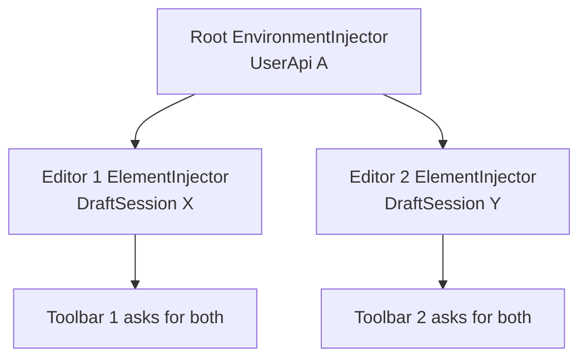

### Resolution trace

For Toolbar 1 requesting `DraftSession`: current element has no provider → parent Editor 1 element has X → return X and stop. For `UserApi`: no element injector has it → retry through the environment-injector hierarchy → root has A → return A. If no injector provides a required token, resolution reaches the null boundary and throws.

**Four scenarios:**

1. Two `Editor` instances receive different `DraftSession` IDs but the same `UserApi` ID.
2. A route-level provider supplies one feature instance to that route's components, guards and resolvers.
3. `inject(DraftSession, {self: true, optional: true})` returns `null` if the current element itself does not provide it, even if a parent does.
4. `inject(DraftSession, {skipSelf: true})` begins at the parent; `host` limits the upward search to the host boundary.

**Invariant:** provider placement intentionally defines visibility, lifetime and sharing. A component provider is not an application singleton. Avoid storing global truth in a service that is accidentally re-provided by every component.

**Cost model:** resolution walks a bounded injector ancestry, conceptually O(h) for h searched levels; after a provider creates a value, normal repeated lookups use the injector's cached instance. Construction cost belongs to the dependency graph itself, and component-scoped providers trade isolation for more live instances. Treat this as a reasoning model, not a framework implementation guarantee.

**Common errors:** using an interface as a token (interfaces disappear at runtime), re-providing a state service unintentionally, assuming a route guard is a security boundary, or injecting an optional value without handling `null`.

<a id="q24"></a>
## Q24. `inject()` vs constructor injection

**Requirement:** choose an injection form for a class, a functional guard and a provider factory, and identify a call that is too late.

Both forms use the same injector. The important distinction is **syntax and injection context**, not lifetime or speed.

| Situation | Good form | Why |
|---|---|---|
| Class with explicit public dependencies | constructor parameters | dependencies are visible in the signature |
| Private field dependency | field `inject()` | concise and strongly typed |
| Functional guard/interceptor | `inject()` | no class constructor exists |
| Provider or token factory | `inject()` or declared `deps` | factory executes in an injection context |

```typescript
import {Component, Injectable, InjectionToken, inject} from '@angular/core';
import {CanActivateFn, Router} from '@angular/router';

@Injectable({providedIn: 'root'})
class AuthService {
  isLoggedIn() { return true; }
}

@Component({selector: 'app-profile', template: 'Profile'})
class Profile {
  // Legal: Angular is constructing the component.
  private readonly auth = inject(AuthService);

  constructor(private readonly router: Router) {}

  // Illegal: calling inject(AuthService) here would be too late.
  save() { /* use this.auth and this.router */ }
}

export const authGuard: CanActivateFn = () => {
  const auth = inject(AuthService);
  const router = inject(Router);
  return auth.isLoggedIn() || router.parseUrl('/login');
};

export const START_TIME = new InjectionToken<number>('start time', {
  providedIn: 'root',
  factory: () => Date.now()
});
```

### Context trace

Angular enters an injection context → begins constructing `Profile` → evaluates field initializers → runs the constructor → leaves the context. Therefore the field and constructor work, but a later click calling `save()` cannot start a fresh `inject()` lookup. A provider factory and functional guard are invoked by Angular inside their own contexts.

`runInInjectionContext(injector, fn)` can establish a context for a synchronous function, but `inject()` must occur before an `await`; the context does not automatically flow into later asynchronous callbacks.

**Four scenarios:** a field initializer succeeds; a constructor parameter succeeds; a functional route guard succeeds; a lifecycle method that calls `inject()` throws an injection-context error. Capture dependencies up front and use the captured value later.

**Invariant:** every `inject()` call executes synchronously inside a valid injection context. **Trade-off:** constructor injection advertises dependencies at the class boundary; `inject()` improves functional composition and avoids parameter-decorator friction. Use a consistent project convention without claiming one changes provider scope.

**Testing boundary:** test a function that calls `inject()` through Angular's injection test context, or refactor its decision logic into a pure function and pass dependencies explicitly. Instantiating such a class with `new` bypasses Angular's context.

<a id="q25"></a>
## Q25. `useClass`, `useValue`, `useFactory` and `useExisting`

**Requirement:** configure an API client, replace logging in production and keep a deprecated token as an alias without creating a second logger.

```typescript
import {InjectionToken, Provider, inject} from '@angular/core';

export interface AppConfig {
  apiUrl: string;
  production: boolean;
}

export const APP_CONFIG =
  new InjectionToken<Readonly<AppConfig>>('app config');

abstract class Logger { abstract log(message: string): void; }
class ConsoleLogger extends Logger {
  log(message: string) { console.log(message); }
}
class SilentLogger extends Logger {
  log(_message: string) {}
}

class ApiClient {
  constructor(readonly baseUrl: string, readonly logger: Logger) {}
}

export const LEGACY_LOGGER = new InjectionToken<Logger>('legacy logger');

export const APP_PROVIDERS: Provider[] = [
  {
    provide: APP_CONFIG,
    useValue: Object.freeze({apiUrl: '/api', production: true})
  },
  {
    provide: Logger,
    useFactory: () =>
      inject(APP_CONFIG).production ? new SilentLogger() : new ConsoleLogger()
  },
  {
    provide: ApiClient,
    useFactory: () => new ApiClient(
      inject(APP_CONFIG).apiUrl,
      inject(Logger)
    )
  },
  {provide: LEGACY_LOGGER, useExisting: Logger}
];
```

| Recipe | Injector returns | Typical use | Important boundary |
|---|---|---|---|
| `useClass` | instance of the named class | swap an implementation | this recipe creates/caches its own instance |
| `useValue` | exact supplied value | immutable configuration or test fake | do not mutate shared config |
| `useFactory` | factory result | derive from other dependencies | factory must stay in an injection context |
| `useExisting` | value already resolved for another token | rename/alias a token | identity is shared |

**Four examples:** replace `Logger` with `ConsoleLogger` using `useClass`; provide a frozen configuration with `useValue`; create `ApiClient` from configuration with `useFactory`; resolve `LEGACY_LOGGER` and `Logger` to the same object with `useExisting`.

**Identity dry run:** resolve `Logger` → factory creates instance L and the injector caches it → resolve `LEGACY_LOGGER` → alias asks for `Logger` → returns L. Replacing the alias with `{provide: LEGACY_LOGGER, useClass: SilentLogger}` would create a different instance.

**Invariant:** one token has one unambiguous recipe at a given injector unless it is deliberately a multi token. Use an `InjectionToken<T>` for interfaces and primitive/config values because TypeScript types do not survive at runtime.

**Failure modes:** exposing a mutable `useValue` object as global state, creating side effects in factories, confusing `useClass` with aliasing, or reading browser globals in a factory during SSR. **Cost:** the injector normally evaluates a recipe once per providing injector and caches the result; factory/construction work is therefore paid per scoped instance. Application behavior inside the result has its own cost.

<a id="q26"></a>
## Q26. Multi providers as a plugin seam

**Requirement:** let independent features contribute audit hooks without any feature replacing another registration.

```typescript
import {Injectable, InjectionToken, Provider, inject} from '@angular/core';

type AuditEvent = Readonly<{actor: string; action: string}>;
interface AuditHook { record(event: AuditEvent): void; }

export const AUDIT_HOOKS =
  new InjectionToken<readonly AuditHook[]>('audit hooks');

@Injectable()
class SecurityAudit implements AuditHook {
  record(event: AuditEvent) { console.log('security', event.action); }
}

@Injectable()
class MetricsAudit implements AuditHook {
  record(event: AuditEvent) { console.log('metric', event.actor); }
}

export const AUDIT_PROVIDERS: Provider[] = [
  {provide: AUDIT_HOOKS, useClass: SecurityAudit, multi: true},
  {provide: AUDIT_HOOKS, useClass: MetricsAudit, multi: true}
];

@Injectable()
export class AuditRunner {
  private readonly hooks =
    inject(AUDIT_HOOKS, {optional: true}) ?? [];

  record(event: AuditEvent) {
    for (const hook of this.hooks) hook.record(event);
  }
}
```

Without `multi: true`, later registration for the same token replaces or conflicts with the intended single recipe. With it, resolving the token returns an array containing all contributions registered as multi providers in that injector.

**Four scenarios:** two hooks both run once; one hook can be replaced with a `useValue` test spy while retaining `multi: true`; no registration produces `null` here and the runner chooses `[]`; registering the same hook twice produces two entries—multi providers do not deduplicate.

**Execution trace:** injector encounters two multi recipes → creates/caches one contribution per recipe → token resolves to `[SecurityAudit, MetricsAudit]` → runner iterates in the resulting order → both observe the immutable event. Keep ordering requirements explicit; avoid correctness that depends on incidental assembly order across separately owned provider arrays.

**Invariant:** every provider for a multi token uses `multi: true`, and consumers expect an array. Do not mix a regular provider and multi providers for the same token at one injector.

**Trade-offs and cost:** the pattern decouples plugin authors from the runner, but hides the final set of contributors and permits duplicates. First resolution constructs p contributions; dispatch costs O(p + Σworkᵢ) time and O(p) cached references for p hooks. A hook failure policy must be deliberate: fail fast, isolate each hook with error handling, or run asynchronously with an explicit delivery contract.

<a id="q27"></a>
## Q27. Host metadata vs `HostBinding` and `HostListener`

**Requirement:** build a reusable pressed-state directive whose CSS class, ARIA state, pointer events and keyboard behavior stay synchronized.

Angular still supports both decorators, but the current API documentation says to prefer the directive/component `host` property; `HostBinding` and `HostListener` remain for backwards compatibility.

```typescript
import {Directive, signal} from '@angular/core';

@Directive({
  selector: 'button[appPressState]',
  host: {
    '[class.is-active]': 'active()',
    '[attr.aria-pressed]': 'active()',
    '(click)': 'toggle()'
  }
})
export class PressState {
  readonly active = signal(false);

  toggle() {
    this.active.update(value => !value);
  }

}
```

```html
<button appPressState type="button">Pin report</button>
```

### Event-to-host trace

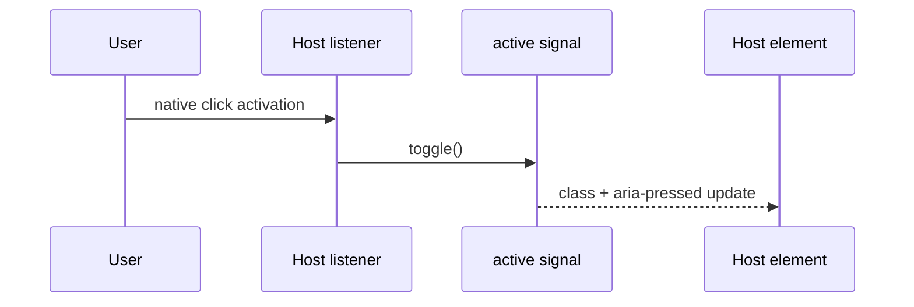

**Four examples:** a pointer click toggles class and ARIA state; Enter activates the native button and produces the click; Space activates it with the browser's native button semantics; programmatic `active.set(false)` updates both host bindings on the next synchronization. Restricting the selector to a native button preserves focus and activation semantics better than inventing a clickable `div`. Do not add redundant keydown toggles to a native button or one keyboard action can toggle twice.

**Host binding vs listener:** `'[class.is-active]': 'active()'` reads directive state during view synchronization; `'(click)': 'toggle()'` invokes behavior when the host emits an event. Prefixes such as `window:` create global listeners and require especially careful ownership; prefer a local host event when it solves the problem.

**Invariant:** visible styling and semantic state derive from the same source of truth. **Boundaries:** host metadata does not sanitize application logic, and a directive should not call browser-only globals during server rendering. Use host bindings or renderer abstractions instead of arbitrary DOM mutation when possible.

**Common errors:** mouse-only interaction, adding button semantics to an unfocusable element, duplicating a native button's keyboard activation, calling a signal without `()` in the host expression, or registering broad global listeners unnecessarily. If a custom non-button widget is truly required, implement the complete WAI-ARIA keyboard/focus pattern instead of copying only one key handler. **Cost:** listener dispatch is O(1) plus handler work; each notification checks the affected view bindings, while actual style/attribute writes occur only when values differ.

## RxJS and asynchronous flows

The important interview question is rarely “Which operator name do you remember?” It is “Who starts the work, what happens when a newer value arrives, when does the result become available, and who owns teardown?”

<a id="q28"></a>
## Q28. Observable vs Promise

**Requirement:** choose the abstraction from the contract, not from syntax. A Promise represents one eventual fulfillment or rejection. An Observable can represent zero, one or many notifications over time, has explicit completion/error channels, composes through operators, and runs only according to the producer's subscription contract.

| Dimension | Promise | Observable |
|---|---|---|
| Result count | One settlement | Zero to many `next` values, then optional completion or error |
| Start | Executor starts when the Promise is constructed | Commonly lazy, but an Observable may wrap a hot producer already running |
| Consumer | `await` / `then` | `subscribe`, `AsyncPipe`, signal interop or an operator chain |
| Cancellation | No built-in cancellation of the Promise itself; the underlying API may accept `AbortSignal` | Unsubscribe tears down that subscription; what the producer can cancel depends on its implementation |
| Composition | Promise combinators | Time-, concurrency- and cancellation-aware RxJS operators |

Angular `HttpClient` returns **cold Observables**: no request is sent until subscription, and each subscription creates a separate request. The generic `get<User>()` is a TypeScript assertion, not runtime validation of untrusted JSON.

```typescript
import {HttpClient} from '@angular/common/http';
import {Observable} from 'rxjs';

type User = Readonly<{id: number; name: string}>;

class UserApi {
  constructor(private readonly http: HttpClient) {}

  user(id: number): Observable<User> {
    return this.http.get<User>(`/api/users/${id}`);
  }
}
```

**Four examples:** `await dialog.open()` fits one eventual choice; a route-parameter stream can emit on every navigation; a WebSocket can emit until disconnected; `HttpClient.get` normally emits one response and completes, but two subscriptions send two requests.

### Subscription trace

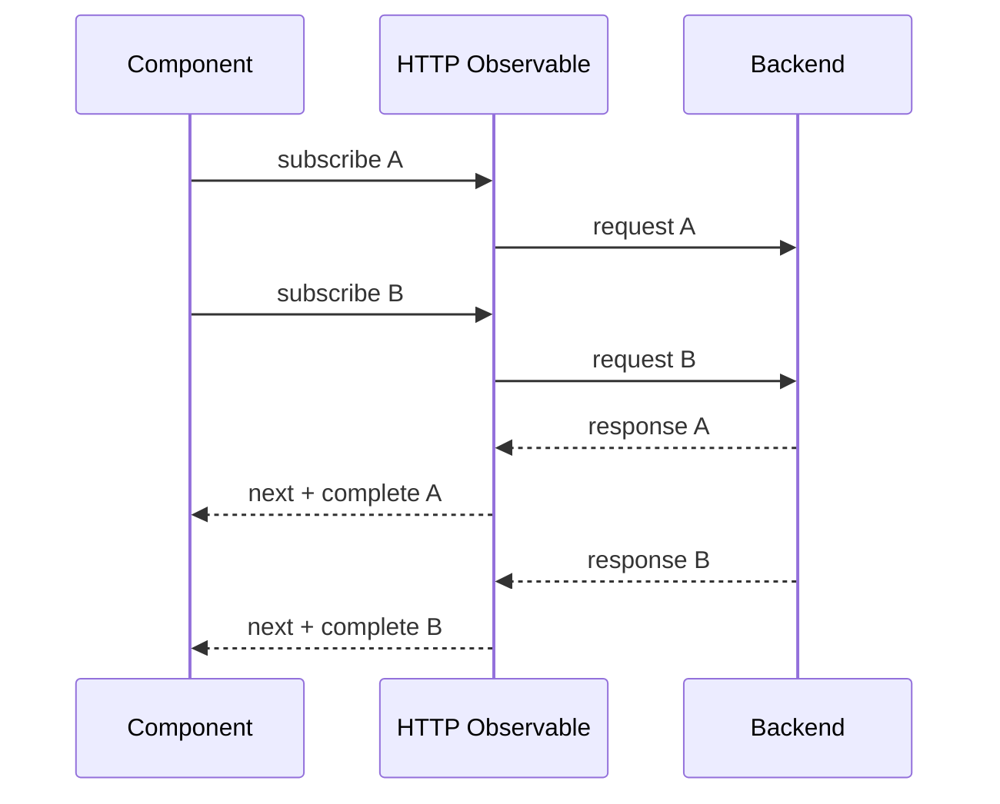

**Cancellation boundary:** unsubscribing can abort an in-flight client request when the producer supports teardown, preventing an obsolete response from updating the UI. It cannot promise that a server has not already processed a mutation. Use idempotency keys, conditional writes or server-side transaction rules where “undo the request” matters.

**Invariants and cost:** after an error or completion, that subscription receives no more values. Creating a pipeline is usually O(k) references for k operators; each notification performs the relevant operator work. Retaining emitted collections costs their size. Do not claim “Observable is faster”; choose it when stream semantics, composition or ownership are required.

<a id="q29"></a>
## Q29. Subject vs BehaviorSubject vs ReplaySubject

**Requirement:** identify whether a subscriber needs only future events, one current state value, or bounded history.

| Type | New subscriber receives immediately | Initial value | Good fit | Main hazard |
|---|---|---|---|---|
| `Subject<T>` | Nothing until the next `next` | No | commands/events bridging imperative code | late subscribers miss earlier events |
| `BehaviorSubject<T>` | latest value | Yes | current state for RxJS consumers | invented sentinel seeds and public mutation |
| `ReplaySubject<T>(n)` | up to the last n values | No | bounded late-subscriber history | unbounded buffer/time window retains memory |

```typescript
import {BehaviorSubject, Observable, ReplaySubject, Subject} from 'rxjs';

class UploadCoordinator {
  private readonly cancelSubject = new Subject<void>();
  readonly cancel$ = this.cancelSubject.asObservable();

  private readonly statusSubject = new BehaviorSubject<'idle' | 'busy'>('idle');
  readonly status$ = this.statusSubject.asObservable();

  private readonly logSubject = new ReplaySubject<string>(3);
  readonly recentLog$ = this.logSubject.asObservable();

  cancel() { this.cancelSubject.next(); }
  begin() { this.statusSubject.next('busy'); }
  log(line: string) { this.logSubject.next(line); }
}
```

**State trace:** write log entries A, B, C, D before observer X subscribes → `ReplaySubject(3)` replays B, C, D → a later E is delivered live. A `BehaviorSubject('idle')` immediately gives a new observer the latest `'idle'` or `'busy'`; a plain Subject gives neither history nor a current value.

**Four examples:** click telemetry uses a Subject; authentication state with a genuine initial “unknown” union can use a BehaviorSubject; a three-line diagnostic panel can use `ReplaySubject(3)`; synchronous component-local derived UI state is often simpler as `signal` + `computed` rather than a public Subject.

**Invariant:** expose the read side (`Observable`) and keep `next` private so one owner controls writes. A Subject is also an Observer and an Observable, but that does not make it a safe shared mutable store. **Cost:** one emission fans out in O(s) time to s active subscribers. BehaviorSubject retains O(1) values; `ReplaySubject(n)` retains O(n) values plus subscriber bookkeeping. Use an explicit finite buffer and, when appropriate, a time window.

**Common errors:** using an empty string as a fake BehaviorSubject seed; reaching for `getValue()` everywhere; assuming a Subject replays the last event; leaving `ReplaySubject()` unbounded; using a Subject where a cold Observable factory would preserve isolation.

<a id="q30"></a>
## Q30. `switchMap`, `mergeMap`, `concatMap` and `exhaustMap`

**Requirement:** map each outer value to an inner Observable and state the concurrency policy.

| Operator | When a new outer value arrives | Ordering/concurrency | Typical scenario |
|---|---|---|---|
| `switchMap` | unsubscribe previous inner, subscribe newest | latest wins; old result cannot flow through that subscription | typeahead/read keyed by current selection |
| `mergeMap` | subscribe to another inner | concurrent; completion order may differ | independent reads with a deliberate concurrency limit |
| `concatMap` | queue until current inner completes | one at a time; preserves source order | ordered writes |
| `exhaustMap` | ignore it while current inner is active | first wins until completion | suppress duplicate submit/login clicks |

```typescript
import {Component, inject} from '@angular/core';
import {HttpClient} from '@angular/common/http';
import {
  catchError, debounceTime, distinctUntilChanged, map, of, Subject, switchMap
} from 'rxjs';

type SearchState =
  | {kind: 'ready'; items: readonly string[]}
  | {kind: 'error'; message: string};

@Component({selector: 'app-search-results', template: ''})
export class SearchResults {
  private readonly http = inject(HttpClient);
  private readonly terms = new Subject<string>();

  readonly state$ = this.terms.pipe(
    map(term => term.trim()),
    debounceTime(250),
    distinctUntilChanged(),
    switchMap(term =>
      this.http.get<readonly string[]>('/api/search', {params: {q: term}}).pipe(
        map(items => ({kind: 'ready', items}) as const),
        catchError(() => of({
          kind: 'error',
          message: 'Search failed'
        } as const))
      )
    )
  );

  search(term: string) { this.terms.next(term); }
}
```

### Latest-wins dry run

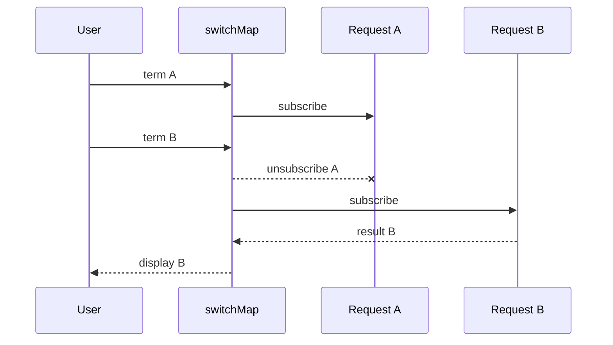

For outer values A, B, C arriving while A is active:

- `switchMap`: A is unsubscribed; then B may be unsubscribed; C is the active result.
- `mergeMap`: A, B and C may all run; emissions arrive in actual completion order.
- `concatMap`: B and C wait; results are processed A, B, C.
- `exhaustMap`: B and C are ignored if A remains active.

**Four choices:** search suggestions → switchMap; prefetch independent product details → mergeMap with a bounded concurrency argument; save ordered audit records → concatMap; login button → exhaustMap plus disabled/loading UI.

**Mutation trap:** “unsubscribe” is not “roll back the server.” `switchMap` is excellent for obsolete reads, but it may hide a response while a POST has already taken effect. Ordered mutation, deduplication and idempotency require an explicit server/client contract.

**Invariants and cost:** the operator controls active inner subscriptions, not the remote system's transaction state. With m outer values, work still includes every inner actually started. `mergeMap` can retain O(c) active inners for concurrency c; unbounded c risks sockets and memory. `concatMap` can retain an O(q) queue when arrivals outpace completion. `exhaustMap` bounds the active inner to one but discards outer values by design.

<a id="q31"></a>
## Q31. `combineLatest` vs `forkJoin`

**Requirement:** distinguish “recompute whenever any live input changes” from “wait for every finite task and collect final results.”

| Question | `combineLatest` | `forkJoin` |
|---|---|---|
| First emission | after every input has emitted at least once | after every input completes with a final value |
| Later emissions | whenever an input emits, using latest values | exactly one combined emission, then complete |
| Non-completing input | normal for a live stream | prevents the combined result from arriving |
| Common fit | filters, route state, UI preferences | parallel finite HTTP reads |

```typescript
import {combineLatest, forkJoin, map, startWith} from 'rxjs';

const visibleOrders$ = combineLatest([
  orders$,
  searchTerm$.pipe(startWith('')),
  status$.pipe(startWith<'all' | 'open' | 'closed'>('all'))
]).pipe(
  map(([orders, term, status]) =>
    orders.filter(order =>
      order.title.includes(term) &&
      (status === 'all' || order.status === status)
    )
  )
);

const dashboard$ = forkJoin({
  profile: http.get<Profile>('/api/profile'),
  permissions: http.get<readonly string[]>('/api/permissions'),
  notices: http.get<readonly Notice[]>('/api/notices')
});
```

**Dry run:** orders emits O1, term has not emitted, status emits “all” → `combineLatest` waits. Term emits `bug` → output uses [O1, `bug`, `all`]. Status emits `open` → output recomputes with O1 and the same term. In the dashboard, profile finishes at 30 ms, notices at 60 ms and permissions at 90 ms → `forkJoin` emits once at 90 ms using each final value.

**Four examples:** live table filters use combineLatest; route params plus cached preferences use combineLatest after each has a seed/emission; three HttpClient GETs use forkJoin; a WebSocket inside forkJoin is a bug unless it is intentionally made finite (for example with `take(1)`).

**Error boundary:** either combinator errors if an input error is uncaught. Catching outside `forkJoin` commonly replaces the whole result. If partial data is valid, catch and map an error inside each source to an explicit result union; do not silently turn errors into ambiguous empty arrays.

**Invariants and cost:** `combineLatest` stores one latest value per input, O(k) references for k sources, and downstream recomputation costs whatever the projection does—O(n) here for filtering n orders. `forkJoin` stores final values until all inputs complete, O(k) references plus the retained payloads. Neither operator makes network requests by itself; subscribing to the composed cold HTTP Observable starts its sources.

<a id="q32"></a>
## Q32. Prevent subscription leaks through ownership

**Requirement:** every long-lived subscription has an owner, an intended lifetime and a teardown path. Prefer declarative consumption where possible.

1. In templates, `AsyncPipe` subscribes, exposes the latest value, marks the component for checking, switches when the bound reference changes and unsubscribes when the view is destroyed.
2. In imperative Angular code, `takeUntilDestroyed()` completes the pipeline when the owning destruction context is destroyed.
3. Finite streams such as ordinary `HttpClient` requests normally complete, but repeated subscriptions can still duplicate work, and cancellation still matters when the owner disappears.
4. Application-lifetime subscriptions in root services can be intentional; “long lived” is not identical to “leak.”

```typescript
import {Component, DestroyRef, inject} from '@angular/core';
import {takeUntilDestroyed} from '@angular/core/rxjs-interop';
import {ActivatedRoute} from '@angular/router';
import {distinctUntilChanged, map} from 'rxjs';

@Component({selector: 'app-order-page', template: ''})
export class OrderPage {
  private readonly route = inject(ActivatedRoute);
  private readonly destroyRef = inject(DestroyRef);

  constructor() {
    this.route.paramMap.pipe(
      map(params => params.get('id')),
      distinctUntilChanged(),
      takeUntilDestroyed(this.destroyRef)
    ).subscribe(id => {
      if (id !== null) this.load(id);
    });
  }

  private load(_id: string) {}
}
```

When called in an injection context, `takeUntilDestroyed()` can infer the `DestroyRef`; passing it explicitly makes ownership visible and is required when the operator is assembled outside such a context.

| Subscription owner | Intended lifetime | Preferred teardown |
|---|---|---|
| template view | while the view exists or source reference remains | `AsyncPipe` |
| component/directive imperative logic | instance lifetime | `takeUntilDestroyed` |
| one finite HTTP read | until response/error or owner no longer needs it | completion plus owner cancellation when appropriate |
| root service connection | application lifetime | explicit application/disconnect policy |
| dynamically replaced child/session | that child/session only | bind teardown to that exact child/session |

**Leak trace:** enter route → component subscribes to a global interval → leave route without teardown → component remains reachable through the observer → re-enter five times → five observers perform the same update. With lifecycle teardown, each destroyed component is removed before the next instance subscribes.

**Four examples:** show `users$ | async` in a template; bind route params with `takeUntilDestroyed`; use `switchMap` to replace an obsolete request and still bind the outer subscription to the owner; deliberately keep a root telemetry connection while the application runs and expose a tested disconnect method.

**Boundaries and mistakes:** cleanup also includes event listeners, timers, observers, sockets and third-party callbacks. Avoid nested subscriptions; compose them so errors and teardown have one path. Do not reuse one destroyed notifier for future component instances, and do not assume garbage collection can reclaim an object still referenced by a live producer.

**Cost:** a leak converts per-instance state O(s) into O(r·s) retained state after r recreations and multiplies event work by the number of stale observers. Correct teardown keeps live subscriber count proportional to current owners.

<a id="q33"></a>
## Q33. Cold vs hot Observables, sharing and cache invalidation

**Requirement:** describe the relationship between a producer and its subscribers. “Cold” and “hot” are not different TypeScript types, and “hot” does not necessarily mean that work started at application bootstrap.

| Contract | Producer relationship | Late subscriber | Angular example |
|---|---|---|---|
| cold/unicast | each subscription creates its own producer execution | receives its own execution from the beginning | `HttpClient.get`, `defer`, most `of` pipelines |
| hot/multicast | subscribers observe one producer that exists independently of any one subscriber | normally receives only future notifications | DOM events, WebSocket feed, plain `Subject` |
| shared cold source | an operator connects one source execution to a multicast subject for a defined lifetime | depends on connector/reset/replay policy | HTTP pipeline with `share` or `shareReplay` |

Angular `HttpClient` Observables are cold: constructing one does not send a request, and **every subscription sends a new backend request**. By contrast, a `Subject` fans one call to `next` out to the observers currently attached. A source can also move between these behaviors: `share()` turns one upstream subscription into a shared connection while its reset policy permits it.

```typescript
import {inject, Injectable} from '@angular/core';
import {HttpClient} from '@angular/common/http';
import {Observable, shareReplay, startWith, Subject, switchMap} from 'rxjs';

type User = Readonly<{id: number; name: string}>;

@Injectable({providedIn: 'root'})
export class CurrentUserStore {
  private readonly http = inject(HttpClient);
  private readonly refreshRequests = new Subject<void>();

  // One active request is shared, one successful value is replayed.
  // refresh() is the explicit invalidation boundary.
  readonly user$: Observable<User> = this.refreshRequests.pipe(
    startWith(void 0),
    switchMap(() => this.http.get<User>('/api/me')),
    shareReplay({bufferSize: 1, refCount: true})
  );

  refresh(): void {
    this.refreshRequests.next();
  }
}
```

### Two-subscription dry run

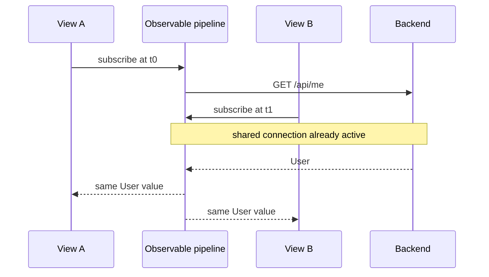

Without `shareReplay`, A and B each subscribe through to `HttpClient`, so two GETs are sent. With the shown pipeline, A creates the upstream connection and B joins it; both receive the response. `bufferSize: 1` retains at most one emitted value for a late subscriber. `refCount: true` disconnects and resets an **active, nonterminal** shared connection when the last subscriber leaves. In RxJS 7’s `shareReplay` contract, a successfully completed source is not reset on completion, so a completed HTTP value can remain cached as long as this `user$` object remains reachable. `refCount` is therefore not a time-to-live or business invalidation policy.

**Four concrete examples:**

1. Two components subscribe to the same unshared `http.get` variable → two independent requests.
2. Two overlapping subscribers use `share()` → one active request, but a subscriber arriving after completion starts a fresh execution because `share` resets on completion by default.
3. A late subscriber uses `shareReplay({bufferSize: 1, refCount: true})` after a successful HTTP completion → it can receive the retained value immediately without a new request.
4. A plain Subject emits A before a view subscribes, then B afterward → that view sees B only; a ReplaySubject or replaying share policy would be required to see A.

**Cache key and invalidation invariant:** a cached value is valid only for the identity and parameters that produced it. Key caches by user/tenant/locale/query as appropriate, clear or replace them on logout and privilege changes, and define refresh after writes. Do not put one root-scoped `/api/me` cache across identities without clearing it. Errors, completion and zero-subscriber resets are separate decisions; retry policy is separate again.

**Common errors:** saying all Observables are lazy/cold; assuming two variables referencing the same cold Observable share work; using an unbounded replay buffer; treating `shareReplay(1)` as a complete cache design; hiding stale data indefinitely; and confusing client unsubscription with rollback of server work.

**Correctness and cost:** while one shared generation is active, every downstream observer sees notifications from that same upstream execution in source order. An emission fans out in O(s) time for s subscribers. A replay buffer of b retained values uses O(b) references plus the retained payload sizes; here b = 1. The HTTP/network and JSON parsing costs are unchanged—sharing prevents duplicate executions, not the cost of the one execution. Interview follow-ups include reconnect after errors, TTL invalidation, per-key caches, WebSocket ownership, SSR request isolation and whether late subscribers need history.

<a id="q34"></a>
## Q34. `AsyncPipe` is a view-owned subscription

**Requirement:** bind an Observable or Promise in a template without manually retaining a component subscription. `AsyncPipe` subscribes, returns the latest value, marks the component to be checked when a new value arrives, unsubscribes when the containing view is destroyed, and switches subscriptions when the bound object reference changes.

```typescript
import {AsyncPipe} from '@angular/common';
import {ChangeDetectionStrategy, Component, inject} from '@angular/core';
import {catchError, map, of, startWith} from 'rxjs';

type User = Readonly<{id: number; name: string}>;
type UserVm =
  | {kind: 'loading'}
  | {kind: 'ready'; user: User}
  | {kind: 'error'; message: string};

@Component({
  selector: 'app-current-user',
  imports: [AsyncPipe],
  changeDetection: ChangeDetectionStrategy.OnPush,
  template: `
    @if (vm$ | async; as vm) {
      @switch (vm.kind) {
        @case ('loading') { <p>Loading…</p> }
        @case ('ready') { <h2>{{ vm.user.name }}</h2> }
        @case ('error') { <p role="alert">{{ vm.message }}</p> }
      }
    }
  `
})
export class CurrentUserComponent {
  private readonly store = inject(CurrentUserStore);

  readonly vm$ = this.store.user$.pipe(
    map(user => ({kind: 'ready', user}) as const),
    startWith({kind: 'loading'} as const),
    catchError(() => of({kind: 'error', message: 'Could not load user'} as const))
  );
}
```

`AsyncPipe` has a `T | null` boundary because a source might not have produced a value on the first template evaluation. This example uses `startWith` so the UI has an explicit loading state immediately, then narrows the discriminated union inside `@switch`. The pipe does not invent loading, empty or error UI; model those states in the stream or surrounding template.

### Reference-switch trace

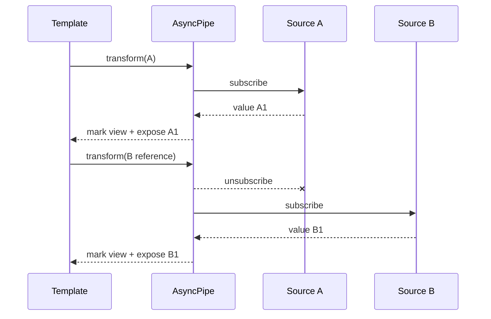

**Four examples:** a finite HTTP view model completes after one response; an interval is unsubscribed when an `@if` removes its view; a Promise resolves once and its value is exposed; replacing `selectedUser$` with a different Observable reference unsubscribes the old source before subscribing to the new one.

**One pipe instance means one subscription.** Writing `user$ | async` three times creates three pipe instances and can create three subscriptions. For a cold HTTP source that can mean three requests. Bind once and alias the result, as above, or deliberately share the pipeline. Conversely, sharing a source does not eliminate the value of aliasing: aliasing also gives one coherent template snapshot and avoids repeated transforms.

**Stable-reference invariant:** do not call a template method or getter that constructs a new Observable on each evaluation. If `loadUser() | async` returns a fresh `http.get` each time, `AsyncPipe` observes a new identity, tears down the previous subscription and starts another. Construct the pipeline once in a field, or derive it from a stable input stream with `switchMap`.

**Boundaries and trade-offs:** use `AsyncPipe` when the view owns consumption; use `takeUntilDestroyed` when imperative code truly needs side effects. A pipe teardown prevents future delivery to that view but cannot reverse server mutations. Errors still need handling; an unhandled Observable error ends that subscription. `AsyncPipe` is impure so Angular can check for reference/value changes, but it does not continuously poll the producer.

**Cost:** each pipe occurrence retains O(1) subscription/bookkeeping state plus the latest referenced value; an emission marks its owning view and causes the relevant change-detection/render work. With p separate pipe occurrences, subscription overhead is O(p), and a cold source may repeat upstream cost p times. Rendering a list of n emitted records still requires O(n) output work and DOM/state proportional to what is rendered. Interview follow-ups include aliasing, OnPush/zoneless notifications, error-state modeling, SSR timing, multiple pipe occurrences and when signal interop is preferable.

<a id="exercise"></a>
## Integrated senior interview exercise

Design `/orders` as a lazy route, resolve an application-wide HTTP service by DI, and provide one scoped `DraftSession` per editor subtree. Add a typed configuration token, a backwards-compatible `useExisting` alias and a multi-provider audit hook list; explain instance identity and the token lookup path. Expose the selected order through a signal-aware request boundary. Display loading/error/empty states, filter n returned orders in O(n) time and O(n) result space, and track visible rows by immutable IDs. Use `computed` for derived filters, `linkedSignal` for a selection that must remain valid, and OnPush-compatible notifications for visible state. Split a parent page, editor child and projected card shell. Pass the immutable draft down, emit Save up, query only DOM owned by the relevant component, and cancel superseded reads with `switchMap`. Use `combineLatest` for live filter inputs and `forkJoin` for a finite parallel dashboard load; state the first-emission and completion contracts. Prevent duplicate saves with an explicit `exhaustMap` or queued `concatMap` policy, and explain why client unsubscription does not roll back a server mutation. Share one current-user HTTP generation with an explicit replay/reset/invalidation policy, key it by identity, and prove that two overlapping views do not duplicate the request. Bind the view model once with `AsyncPipe`, alias its discriminated loading/ready/error state, and use `takeUntilDestroyed` for imperative route side effects. Add a keyboard-accessible host-metadata directive and a legacy SDK callback; explain whether to adapt the callback to a signal or call `markForCheck`. Test: two editor scopes, missing/optional provider, alias identity, duplicate multi contribution, empty list, reordered list, removed selection, A→B request race, duplicate Save clicks, a never-completing forkJoin source, a combineLatest source without an initial value, two subscribers to cold and shared HTTP sources, late replay subscriber, logout cache invalidation, repeated `async` use, an `@if`-destroyed async view, 401 response, malformed payload, same-reference input mutation, missing zoneless notification, detach/reattach cleanup, component recreation without stale observers, host keyboard behavior, and SSR work registered with `PendingTasks`. Do **not** claim route guards enforce authorization.

## Verification and primary sources

- Both **actual Library source texts** were inspected for Q1–Q34. This pass was bounded to Markdown lines 800–830 and DOCX extracted lines 515–534 for Q33–Q34; the two sources contained the same two questions. The Markdown source hash is `b1d89bb0461fa6ee0e9aa826a0093700731ca12348169b4aefd6c3d5f96bf42e` per the intake manifest. No DOCX byte hash is claimed.
- Code snippets and traces were checked conceptually against the linked official docs. The reader validator and JavaScript syntax checks were executed, but **no Angular CLI integration compile, browser screenshot or live server call was executed** during this source-comparison pass.
- Official Angular (reviewed 2026-10-11): [supported versions](https://angular.dev/reference/versions), [release timetable](https://angular.dev/reference/releases), [components/imports](https://angular.dev/guide/components/importing), [inputs and model](https://angular.dev/guide/components/inputs), [outputs](https://angular.dev/guide/components/outputs), [lifecycle](https://angular.dev/guide/components/lifecycle), [queries](https://angular.dev/guide/components/queries), [content projection](https://angular.dev/guide/components/content-projection), [pipes](https://angular.dev/guide/templates/pipes), [AOT compiler](https://angular.dev/tools/cli/aot-compiler), [control flow](https://angular.dev/guide/templates/control-flow), [signals](https://angular.dev/guide/signals), [linkedSignal](https://angular.dev/guide/signals/linked-signal), [resource](https://angular.dev/guide/signals/resource), [httpResource](https://angular.dev/guide/http/http-resource), [making HTTP requests](https://angular.dev/guide/http/making-requests), [skipping subtrees](https://angular.dev/best-practices/skipping-subtrees), [zoneless](https://angular.dev/guide/zoneless), [`ChangeDetectorRef`](https://angular.dev/api/core/ChangeDetectorRef), [hierarchical injectors](https://angular.dev/guide/di/hierarchical-dependency-injection), [defining providers](https://angular.dev/guide/di/defining-dependency-providers), [injection context](https://angular.dev/guide/di/dependency-injection-context), [`inject`](https://angular.dev/api/core/inject), [`HostBinding`](https://angular.dev/api/core/HostBinding), [`HostListener`](https://angular.dev/api/core/HostListener), [`AsyncPipe`](https://angular.dev/api/common/AsyncPipe), [`takeUntilDestroyed`](https://angular.dev/api/core/rxjs-interop/takeUntilDestroyed), [`afterNextRender`](https://angular.dev/api/core/afterNextRender).
- Official RxJS (reviewed 2026-10-11): [overview](https://rxjs.dev/guide/overview), [Subject variants](https://rxjs.dev/guide/subject), [`switchMap`](https://rxjs.dev/api/operators/switchMap), [`mergeMap`](https://rxjs.dev/api/operators/mergeMap), [`concatMap`](https://rxjs.dev/api/operators/concatMap), [`exhaustMap`](https://rxjs.dev/api/operators/exhaustMap), [`combineLatest`](https://rxjs.dev/api/index/function/combineLatest), [`forkJoin`](https://rxjs.dev/api/index/function/forkJoin), [`share`](https://rxjs.dev/api/operators/share), [`shareReplay`](https://rxjs.dev/api/operators/shareReplay), and the current [share](https://github.com/ReactiveX/rxjs/blob/master/packages/rxjs/src/share.ts), [shareReplay](https://github.com/ReactiveX/rxjs/blob/master/packages/rxjs/src/share-replay.ts) and [Subject](https://github.com/ReactiveX/rxjs/blob/master/packages/rxjs/src/subject.ts) source contracts. RxJS reset details are version-sensitive; the guide's concrete Angular code uses the RxJS 7 configuration shape.
- Added explanations, examples, traces, cost derivations and diagrams are teaching material, not copied source prose.
- **Next:** continue with the bounded forms section beginning at Q35 in both sources; keep extending this one canonical guide.

