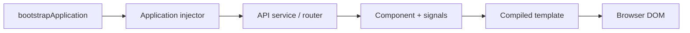
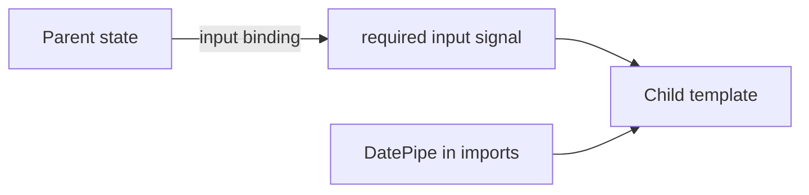
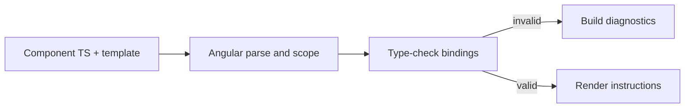
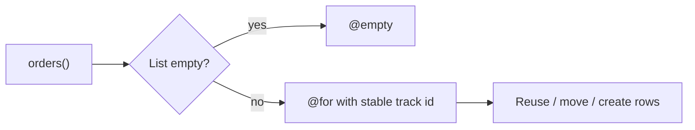
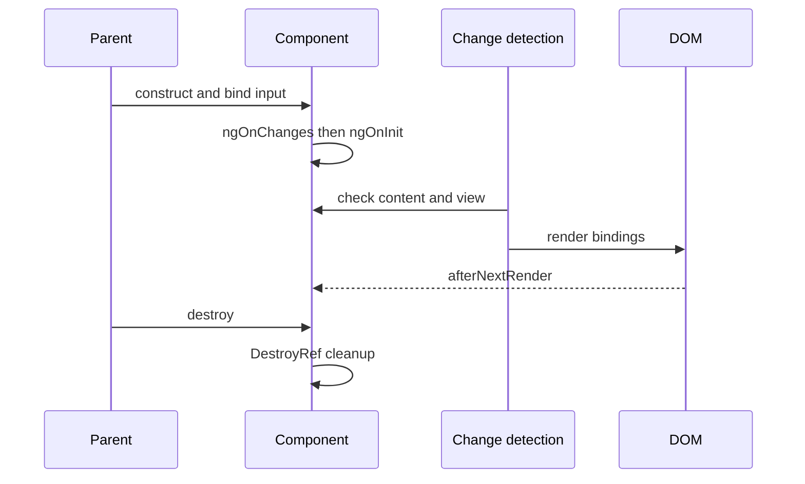
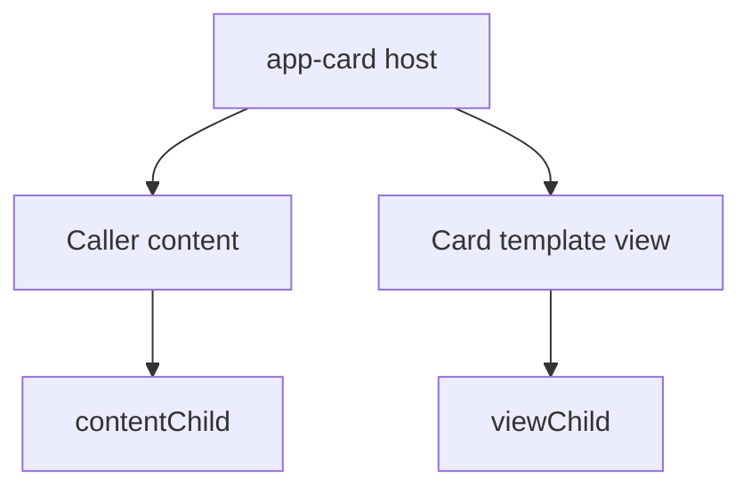

# Angular 22 — Interview Foundations (Q1–Q13)

> **Current bounded edition, 2026-10-11.** Reconciled `Angular_Interview_Mermaid_Workbook.md` Q1–Q13 (Q7–Q13 are lines 298–429) with the corresponding `Angular_Interview_Workbook.docx` text (Q7–Q13 are extracted lines 161–251). The paired sources agree; this edition adds explicit contracts, four scenario families, lifecycle/event traces, modern signal APIs, diagrams, costs and caveats. It is **not** a claim that an Angular application was compiled. Angular 22 is the current major release; earlier decorator and NgModule APIs remain supported.

## Contents

- [Q1: Why Angular?](#q1)
- [Q2: Standalone components](#q2)
- [Q3: Bootstrapping](#q3)
- [Q4: AOT and template checking](#q4)
- [Q5: Binding directions](#q5)
- [Q6: Built-in control flow](#q6)
- [Q7: Component lifecycle](#q7)
- [Q8: Constructor vs ngOnInit](#q8)
- [Q9: Parent/child communication](#q9)
- [Q10: View and content queries](#q10)
- [Q11: Content projection](#q11)
- [Q12: Directive vs component](#q12)
- [Q13: Pure vs impure pipes](#q13)
- [Integrated exercise and references](#exercise)

## The architecture at a glance

Angular links component state, dependency injection, router, HTTP and forms with a compiled template system. A component **owns UI behavior**, a service typically owns reusable API/business coordination, and a template **projects state into the view**. Their exact ownership depends on the application architecture.



<a id="q1"></a>
## Q1. What does Angular solve?

**Requirement:** Explain what is gained by adopting a complete application framework rather than assembling unrelated libraries. Angular provides component templates, DI, routing, forms, HTTP, compilation/tooling, SSR/hydration integration and consistent patterns.

| Scenario | Expected architecture | Mistake to avoid |
|---|---|---|
| Many teams own screens | Shared conventions and testable components | One giant app component |
| Edit an order | Form with validation and API service | Trusting browser validation on the server |
| Navigate to a report | Router and lazy feature | Loading all features on startup |
| Search orders | Service fetches; component owns filter state | HTTP calls directly from template expressions |

**Step-by-step request trace:** (1) URL matches a route. (2) Angular loads the route component. (3) The injector resolves its dependencies. (4) The service requests data. (5) State updates, and Angular schedules the bound view to refresh. If a user leaves the route, async operations need cancellation/ownership handling.

**Invariant:** a view displays state, but rendering is not authorization. Protect data in the backend. **Trade-off:** conventions reduce design churn but add framework concepts and opinionated defaults. **Complexity:** no meaningful fixed Big-O for framework choice; measure route bundle weight, API latency and affected DOM updates separately.

**Interview follow-ups:** Angular vs React; route/component/service responsibilities; SSR; hydration and lazy loading.

<a id="q2"></a>
## Q2. Standalone component vs NgModule

**Requirement:** Define a required typed input and use a pipe without declaring the component in an NgModule.

```typescript
import {Component, input} from '@angular/core';
import {DatePipe} from '@angular/common';

type User = { id: number; name: string; joined: Date };

@Component({
  selector: 'app-user-card',
  imports: [DatePipe],
  template: `<h3>{{ user().name }}</h3>
             <time>{{ user().joined | date:'mediumDate' }}</time>`
})
export class UserCard {
  readonly user = input.required<User>();
}
```

**Examples:** input `{id:1,name:'Asha',joined:new Date('2026-01-01')}` renders Asha and a date; replacing it with Ravi updates the view; omitting `[user]` on a template usage gives a required-input compiler diagnostic; passing an incompatible type gives a template type-checking diagnostic under strict typing.

**How it works:** (1) the parent supplies `[user]="selectedUser()"`; (2) Angular writes the signal input binding; (3) the child reads `user()`; (4) `DatePipe` is in this component's template scope because of `imports`. Angular 19+ components default to standalone; `standalone: true` remains allowed; `standalone: false` opts into NgModule declaration.



**Invariant:** the parent owns the supplied value; a child input signal is read-only. **Edges:** delayed data should be narrowed with an outer `@if` rather than forced via unsafe non-null assertions. **Complexity:** binding a reference is O(1), but rendering depends on the subtree. **Mistakes:** claiming NgModules are removed; forgetting a pipe/directive in imports.

**Follow-ups:** `@Input` vs `input()`; two-way `model()`; content projection; provider scopes.

<a id="q3"></a>
## Q3. Bootstrap a modern application

**Requirement:** Start a standalone root and register a router and HTTP interceptor.

```typescript
import {bootstrapApplication} from '@angular/platform-browser';
import {provideRouter, Routes} from '@angular/router';
import {provideHttpClient, withInterceptors} from '@angular/common/http';
import {AppComponent} from './app.component';
import {authInterceptor} from './auth.interceptor';

const routes: Routes = [{
  path: 'orders',
  loadComponent: () => import('./orders.component')
    .then(m => m.OrdersComponent)
}];

bootstrapApplication(AppComponent, {
  providers: [
    provideRouter(routes),
    provideHttpClient(withInterceptors([authInterceptor]))
  ]
}).catch(console.error);
```

**Four examples:** opening `/orders` loads the lazily declared route; an HTTP request made by injected HttpClient uses registered interceptors; missing `provideHttpClient` produces an injection problem; a failed lazy import causes a route-loading error.

**Trace:** application platform starts → providers registered in application injector → root component created → router resolves URL → route chunk imported → feature component instantiated → service injects HttpClient → outbound HTTP request flows through interceptors. The code assumes `authInterceptor` and `OrdersComponent` exist in a real app.

**Invariant:** importing a TypeScript symbol alone does **not** register its provider. **Security:** client route guards and interceptors do not replace server authorization. **Complexity:** lazy loading shifts network/bundle costs to route entry; it does not remove them. **Follow-ups:** root vs child injectors, SSR bootstrapping, OIDC tokens.

<a id="q4"></a>
## Q4. AOT and template type checking

**Requirement:** Detect a binding error before running the corresponding browser path.

| Input | Declared contract | Expected |
|---|---|---|
| `{{ user.name }}` | User has string name | Valid binding |
| `{{ user.addresss }}` | User has `address` only | Template diagnostic |
| `<app-user-card />` | `user` required | Missing-input diagnostic |
| `[user]="123"` | expects User | Type mismatch diagnostic |

**How it works:** Angular parses component metadata/template → resolves import scopes → constructs typed representations of bindings → asks TypeScript to check them → produces build diagnostics and rendering instructions. The compiler handles more than minification and can catch invalid property access.



**Invariant:** build-time validity says nothing about the shape of untrusted runtime JSON. Validate backend data at trust boundaries. **Boundary:** `any` and weakened template options erase useful checks. **Cost:** depends on codebase size and type complexity; no universal O(n) claim for a full compiler. **Follow-ups:** strictTemplates, JIT vs AOT, SSR builds.

<a id="q5"></a>
## Q5. Data-binding directions

**Requirement:** Support an editable search term, a clear button and an avatar URL.

```typescript
import {Component, signal} from '@angular/core';
import {FormsModule} from '@angular/forms';

@Component({
  selector: 'app-search',
  imports: [FormsModule],
  template: `<input [(ngModel)]="search" aria-label="Search">
    <button (click)="clear()">Clear</button>
    <p>{{ search }}</p>
    `
})
export class SearchComponent {
  search = '';
  readonly avatarUrl = signal('/assets/avatar.png');
  clear() { this.search = ''; }
}
```

**Four examples:**

| Binding | Example | Direction |
|---|---|---|
| Interpolation | `{{ search }}` | Component → text |
| Property | `[src]="avatarUrl()"` | Component → DOM property |
| Event | `(click)="clear()"` | DOM event → component |
| Two-way | `[(ngModel)]="search"` | Both via directive |

**Dry run:** initial empty → user types "ab" → NgModel updates `search` → interpolation displays "ab" → click Clear → `search` becomes empty and the form view synchronizes.

**Invariant:** data down, events up; two-way syntax combines the two directions. **Pitfalls:** missing FormsModule, writing `(click)="clear"` instead of invocation, conflating DOM attributes and properties. **Cost:** this tiny example's handlers perform O(1) work, while resulting DOM updates depend on affected content. **Follow-ups:** model inputs, reactive forms, zoneless notifications, sanitization.

<a id="q6"></a>
## Q6. Built-in control flow and identity

**Requirement:** Render an order list, keep row identity during reorder and display an empty state.

```typescript
import {Component, signal} from '@angular/core';
type Order = {id: string; amount: number};

@Component({
  selector: 'app-orders',
  template: `
    @for (order of orders(); track order.id) {
      <p>{{ order.id }}: {{ order.amount }}</p>
    } @empty {
      <p>No orders</p>
    }
  `
})
export class OrdersComponent {
  readonly orders = signal<Order[]>([]);
}
```

| Input `orders()` | Expected rendered view |
|---|---|
| `[]` | No orders |
| `[{id:'a',amount:10}]` | a: 10 |
| `[a,b]` → `[b,a]` | Rows reorder, stable IDs reused |
| `[a,b]` → `[b,c]` | a removed, c created, b retained |

**Detailed trace:** `orders()` signal changes → Angular re-evaluates the loop → compares tracking keys to prior iteration → reuses/moves/removes/creates rows → updates bindings. A unique stable entity key is the essential invariant; changing keys or using indices for reordering lists can mix up component state.

**Original state diagram:**



**Boundaries:** duplicate IDs break the intended stable identity mapping; Angular `@switch` does not fall through; choose `@if` for conditional content and `@for` for iteration. **Complexity:** n rows require O(n) output DOM capacity; no claim that keyed list rendering is O(1). **Follow-ups:** `@if` aliases, `@defer`, immutable lists and signals.

## Components, lifecycle and communication

The next seven questions share one mental model: Angular creates a component instance, binds inputs, checks and renders its view, lets it communicate through explicit APIs, and eventually destroys the instance. Keep **ownership** visible: a parent owns input state, a child emits an event describing what happened, and a two-way `model()` is justified only when both sides intentionally share one component-level value.

| Scenario | Primary mechanism | Why | Boundary |
|---|---|---|---|
| Parent supplies an immutable order | `input.required<Order>()` | Typed data flows down | Child cannot write the input signal |
| Child reports Save | `output<OrderDraft>()` | Event flows up | Custom outputs do not bubble through DOM ancestors |
| Reusable slider edits a value | `model(0)` | Deliberate two-way component API | Avoid for unrelated multi-field state |
| Card accepts caller-defined body | `<ng-content>` + `contentChild` if inspection is required | Caller supplies content; card owns layout | Projection is compiled, not a run-time DOM portal |

<a id="q7"></a>
## Q7. Describe the component lifecycle

**Requirement:** Fetch data for a required `userId` input, perform a DOM measurement only after rendering, and cancel owned asynchronous work on destruction.

Angular walks the application tree top-to-bottom while checking bindings. An instance is visited once per traversal, so changing more state halfway through check hooks is unsafe. The useful phases are:

| Phase | Hook/API | Precise use |
|---|---|---|
| Construct | `constructor` / `inject()` | Establish dependencies and input-independent fields |
| Bind/update | `ngOnChanges` | React to one or more changed inputs; first call precedes `ngOnInit` |
| Initialize | `ngOnInit` | One-time work after initial inputs exist, before this view initializes |
| Content/view | `ngAfterContentInit`, `ngAfterViewInit` | Read initialized query results; do not casually mutate checked state |
| Render DOM | `afterNextRender`, `afterEveryRender` | Application-wide post-render callback; DOM write/read phasing |
| Destroy | `ngOnDestroy` or `DestroyRef` | Release timers, observers and owned subscriptions |

```typescript
import {
  Component, DestroyRef, ElementRef, afterNextRender,
  inject, input
} from '@angular/core';
import {takeUntilDestroyed} from '@angular/core/rxjs-interop';
import {UserApi} from './user-api';

@Component({
  selector: 'app-user-panel',
  template: `<section>{{ status }}</section>`
})
export class UserPanel {
  readonly userId = input.required<string>();
  private readonly api = inject(UserApi);
  private readonly host = inject(ElementRef<HTMLElement>);
  private readonly destroyRef = inject(DestroyRef);
  status = 'idle';

  constructor() {
    // Render callbacks require an injection context; the constructor provides one.
    afterNextRender({
      write: () => this.host.nativeElement.classList.add('measured'),
      read: () => this.host.nativeElement.getBoundingClientRect().height
    });
  }

  ngOnInit() {
    this.status = 'loading';
    this.api.load(this.userId())
      .pipe(takeUntilDestroyed(this.destroyRef))
      .subscribe({
        next: () => this.status = 'ready',
        error: () => this.status = 'error'
      });
  }
}
```

**Initial dry run:** instantiate → inject dependencies → set `userId='u7'` → first `ngOnChanges` (if implemented) → `ngOnInit` subscribes → template initializes/checks → DOM render finishes → write phase adds class → read phase measures. **Update:** parent changes `userId`; Angular calls `ngOnChanges`, not `ngOnInit` again. The example therefore demonstrates one initial load; a production component that reloads on every ID needs `ngOnChanges` or a reactive effect/switching pipeline. **Destroy:** route leaves → `DestroyRef` signals → `takeUntilDestroyed` unsubscribes.



**Four boundaries:** empty/invalid IDs must be rejected by the API contract; `afterNextRender` does not run during SSR or build-time prerender; `ngDoCheck` and checked hooks are frequent and can become hot paths; an async callback should not write after destruction. **Correctness invariant:** each acquired resource has exactly one owner and cleanup path. **Cost:** a hook body costs whatever work it performs; putting O(n) work in a hook executed c times costs O(cn), while one subscription occupies O(1) framework references plus stream-specific state.

<a id="q8"></a>
## Q8. `constructor` vs `ngOnInit`

**Requirement:** explain why `userId()` should not be read as if bound inside the constructor.

| Property | Constructor | `ngOnInit` |
|---|---|---|
| Owner | JavaScript/TypeScript class creation | Angular lifecycle |
| Inputs guaranteed initialized | No | Yes, initial values are set |
| Runs | Once per instance | Once per instance |
| Good work | DI, cheap field setup, registering APIs that require injection context | Input-dependent initialization |
| Testing concern | Heavy side effects make construction hard to test | Still avoid hidden global side effects |

```typescript
import {input} from '@angular/core';

export class ProfileComponent {
  readonly userId = input.required<string>();
  initialUserId = '';

  constructor() {
    // Do not read this.userId() as though the parent has bound it here.
  }

  ngOnInit() {
    this.initialUserId = this.userId(); // initial input is available
  }
}
```

**Examples:** inject a logger in a field initializer; create an `AbortController` in construction and abort it through `DestroyRef`; derive initial state from a bound ID in `ngOnInit`; react to later ID changes with `ngOnChanges` rather than expecting `ngOnInit` to repeat. **Common error:** saying constructors are “not Angular.” Angular invokes the class constructor, but the language owns its semantics; Angular owns input binding and lifecycle timing. **Cost:** both callbacks are O(1) unless application work inside them changes that.

<a id="q9"></a>
## Q9. Parent and child communication

**Requirement:** a parent passes a draft to an editor; the editor reports Save without mutating the parent-owned object.

```typescript
import {Component, input, output} from '@angular/core';

type Draft = Readonly<{id: string; title: string}>;
type SaveEvent = {id: string; title: string};

@Component({
  selector: 'app-draft-editor',
  template: `<button (click)="save('Reviewed')">Save</button>`
})
export class DraftEditor {
  readonly draft = input.required<Draft>();
  readonly saved = output<SaveEvent>();

  save(title: string) {
    this.saved.emit({id: this.draft().id, title});
  }
}
```

```html
<app-draft-editor
  [draft]="selectedDraft()"
  (saved)="replaceDraft($event)" />
```

**Event trace:** parent evaluates input → child reads a read-only `InputSignal` → user clicks → child constructs a new event value → `emit` invokes the bound parent listener → parent replaces owned state → bindings refresh. Angular custom outputs are case-sensitive and do not bubble through the DOM.

**Choosing a channel:** input/output for direct ownership across one component edge; `model()` for a true two-way value such as a custom control; DI service/store for many unrelated consumers with an explicit lifetime; router state for navigable state. Do not reach into a child with a query just to bypass a clear input/output API.

**Four examples:** required input omitted produces a build diagnostic; a Save output carries a typed payload; a slider `model()` automatically has a matching `valueChange` output; a shared feature store coordinates siblings without chaining events through every intermediate component. **Invariant:** there is one authoritative owner for each mutable state value. **Cost:** passing/emitting a reference is O(1); copying a draft with k fields is O(k); rendering downstream output is additional.

<a id="q10"></a>
## Q10. `viewChild` vs `contentChild`

**Requirement:** a card focuses a button declared in its own template and optionally inspects a title projected by its caller.

```typescript
import {Component, ElementRef, contentChild, viewChild} from '@angular/core';

@Component({selector: 'card-title', template: `<ng-content />`})
export class CardTitle {}

@Component({
  selector: 'app-card',
  imports: [CardTitle],
  template: `
    <header><ng-content select="card-title">Untitled</ng-content></header>
    <ng-content />
    <button #close type="button">Close</button>`
})
export class Card {
  readonly closeButton = viewChild.required<ElementRef<HTMLButtonElement>>('close');
  readonly projectedTitle = contentChild(CardTitle);

  focusClose() { this.closeButton().nativeElement.focus(); }
}
```



**Four examples:** `viewChild('close')` finds the local template reference; it does not search projected content; `contentChild(CardTitle)` finds the caller's projected title; an optional query returns `undefined` when no result exists; a required query reports failure if the promised result is absent. Query functions return signals and update as conditional content changes.

**Boundaries:** a query never pierces another component's template; use `read: ElementRef` or `TemplateRef` only when that is the actual contract; DOM access requires browser/SSR care; content query descendant behavior differs between `contentChild` and `contentChildren`. **Invariant:** view = nodes declared by this template; content = nodes supplied between this component's host tags. **Cost:** framework query maintenance depends on the candidate subtree; reading the returned signal is O(1), while processing m query results is O(m).

<a id="q11"></a>
## Q11. Content projection

**Requirement:** build one card shell with named title content, arbitrary body content, and sensible fallbacks.

```typescript
import {Component} from '@angular/core';

@Component({
  selector: 'app-card',
  template: `
    <article class="card">
      <header><ng-content select="[card-title]">Untitled</ng-content></header>
      <section><ng-content>No content</ng-content></section>
    </article>`
})
export class Card {}
```

```html
<app-card>
  <h2 card-title>Orders</h2>
  <app-order-list />
</app-card>
```

**Projection trace:** Angular compiles each `<ng-content>` slot → at use-site it classifies host children by selector → matching title goes to the named slot → unmatched nodes go to the catch-all slot → card template supplies surrounding DOM. `<ng-content>` itself is not emitted as a DOM node.

**Four examples:** title and body both supplied; title missing uses fallback title; unmatched content goes to the unqualified slot; without an unqualified slot, unmatched nodes are not rendered. **Common errors:** treating `<ng-content>` like a run-time element, adding directives/attributes to it, or conditionally adding/removing the placeholder. Use template fragments for genuinely dynamic template composition.

**Trade-off:** projection gives flexible composition without duplicating layout, but too many selector slots create a fragile mini-language. **Output cost:** rendering p projected DOM nodes requires O(p) output space; selector matching and rendering are framework concerns, not “free” because the shell is reusable.

<a id="q12"></a>
## Q12. Directive vs component

**Requirement:** add reusable focus behavior without introducing an unnecessary wrapper component.

```typescript
import {Directive, ElementRef, HostListener, inject} from '@angular/core';

@Directive({selector: '[focusOnInvalid]'})
export class FocusOnInvalidDirective {
  private readonly host = inject(ElementRef<HTMLElement>);

  @HostListener('submit')
  focusFirstInvalid() {
    this.host.nativeElement
      .querySelector<HTMLElement>(':invalid')
      ?.focus();
  }
}
```

Use a **component** when the feature owns a UI template, styles and a meaningful public UI API. Use an **attribute directive** for cross-cutting behavior on an existing host, and a structural/template mechanism when behavior controls embedded views. A component is a directive with a template, but not every directive should become a component.

**Examples:** order card → component; permission tooltip behavior → directive; autofocus/validation behavior → directive; complex date picker with its own DOM → component. **Boundaries:** direct DOM APIs need platform/accessibility care; directives on the same element must not depend on an undocumented lifecycle ordering; host directives can compose behavior when their public API remains intentional. **Complexity:** the selector attachment is framework work; this example's `querySelector` is up to O(d) in the host descendant count.

<a id="q13"></a>
## Q13. Pure vs impure pipes

**Requirement:** format an immutable list of names without re-running an O(n) transformation on every unrelated check.

```typescript
import {Pipe, PipeTransform} from '@angular/core';

@Pipe({name: 'joinNames'})
export class JoinNamesPipe implements PipeTransform {
  transform(names: readonly string[], separator = ', '): string {
    return names.join(separator);
  }
}
```

A pipe is pure by default. Angular re-executes it when a primitive input changes or an object/array **reference** changes. Mutating `names.push('Meera')` preserves the reference, so a pure pipe may not run; replace it with `names = [...names, 'Meera']`. Setting `pure: false` lets a pipe observe internal mutation but can invoke it much more frequently.

| Input transition | Pure pipe runs? | Resulting lesson |
|---|---|---|
| `'a'` → `'b'` | Yes | Primitive changed |
| `[A]` → `[A,B]` new array | Yes | Reference changed |
| Same array, `push(B)` | No guarantee of desired recomputation | Prefer immutable replacement |
| Unrelated component state changes | Usually skipped for same pure inputs | Pure pipe saves repeated work |

**Trace and cost:** for n names, `join` consumes O(n) element visits and O(L) output characters, where L is the produced string length. Across c checks, an impure version can cost O(c(n + L)); a pure version performs that cost only when its inputs change, plus framework comparison overhead. The output string itself requires O(L) space.

**Invariant:** `transform` is deterministic and side-effect free for the same inputs. **Never:** start HTTP calls, mutate application state, or hide subscriptions in a pipe. Extract reusable transformation logic into a standalone function for services/non-template callers rather than injecting the pipe class. **Follow-ups:** AsyncPipe ownership, memoized `computed`, immutable data, pipe arguments and operator precedence.

<a id="exercise"></a>
## Integrated senior interview exercise

Design `/orders` as a lazy route, resolve an HTTP service by DI, display loading/error/empty states, filter n returned orders in O(n) time and O(n) extra space, and track visible rows by immutable IDs. Split a parent page, editor child and projected card shell. Pass the immutable draft down, emit Save up, query only DOM owned by the relevant component, and cancel a pending request on destruction. Test: empty list, reordered list, missing projected title, late response after navigation, 401 response, malformed backend payload, and a pure pipe receiving both a mutated and replaced array. Do **not** claim route guards enforce authorization.

## Verification and primary sources

- Both **actual Library source texts** were inspected for Q1–Q13. Q7–Q13 were bounded to Markdown lines 298–429 and DOCX extracted lines 161–251; both contained the same seven questions. The Markdown source hash is `b1d89bb0461fa6ee0e9aa826a0093700731ca12348169b4aefd6c3d5f96bf42e` per the intake manifest. No DOCX byte hash is claimed.
- Code snippets and traces were checked conceptually against the linked official docs. **No Angular CLI/Node integration compile, browser screenshot or live server call was executed** during this source-comparison pass.
- Official Angular (reviewed 2026-10-11): [supported versions](https://angular.dev/reference/versions), [release timetable](https://angular.dev/reference/releases), [components/imports](https://angular.dev/guide/components/importing), [inputs and model](https://angular.dev/guide/components/inputs), [outputs](https://angular.dev/guide/components/outputs), [lifecycle](https://angular.dev/guide/components/lifecycle), [queries](https://angular.dev/guide/components/queries), [content projection](https://angular.dev/guide/components/content-projection), [pipes](https://angular.dev/guide/templates/pipes), [AOT compiler](https://angular.dev/tools/cli/aot-compiler), [control flow](https://angular.dev/guide/templates/control-flow), [zoneless](https://angular.dev/guide/zoneless).
- Added explanations, examples, traces, cost derivations and diagrams are teaching material, not copied source prose.
- **Next:** read and enrich Q14–Q20, signals and change detection, from both sources; keep this one canonical guide.

