# Angular 22 — Interview Foundations (Q1–Q52)

> **Current bounded edition, 2026-10-11.** Reconciled `Angular_Interview_Mermaid_Workbook.md` Q1–Q52 (Q52 is lines 1151–1162) with the corresponding `Angular_Interview_Workbook.docx` text (Q52 is extracted lines 751–758). The paired sources agree; this edition adds explicit contracts, scenario families, reactive state, routing and HTTP traces, modern signal/resource, forms and DI APIs, route-level rendering, hydration, measured list-performance guidance, lifecycle-stability diagnosis, large-application dependency boundaries, pragmatic component ownership and behavior-focused component testing, with diagrams, costs and caveats. It is **not** a claim that an Angular application was compiled. Angular 22 is the current major release; earlier decorator and NgModule APIs remain supported.

## Contents

- [Q1: Why Angular?](#q1)
- [Q2: Standalone components](#q2)
- [Q3: Bootstrapping](#q3)
- [Q4: AOT and template checking](#q4)
- [Q5: Binding directions](#q5)
- [Q6: Built-in control flow](#q6)
- [Q7: Component lifecycle](#q7)
- [Q8: Constructor vs ngOnInit](#q8)
- [Q9: Parent/child communication](#q9)
- [Q10: View and content queries](#q10)
- [Q11: Content projection](#q11)
- [Q12: Directive vs component](#q12)
- [Q13: Pure vs impure pipes](#q13)
- [Q14: Angular signals](#q14)
- [Q15: signal vs computed vs effect](#q15)
- [Q16: Dynamic dependency tracking](#q16)
- [Q17: linkedSignal](#q17)
- [Q18: resource and httpResource](#q18)
- [Q19: Change detection](#q19)
- [Q20: OnPush today](#q20)
- [Q21: Zoneless Angular](#q21)
- [Q22: ChangeDetectorRef](#q22)
- [Q23: Dependency injection](#q23)
- [Q24: inject vs constructor injection](#q24)
- [Q25: Provider recipes](#q25)
- [Q26: Multi providers](#q26)
- [Q27: Host metadata](#q27)
- [Q28: Observable vs Promise](#q28)
- [Q29: Subject families](#q29)
- [Q30: Higher-order mapping](#q30)
- [Q31: combineLatest vs forkJoin](#q31)
- [Q32: Subscription ownership](#q32)
- [Q33: Cold vs hot Observables](#q33)
- [Q34: AsyncPipe lifecycle](#q34)
- [Q35: Reactive vs template-driven forms](#q35)
- [Q36: Signal Forms](#q36)
- [Q37: Sync vs async validators](#q37)
- [Q38: Standalone lazy routing](#q38)
- [Q39: Guard vs resolver](#q39)
- [Q40: HTTP interceptors](#q40)
- [Q41: HTTP error ownership](#q41)
- [Q42: Cancel stale HTTP requests](#q42)
- [Q43: Service + signals vs NgRx](#q43)
- [Q44: Signal feature-store design](#q44)
- [Q45: Deferrable views](#q45)
- [Q46: CSR vs SSR vs prerendering](#q46)
- [Q47: Hydration and incremental hydration](#q47)
- [Q48: Slow-list diagnosis](#q48)
- [Q49: ExpressionChangedAfterItHasBeenChecked](#q49)
- [Q50: Large-application structure](#q50)
- [Q51: Smart vs presentational components](#q51)
- [Q52: Component testing](#q52)
- [Integrated exercise and references](#exercise)

## The architecture at a glance

Angular links component state, dependency injection, router, HTTP and forms with a compiled template system. A component **owns UI behavior**, a service typically owns reusable API/business coordination, and a template **projects state into the view**. Their exact ownership depends on the application architecture.

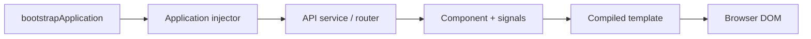

<a id="q1"></a>
## Q1. What does Angular solve?

**Requirement:** Explain what is gained by adopting a complete application framework rather than assembling unrelated libraries. Angular provides component templates, DI, routing, forms, HTTP, compilation/tooling, SSR/hydration integration and consistent patterns.

| Scenario | Expected architecture | Mistake to avoid |
|---|---|---|
| Many teams own screens | Shared conventions and testable components | One giant app component |
| Edit an order | Form with validation and API service | Trusting browser validation on the server |
| Navigate to a report | Router and lazy feature | Loading all features on startup |
| Search orders | Service fetches; component owns filter state | HTTP calls directly from template expressions |

**Step-by-step request trace:** (1) URL matches a route. (2) Angular loads the route component. (3) The injector resolves its dependencies. (4) The service requests data. (5) State updates, and Angular schedules the bound view to refresh. If a user leaves the route, async operations need cancellation/ownership handling.

**Invariant:** a view displays state, but rendering is not authorization. Protect data in the backend. **Trade-off:** conventions reduce design churn but add framework concepts and opinionated defaults. **Complexity:** no meaningful fixed Big-O for framework choice; measure route bundle weight, API latency and affected DOM updates separately.

**Interview follow-ups:** Angular vs React; route/component/service responsibilities; SSR; hydration and lazy loading.

<a id="q2"></a>
## Q2. Standalone component vs NgModule

**Requirement:** Define a required typed input and use a pipe without declaring the component in an NgModule.

```typescript
import {Component, input} from '@angular/core';
import {DatePipe} from '@angular/common';

type User = { id: number; name: string; joined: Date };

@Component({
  selector: 'app-user-card',
  imports: [DatePipe],
  template: `<h3>{{ user().name }}</h3>
             <time>{{ user().joined | date:'mediumDate' }}</time>`
})
export class UserCard {
  readonly user = input.required<User>();
}
```

**Examples:** input `{id:1,name:'Asha',joined:new Date('2026-01-01')}` renders Asha and a date; replacing it with Ravi updates the view; omitting `[user]` on a template usage gives a required-input compiler diagnostic; passing an incompatible type gives a template type-checking diagnostic under strict typing.

**How it works:** (1) the parent supplies `[user]="selectedUser()"`; (2) Angular writes the signal input binding; (3) the child reads `user()`; (4) `DatePipe` is in this component's template scope because of `imports`. Angular 19+ components default to standalone; `standalone: true` remains allowed; `standalone: false` opts into NgModule declaration.

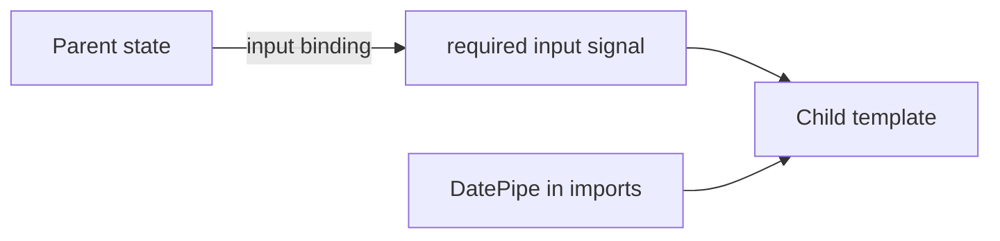

**Invariant:** the parent owns the supplied value; a child input signal is read-only. **Edges:** delayed data should be narrowed with an outer `@if` rather than forced via unsafe non-null assertions. **Complexity:** binding a reference is O(1), but rendering depends on the subtree. **Mistakes:** claiming NgModules are removed; forgetting a pipe/directive in imports.

**Follow-ups:** `@Input` vs `input()`; two-way `model()`; content projection; provider scopes.

<a id="q3"></a>
## Q3. Bootstrap a modern application

**Requirement:** Start a standalone root and register a router and HTTP interceptor.

```typescript
import {bootstrapApplication} from '@angular/platform-browser';
import {provideRouter, Routes} from '@angular/router';
import {provideHttpClient, withInterceptors} from '@angular/common/http';
import {AppComponent} from './app.component';
import {authInterceptor} from './auth.interceptor';

const routes: Routes = [{
  path: 'orders',
  loadComponent: () => import('./orders.component')
    .then(m => m.OrdersComponent)
}];

bootstrapApplication(AppComponent, {
  providers: [
    provideRouter(routes),
    provideHttpClient(withInterceptors([authInterceptor]))
  ]
}).catch(console.error);
```

**Four examples:** opening `/orders` loads the lazily declared route; an HTTP request made by injected HttpClient uses registered interceptors; missing `provideHttpClient` produces an injection problem; a failed lazy import causes a route-loading error.

**Trace:** application platform starts → providers registered in application injector → root component created → router resolves URL → route chunk imported → feature component instantiated → service injects HttpClient → outbound HTTP request flows through interceptors. The code assumes `authInterceptor` and `OrdersComponent` exist in a real app.

**Invariant:** importing a TypeScript symbol alone does **not** register its provider. **Security:** client route guards and interceptors do not replace server authorization. **Complexity:** lazy loading shifts network/bundle costs to route entry; it does not remove them. **Follow-ups:** root vs child injectors, SSR bootstrapping, OIDC tokens.

<a id="q4"></a>
## Q4. AOT and template type checking

**Requirement:** Detect a binding error before running the corresponding browser path.

| Input | Declared contract | Expected |
|---|---|---|
| `{{ user.name }}` | User has string name | Valid binding |
| `{{ user.addresss }}` | User has `address` only | Template diagnostic |
| `<app-user-card />` | `user` required | Missing-input diagnostic |
| `[user]="123"` | expects User | Type mismatch diagnostic |

**How it works:** Angular parses component metadata/template → resolves import scopes → constructs typed representations of bindings → asks TypeScript to check them → produces build diagnostics and rendering instructions. The compiler handles more than minification and can catch invalid property access.

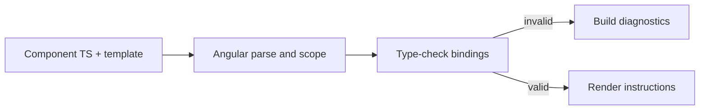

**Invariant:** build-time validity says nothing about the shape of untrusted runtime JSON. Validate backend data at trust boundaries. **Boundary:** `any` and weakened template options erase useful checks. **Cost:** depends on codebase size and type complexity; no universal O(n) claim for a full compiler. **Follow-ups:** strictTemplates, JIT vs AOT, SSR builds.

<a id="q5"></a>
## Q5. Data-binding directions

**Requirement:** Support an editable search term, a clear button and an avatar URL.

```typescript
import {Component, signal} from '@angular/core';
import {FormsModule} from '@angular/forms';

@Component({
  selector: 'app-search',
  imports: [FormsModule],
  template: `<input [(ngModel)]="search" aria-label="Search">
    <button (click)="clear()">Clear</button>
    <p>{{ search }}</p>
    `
})
export class SearchComponent {
  search = '';
  readonly avatarUrl = signal('/assets/avatar.png');
  clear() { this.search = ''; }
}
```

**Four examples:**

| Binding | Example | Direction |
|---|---|---|
| Interpolation | `{{ search }}` | Component → text |
| Property | `[src]="avatarUrl()"` | Component → DOM property |
| Event | `(click)="clear()"` | DOM event → component |
| Two-way | `[(ngModel)]="search"` | Both via directive |

**Dry run:** initial empty → user types "ab" → NgModel updates `search` → interpolation displays "ab" → click Clear → `search` becomes empty and the form view synchronizes.

**Invariant:** data down, events up; two-way syntax combines the two directions. **Pitfalls:** missing FormsModule, writing `(click)="clear"` instead of invocation, conflating DOM attributes and properties. **Cost:** this tiny example's handlers perform O(1) work, while resulting DOM updates depend on affected content. **Follow-ups:** model inputs, reactive forms, zoneless notifications, sanitization.

<a id="q6"></a>
## Q6. Built-in control flow and identity

**Requirement:** Render an order list, keep row identity during reorder and display an empty state.

```typescript
import {Component, signal} from '@angular/core';
type Order = {id: string; amount: number};

@Component({
  selector: 'app-orders',
  template: `
    @for (order of orders(); track order.id) {
      <p>{{ order.id }}: {{ order.amount }}</p>
    } @empty {
      <p>No orders</p>
    }
  `
})
export class OrdersComponent {
  readonly orders = signal<Order[]>([]);
}
```

| Input `orders()` | Expected rendered view |
|---|---|
| `[]` | No orders |
| `[{id:'a',amount:10}]` | a: 10 |
| `[a,b]` → `[b,a]` | Rows reorder, stable IDs reused |
| `[a,b]` → `[b,c]` | a removed, c created, b retained |

**Detailed trace:** `orders()` signal changes → Angular re-evaluates the loop → compares tracking keys to prior iteration → reuses/moves/removes/creates rows → updates bindings. A unique stable entity key is the essential invariant; changing keys or using indices for reordering lists can mix up component state.

**Original state diagram:**

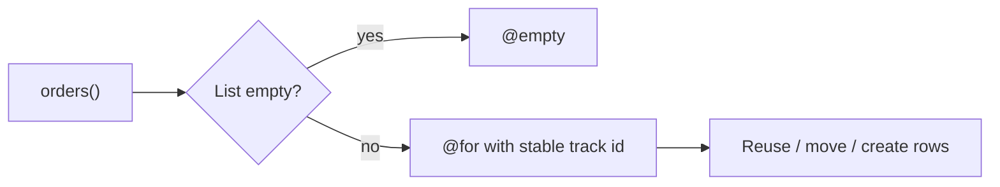

**Boundaries:** duplicate IDs break the intended stable identity mapping; Angular `@switch` does not fall through; choose `@if` for conditional content and `@for` for iteration. **Complexity:** n rows require O(n) output DOM capacity; no claim that keyed list rendering is O(1). **Follow-ups:** `@if` aliases, `@defer`, immutable lists and signals.

## Components, lifecycle and communication

The next seven questions share one mental model: Angular creates a component instance, binds inputs, checks and renders its view, lets it communicate through explicit APIs, and eventually destroys the instance. Keep **ownership** visible: a parent owns input state, a child emits an event describing what happened, and a two-way `model()` is justified only when both sides intentionally share one component-level value.

| Scenario | Primary mechanism | Why | Boundary |
|---|---|---|---|
| Parent supplies an immutable order | `input.required<Order>()` | Typed data flows down | Child cannot write the input signal |
| Child reports Save | `output<OrderDraft>()` | Event flows up | Custom outputs do not bubble through DOM ancestors |
| Reusable slider edits a value | `model(0)` | Deliberate two-way component API | Avoid for unrelated multi-field state |
| Card accepts caller-defined body | `<ng-content>` + `contentChild` if inspection is required | Caller supplies content; card owns layout | Projection is compiled, not a run-time DOM portal |

<a id="q7"></a>
## Q7. Describe the component lifecycle

**Requirement:** Fetch data for a required `userId` input, perform a DOM measurement only after rendering, and cancel owned asynchronous work on destruction.

Angular walks the application tree top-to-bottom while checking bindings. An instance is visited once per traversal, so changing more state halfway through check hooks is unsafe. The useful phases are:

| Phase | Hook/API | Precise use |
|---|---|---|
| Construct | `constructor` / `inject()` | Establish dependencies and input-independent fields |
| Bind/update | `ngOnChanges` | React to one or more changed inputs; first call precedes `ngOnInit` |
| Initialize | `ngOnInit` | One-time work after initial inputs exist, before this view initializes |
| Content/view | `ngAfterContentInit`, `ngAfterViewInit` | Read initialized query results; do not casually mutate checked state |
| Render DOM | `afterNextRender`, `afterEveryRender` | Application-wide post-render callback; DOM write/read phasing |
| Destroy | `ngOnDestroy` or `DestroyRef` | Release timers, observers and owned subscriptions |

```typescript
import {
  Component, DestroyRef, ElementRef, afterNextRender,
  inject, input
} from '@angular/core';
import {takeUntilDestroyed} from '@angular/core/rxjs-interop';
import {UserApi} from './user-api';

@Component({
  selector: 'app-user-panel',
  template: `<section>{{ status }}</section>`
})
export class UserPanel {
  readonly userId = input.required<string>();
  private readonly api = inject(UserApi);
  private readonly host = inject(ElementRef<HTMLElement>);
  private readonly destroyRef = inject(DestroyRef);
  status = 'idle';

  constructor() {
    // Render callbacks require an injection context; the constructor provides one.
    afterNextRender({
      write: () => this.host.nativeElement.classList.add('measured'),
      read: () => this.host.nativeElement.getBoundingClientRect().height
    });
  }

  ngOnInit() {
    this.status = 'loading';
    this.api.load(this.userId())
      .pipe(takeUntilDestroyed(this.destroyRef))
      .subscribe({
        next: () => this.status = 'ready',
        error: () => this.status = 'error'
      });
  }
}
```

**Initial dry run:** instantiate → inject dependencies → set `userId='u7'` → first `ngOnChanges` (if implemented) → `ngOnInit` subscribes → template initializes/checks → DOM render finishes → write phase adds class → read phase measures. **Update:** parent changes `userId`; Angular calls `ngOnChanges`, not `ngOnInit` again. The example therefore demonstrates one initial load; a production component that reloads on every ID needs `ngOnChanges` or a reactive effect/switching pipeline. **Destroy:** route leaves → `DestroyRef` signals → `takeUntilDestroyed` unsubscribes.

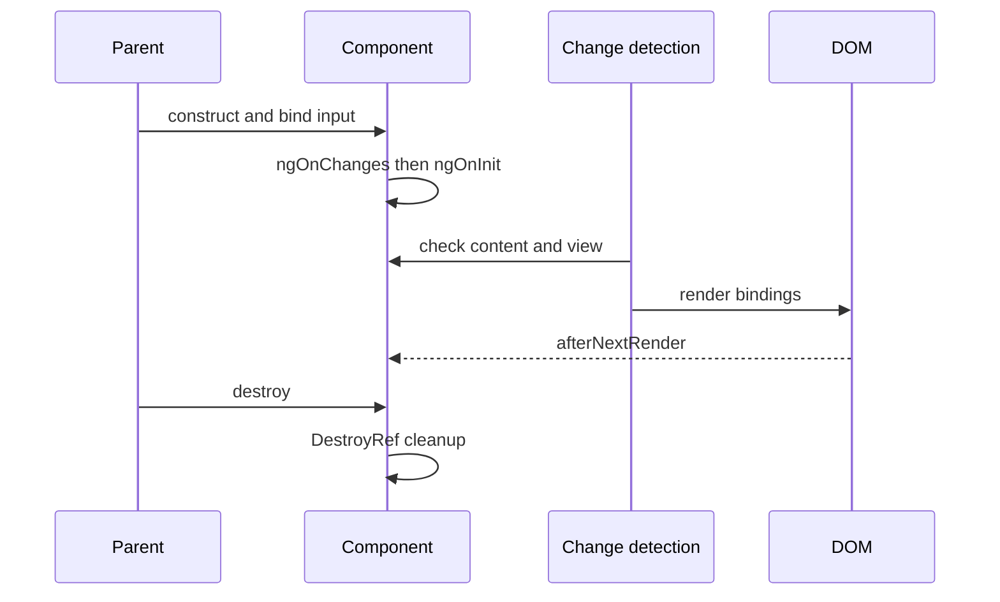

**Four boundaries:** empty/invalid IDs must be rejected by the API contract; `afterNextRender` does not run during SSR or build-time prerender; `ngDoCheck` and checked hooks are frequent and can become hot paths; an async callback should not write after destruction. **Correctness invariant:** each acquired resource has exactly one owner and cleanup path. **Cost:** a hook body costs whatever work it performs; putting O(n) work in a hook executed c times costs O(cn), while one subscription occupies O(1) framework references plus stream-specific state.

<a id="q8"></a>
## Q8. `constructor` vs `ngOnInit`

**Requirement:** explain why `userId()` should not be read as if bound inside the constructor.

| Property | Constructor | `ngOnInit` |
|---|---|---|
| Owner | JavaScript/TypeScript class creation | Angular lifecycle |
| Inputs guaranteed initialized | No | Yes, initial values are set |
| Runs | Once per instance | Once per instance |
| Good work | DI, cheap field setup, registering APIs that require injection context | Input-dependent initialization |
| Testing concern | Heavy side effects make construction hard to test | Still avoid hidden global side effects |

```typescript
import {input} from '@angular/core';

export class ProfileComponent {
  readonly userId = input.required<string>();
  initialUserId = '';

  constructor() {
    // Do not read this.userId() as though the parent has bound it here.
  }

  ngOnInit() {
    this.initialUserId = this.userId(); // initial input is available
  }
}
```

**Examples:** inject a logger in a field initializer; create an `AbortController` in construction and abort it through `DestroyRef`; derive initial state from a bound ID in `ngOnInit`; react to later ID changes with `ngOnChanges` rather than expecting `ngOnInit` to repeat. **Common error:** saying constructors are “not Angular.” Angular invokes the class constructor, but the language owns its semantics; Angular owns input binding and lifecycle timing. **Cost:** both callbacks are O(1) unless application work inside them changes that.

<a id="q9"></a>
## Q9. Parent and child communication

**Requirement:** a parent passes a draft to an editor; the editor reports Save without mutating the parent-owned object.

```typescript
import {Component, input, output} from '@angular/core';

type Draft = Readonly<{id: string; title: string}>;
type SaveEvent = {id: string; title: string};

@Component({
  selector: 'app-draft-editor',
  template: `<button (click)="save('Reviewed')">Save</button>`
})
export class DraftEditor {
  readonly draft = input.required<Draft>();
  readonly saved = output<SaveEvent>();

  save(title: string) {
    this.saved.emit({id: this.draft().id, title});
  }
}
```

```html
<app-draft-editor
  [draft]="selectedDraft()"
  (saved)="replaceDraft($event)" />
```

**Event trace:** parent evaluates input → child reads a read-only `InputSignal` → user clicks → child constructs a new event value → `emit` invokes the bound parent listener → parent replaces owned state → bindings refresh. Angular custom outputs are case-sensitive and do not bubble through the DOM.

**Choosing a channel:** input/output for direct ownership across one component edge; `model()` for a true two-way value such as a custom control; DI service/store for many unrelated consumers with an explicit lifetime; router state for navigable state. Do not reach into a child with a query just to bypass a clear input/output API.

**Four examples:** required input omitted produces a build diagnostic; a Save output carries a typed payload; a slider `model()` automatically has a matching `valueChange` output; a shared feature store coordinates siblings without chaining events through every intermediate component. **Invariant:** there is one authoritative owner for each mutable state value. **Cost:** passing/emitting a reference is O(1); copying a draft with k fields is O(k); rendering downstream output is additional.

<a id="q10"></a>
## Q10. `viewChild` vs `contentChild`

**Requirement:** a card focuses a button declared in its own template and optionally inspects a title projected by its caller.

```typescript
import {Component, ElementRef, contentChild, viewChild} from '@angular/core';

@Component({selector: 'card-title', template: `<ng-content />`})
export class CardTitle {}

@Component({
  selector: 'app-card',
  imports: [CardTitle],
  template: `
    <header><ng-content select="card-title">Untitled</ng-content></header>
    <ng-content />
    <button #close type="button">Close</button>`
})
export class Card {
  readonly closeButton = viewChild.required<ElementRef<HTMLButtonElement>>('close');
  readonly projectedTitle = contentChild(CardTitle);

  focusClose() { this.closeButton().nativeElement.focus(); }
}
```

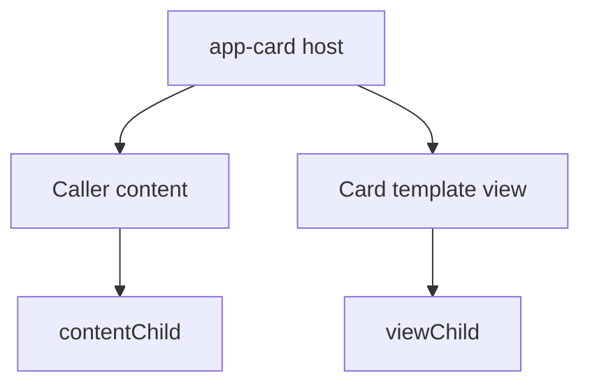

**Four examples:** `viewChild('close')` finds the local template reference; it does not search projected content; `contentChild(CardTitle)` finds the caller's projected title; an optional query returns `undefined` when no result exists; a required query reports failure if the promised result is absent. Query functions return signals and update as conditional content changes.

**Boundaries:** a query never pierces another component's template; use `read: ElementRef` or `TemplateRef` only when that is the actual contract; DOM access requires browser/SSR care; content query descendant behavior differs between `contentChild` and `contentChildren`. **Invariant:** view = nodes declared by this template; content = nodes supplied between this component's host tags. **Cost:** framework query maintenance depends on the candidate subtree; reading the returned signal is O(1), while processing m query results is O(m).

<a id="q11"></a>
## Q11. Content projection

**Requirement:** build one card shell with named title content, arbitrary body content, and sensible fallbacks.

```typescript
import {Component} from '@angular/core';

@Component({
  selector: 'app-card',
  template: `
    <article class="card">
      <header><ng-content select="[card-title]">Untitled</ng-content></header>
      <section><ng-content>No content</ng-content></section>
    </article>`
})
export class Card {}
```

```html
<app-card>
  <h2 card-title>Orders</h2>
  <app-order-list />
</app-card>
```

**Projection trace:** Angular compiles each `<ng-content>` slot → at use-site it classifies host children by selector → matching title goes to the named slot → unmatched nodes go to the catch-all slot → card template supplies surrounding DOM. `<ng-content>` itself is not emitted as a DOM node.

**Four examples:** title and body both supplied; title missing uses fallback title; unmatched content goes to the unqualified slot; without an unqualified slot, unmatched nodes are not rendered. **Common errors:** treating `<ng-content>` like a run-time element, adding directives/attributes to it, or conditionally adding/removing the placeholder. Use template fragments for genuinely dynamic template composition.

**Trade-off:** projection gives flexible composition without duplicating layout, but too many selector slots create a fragile mini-language. **Output cost:** rendering p projected DOM nodes requires O(p) output space; selector matching and rendering are framework concerns, not “free” because the shell is reusable.

<a id="q12"></a>
## Q12. Directive vs component

**Requirement:** add reusable focus behavior without introducing an unnecessary wrapper component.

```typescript
import {Directive, ElementRef, HostListener, inject} from '@angular/core';

@Directive({selector: '[focusOnInvalid]'})
export class FocusOnInvalidDirective {
  private readonly host = inject(ElementRef<HTMLElement>);

  @HostListener('submit')
  focusFirstInvalid() {
    this.host.nativeElement
      .querySelector<HTMLElement>(':invalid')
      ?.focus();
  }
}
```

Use a **component** when the feature owns a UI template, styles and a meaningful public UI API. Use an **attribute directive** for cross-cutting behavior on an existing host, and a structural/template mechanism when behavior controls embedded views. A component is a directive with a template, but not every directive should become a component.

**Examples:** order card → component; permission tooltip behavior → directive; autofocus/validation behavior → directive; complex date picker with its own DOM → component. **Boundaries:** direct DOM APIs need platform/accessibility care; directives on the same element must not depend on an undocumented lifecycle ordering; host directives can compose behavior when their public API remains intentional. **Complexity:** the selector attachment is framework work; this example's `querySelector` is up to O(d) in the host descendant count.

<a id="q13"></a>
## Q13. Pure vs impure pipes

**Requirement:** format an immutable list of names without re-running an O(n) transformation on every unrelated check.

```typescript
import {Pipe, PipeTransform} from '@angular/core';

@Pipe({name: 'joinNames'})
export class JoinNamesPipe implements PipeTransform {
  transform(names: readonly string[], separator = ', '): string {
    return names.join(separator);
  }
}
```

A pipe is pure by default. Angular re-executes it when a primitive input changes or an object/array **reference** changes. Mutating `names.push('Meera')` preserves the reference, so a pure pipe may not run; replace it with `names = [...names, 'Meera']`. Setting `pure: false` lets a pipe observe internal mutation but can invoke it much more frequently.

| Input transition | Pure pipe runs? | Resulting lesson |
|---|---|---|
| `'a'` → `'b'` | Yes | Primitive changed |
| `[A]` → `[A,B]` new array | Yes | Reference changed |
| Same array, `push(B)` | No guarantee of desired recomputation | Prefer immutable replacement |
| Unrelated component state changes | Usually skipped for same pure inputs | Pure pipe saves repeated work |

**Trace and cost:** for n names, `join` consumes O(n) element visits and O(L) output characters, where L is the produced string length. Across c checks, an impure version can cost O(c(n + L)); a pure version performs that cost only when its inputs change, plus framework comparison overhead. The output string itself requires O(L) space.

**Invariant:** `transform` is deterministic and side-effect free for the same inputs. **Never:** start HTTP calls, mutate application state, or hide subscriptions in a pipe. Extract reusable transformation logic into a standalone function for services/non-template callers rather than injecting the pipe class. **Follow-ups:** AsyncPipe ownership, memoized `computed`, immutable data, pipe arguments and operator precedence.

<a id="q14"></a>
## Q14. What is an Angular signal?

**Requirement:** hold a counter as component-owned state, expose it read-only, and derive a value without storing a second mutable copy.

```typescript
import {computed, signal} from '@angular/core';

export class Counter {
  private readonly countState = signal(0);
  readonly count = this.countState.asReadonly();
  readonly doubled = computed(() => this.count() * 2);

  increment() { this.countState.update(value => value + 1); }
  reset() { this.countState.set(0); }
}
```

A signal is a value wrapper that notifies tracked consumers when its value changes. Call it to read: `count()`. A writable signal adds `set` and `update`; `asReadonly()` removes that write API from consumers, but does **not** deep-freeze an object held inside it.

**Four examples:** a boolean controls a panel; a number drives a counter; a new immutable order object updates an order view; setting the same primitive again produces no downstream change under the default `Object.is` equality. For arrays and objects, replace rather than mutate when consumers depend on a new reference:

```typescript
readonly names = signal<readonly string[]>(['Asha']);

addRavi() {
  this.names.update(current => [...current, 'Ravi']); // new reference
}
```

**State trace:** read in a template → Angular records the template consumer → `set`/`update` produces a non-equal value → dependents are invalidated and the view is marked for synchronization → the next render reads the current value. Signals do not themselves make a mutable object immutable.

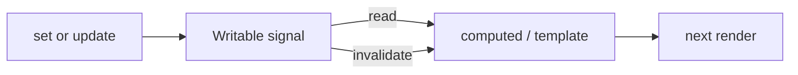

**Invariant:** one owner writes the state; consumers read it. **Cost:** reading or writing the signal container is conceptually O(1); a copied array update is O(n) time and O(n) space; rendering and each dependent derivation add their own work. **Common errors:** forgetting `()`, changing a nested property in place, using a signal as a security boundary, or promising that a write immediately mutates the DOM synchronously.

<a id="q15"></a>
## Q15. `signal` vs `computed` vs `effect`

**Requirement:** represent editable price and quantity, derive a total, and synchronize only the finished total to a non-reactive browser API.

```typescript
import {computed, effect, signal} from '@angular/core';

export class Basket {
  readonly price = signal(25);
  readonly quantity = signal(2);
  readonly total = computed(() => this.price() * this.quantity());

  constructor() {
    effect(() => localStorage.setItem('basket-total', String(this.total())));
  }
}
```

| Primitive | Owns writable state? | Cached derivation? | Intended job |
|---|---:|---:|---|
| `signal` | Yes | No | source state |
| `computed` | No | Yes, lazy and memoized | pure derived state |
| `effect` | No | No returned state | synchronize with a non-reactive API |

**Examples:** `quantity.set(3)` owns a new fact; `total()` derives `75`; a filtered list belongs in `computed`; logging, storage, a canvas or another imperative boundary can justify an `effect`. Do not use an effect to copy `total()` into another signal—two mutable representations can disagree.

**Trace:** first `total()` read runs the computation and caches 50 → a second read returns the cache → `quantity.set(3)` invalidates the cache → the next read computes 75 → the effect observes its dependency and eventually synchronizes `"75"`. Dependencies are determined by signal reads during the reactive execution.

**Invariant:** computed functions are pure and return the entire derived value; effects own only their external side effect and cleanup. A signal read after an `await` is outside the original synchronous tracking context, so capture tracked inputs before the async boundary. **Cost:** if derivation work is O(n), each invalidated-and-read computation is O(n), but repeated reads before invalidation are O(1); output construction still costs O(L) for L output units.

<a id="q16"></a>
## Q16. How dynamic dependency tracking works

**Requirement:** do not refilter a list while its results are hidden, but resume tracking when the panel becomes visible.

```typescript
import {computed, signal} from '@angular/core';

type Product = Readonly<{name: string}>;

export class SearchState {
  readonly visible = signal(false);
  readonly query = signal('');
  readonly products = signal<readonly Product[]>([]);

  readonly matches = computed(() => {
    if (!this.visible()) return [];
    const needle = this.query().trim().toLowerCase();
    return this.products().filter(p => p.name.toLowerCase().includes(needle));
  });
}
```

Angular tracks only signals actually read during the current reactive execution. The dependency set can add and remove edges on later executions.

| Step | State/change | Signals read by `matches` | Result |
|---:|---|---|---|
| 1 | read with `visible=false` | `visible` | `[]` cached |
| 2 | `query.set('cam')` | none rerun | cached result stays valid |
| 3 | `visible.set(true)` then read | `visible`, `query`, `products` | matching products |
| 4 | replace products | same three on next read | result recomputed |
| 5 | hide and read | `visible` only | query/products edges removed |

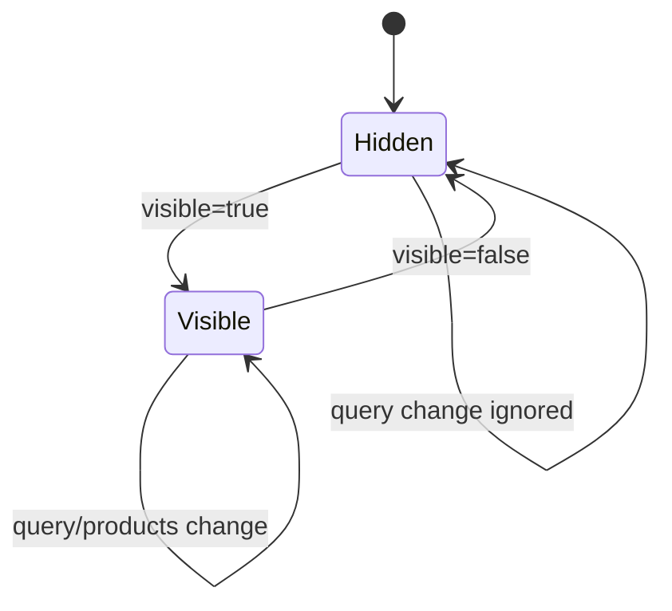

**Four examples:** a hidden expensive chart stops depending on samples; a selected account adds an account-details dependency; changing an unexecuted branch's signal does not invalidate the computed; `untracked` can intentionally read incidental data without adding an edge. **Boundary:** tracking is synchronous; a signal read only after `await` does not become a dependency of the original reactive context.

**Correctness invariant:** after every execution, the recorded dependencies are exactly the producers read on that execution. **Cost:** rebuilding the edge set is O(d) for d tracked reads; filtering n products costs O(n) time and O(k) result space for k matches, including constructing the output array.

<a id="q17"></a>
## Q17. When to use `linkedSignal`

**Requirement:** let a user override a selected shipping method, retain it when still valid, and fall back when server options change.

```typescript
import {linkedSignal, signal} from '@angular/core';

type Method = Readonly<{id: number; label: string}>;

export class ShippingPicker {
  readonly methods = signal<readonly Method[]>([
    {id: 1, label: 'Ground'},
    {id: 2, label: 'Air'}
  ]);

  readonly selected = linkedSignal<readonly Method[], Method | undefined>({
    source: this.methods,
    computation: (next, previous) =>
      next.find(method => method.id === previous?.value?.id) ?? next[0]
  });

  choose(method: Method) { this.selected.set(method); }
}
```

Unlike `computed`, a linked signal is writable. Unlike an independent `signal`, it recomputes from a source relationship. Here is the dry run:

| Action | Methods | Selected | Why |
|---|---|---|---|
| initialize | Ground, Air | Ground | first valid default |
| user chooses Air | Ground, Air | Air | local write allowed |
| server adds Sea | Ground, Air, Sea | Air | previous ID remains valid |
| server removes Air | Ground, Sea | Ground | fallback restores invariant |

**Examples:** valid selection in changing options; editable draft derived from the current record; unit view linked to a canonical value; resettable pagination linked to filters. Use `computed` if callers must never override the result, and a plain signal if no source relationship exists.

**Invariant:** `selected()` is either `undefined` for no options or belongs to the current option set. **Cost:** the `find` reconciliation is O(n) time and O(1) extra space; indexing methods by ID could make lookup expected O(1) at O(n) index space. **Common errors:** preserving an object by stale reference rather than stable ID, assuming `linkedSignal` is two-way persistence, or using it for every writable value.

<a id="q18"></a>
## Q18. `resource` and `httpResource`

**Requirement:** fetch a user reactively from a signal ID, cancel obsolete work, and render loading, error and value states without reading a failed value.

```typescript
import {computed, input} from '@angular/core';
import {httpResource} from '@angular/common/http';

type User = Readonly<{id: string; name: string}>;

export class UserPanel {
  readonly userId = input.required<string>();
  readonly user = httpResource<User>(() => `/api/users/${this.userId()}`);
  readonly heading = computed(() =>
    this.user.hasValue() ? `User: ${this.user.value().name}` : 'User');
}
```

```html
@if (user.hasValue()) {
  <h2>{{ heading() }}</h2>
} @else if (user.error()) {
  <p role="alert">Could not load this user.</p>
} @else if (user.isLoading()) {
  <p>Loading…</p>
}
```

`resource` connects reactive params to a general async loader; the loader receives an `AbortSignal`. `httpResource` is an eager reactive wrapper over `HttpClient`, including interceptor support. A dependency change starts a new request and cancels an outstanding one. A plain `HttpClient` observable is cold and starts on subscription.

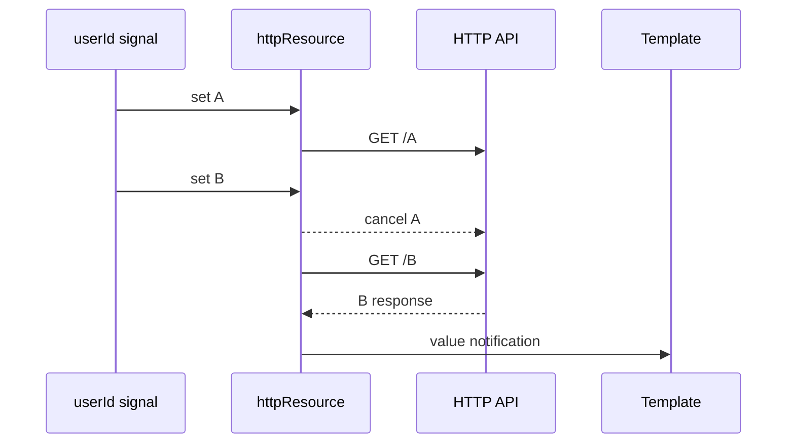

**Four examples:** reactive GET by ID; general `resource` loader for non-HTTP async work; an RxJS pipeline for debouncing and multi-source event orchestration; direct `HttpClient.post` for a mutation. Avoid `httpResource` for POST/PUT mutations, and guard `value()` with `hasValue()` because reading a resource value in an error state throws.

**Invariant:** only the latest active parameter set may publish its result; every UI path distinguishes idle/loading/value/error as needed. **Cost:** client bookkeeping is O(1) per active request plus the response and parsed object size O(b) for b bytes; network latency and server work dominate; rendering r returned records costs at least O(r) time and output space. **Testing:** exercise success, error, rapid A→B changes, empty response, teardown and interceptor behavior.

<a id="q19"></a>
## Q19. Change detection at a high level

**Requirement:** explain how a click that updates a template-read signal reaches the DOM in a zoneless Angular 22 application.

1. A bound listener runs for the click.
2. Application code writes the signal.
3. The signal invalidates tracked consumers; Angular knows the template view needs synchronization.
4. Angular schedules change detection from the framework notification.
5. The view reevaluates affected bindings and applies necessary DOM changes.

```typescript
import {Component, signal} from '@angular/core';

@Component({
  selector: 'app-votes',
  template: `<button (click)="upvote()">{{ votes() }} votes</button>`
})
export class Votes {
  readonly votes = signal(0);
  upvote() { this.votes.update(v => v + 1); }
}
```

The modern mental model is **notification-driven synchronization**, not “ZoneJS always scans because anything async happened.” Zoneless is the default in Angular 21+. Useful notifications include a template-read signal update, a bound template/host listener, `ComponentRef.setInput`, attaching a dirty view, and `ChangeDetectorRef.markForCheck` (which `AsyncPipe` invokes).

| Scenario | Notification present? | Expected result |
|---|---:|---|
| bound click updates template signal | Yes | view refresh scheduled |
| `AsyncPipe` receives value | Yes | marks view for check |
| external callback changes plain field only | Not necessarily | stale view risk |
| external callback sets template signal | Yes | view refresh scheduled |

**Invariant:** every state transition visible to a template must flow through an Angular-recognized notification. Zoneless does not mean “no change detection”; it removes ZoneJS patching as the trigger mechanism. **Cost:** a check costs roughly the evaluated binding/subtree work plus DOM writes; Big-O is application-specific. Use profiling before adding manual change-detector calls. **Errors:** mutating a plain field in an unintegrated callback, confusing detection with browser painting, or calling `detectChanges()` everywhere and masking missing notifications.

<a id="q20"></a>
## Q20. What `OnPush` means today

**Requirement:** make a row component safe for immutable inputs and signal state, and explain every normal path that can cause it to be checked.

```typescript
import {ChangeDetectionStrategy, Component, input, signal} from '@angular/core';

type Order = Readonly<{id: string; total: number}>;

@Component({
  selector: 'app-order-row',
  changeDetection: ChangeDetectionStrategy.OnPush,
  template: `
    <button (click)="expanded.update(v => !v)">{{ order().id }}</button>
    @if (expanded()) { <span>{{ order().total }}</span> }`
})
export class OrderRow {
  readonly order = input.required<Order>();
  readonly expanded = signal(false);
}
```

In Angular 22, `OnPush` is the default component strategy. It lets Angular skip a subtree lacking a relevant notification. New bound inputs are compared with `Object.is`; an event handled in the subtree causes relevant checks; a template-read signal update marks the component; `AsyncPipe`/`markForCheck` and framework input/view APIs also provide notifications. Therefore “OnPush only reacts to new `@Input` references” is incomplete.

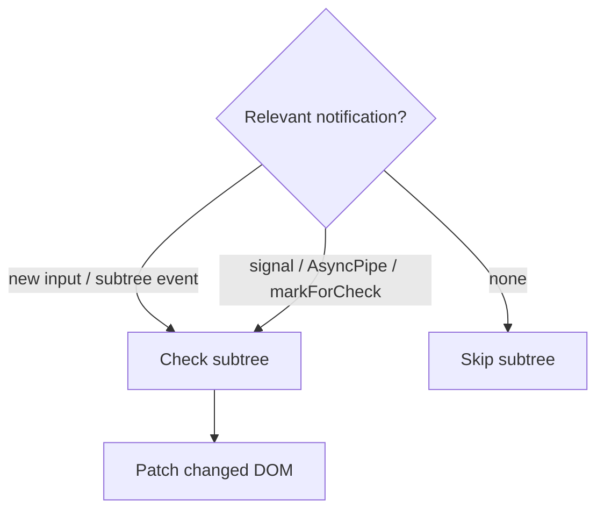

**Four examples:** replacing `order` checks the row; mutating the same object can leave a stale binding because its identity did not change; clicking the row checks its subtree and ancestors as required; a signal read by its template marks it when updated. An unrelated event outside an unmarked OnPush subtree permits that subtree to be skipped.

**Invariant:** parent-owned input values are replaced immutably, and every internal visible update emits a recognized notification. **Trade-off:** skipping can reduce work in large trees, but does not make an expensive checked template cheap. Memoize expensive pure derivations, track list items by stable identity, and measure. **Complexity:** if a full tree has V binding views but only an affected subtree has S, skipping may reduce binding work from O(V) toward O(S); actual cost depends on ancestors, events, dirty views and DOM updates, so this is a model—not a fixed guarantee.

<a id="q21"></a>
## Q21. What zoneless means in Angular 21+

**Requirement:** migrate an application from ZoneJS without losing updates from timers, third-party callbacks, forms, or server-side rendering.

Zoneless Angular still performs change detection. The difference is **how Angular learns that a view may need synchronization**. ZoneJS patched browser async APIs and treated many tasks as possible state changes. Zoneless Angular relies on explicit framework notifications: template-read signal writes, bound listeners, input updates, `AsyncPipe`/`markForCheck`, and attaching a dirty view. Zoneless is the default from Angular 21 onward; an application can still opt back into zone-based scheduling with `provideZoneChangeDetection`.

```typescript
import {Component, signal} from '@angular/core';

@Component({
  selector: 'app-clock',
  template: `<p>Ticks: {{ ticks() }}</p>`
})
export class Clock {
  readonly ticks = signal(0);
  private readonly timer = setInterval(
    () => this.ticks.update(value => value + 1),
    1000
  );

  ngOnDestroy() { clearInterval(this.timer); }
}
```

The timer itself is not a notification; the write to a signal consumed by the template is. Compare that with a plain field changed by an unintegrated callback: the value can change while no view synchronization is scheduled.

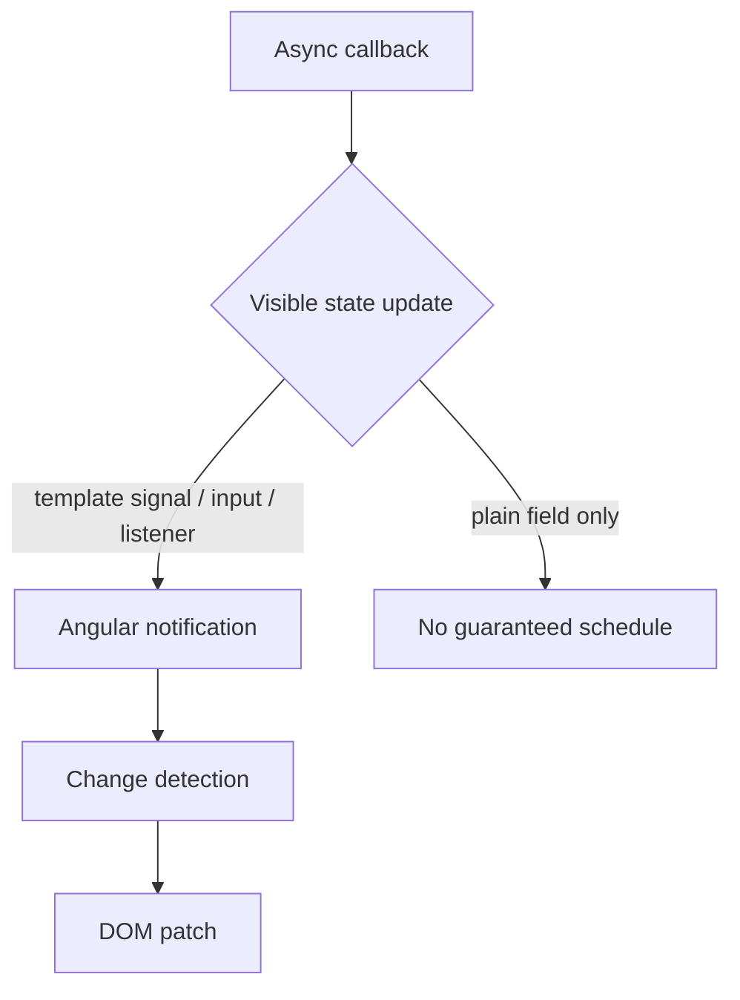

### Migration trace

| Step | Check | Failure signal | Repair |
|---:|---|---|---|
| 1 | Remove `zone.js` and `zone.js/testing` from build/test polyfills | app still bundles ZoneJS | remove dependency/imports |
| 2 | Audit visible state writes | callback changes a plain field with no notification | use a template-read signal or `markForCheck()` |
| 3 | Replace `NgZone.onStable` timing | post-render work never runs | use `afterNextRender`/`afterEveryRender` |
| 4 | Audit SSR work | HTML serializes before custom async work finishes | register work with `PendingTasks` |
| 5 | Test like production | forced `detectChanges()` hides missing notification | wait for stability and assert rendered output |

**Four scenarios:** a template signal updated by `setTimeout` schedules rendering; an `AsyncPipe` emission calls `markForCheck`; `FormControl.setValue` changes form state but may need a signal/mark when a template depends on unnotified reactive-form state; custom SSR work must participate in `PendingTasks`. `NgZone.run` and `runOutsideAngular` can remain for library compatibility—they are not proof that ZoneJS is active.

**Invariant:** every user-visible state transition has a recognized notification path. **Benefits:** fewer speculative synchronizations, no async-API monkey patching, smaller payload/startup overhead, and clearer native stack traces. **Boundary:** zoneless does not guarantee a fast app; expensive bindings, large DOM updates and excessive notifications remain expensive.

**Cost model:** let A be all async tasks and U be tasks that actually cause visible updates. Zone-based scheduling can react to work closer to A; notification-driven scheduling aims toward U, but each scheduled check still costs the checked views/bindings plus DOM writes. Measure rather than claiming a fixed Big-O improvement.

<a id="q22"></a>
## Q22. When to use `ChangeDetectorRef`

**Requirement:** integrate a callback that updates a plain field, and distinguish scheduling a normal future check from forcing a local synchronous check.

```typescript
import {ChangeDetectionStrategy, ChangeDetectorRef, Component} from '@angular/core';

interface LegacyMap {
  onZoom(listener: (zoom: number) => void): () => void;
}

@Component({
  selector: 'app-map-status',
  changeDetection: ChangeDetectionStrategy.OnPush,
  template: `<p>Zoom: {{ zoom }}</p>`
})
export class MapStatus {
  zoom = 1;
  private removeListener?: () => void;

  constructor(private readonly cdr: ChangeDetectorRef) {}

  connect(map: LegacyMap) {
    this.removeListener = map.onZoom(next => {
      this.zoom = next;
      this.cdr.markForCheck();
    });
  }

  ngOnDestroy() { this.removeListener?.(); }
}
```

`markForCheck()` marks the view dirty so Angular includes it in a scheduled synchronization; it does not immediately run the component's check in the callback. Prefer a signal when it cleanly represents the state, but `markForCheck` is appropriate at an imperative integration boundary.

| Method | Meaning | Appropriate example | Main risk |
|---|---|---|---|
| `markForCheck()` | mark view dirty for a normal check | legacy callback changes a plain field | forgetting cleanup/ownership |
| `detach()` | remove view from the change-detection tree | measured, high-frequency read-only display | stale UI |
| `detectChanges()` | synchronously check this view and children | intentionally detached view at a controlled cadence | re-entrancy and hidden design defects |
| `reattach()` | return detached view to normal checking | resume a paused live panel | assuming it retroactively renders |

### Controlled local checking

```typescript
import {ChangeDetectorRef, inject} from '@angular/core';

export class DenseTelemetry {
  private readonly cdr = inject(ChangeDetectorRef);
  private refreshId?: ReturnType<typeof setInterval>;

  start() {
    this.cdr.detach();
    this.refreshId = setInterval(() => this.cdr.detectChanges(), 250);
  }

  stop() {
    if (this.refreshId !== undefined) clearInterval(this.refreshId);
    this.cdr.reattach();
  }
}
```

This pattern is advanced: it trades freshness for fewer checks and requires explicit teardown. A signal update can mark a detached view dirty, but the detached view is still skipped until it is locally checked or reattached.

**Four examples:** mark an OnPush view after a non-Angular SDK callback; detach a telemetry panel and refresh four times per second; reattach when a paused tab becomes active; use `afterNextRender`, not an arbitrary `detectChanges()`, for work that must wait for rendered DOM. **Avoid:** calling `detectChanges()` in ordinary setters, lifecycle hooks or every subscription merely to silence `ExpressionChangedAfterItHasBeenCheckedError`.

**Invariant:** manual checking has a named owner, a documented freshness contract and a cleanup path. **Cost:** `markForCheck` is O(h) at most conceptually for dirty propagation through h ancestors, while `detectChanges()` costs O(v + w) for bindings/views v checked and DOM writes w; framework details may vary, so profile actual work.

<a id="q23"></a>
## Q23. How Angular dependency injection resolves a token

**Requirement:** give every editor subtree an isolated draft session while sharing one application-wide API client, then explain exactly which instance a nested component receives.

Dependency injection separates **what a consumer asks for** from **how and where the value is produced**:

| Term | Meaning | Example |
|---|---|---|
| Token | Runtime lookup key | `UserApi` or `InjectionToken<AppConfig>` |
| Provider | Recipe associated with a token | `{provide: API_URL, useValue: '/api'}` |
| Injector | Registry/cache that resolves recipes | application, route or element injector |
| Injection site | Code requesting the token | `inject(UserApi)` in a component |

```typescript
import {Component, Injectable, inject} from '@angular/core';

@Injectable({providedIn: 'root'})
export class UserApi {
  readonly instanceId = crypto.randomUUID();
}

@Injectable()
export class DraftSession {
  readonly instanceId = crypto.randomUUID();
}

@Component({
  selector: 'app-editor',
  providers: [DraftSession],
  template: `<p>Editor session: {{ draft.instanceId }}</p>`
})
export class Editor {
  readonly api = inject(UserApi);
  readonly draft = inject(DraftSession);
}
```

Each `Editor` element gets an element-injector `DraftSession`; descendants that do not override the token see that nearest session. Both editors still fall back to the root environment injector for the same `UserApi` instance. Angular destroys the component-scoped service when that component instance is destroyed.

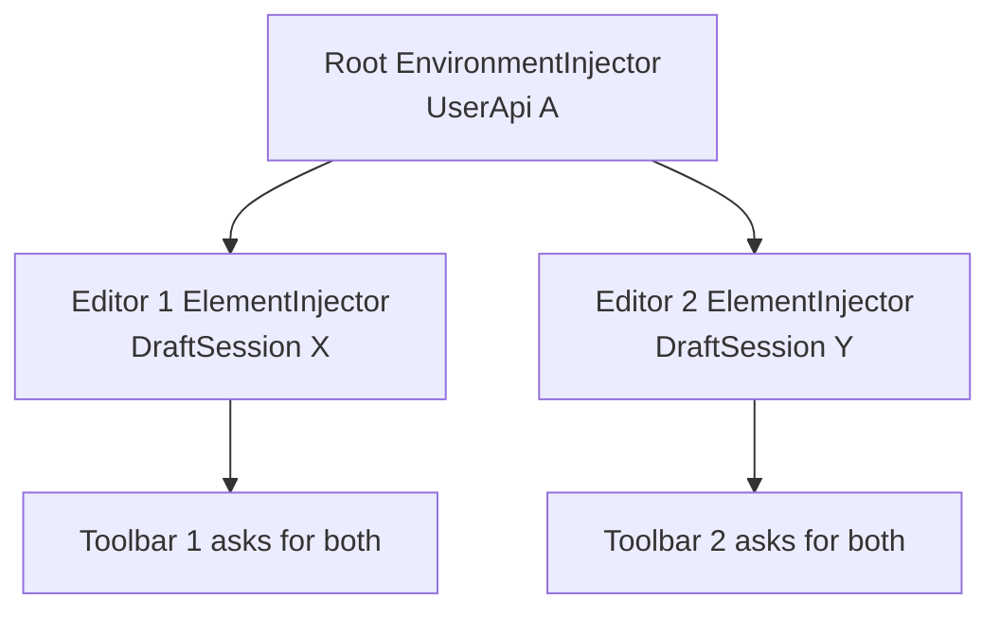

### Resolution trace

For Toolbar 1 requesting `DraftSession`: current element has no provider → parent Editor 1 element has X → return X and stop. For `UserApi`: no element injector has it → retry through the environment-injector hierarchy → root has A → return A. If no injector provides a required token, resolution reaches the null boundary and throws.

**Four scenarios:**

1. Two `Editor` instances receive different `DraftSession` IDs but the same `UserApi` ID.
2. A route-level provider supplies one feature instance to that route's components, guards and resolvers.
3. `inject(DraftSession, {self: true, optional: true})` returns `null` if the current element itself does not provide it, even if a parent does.
4. `inject(DraftSession, {skipSelf: true})` begins at the parent; `host` limits the upward search to the host boundary.

**Invariant:** provider placement intentionally defines visibility, lifetime and sharing. A component provider is not an application singleton. Avoid storing global truth in a service that is accidentally re-provided by every component.

**Cost model:** resolution walks a bounded injector ancestry, conceptually O(h) for h searched levels; after a provider creates a value, normal repeated lookups use the injector's cached instance. Construction cost belongs to the dependency graph itself, and component-scoped providers trade isolation for more live instances. Treat this as a reasoning model, not a framework implementation guarantee.

**Common errors:** using an interface as a token (interfaces disappear at runtime), re-providing a state service unintentionally, assuming a route guard is a security boundary, or injecting an optional value without handling `null`.

<a id="q24"></a>
## Q24. `inject()` vs constructor injection

**Requirement:** choose an injection form for a class, a functional guard and a provider factory, and identify a call that is too late.

Both forms use the same injector. The important distinction is **syntax and injection context**, not lifetime or speed.

| Situation | Good form | Why |
|---|---|---|
| Class with explicit public dependencies | constructor parameters | dependencies are visible in the signature |
| Private field dependency | field `inject()` | concise and strongly typed |
| Functional guard/interceptor | `inject()` | no class constructor exists |
| Provider or token factory | `inject()` or declared `deps` | factory executes in an injection context |

```typescript
import {Component, Injectable, InjectionToken, inject} from '@angular/core';
import {CanActivateFn, Router} from '@angular/router';

@Injectable({providedIn: 'root'})
class AuthService {
  isLoggedIn() { return true; }
}

@Component({selector: 'app-profile', template: 'Profile'})
class Profile {
  // Legal: Angular is constructing the component.
  private readonly auth = inject(AuthService);

  constructor(private readonly router: Router) {}

  // Illegal: calling inject(AuthService) here would be too late.
  save() { /* use this.auth and this.router */ }
}

export const authGuard: CanActivateFn = () => {
  const auth = inject(AuthService);
  const router = inject(Router);
  return auth.isLoggedIn() || router.parseUrl('/login');
};

export const START_TIME = new InjectionToken<number>('start time', {
  providedIn: 'root',
  factory: () => Date.now()
});
```

### Context trace

Angular enters an injection context → begins constructing `Profile` → evaluates field initializers → runs the constructor → leaves the context. Therefore the field and constructor work, but a later click calling `save()` cannot start a fresh `inject()` lookup. A provider factory and functional guard are invoked by Angular inside their own contexts.

`runInInjectionContext(injector, fn)` can establish a context for a synchronous function, but `inject()` must occur before an `await`; the context does not automatically flow into later asynchronous callbacks.

**Four scenarios:** a field initializer succeeds; a constructor parameter succeeds; a functional route guard succeeds; a lifecycle method that calls `inject()` throws an injection-context error. Capture dependencies up front and use the captured value later.

**Invariant:** every `inject()` call executes synchronously inside a valid injection context. **Trade-off:** constructor injection advertises dependencies at the class boundary; `inject()` improves functional composition and avoids parameter-decorator friction. Use a consistent project convention without claiming one changes provider scope.

**Testing boundary:** test a function that calls `inject()` through Angular's injection test context, or refactor its decision logic into a pure function and pass dependencies explicitly. Instantiating such a class with `new` bypasses Angular's context.

<a id="q25"></a>
## Q25. `useClass`, `useValue`, `useFactory` and `useExisting`

**Requirement:** configure an API client, replace logging in production and keep a deprecated token as an alias without creating a second logger.

```typescript
import {InjectionToken, Provider, inject} from '@angular/core';

export interface AppConfig {
  apiUrl: string;
  production: boolean;
}

export const APP_CONFIG =
  new InjectionToken<Readonly<AppConfig>>('app config');

abstract class Logger { abstract log(message: string): void; }
class ConsoleLogger extends Logger {
  log(message: string) { console.log(message); }
}
class SilentLogger extends Logger {
  log(_message: string) {}
}

class ApiClient {
  constructor(readonly baseUrl: string, readonly logger: Logger) {}
}

export const LEGACY_LOGGER = new InjectionToken<Logger>('legacy logger');

export const APP_PROVIDERS: Provider[] = [
  {
    provide: APP_CONFIG,
    useValue: Object.freeze({apiUrl: '/api', production: true})
  },
  {
    provide: Logger,
    useFactory: () =>
      inject(APP_CONFIG).production ? new SilentLogger() : new ConsoleLogger()
  },
  {
    provide: ApiClient,
    useFactory: () => new ApiClient(
      inject(APP_CONFIG).apiUrl,
      inject(Logger)
    )
  },
  {provide: LEGACY_LOGGER, useExisting: Logger}
];
```

| Recipe | Injector returns | Typical use | Important boundary |
|---|---|---|---|
| `useClass` | instance of the named class | swap an implementation | this recipe creates/caches its own instance |
| `useValue` | exact supplied value | immutable configuration or test fake | do not mutate shared config |
| `useFactory` | factory result | derive from other dependencies | factory must stay in an injection context |
| `useExisting` | value already resolved for another token | rename/alias a token | identity is shared |

**Four examples:** replace `Logger` with `ConsoleLogger` using `useClass`; provide a frozen configuration with `useValue`; create `ApiClient` from configuration with `useFactory`; resolve `LEGACY_LOGGER` and `Logger` to the same object with `useExisting`.

**Identity dry run:** resolve `Logger` → factory creates instance L and the injector caches it → resolve `LEGACY_LOGGER` → alias asks for `Logger` → returns L. Replacing the alias with `{provide: LEGACY_LOGGER, useClass: SilentLogger}` would create a different instance.

**Invariant:** one token has one unambiguous recipe at a given injector unless it is deliberately a multi token. Use an `InjectionToken<T>` for interfaces and primitive/config values because TypeScript types do not survive at runtime.

**Failure modes:** exposing a mutable `useValue` object as global state, creating side effects in factories, confusing `useClass` with aliasing, or reading browser globals in a factory during SSR. **Cost:** the injector normally evaluates a recipe once per providing injector and caches the result; factory/construction work is therefore paid per scoped instance. Application behavior inside the result has its own cost.

<a id="q26"></a>
## Q26. Multi providers as a plugin seam

**Requirement:** let independent features contribute audit hooks without any feature replacing another registration.

```typescript
import {Injectable, InjectionToken, Provider, inject} from '@angular/core';

type AuditEvent = Readonly<{actor: string; action: string}>;
interface AuditHook { record(event: AuditEvent): void; }

export const AUDIT_HOOKS =
  new InjectionToken<readonly AuditHook[]>('audit hooks');

@Injectable()
class SecurityAudit implements AuditHook {
  record(event: AuditEvent) { console.log('security', event.action); }
}

@Injectable()
class MetricsAudit implements AuditHook {
  record(event: AuditEvent) { console.log('metric', event.actor); }
}

export const AUDIT_PROVIDERS: Provider[] = [
  {provide: AUDIT_HOOKS, useClass: SecurityAudit, multi: true},
  {provide: AUDIT_HOOKS, useClass: MetricsAudit, multi: true}
];

@Injectable()
export class AuditRunner {
  private readonly hooks =
    inject(AUDIT_HOOKS, {optional: true}) ?? [];

  record(event: AuditEvent) {
    for (const hook of this.hooks) hook.record(event);
  }
}
```

Without `multi: true`, later registration for the same token replaces or conflicts with the intended single recipe. With it, resolving the token returns an array containing all contributions registered as multi providers in that injector.

**Four scenarios:** two hooks both run once; one hook can be replaced with a `useValue` test spy while retaining `multi: true`; no registration produces `null` here and the runner chooses `[]`; registering the same hook twice produces two entries—multi providers do not deduplicate.

**Execution trace:** injector encounters two multi recipes → creates/caches one contribution per recipe → token resolves to `[SecurityAudit, MetricsAudit]` → runner iterates in the resulting order → both observe the immutable event. Keep ordering requirements explicit; avoid correctness that depends on incidental assembly order across separately owned provider arrays.

**Invariant:** every provider for a multi token uses `multi: true`, and consumers expect an array. Do not mix a regular provider and multi providers for the same token at one injector.

**Trade-offs and cost:** the pattern decouples plugin authors from the runner, but hides the final set of contributors and permits duplicates. First resolution constructs p contributions; dispatch costs O(p + Σworkᵢ) time and O(p) cached references for p hooks. A hook failure policy must be deliberate: fail fast, isolate each hook with error handling, or run asynchronously with an explicit delivery contract.

<a id="q27"></a>
## Q27. Host metadata vs `HostBinding` and `HostListener`

**Requirement:** build a reusable pressed-state directive whose CSS class, ARIA state, pointer events and keyboard behavior stay synchronized.

Angular still supports both decorators, but the current API documentation says to prefer the directive/component `host` property; `HostBinding` and `HostListener` remain for backwards compatibility.

```typescript
import {Directive, signal} from '@angular/core';

@Directive({
  selector: 'button[appPressState]',
  host: {
    '[class.is-active]': 'active()',
    '[attr.aria-pressed]': 'active()',
    '(click)': 'toggle()'
  }
})
export class PressState {
  readonly active = signal(false);

  toggle() {
    this.active.update(value => !value);
  }

}
```

```html
<button appPressState type="button">Pin report</button>
```

### Event-to-host trace

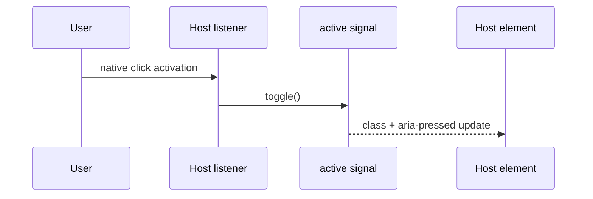

**Four examples:** a pointer click toggles class and ARIA state; Enter activates the native button and produces the click; Space activates it with the browser's native button semantics; programmatic `active.set(false)` updates both host bindings on the next synchronization. Restricting the selector to a native button preserves focus and activation semantics better than inventing a clickable `div`. Do not add redundant keydown toggles to a native button or one keyboard action can toggle twice.

**Host binding vs listener:** `'[class.is-active]': 'active()'` reads directive state during view synchronization; `'(click)': 'toggle()'` invokes behavior when the host emits an event. Prefixes such as `window:` create global listeners and require especially careful ownership; prefer a local host event when it solves the problem.

**Invariant:** visible styling and semantic state derive from the same source of truth. **Boundaries:** host metadata does not sanitize application logic, and a directive should not call browser-only globals during server rendering. Use host bindings or renderer abstractions instead of arbitrary DOM mutation when possible.

**Common errors:** mouse-only interaction, adding button semantics to an unfocusable element, duplicating a native button's keyboard activation, calling a signal without `()` in the host expression, or registering broad global listeners unnecessarily. If a custom non-button widget is truly required, implement the complete WAI-ARIA keyboard/focus pattern instead of copying only one key handler. **Cost:** listener dispatch is O(1) plus handler work; each notification checks the affected view bindings, while actual style/attribute writes occur only when values differ.

## RxJS and asynchronous flows

The important interview question is rarely “Which operator name do you remember?” It is “Who starts the work, what happens when a newer value arrives, when does the result become available, and who owns teardown?”

<a id="q28"></a>
## Q28. Observable vs Promise

**Requirement:** choose the abstraction from the contract, not from syntax. A Promise represents one eventual fulfillment or rejection. An Observable can represent zero, one or many notifications over time, has explicit completion/error channels, composes through operators, and runs only according to the producer's subscription contract.

| Dimension | Promise | Observable |
|---|---|---|
| Result count | One settlement | Zero to many `next` values, then optional completion or error |
| Start | Executor starts when the Promise is constructed | Commonly lazy, but an Observable may wrap a hot producer already running |
| Consumer | `await` / `then` | `subscribe`, `AsyncPipe`, signal interop or an operator chain |
| Cancellation | No built-in cancellation of the Promise itself; the underlying API may accept `AbortSignal` | Unsubscribe tears down that subscription; what the producer can cancel depends on its implementation |
| Composition | Promise combinators | Time-, concurrency- and cancellation-aware RxJS operators |

Angular `HttpClient` returns **cold Observables**: no request is sent until subscription, and each subscription creates a separate request. The generic `get<User>()` is a TypeScript assertion, not runtime validation of untrusted JSON.

```typescript
import {HttpClient} from '@angular/common/http';
import {Observable} from 'rxjs';

type User = Readonly<{id: number; name: string}>;

class UserApi {
  constructor(private readonly http: HttpClient) {}

  user(id: number): Observable<User> {
    return this.http.get<User>(`/api/users/${id}`);
  }
}
```

**Four examples:** `await dialog.open()` fits one eventual choice; a route-parameter stream can emit on every navigation; a WebSocket can emit until disconnected; `HttpClient.get` normally emits one response and completes, but two subscriptions send two requests.

### Subscription trace

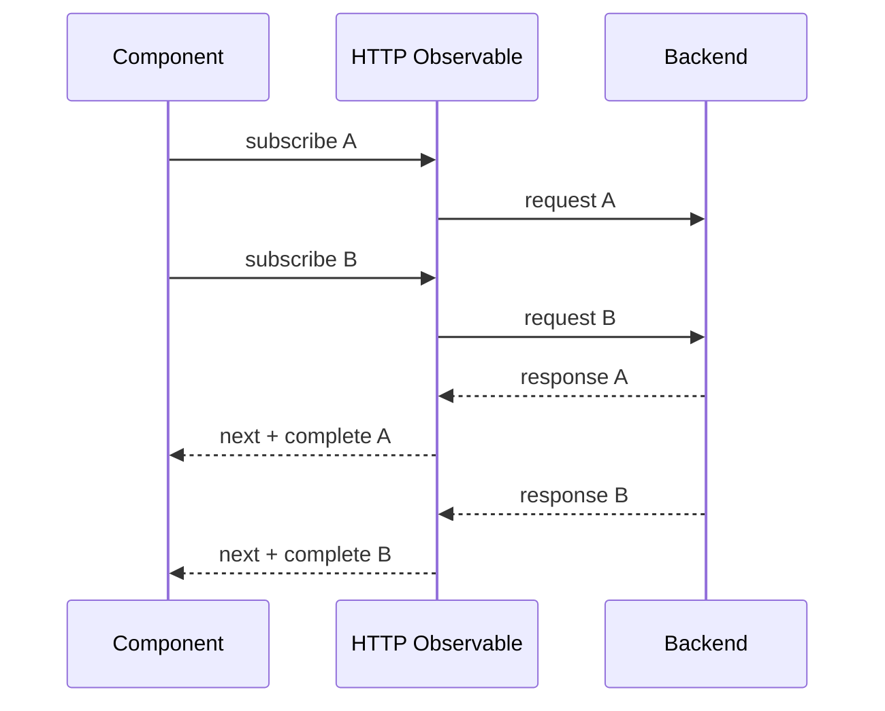

**Cancellation boundary:** unsubscribing can abort an in-flight client request when the producer supports teardown, preventing an obsolete response from updating the UI. It cannot promise that a server has not already processed a mutation. Use idempotency keys, conditional writes or server-side transaction rules where “undo the request” matters.

**Invariants and cost:** after an error or completion, that subscription receives no more values. Creating a pipeline is usually O(k) references for k operators; each notification performs the relevant operator work. Retaining emitted collections costs their size. Do not claim “Observable is faster”; choose it when stream semantics, composition or ownership are required.

<a id="q29"></a>
## Q29. Subject vs BehaviorSubject vs ReplaySubject

**Requirement:** identify whether a subscriber needs only future events, one current state value, or bounded history.

| Type | New subscriber receives immediately | Initial value | Good fit | Main hazard |
|---|---|---|---|---|
| `Subject<T>` | Nothing until the next `next` | No | commands/events bridging imperative code | late subscribers miss earlier events |
| `BehaviorSubject<T>` | latest value | Yes | current state for RxJS consumers | invented sentinel seeds and public mutation |
| `ReplaySubject<T>(n)` | up to the last n values | No | bounded late-subscriber history | unbounded buffer/time window retains memory |

```typescript
import {BehaviorSubject, Observable, ReplaySubject, Subject} from 'rxjs';

class UploadCoordinator {
  private readonly cancelSubject = new Subject<void>();
  readonly cancel$ = this.cancelSubject.asObservable();

  private readonly statusSubject = new BehaviorSubject<'idle' | 'busy'>('idle');
  readonly status$ = this.statusSubject.asObservable();

  private readonly logSubject = new ReplaySubject<string>(3);
  readonly recentLog$ = this.logSubject.asObservable();

  cancel() { this.cancelSubject.next(); }
  begin() { this.statusSubject.next('busy'); }
  log(line: string) { this.logSubject.next(line); }
}
```

**State trace:** write log entries A, B, C, D before observer X subscribes → `ReplaySubject(3)` replays B, C, D → a later E is delivered live. A `BehaviorSubject('idle')` immediately gives a new observer the latest `'idle'` or `'busy'`; a plain Subject gives neither history nor a current value.

**Four examples:** click telemetry uses a Subject; authentication state with a genuine initial “unknown” union can use a BehaviorSubject; a three-line diagnostic panel can use `ReplaySubject(3)`; synchronous component-local derived UI state is often simpler as `signal` + `computed` rather than a public Subject.

**Invariant:** expose the read side (`Observable`) and keep `next` private so one owner controls writes. A Subject is also an Observer and an Observable, but that does not make it a safe shared mutable store. **Cost:** one emission fans out in O(s) time to s active subscribers. BehaviorSubject retains O(1) values; `ReplaySubject(n)` retains O(n) values plus subscriber bookkeeping. Use an explicit finite buffer and, when appropriate, a time window.

**Common errors:** using an empty string as a fake BehaviorSubject seed; reaching for `getValue()` everywhere; assuming a Subject replays the last event; leaving `ReplaySubject()` unbounded; using a Subject where a cold Observable factory would preserve isolation.

<a id="q30"></a>
## Q30. `switchMap`, `mergeMap`, `concatMap` and `exhaustMap`

**Requirement:** map each outer value to an inner Observable and state the concurrency policy.

| Operator | When a new outer value arrives | Ordering/concurrency | Typical scenario |
|---|---|---|---|
| `switchMap` | unsubscribe previous inner, subscribe newest | latest wins; old result cannot flow through that subscription | typeahead/read keyed by current selection |
| `mergeMap` | subscribe to another inner | concurrent; completion order may differ | independent reads with a deliberate concurrency limit |
| `concatMap` | queue until current inner completes | one at a time; preserves source order | ordered writes |
| `exhaustMap` | ignore it while current inner is active | first wins until completion | suppress duplicate submit/login clicks |

```typescript
import {Component, inject} from '@angular/core';
import {HttpClient} from '@angular/common/http';
import {
  catchError, debounceTime, distinctUntilChanged, map, of, Subject, switchMap
} from 'rxjs';

type SearchState =
  | {kind: 'ready'; items: readonly string[]}
  | {kind: 'error'; message: string};

@Component({selector: 'app-search-results', template: ''})
export class SearchResults {
  private readonly http = inject(HttpClient);
  private readonly terms = new Subject<string>();

  readonly state$ = this.terms.pipe(
    map(term => term.trim()),
    debounceTime(250),
    distinctUntilChanged(),
    switchMap(term =>
      this.http.get<readonly string[]>('/api/search', {params: {q: term}}).pipe(
        map(items => ({kind: 'ready', items}) as const),
        catchError(() => of({
          kind: 'error',
          message: 'Search failed'
        } as const))
      )
    )
  );

  search(term: string) { this.terms.next(term); }
}
```

### Latest-wins dry run

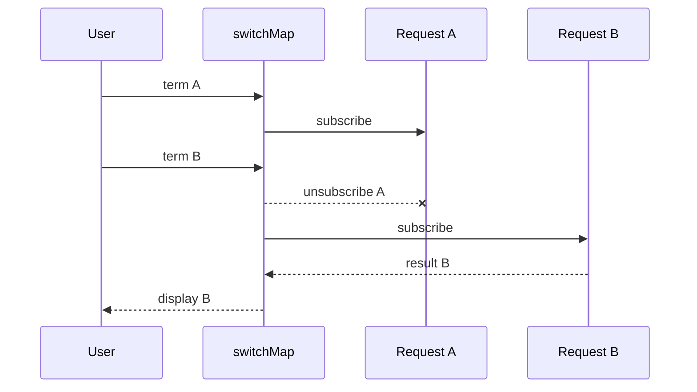

For outer values A, B, C arriving while A is active:

- `switchMap`: A is unsubscribed; then B may be unsubscribed; C is the active result.
- `mergeMap`: A, B and C may all run; emissions arrive in actual completion order.
- `concatMap`: B and C wait; results are processed A, B, C.
- `exhaustMap`: B and C are ignored if A remains active.

**Four choices:** search suggestions → switchMap; prefetch independent product details → mergeMap with a bounded concurrency argument; save ordered audit records → concatMap; login button → exhaustMap plus disabled/loading UI.

**Mutation trap:** “unsubscribe” is not “roll back the server.” `switchMap` is excellent for obsolete reads, but it may hide a response while a POST has already taken effect. Ordered mutation, deduplication and idempotency require an explicit server/client contract.

**Invariants and cost:** the operator controls active inner subscriptions, not the remote system's transaction state. With m outer values, work still includes every inner actually started. `mergeMap` can retain O(c) active inners for concurrency c; unbounded c risks sockets and memory. `concatMap` can retain an O(q) queue when arrivals outpace completion. `exhaustMap` bounds the active inner to one but discards outer values by design.

<a id="q31"></a>
## Q31. `combineLatest` vs `forkJoin`

**Requirement:** distinguish “recompute whenever any live input changes” from “wait for every finite task and collect final results.”

| Question | `combineLatest` | `forkJoin` |
|---|---|---|
| First emission | after every input has emitted at least once | after every input completes with a final value |
| Later emissions | whenever an input emits, using latest values | exactly one combined emission, then complete |
| Non-completing input | normal for a live stream | prevents the combined result from arriving |
| Common fit | filters, route state, UI preferences | parallel finite HTTP reads |

```typescript
import {combineLatest, forkJoin, map, startWith} from 'rxjs';

const visibleOrders$ = combineLatest([
  orders$,
  searchTerm$.pipe(startWith('')),
  status$.pipe(startWith<'all' | 'open' | 'closed'>('all'))
]).pipe(
  map(([orders, term, status]) =>
    orders.filter(order =>
      order.title.includes(term) &&
      (status === 'all' || order.status === status)
    )
  )
);

const dashboard$ = forkJoin({
  profile: http.get<Profile>('/api/profile'),
  permissions: http.get<readonly string[]>('/api/permissions'),
  notices: http.get<readonly Notice[]>('/api/notices')
});
```

**Dry run:** orders emits O1, term has not emitted, status emits “all” → `combineLatest` waits. Term emits `bug` → output uses [O1, `bug`, `all`]. Status emits `open` → output recomputes with O1 and the same term. In the dashboard, profile finishes at 30 ms, notices at 60 ms and permissions at 90 ms → `forkJoin` emits once at 90 ms using each final value.

**Four examples:** live table filters use combineLatest; route params plus cached preferences use combineLatest after each has a seed/emission; three HttpClient GETs use forkJoin; a WebSocket inside forkJoin is a bug unless it is intentionally made finite (for example with `take(1)`).

**Error boundary:** either combinator errors if an input error is uncaught. Catching outside `forkJoin` commonly replaces the whole result. If partial data is valid, catch and map an error inside each source to an explicit result union; do not silently turn errors into ambiguous empty arrays.

**Invariants and cost:** `combineLatest` stores one latest value per input, O(k) references for k sources, and downstream recomputation costs whatever the projection does—O(n) here for filtering n orders. `forkJoin` stores final values until all inputs complete, O(k) references plus the retained payloads. Neither operator makes network requests by itself; subscribing to the composed cold HTTP Observable starts its sources.

<a id="q32"></a>
## Q32. Prevent subscription leaks through ownership

**Requirement:** every long-lived subscription has an owner, an intended lifetime and a teardown path. Prefer declarative consumption where possible.

1. In templates, `AsyncPipe` subscribes, exposes the latest value, marks the component for checking, switches when the bound reference changes and unsubscribes when the view is destroyed.
2. In imperative Angular code, `takeUntilDestroyed()` completes the pipeline when the owning destruction context is destroyed.
3. Finite streams such as ordinary `HttpClient` requests normally complete, but repeated subscriptions can still duplicate work, and cancellation still matters when the owner disappears.
4. Application-lifetime subscriptions in root services can be intentional; “long lived” is not identical to “leak.”

```typescript
import {Component, DestroyRef, inject} from '@angular/core';
import {takeUntilDestroyed} from '@angular/core/rxjs-interop';
import {ActivatedRoute} from '@angular/router';
import {distinctUntilChanged, map} from 'rxjs';

@Component({selector: 'app-order-page', template: ''})
export class OrderPage {
  private readonly route = inject(ActivatedRoute);
  private readonly destroyRef = inject(DestroyRef);

  constructor() {
    this.route.paramMap.pipe(
      map(params => params.get('id')),
      distinctUntilChanged(),
      takeUntilDestroyed(this.destroyRef)
    ).subscribe(id => {
      if (id !== null) this.load(id);
    });
  }

  private load(_id: string) {}
}
```

When called in an injection context, `takeUntilDestroyed()` can infer the `DestroyRef`; passing it explicitly makes ownership visible and is required when the operator is assembled outside such a context.

| Subscription owner | Intended lifetime | Preferred teardown |
|---|---|---|
| template view | while the view exists or source reference remains | `AsyncPipe` |
| component/directive imperative logic | instance lifetime | `takeUntilDestroyed` |
| one finite HTTP read | until response/error or owner no longer needs it | completion plus owner cancellation when appropriate |
| root service connection | application lifetime | explicit application/disconnect policy |
| dynamically replaced child/session | that child/session only | bind teardown to that exact child/session |

**Leak trace:** enter route → component subscribes to a global interval → leave route without teardown → component remains reachable through the observer → re-enter five times → five observers perform the same update. With lifecycle teardown, each destroyed component is removed before the next instance subscribes.

**Four examples:** show `users$ | async` in a template; bind route params with `takeUntilDestroyed`; use `switchMap` to replace an obsolete request and still bind the outer subscription to the owner; deliberately keep a root telemetry connection while the application runs and expose a tested disconnect method.

**Boundaries and mistakes:** cleanup also includes event listeners, timers, observers, sockets and third-party callbacks. Avoid nested subscriptions; compose them so errors and teardown have one path. Do not reuse one destroyed notifier for future component instances, and do not assume garbage collection can reclaim an object still referenced by a live producer.

**Cost:** a leak converts per-instance state O(s) into O(r·s) retained state after r recreations and multiplies event work by the number of stale observers. Correct teardown keeps live subscriber count proportional to current owners.

<a id="q33"></a>
## Q33. Cold vs hot Observables, sharing and cache invalidation

**Requirement:** describe the relationship between a producer and its subscribers. “Cold” and “hot” are not different TypeScript types, and “hot” does not necessarily mean that work started at application bootstrap.

| Contract | Producer relationship | Late subscriber | Angular example |
|---|---|---|---|
| cold/unicast | each subscription creates its own producer execution | receives its own execution from the beginning | `HttpClient.get`, `defer`, most `of` pipelines |
| hot/multicast | subscribers observe one producer that exists independently of any one subscriber | normally receives only future notifications | DOM events, WebSocket feed, plain `Subject` |
| shared cold source | an operator connects one source execution to a multicast subject for a defined lifetime | depends on connector/reset/replay policy | HTTP pipeline with `share` or `shareReplay` |

Angular `HttpClient` Observables are cold: constructing one does not send a request, and **every subscription sends a new backend request**. By contrast, a `Subject` fans one call to `next` out to the observers currently attached. A source can also move between these behaviors: `share()` turns one upstream subscription into a shared connection while its reset policy permits it.

```typescript
import {inject, Injectable} from '@angular/core';
import {HttpClient} from '@angular/common/http';
import {Observable, shareReplay, startWith, Subject, switchMap} from 'rxjs';

type User = Readonly<{id: number; name: string}>;

@Injectable({providedIn: 'root'})
export class CurrentUserStore {
  private readonly http = inject(HttpClient);
  private readonly refreshRequests = new Subject<void>();

  // One active request is shared, one successful value is replayed.
  // refresh() is the explicit invalidation boundary.
  readonly user$: Observable<User> = this.refreshRequests.pipe(
    startWith(void 0),
    switchMap(() => this.http.get<User>('/api/me')),
    shareReplay({bufferSize: 1, refCount: true})
  );

  refresh(): void {
    this.refreshRequests.next();
  }
}
```

### Two-subscription dry run

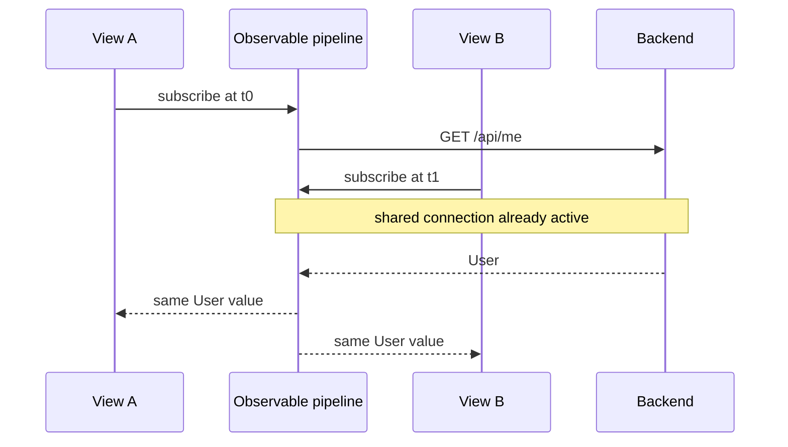

Without `shareReplay`, A and B each subscribe through to `HttpClient`, so two GETs are sent. With the shown pipeline, A creates the upstream connection and B joins it; both receive the response. `bufferSize: 1` retains at most one emitted value for a late subscriber. `refCount: true` disconnects and resets an **active, nonterminal** shared connection when the last subscriber leaves. In RxJS 7’s `shareReplay` contract, a successfully completed source is not reset on completion, so a completed HTTP value can remain cached as long as this `user$` object remains reachable. `refCount` is therefore not a time-to-live or business invalidation policy.

**Four concrete examples:**

1. Two components subscribe to the same unshared `http.get` variable → two independent requests.
2. Two overlapping subscribers use `share()` → one active request, but a subscriber arriving after completion starts a fresh execution because `share` resets on completion by default.
3. A late subscriber uses `shareReplay({bufferSize: 1, refCount: true})` after a successful HTTP completion → it can receive the retained value immediately without a new request.
4. A plain Subject emits A before a view subscribes, then B afterward → that view sees B only; a ReplaySubject or replaying share policy would be required to see A.

**Cache key and invalidation invariant:** a cached value is valid only for the identity and parameters that produced it. Key caches by user/tenant/locale/query as appropriate, clear or replace them on logout and privilege changes, and define refresh after writes. Do not put one root-scoped `/api/me` cache across identities without clearing it. Errors, completion and zero-subscriber resets are separate decisions; retry policy is separate again.

**Common errors:** saying all Observables are lazy/cold; assuming two variables referencing the same cold Observable share work; using an unbounded replay buffer; treating `shareReplay(1)` as a complete cache design; hiding stale data indefinitely; and confusing client unsubscription with rollback of server work.

**Correctness and cost:** while one shared generation is active, every downstream observer sees notifications from that same upstream execution in source order. An emission fans out in O(s) time for s subscribers. A replay buffer of b retained values uses O(b) references plus the retained payload sizes; here b = 1. The HTTP/network and JSON parsing costs are unchanged—sharing prevents duplicate executions, not the cost of the one execution. Interview follow-ups include reconnect after errors, TTL invalidation, per-key caches, WebSocket ownership, SSR request isolation and whether late subscribers need history.

<a id="q34"></a>
## Q34. `AsyncPipe` is a view-owned subscription

**Requirement:** bind an Observable or Promise in a template without manually retaining a component subscription. `AsyncPipe` subscribes, returns the latest value, marks the component to be checked when a new value arrives, unsubscribes when the containing view is destroyed, and switches subscriptions when the bound object reference changes.

```typescript
import {AsyncPipe} from '@angular/common';
import {ChangeDetectionStrategy, Component, inject} from '@angular/core';
import {catchError, map, of, startWith} from 'rxjs';

type User = Readonly<{id: number; name: string}>;
type UserVm =
  | {kind: 'loading'}
  | {kind: 'ready'; user: User}
  | {kind: 'error'; message: string};

@Component({
  selector: 'app-current-user',
  imports: [AsyncPipe],
  changeDetection: ChangeDetectionStrategy.OnPush,
  template: `
    @if (vm$ | async; as vm) {
      @switch (vm.kind) {
        @case ('loading') { <p>Loading…</p> }
        @case ('ready') { <h2>{{ vm.user.name }}</h2> }
        @case ('error') { <p role="alert">{{ vm.message }}</p> }
      }
    }
  `
})
export class CurrentUserComponent {
  private readonly store = inject(CurrentUserStore);

  readonly vm$ = this.store.user$.pipe(
    map(user => ({kind: 'ready', user}) as const),
    startWith({kind: 'loading'} as const),
    catchError(() => of({kind: 'error', message: 'Could not load user'} as const))
  );
}
```

`AsyncPipe` has a `T | null` boundary because a source might not have produced a value on the first template evaluation. This example uses `startWith` so the UI has an explicit loading state immediately, then narrows the discriminated union inside `@switch`. The pipe does not invent loading, empty or error UI; model those states in the stream or surrounding template.

### Reference-switch trace

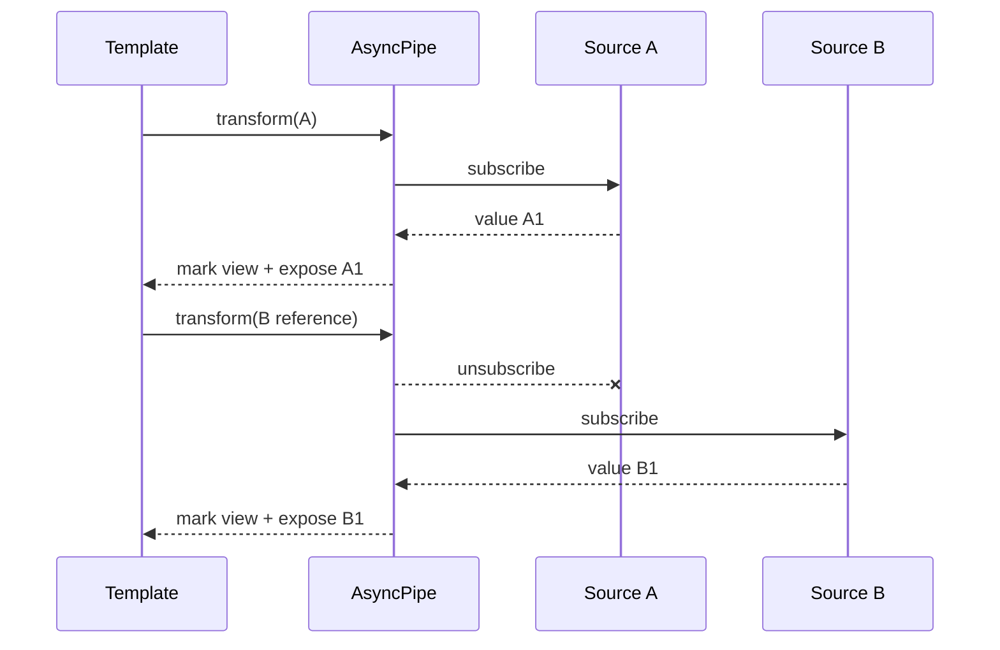

**Four examples:** a finite HTTP view model completes after one response; an interval is unsubscribed when an `@if` removes its view; a Promise resolves once and its value is exposed; replacing `selectedUser$` with a different Observable reference unsubscribes the old source before subscribing to the new one.

**One pipe instance means one subscription.** Writing `user$ | async` three times creates three pipe instances and can create three subscriptions. For a cold HTTP source that can mean three requests. Bind once and alias the result, as above, or deliberately share the pipeline. Conversely, sharing a source does not eliminate the value of aliasing: aliasing also gives one coherent template snapshot and avoids repeated transforms.

**Stable-reference invariant:** do not call a template method or getter that constructs a new Observable on each evaluation. If `loadUser() | async` returns a fresh `http.get` each time, `AsyncPipe` observes a new identity, tears down the previous subscription and starts another. Construct the pipeline once in a field, or derive it from a stable input stream with `switchMap`.

**Boundaries and trade-offs:** use `AsyncPipe` when the view owns consumption; use `takeUntilDestroyed` when imperative code truly needs side effects. A pipe teardown prevents future delivery to that view but cannot reverse server mutations. Errors still need handling; an unhandled Observable error ends that subscription. `AsyncPipe` is impure so Angular can check for reference/value changes, but it does not continuously poll the producer.

**Cost:** each pipe occurrence retains O(1) subscription/bookkeeping state plus the latest referenced value; an emission marks its owning view and causes the relevant change-detection/render work. With p separate pipe occurrences, subscription overhead is O(p), and a cold source may repeat upstream cost p times. Rendering a list of n emitted records still requires O(n) output work and DOM/state proportional to what is rendered. Interview follow-ups include aliasing, OnPush/zoneless notifications, error-state modeling, SSR timing, multiple pipe occurrences and when signal interop is preferable.

## Forms, validation and submission

A form is not merely a collection of inputs. It is a state machine containing a typed value, validity, disabled state, interaction state (`pristine`/`dirty`, `untouched`/`touched`), possible asynchronous work and a submission policy. The form approach determines where that model lives and how explicitly code can inspect it.

<a id="q35"></a>
## Q35. Reactive Forms vs template-driven forms

**Requirement:** choose from the size, dynamism, test strategy and ownership of the form—not from a slogan that one style is always better.

| Dimension | Reactive Forms | Template-driven forms |
|---|---|---|
| Form model | explicit controls/groups created in TypeScript | implicit controls created by `NgModel`/template directives |
| Data flow | synchronous access to the control model | template directives synchronize mutable component data asynchronously |
| Validation | validator functions attached to controls | attributes/directives in the template |
| Testing | model can be exercised without rendering the template | usually requires template rendering and change-detection stabilization |
| Best fit | typed, nested, dynamic or heavily validated workflows | small, stable forms with simple rules |

```typescript
import {Component, inject} from '@angular/core';
import {FormBuilder, ReactiveFormsModule, Validators} from '@angular/forms';

type ProfileCommand = Readonly<{
  displayName: string;
  notificationEmail: string;
  marketingAllowed: boolean;
}>;

@Component({
  selector: 'app-profile-form',
  imports: [ReactiveFormsModule],
  template: `
    <form [formGroup]="profile" (ngSubmit)="save()">
      <label>Display name <input formControlName="displayName"></label>
      <label>Email <input type="email" formControlName="notificationEmail"></label>
      <label><input type="checkbox" formControlName="marketingAllowed"> Marketing</label>
      <button type="submit" [disabled]="profile.invalid">Save</button>
    </form>
  `
})
export class ProfileFormComponent {
  private readonly fb = inject(FormBuilder).nonNullable;

  readonly profile = this.fb.group({
    displayName: ['', [Validators.required, Validators.maxLength(80)]],
    notificationEmail: ['', [Validators.required, Validators.email]],
    marketingAllowed: false
  });

  save(): void {
    if (this.profile.invalid) {
      this.profile.markAllAsTouched();
      return;
    }
    const command: ProfileCommand = this.profile.getRawValue();
    // Send command through a service; the server validates it again.
    void command;
  }
}
```

`nonNullable` prevents these controls from acquiring `null` merely because `reset()` was called; `getRawValue()` includes disabled controls, while `value` omits disabled descendants. That distinction matters when building commands—disabled UI is not authorization and must not decide what the server accepts.

### Input-to-command trace

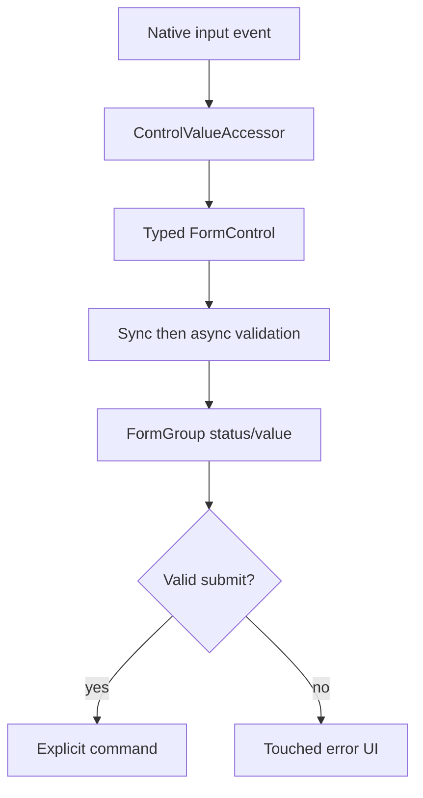

**Four choices:** a newsletter email field can be template-driven; a checkout with address groups and conditional delivery controls favors Reactive Forms; a questionnaire with add/remove rows needs `FormArray` or another explicit dynamic model; a small legacy screen should normally keep its consistent existing approach unless migration has a measured payoff.

**Invariants:** the control tree shape matches the submitted domain shape or has an explicit mapping; one owner decides when controls are added/removed; and server validation remains authoritative. `setValue` requires the complete group shape, while `patchValue` allows a subset—using `patchValue` everywhere can hide missing fields. A checkbox disabled in the browser is not a security boundary.

**Common errors:** mixing `ngModel` and reactive directives on the same field, forgetting to import `FormsModule` or `ReactiveFormsModule`, reading `value` when disabled fields are intentionally required, mutating the backing object without updating controls, showing errors before interaction, and embedding business submission logic inside a template.

**Cost:** a changed control evaluates its attached validators and propagates status through its ancestors. With v validators and tree height h, local bookkeeping is approximately O(v + h), excluding validator work and rendering. Rendering or serializing n controls is at least O(n). Dynamic conditional sections can retain substantial values, subscriptions and DOM, so remove or disable them according to the domain contract rather than only hiding their elements.

<a id="q36"></a>
## Q36. What are Signal Forms, and when should you adopt them?

**Requirement:** explain the current Angular API and a migration decision. Signal Forms build a form tree over a writable signal model, bind fields with `FormField`, centralize rules in a schema and expose field state through signals such as `value`, `touched`, `invalid`, `errors` and `pending`. Current Angular documentation requires Angular 21+ and imports the API from `@angular/forms/signals`.

```typescript
import {Component, signal} from '@angular/core';
import {
  email, form, FormField, minLength, required
} from '@angular/forms/signals';

type Registration = {
  email: string;
  password: string;
};

@Component({
  selector: 'app-registration',
  imports: [FormField],
  template: `
    <form novalidate (submit)="onSubmit($event)">
      <label>Email <input type="email" [formField]="registrationForm.email"></label>
      @if (registrationForm.email().touched() && registrationForm.email().invalid()) {
        <ul>
          @for (error of registrationForm.email().errors(); track error) {
            <li>{{ error.message }}</li>
          }
        </ul>
      }
      <label>Password <input type="password" [formField]="registrationForm.password"></label>
      <button type="submit" [disabled]="registrationForm().invalid()">Register</button>
    </form>
  `
})
export class RegistrationComponent {
  readonly registrationModel = signal<Registration>({email: '', password: ''});

  readonly registrationForm = form(this.registrationModel, path => {
    required(path.email, {message: 'Email is required'});
    email(path.email, {message: 'Enter a valid email address'});
    required(path.password, {message: 'Password is required'});
    minLength(path.password, 12, {message: 'Use at least 12 characters'});
  });

  onSubmit(event: SubmitEvent): void {
    event.preventDefault();
    if (this.registrationForm().invalid()) return;
    const command: Registration = this.registrationModel();
    // Send command through a service; the server validates it again.
    void command;
  }
}
```

**How it works:** create a typed signal model → `form()` builds a field tree and binds schema rules once → `[formField]` synchronizes the field and native control → a user edit updates the model signal → validation updates field-state signals → the template rerenders only the state it reads. Validation and submission are still different concerns; a disabled button does not replace a guarded submit handler or server enforcement.

**Four decisions:** choose Signal Forms for a new signal-first feature; keep mature Reactive Forms when libraries, custom controls and tests already depend on them; prototype a migration at a feature boundary rather than rewriting the whole application; use template-driven forms for genuinely small stable screens where the new abstraction would add no value.

**Migration trade-offs:** Signal Forms reduce manual synchronization and provide typed schema paths, but the API and ecosystem are newer than Reactive Forms. Inventory custom `ControlValueAccessor` components, cross-field rules, dynamic arrays, test helpers and third-party UI integrations before migrating. Do not keep two writable sources of truth—for example, a signal model plus a separately mutated DTO.

**State invariant:** the writable signal is the value source of truth, while the form tree owns interaction and validation state. Schema rules must remain deterministic for the values they read. Field errors are presentation hints, not trusted business authorization.

**Cost:** changing one field triggers its dependent schema rules and consumers; the exact graph cost depends on dependencies rather than the total application size. A form with n rendered fields still needs O(n) field/view state. Error rendering costs O(e) for e exposed errors. Compare measured bundle, rendering, validation and migration costs rather than claiming signals make all forms automatically faster.

<a id="q37"></a>
## Q37. Synchronous vs asynchronous validators

**Requirement:** a validator returns `null` when valid or a structured error when invalid. A synchronous `ValidatorFn` returns immediately. An `AsyncValidatorFn` returns a finite Promise or Observable of `ValidationErrors | null`. Angular runs async validators only after synchronous validators pass, and a control remains `PENDING` until async validation completes.

```typescript
import {inject, Injectable} from '@angular/core';
import {
  AbstractControl, AsyncValidatorFn, FormControl,
  ValidationErrors, ValidatorFn, Validators
} from '@angular/forms';
import {HttpClient} from '@angular/common/http';
import {catchError, map, Observable, of, take} from 'rxjs';

export const trimmedMinLength = (minimum: number): ValidatorFn =>
  (control: AbstractControl): ValidationErrors | null => {
    const value = String(control.value ?? '').trim();
    return value.length >= minimum
      ? null
      : {trimmedMinLength: {minimum, actual: value.length}};
  };

@Injectable({providedIn: 'root'})
export class UsernameApi {
  private readonly http = inject(HttpClient);

  isTaken(username: string): Observable<boolean> {
    return this.http.get<boolean>('/api/usernames/taken', {params: {username}});
  }
}

export const uniqueUsername = (api: UsernameApi): AsyncValidatorFn =>
  (control: AbstractControl): Observable<ValidationErrors | null> =>
    api.isTaken(String(control.value ?? '').trim()).pipe(
      map(taken => taken ? {usernameTaken: true} : null),
      // Product decision: unavailable validation blocks submission explicitly.
      catchError(() => of({validationUnavailable: true})),
      take(1)
    );

export const usernameControl = (api: UsernameApi) => new FormControl('', {
  nonNullable: true,
  validators: [Validators.required, trimmedMinLength(3)],
  asyncValidators: [uniqueUsername(api)],
  updateOn: 'blur'
});
```

### Validation state trace

```mermaid
sequenceDiagram
 participant U as User
 participant C as FormControl
 participant V as Validators
 participant API as Server
 U->>C: blur value "asha"
 C->>V: run required + length
 V-->>C: null, sync valid
 C->>C: status PENDING
 C->>API: uniqueness request
 API-->>C: taken = true
 C->>C: errors usernameTaken; status INVALID
```

**Four examples:** `required` is synchronous; a pure cross-field rule such as “end date is not before start date” is synchronous on the group; username uniqueness is asynchronous and server-backed; checking whether a value already present in an in-memory set is synchronous even if the business concept sounds “remote.” Choose by where the answer lives, not by the rule's name.

**Why `updateOn: 'blur'`:** the default is validation after each value change. A remote call for every keystroke wastes backend capacity and produces flickering states. `blur` is suitable when the user should finish one field first; `submit` is suitable when validation can wait. For typeahead-style feedback, build an explicitly debounced/cancelled design rather than hiding timers inside an unpredictable validator.

**Finite-result invariant:** an Observable validator must complete; otherwise the control can remain `PENDING`. Map every success path to either `null` or an error object and make the failure policy explicit. “Network error means valid” improves availability but may permit a bad value; “network error blocks submission” is safer but can prevent progress. The product and threat model decide.

**Server boundary:** client validation improves feedback and reduces obvious bad requests. It cannot guarantee uniqueness under concurrency: two clients can both see “available” and race. Enforce the unique constraint in the database/server transaction and map a conflict response back to a field/form error.

**Common errors:** returning `true`/`false` instead of `null`/an error map; attaching a group rule to the wrong control; never completing an async Observable; issuing HTTP on every keypress; swallowing transport failure without a documented policy; displaying errors before `dirty` or `touched`; and assuming a temporarily valid UI authorizes submission.

**Cost:** synchronous validation costs the sum of invoked rules, commonly O(v) for v constant-time validators plus any scan such as O(L) for a length/pattern over L characters. Async validation adds network latency, backend work and one retained pending subscription. Angular skips that expense when sync validation fails. A database uniqueness index is typically O(log n) lookup or implementation-specific, but the only correctness guarantee comes from the atomic server-side constraint, not the preliminary client query.

## Routing and HTTP request boundaries

Routing decides **which feature should exist now**; HTTP decides **which remote state that feature can observe or mutate**. Lazy loading, guards, resolvers, interceptors and RxJS cancellation each solve a different boundary. Combining them indiscriminately creates slow navigation, leaked credentials or hidden error behavior.

<a id="q38"></a>
## Q38. How does lazy-loaded routing work in standalone Angular?

**Requirement:** keep the landing shell small, load an admin feature only when its URL is matched, and preserve a clear feature boundary. A direct `component` reference is eager. `loadComponent` loads one standalone component, while `loadChildren` loads a child route configuration. Both loader functions normally use the JavaScript `import()` boundary that the build system turns into a separate chunk.

```typescript
import {Routes} from '@angular/router';

export const routes: Routes = [
  {
    path: '',
    pathMatch: 'full',
    loadComponent: () => import('./home/home.page')
      .then(module => module.HomePage)
  },
  {
    path: 'admin',
    loadChildren: () => import('./admin/admin.routes')
      .then(module => module.ADMIN_ROUTES)
  },
  {
    path: '**',
    loadComponent: () => import('./not-found/not-found.page')
      .then(module => module.NotFoundPage)
  }
];
```

```typescript
// admin/admin.routes.ts
import {Routes} from '@angular/router';

export const ADMIN_ROUTES: Routes = [
  {
    path: '',
    loadComponent: () => import('./admin-dashboard.page')
      .then(module => module.AdminDashboardPage)
  },
  {
    path: 'users/:id',
    loadComponent: () => import('./user-admin.page')
      .then(module => module.UserAdminPage)
  }
];
```

### First-navigation trace

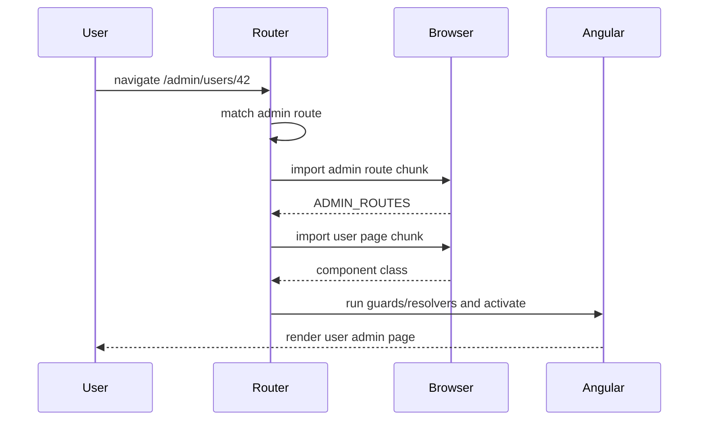

**Four examples:** the primary landing page may be eager when immediate paint matters; a rarely visited admin area should usually be lazy; a small settings page can use `loadComponent`; a larger billing feature with several nested screens can use `loadChildren` so its routes and providers remain grouped.

**What lazy loading does not do:** it does not authorize the route, hide secrets already shipped elsewhere, or guarantee a faster transition. It moves code out of the initial bundle and introduces a later chunk request. Route-level providers and the loader's injection context can scope dependencies, but backend authorization still protects data and mutations.

**Invariants and errors:** route order is significant, so put specific routes before `**`; exported names in `.then(...)` must match the module; avoid accidental eager imports of the same feature from root code; and handle chunk-load failure with navigation error policy and deployment-compatible caching. A stale HTML document that references removed hashed chunks is a deployment/versioning problem, not a reason to disable lazy loading.

**Cost and trade-off:** the initial JavaScript download/parse cost drops by the bytes moved into lazy chunks. First navigation then pays a network round trip plus transfer, parse and initialization for those chunks. Route matching is proportional to the candidate configuration examined, while rendering remains proportional to produced view output. Excessive nested lazy boundaries can create a request waterfall; choose boundaries around meaningful features and measure real bundle and navigation timings.

<a id="q39"></a>
## Q39. Guard vs resolver

**Requirement:** redirect unauthenticated users before entering `/orders/:id`, then obtain the order required by the page. A **guard decides whether or how navigation may proceed**. A **resolver obtains required route data before activation**. Neither substitutes for backend authorization.

```typescript
import {inject} from '@angular/core';
import {
  CanActivateFn, ResolveFn, Router, Routes
} from '@angular/router';
import {Observable} from 'rxjs';

type Order = Readonly<{id: string; status: string; totalCents: number}>;

export const signedInGuard: CanActivateFn = (_route, state) => {
  const session = inject(SessionService);
  const router = inject(Router);
  return session.isSignedIn()
    ? true
    : router.createUrlTree(['/sign-in'], {queryParams: {returnUrl: state.url}});
};

export const orderResolver: ResolveFn<Order> = route => {
  const orders = inject(OrderService);
  const id = route.paramMap.get('id');
  if (id === null) throw new Error('Route contract requires id');
  return orders.get(id);
};

export const orderRoutes: Routes = [
  {
    path: 'orders/:id',
    canActivate: [signedInGuard],
    resolve: {order: orderResolver},
    loadComponent: () => import('./order.page').then(m => m.OrderPage)
  }
];
```

With `provideRouter(routes, withComponentInputBinding())`, the component can declare `order = input.required<Order>()`; otherwise it can read `ActivatedRoute.data`. The router waits for the resolver's result before activation. That makes resolvers suitable for essential first-render data but poor for optional or slow secondary panels that should load progressively.

| Scenario | Correct tool | Expected behavior |
|---|---|---|
| Not signed in | `CanActivate` | return a `UrlTree`/`RedirectCommand` to sign-in |
| Unsaved editor | `CanDeactivate` | ask whether leaving is allowed |
| Feature-flagged route variants | `CanMatch` | `false` tries another matching route |
| Order required to render page | `ResolveFn<Order>` | load before component activation |

**Return contracts:** guards may return a boolean, redirect object, Promise or Observable; the router uses the first async result and unsubscribes. Return a redirect rather than returning `false` and imperatively calling `navigate`. Multiple asynchronous guards in one array may start concurrently, so one guard must not depend on another guard's side effect. Resolvers can also return synchronous values, Promises or Observables; define an error/redirect policy so failed required data does not produce an unexplained navigation failure.

**Navigation invariant:** activation occurs only after route matching and the required guard/resolver phase succeeds. A guard protects user experience, not the API. The server must validate the token, tenant, role and resource ownership on every protected request.

**Cost:** a synchronous guard is typically O(1). Remote guards/resolvers add network latency to the critical navigation path; several independent requests can run concurrently, but the slowest required one determines readiness. Resolved data occupies O(d) memory for payload size d and rendering it costs at least O(d) or O(number of displayed records). Prefer route resources or component-level loading for non-blocking data.

<a id="q40"></a>
## Q40. How do `HttpClient` interceptors work?

**Requirement:** attach a bearer token only to the trusted API origin, add a correlation ID, and preserve predictable ordering. Functional interceptors are request/response middleware registered with `withInterceptors`. Requests travel through them in listed order; response events unwind through the same nested chain in reverse.

```typescript
import {inject} from '@angular/core';
import {
  HttpInterceptorFn, provideHttpClient, withInterceptors
} from '@angular/common/http';
import {finalize} from 'rxjs';

const API_ORIGIN = 'https://api.example.com';

export const correlationInterceptor: HttpInterceptorFn = (request, next) => {
  const requestId = crypto.randomUUID();
  const tagged = request.clone({
    setHeaders: {'X-Request-ID': requestId}
  });
  const startedAt = performance.now();
  return next(tagged).pipe(
    finalize(() => console.debug(requestId, performance.now() - startedAt))
  );
};

export const authInterceptor: HttpInterceptorFn = (request, next) => {
  const token = inject(SessionService).accessToken();
  const trusted = request.url.startsWith('/api/') ||
    request.url.startsWith(`${API_ORIGIN}/`);
  const authenticated = token && trusted
    ? request.clone({setHeaders: {Authorization: `Bearer ${token}`}})
    : request;
  return next(authenticated);
};

export const httpProviders = provideHttpClient(
  withInterceptors([correlationInterceptor, authInterceptor])
);
```

```mermaid
sequenceDiagram
 participant C as Caller
 participant I1 as Correlation
 participant I2 as Auth
 participant B as Backend
 C->>I1: original request
 I1->>I2: cloned + request ID
 I2->>B: cloned + trusted auth
 B-->>I2: response/error
 I2-->>I1: response/error
 I1-->>C: finalize timing
```

**Four uses:** auth headers scoped to trusted origins; correlation IDs and timing; bounded retry for explicitly safe/idempotent operations; short-lived GET caching with a clear invalidation key. A loading indicator is also possible, but concurrent requests require a reference count rather than a single boolean.

**Immutability invariant:** `HttpRequest`, `HttpHeaders` and `HttpParams` use immutable-style updates. Clone to change them and pass exactly one request to `next` unless deliberate fan-out is the contract. Bodies are not deeply immutable, so mutating an object body in place can break idempotence when retries re-enter the chain.

**Security and retry boundaries:** do not send credentials to every absolute URL; allowlist trusted origins. Do not blindly retry non-idempotent POST/payment operations. Prevent token-refresh recursion by excluding the refresh endpoint and coordinating concurrent 401s. An interceptor is cross-cutting infrastructure, not the place for order-specific UI copy.

**Cost:** with i interceptors, chain traversal is O(i) around the underlying network request, plus the work each interceptor performs. Cloning headers is small but not free; deep body copies would be O(body size) and are normally unnecessary. Cache memory is O(total retained response bytes), so define capacity, lifetime, key identity and mutation invalidation.

<a id="q41"></a>
## Q41. Where should HTTP error handling live?

**Requirement:** place each decision in the lowest layer with enough context to make it correctly, while preserving a useful error for the next layer.

| Layer | Owns | Example |
|---|---|---|
| Interceptor | transport-wide mechanics | correlation, one coordinated refresh, telemetry, safe retry policy |
| Domain service | API-to-domain translation | map 404 order to `OrderNotFound`, validate payload shape |
| Component/facade | user workflow and presentation | retry button, inline message, route fallback |
| Global handler | truly unexpected failures | last-resort logging and recovery shell |

```typescript
import {HttpClient, HttpErrorResponse} from '@angular/common/http';
import {inject, Injectable} from '@angular/core';
import {catchError, Observable, throwError} from 'rxjs';

export class OrderNotFound extends Error {
  constructor(readonly orderId: string, options?: ErrorOptions) {
    super(`Order ${orderId} was not found`, options);
  }
}

@Injectable({providedIn: 'root'})
export class OrderService {
  private readonly http = inject(HttpClient);

  get(id: string): Observable<Order> {
    return this.http.get<Order>(`/api/orders/${encodeURIComponent(id)}`).pipe(
      catchError((error: unknown) => {
        if (error instanceof HttpErrorResponse && error.status === 404) {
          return throwError(() => new OrderNotFound(id, {cause: error}));
        }
        return throwError(() => error);
      })
    );
  }
}
```

**Four cases:** status 401 may trigger one application-wide session refresh or sign-out policy; status 404 for a known order becomes a domain error in `OrderService`; status 409 on Save belongs to the editor workflow and may restore field/form errors; status 0 can represent a network/connection failure and should offer retry or offline guidance rather than pretending the server rejected the domain command.

**Error-translation invariant:** one layer translates only what it understands, preserves the cause, and rethrows unknown failures. Returning `EMPTY` from a broad interceptor silently converts “failed” into “completed with no value” and can leave callers waiting for state that never arrives. Likewise, retry belongs behind an explicit safety policy: retry transient reads with bounds/backoff, not validation failures or unprotected mutations.

**Boundary details:** `HttpClient` reports network, timeout and backend failures through `HttpErrorResponse`; backend status and body require separate interpretation. Error bodies are untrusted input. A global toast for every failure causes duplicates and exposes transport details; let the component decide whether the current workflow needs inline feedback, navigation, a retry affordance or silence.

**Cost:** translating an error is O(1) aside from logging/serialization. With r retries, network/backend work can approach O(r) times one request and total latency accumulates across attempts and backoff. Logging full bodies costs O(payload bytes) and may leak secrets, so use structured redaction and size limits.

<a id="q42"></a>
## Q42. How do you cancel stale HTTP requests in Angular?

**Requirement:** a typeahead should display only the newest query result, avoid a request per raw key event, and cancel the previous in-flight subscription when a newer normalized query supersedes it. `switchMap` expresses exactly that **latest-wins** policy.

```typescript
import {AsyncPipe} from '@angular/common';
import {HttpClient} from '@angular/common/http';
import {Component, inject} from '@angular/core';
import {FormControl, ReactiveFormsModule} from '@angular/forms';
import {
  catchError, debounceTime, distinctUntilChanged, map, of,
  startWith, switchMap
} from 'rxjs';

type SearchResult = Readonly<{id: string; title: string}>;
type SearchState =
  | {kind: 'idle'}
  | {kind: 'loading'; query: string}
  | {kind: 'ready'; query: string; items: readonly SearchResult[]}
  | {kind: 'error'; query: string; message: string};

@Component({
  selector: 'app-search',
  imports: [AsyncPipe, ReactiveFormsModule],
  template: `
    <label>Search <input [formControl]="query"></label>
    @if (state$ | async; as state) {
      @switch (state.kind) {
        @case ('idle') { <p>Enter at least two characters.</p> }
        @case ('loading') { <p>Searching for {{ state.query }}…</p> }
        @case ('ready') {
          <ul>@for (item of state.items; track item.id) { <li>{{ item.title }}</li> }</ul>
        }
        @case ('error') { <p role="alert">{{ state.message }}</p> }
      }
    }
  `
})
export class SearchComponent {
  private readonly http = inject(HttpClient);
  readonly query = new FormControl('', {nonNullable: true});

  readonly state$ = this.query.valueChanges.pipe(
    map(value => value.trim()),
    debounceTime(250),
    distinctUntilChanged(),
    switchMap(query => {
      if (query.length < 2) return of<SearchState>({kind: 'idle'});
      return this.http.get<readonly SearchResult[]>('/api/search', {
        params: {q: query}
      }).pipe(
        map(items => ({kind: 'ready', query, items}) as const),
        startWith({kind: 'loading', query} as const),
        catchError(() => of<SearchState>({
          kind: 'error', query, message: 'Search is temporarily unavailable.'
        }))
      );
    }),
    startWith<SearchState>({kind: 'idle'})
  );
}
```

### A→AB stale-request trace

```mermaid
sequenceDiagram
 participant U as User
 participant S as switchMap
 participant A as GET q=a
 participant AB as GET q=ab
 U->>S: normalized "a"
 S->>A: subscribe
 U->>S: normalized "ab"
 S--xA: unsubscribe / abort in progress
 S->>AB: subscribe
 A--xS: late result cannot reach view
 AB-->>S: newest result
 S-->>U: render q=ab
```

**Four policies:** search/typeahead uses `switchMap` because only the latest read matters; Save button spam often uses `exhaustMap` because the first mutation must finish; queued writes may use `concatMap`; independent telemetry or bulk reads may use bounded `mergeMap`. Operator choice is a business concurrency decision, not a style preference.

**Cancellation invariant:** after a newer outer value arrives, the previous inner subscription cannot emit to this chain. Angular aborts an in-progress `HttpClient` request when that subscription is removed, so work and bandwidth may be saved. However, cancellation is not transaction rollback: the server may already have received or completed the operation. Do not use `switchMap` for a mutation whose effects must be observed unless the API supplies idempotency/transaction semantics and the product explicitly wants latest-wins behavior.

**Ownership and errors:** `AsyncPipe` owns the outer subscription and disposes it when the view is destroyed. If code subscribes imperatively, bind the lifetime with `takeUntilDestroyed` or another explicit owner. Put `catchError` inside the inner request when one failed search should not kill future searches. Debouncing reduces request frequency; `distinctUntilChanged` suppresses adjacent equivalent normalized values.

**Cost:** normalization is O(L) for query length L; each accepted query creates at most one active inner request, so retained request state is O(1) plus response data. Rendering k results costs O(k) time and DOM/state. Debouncing changes request count and latency, not the asymptotic output cost. The server still needs rate limits, indexed search, bounded result sizes and authorization.

<a id="q43"></a>
## Q43. When should you use a service with signals instead of NgRx?

**Requirement:** choose the smallest state model that keeps ownership, transitions, side effects and debugging explicit. Signals are a reactive primitive, a service is an ownership boundary, and NgRx supplies state-management architectures. They solve related but different problems.

| State shape | Default fit | Why | Escalation signal |
|---|---|---|---|
| One component's menu, draft tab or disclosure state | Component signals | The component owns the lifetime and mutations | Siblings or routes need the same state |
| One feature's cart, filters or editor session | Feature-provided service with private signals | One owner, explicit commands, derived `computed` views | Transitions/effects become difficult to audit |
| Time-based events such as WebSocket messages or autosave | RxJS inside the owner | Cancellation, ordering, concurrency and errors are event-stream concerns | Many features must coordinate the same events |
| Application-wide identity, normalized entities or multi-step workflow | NgRx Store plus Effects/Entity as justified | Named events, pure reducers, selectors, effect boundaries and devtools support a large coordination surface | Never adopt it only because the application is “large” |
| Signal-first feature state needing reusable store composition | NgRx SignalStore | Structured signal state and features without assuming classic Global Store | Cross-feature event history or reducer conventions are required |

Angular's current signal API supports writable signals, `asReadonly()` and lazy memoized `computed` values. NgRx's current documentation presents **Global Store** and **SignalStore** as separate learning paths. Therefore, “signals replaced NgRx” and “every shared value belongs in NgRx” are both category errors.

### Four concrete decisions

1. A product-card accordion is destroyed with its card: keep `expanded = signal(false)` in the component.
2. A checkout route has three sibling steps sharing a cart: provide `CartStore` at the route boundary and expose readonly signals plus commands.
3. A trading console combines normalized instruments, user permissions, reconnect effects and actions dispatched by independently owned features: Global Store's event/reducer/effect conventions can repay their ceremony.
4. A typeahead has one owner but a latest-request-wins rule: keep the state local and use `switchMap`; a global store does not remove the need to define concurrency.

```mermaid
flowchart TD
 A["Who owns the state?"] --> B{"One component?"}
 B -->|yes| C["Component signals"]
 B -->|no| D{"One bounded feature?"}
 D -->|yes| E["Scoped signal service or SignalStore"]
 D -->|no| F{"Auditable cross-feature events/effects?"}
 F -->|yes| G["NgRx Global Store"]
 F -->|no| H["Recheck ownership; avoid accidental global state"]
```

**Decision trace:** begin with ownership, not library preference. (1) Name the authoritative owner and lifetime. (2) List commands and derived views. (3) Mark async boundaries and choose cancellation/ordering rules. (4) Count independent writers and features. (5) Ask whether event history, reducer purity, devtools and organization-wide conventions will lower the debugging cost enough to justify more indirection. Re-evaluate as the coordination surface changes.

**Core invariants:** exactly one authoritative owner writes a state fact; consumers observe readonly or derived views; a derived value is computed rather than stored twice; side effects stay outside pure derivations; and every asynchronous command has an explicit concurrency and error policy. NgRx does not make an ambiguous domain model correct, while a small service does not make cross-team transitions observable.

**Migration boundary:** component signals can move behind a feature service without changing every template if the public readonly view remains stable. A service can later adapt to NgRx selectors/actions. Migrate by behavior slice, keep one source of truth during the transition, and do not mirror the same fact in a service signal and Global Store indefinitely.

**Cost:** reading a signal is O(1). A `computed` derivation is cached between dependency changes but costs whatever its body costs when invalidated—for example, filtering n rows is O(n) time and up to O(n) output space. A reducer that shallow-copies a normalized entity map may copy O(n) keys even when lookup is O(1). NgRx adds action/reducer/effect/selector code and runtime objects; its benefit is organizational traceability, not a lower universal Big-O.

**Common errors:** root-providing every feature store and leaking state after navigation; exposing a `WritableSignal`; mutating an array held inside a readonly signal (readonly is not deep immutability); using `effect` to propagate derived state; dispatching actions as setters without domain meaning; putting HTTP inside a reducer or `computed`; and choosing a global store before defining request cancellation, retry and authorization boundaries.

**Interview variations:** local vs global state; ComponentStore/SignalStore vs Global Store; when Redux-style events help; how devtools change incident diagnosis; how to migrate without two authorities; signals and RxJS interoperability.

<a id="q44"></a>
## Q44. How do you design a signal-based feature store?

**Requirement:** keep writable state private, expose readonly source state and `computed` projections, mutate only through named commands, scope the provider to the feature lifetime, and isolate asynchronous work. The example deliberately rejects edits during a save; that makes its single-flight policy and response reconciliation provable.

```typescript
import {DestroyRef, Injectable, computed, inject, signal} from '@angular/core';
import {HttpClient} from '@angular/common/http';
import {takeUntilDestroyed} from '@angular/core/rxjs-interop';

export type CartItem = Readonly<{
  id: string;
  name: string;
  unitPriceCents: number;
  quantity: number;
}>;
type Phase = 'idle' | 'saving' | 'error';
type CartState = Readonly<{
  items: readonly CartItem[];
  phase: Phase;
  error: string | null;
}>;

const INITIAL_STATE: CartState = {items: [], phase: 'idle', error: null};

@Injectable() // intentionally no providedIn: 'root'
export class CartStore {
  private readonly http = inject(HttpClient);
  private readonly destroyRef = inject(DestroyRef);
  private readonly writableState = signal<CartState>(INITIAL_STATE);

  readonly state = this.writableState.asReadonly();
  readonly items = computed(() => this.writableState().items);
  readonly phase = computed(() => this.writableState().phase);
  readonly error = computed(() => this.writableState().error);
  readonly totalCents = computed(() =>
    this.writableState().items.reduce(
      (sum, item) => sum + item.unitPriceCents * item.quantity,
      0
    )
  );

  upsert(item: CartItem): 'inserted' | 'replaced' | 'busy' {
    const current = this.writableState();
    if (current.phase === 'saving') return 'busy';

    const found = current.items.some(existing => existing.id === item.id);
    const items = found
      ? current.items.map(existing => existing.id === item.id ? item : existing)
      : [...current.items, item];
    this.writableState.set({...current, items, phase: 'idle', error: null});
    return found ? 'replaced' : 'inserted';
  }

  remove(id: string): boolean {
    const current = this.writableState();
    if (current.phase === 'saving') return false;
    const items = current.items.filter(item => item.id !== id);
    if (items.length === current.items.length) return false;
    this.writableState.set({...current, items, phase: 'idle', error: null});
    return true;
  }

  save(): void {
    const current = this.writableState();
    if (current.phase === 'saving') return; // exhaust/single-flight policy

    const requestItems = current.items;
    this.writableState.set({...current, phase: 'saving', error: null});
    this.http.put<readonly CartItem[]>('/api/cart', requestItems).pipe(
      takeUntilDestroyed(this.destroyRef)
    ).subscribe({
      next: saved => this.writableState.set({
        items: saved.map(item => ({...item})),
        phase: 'idle',
        error: null
      }),
      error: () => this.writableState.update(state => ({
        ...state,
        phase: 'error',
        error: 'Cart could not be saved. Your local items are retained.'
      }))
    });
  }
}
```

Provide it where the feature lifetime begins, not automatically for the whole application:

```typescript
import {Routes} from '@angular/router';

export const CHECKOUT_ROUTES: Routes = [{
  path: '',
  providers: [CartStore],
  loadComponent: () => import('./checkout.component')
    .then(module => module.CheckoutComponent)
}];
```

### State-machine invariant and dry run

```mermaid
stateDiagram-v2
 [*] --> idle
 idle --> idle: upsert / remove
 idle --> saving: save
 saving --> idle: success + canonical items
 saving --> error: failure + retain local items
 error --> idle: edit
 error --> saving: retry save
```

| Step | Command/result | `items` | phase | `totalCents` |
|---:|---|---|---|---:|
| 0 | initial | `[]` | idle | 0 |
| 1 | upsert `{A, 250, 2}` → inserted | `[A×2]` | idle | 500 |
| 2 | upsert `{B, 100, 1}` → inserted | `[A×2,B×1]` | idle | 600 |
| 3 | upsert `{A, 250, 3}` → replaced | `[A×3,B×1]` | idle | 850 |
| 4 | save; second save → ignored | unchanged snapshot | saving | 850 |
| 5a | server returns canonical items | copied response | idle | recomputed lazily |
| 5b | or request fails | local snapshot retained | error | 850 |

**Why the code is correct:** all writes pass through `upsert`, `remove`, `save` or the request callbacks. Each synchronous transition replaces the entire `CartState` once, so consumers cannot observe “new items, old phase” between separate signal writes. `totalCents` depends only on `items` and is therefore never stale as separately stored state. The saving guard makes at most one save subscription active and prevents local edits from being overwritten by its response. Feature injector destruction unsubscribes an in-flight request. This cancels client observation; it does **not** roll back a server mutation.

**Four boundary examples:** duplicate ID replaces one logical item rather than creating a duplicate; removing an unknown ID leaves the same state and returns false; a double Save creates one request; a failed Save retains items and permits either an edit (clearing the error) or retry. Real checkout systems should additionally validate positive quantities/prices at the boundary, use server-calculated totals, authorize every request and define idempotency/version-conflict behavior.

**Complexity derivation:** for n items, `upsert` scans with `some` and may map/copy, so it is O(n) time and O(n) output space; `remove` is O(n) time and O(n) output space. A successful response copy is O(n). The first `totalCents()` read after `items` changes is O(n), while subsequent reads before another dependency change use the memoized result. Source-state reads and phase checks are O(1). Retained store state is O(n). If n is large and keyed updates dominate, a normalized `Map`/entity adapter can improve lookup/update strategy, though immutable snapshots still incur allocation or structural-sharing costs.

**Testing:** instantiate through Angular's test injector with an HTTP testing backend; assert command return values and state snapshots; read `totalCents()` before and after edits; flush success/error responses; issue Save twice and assert one request; destroy the fixture during a request and assert no later state transition. A pure reducer extracted from the command transitions can be property-tested independently—for example, generated sequences must never produce duplicate IDs or a negative total when inputs are valid.

**Common errors and trade-offs:** exposing `writableState`; mutating `items.push` and retaining the same reference; storing `totalCents` independently; starting HTTP in a constructor or `computed`; root-scoping disposable feature state; subscribing without a destruction owner; accepting concurrent saves without request IDs or an ordering policy; optimistic updates without rollback; and assuming TypeScript `readonly` prevents runtime deep mutation. A single state signal gives atomic snapshots; multiple fine-grained signals can reduce invalidation but require care to preserve cross-field invariants.

**Interview variations:** optimistic update with rollback/version token; latest-wins load with request generation IDs or `switchMap`; normalized entities; persisted state and schema migration; SSR request isolation; replacing the hand-written service with NgRx SignalStore; extracting domain transitions to pure functions.

<a id="q45"></a>
## Q45. What are deferrable views (`@defer`)?

**Requirement:** remove non-critical code from the initial JavaScript graph, load it on an explicit trigger, preserve accessible layout while waiting, and define loading and failure states. `@defer` is both a template state machine and a compiler-recognized lazy boundary; hiding an eagerly imported component with `@if` does not create the same code split.

```html
@defer (on viewport; prefetch on idle) {
  <app-recommendations />
} @placeholder (minimum 300ms) {
  <section class="recommendation-skeleton"
           aria-label="Recommendations loading"></section>
} @loading (after 150ms; minimum 300ms) {
  <p role="status">Loading recommendations…</p>
} @error {
  <p role="alert">Recommendations could not be loaded.</p>
}
```

Angular emits dynamic imports for eligible components, directives and pipes in the main block. To remain deferred, a dependency must be standalone and must not also be referenced outside a defer block in the same file, including through a `ViewChild` query. Placeholder, loading and error dependencies are eager, so a heavyweight “skeleton component” can accidentally return bytes to the initial bundle.

### Trigger and state model

| Trigger/policy | Suitable example | Boundary to remember |
|---|---|---|
| default / `on idle` | analytics-rich related-content panel | Idle may occur before the user approaches it |
| `on viewport` | below-fold reviews | Needs a placeholder or explicit trigger element for observation |
| `on interaction` | optional configurator opened by click/keydown | Do not make keyboard users wait without a status state |
| `on hover` | desktop preview | Hover is not a complete mobile/accessibility interaction model |
| `when condition` | admin-only tool after permission state resolves | One-shot: becoming false later does not restore the placeholder |
| `prefetch on idle` + render on interaction | likely next action with expensive code | Prefetch fetches code; the main trigger controls rendering |

```mermaid
stateDiagram-v2
 [*] --> placeholder
 placeholder --> loading: render trigger
 placeholder --> placeholder: prefetch only
 loading --> content: imports resolve
 loading --> error: import fails
 content --> content: trigger condition later false
```

**Four examples:** defer below-fold reviews on viewport; prefetch a product customizer on idle but render only on interaction; render a permissions-gated audit panel when its signal becomes true; keep the above-fold price and primary purchase action eager because they define the page's purpose and likely LCP.

**Step-by-step trace:** (1) the eager view renders the placeholder. (2) During idle time, the browser may fetch the deferred JavaScript. (3) The placeholder enters the viewport. (4) If bytes are not ready, the loading block appears after its `after` delay. (5) All deferred imports resolve and Angular instantiates the main block. (6) An import failure selects `@error`; a data-request failure inside the child still needs the child's own error handling.

**Invariants:** a defer block triggers at most once for a rendered instance; prefetching does not render; placeholder/loading/error dependencies stay eager; and code splitting happens only for compiler-eligible references. Reserve stable dimensions to limit layout shift. A timer or viewport trigger is a performance decision, not an authorization boundary—do not download secrets or omit backend checks based on whether a block rendered.

**Cost model:** let the original initial JavaScript be B bytes and eligible deferred code be D bytes. The initial code-transfer target becomes roughly B − D plus the eager sub-block dependencies; total bytes may be similar or slightly higher because of chunk/runtime overhead. The first use adds a chunk request and parse/compile cost O(D); prefetch moves that cost earlier but does not eliminate it. Rendering k deferred rows still costs O(k) DOM work and O(k) output nodes. Measure LCP, INP, CLS, transferred bytes, request priority and real cache-hit behavior rather than counting chunks.

**Testing and common errors:** use Angular's manual defer-block test behavior to step through placeholder/loading/complete/error states; also test keyboard activation, slow and failed chunks, reduced bandwidth, layout stability and a client-side revisit. Common errors are deferring critical content, referencing the same dependency eagerly, placing large libraries in the placeholder, creating dozens of tiny chunks, confusing code-load errors with data errors, and using hover as the only trigger.

**Interview variations:** `@defer` vs route lazy loading; prefetch vs render triggers; nested defer blocks; SSR behavior; incremental hydration boundaries; bundle inspection and Core Web Vitals.

<a id="q46"></a>
## Q46. How do CSR, SSR and prerendering differ?

**Requirement:** choose a render mode per route from data freshness, personalization, indexability, cacheability, runtime cost and browser-only dependencies. Rendering mode is not an application-wide identity.

```typescript
import {RenderMode, ServerRoute} from '@angular/ssr';

export const serverRoutes: ServerRoute[] = [
  {path: '', renderMode: RenderMode.Prerender},
  {path: 'docs/**', renderMode: RenderMode.Prerender},
  {path: 'account', renderMode: RenderMode.Server},
  {path: 'workspace/**', renderMode: RenderMode.Client},
  {path: '**', renderMode: RenderMode.Server}
];
```

| Mode | HTML produced | Best fit | Main trade-off |
|---|---|---|---|
| CSR / `RenderMode.Client` | Browser after JavaScript runs | authenticated app shell, offline-capable tool, browser-only library | slower first meaningful content; device performs work |
| SSR / `RenderMode.Server` | server on every request | personalized/fresh public page, request-specific metadata/status | server latency/capacity, hydration and universal-code constraints |
| SSG / `RenderMode.Prerender` | build time, stored as static HTML | docs, marketing, finite product/category pages | stale until rebuild; parameter explosion increases build/storage |

### Route decision flow

```mermaid
flowchart TD
 A["Can all route data exist at build time?"] -->|yes| B{"Finite routes and acceptable rebuild?"}
 B -->|yes| C["Prerender / SSG"]
 B -->|no| D["SSR or CSR"]
 A -->|no| E{"First response needs fresh or indexable HTML?"}
 E -->|yes| F["SSR"]
 E -->|no| G["CSR"]
```

**Four decisions:** a versioned documentation site is prerendered and CDN-cached; a public product page with rapidly changing availability may use SSR while client requests refresh volatile inventory; a signed-in analytics workspace can use CSR because it is not indexed and heavily depends on browser interaction; a marketing home page can be prerendered while `/account` uses SSR and `/editor` uses CSR.

**Request traces:** CSR returns a shell and JavaScript, then the browser renders and may fetch data. SSR runs Angular and data access for that request, sends populated HTML, then the browser hydrates it. Prerendering runs Angular during the build, stores one HTML artifact per generated route, and serves those bytes from a CDN/static server; subsequent interactivity still needs client JavaScript unless the content remains static.

**Correctness boundaries:** SSR is not hydration—HTML can arrive without becoming interactive. SSR also is not authorization or automatic caching. Never serialize credentials, private user data, request-scoped services or server-only configuration into shared HTML/transfer state. Guard browser globals such as `window` and `document`; use server-compatible libraries. A CDN cache key must vary on every response dimension that changes content, or personalized data can leak.

**Cost derivation:** for R requests and server render cost S, uncached SSR uses about O(R·S) render work plus data-source work. For P prerendered paths, build work is O(P·S) and stored HTML is O(P·H) for average document size H, while request render work approaches O(1) static-file serving. CSR minimizes application render work on the server but transfers JavaScript and moves render/data cost to each device. These are capacity models, not guarantees of faster pages; profile TTFB, LCP, INP, cache hit ratio, build duration and origin CPU.

**Failure cases and tests:** test a direct deep link, 404/status/redirect behavior, slow data, crawler-visible metadata, disabled JavaScript, hydration mismatch, a cold origin and warm CDN, browser-global access during SSR, and parameter counts for prerendering. Avoid prerendering unbounded IDs, SSR-fetching your own public endpoint through unnecessary network hops, or selecting SSR solely as an SEO slogan.

**Interview variations:** ISR/revalidation patterns outside the core three modes; app shell; CDN and cache keys; transfer cache; per-route headers/status; prerender fallback; streaming; edge SSR.

<a id="q47"></a>
## Q47. What are hydration and incremental hydration?

**Requirement:** reuse server-rendered DOM, attach Angular runtime state and listeners without rebuilding the page, then delay selected hydration boundaries until their interaction or visibility justifies client work.

```typescript
import {ApplicationConfig} from '@angular/core';
import {provideClientHydration} from '@angular/platform-browser';

export const appConfig: ApplicationConfig = {
  providers: [provideClientHydration()]
};
```

In Angular 22, `provideClientHydration()` enables incremental hydration by default. The older `withIncrementalHydration()` feature is deprecated, so adding it to new Angular 22 code is unnecessary. Incremental hydration also enables event replay.

```html
@defer (on viewport; hydrate on interaction) {
  <app-review-editor />
} @placeholder {
  <button type="button">Write a review</button>
}
```

On the initial server-rendered navigation, the hydrate trigger makes the server render the main block. The browser can leave that DOM dehydrated until interaction, queue supported pre-hydration events, fetch the block's code and replay the events after hydration. On a later client-only navigation, the regular `on viewport` trigger applies. The placeholder remains necessary for that client-rendered case.

### Server-to-interactive trace

```mermaid
sequenceDiagram
 participant S as Server
 participant B as Browser DOM
 participant H as Angular hydration
 participant U as User
 S-->>B: rendered HTML + markers
 B-->>U: visible content before client activation
 U->>B: click dehydrated boundary
 B->>H: queue event; load boundary code
 H->>B: match and claim existing nodes
 H->>B: attach listeners and replay click
 B-->>U: interactive result
```

**Four examples:** hydrate the primary navigation immediately because it is above-fold and interactive; hydrate below-fold reviews on viewport; hydrate a server-rendered “Add to cart” island on interaction so event replay preserves an early click; isolate an incompatible DOM-mutating chart temporarily with `ngSkipHydration`, knowing Angular will destroy/re-render that subtree and the annotation is a migration workaround, not the desired end state.

**Hydration invariants:** the server and client must produce the same valid DOM structure, including Angular-significant comment/whitespace nodes; intermediaries must not rewrite it; direct DOM manipulation before hydration is unsafe; and a child boundary cannot hydrate before its dehydrated parent. Triggering a nested child hydrates the required ancestor path first. `hydrate never` leaves the initial SSR subtree static and prevents nested hydration there.

**Hydration vs rendering:** CSR has no server DOM to hydrate. SSR/SSG can display HTML without hydration, but Angular interactions will not be active. Full hydration claims the application eagerly; incremental hydration retains selected server-rendered subtrees and activates them later. Hydration saves DOM recreation and reduces flicker, but it does not eliminate the JavaScript required for a component that must become interactive.

**Mismatch dry run:** server renders `<table><tr>…`; the browser inserts `<tbody>`; Angular expects the original tree and reports a mismatch. The fix is valid, identical markup—explicitly render `<tbody>`—not broadly adding `ngSkipHydration`. The same reasoning applies to `appendChild`, browser-only conditionals, third-party scripts that rewrite nodes and inconsistent whitespace settings.

**Cost model:** with full hydration, client startup work is roughly proportional to the components/nodes claimed plus listener/runtime setup. If n total nodes are divided into an initially hydrated set h and deferred boundaries d, initial claim work targets O(h), with later work paid per triggered boundary; total eventual work may still reach O(n). Event queues and hydration metadata consume memory proportional to retained boundaries/events. Measure server HTML bytes, client JavaScript, LCP, CLS, INP, hydration duration, mismatch rate and interaction latency—incremental hydration shifts work; it does not make work free.

**Testing:** compare server HTML with the pre-hydration browser DOM; fail tests on hydration console errors; click/type before a boundary hydrates and verify one replayed outcome; verify nested-parent order; test JavaScript disabled for readable content; test client-side navigation where ordinary defer triggers apply; exercise invalid HTML and third-party DOM changes; and monitor application stability because unresolved tasks can delay hydration cleanup.

**Common errors:** calling deprecated `withIncrementalHydration()` in new v22 code; confusing visibility with interactivity; server/client branches that produce different nodes; random/time-dependent initial markup; duplicate HTTP work instead of transfer-cache-aware ownership; modifying HTML at a CDN; root-level `ngSkipHydration`; and believing event replay makes every arbitrary browser event or external widget safe.

**Interview variations:** event replay; `hydrate on viewport/interaction/idle/timer`; `hydrate when`; `hydrate never`; nested boundaries; transfer cache; DOM mismatch debugging; SSR without hydration; partial/island architecture.

<a id="q48"></a>
## Q48. How would you diagnose and optimize a slow Angular list?

**Requirement:** improve a measured user interaction without changing which records appear, their order, row-local state, focus behavior or accessibility. Treat “the list is slow” as a hypothesis: first identify whether time is spent deriving data, checking components, reconciling DOM, laying out/painting too many nodes, fetching data or running row work.

Angular DevTools records change-detection cycles and identifies expensive components/directives; a browser performance trace adds scripting, layout, paint and frame timing. Reproduce one named interaction with production-sized data, capture a baseline, change one cause, then repeat the same trace. A smaller development data set or a faster warm-cache run is not a valid comparison.

```mermaid
flowchart TD
 A["Reproduce and profile"] --> B{"Where is time spent?"}
 B -->|derive/check| C["Memoize state; narrow notifications"]
 B -->|DOM reconcile| D["Stable unique track key"]
 B -->|layout/paint| E["Paginate or virtualize"]
 B -->|row work| F["Simplify, split or defer noncritical work"]
 C --> G["Repeat trace and correctness tests"]
 D --> G
 E --> G
 F --> G
```

### First fix identity and repeated derivation

```typescript
import {ChangeDetectionStrategy, Component, computed, signal} from '@angular/core';

type Product = Readonly<{id: string; name: string; priceCents: number}>;

@Component({
  selector: 'app-product-list',
  changeDetection: ChangeDetectionStrategy.OnPush,
  template: `
    <label>
      Filter
      <input [value]="query()"
             (input)="query.set($any($event.target).value)" />
    </label>

    <p aria-live="polite">{{ visibleProducts().length }} results</p>
    <ul>
      @for (product of visibleProducts(); track product.id) {
        <li>{{ product.name }} — {{ product.priceCents }} cents</li>
      } @empty {
        <li>No matching products</li>
      }
    </ul>
  `
})
export class ProductListComponent {
  readonly products = signal<readonly Product[]>([]);
  readonly query = signal('');

  readonly visibleProducts = computed(() => {
    const needle = this.query().trim().toLocaleLowerCase();
    return this.products()
      .filter(product => product.name.toLocaleLowerCase().includes(needle))
      .sort((a, b) => a.name.localeCompare(b.name)); // filter() made a new array
  });

  replaceProduct(changed: Product): void {
    this.products.update(items =>
      items.map(item => item.id === changed.id ? changed : item));
  }
}
```

The `computed` value reruns only when `products` or `query` changes; it does not allocate a fresh filtered/sorted array every time an unrelated binding is checked. `track product.id` maps logical records to views, so Angular can move and update existing row views instead of treating a reorder as unrelated DOM. The key must be unique among current siblings and stable for that record's lifetime. `$index` is safe only for a static collection whose insertion, removal and reorder semantics cannot change; tracking by object identity loses reuse when a server refresh creates new objects.

Angular 22 uses `OnPush` by default. That reduces checks for unaffected subtrees, but it is not a substitute for stable identity or bounded DOM. An OnPush child is eligible to be checked when it receives a new bound input or an event occurs in its subtree; mutating an input object while retaining the same reference can therefore leave stale UI. Prefer immutable replacement as above. Signals read by the template provide targeted notifications; do not add manual `detectChanges()` calls until a trace and ownership contract justify them.

### When the DOM itself is the bottleneck, virtualize

```typescript
import {Component, computed, signal} from '@angular/core';
import {ScrollingModule} from '@angular/cdk/scrolling';

type Product = Readonly<{id: string; name: string; priceCents: number}>;

@Component({
  selector: 'app-virtual-products',
  standalone: true,
  imports: [ScrollingModule],
  styles: [`.viewport { height: 440px; } .row { height: 44px; }`],
  template: `
    <cdk-virtual-scroll-viewport class="viewport" itemSize="44"
                                 minBufferPx="220" maxBufferPx="440">
      <div class="row"
           *cdkVirtualFor="let product of visibleProducts();
                           trackBy: trackById; templateCacheSize: 20">
        {{ product.name }} — {{ product.priceCents }} cents
      </div>
    </cdk-virtual-scroll-viewport>
  `
})
export class VirtualProductsComponent {
  readonly products = signal<readonly Product[]>([]);
  readonly visibleProducts = computed(() => this.products());
  readonly trackById = (_index: number, product: Product): string => product.id;
}
```

The fixed-size CDK strategy gives the scroll container the full logical height while rendering a viewport-sized window plus buffers. `*cdkVirtualFor` can recycle cached views, and its `trackBy` index refers to the data source—not merely the rendered window. Here the declared 44 px row height must match the measured row box. Variable-height rows, sticky/table semantics, focus across recycled views, screen-reader navigation, printing and browser find all need explicit product testing; server pagination may be a better boundary when clients should not receive the full data set.

### Four concrete scenarios

| Scenario | Correct move | Observable result |
|---|---|---|
| Replace 10,000 API objects but preserve IDs | `track product.id` | Existing row views are reused and bindings update; row state is not attached to array position. |
| Sort `[A#7, B#2, C#9]` to `[C#9, A#7, B#2]` | Track IDs, never `$index` | DOM/view identity moves `9, 7, 2`; focused or stateful row `#7` remains record `#7`. |
| Filter and sort after typing | One `computed` derivation | One derivation per dependency change, rather than one new array per template evaluation. |
| Display 100,000 fixed-height records in a 440 px viewport | `itemSize=44` plus measured buffers | Roughly the visible ten rows plus buffered rows exist as rendered views, not 100,000 row elements. |

### Identity dry run

Start with keys `[7, 2, 9]` and three existing views `V7, V2, V9`. The next server response contains new object references in key order `[9, 7, 4]`.

| Reconciliation step | Key | Correct action | Why |
|---:|---:|---|---|
| 1 | 9 | Move/rebind `V9` to index 0 | Stable key 9 already owns a view. |
| 2 | 7 | Move/rebind `V7` to index 1 | Stable key 7 already owns a view. |
| 3 | 4 | Create `V4` at index 2 | Key 4 is new. |
| finish | 2 | Destroy `V2` | Key 2 no longer exists. |

Tracking by `$index` would instead reuse the old index-zero view for record 9 and the old index-one view for record 7. Text may look correct after rebinding, but input values, selection, animation or child-local state can follow the position rather than the record—the worst kind of “fast” result because it is semantically wrong.

### Invariants, costs and boundaries

- **Identity invariant:** each displayed record has one stable, unique key; never silently change key meaning between refreshes.
- **Derivation invariant:** filtering/sorting is pure and owned outside the template. If source size is `n` and `m` records survive, filtering is O(n), sorting is O(m log m), and constructing the result costs O(m) space; memoization avoids paying again while dependencies are unchanged, not the first cost.
- **DOM invariant:** without virtualization the list has O(m) row views. With a fixed-size viewport it has O(v + b) rendered views for visible count `v` and buffer count `b`, while the client-side source and filtered result can still consume O(n) and O(m) memory.
- **Reconciliation cost:** even with stable keys Angular must inspect the collection, so a refresh is generally O(m) diff work; the gain is minimizing expensive create/destroy and preserving correct view identity, not making every refresh O(1).
- **Server boundary:** for unbounded data, combine server filtering/sorting with cursor pagination or a windowed data source. Virtualizing a million already-downloaded objects only solves DOM pressure.

**Common errors:** invoking `filter()`, `sort()` or a heavy formatter directly from the template; using an impure pipe; tracking a reorderable list by `$index`; mutating an OnPush input in place; subscribing once per row to the same source; stacking nested full lists; rendering hidden rows instead of removing/virtualizing them; guessing `itemSize`; retaining subscriptions in a custom data source after `disconnect`; adding `@defer` to every row while still creating the same huge DOM; and claiming OnPush alone fixes layout or paint.

**Verification plan:** preserve a production-sized fixture and the same CPU/network conditions; record Angular and browser traces for initial render, append, middle deletion, reorder and filter typing; assert unique keys; spy on row construction/destruction to prove reuse; place focus and editable state in a row before reorder; test empty/singleton/duplicate-key rejection; scroll from first to last record and back; verify keyboard and screen-reader behavior; compare result order with an independent filter/sort oracle; and set a regression budget for change-detection time, long tasks, rendered row count and interaction latency. This guide's code was inspected, but not Angular-compiled or browser-profiled in this environment.

**Interview variations:** `@for track` versus legacy `*ngFor trackBy`; Signals versus `AsyncPipe`; zoneless notification sources; Web Workers for CPU-heavy pure transforms; incremental/server pagination; custom `DataSource`; view-cache memory; variable-height virtualization; CDK table integration; preserving selection/focus; performance budgets.

<a id="q49"></a>
## Q49. What conceptually causes `ExpressionChangedAfterItHasBeenCheckedError`?

**Requirement:** find the bound value that changed during one Angular checking traversal, identify who wrote it and why the write happened too late, then repair state ownership or lifecycle timing. Do not merely silence the development diagnostic.

Angular walks the component tree from top to bottom and checks each component once per traversal. In development mode it performs an additional verification after change detection; if a template binding no longer has the value just observed, Angular reports `NG0100`. Production mode does not throw this extra-check error, but removing the warning does not make an unstable state flow correct. The UI could otherwise depend on traversal order, flicker, show stale parent data or enter a feedback loop.

### Minimal failing trace

```typescript
import {AfterViewInit, Component, EventEmitter, Output} from '@angular/core';

@Component({
  selector: 'app-child',
  template: `Ready`,
})
export class ChildComponent implements AfterViewInit {
  @Output() ready = new EventEmitter<void>();

  ngAfterViewInit(): void {
    this.ready.emit(); // synchronous write back into an already-checked parent
  }
}

@Component({
  selector: 'app-parent',
  imports: [ChildComponent],
  template: `
    <p>Child ready: {{ childReady }}</p>
    <app-child (ready)="childReady = true" />
  `,
})
export class ParentComponent {
  childReady = false;
}
```

```mermaid
sequenceDiagram
 participant A as Angular
 participant P as Parent binding
 participant C as Child hook
 A->>P: check childReady = false
 A->>C: create/check child
 C->>P: synchronous ready sets true
 A->>P: development verification reads true
 P-->>A: false != true; NG0100
```

The problem is not that `true` is illegal. It is that the child changes an ancestor binding after that ancestor was already checked in the same traversal. A later independent user event or HTTP completion may legitimately change state and schedule a new traversal; the error concerns a value that failed to remain stable across the completed check and its development verification.

### Repair the ownership, not the symptom

For the example above, if readiness means “the child exists,” the parent already owns enough information and should initialize `childReady` before its template check. If readiness represents a real user action or a genuinely later asynchronous completion, the child may emit then; that event starts from the correct semantic boundary. Do not invent asynchrony solely to evade the verification.

```typescript
import {Component, computed, input} from '@angular/core';

@Component({
  selector: 'app-profile-heading',
  template: `<h2>{{ heading() }}</h2>`,
})
export class ProfileHeadingComponent {
  readonly first = input.required<string>();
  readonly last = input.required<string>();
  readonly heading = computed(() => `${this.first()} ${this.last()}`.trim());
}
```

Here the heading is a pure derivation of inputs rather than a field assigned in `ngAfterViewInit`. `ngOnChanges` or `ngOnInit` is also appropriate for imperative initialization based on inputs because those hooks run before the component's own template is checked. Prefer a `computed` value when the state is purely derived and should stay synchronized for later input changes.

### Four root-cause families

| Symptom | Unstable write | Principled repair | Why it is stable |
|---|---|---|---|
| Parent shows `loading=false`, child initialization flips it to `true` | Child synchronously mutates/emits into an already-checked ancestor | Parent owns initial loading state; later request events update it | The first observed parent value is already authoritative. |
| `ngAfterViewInit` assigns a field derived only from inputs | Initialization occurs after the view was checked | Use `computed`, `ngOnChanges` or `ngOnInit` | Derivation exists before the template consumes it. |
| `{{ nextSequence() }}` increments a counter, or a getter returns `Date.now()`/`Math.random()` | Reading the binding itself changes or produces a new value | Make template reads pure; snapshot on an explicit event/state transition | Repeated reads of unchanged state return the same value. |
| Layout measurement is required before positioning a third-party widget | View hook reads DOM and immediately rewrites a bound value mid-traversal | Use `afterNextRender` with explicit write/read phases and a browser/SSR policy | DOM work occurs after rendering rather than during the tree walk. |

### DOM-dependent work with a render callback

```typescript
import {
  Component, ElementRef, afterNextRender, signal, viewChild
} from '@angular/core';

@Component({
  selector: 'app-measured-panel',
  template: `
    <section #panel class="panel">Account summary</section>
    <p>Measured height: {{ heightPx() ?? 'pending' }}</p>
  `,
})
export class MeasuredPanelComponent {
  readonly panel = viewChild.required<ElementRef<HTMLElement>>('panel');
  readonly heightPx = signal<number | null>(null);

  constructor() {
    afterNextRender({
      read: () => {
        const next = Math.round(
          this.panel().nativeElement.getBoundingClientRect().height
        );
        if (next !== this.heightPx()) this.heightPx.set(next);
      },
    });
  }
}
```

`afterNextRender` must be registered in an injection context, normally the constructor. It runs once after the next application render, on browser platforms only; it does not run during SSR or build-time prerendering. Therefore `null` is a real initial/SSR state, not an impossible branch. Use render callbacks for actual DOM integration, not as a generic queue for ordinary business state. For layout work, separate writes from reads when both are needed; this reduces layout thrashing. Angular also warns that hydration may not be complete before every callback, so direct DOM integration still needs hydration-specific testing.

### Debugging workflow

1. **Read the old/new values and component named by NG0100.** Follow source-mapped stack frames to the template binding; the last framework frame is rarely the real owner.
2. **Reproduce with one development-mode `detectChanges` path.** Production absence is not evidence of correctness.
3. **Find the first write, not the final read.** Search output handlers, child service initialization, impure getters/methods, effects and `ngAfterContentInit`/`Checked` or `ngAfterViewInit`/`Checked` hooks.
4. **Classify the state.** Is it input-derived, parent-owned, event-owned, async-resource state or DOM measurement?
5. **Move it to the semantic owner/time.** Use `computed`; initialize in the constructor/field, `ngOnChanges` or `ngOnInit`; respond to the real later event; or use a browser-only render callback for DOM work.
6. **Prove stability and behavior.** Re-run the exact path, assert the intended UI, and ensure there is no extra render loop, stale SSR state or lost interaction.

### Stability invariants and costs

- **Check invariant:** once Angular has observed a binding during a traversal, application code must not make that binding produce a different value before verification completes.
- **Purity invariant:** evaluating a template expression with unchanged inputs has no side effect and returns a stable result. Memoization is an optimization; purity is the correctness requirement.
- **Ownership invariant:** data flows down as inputs; semantic events flow up. A child should not synchronously initialize parent-owned display state during its after-view hook.
- **Lifecycle invariant:** content/view `Init` and `Checked` hooks may inspect initialized queries, but they are too late to rewrite state already bound in that traversal. `Checked` hooks are also frequent and must not become a hidden scheduler.
- **Render invariant:** `afterNextRender` is browser-only DOM coordination. A server-rendered value must not depend exclusively on it.

The development verification adds diagnostic work proportional to the bindings Angular rechecks. Moving a pure O(1) derivation to `computed` does not make the first calculation free, but it prevents repeated work while dependencies are unchanged. An arbitrary `setTimeout`, `Promise.resolve`, `detectChanges()` or application tick can add another traversal—roughly O(B) binding work for B visited bindings—and may turn one ownership bug into extra frames or a loop. Use such scheduling only when the domain truly defines a later event, not as an NG0100 eraser.

### Tests and failure boundaries

```typescript
import {TestBed} from '@angular/core/testing';

it('keeps the first checked heading stable', () => {
  const fixture = TestBed.createComponent(ProfileHeadingComponent);
  fixture.componentRef.setInput('first', 'Ada');
  fixture.componentRef.setInput('last', 'Lovelace');

  expect(() => fixture.detectChanges()).not.toThrow();
  expect(fixture.nativeElement.textContent).toContain('Ada Lovelace');
  expect(() => fixture.detectChanges()).not.toThrow();
});
```

Also test the original failing parent/child order, later input replacement, a real click/HTTP completion, repeated getter evaluation, server rendering where render callbacks do not run, hydration, and component destruction before delayed external callbacks. Keep the negative test while refactoring: it should demonstrate NG0100 before the repair, then the behavioral assertion should replace reliance on the error text.

**Common wrong fixes:** wrapping every write in `setTimeout(..., 0)`; calling `detectChanges()` from `ngAfterViewChecked`; switching to production mode; ignoring a child-to-parent initialization cycle; moving side effects into a getter; assuming Signals prohibit unstable writes; using `afterNextRender` for ordinary input derivation; or confusing NG0100 with hydration mismatch, an OnPush notification bug or a changed JavaScript object whose bound expression still evaluates identically.

**Interview variations:** dev-mode verification; parent/child feedback; lifecycle ordering; signal effects; impure getters; OnPush and zoneless behavior; DOM measurement; `afterNextRender` phases; SSR absence; hydration timing; testing with `ComponentFixture`; why timers hide rather than repair the issue.

<a id="q50"></a>
## Q50. How should a large Angular application be structured?

**Requirement:** Design boundaries that let several teams add features without turning every change into an application-wide edit. The organizing unit is a **business capability** such as orders or billing—not a technical bucket such as `components`, `services` or `models`. A boundary should state what it owns, what it exports and which direction dependencies may cross.

### Start with one deployable application, then earn extraction

Do not confuse a large codebase with a need for dozens of publishable packages. Begin with feature folders inside the application. Extract a workspace library when code has a stable consumer-facing API, is used by multiple projects, needs independent ownership or benefits from an enforced build boundary. A folder move alone does not create architecture; import rules and deliberately small public APIs do.

```text
src/app/
├── shell/                         # composition root, top-level layout and routes
├── orders/                        # one business feature
│   ├── feature-order-list/        # routed/container UI
│   ├── feature-order-edit/
│   ├── ui-order-card/             # order-specific presentation
│   ├── data-access/               # HTTP adapter + DTO mapping
│   ├── application/               # facade/use cases and feature state
│   ├── domain/                    # Order, rules, ports; no Angular UI imports
│   └── orders.routes.ts           # public route composition
├── billing/
├── design-system/                 # domain-neutral visual primitives
└── platform/                      # auth, telemetry, runtime configuration
```

Names describe responsibility rather than prescribe an exact folder template. A small feature may keep five cohesive files together; split only when navigation, ownership or dependency control improves. `core`, `common`, `shared`, `helpers` and `utils` are warning labels unless each has a narrow, documented purpose.

### Dependency rule

```mermaid
flowchart TD
  Shell["Shell and route composition"] --> Feature["Orders feature UI"]
  Feature --> App["Application facade / use cases"]
  App --> Domain["Domain model and ports"]
  Data["HTTP and storage adapters"] --> Domain
  Shell --> Data
  Feature --> DS["Design-system primitives"]
```

The arrows mean “may import.” Domain code must not import feature components, router configuration or concrete HTTP adapters. The shell is the composition root: it connects ports to adapters and composes routes. A feature may use domain-neutral design-system primitives, while the design system must not know what an `Order`, `Claim` or `Invoice` is. This direction prevents a reusable-looking button library from quietly depending on half the application.

| Scenario | Boundary decision | Expected result |
|---|---|---|
| Orders page used only by one app | Keep it under `orders/`; lazy-load its routes | One cohesive feature, no premature package |
| Button, dialog and spacing tokens used by three apps | Extract a design-system library with accessibility and visual tests | Domain-neutral public UI API |
| REST payload changes but business model should not | Map `OrderDto` inside `orders/data-access` | Transport churn does not leak into templates |
| Two teams edit checkout every week | Give checkout an owned entry point and import constraints | Smaller review surface and explicit contract |

### Example 1 — the route is the feature entry point

```typescript
// app.routes.ts — composition, not feature implementation
import {Routes} from '@angular/router';

export const APP_ROUTES: Routes = [
  {path: '', loadComponent: () => import('./home/home-page')},
  {
    path: 'orders',
    loadChildren: () => import('./orders/orders.routes'),
  },
];

// orders/orders.routes.ts — the bounded public entry point
import {Routes} from '@angular/router';
import {provideOrdersApi} from './data-access/provide-orders-api';

export default [
  {
    path: '',
    providers: [provideOrdersApi()],
    children: [
      {path: '', loadComponent: () => import('./feature-order-list/order-list-page')},
      {path: ':id', loadComponent: () => import('./feature-order-edit/order-edit-page')},
    ],
  },
] satisfies Routes;
```

`loadChildren` makes the feature route file a chunk boundary; nested pages can remain separate chunks. Route-scoped providers also give each loaded feature tree a lifecycle boundary. Do not lazy-load every tiny component: excessive nested boundaries add requests and navigation waterfalls. Keep the primary landing path eager when that improves first paint, and measure the production bundle and navigation trace.

### Example 2 — typed port, adapter and mapping boundary

```typescript
// orders/domain/order.ts
export type OrderStatus = 'draft' | 'submitted' | 'fulfilled';
export interface Order { readonly id: string; readonly totalCents: number; readonly status: OrderStatus; }

// orders/domain/orders-repository.ts
import {InjectionToken} from '@angular/core';
import {Observable} from 'rxjs';
import {Order} from './order';

export interface OrdersRepository { list(): Observable<readonly Order[]>; }
export const ORDERS_REPOSITORY = new InjectionToken<OrdersRepository>('ORDERS_REPOSITORY');

// orders/data-access/http-orders-repository.ts
import {inject, Injectable} from '@angular/core';
import {HttpClient} from '@angular/common/http';
import {map} from 'rxjs';
import {Order, OrderStatus} from '../domain/order';
import {OrdersRepository} from '../domain/orders-repository';

interface OrderDto { id: string; total_minor: number; state: string; }

@Injectable()
export class HttpOrdersRepository implements OrdersRepository {
  private readonly http = inject(HttpClient);

  list() {
    return this.http.get<readonly OrderDto[]>('/api/orders').pipe(
      map(rows => rows.map(toOrder)),
    );
  }
}

function toOrder(dto: OrderDto): Order {
  const allowed = new Set<OrderStatus>(['draft', 'submitted', 'fulfilled']);
  if (!allowed.has(dto.state as OrderStatus)) throw new Error(`Unknown order state: ${dto.state}`);
  return {id: dto.id, totalCents: dto.total_minor, status: dto.state as OrderStatus};
}
```

The adapter owns protocol names, validation and mapping; components consume the domain shape. Compile-time types do not validate untrusted JSON, so a production adapter needs schema validation where the boundary risk warrants it. Do not add interfaces merely to imitate another language—add a port when substitution, testing or dependency inversion has concrete value.

### Example 3 — a facade is a feature API, not a second backend

```typescript
import {computed, inject, Injectable, signal} from '@angular/core';
import {finalize} from 'rxjs';
import {ORDERS_REPOSITORY} from '../domain/orders-repository';
import {Order} from '../domain/order';

@Injectable()
export class OrdersFacade {
  private readonly repository = inject(ORDERS_REPOSITORY);
  private readonly rowsState = signal<readonly Order[]>([]);
  private readonly loadingState = signal(false);

  readonly rows = this.rowsState.asReadonly();
  readonly loading = this.loadingState.asReadonly();
  readonly submittedCount = computed(() =>
    this.rowsState().filter(order => order.status === 'submitted').length,
  );

  refresh(): void {
    if (this.loadingState()) return;
    this.loadingState.set(true);
    this.repository.list().pipe(finalize(() => this.loadingState.set(false)))
      .subscribe({next: rows => this.rowsState.set(rows)});
  }
}
```

The facade exposes feature vocabulary (`refresh`, `submittedCount`) and hides where state and transport live. It is useful when several feature components coordinate the same workflow. For a single small component, injecting a focused service directly may be clearer. A facade that only renames every service method one-for-one is ceremony, not a boundary.

### Example 4 — public APIs and monorepo ownership

If the design system becomes a workspace library, expose only supported entry points:

```typescript
// projects/design-system/src/public-api.ts
export {ButtonComponent} from './lib/button/button';
export {DialogComponent} from './lib/dialog/dialog';
export {provideDesignSystem} from './lib/provide-design-system';
```

Consumers import from `@company/design-system`, never from `projects/design-system/src/lib/...`. Deep imports couple callers to private layout and make refactoring or packaging unsafe. Secondary entry points such as `@company/design-system/button` are appropriate only when they are deliberate public contracts or chunk boundaries. A monorepo provides shared versioning and tooling, but it does **not** make every project mutually importable: CODEOWNERS, lint/module-boundary rules, dependency graphs and CI affected-project checks enforce the intended ownership.

### Request and dependency dry run

For navigation to `/orders/42`:

1. The root router matches `orders` and downloads `orders.routes` if its chunk is absent.
2. The route injector installs the concrete repository provider for this feature tree.
3. The edit page asks for `OrdersFacade`; DI follows the configured token to `HttpOrdersRepository`.
4. The adapter fetches `/api/orders/42`, validates/maps the DTO and emits a domain `Order`.
5. The facade performs the workflow transition; the component renders readonly state through the design system.
6. Leaving the feature destroys route-scoped providers and view-owned subscriptions. Application-singleton platform services remain.

The important trace is not folder traversal—it is dependency resolution and data ownership. No domain file imports the router, the concrete adapter or a UI component.

### Enforceable invariants

- **Feature cohesion:** code that changes for one business capability is colocated unless a real shared contract exists.
- **Acyclic direction:** shell composes; feature UI calls application/domain APIs; infrastructure implements domain ports. Reverse imports and cycles fail CI.
- **Small public surface:** consumers see an entry point, not internal paths. Moving a private file should not require unrelated feature edits.
- **Transport isolation:** DTOs, headers, endpoints and retry policy stop at data-access boundaries; domain models do not pretend raw JSON is trusted.
- **UI neutrality:** design-system code accepts visual/interaction data and emits events; it does not fetch orders or inject feature stores.
- **State locality:** keep state at the narrowest lifetime that needs it—component, route feature or application—not automatically global.
- **Team alignment:** a boundary has an owner and review policy; an ownerless “shared” library becomes a change bottleneck.

### Cost model and trade-offs

Let F be feature boundaries, E allowed dependency edges, C consumers of a public API and Δ the files affected by a change. Runtime Big-O usually does not improve merely because folders are reorganized. Architecture aims to keep review/build impact closer to the affected subgraph rather than all projects. A clean feature change should touch O(|Δ|) cohesive files; changing a stable public contract may require O(C) migrations. Static dependency checks walk roughly O(F + E). Lazy loading reduces initial JavaScript by the deferred chunk sizes but adds a later request, parse and initialization cost. More libraries add build graph nodes, API/version work and possible duplicate dependencies; use measurements and ownership needs, not package count, as the success metric.

### Tests, migration and failure boundaries

Test behavior at each boundary: pure domain rules without TestBed; adapter mapping with malformed/unknown DTOs; facade transitions with a fake repository; routed components with provider overrides; public entry points with a production build. Add an import-boundary rule that rejects `domain -> data-access`, feature-to-feature private imports, and design-system-to-domain imports. Run a cycle detector and build every published entry point.

To migrate a type-bucket application safely: choose one frequently changed feature, map its current imports, define its entry point, move code without behavior changes, introduce DTO mapping, redirect callers to the entry point, add boundary checks, then repeat. Do not stop all delivery for a “big-bang clean architecture” rewrite.

**Common wrong approaches:** global `components/services/models` folders; a `SharedModule` or `common` barrel exporting everything; one global store for all transient state; domain models equal to API DTOs; deep imports into another feature; circular facades; one library per class; extracting code before a second real consumer; putting feature-aware widgets into the design system; assuming lazy loading is always faster; and calling a repository layout a micro-frontend architecture.

**Interview variations:** modular monolith vs micro-frontends; standalone route boundaries; route/provider lifetime; facades versus direct services; monorepo ownership; when to extract a library; primary versus secondary entry points; DTO/domain mapping; design-system governance; dependency-cycle prevention; affected builds; strangler migration from type folders; measuring chunk and team-boundary costs.

<a id="q51"></a>
## Q51. Are smart and presentational components still useful?

**Requirement:** Explain the pattern without treating two labels as mandatory Angular types. A **container/orchestration component** coordinates feature state, routing, data access and user intentions. A **presentational component** receives the data needed to render and reports semantic events. The useful idea is an ownership boundary—not a suffix, folder or rule that every component must be split in two.

Signals, standalone components and `inject()` reduce wiring, but they do not answer who owns state, who may start I/O, or whether a component can be reused without a feature injector. Split when the boundary makes the public contract clearer, permits reuse, isolates volatile orchestration or enables focused tests. Keep a cohesive component whole when a split only forwards every property and event.

| Situation | Recommended ownership | Why |
|---|---|---|
| Routed order list coordinates loading, filters and navigation | Container/page injects the facade and router | Feature workflow and route lifetime belong here |
| Order card appears in list, search and dashboard | Presentational card takes a view model and emits `selected` | Reusable without API/store/router dependencies |
| One date picker owns only its open/closed and focused-day state | Keep local UI state inside the picker | “Presentational” does not mean stateless |
| Tiny page used once with one query and no reusable subtree | Keep one cohesive component initially | Avoid a pass-through component pair |

### Modern ownership model

```mermaid
flowchart TD
  Route["Route / feature boundary"] --> Page["Container page"]
  Page --> Facade["Facade or use case"]
  Page --> Card["Presentational component"]
  Facade --> Page
  Card --> Page
```

The two return arrows represent different contracts: the facade exposes feature state to the page, while the card emits a user intention such as `selected(orderId)`. The card does not call the facade, navigate or decide which HTTP endpoint to use. It may still own hover, focus, expanded/collapsed or draft-input state that exists only for its view.

### Example 1 — a narrow presentational contract

```typescript
import {ChangeDetectionStrategy, Component, computed, input, output} from '@angular/core';

export interface OrderCardVm {
  readonly id: string;
  readonly customerName: string;
  readonly totalCents: number;
  readonly statusLabel: string;
}

@Component({
  selector: 'app-order-card',
  changeDetection: ChangeDetectionStrategy.OnPush,
  template: `
    <article>
      <h3>{{ order().customerName }}</h3>
      <p>{{ totalLabel() }} · {{ order().statusLabel }}</p>
      <button type="button" (click)="selectOrder()">Open order</button>
    </article>
  `,
})
export class OrderCardComponent {
  readonly order = input.required<OrderCardVm>();
  readonly selected = output<string>();
  protected readonly totalLabel = computed(() =>
    new Intl.NumberFormat('en-US', {style: 'currency', currency: 'USD'})
      .format(this.order().totalCents / 100),
  );

  protected selectOrder(): void {
    this.selected.emit(this.order().id);
  }
}
```

The input is the complete render contract and the output describes meaning, not DOM mechanics. Prefer `selected` or `orderOpened` over `buttonClicked`. The child does not mutate the input or expose its button element. For a hot list, avoid constructing `Intl.NumberFormat` per recomputation—inject or share a formatter, or use a pipe; the inline form keeps the ownership example self-contained.

### Example 2 — the container composes state and effects

```typescript
import {ChangeDetectionStrategy, Component, computed, inject} from '@angular/core';
import {Router} from '@angular/router';
import {OrderCardComponent, OrderCardVm} from '../ui-order-card/order-card';
import {OrdersFacade} from '../application/orders-facade';

@Component({
  selector: 'app-order-list-page',
  imports: [OrderCardComponent],
  changeDetection: ChangeDetectionStrategy.OnPush,
  template: `
    @if (loading()) {
      <p role="status">Loading orders…</p>
    } @else if (cards().length === 0) {
      <p>No orders found.</p>
    } @else {
      @for (card of cards(); track card.id) {
        <app-order-card [order]="card" (selected)="openOrder($event)" />
      }
    }
  `,
})
export default class OrderListPage {
  private readonly facade = inject(OrdersFacade);
  private readonly router = inject(Router);

  protected readonly loading = this.facade.loading;
  protected readonly cards = computed<readonly OrderCardVm[]>(() =>
    this.facade.rows().map(order => ({
      id: order.id,
      customerName: order.customerName,
      totalCents: order.totalCents,
      statusLabel: order.status.toUpperCase(),
    })),
  );

  protected openOrder(id: string): void {
    void this.router.navigate(['/orders', id]);
  }
}
```

The page owns navigation and converts domain state into a render-focused view model. Mapping here is appropriate while it is page-specific; move it to a pure presenter function when multiple pages need the same projection or the mapping deserves direct tests. Do not create a facade solely so that the page never injects a service—the facade must hide a meaningful workflow or state boundary.

### Example 3 — a reusable component can own local state

```typescript
import {Component, input, output, signal} from '@angular/core';

@Component({
  selector: 'app-filter-panel',
  template: `
    <button type="button" [attr.aria-expanded]="expanded()" (click)="toggle()">
      Filters
    </button>
    @if (expanded()) {
      <label>
        Query
        <input [value]="query()" (input)="queryChanged.emit(readValue($event))" />
      </label>
    }
  `,
})
export class FilterPanelComponent {
  readonly query = input('');
  readonly queryChanged = output<string>();
  protected readonly expanded = signal(false);

  protected toggle(): void {
    this.expanded.update(value => !value);
  }

  protected readValue(event: Event): string {
    return (event.target as HTMLInputElement).value;
  }
}
```

`expanded` is ephemeral visual state, so forcing it into a global store would weaken ownership. The parent owns the search query because it affects data selection and URL/filter behavior; the child reports edits. If the component is a form control, a `model()` contract or ControlValueAccessor may be more natural than a separate input/output pair. Use two-way state only for a genuine shared value, not for commands such as “save order.”

### Example 4 — know when not to split

Suppose `AccountAvatarComponent` is used once, injects a small current-user service and renders eight lines of markup. Creating `AccountAvatarContainer` plus `AccountAvatarView` would add an input, output, extra selector and duplicate tests without establishing reuse or isolating volatile logic. Keep it cohesive. Extract the view later if a second consumer, Storybook/design-system requirement, complex orchestration or independent ownership appears.

### Click-to-effect dry run

For the order-card example:

1. The facade publishes two domain orders; the page's `computed` maps them to two immutable card view models.
2. `@for` tracks each card by `id`, so reorder/refresh preserves the correct component identity.
3. The user clicks “Open order” in card B.
4. Card B emits only `selected('B')`; it does not know the route.
5. The page handles the semantic event and navigates to `/orders/B`.
6. A different parent could handle the same event by opening a dialog or selecting a dashboard row without changing the card.

This is the substitution test for a presentation boundary: can another parent supply valid inputs and interpret outputs without recreating hidden providers or route context?

### Invariants and decision test

- **Input invariant:** inputs are sufficient to render every externally controlled state, including loading-disabled or selected appearance where relevant.
- **Event invariant:** outputs report semantic user intentions; the child does not perform feature navigation, global mutation or transport calls behind the parent's back.
- **Locality invariant:** transient view state stays local. Shared feature/server state lives at the nearest common owner.
- **Dependency invariant:** a reusable presentation component does not inject a feature facade/store merely for convenience. Domain-neutral services such as accessibility helpers can be legitimate.
- **Purity invariant:** transforming inputs to display values is deterministic; I/O and cross-feature effects remain in orchestration/application boundaries.
- **Pragmatism invariant:** every split must improve at least one of reuse, test isolation, ownership, readability or change containment.

Ask four questions before splitting: (1) Will the view have another consumer? (2) Do data/effect dependencies change for different hosts? (3) Can the child contract be expressed with a small set of values and events? (4) Will separate tests exercise meaningful behavior rather than forwarding? A “yes” to none is a strong signal to keep one component.

### Costs and trade-offs

For n visible cards, mapping to view models costs O(n) time and O(n) output space; rendering still depends on the affected views and DOM. A `computed` avoids remapping while its signal dependencies are unchanged, but a changed rows reference recomputes the projection. Component separation does not automatically improve runtime speed: it adds instances and bindings, while OnPush and stable identities can reduce unrelated checks. Measure before claiming a performance win.

Architecturally, a narrow contract reduces the number of feature dependencies a reusable child can reach. The trade-off is interface surface: I inputs plus O outputs must be named, documented and evolved. If a child needs twenty pass-through properties, prefer a cohesive typed view model, content projection or reconsider the boundary; do not hide coupling by injecting global state.

### Tests and failure boundaries

```typescript
import {TestBed} from '@angular/core/testing';

it('emits the semantic order id', () => {
  const fixture = TestBed.createComponent(OrderCardComponent);
  fixture.componentRef.setInput('order', {
    id: 'B',
    customerName: 'Ada',
    totalCents: 2599,
    statusLabel: 'SUBMITTED',
  } satisfies OrderCardVm);
  const selected: string[] = [];
  fixture.componentInstance.selected.subscribe(id => selected.push(id));

  fixture.detectChanges();
  fixture.nativeElement.querySelector('button').click();

  expect(selected).toEqual(['B']);
});
```

Test the presentation component's rendered contract and semantic events with no router or HTTP mock. Test the container with a fake facade/router for mapping, empty/loading/error states and event orchestration. Also test changed input, repeated click policy, keyboard interaction, removed rows, duplicate IDs, error states, localization and destruction. A child unit test cannot prove the page wired every input/output correctly, so retain one composition test.

**Common wrong approaches:** interpreting “presentational” as zero local state; injecting a global store into every leaf; wrapping every component in a container; passing raw API DTOs to UI; outputs named after DOM events; a child navigating directly despite a reusable contract; twenty scalar pass-through inputs; mutating an input object; using `model()` for commands; asserting private methods instead of rendered behavior; and assuming Signals remove ownership decisions.

**Interview variations:** container/presentational vs feature/UI terminology; smart components with Signals; local vs feature vs global state; input/output vs `model()`; facade usefulness; OnPush; view-model mapping; content projection; design-system boundaries; component harnesses; when to merge an over-split pair; and when a routed page should remain cohesive.

<a id="q52"></a>
## Q52. What should you test in Angular components?

**Requirement:** Test the component's observable contract: what it renders for meaningful inputs and dependency states, how a user can interact with it, what semantic outputs or effects follow, and how it moves between states. A component combines a class and template, so a class-only test cannot prove that a binding, event handler, accessibility attribute or child composition works. Conversely, a DOM fixture is unnecessary for a pure projection function.

Current Angular CLI projects use Vitest with `jsdom` by default, while `TestBed` creates Angular-aware fixtures. These solve different concerns: Vitest supplies the runner, assertions, spies and timer control; `TestBed` supplies dependency injection, component creation, metadata overrides and Angular rendering. A test should choose the smallest environment that can observe the promised behavior.

| Contract to protect | Smallest useful test | Avoid |
|---|---|---|
| Pure view-model projection or validation rule | Plain TypeScript unit test | Booting `TestBed` for a deterministic function |
| Input → rendered DOM and user action → output | Focused `TestBed` component test | Calling the click handler directly |
| Loading, empty, ready and error states from a dependency | Fixture plus controlled fake at the owned service/facade boundary | Real network, global store or router by accident |
| Focus, layout, overlays, browser APIs or full navigation | Browser component/integration test or Angular harness | Assuming `jsdom` proves layout or browser behavior |

### Contract-first test loop

```mermaid
flowchart TD
  A["Arrange inputs and fakes"] --> C["Create fixture"]
  C --> I["Interact through DOM"]
  I --> S["Settle owned scheduler"]
  S --> O["Observe DOM, output or effect"]
```

The important direction is outside-in. Set inputs as a parent would, trigger an element as a user would, settle the scheduler that the component actually uses, then assert public evidence. Private fields, helper methods and the exact number of internal signal recomputations are refactoring details unless they are themselves a supported API.

### Example 1 — input, rendering and semantic output

This test reuses `OrderCardComponent` from Q51. It verifies three public facts together: the parent can supply the required input, Angular renders it, and the button emits the order ID.

```typescript
import {TestBed} from '@angular/core/testing';
import {describe, expect, it, vi} from 'vitest';
import {OrderCardComponent, OrderCardVm} from './order-card';

describe('OrderCardComponent', () => {
  it('renders an order and emits its id when opened', async () => {
    const fixture = TestBed.createComponent(OrderCardComponent);
    const order: OrderCardVm = {
      id: 'B',
      customerName: 'Ada',
      totalCents: 2599,
      statusLabel: 'SUBMITTED',
    };
    const selected = vi.fn<(id: string) => void>();
    fixture.componentInstance.selected.subscribe(selected);

    fixture.componentRef.setInput('order', order);
    await fixture.whenStable();

    const host: HTMLElement = fixture.nativeElement;
    expect(host.querySelector('h3')?.textContent).toContain('Ada');
    expect(host.textContent).toContain('$25.99');

    host.querySelector('button')!.click();
    expect(selected).toHaveBeenCalledOnce();
    expect(selected).toHaveBeenCalledWith('B');
  });
});
```

`componentRef.setInput` follows the Angular input path; assigning an internal backing field would bypass input transforms and lifecycle semantics. Clicking the button proves the template is wired. Calling `selectOrder()` directly would miss a broken `(click)` binding and couple the test to a protected method.

### Example 2 — local state and a real DOM event

The Q51 filter panel owns expanded/collapsed state but reports query edits. The test changes the DOM property **and dispatches `input`**; changing `HTMLInputElement.value` alone does not notify Angular.

```typescript
import {TestBed} from '@angular/core/testing';
import {expect, it, vi} from 'vitest';
import {FilterPanelComponent} from './filter-panel';

it('reveals the field and reports the entered query', async () => {
  const fixture = TestBed.createComponent(FilterPanelComponent);
  const changed = vi.fn<(query: string) => void>();
  fixture.componentInstance.queryChanged.subscribe(changed);
  fixture.componentRef.setInput('query', 'old');
  await fixture.whenStable();

  const host: HTMLElement = fixture.nativeElement;
  const toggle = host.querySelector('button')!;
  expect(toggle.getAttribute('aria-expanded')).toBe('false');

  toggle.click();
  await fixture.whenStable();
  expect(toggle.getAttribute('aria-expanded')).toBe('true');

  const input = host.querySelector('input')!;
  expect(input.value).toBe('old');
  input.value = 'priority';
  input.dispatchEvent(new Event('input'));

  expect(changed).toHaveBeenCalledWith('priority');
});
```

This protects behavior without asserting that the component uses a `signal`, the name of that signal, or its `toggle()` implementation. An accessibility regression in `aria-expanded` is observable and worth testing; a rename of a private helper is not.

### Example 3 — drive dependency states with a controlled fake

For the Q51 order-list page, replace the route-scoped facade and router at their public boundaries. Mutable test signals let one fixture traverse loading → empty → ready; a router spy verifies orchestration without starting real navigation.

```typescript
import {signal} from '@angular/core';
import {TestBed} from '@angular/core/testing';
import {Router} from '@angular/router';
import {describe, expect, it, vi} from 'vitest';
import OrderListPage from './order-list-page';
import {OrdersFacade} from '../application/orders-facade';

describe('OrderListPage', () => {
  it('renders dependency states and navigates for the selected order', async () => {
    interface OrderRow {
      readonly id: string;
      readonly customerName: string;
      readonly totalCents: number;
      readonly status: string;
    }
    const loading = signal(true);
    const rows = signal<readonly OrderRow[]>([]);
    const navigate = vi.fn().mockResolvedValue(true);

    TestBed.configureTestingModule({
      providers: [
        {provide: OrdersFacade, useValue: {loading, rows}},
        {provide: Router, useValue: {navigate}},
      ],
    });
    const fixture = TestBed.createComponent(OrderListPage);
    await fixture.whenStable();
    const host: HTMLElement = fixture.nativeElement;
    expect(host.querySelector('[role="status"]')?.textContent).toContain('Loading');

    loading.set(false);
    await fixture.whenStable();
    expect(host.textContent).toContain('No orders found');

    rows.set([{
      id: 'B', customerName: 'Ada', totalCents: 2599, status: 'submitted',
    }]);
    await fixture.whenStable();
    host.querySelector('app-order-card button')!.click();
    expect(navigate).toHaveBeenCalledWith(['/orders', 'B']);
  });
});
```

In the repository, import the real domain row type rather than redeclaring the small shape shown here. Add an error-state assertion when the page owns error presentation. If HTTP request shape belongs to `OrdersFacade`, test it in the facade/service spec with HTTP testing utilities rather than repeating transport assertions in the component spec.

### Example 4 — choose a real browser when emulation is insufficient

Suppose a menu promises: opening moves focus to its first option, ArrowDown changes the active option, Escape closes it, and focus returns to the trigger. A fast `TestBed` test can protect semantic attributes and emitted actions, but `jsdom` does not prove layout, scrolling, computed styles or every native focus interaction. Keep the behavior contract in a browser component test or a reusable component harness, and retain at least one application-level integration test for the parent wiring. The correct test boundary follows the promise, not a target percentage of “unit” tests.

### Step-by-step render trace

For Example 1:

1. `TestBed.createComponent` constructs the component and host element but does not synchronously guarantee the bound DOM is current.
2. `setInput('order', order)` supplies the value through Angular's input contract before the first settled render.
3. `await fixture.whenStable()` lets Angular complete the scheduled render; the heading and formatted total become observable.
4. The DOM button receives a click and invokes the template binding.
5. `OutputEmitterRef` synchronously notifies the test subscriber with `'B'`.
6. No additional stabilization is required for that output assertion; a subsequent DOM change would require settling rendering before inspecting the DOM.

### Invariants and scheduler ownership

- **Observable-behavior invariant:** assert DOM, accessibility state, outputs or calls to an owned dependency—not private implementation choreography.
- **Input invariant:** use `componentRef.setInput`, a host component or signal `inputBinding`; do not mutate a hidden input field.
- **Interaction invariant:** dispatch the browser event Angular listens for. Property assignment without `dispatchEvent` is not user input.
- **State invariant:** cover meaningful loading, empty, ready, error, disabled and retry states that the component owns; do not multiply tests for equivalent branches.
- **Isolation invariant:** fake the nearest owned boundary. A component test generally fakes a facade/service; a service test owns URL, method, body and header assertions.
- **Scheduler invariant:** settle the mechanism that created pending work. Use `fixture.whenStable()` for Angular-scheduled rendering and Vitest fake timers for code that actually uses timers; restore fake timers after the test.
- **Realism invariant:** DOM emulation is not proof of layout, animation, focus, scrolling or browser-only APIs. Escalate those promises to a real browser.

Avoid arbitrary sleeps. They make a test slower without proving which work completed. Also avoid mixing several timer systems in one test unless the component truly owns them and the order is explicit: run the controlled timers, then wait for Angular to stabilize, then assert.

### Correctness and cost model

A contract test is correct when every assertion follows from a user- or parent-visible requirement and the arranged boundary controls all nondeterministic inputs. It is robust under an internal refactor that preserves the same contract and fails when rendering, event wiring, state selection or effect delegation breaks.

Let D be the rendered descendant count, B the number of bindings checked, and E the number of dispatched interactions. Fixture creation plus the initial render is at least O(B + D) time and O(D) DOM space. A selector may scan up to O(D); E interactions add their application work and affected rendering. Recreating a large fixture in every assertion therefore has real cost, but sharing mutable fixtures across tests leaks order dependence. Prefer a small focused fixture per test or per isolated setup, and move deterministic transformations into plain O(1)/O(n) TypeScript tests.

Browser tests add process startup, page navigation and rendering costs, so reserve them for browser contracts rather than duplicating every unit assertion. Coverage can reveal unexecuted code; it cannot prove meaningful assertions, correct accessibility or complete state combinations.

### Failure boundaries and interview checklist

Test: required and changed inputs; visible output; semantic output payload; keyboard and pointer interactions; accessible name/state; loading/empty/ready/error; dependency success/failure; repeated or disabled actions; teardown of subscriptions/timers; parent composition; and browser-only behavior where promised. Prefer role, label, stable test ID or component harness locators over CSS classes used only for styling.

**Common wrong approaches:** only asserting “should create”; testing every private method; calling handlers instead of interacting with the DOM; setting `input.value` without an event; inspecting DOM before stabilization; real network or navigation; over-mocking until the template cannot fail; `NO_ERRORS_SCHEMA` hiding misspelled elements/inputs; snapshots as the only behavioral evidence; arbitrary sleeps; fake timers not restored; asserting framework internals; and treating 100% line coverage as correctness.

**Interview variations:** plain class test vs `TestBed`; Vitest vs Angular testing utilities; `fixture.whenStable()` vs controlled timers; host component vs `setInput`; service fake vs HTTP testing controller; shallow vs integrated component test; component harnesses; router testing; Signals and zoneless rendering; accessibility tests; browser mode; flaky-test diagnosis; coverage trade-offs; and testing deferred content.

<a id="exercise"></a>
## Integrated senior interview exercise

Keep the reusable order card behind a readonly view-model input and semantic `selected` output; let it own only local view state while the page owns navigation, feature state and effects.

Test the card through its input, rendered DOM and semantic output; test the page through controlled loading/empty/ready dependency states and navigation effect. Use a real browser for promised focus/layout behavior, and do not assert private signals or call click handlers directly.

Place `/orders/:id` behind one public orders feature entry point. Keep order domain rules independent of Angular UI and concrete HTTP code, map DTOs in data access, inject the repository port at route composition, expose workflow state through a route-scoped facade, and prove import rules reject reverse/deep dependencies. Design `/orders/:id` as a lazy route group. Redirect unsigned users with a returned `UrlTree`, resolve only the order essential for first paint, and explain why backend authorization still owns access control. Resolve an application-wide HTTP service by DI and provide one scoped `DraftSession` per editor subtree. Add a typed configuration token, a backwards-compatible `useExisting` alias and a multi-provider audit hook list; explain instance identity and the token lookup path. Register ordered functional interceptors for allowlisted-origin authentication, correlation and bounded retry; keep domain error translation in the order service and presentation policy in the component. Expose the selected order through a signal-aware request boundary. Display loading/error/empty states, filter n returned orders in O(n) time and O(n) result space, and track visible rows by immutable IDs. Use `computed` for derived filters, `linkedSignal` for a selection that must remain valid, and OnPush-compatible notifications for visible state. Profile the production-sized order list, preserve row identity during refresh/reorder, virtualize or paginate only when DOM pressure is measured, and derive data, view and rendered-DOM costs. Split a parent page, editor child and projected card shell. Pass the immutable draft down, emit Save up, query only DOM owned by the relevant component, and prevent synchronous child initialization from rewriting an already-checked parent binding; demonstrate the NG0100 trace and repair the ownership rather than adding a timer. Cancel superseded reads with `switchMap`. Use `combineLatest` for live filter inputs and `forkJoin` for a finite parallel dashboard load; state the first-emission and completion contracts. Prevent duplicate saves with an explicit `exhaustMap` or queued `concatMap` policy, and explain why client unsubscription does not roll back a server mutation. Share one current-user HTTP generation with an explicit replay/reset/invalidation policy, key it by identity, and prove that two overlapping views do not duplicate the request. Bind the view model once with `AsyncPipe`, alias its discriminated loading/ready/error state, and use `takeUntilDestroyed` for imperative route side effects. Build an editor form with an explicit typed model, a cross-field rule and a finite server-backed uniqueness check; justify Reactive Forms, Signal Forms or template-driven forms, show `PENDING`, define the network-error policy and explain the atomic server constraint. Add a keyboard-accessible host-metadata directive and a legacy SDK callback; explain whether to adapt the callback to a signal or call `markForCheck`. Choose component signals, a route-scoped signal service, NgRx SignalStore or Global Store for each state owner and justify the ceremony. For a scoped order-draft store, keep writable state private, expose readonly/computed views, express named commands, preserve atomic snapshots, and define save concurrency, failure recovery and injector-destruction behavior. Choose CSR, SSR or prerendering separately for the public catalog, account and editor routes; derive build, origin and browser costs. Defer only the non-critical recommendation panel, separate prefetch from render triggers and preserve layout. Hydrate the server-rendered purchase boundary on interaction, explain event replay and prove the server/client DOM is identical. Test: forbidden import direction, deep import, dependency cycle, malformed DTO, route-provider teardown, lazy chunk failure, guard redirect, `CanMatch` fallback, concurrent guards, resolver failure, unauthorized API access despite a bypassed guard, interceptor ordering, auth-origin leakage prevention, refresh recursion, unsafe mutation retry, two editor scopes, missing/optional provider, alias identity, duplicate multi contribution, empty list, reordered list with focused child state, duplicate list key, virtual viewport first/last navigation, rendered-row budget, removed selection, child-after-view parent mutation, impure binding getter, DOM measurement in browser and SSR, A→B request race, route destruction during a request, duplicate Save clicks, a never-completing forkJoin source, a combineLatest source without an initial value, two subscribers to cold and shared HTTP sources, late replay subscriber, logout cache invalidation, repeated `async` use, an `@if`-destroyed async view, partial versus exact form writes, disabled-value serialization, cross-field validation, never-completing async validation, uniqueness race, validation-service failure, 401/404/409/network failures, malformed payload, same-reference input mutation, missing zoneless notification, detach/reattach cleanup, component recreation without stale observers, host keyboard behavior, feature-store duplicate IDs, writes during save, failed-save item retention, provider-scope recreation, and SSR work registered with `PendingTasks`. Do **not** claim route guards, request cancellation or client validation enforce backend authorization, rollback or integrity.

## Verification and primary sources

- Both **actual Library source texts** were inspected for Q1–Q52. This pass was bounded to Markdown lines 1151–1162 and DOCX extracted lines 751–758 for Q52; the two sources contained the same advice to test rendered behavior, interaction, input/output contracts, state transitions and dependency integration without coupling to private choreography. The Markdown source hash is `b1d89bb0461fa6ee0e9aa826a0093700731ca12348169b4aefd6c3d5f96bf42e` per the intake manifest. No DOCX byte hash is claimed.
- Code snippets and traces were checked conceptually against the linked official docs. The reader validator and JavaScript syntax checks were executed, but **no Angular CLI integration compile, Vitest execution, browser screenshot or live server call was executed** during this source-comparison pass.
- Official Angular (reviewed 2026-10-11): [supported versions](https://angular.dev/reference/versions), [release timetable](https://angular.dev/reference/releases), [components/imports](https://angular.dev/guide/components/importing), [inputs and model](https://angular.dev/guide/components/inputs), [outputs](https://angular.dev/guide/components/outputs), [lifecycle](https://angular.dev/guide/components/lifecycle), [queries](https://angular.dev/guide/components/queries), [content projection](https://angular.dev/guide/components/content-projection), [pipes](https://angular.dev/guide/templates/pipes), [AOT compiler](https://angular.dev/tools/cli/aot-compiler), [control flow](https://angular.dev/guide/templates/control-flow), [signals](https://angular.dev/guide/signals), [services](https://angular.dev/guide/di/creating-and-using-services), [linkedSignal](https://angular.dev/guide/signals/linked-signal), [resource](https://angular.dev/guide/signals/resource), [httpResource](https://angular.dev/guide/http/http-resource), [route loading strategies](https://angular.dev/guide/routing/loading-strategies), [route guards](https://angular.dev/guide/routing/route-guards), [data resolvers](https://angular.dev/guide/routing/data-resolvers), [HTTP interceptors](https://angular.dev/guide/http/interceptors), [making HTTP requests](https://angular.dev/guide/http/making-requests), [skipping subtrees](https://angular.dev/best-practices/skipping-subtrees), [zoneless](https://angular.dev/guide/zoneless), [`ChangeDetectorRef`](https://angular.dev/api/core/ChangeDetectorRef), [hierarchical injectors](https://angular.dev/guide/di/hierarchical-dependency-injection), [defining providers](https://angular.dev/guide/di/defining-dependency-providers), [injection context](https://angular.dev/guide/di/dependency-injection-context), [`inject`](https://angular.dev/api/core/inject), [`HostBinding`](https://angular.dev/api/core/HostBinding), [`HostListener`](https://angular.dev/api/core/HostListener), [`AsyncPipe`](https://angular.dev/api/common/AsyncPipe), [`takeUntilDestroyed`](https://angular.dev/api/core/rxjs-interop/takeUntilDestroyed), [forms comparison](https://angular.dev/guide/forms), [Reactive Forms](https://angular.dev/guide/forms/reactive-forms), [Signal Forms](https://angular.dev/guide/forms/signals/overview), [Signal Forms validation](https://angular.dev/guide/forms/signals/validation), [form validation](https://angular.dev/guide/forms/form-validation), [`AsyncValidatorFn`](https://angular.dev/api/forms/AsyncValidatorFn), [`afterNextRender`](https://angular.dev/api/core/afterNextRender).
- Official Angular rendering and hydration (reviewed 2026-10-11): [`@defer`](https://angular.dev/guide/templates/defer), [server and hybrid rendering](https://angular.dev/guide/ssr), [hydration](https://angular.dev/guide/hydration), [incremental hydration](https://angular.dev/guide/incremental-hydration), and the deprecated [`withIncrementalHydration`](https://angular.dev/api/platform-browser/withIncrementalHydration) API reference.
- Official Angular performance material (reviewed 2026-10-11): [`@for` tracking](https://angular.dev/guide/templates/control-flow#why-is-track-in-for-blocks-important), [Angular DevTools profiler](https://angular.dev/tools/devtools/profiler), [slow computations](https://angular.dev/best-practices/slow-computations), [skipping component subtrees](https://angular.dev/best-practices/skipping-subtrees), and the Angular Components repository's [CDK scrolling guide](https://github.com/angular/components/blob/main/src/cdk/scrolling/scrolling.md).
- Official Angular lifecycle-stability material (reviewed 2026-10-11): [NG0100 error encyclopedia](https://angular.dev/errors/NG0100), [component lifecycle](https://angular.dev/guide/components/lifecycle), and [`afterNextRender`](https://angular.dev/api/core/afterNextRender).
- Official Angular application-structure and component-contract material (reviewed 2026-10-11): [coding style guide](https://angular.dev/style-guide), [inputs and model](https://angular.dev/guide/components/inputs), [outputs](https://angular.dev/guide/components/outputs), [signals](https://angular.dev/guide/signals), [services and DI](https://angular.dev/guide/di/creating-and-using-services), [workspace file structure](https://angular.dev/reference/configs/file-structure), [workspace configuration](https://angular.dev/reference/configs/workspace-config), [creating libraries](https://angular.dev/tools/libraries/creating-libraries), and [route loading strategies](https://angular.dev/guide/routing/loading-strategies).
- Official Angular testing material (reviewed 2026-10-11): [testing overview and Vitest setup](https://angular.dev/guide/testing), [component-testing basics](https://angular.dev/guide/testing/components-basics), [component-testing scenarios](https://angular.dev/guide/testing/components-scenarios), [testing utility APIs](https://angular.dev/guide/testing/utility-apis), [component harnesses](https://angular.dev/guide/testing/component-harnesses-overview), and [migrating from Karma to Vitest](https://angular.dev/guide/testing/migrating-to-vitest).
- Official NgRx (reviewed 2026-10-11): [Global Store](https://ngrx.io/guide/store), [Effects](https://ngrx.io/guide/effects), [Signals and SignalStore](https://ngrx.io/guide/signals), and the [NgRx platform repository](https://github.com/ngrx/platform). NgRx APIs are version-sensitive; choose and pin the package version that matches the application's Angular version.
- Official RxJS (reviewed 2026-10-11): [overview](https://rxjs.dev/guide/overview), [Subject variants](https://rxjs.dev/guide/subject), [`switchMap`](https://rxjs.dev/api/operators/switchMap), [`mergeMap`](https://rxjs.dev/api/operators/mergeMap), [`concatMap`](https://rxjs.dev/api/operators/concatMap), [`exhaustMap`](https://rxjs.dev/api/operators/exhaustMap), [`combineLatest`](https://rxjs.dev/api/index/function/combineLatest), [`forkJoin`](https://rxjs.dev/api/index/function/forkJoin), [`share`](https://rxjs.dev/api/operators/share), [`shareReplay`](https://rxjs.dev/api/operators/shareReplay), and the current [share](https://github.com/ReactiveX/rxjs/blob/master/packages/rxjs/src/share.ts), [shareReplay](https://github.com/ReactiveX/rxjs/blob/master/packages/rxjs/src/share-replay.ts) and [Subject](https://github.com/ReactiveX/rxjs/blob/master/packages/rxjs/src/subject.ts) source contracts. RxJS reset details are version-sensitive; the guide's concrete Angular code uses the RxJS 7 configuration shape.
- Added explanations, examples, traces, cost derivations and diagrams are teaching material, not copied source prose.
- **Next:** continue with bounded Q53 (testing HTTP code) in both sources, starting at Markdown line 1165 and DOCX extracted line 762; resolve the section end before reading it and keep extending this one canonical guide.

