# Angular 22 — Interview Foundations (Q1–Q69)

> **Current bounded edition, 2026-10-13.** Reconciled `Angular_Interview_Mermaid_Workbook.md` Q1–Q69 (Q69 is lines 1431–1444) with the corresponding `Angular_Interview_Workbook.docx` text (Q69 is extracted lines 959–969). The paired sources agree; this edition adds explicit contracts, scenario families, reactive state, routing and HTTP traces, modern signal/resource, forms and DI APIs, route-level rendering, hydration, measured list-performance guidance, lifecycle-stability diagnosis, large-application dependency boundaries, pragmatic component ownership, behavior-focused component and HTTP testing, context-aware XSS defenses, a client-guard/server-authorization threat boundary, a reversible NgModule/ZoneJS modernization sequence, subscription-topology diagnosis for duplicate HTTP requests, explicit third-party callback notification boundaries for zoneless rendering, a layered duplicate-payment defense combining RxJS admission control with server idempotency, route-keyed stale-result cancellation with explicit loading ownership, a production-budgeted 5,000-row table investigation, the Angular 22 OnPush-default migration contract—including the current JIT/AOT discrepancy—explicit `toSignal`/`toObservable` boundary, timing and lifetime rules, application-wide render-callback phase, cleanup, SSR and hydration contracts, required signal-input plus pure boundary-normalization rules, intentional `model()` ownership for reusable value editors, capability-oriented browser API boundaries, evidence-based `@defer` trigger selection across CSR, SSR and incremental hydration, and a race-safe single-flight access-token refresh protocol with bounded request replay, with diagrams, costs and caveats. It is **not** a claim that an Angular or Spring application was compiled. Angular 22 is the current major release; earlier decorator and NgModule APIs remain supported.

## Contents

- [Q1: Why Angular?](#q1)
- [Q2: Standalone components](#q2)
- [Q3: Bootstrapping](#q3)
- [Q4: AOT and template checking](#q4)
- [Q5: Binding directions](#q5)
- [Q6: Built-in control flow](#q6)
- [Q7: Component lifecycle](#q7)
- [Q8: Constructor vs ngOnInit](#q8)
- [Q9: Parent/child communication](#q9)
- [Q10: View and content queries](#q10)
- [Q11: Content projection](#q11)
- [Q12: Directive vs component](#q12)
- [Q13: Pure vs impure pipes](#q13)
- [Q14: Angular signals](#q14)
- [Q15: signal vs computed vs effect](#q15)
- [Q16: Dynamic dependency tracking](#q16)
- [Q17: linkedSignal](#q17)
- [Q18: resource and httpResource](#q18)
- [Q19: Change detection](#q19)
- [Q20: OnPush today](#q20)
- [Q21: Zoneless Angular](#q21)
- [Q22: ChangeDetectorRef](#q22)
- [Q23: Dependency injection](#q23)
- [Q24: inject vs constructor injection](#q24)
- [Q25: Provider recipes](#q25)
- [Q26: Multi providers](#q26)
- [Q27: Host metadata](#q27)
- [Q28: Observable vs Promise](#q28)
- [Q29: Subject families](#q29)
- [Q30: Higher-order mapping](#q30)
- [Q31: combineLatest vs forkJoin](#q31)
- [Q32: Subscription ownership](#q32)
- [Q33: Cold vs hot Observables](#q33)
- [Q34: AsyncPipe lifecycle](#q34)
- [Q35: Reactive vs template-driven forms](#q35)
- [Q36: Signal Forms](#q36)
- [Q37: Sync vs async validators](#q37)
- [Q38: Standalone lazy routing](#q38)
- [Q39: Guard vs resolver](#q39)
- [Q40: HTTP interceptors](#q40)
- [Q41: HTTP error ownership](#q41)
- [Q42: Cancel stale HTTP requests](#q42)
- [Q43: Service + signals vs NgRx](#q43)
- [Q44: Signal feature-store design](#q44)
- [Q45: Deferrable views](#q45)
- [Q46: CSR vs SSR vs prerendering](#q46)
- [Q47: Hydration and incremental hydration](#q47)
- [Q48: Slow-list diagnosis](#q48)
- [Q49: ExpressionChangedAfterItHasBeenChecked](#q49)
- [Q50: Large-application structure](#q50)
- [Q51: Smart vs presentational components](#q51)
- [Q52: Component testing](#q52)
- [Q53: HTTP testing](#q53)
- [Q54: XSS prevention](#q54)
- [Q55: route guards versus server authorization](#q55)
- [Q56: migrate a legacy NgModule + ZoneJS application](#q56)
- [Q57: diagnose duplicate HTTP calls](#q57)
- [Q58: third-party callbacks in zoneless Angular](#q58)
- [Q59: prevent duplicate payment submissions](#q59)
- [Q60: prevent stale route-detail results](#q60)
- [Q61: diagnose a slow 5,000-row table](#q61)
- [Q62: Angular 22 change-detection defaults](#q62)
- [Q63: toSignal vs toObservable](#q63)
- [Q64: afterNextRender vs afterEveryRender](#q64)
- [Q65: required signal inputs and transforms](#q65)
- [Q66: model inputs and intentional two-way binding](#q66)
- [Q67: browser-only APIs in SSR applications](#q67)
- [Q68: @defer triggers across CSR and SSR](#q68)
- [Q69: single-flight token refresh interceptor](#q69)
- [Integrated exercise and references](#exercise)

## The architecture at a glance

Angular links component state, dependency injection, router, HTTP and forms with a compiled template system. A component **owns UI behavior**, a service typically owns reusable API/business coordination, and a template **projects state into the view**. Their exact ownership depends on the application architecture.

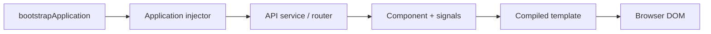

<a id="q1"></a>
## Q1. What does Angular solve?

**Requirement:** Explain what is gained by adopting a complete application framework rather than assembling unrelated libraries. Angular provides component templates, DI, routing, forms, HTTP, compilation/tooling, SSR/hydration integration and consistent patterns.

| Scenario | Expected architecture | Mistake to avoid |
|---|---|---|
| Many teams own screens | Shared conventions and testable components | One giant app component |
| Edit an order | Form with validation and API service | Trusting browser validation on the server |
| Navigate to a report | Router and lazy feature | Loading all features on startup |
| Search orders | Service fetches; component owns filter state | HTTP calls directly from template expressions |

**Step-by-step request trace:** (1) URL matches a route. (2) Angular loads the route component. (3) The injector resolves its dependencies. (4) The service requests data. (5) State updates, and Angular schedules the bound view to refresh. If a user leaves the route, async operations need cancellation/ownership handling.

**Invariant:** a view displays state, but rendering is not authorization. Protect data in the backend. **Trade-off:** conventions reduce design churn but add framework concepts and opinionated defaults. **Complexity:** no meaningful fixed Big-O for framework choice; measure route bundle weight, API latency and affected DOM updates separately.

**Interview follow-ups:** Angular vs React; route/component/service responsibilities; SSR; hydration and lazy loading.

<a id="q2"></a>
## Q2. Standalone component vs NgModule

**Requirement:** Define a required typed input and use a pipe without declaring the component in an NgModule.

```typescript
import {Component, input} from '@angular/core';
import {DatePipe} from '@angular/common';

type User = { id: number; name: string; joined: Date };

@Component({
  selector: 'app-user-card',
  imports: [DatePipe],
  template: `<h3>{{ user().name }}</h3>
             <time>{{ user().joined | date:'mediumDate' }}</time>`
})
export class UserCard {
  readonly user = input.required<User>();
}
```

**Examples:** input `{id:1,name:'Asha',joined:new Date('2026-01-01')}` renders Asha and a date; replacing it with Ravi updates the view; omitting `[user]` on a template usage gives a required-input compiler diagnostic; passing an incompatible type gives a template type-checking diagnostic under strict typing.

**How it works:** (1) the parent supplies `[user]="selectedUser()"`; (2) Angular writes the signal input binding; (3) the child reads `user()`; (4) `DatePipe` is in this component's template scope because of `imports`. Angular 19+ components default to standalone; `standalone: true` remains allowed; `standalone: false` opts into NgModule declaration.

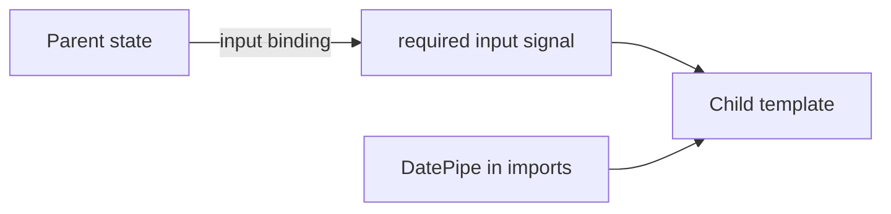

**Invariant:** the parent owns the supplied value; a child input signal is read-only. **Edges:** delayed data should be narrowed with an outer `@if` rather than forced via unsafe non-null assertions. **Complexity:** binding a reference is O(1), but rendering depends on the subtree. **Mistakes:** claiming NgModules are removed; forgetting a pipe/directive in imports.

**Follow-ups:** `@Input` vs `input()`; two-way `model()`; content projection; provider scopes.

<a id="q3"></a>
## Q3. Bootstrap a modern application

**Requirement:** Start a standalone root and register a router and HTTP interceptor.

```typescript
import {bootstrapApplication} from '@angular/platform-browser';
import {provideRouter, Routes} from '@angular/router';
import {provideHttpClient, withInterceptors} from '@angular/common/http';
import {AppComponent} from './app.component';
import {authInterceptor} from './auth.interceptor';

const routes: Routes = [{
  path: 'orders',
  loadComponent: () => import('./orders.component')
    .then(m => m.OrdersComponent)
}];

bootstrapApplication(AppComponent, {
  providers: [
    provideRouter(routes),
    provideHttpClient(withInterceptors([authInterceptor]))
  ]
}).catch(console.error);
```

**Four examples:** opening `/orders` loads the lazily declared route; an HTTP request made by injected HttpClient uses registered interceptors; missing `provideHttpClient` produces an injection problem; a failed lazy import causes a route-loading error.

**Trace:** application platform starts → providers registered in application injector → root component created → router resolves URL → route chunk imported → feature component instantiated → service injects HttpClient → outbound HTTP request flows through interceptors. The code assumes `authInterceptor` and `OrdersComponent` exist in a real app.

**Invariant:** importing a TypeScript symbol alone does **not** register its provider. **Security:** client route guards and interceptors do not replace server authorization. **Complexity:** lazy loading shifts network/bundle costs to route entry; it does not remove them. **Follow-ups:** root vs child injectors, SSR bootstrapping, OIDC tokens.

<a id="q4"></a>
## Q4. AOT and template type checking

**Requirement:** Detect a binding error before running the corresponding browser path.

| Input | Declared contract | Expected |
|---|---|---|
| `{{ user.name }}` | User has string name | Valid binding |
| `{{ user.addresss }}` | User has `address` only | Template diagnostic |
| `<app-user-card />` | `user` required | Missing-input diagnostic |
| `[user]="123"` | expects User | Type mismatch diagnostic |

**How it works:** Angular parses component metadata/template → resolves import scopes → constructs typed representations of bindings → asks TypeScript to check them → produces build diagnostics and rendering instructions. The compiler handles more than minification and can catch invalid property access.

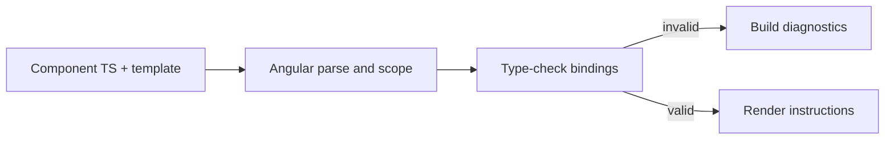

**Invariant:** build-time validity says nothing about the shape of untrusted runtime JSON. Validate backend data at trust boundaries. **Boundary:** `any` and weakened template options erase useful checks. **Cost:** depends on codebase size and type complexity; no universal O(n) claim for a full compiler. **Follow-ups:** strictTemplates, JIT vs AOT, SSR builds.

<a id="q5"></a>
## Q5. Data-binding directions

**Requirement:** Support an editable search term, a clear button and an avatar URL.

```typescript
import {Component, signal} from '@angular/core';
import {FormsModule} from '@angular/forms';

@Component({
  selector: 'app-search',
  imports: [FormsModule],
  template: `<input [(ngModel)]="search" aria-label="Search">
    <button (click)="clear()">Clear</button>
    <p>{{ search }}</p>
    `
})
export class SearchComponent {
  search = '';
  readonly avatarUrl = signal('/assets/avatar.png');
  clear() { this.search = ''; }
}
```

**Four examples:**

| Binding | Example | Direction |
|---|---|---|
| Interpolation | `{{ search }}` | Component → text |
| Property | `[src]="avatarUrl()"` | Component → DOM property |
| Event | `(click)="clear()"` | DOM event → component |
| Two-way | `[(ngModel)]="search"` | Both via directive |

**Dry run:** initial empty → user types "ab" → NgModel updates `search` → interpolation displays "ab" → click Clear → `search` becomes empty and the form view synchronizes.

**Invariant:** data down, events up; two-way syntax combines the two directions. **Pitfalls:** missing FormsModule, writing `(click)="clear"` instead of invocation, conflating DOM attributes and properties. **Cost:** this tiny example's handlers perform O(1) work, while resulting DOM updates depend on affected content. **Follow-ups:** model inputs, reactive forms, zoneless notifications, sanitization.

<a id="q6"></a>
## Q6. Built-in control flow and identity

**Requirement:** Render an order list, keep row identity during reorder and display an empty state.

```typescript
import {Component, signal} from '@angular/core';
type Order = {id: string; amount: number};

@Component({
  selector: 'app-orders',
  template: `
    @for (order of orders(); track order.id) {
      <p>{{ order.id }}: {{ order.amount }}</p>
    } @empty {
      <p>No orders</p>
    }
  `
})
export class OrdersComponent {
  readonly orders = signal<Order[]>([]);
}
```

| Input `orders()` | Expected rendered view |
|---|---|
| `[]` | No orders |
| `[{id:'a',amount:10}]` | a: 10 |
| `[a,b]` → `[b,a]` | Rows reorder, stable IDs reused |
| `[a,b]` → `[b,c]` | a removed, c created, b retained |

**Detailed trace:** `orders()` signal changes → Angular re-evaluates the loop → compares tracking keys to prior iteration → reuses/moves/removes/creates rows → updates bindings. A unique stable entity key is the essential invariant; changing keys or using indices for reordering lists can mix up component state.

**Original state diagram:**

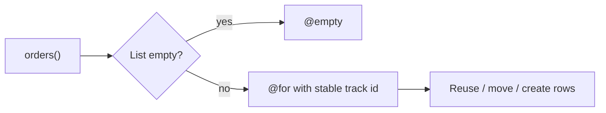

**Boundaries:** duplicate IDs break the intended stable identity mapping; Angular `@switch` does not fall through; choose `@if` for conditional content and `@for` for iteration. **Complexity:** n rows require O(n) output DOM capacity; no claim that keyed list rendering is O(1). **Follow-ups:** `@if` aliases, `@defer`, immutable lists and signals.

## Components, lifecycle and communication

The next seven questions share one mental model: Angular creates a component instance, binds inputs, checks and renders its view, lets it communicate through explicit APIs, and eventually destroys the instance. Keep **ownership** visible: a parent owns input state, a child emits an event describing what happened, and a two-way `model()` is justified only when both sides intentionally share one component-level value.

| Scenario | Primary mechanism | Why | Boundary |
|---|---|---|---|
| Parent supplies an immutable order | `input.required<Order>()` | Typed data flows down | Child cannot write the input signal |
| Child reports Save | `output<OrderDraft>()` | Event flows up | Custom outputs do not bubble through DOM ancestors |
| Reusable slider edits a value | `model(0)` | Deliberate two-way component API | Avoid for unrelated multi-field state |
| Card accepts caller-defined body | `<ng-content>` + `contentChild` if inspection is required | Caller supplies content; card owns layout | Projection is compiled, not a run-time DOM portal |

<a id="q7"></a>
## Q7. Describe the component lifecycle

**Requirement:** Fetch data for a required `userId` input, perform a DOM measurement only after rendering, and cancel owned asynchronous work on destruction.

Angular walks the application tree top-to-bottom while checking bindings. An instance is visited once per traversal, so changing more state halfway through check hooks is unsafe. The useful phases are:

| Phase | Hook/API | Precise use |
|---|---|---|
| Construct | `constructor` / `inject()` | Establish dependencies and input-independent fields |
| Bind/update | `ngOnChanges` | React to one or more changed inputs; first call precedes `ngOnInit` |
| Initialize | `ngOnInit` | One-time work after initial inputs exist, before this view initializes |
| Content/view | `ngAfterContentInit`, `ngAfterViewInit` | Read initialized query results; do not casually mutate checked state |
| Render DOM | `afterNextRender`, `afterEveryRender` | Application-wide post-render callback; DOM write/read phasing |
| Destroy | `ngOnDestroy` or `DestroyRef` | Release timers, observers and owned subscriptions |

```typescript
import {
  Component, DestroyRef, ElementRef, afterNextRender,
  inject, input
} from '@angular/core';
import {takeUntilDestroyed} from '@angular/core/rxjs-interop';
import {UserApi} from './user-api';

@Component({
  selector: 'app-user-panel',
  template: `<section>{{ status }}</section>`
})
export class UserPanel {
  readonly userId = input.required<string>();
  private readonly api = inject(UserApi);
  private readonly host = inject(ElementRef<HTMLElement>);
  private readonly destroyRef = inject(DestroyRef);
  status = 'idle';

  constructor() {
    // Render callbacks require an injection context; the constructor provides one.
    afterNextRender({
      write: () => this.host.nativeElement.classList.add('measured'),
      read: () => this.host.nativeElement.getBoundingClientRect().height
    });
  }

  ngOnInit() {
    this.status = 'loading';
    this.api.load(this.userId())
      .pipe(takeUntilDestroyed(this.destroyRef))
      .subscribe({
        next: () => this.status = 'ready',
        error: () => this.status = 'error'
      });
  }
}
```

**Initial dry run:** instantiate → inject dependencies → set `userId='u7'` → first `ngOnChanges` (if implemented) → `ngOnInit` subscribes → template initializes/checks → DOM render finishes → write phase adds class → read phase measures. **Update:** parent changes `userId`; Angular calls `ngOnChanges`, not `ngOnInit` again. The example therefore demonstrates one initial load; a production component that reloads on every ID needs `ngOnChanges` or a reactive effect/switching pipeline. **Destroy:** route leaves → `DestroyRef` signals → `takeUntilDestroyed` unsubscribes.

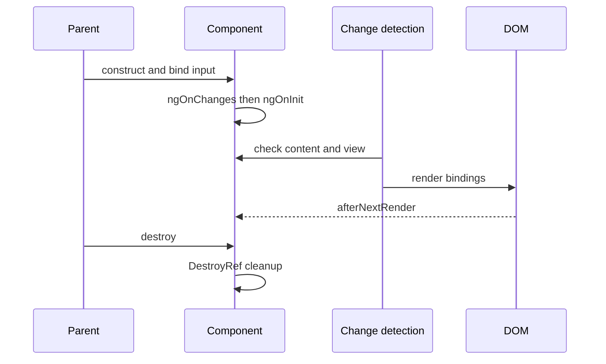

**Four boundaries:** empty/invalid IDs must be rejected by the API contract; `afterNextRender` does not run during SSR or build-time prerender; `ngDoCheck` and checked hooks are frequent and can become hot paths; an async callback should not write after destruction. **Correctness invariant:** each acquired resource has exactly one owner and cleanup path. **Cost:** a hook body costs whatever work it performs; putting O(n) work in a hook executed c times costs O(cn), while one subscription occupies O(1) framework references plus stream-specific state.

<a id="q8"></a>
## Q8. `constructor` vs `ngOnInit`

**Requirement:** explain why `userId()` should not be read as if bound inside the constructor.

| Property | Constructor | `ngOnInit` |
|---|---|---|
| Owner | JavaScript/TypeScript class creation | Angular lifecycle |
| Inputs guaranteed initialized | No | Yes, initial values are set |
| Runs | Once per instance | Once per instance |
| Good work | DI, cheap field setup, registering APIs that require injection context | Input-dependent initialization |
| Testing concern | Heavy side effects make construction hard to test | Still avoid hidden global side effects |

```typescript
import {input} from '@angular/core';

export class ProfileComponent {
  readonly userId = input.required<string>();
  initialUserId = '';

  constructor() {
    // Do not read this.userId() as though the parent has bound it here.
  }

  ngOnInit() {
    this.initialUserId = this.userId(); // initial input is available
  }
}
```

**Examples:** inject a logger in a field initializer; create an `AbortController` in construction and abort it through `DestroyRef`; derive initial state from a bound ID in `ngOnInit`; react to later ID changes with `ngOnChanges` rather than expecting `ngOnInit` to repeat. **Common error:** saying constructors are “not Angular.” Angular invokes the class constructor, but the language owns its semantics; Angular owns input binding and lifecycle timing. **Cost:** both callbacks are O(1) unless application work inside them changes that.

<a id="q9"></a>
## Q9. Parent and child communication

**Requirement:** a parent passes a draft to an editor; the editor reports Save without mutating the parent-owned object.

```typescript
import {Component, input, output} from '@angular/core';

type Draft = Readonly<{id: string; title: string}>;
type SaveEvent = {id: string; title: string};

@Component({
  selector: 'app-draft-editor',
  template: `<button (click)="save('Reviewed')">Save</button>`
})
export class DraftEditor {
  readonly draft = input.required<Draft>();
  readonly saved = output<SaveEvent>();

  save(title: string) {
    this.saved.emit({id: this.draft().id, title});
  }
}
```

```html
<app-draft-editor
  [draft]="selectedDraft()"
  (saved)="replaceDraft($event)" />
```

**Event trace:** parent evaluates input → child reads a read-only `InputSignal` → user clicks → child constructs a new event value → `emit` invokes the bound parent listener → parent replaces owned state → bindings refresh. Angular custom outputs are case-sensitive and do not bubble through the DOM.

**Choosing a channel:** input/output for direct ownership across one component edge; `model()` for a true two-way value such as a custom control; DI service/store for many unrelated consumers with an explicit lifetime; router state for navigable state. Do not reach into a child with a query just to bypass a clear input/output API.

**Four examples:** required input omitted produces a build diagnostic; a Save output carries a typed payload; a slider `model()` automatically has a matching `valueChange` output; a shared feature store coordinates siblings without chaining events through every intermediate component. **Invariant:** there is one authoritative owner for each mutable state value. **Cost:** passing/emitting a reference is O(1); copying a draft with k fields is O(k); rendering downstream output is additional.

<a id="q10"></a>
## Q10. `viewChild` vs `contentChild`

**Requirement:** a card focuses a button declared in its own template and optionally inspects a title projected by its caller.

```typescript
import {Component, ElementRef, contentChild, viewChild} from '@angular/core';

@Component({selector: 'card-title', template: `<ng-content />`})
export class CardTitle {}

@Component({
  selector: 'app-card',
  imports: [CardTitle],
  template: `
    <header><ng-content select="card-title">Untitled</ng-content></header>
    <ng-content />
    <button #close type="button">Close</button>`
})
export class Card {
  readonly closeButton = viewChild.required<ElementRef<HTMLButtonElement>>('close');
  readonly projectedTitle = contentChild(CardTitle);

  focusClose() { this.closeButton().nativeElement.focus(); }
}
```

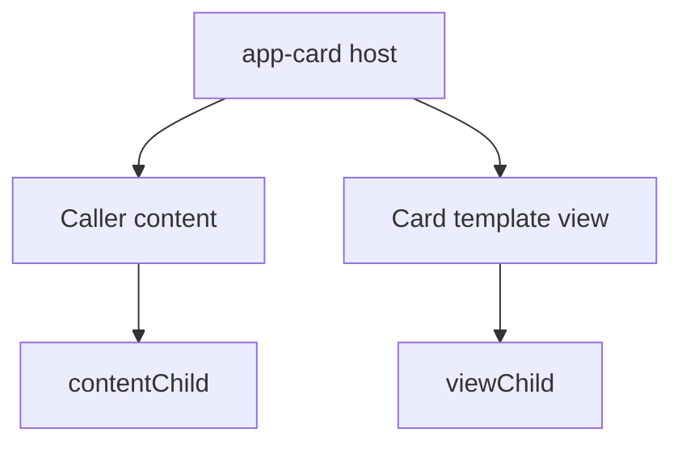

**Four examples:** `viewChild('close')` finds the local template reference; it does not search projected content; `contentChild(CardTitle)` finds the caller's projected title; an optional query returns `undefined` when no result exists; a required query reports failure if the promised result is absent. Query functions return signals and update as conditional content changes.

**Boundaries:** a query never pierces another component's template; use `read: ElementRef` or `TemplateRef` only when that is the actual contract; DOM access requires browser/SSR care; content query descendant behavior differs between `contentChild` and `contentChildren`. **Invariant:** view = nodes declared by this template; content = nodes supplied between this component's host tags. **Cost:** framework query maintenance depends on the candidate subtree; reading the returned signal is O(1), while processing m query results is O(m).

<a id="q11"></a>
## Q11. Content projection

**Requirement:** build one card shell with named title content, arbitrary body content, and sensible fallbacks.

```typescript
import {Component} from '@angular/core';

@Component({
  selector: 'app-card',
  template: `
    <article class="card">
      <header><ng-content select="[card-title]">Untitled</ng-content></header>
      <section><ng-content>No content</ng-content></section>
    </article>`
})
export class Card {}
```

```html
<app-card>
  <h2 card-title>Orders</h2>
  <app-order-list />
</app-card>
```

**Projection trace:** Angular compiles each `<ng-content>` slot → at use-site it classifies host children by selector → matching title goes to the named slot → unmatched nodes go to the catch-all slot → card template supplies surrounding DOM. `<ng-content>` itself is not emitted as a DOM node.

**Four examples:** title and body both supplied; title missing uses fallback title; unmatched content goes to the unqualified slot; without an unqualified slot, unmatched nodes are not rendered. **Common errors:** treating `<ng-content>` like a run-time element, adding directives/attributes to it, or conditionally adding/removing the placeholder. Use template fragments for genuinely dynamic template composition.

**Trade-off:** projection gives flexible composition without duplicating layout, but too many selector slots create a fragile mini-language. **Output cost:** rendering p projected DOM nodes requires O(p) output space; selector matching and rendering are framework concerns, not “free” because the shell is reusable.

<a id="q12"></a>
## Q12. Directive vs component

**Requirement:** add reusable focus behavior without introducing an unnecessary wrapper component.

```typescript
import {Directive, ElementRef, HostListener, inject} from '@angular/core';

@Directive({selector: '[focusOnInvalid]'})
export class FocusOnInvalidDirective {
  private readonly host = inject(ElementRef<HTMLElement>);

  @HostListener('submit')
  focusFirstInvalid() {
    this.host.nativeElement
      .querySelector<HTMLElement>(':invalid')
      ?.focus();
  }
}
```

Use a **component** when the feature owns a UI template, styles and a meaningful public UI API. Use an **attribute directive** for cross-cutting behavior on an existing host, and a structural/template mechanism when behavior controls embedded views. A component is a directive with a template, but not every directive should become a component.

**Examples:** order card → component; permission tooltip behavior → directive; autofocus/validation behavior → directive; complex date picker with its own DOM → component. **Boundaries:** direct DOM APIs need platform/accessibility care; directives on the same element must not depend on an undocumented lifecycle ordering; host directives can compose behavior when their public API remains intentional. **Complexity:** the selector attachment is framework work; this example's `querySelector` is up to O(d) in the host descendant count.

<a id="q13"></a>
## Q13. Pure vs impure pipes

**Requirement:** format an immutable list of names without re-running an O(n) transformation on every unrelated check.

```typescript
import {Pipe, PipeTransform} from '@angular/core';

@Pipe({name: 'joinNames'})
export class JoinNamesPipe implements PipeTransform {
  transform(names: readonly string[], separator = ', '): string {
    return names.join(separator);
  }
}
```

A pipe is pure by default. Angular re-executes it when a primitive input changes or an object/array **reference** changes. Mutating `names.push('Meera')` preserves the reference, so a pure pipe may not run; replace it with `names = [...names, 'Meera']`. Setting `pure: false` lets a pipe observe internal mutation but can invoke it much more frequently.

| Input transition | Pure pipe runs? | Resulting lesson |
|---|---|---|
| `'a'` → `'b'` | Yes | Primitive changed |
| `[A]` → `[A,B]` new array | Yes | Reference changed |
| Same array, `push(B)` | No guarantee of desired recomputation | Prefer immutable replacement |
| Unrelated component state changes | Usually skipped for same pure inputs | Pure pipe saves repeated work |

**Trace and cost:** for n names, `join` consumes O(n) element visits and O(L) output characters, where L is the produced string length. Across c checks, an impure version can cost O(c(n + L)); a pure version performs that cost only when its inputs change, plus framework comparison overhead. The output string itself requires O(L) space.

**Invariant:** `transform` is deterministic and side-effect free for the same inputs. **Never:** start HTTP calls, mutate application state, or hide subscriptions in a pipe. Extract reusable transformation logic into a standalone function for services/non-template callers rather than injecting the pipe class. **Follow-ups:** AsyncPipe ownership, memoized `computed`, immutable data, pipe arguments and operator precedence.

<a id="q14"></a>
## Q14. What is an Angular signal?

**Requirement:** hold a counter as component-owned state, expose it read-only, and derive a value without storing a second mutable copy.

```typescript
import {computed, signal} from '@angular/core';

export class Counter {
  private readonly countState = signal(0);
  readonly count = this.countState.asReadonly();
  readonly doubled = computed(() => this.count() * 2);

  increment() { this.countState.update(value => value + 1); }
  reset() { this.countState.set(0); }
}
```

A signal is a value wrapper that notifies tracked consumers when its value changes. Call it to read: `count()`. A writable signal adds `set` and `update`; `asReadonly()` removes that write API from consumers, but does **not** deep-freeze an object held inside it.

**Four examples:** a boolean controls a panel; a number drives a counter; a new immutable order object updates an order view; setting the same primitive again produces no downstream change under the default `Object.is` equality. For arrays and objects, replace rather than mutate when consumers depend on a new reference:

```typescript
readonly names = signal<readonly string[]>(['Asha']);

addRavi() {
  this.names.update(current => [...current, 'Ravi']); // new reference
}
```

**State trace:** read in a template → Angular records the template consumer → `set`/`update` produces a non-equal value → dependents are invalidated and the view is marked for synchronization → the next render reads the current value. Signals do not themselves make a mutable object immutable.

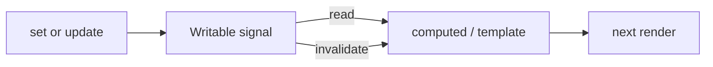

**Invariant:** one owner writes the state; consumers read it. **Cost:** reading or writing the signal container is conceptually O(1); a copied array update is O(n) time and O(n) space; rendering and each dependent derivation add their own work. **Common errors:** forgetting `()`, changing a nested property in place, using a signal as a security boundary, or promising that a write immediately mutates the DOM synchronously.

<a id="q15"></a>
## Q15. `signal` vs `computed` vs `effect`

**Requirement:** represent editable price and quantity, derive a total, and synchronize only the finished total to a non-reactive browser API.

```typescript
import {computed, effect, signal} from '@angular/core';

export class Basket {
  readonly price = signal(25);
  readonly quantity = signal(2);
  readonly total = computed(() => this.price() * this.quantity());

  constructor() {
    effect(() => localStorage.setItem('basket-total', String(this.total())));
  }
}
```

| Primitive | Owns writable state? | Cached derivation? | Intended job |
|---|---:|---:|---|
| `signal` | Yes | No | source state |
| `computed` | No | Yes, lazy and memoized | pure derived state |
| `effect` | No | No returned state | synchronize with a non-reactive API |

**Examples:** `quantity.set(3)` owns a new fact; `total()` derives `75`; a filtered list belongs in `computed`; logging, storage, a canvas or another imperative boundary can justify an `effect`. Do not use an effect to copy `total()` into another signal—two mutable representations can disagree.

**Trace:** first `total()` read runs the computation and caches 50 → a second read returns the cache → `quantity.set(3)` invalidates the cache → the next read computes 75 → the effect observes its dependency and eventually synchronizes `"75"`. Dependencies are determined by signal reads during the reactive execution.

**Invariant:** computed functions are pure and return the entire derived value; effects own only their external side effect and cleanup. A signal read after an `await` is outside the original synchronous tracking context, so capture tracked inputs before the async boundary. **Cost:** if derivation work is O(n), each invalidated-and-read computation is O(n), but repeated reads before invalidation are O(1); output construction still costs O(L) for L output units.

<a id="q16"></a>
## Q16. How dynamic dependency tracking works

**Requirement:** do not refilter a list while its results are hidden, but resume tracking when the panel becomes visible.

```typescript
import {computed, signal} from '@angular/core';

type Product = Readonly<{name: string}>;

export class SearchState {
  readonly visible = signal(false);
  readonly query = signal('');
  readonly products = signal<readonly Product[]>([]);

  readonly matches = computed(() => {
    if (!this.visible()) return [];
    const needle = this.query().trim().toLowerCase();
    return this.products().filter(p => p.name.toLowerCase().includes(needle));
  });
}
```

Angular tracks only signals actually read during the current reactive execution. The dependency set can add and remove edges on later executions.

| Step | State/change | Signals read by `matches` | Result |
|---:|---|---|---|
| 1 | read with `visible=false` | `visible` | `[]` cached |
| 2 | `query.set('cam')` | none rerun | cached result stays valid |
| 3 | `visible.set(true)` then read | `visible`, `query`, `products` | matching products |
| 4 | replace products | same three on next read | result recomputed |
| 5 | hide and read | `visible` only | query/products edges removed |

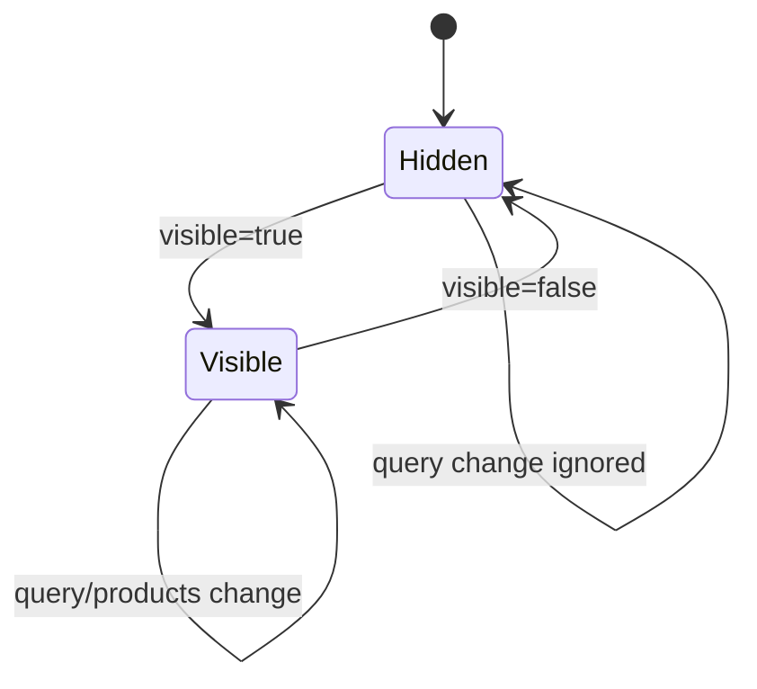

**Four examples:** a hidden expensive chart stops depending on samples; a selected account adds an account-details dependency; changing an unexecuted branch's signal does not invalidate the computed; `untracked` can intentionally read incidental data without adding an edge. **Boundary:** tracking is synchronous; a signal read only after `await` does not become a dependency of the original reactive context.

**Correctness invariant:** after every execution, the recorded dependencies are exactly the producers read on that execution. **Cost:** rebuilding the edge set is O(d) for d tracked reads; filtering n products costs O(n) time and O(k) result space for k matches, including constructing the output array.

<a id="q17"></a>
## Q17. When to use `linkedSignal`

**Requirement:** let a user override a selected shipping method, retain it when still valid, and fall back when server options change.

```typescript
import {linkedSignal, signal} from '@angular/core';

type Method = Readonly<{id: number; label: string}>;

export class ShippingPicker {
  readonly methods = signal<readonly Method[]>([
    {id: 1, label: 'Ground'},
    {id: 2, label: 'Air'}
  ]);

  readonly selected = linkedSignal<readonly Method[], Method | undefined>({
    source: this.methods,
    computation: (next, previous) =>
      next.find(method => method.id === previous?.value?.id) ?? next[0]
  });

  choose(method: Method) { this.selected.set(method); }
}
```

Unlike `computed`, a linked signal is writable. Unlike an independent `signal`, it recomputes from a source relationship. Here is the dry run:

| Action | Methods | Selected | Why |
|---|---|---|---|
| initialize | Ground, Air | Ground | first valid default |
| user chooses Air | Ground, Air | Air | local write allowed |
| server adds Sea | Ground, Air, Sea | Air | previous ID remains valid |
| server removes Air | Ground, Sea | Ground | fallback restores invariant |

**Examples:** valid selection in changing options; editable draft derived from the current record; unit view linked to a canonical value; resettable pagination linked to filters. Use `computed` if callers must never override the result, and a plain signal if no source relationship exists.

**Invariant:** `selected()` is either `undefined` for no options or belongs to the current option set. **Cost:** the `find` reconciliation is O(n) time and O(1) extra space; indexing methods by ID could make lookup expected O(1) at O(n) index space. **Common errors:** preserving an object by stale reference rather than stable ID, assuming `linkedSignal` is two-way persistence, or using it for every writable value.

<a id="q18"></a>
## Q18. `resource` and `httpResource`

**Requirement:** fetch a user reactively from a signal ID, cancel obsolete work, and render loading, error and value states without reading a failed value.

```typescript
import {computed, input} from '@angular/core';
import {httpResource} from '@angular/common/http';

type User = Readonly<{id: string; name: string}>;

export class UserPanel {
  readonly userId = input.required<string>();
  readonly user = httpResource<User>(() => `/api/users/${this.userId()}`);
  readonly heading = computed(() =>
    this.user.hasValue() ? `User: ${this.user.value().name}` : 'User');
}
```

```html
@if (user.hasValue()) {
  <h2>{{ heading() }}</h2>
} @else if (user.error()) {
  <p role="alert">Could not load this user.</p>
} @else if (user.isLoading()) {
  <p>Loading…</p>
}
```

`resource` connects reactive params to a general async loader; the loader receives an `AbortSignal`. `httpResource` is an eager reactive wrapper over `HttpClient`, including interceptor support. A dependency change starts a new request and cancels an outstanding one. A plain `HttpClient` observable is cold and starts on subscription.

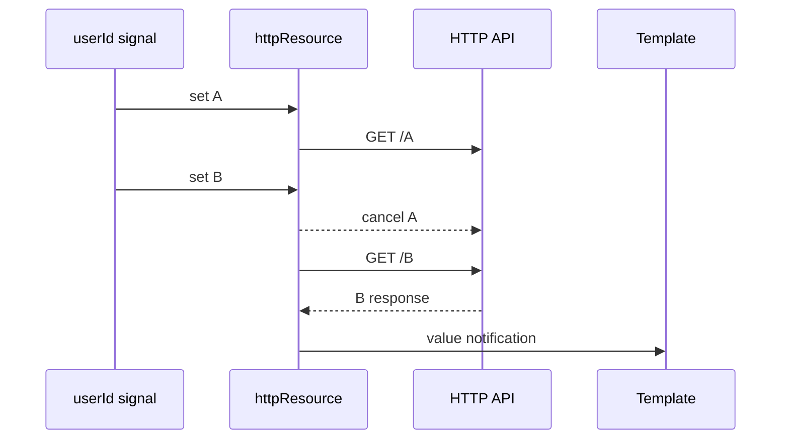

**Four examples:** reactive GET by ID; general `resource` loader for non-HTTP async work; an RxJS pipeline for debouncing and multi-source event orchestration; direct `HttpClient.post` for a mutation. Avoid `httpResource` for POST/PUT mutations, and guard `value()` with `hasValue()` because reading a resource value in an error state throws.

**Invariant:** only the latest active parameter set may publish its result; every UI path distinguishes idle/loading/value/error as needed. **Cost:** client bookkeeping is O(1) per active request plus the response and parsed object size O(b) for b bytes; network latency and server work dominate; rendering r returned records costs at least O(r) time and output space. **Testing:** exercise success, error, rapid A→B changes, empty response, teardown and interceptor behavior.

<a id="q19"></a>
## Q19. Change detection at a high level

**Requirement:** explain how a click that updates a template-read signal reaches the DOM in a zoneless Angular 22 application.

1. A bound listener runs for the click.
2. Application code writes the signal.
3. The signal invalidates tracked consumers; Angular knows the template view needs synchronization.
4. Angular schedules change detection from the framework notification.
5. The view reevaluates affected bindings and applies necessary DOM changes.

```typescript
import {Component, signal} from '@angular/core';

@Component({
  selector: 'app-votes',
  template: `<button (click)="upvote()">{{ votes() }} votes</button>`
})
export class Votes {
  readonly votes = signal(0);
  upvote() { this.votes.update(v => v + 1); }
}
```

The modern mental model is **notification-driven synchronization**, not “ZoneJS always scans because anything async happened.” Zoneless is the default in Angular 21+. Useful notifications include a template-read signal update, a bound template/host listener, `ComponentRef.setInput`, attaching a dirty view, and `ChangeDetectorRef.markForCheck` (which `AsyncPipe` invokes).

| Scenario | Notification present? | Expected result |
|---|---:|---|
| bound click updates template signal | Yes | view refresh scheduled |
| `AsyncPipe` receives value | Yes | marks view for check |
| external callback changes plain field only | Not necessarily | stale view risk |
| external callback sets template signal | Yes | view refresh scheduled |

**Invariant:** every state transition visible to a template must flow through an Angular-recognized notification. Zoneless does not mean “no change detection”; it removes ZoneJS patching as the trigger mechanism. **Cost:** a check costs roughly the evaluated binding/subtree work plus DOM writes; Big-O is application-specific. Use profiling before adding manual change-detector calls. **Errors:** mutating a plain field in an unintegrated callback, confusing detection with browser painting, or calling `detectChanges()` everywhere and masking missing notifications.

<a id="q20"></a>
## Q20. What `OnPush` means today

**Requirement:** make a row component safe for immutable inputs and signal state, and explain every normal path that can cause it to be checked.

```typescript
import {ChangeDetectionStrategy, Component, input, signal} from '@angular/core';

type Order = Readonly<{id: string; total: number}>;

@Component({
  selector: 'app-order-row',
  changeDetection: ChangeDetectionStrategy.OnPush,
  template: `
    <button (click)="expanded.update(v => !v)">{{ order().id }}</button>
    @if (expanded()) { <span>{{ order().total }}</span> }`
})
export class OrderRow {
  readonly order = input.required<Order>();
  readonly expanded = signal(false);
}
```

In Angular 22, `OnPush` is the default component strategy. It lets Angular skip a subtree lacking a relevant notification. New bound inputs are compared with `Object.is`; an event handled in the subtree causes relevant checks; a template-read signal update marks the component; `AsyncPipe`/`markForCheck` and framework input/view APIs also provide notifications. Therefore “OnPush only reacts to new `@Input` references” is incomplete.

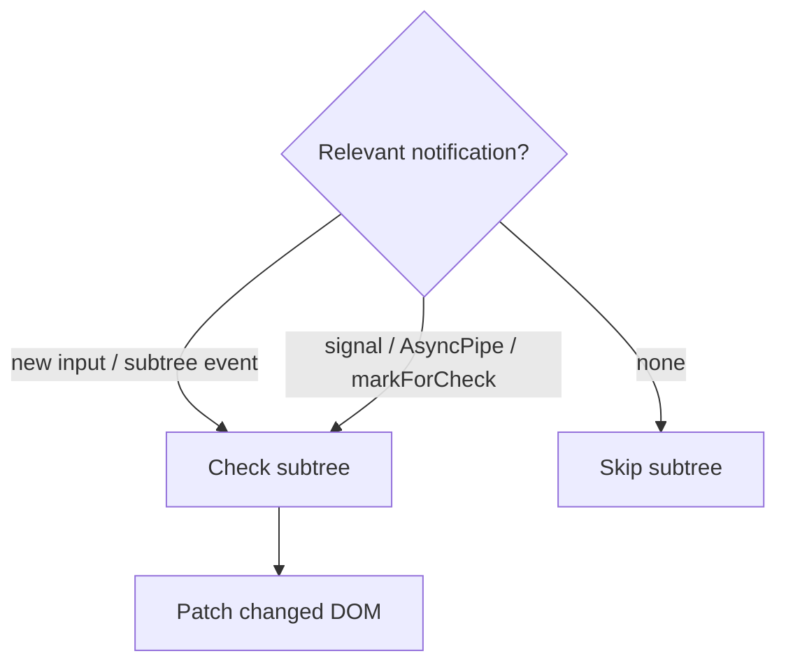

**Four examples:** replacing `order` checks the row; mutating the same object can leave a stale binding because its identity did not change; clicking the row checks its subtree and ancestors as required; a signal read by its template marks it when updated. An unrelated event outside an unmarked OnPush subtree permits that subtree to be skipped.

**Invariant:** parent-owned input values are replaced immutably, and every internal visible update emits a recognized notification. **Trade-off:** skipping can reduce work in large trees, but does not make an expensive checked template cheap. Memoize expensive pure derivations, track list items by stable identity, and measure. **Complexity:** if a full tree has V binding views but only an affected subtree has S, skipping may reduce binding work from O(V) toward O(S); actual cost depends on ancestors, events, dirty views and DOM updates, so this is a model—not a fixed guarantee.

<a id="q21"></a>
## Q21. What zoneless means in Angular 21+

**Requirement:** migrate an application from ZoneJS without losing updates from timers, third-party callbacks, forms, or server-side rendering.

Zoneless Angular still performs change detection. The difference is **how Angular learns that a view may need synchronization**. ZoneJS patched browser async APIs and treated many tasks as possible state changes. Zoneless Angular relies on explicit framework notifications: template-read signal writes, bound listeners, input updates, `AsyncPipe`/`markForCheck`, and attaching a dirty view. Zoneless is the default from Angular 21 onward; an application can still opt back into zone-based scheduling with `provideZoneChangeDetection`.

```typescript
import {Component, signal} from '@angular/core';

@Component({
  selector: 'app-clock',
  template: `<p>Ticks: {{ ticks() }}</p>`
})
export class Clock {
  readonly ticks = signal(0);
  private readonly timer = setInterval(
    () => this.ticks.update(value => value + 1),
    1000
  );

  ngOnDestroy() { clearInterval(this.timer); }
}
```

The timer itself is not a notification; the write to a signal consumed by the template is. Compare that with a plain field changed by an unintegrated callback: the value can change while no view synchronization is scheduled.

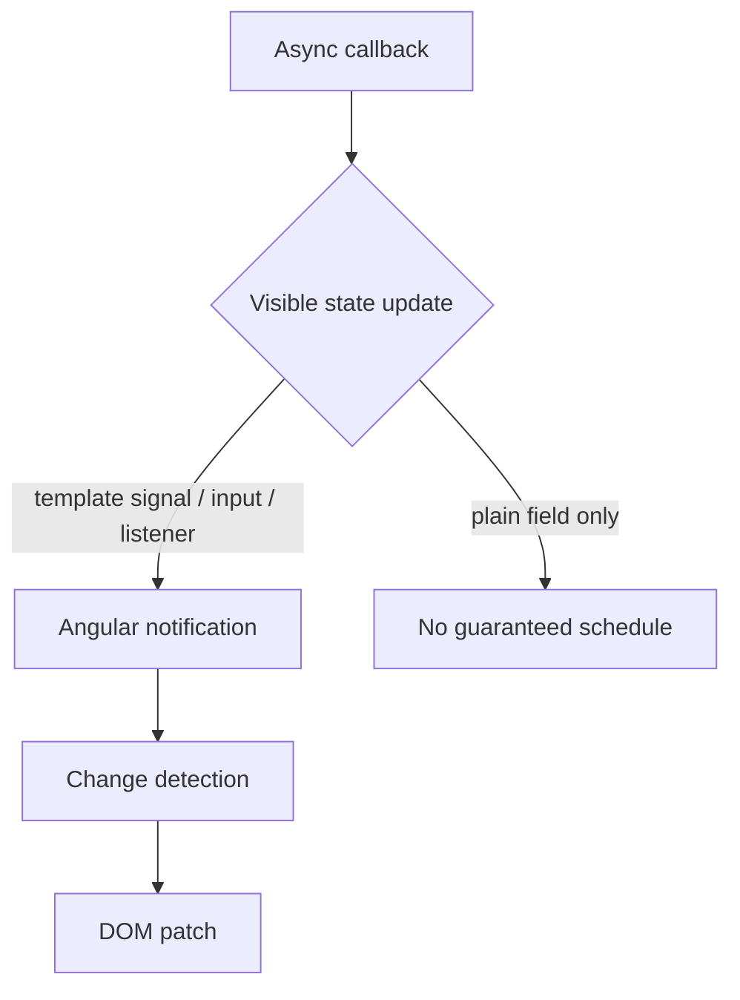

### Migration trace

| Step | Check | Failure signal | Repair |
|---:|---|---|---|
| 1 | Remove `zone.js` and `zone.js/testing` from build/test polyfills | app still bundles ZoneJS | remove dependency/imports |
| 2 | Audit visible state writes | callback changes a plain field with no notification | use a template-read signal or `markForCheck()` |
| 3 | Replace `NgZone.onStable` timing | post-render work never runs | use `afterNextRender`/`afterEveryRender` |
| 4 | Audit SSR work | HTML serializes before custom async work finishes | register work with `PendingTasks` |
| 5 | Test like production | forced `detectChanges()` hides missing notification | wait for stability and assert rendered output |

**Four scenarios:** a template signal updated by `setTimeout` schedules rendering; an `AsyncPipe` emission calls `markForCheck`; `FormControl.setValue` changes form state but may need a signal/mark when a template depends on unnotified reactive-form state; custom SSR work must participate in `PendingTasks`. `NgZone.run` and `runOutsideAngular` can remain for library compatibility—they are not proof that ZoneJS is active.

**Invariant:** every user-visible state transition has a recognized notification path. **Benefits:** fewer speculative synchronizations, no async-API monkey patching, smaller payload/startup overhead, and clearer native stack traces. **Boundary:** zoneless does not guarantee a fast app; expensive bindings, large DOM updates and excessive notifications remain expensive.

**Cost model:** let A be all async tasks and U be tasks that actually cause visible updates. Zone-based scheduling can react to work closer to A; notification-driven scheduling aims toward U, but each scheduled check still costs the checked views/bindings plus DOM writes. Measure rather than claiming a fixed Big-O improvement.

<a id="q22"></a>
## Q22. When to use `ChangeDetectorRef`

**Requirement:** integrate a callback that updates a plain field, and distinguish scheduling a normal future check from forcing a local synchronous check.

```typescript
import {ChangeDetectionStrategy, ChangeDetectorRef, Component} from '@angular/core';

interface LegacyMap {
  onZoom(listener: (zoom: number) => void): () => void;
}

@Component({
  selector: 'app-map-status',
  changeDetection: ChangeDetectionStrategy.OnPush,
  template: `<p>Zoom: {{ zoom }}</p>`
})
export class MapStatus {
  zoom = 1;
  private removeListener?: () => void;

  constructor(private readonly cdr: ChangeDetectorRef) {}

  connect(map: LegacyMap) {
    this.removeListener = map.onZoom(next => {
      this.zoom = next;
      this.cdr.markForCheck();
    });
  }

  ngOnDestroy() { this.removeListener?.(); }
}
```

`markForCheck()` marks the view dirty so Angular includes it in a scheduled synchronization; it does not immediately run the component's check in the callback. Prefer a signal when it cleanly represents the state, but `markForCheck` is appropriate at an imperative integration boundary.

| Method | Meaning | Appropriate example | Main risk |
|---|---|---|---|
| `markForCheck()` | mark view dirty for a normal check | legacy callback changes a plain field | forgetting cleanup/ownership |
| `detach()` | remove view from the change-detection tree | measured, high-frequency read-only display | stale UI |
| `detectChanges()` | synchronously check this view and children | intentionally detached view at a controlled cadence | re-entrancy and hidden design defects |
| `reattach()` | return detached view to normal checking | resume a paused live panel | assuming it retroactively renders |

### Controlled local checking

```typescript
import {ChangeDetectorRef, inject} from '@angular/core';

export class DenseTelemetry {
  private readonly cdr = inject(ChangeDetectorRef);
  private refreshId?: ReturnType<typeof setInterval>;

  start() {
    this.cdr.detach();
    this.refreshId = setInterval(() => this.cdr.detectChanges(), 250);
  }

  stop() {
    if (this.refreshId !== undefined) clearInterval(this.refreshId);
    this.cdr.reattach();
  }
}
```

This pattern is advanced: it trades freshness for fewer checks and requires explicit teardown. A signal update can mark a detached view dirty, but the detached view is still skipped until it is locally checked or reattached.

**Four examples:** mark an OnPush view after a non-Angular SDK callback; detach a telemetry panel and refresh four times per second; reattach when a paused tab becomes active; use `afterNextRender`, not an arbitrary `detectChanges()`, for work that must wait for rendered DOM. **Avoid:** calling `detectChanges()` in ordinary setters, lifecycle hooks or every subscription merely to silence `ExpressionChangedAfterItHasBeenCheckedError`.

**Invariant:** manual checking has a named owner, a documented freshness contract and a cleanup path. **Cost:** `markForCheck` is O(h) at most conceptually for dirty propagation through h ancestors, while `detectChanges()` costs O(v + w) for bindings/views v checked and DOM writes w; framework details may vary, so profile actual work.

<a id="q23"></a>
## Q23. How Angular dependency injection resolves a token

**Requirement:** give every editor subtree an isolated draft session while sharing one application-wide API client, then explain exactly which instance a nested component receives.

Dependency injection separates **what a consumer asks for** from **how and where the value is produced**:

| Term | Meaning | Example |
|---|---|---|
| Token | Runtime lookup key | `UserApi` or `InjectionToken<AppConfig>` |
| Provider | Recipe associated with a token | `{provide: API_URL, useValue: '/api'}` |
| Injector | Registry/cache that resolves recipes | application, route or element injector |
| Injection site | Code requesting the token | `inject(UserApi)` in a component |

```typescript
import {Component, Injectable, inject} from '@angular/core';

@Injectable({providedIn: 'root'})
export class UserApi {
  readonly instanceId = crypto.randomUUID();
}

@Injectable()
export class DraftSession {
  readonly instanceId = crypto.randomUUID();
}

@Component({
  selector: 'app-editor',
  providers: [DraftSession],
  template: `<p>Editor session: {{ draft.instanceId }}</p>`
})
export class Editor {
  readonly api = inject(UserApi);
  readonly draft = inject(DraftSession);
}
```

Each `Editor` element gets an element-injector `DraftSession`; descendants that do not override the token see that nearest session. Both editors still fall back to the root environment injector for the same `UserApi` instance. Angular destroys the component-scoped service when that component instance is destroyed.

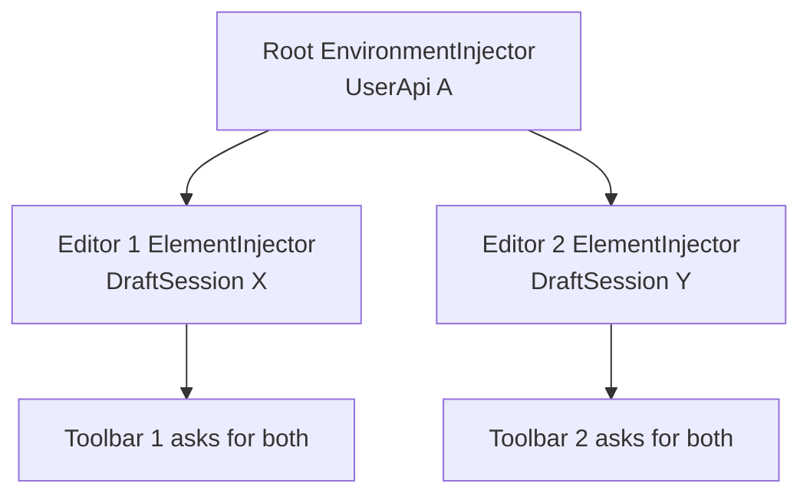

### Resolution trace

For Toolbar 1 requesting `DraftSession`: current element has no provider → parent Editor 1 element has X → return X and stop. For `UserApi`: no element injector has it → retry through the environment-injector hierarchy → root has A → return A. If no injector provides a required token, resolution reaches the null boundary and throws.

**Four scenarios:**

1. Two `Editor` instances receive different `DraftSession` IDs but the same `UserApi` ID.
2. A route-level provider supplies one feature instance to that route's components, guards and resolvers.
3. `inject(DraftSession, {self: true, optional: true})` returns `null` if the current element itself does not provide it, even if a parent does.
4. `inject(DraftSession, {skipSelf: true})` begins at the parent; `host` limits the upward search to the host boundary.

**Invariant:** provider placement intentionally defines visibility, lifetime and sharing. A component provider is not an application singleton. Avoid storing global truth in a service that is accidentally re-provided by every component.

**Cost model:** resolution walks a bounded injector ancestry, conceptually O(h) for h searched levels; after a provider creates a value, normal repeated lookups use the injector's cached instance. Construction cost belongs to the dependency graph itself, and component-scoped providers trade isolation for more live instances. Treat this as a reasoning model, not a framework implementation guarantee.

**Common errors:** using an interface as a token (interfaces disappear at runtime), re-providing a state service unintentionally, assuming a route guard is a security boundary, or injecting an optional value without handling `null`.

<a id="q24"></a>
## Q24. `inject()` vs constructor injection

**Requirement:** choose an injection form for a class, a functional guard and a provider factory, and identify a call that is too late.

Both forms use the same injector. The important distinction is **syntax and injection context**, not lifetime or speed.

| Situation | Good form | Why |
|---|---|---|
| Class with explicit public dependencies | constructor parameters | dependencies are visible in the signature |
| Private field dependency | field `inject()` | concise and strongly typed |
| Functional guard/interceptor | `inject()` | no class constructor exists |
| Provider or token factory | `inject()` or declared `deps` | factory executes in an injection context |

```typescript
import {Component, Injectable, InjectionToken, inject} from '@angular/core';
import {CanActivateFn, Router} from '@angular/router';

@Injectable({providedIn: 'root'})
class AuthService {
  isLoggedIn() { return true; }
}

@Component({selector: 'app-profile', template: 'Profile'})
class Profile {
  // Legal: Angular is constructing the component.
  private readonly auth = inject(AuthService);

  constructor(private readonly router: Router) {}

  // Illegal: calling inject(AuthService) here would be too late.
  save() { /* use this.auth and this.router */ }
}

export const authGuard: CanActivateFn = () => {
  const auth = inject(AuthService);
  const router = inject(Router);
  return auth.isLoggedIn() || router.parseUrl('/login');
};

export const START_TIME = new InjectionToken<number>('start time', {
  providedIn: 'root',
  factory: () => Date.now()
});
```

### Context trace

Angular enters an injection context → begins constructing `Profile` → evaluates field initializers → runs the constructor → leaves the context. Therefore the field and constructor work, but a later click calling `save()` cannot start a fresh `inject()` lookup. A provider factory and functional guard are invoked by Angular inside their own contexts.

`runInInjectionContext(injector, fn)` can establish a context for a synchronous function, but `inject()` must occur before an `await`; the context does not automatically flow into later asynchronous callbacks.

**Four scenarios:** a field initializer succeeds; a constructor parameter succeeds; a functional route guard succeeds; a lifecycle method that calls `inject()` throws an injection-context error. Capture dependencies up front and use the captured value later.

**Invariant:** every `inject()` call executes synchronously inside a valid injection context. **Trade-off:** constructor injection advertises dependencies at the class boundary; `inject()` improves functional composition and avoids parameter-decorator friction. Use a consistent project convention without claiming one changes provider scope.

**Testing boundary:** test a function that calls `inject()` through Angular's injection test context, or refactor its decision logic into a pure function and pass dependencies explicitly. Instantiating such a class with `new` bypasses Angular's context.

<a id="q25"></a>
## Q25. `useClass`, `useValue`, `useFactory` and `useExisting`

**Requirement:** configure an API client, replace logging in production and keep a deprecated token as an alias without creating a second logger.

```typescript
import {InjectionToken, Provider, inject} from '@angular/core';

export interface AppConfig {
  apiUrl: string;
  production: boolean;
}

export const APP_CONFIG =
  new InjectionToken<Readonly<AppConfig>>('app config');

abstract class Logger { abstract log(message: string): void; }
class ConsoleLogger extends Logger {
  log(message: string) { console.log(message); }
}
class SilentLogger extends Logger {
  log(_message: string) {}
}

class ApiClient {
  constructor(readonly baseUrl: string, readonly logger: Logger) {}
}

export const LEGACY_LOGGER = new InjectionToken<Logger>('legacy logger');

export const APP_PROVIDERS: Provider[] = [
  {
    provide: APP_CONFIG,
    useValue: Object.freeze({apiUrl: '/api', production: true})
  },
  {
    provide: Logger,
    useFactory: () =>
      inject(APP_CONFIG).production ? new SilentLogger() : new ConsoleLogger()
  },
  {
    provide: ApiClient,
    useFactory: () => new ApiClient(
      inject(APP_CONFIG).apiUrl,
      inject(Logger)
    )
  },
  {provide: LEGACY_LOGGER, useExisting: Logger}
];
```

| Recipe | Injector returns | Typical use | Important boundary |
|---|---|---|---|
| `useClass` | instance of the named class | swap an implementation | this recipe creates/caches its own instance |
| `useValue` | exact supplied value | immutable configuration or test fake | do not mutate shared config |
| `useFactory` | factory result | derive from other dependencies | factory must stay in an injection context |
| `useExisting` | value already resolved for another token | rename/alias a token | identity is shared |

**Four examples:** replace `Logger` with `ConsoleLogger` using `useClass`; provide a frozen configuration with `useValue`; create `ApiClient` from configuration with `useFactory`; resolve `LEGACY_LOGGER` and `Logger` to the same object with `useExisting`.

**Identity dry run:** resolve `Logger` → factory creates instance L and the injector caches it → resolve `LEGACY_LOGGER` → alias asks for `Logger` → returns L. Replacing the alias with `{provide: LEGACY_LOGGER, useClass: SilentLogger}` would create a different instance.

**Invariant:** one token has one unambiguous recipe at a given injector unless it is deliberately a multi token. Use an `InjectionToken<T>` for interfaces and primitive/config values because TypeScript types do not survive at runtime.

**Failure modes:** exposing a mutable `useValue` object as global state, creating side effects in factories, confusing `useClass` with aliasing, or reading browser globals in a factory during SSR. **Cost:** the injector normally evaluates a recipe once per providing injector and caches the result; factory/construction work is therefore paid per scoped instance. Application behavior inside the result has its own cost.

<a id="q26"></a>
## Q26. Multi providers as a plugin seam

**Requirement:** let independent features contribute audit hooks without any feature replacing another registration.

```typescript
import {Injectable, InjectionToken, Provider, inject} from '@angular/core';

type AuditEvent = Readonly<{actor: string; action: string}>;
interface AuditHook { record(event: AuditEvent): void; }

export const AUDIT_HOOKS =
  new InjectionToken<readonly AuditHook[]>('audit hooks');

@Injectable()
class SecurityAudit implements AuditHook {
  record(event: AuditEvent) { console.log('security', event.action); }
}

@Injectable()
class MetricsAudit implements AuditHook {
  record(event: AuditEvent) { console.log('metric', event.actor); }
}

export const AUDIT_PROVIDERS: Provider[] = [
  {provide: AUDIT_HOOKS, useClass: SecurityAudit, multi: true},
  {provide: AUDIT_HOOKS, useClass: MetricsAudit, multi: true}
];

@Injectable()
export class AuditRunner {
  private readonly hooks =
    inject(AUDIT_HOOKS, {optional: true}) ?? [];

  record(event: AuditEvent) {
    for (const hook of this.hooks) hook.record(event);
  }
}
```

Without `multi: true`, later registration for the same token replaces or conflicts with the intended single recipe. With it, resolving the token returns an array containing all contributions registered as multi providers in that injector.

**Four scenarios:** two hooks both run once; one hook can be replaced with a `useValue` test spy while retaining `multi: true`; no registration produces `null` here and the runner chooses `[]`; registering the same hook twice produces two entries—multi providers do not deduplicate.

**Execution trace:** injector encounters two multi recipes → creates/caches one contribution per recipe → token resolves to `[SecurityAudit, MetricsAudit]` → runner iterates in the resulting order → both observe the immutable event. Keep ordering requirements explicit; avoid correctness that depends on incidental assembly order across separately owned provider arrays.

**Invariant:** every provider for a multi token uses `multi: true`, and consumers expect an array. Do not mix a regular provider and multi providers for the same token at one injector.

**Trade-offs and cost:** the pattern decouples plugin authors from the runner, but hides the final set of contributors and permits duplicates. First resolution constructs p contributions; dispatch costs O(p + Σworkᵢ) time and O(p) cached references for p hooks. A hook failure policy must be deliberate: fail fast, isolate each hook with error handling, or run asynchronously with an explicit delivery contract.

<a id="q27"></a>
## Q27. Host metadata vs `HostBinding` and `HostListener`

**Requirement:** build a reusable pressed-state directive whose CSS class, ARIA state, pointer events and keyboard behavior stay synchronized.

Angular still supports both decorators, but the current API documentation says to prefer the directive/component `host` property; `HostBinding` and `HostListener` remain for backwards compatibility.

```typescript
import {Directive, signal} from '@angular/core';

@Directive({
  selector: 'button[appPressState]',
  host: {
    '[class.is-active]': 'active()',
    '[attr.aria-pressed]': 'active()',
    '(click)': 'toggle()'
  }
})
export class PressState {
  readonly active = signal(false);

  toggle() {
    this.active.update(value => !value);
  }

}
```

```html
<button appPressState type="button">Pin report</button>
```

### Event-to-host trace

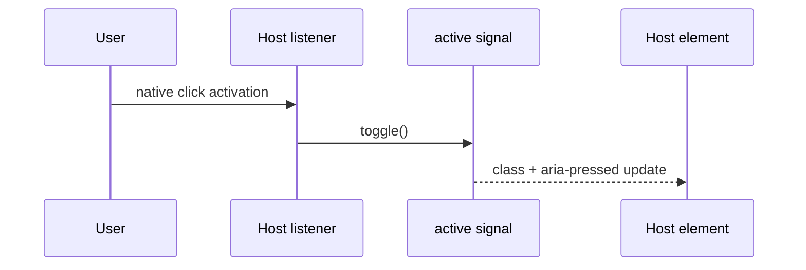

**Four examples:** a pointer click toggles class and ARIA state; Enter activates the native button and produces the click; Space activates it with the browser's native button semantics; programmatic `active.set(false)` updates both host bindings on the next synchronization. Restricting the selector to a native button preserves focus and activation semantics better than inventing a clickable `div`. Do not add redundant keydown toggles to a native button or one keyboard action can toggle twice.

**Host binding vs listener:** `'[class.is-active]': 'active()'` reads directive state during view synchronization; `'(click)': 'toggle()'` invokes behavior when the host emits an event. Prefixes such as `window:` create global listeners and require especially careful ownership; prefer a local host event when it solves the problem.

**Invariant:** visible styling and semantic state derive from the same source of truth. **Boundaries:** host metadata does not sanitize application logic, and a directive should not call browser-only globals during server rendering. Use host bindings or renderer abstractions instead of arbitrary DOM mutation when possible.

**Common errors:** mouse-only interaction, adding button semantics to an unfocusable element, duplicating a native button's keyboard activation, calling a signal without `()` in the host expression, or registering broad global listeners unnecessarily. If a custom non-button widget is truly required, implement the complete WAI-ARIA keyboard/focus pattern instead of copying only one key handler. **Cost:** listener dispatch is O(1) plus handler work; each notification checks the affected view bindings, while actual style/attribute writes occur only when values differ.

## RxJS and asynchronous flows

The important interview question is rarely “Which operator name do you remember?” It is “Who starts the work, what happens when a newer value arrives, when does the result become available, and who owns teardown?”

<a id="q28"></a>
## Q28. Observable vs Promise

**Requirement:** choose the abstraction from the contract, not from syntax. A Promise represents one eventual fulfillment or rejection. An Observable can represent zero, one or many notifications over time, has explicit completion/error channels, composes through operators, and runs only according to the producer's subscription contract.

| Dimension | Promise | Observable |
|---|---|---|
| Result count | One settlement | Zero to many `next` values, then optional completion or error |
| Start | Executor starts when the Promise is constructed | Commonly lazy, but an Observable may wrap a hot producer already running |
| Consumer | `await` / `then` | `subscribe`, `AsyncPipe`, signal interop or an operator chain |
| Cancellation | No built-in cancellation of the Promise itself; the underlying API may accept `AbortSignal` | Unsubscribe tears down that subscription; what the producer can cancel depends on its implementation |
| Composition | Promise combinators | Time-, concurrency- and cancellation-aware RxJS operators |

Angular `HttpClient` returns **cold Observables**: no request is sent until subscription, and each subscription creates a separate request. The generic `get<User>()` is a TypeScript assertion, not runtime validation of untrusted JSON.

```typescript
import {HttpClient} from '@angular/common/http';
import {Observable} from 'rxjs';

type User = Readonly<{id: number; name: string}>;

class UserApi {
  constructor(private readonly http: HttpClient) {}

  user(id: number): Observable<User> {
    return this.http.get<User>(`/api/users/${id}`);
  }
}
```

**Four examples:** `await dialog.open()` fits one eventual choice; a route-parameter stream can emit on every navigation; a WebSocket can emit until disconnected; `HttpClient.get` normally emits one response and completes, but two subscriptions send two requests.

### Subscription trace

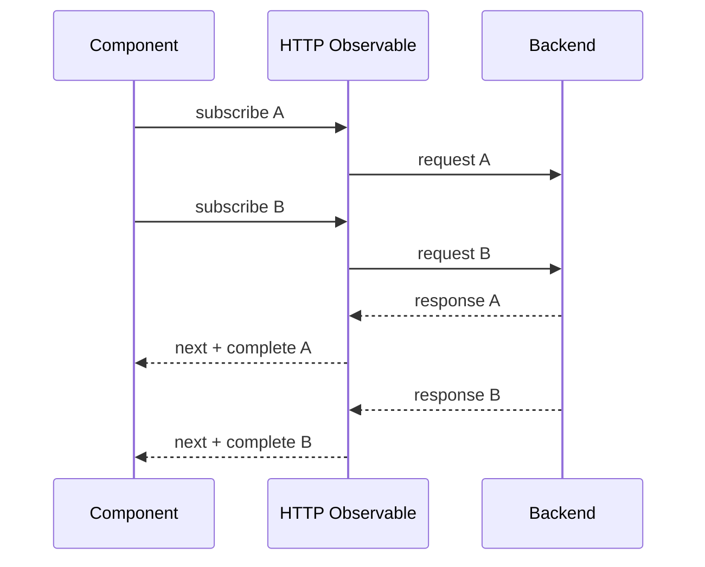

**Cancellation boundary:** unsubscribing can abort an in-flight client request when the producer supports teardown, preventing an obsolete response from updating the UI. It cannot promise that a server has not already processed a mutation. Use idempotency keys, conditional writes or server-side transaction rules where “undo the request” matters.

**Invariants and cost:** after an error or completion, that subscription receives no more values. Creating a pipeline is usually O(k) references for k operators; each notification performs the relevant operator work. Retaining emitted collections costs their size. Do not claim “Observable is faster”; choose it when stream semantics, composition or ownership are required.

<a id="q29"></a>
## Q29. Subject vs BehaviorSubject vs ReplaySubject

**Requirement:** identify whether a subscriber needs only future events, one current state value, or bounded history.

| Type | New subscriber receives immediately | Initial value | Good fit | Main hazard |
|---|---|---|---|---|
| `Subject<T>` | Nothing until the next `next` | No | commands/events bridging imperative code | late subscribers miss earlier events |
| `BehaviorSubject<T>` | latest value | Yes | current state for RxJS consumers | invented sentinel seeds and public mutation |
| `ReplaySubject<T>(n)` | up to the last n values | No | bounded late-subscriber history | unbounded buffer/time window retains memory |

```typescript
import {BehaviorSubject, Observable, ReplaySubject, Subject} from 'rxjs';

class UploadCoordinator {
  private readonly cancelSubject = new Subject<void>();
  readonly cancel$ = this.cancelSubject.asObservable();

  private readonly statusSubject = new BehaviorSubject<'idle' | 'busy'>('idle');
  readonly status$ = this.statusSubject.asObservable();

  private readonly logSubject = new ReplaySubject<string>(3);
  readonly recentLog$ = this.logSubject.asObservable();

  cancel() { this.cancelSubject.next(); }
  begin() { this.statusSubject.next('busy'); }
  log(line: string) { this.logSubject.next(line); }
}
```

**State trace:** write log entries A, B, C, D before observer X subscribes → `ReplaySubject(3)` replays B, C, D → a later E is delivered live. A `BehaviorSubject('idle')` immediately gives a new observer the latest `'idle'` or `'busy'`; a plain Subject gives neither history nor a current value.

**Four examples:** click telemetry uses a Subject; authentication state with a genuine initial “unknown” union can use a BehaviorSubject; a three-line diagnostic panel can use `ReplaySubject(3)`; synchronous component-local derived UI state is often simpler as `signal` + `computed` rather than a public Subject.

**Invariant:** expose the read side (`Observable`) and keep `next` private so one owner controls writes. A Subject is also an Observer and an Observable, but that does not make it a safe shared mutable store. **Cost:** one emission fans out in O(s) time to s active subscribers. BehaviorSubject retains O(1) values; `ReplaySubject(n)` retains O(n) values plus subscriber bookkeeping. Use an explicit finite buffer and, when appropriate, a time window.

**Common errors:** using an empty string as a fake BehaviorSubject seed; reaching for `getValue()` everywhere; assuming a Subject replays the last event; leaving `ReplaySubject()` unbounded; using a Subject where a cold Observable factory would preserve isolation.

<a id="q30"></a>
## Q30. `switchMap`, `mergeMap`, `concatMap` and `exhaustMap`

**Requirement:** map each outer value to an inner Observable and state the concurrency policy.

| Operator | When a new outer value arrives | Ordering/concurrency | Typical scenario |
|---|---|---|---|
| `switchMap` | unsubscribe previous inner, subscribe newest | latest wins; old result cannot flow through that subscription | typeahead/read keyed by current selection |
| `mergeMap` | subscribe to another inner | concurrent; completion order may differ | independent reads with a deliberate concurrency limit |
| `concatMap` | queue until current inner completes | one at a time; preserves source order | ordered writes |
| `exhaustMap` | ignore it while current inner is active | first wins until completion | suppress duplicate submit/login clicks |

```typescript
import {Component, inject} from '@angular/core';
import {HttpClient} from '@angular/common/http';
import {
  catchError, debounceTime, distinctUntilChanged, map, of, Subject, switchMap
} from 'rxjs';

type SearchState =
  | {kind: 'ready'; items: readonly string[]}
  | {kind: 'error'; message: string};

@Component({selector: 'app-search-results', template: ''})
export class SearchResults {
  private readonly http = inject(HttpClient);
  private readonly terms = new Subject<string>();

  readonly state$ = this.terms.pipe(
    map(term => term.trim()),
    debounceTime(250),
    distinctUntilChanged(),
    switchMap(term =>
      this.http.get<readonly string[]>('/api/search', {params: {q: term}}).pipe(
        map(items => ({kind: 'ready', items}) as const),
        catchError(() => of({
          kind: 'error',
          message: 'Search failed'
        } as const))
      )
    )
  );

  search(term: string) { this.terms.next(term); }
}
```

### Latest-wins dry run

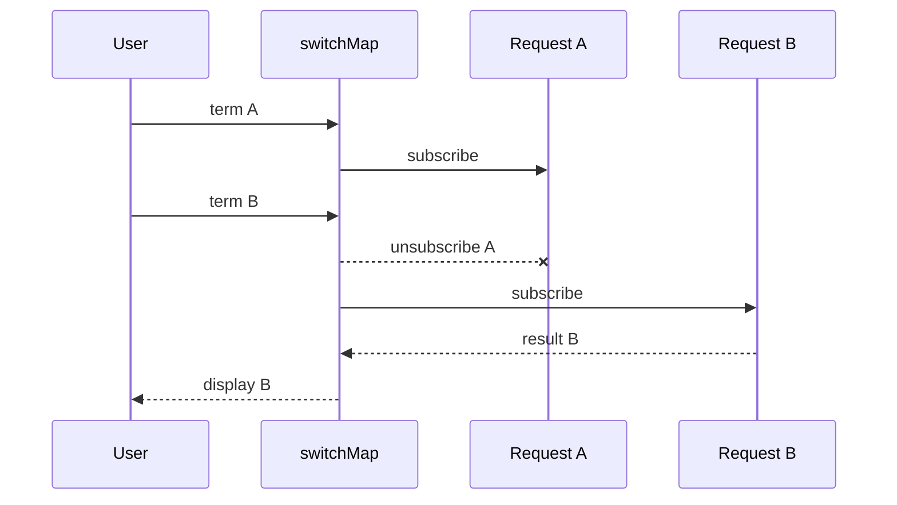

For outer values A, B, C arriving while A is active:

- `switchMap`: A is unsubscribed; then B may be unsubscribed; C is the active result.
- `mergeMap`: A, B and C may all run; emissions arrive in actual completion order.
- `concatMap`: B and C wait; results are processed A, B, C.
- `exhaustMap`: B and C are ignored if A remains active.

**Four choices:** search suggestions → switchMap; prefetch independent product details → mergeMap with a bounded concurrency argument; save ordered audit records → concatMap; login button → exhaustMap plus disabled/loading UI.

**Mutation trap:** “unsubscribe” is not “roll back the server.” `switchMap` is excellent for obsolete reads, but it may hide a response while a POST has already taken effect. Ordered mutation, deduplication and idempotency require an explicit server/client contract.

**Invariants and cost:** the operator controls active inner subscriptions, not the remote system's transaction state. With m outer values, work still includes every inner actually started. `mergeMap` can retain O(c) active inners for concurrency c; unbounded c risks sockets and memory. `concatMap` can retain an O(q) queue when arrivals outpace completion. `exhaustMap` bounds the active inner to one but discards outer values by design.

<a id="q31"></a>
## Q31. `combineLatest` vs `forkJoin`

**Requirement:** distinguish “recompute whenever any live input changes” from “wait for every finite task and collect final results.”

| Question | `combineLatest` | `forkJoin` |
|---|---|---|
| First emission | after every input has emitted at least once | after every input completes with a final value |
| Later emissions | whenever an input emits, using latest values | exactly one combined emission, then complete |
| Non-completing input | normal for a live stream | prevents the combined result from arriving |
| Common fit | filters, route state, UI preferences | parallel finite HTTP reads |

```typescript
import {combineLatest, forkJoin, map, startWith} from 'rxjs';

const visibleOrders$ = combineLatest([
  orders$,
  searchTerm$.pipe(startWith('')),
  status$.pipe(startWith<'all' | 'open' | 'closed'>('all'))
]).pipe(
  map(([orders, term, status]) =>
    orders.filter(order =>
      order.title.includes(term) &&
      (status === 'all' || order.status === status)
    )
  )
);

const dashboard$ = forkJoin({
  profile: http.get<Profile>('/api/profile'),
  permissions: http.get<readonly string[]>('/api/permissions'),
  notices: http.get<readonly Notice[]>('/api/notices')
});
```

**Dry run:** orders emits O1, term has not emitted, status emits “all” → `combineLatest` waits. Term emits `bug` → output uses [O1, `bug`, `all`]. Status emits `open` → output recomputes with O1 and the same term. In the dashboard, profile finishes at 30 ms, notices at 60 ms and permissions at 90 ms → `forkJoin` emits once at 90 ms using each final value.

**Four examples:** live table filters use combineLatest; route params plus cached preferences use combineLatest after each has a seed/emission; three HttpClient GETs use forkJoin; a WebSocket inside forkJoin is a bug unless it is intentionally made finite (for example with `take(1)`).

**Error boundary:** either combinator errors if an input error is uncaught. Catching outside `forkJoin` commonly replaces the whole result. If partial data is valid, catch and map an error inside each source to an explicit result union; do not silently turn errors into ambiguous empty arrays.

**Invariants and cost:** `combineLatest` stores one latest value per input, O(k) references for k sources, and downstream recomputation costs whatever the projection does—O(n) here for filtering n orders. `forkJoin` stores final values until all inputs complete, O(k) references plus the retained payloads. Neither operator makes network requests by itself; subscribing to the composed cold HTTP Observable starts its sources.

<a id="q32"></a>
## Q32. Prevent subscription leaks through ownership

**Requirement:** every long-lived subscription has an owner, an intended lifetime and a teardown path. Prefer declarative consumption where possible.

1. In templates, `AsyncPipe` subscribes, exposes the latest value, marks the component for checking, switches when the bound reference changes and unsubscribes when the view is destroyed.
2. In imperative Angular code, `takeUntilDestroyed()` completes the pipeline when the owning destruction context is destroyed.
3. Finite streams such as ordinary `HttpClient` requests normally complete, but repeated subscriptions can still duplicate work, and cancellation still matters when the owner disappears.
4. Application-lifetime subscriptions in root services can be intentional; “long lived” is not identical to “leak.”

```typescript
import {Component, DestroyRef, inject} from '@angular/core';
import {takeUntilDestroyed} from '@angular/core/rxjs-interop';
import {ActivatedRoute} from '@angular/router';
import {distinctUntilChanged, map} from 'rxjs';

@Component({selector: 'app-order-page', template: ''})
export class OrderPage {
  private readonly route = inject(ActivatedRoute);
  private readonly destroyRef = inject(DestroyRef);

  constructor() {
    this.route.paramMap.pipe(
      map(params => params.get('id')),
      distinctUntilChanged(),
      takeUntilDestroyed(this.destroyRef)
    ).subscribe(id => {
      if (id !== null) this.load(id);
    });
  }

  private load(_id: string) {}
}
```

When called in an injection context, `takeUntilDestroyed()` can infer the `DestroyRef`; passing it explicitly makes ownership visible and is required when the operator is assembled outside such a context.

| Subscription owner | Intended lifetime | Preferred teardown |
|---|---|---|
| template view | while the view exists or source reference remains | `AsyncPipe` |
| component/directive imperative logic | instance lifetime | `takeUntilDestroyed` |
| one finite HTTP read | until response/error or owner no longer needs it | completion plus owner cancellation when appropriate |
| root service connection | application lifetime | explicit application/disconnect policy |
| dynamically replaced child/session | that child/session only | bind teardown to that exact child/session |

**Leak trace:** enter route → component subscribes to a global interval → leave route without teardown → component remains reachable through the observer → re-enter five times → five observers perform the same update. With lifecycle teardown, each destroyed component is removed before the next instance subscribes.

**Four examples:** show `users$ | async` in a template; bind route params with `takeUntilDestroyed`; use `switchMap` to replace an obsolete request and still bind the outer subscription to the owner; deliberately keep a root telemetry connection while the application runs and expose a tested disconnect method.

**Boundaries and mistakes:** cleanup also includes event listeners, timers, observers, sockets and third-party callbacks. Avoid nested subscriptions; compose them so errors and teardown have one path. Do not reuse one destroyed notifier for future component instances, and do not assume garbage collection can reclaim an object still referenced by a live producer.

**Cost:** a leak converts per-instance state O(s) into O(r·s) retained state after r recreations and multiplies event work by the number of stale observers. Correct teardown keeps live subscriber count proportional to current owners.

<a id="q33"></a>
## Q33. Cold vs hot Observables, sharing and cache invalidation

**Requirement:** describe the relationship between a producer and its subscribers. “Cold” and “hot” are not different TypeScript types, and “hot” does not necessarily mean that work started at application bootstrap.

| Contract | Producer relationship | Late subscriber | Angular example |
|---|---|---|---|
| cold/unicast | each subscription creates its own producer execution | receives its own execution from the beginning | `HttpClient.get`, `defer`, most `of` pipelines |
| hot/multicast | subscribers observe one producer that exists independently of any one subscriber | normally receives only future notifications | DOM events, WebSocket feed, plain `Subject` |
| shared cold source | an operator connects one source execution to a multicast subject for a defined lifetime | depends on connector/reset/replay policy | HTTP pipeline with `share` or `shareReplay` |

Angular `HttpClient` Observables are cold: constructing one does not send a request, and **every subscription sends a new backend request**. By contrast, a `Subject` fans one call to `next` out to the observers currently attached. A source can also move between these behaviors: `share()` turns one upstream subscription into a shared connection while its reset policy permits it.

```typescript
import {inject, Injectable} from '@angular/core';
import {HttpClient} from '@angular/common/http';
import {Observable, shareReplay, startWith, Subject, switchMap} from 'rxjs';

type User = Readonly<{id: number; name: string}>;

@Injectable({providedIn: 'root'})
export class CurrentUserStore {
  private readonly http = inject(HttpClient);
  private readonly refreshRequests = new Subject<void>();

  // One active request is shared, one successful value is replayed.
  // refresh() is the explicit invalidation boundary.
  readonly user$: Observable<User> = this.refreshRequests.pipe(
    startWith(void 0),
    switchMap(() => this.http.get<User>('/api/me')),
    shareReplay({bufferSize: 1, refCount: true})
  );

  refresh(): void {
    this.refreshRequests.next();
  }
}
```

### Two-subscription dry run

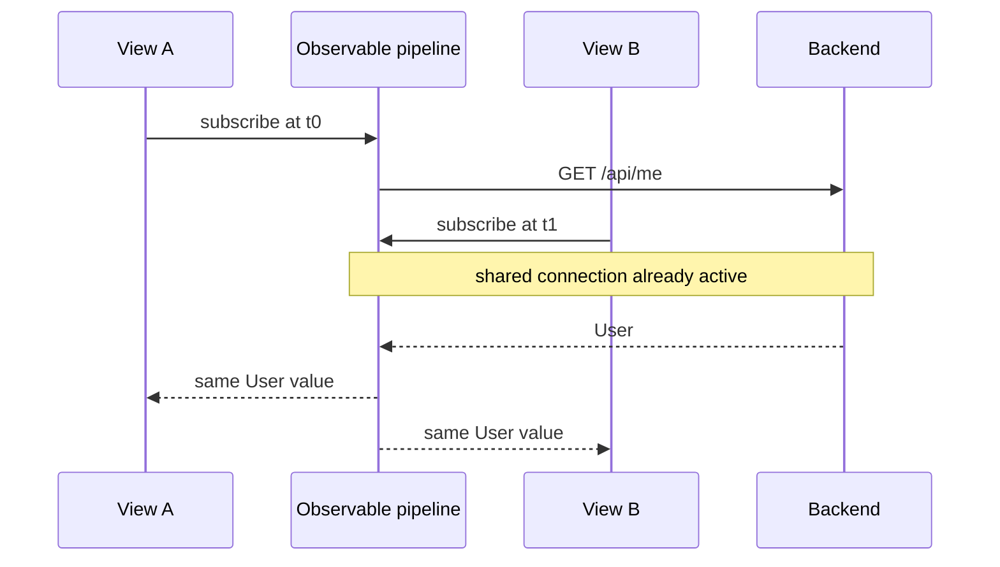

Without `shareReplay`, A and B each subscribe through to `HttpClient`, so two GETs are sent. With the shown pipeline, A creates the upstream connection and B joins it; both receive the response. `bufferSize: 1` retains at most one emitted value for a late subscriber. `refCount: true` disconnects and resets an **active, nonterminal** shared connection when the last subscriber leaves. In RxJS 7’s `shareReplay` contract, a successfully completed source is not reset on completion, so a completed HTTP value can remain cached as long as this `user$` object remains reachable. `refCount` is therefore not a time-to-live or business invalidation policy.

**Four concrete examples:**

1. Two components subscribe to the same unshared `http.get` variable → two independent requests.
2. Two overlapping subscribers use `share()` → one active request, but a subscriber arriving after completion starts a fresh execution because `share` resets on completion by default.
3. A late subscriber uses `shareReplay({bufferSize: 1, refCount: true})` after a successful HTTP completion → it can receive the retained value immediately without a new request.
4. A plain Subject emits A before a view subscribes, then B afterward → that view sees B only; a ReplaySubject or replaying share policy would be required to see A.

**Cache key and invalidation invariant:** a cached value is valid only for the identity and parameters that produced it. Key caches by user/tenant/locale/query as appropriate, clear or replace them on logout and privilege changes, and define refresh after writes. Do not put one root-scoped `/api/me` cache across identities without clearing it. Errors, completion and zero-subscriber resets are separate decisions; retry policy is separate again.

**Common errors:** saying all Observables are lazy/cold; assuming two variables referencing the same cold Observable share work; using an unbounded replay buffer; treating `shareReplay(1)` as a complete cache design; hiding stale data indefinitely; and confusing client unsubscription with rollback of server work.

**Correctness and cost:** while one shared generation is active, every downstream observer sees notifications from that same upstream execution in source order. An emission fans out in O(s) time for s subscribers. A replay buffer of b retained values uses O(b) references plus the retained payload sizes; here b = 1. The HTTP/network and JSON parsing costs are unchanged—sharing prevents duplicate executions, not the cost of the one execution. Interview follow-ups include reconnect after errors, TTL invalidation, per-key caches, WebSocket ownership, SSR request isolation and whether late subscribers need history.

<a id="q34"></a>
## Q34. `AsyncPipe` is a view-owned subscription

**Requirement:** bind an Observable or Promise in a template without manually retaining a component subscription. `AsyncPipe` subscribes, returns the latest value, marks the component to be checked when a new value arrives, unsubscribes when the containing view is destroyed, and switches subscriptions when the bound object reference changes.

```typescript
import {AsyncPipe} from '@angular/common';
import {ChangeDetectionStrategy, Component, inject} from '@angular/core';
import {catchError, map, of, startWith} from 'rxjs';

type User = Readonly<{id: number; name: string}>;
type UserVm =
  | {kind: 'loading'}
  | {kind: 'ready'; user: User}
  | {kind: 'error'; message: string};

@Component({
  selector: 'app-current-user',
  imports: [AsyncPipe],
  changeDetection: ChangeDetectionStrategy.OnPush,
  template: `
    @if (vm$ | async; as vm) {
      @switch (vm.kind) {
        @case ('loading') { <p>Loading…</p> }
        @case ('ready') { <h2>{{ vm.user.name }}</h2> }
        @case ('error') { <p role="alert">{{ vm.message }}</p> }
      }
    }
  `
})
export class CurrentUserComponent {
  private readonly store = inject(CurrentUserStore);

  readonly vm$ = this.store.user$.pipe(
    map(user => ({kind: 'ready', user}) as const),
    startWith({kind: 'loading'} as const),
    catchError(() => of({kind: 'error', message: 'Could not load user'} as const))
  );
}
```

`AsyncPipe` has a `T | null` boundary because a source might not have produced a value on the first template evaluation. This example uses `startWith` so the UI has an explicit loading state immediately, then narrows the discriminated union inside `@switch`. The pipe does not invent loading, empty or error UI; model those states in the stream or surrounding template.

### Reference-switch trace

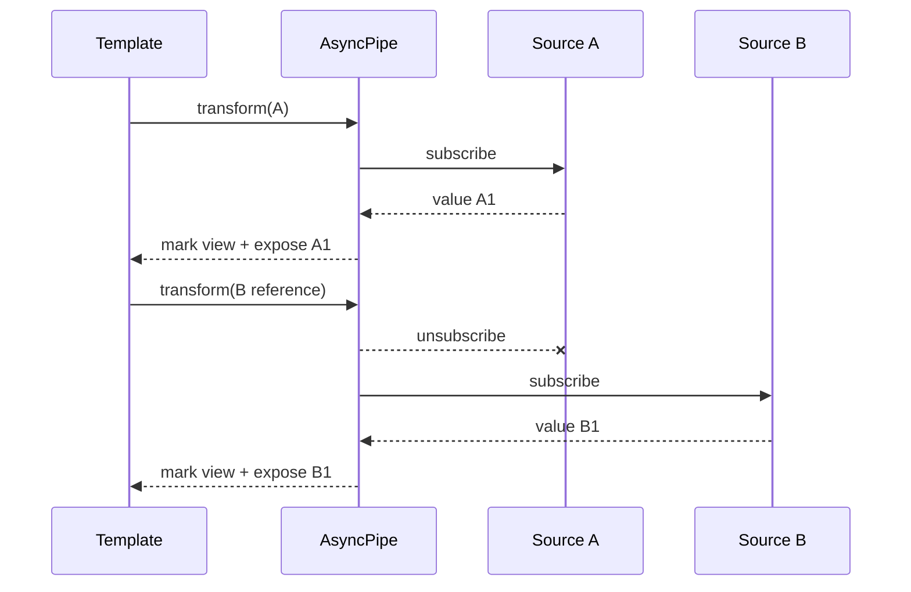

**Four examples:** a finite HTTP view model completes after one response; an interval is unsubscribed when an `@if` removes its view; a Promise resolves once and its value is exposed; replacing `selectedUser$` with a different Observable reference unsubscribes the old source before subscribing to the new one.

**One pipe instance means one subscription.** Writing `user$ | async` three times creates three pipe instances and can create three subscriptions. For a cold HTTP source that can mean three requests. Bind once and alias the result, as above, or deliberately share the pipeline. Conversely, sharing a source does not eliminate the value of aliasing: aliasing also gives one coherent template snapshot and avoids repeated transforms.

**Stable-reference invariant:** do not call a template method or getter that constructs a new Observable on each evaluation. If `loadUser() | async` returns a fresh `http.get` each time, `AsyncPipe` observes a new identity, tears down the previous subscription and starts another. Construct the pipeline once in a field, or derive it from a stable input stream with `switchMap`.

**Boundaries and trade-offs:** use `AsyncPipe` when the view owns consumption; use `takeUntilDestroyed` when imperative code truly needs side effects. A pipe teardown prevents future delivery to that view but cannot reverse server mutations. Errors still need handling; an unhandled Observable error ends that subscription. `AsyncPipe` is impure so Angular can check for reference/value changes, but it does not continuously poll the producer.

**Cost:** each pipe occurrence retains O(1) subscription/bookkeeping state plus the latest referenced value; an emission marks its owning view and causes the relevant change-detection/render work. With p separate pipe occurrences, subscription overhead is O(p), and a cold source may repeat upstream cost p times. Rendering a list of n emitted records still requires O(n) output work and DOM/state proportional to what is rendered. Interview follow-ups include aliasing, OnPush/zoneless notifications, error-state modeling, SSR timing, multiple pipe occurrences and when signal interop is preferable.

## Forms, validation and submission

A form is not merely a collection of inputs. It is a state machine containing a typed value, validity, disabled state, interaction state (`pristine`/`dirty`, `untouched`/`touched`), possible asynchronous work and a submission policy. The form approach determines where that model lives and how explicitly code can inspect it.

<a id="q35"></a>
## Q35. Reactive Forms vs template-driven forms

**Requirement:** choose from the size, dynamism, test strategy and ownership of the form—not from a slogan that one style is always better.

| Dimension | Reactive Forms | Template-driven forms |
|---|---|---|
| Form model | explicit controls/groups created in TypeScript | implicit controls created by `NgModel`/template directives |
| Data flow | synchronous access to the control model | template directives synchronize mutable component data asynchronously |
| Validation | validator functions attached to controls | attributes/directives in the template |
| Testing | model can be exercised without rendering the template | usually requires template rendering and change-detection stabilization |
| Best fit | typed, nested, dynamic or heavily validated workflows | small, stable forms with simple rules |

```typescript
import {Component, inject} from '@angular/core';
import {FormBuilder, ReactiveFormsModule, Validators} from '@angular/forms';

type ProfileCommand = Readonly<{
  displayName: string;
  notificationEmail: string;
  marketingAllowed: boolean;
}>;

@Component({
  selector: 'app-profile-form',
  imports: [ReactiveFormsModule],
  template: `
    <form [formGroup]="profile" (ngSubmit)="save()">
      <label>Display name <input formControlName="displayName"></label>
      <label>Email <input type="email" formControlName="notificationEmail"></label>
      <label><input type="checkbox" formControlName="marketingAllowed"> Marketing</label>
      <button type="submit" [disabled]="profile.invalid">Save</button>
    </form>
  `
})
export class ProfileFormComponent {
  private readonly fb = inject(FormBuilder).nonNullable;

  readonly profile = this.fb.group({
    displayName: ['', [Validators.required, Validators.maxLength(80)]],
    notificationEmail: ['', [Validators.required, Validators.email]],
    marketingAllowed: false
  });

  save(): void {
    if (this.profile.invalid) {
      this.profile.markAllAsTouched();
      return;
    }
    const command: ProfileCommand = this.profile.getRawValue();
    // Send command through a service; the server validates it again.
    void command;
  }
}
```

`nonNullable` prevents these controls from acquiring `null` merely because `reset()` was called; `getRawValue()` includes disabled controls, while `value` omits disabled descendants. That distinction matters when building commands—disabled UI is not authorization and must not decide what the server accepts.

### Input-to-command trace

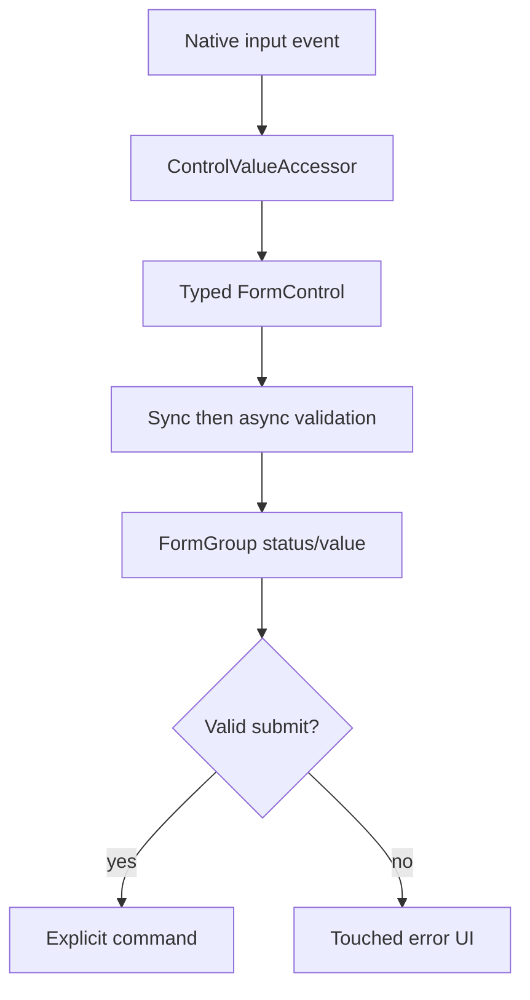

**Four choices:** a newsletter email field can be template-driven; a checkout with address groups and conditional delivery controls favors Reactive Forms; a questionnaire with add/remove rows needs `FormArray` or another explicit dynamic model; a small legacy screen should normally keep its consistent existing approach unless migration has a measured payoff.

**Invariants:** the control tree shape matches the submitted domain shape or has an explicit mapping; one owner decides when controls are added/removed; and server validation remains authoritative. `setValue` requires the complete group shape, while `patchValue` allows a subset—using `patchValue` everywhere can hide missing fields. A checkbox disabled in the browser is not a security boundary.

**Common errors:** mixing `ngModel` and reactive directives on the same field, forgetting to import `FormsModule` or `ReactiveFormsModule`, reading `value` when disabled fields are intentionally required, mutating the backing object without updating controls, showing errors before interaction, and embedding business submission logic inside a template.

**Cost:** a changed control evaluates its attached validators and propagates status through its ancestors. With v validators and tree height h, local bookkeeping is approximately O(v + h), excluding validator work and rendering. Rendering or serializing n controls is at least O(n). Dynamic conditional sections can retain substantial values, subscriptions and DOM, so remove or disable them according to the domain contract rather than only hiding their elements.

<a id="q36"></a>
## Q36. What are Signal Forms, and when should you adopt them?

**Requirement:** explain the current Angular API and a migration decision. Signal Forms build a form tree over a writable signal model, bind fields with `FormField`, centralize rules in a schema and expose field state through signals such as `value`, `touched`, `invalid`, `errors` and `pending`. Current Angular documentation requires Angular 21+ and imports the API from `@angular/forms/signals`.

```typescript
import {Component, signal} from '@angular/core';
import {
  email, form, FormField, minLength, required
} from '@angular/forms/signals';

type Registration = {
  email: string;
  password: string;
};

@Component({
  selector: 'app-registration',
  imports: [FormField],
  template: `
    <form novalidate (submit)="onSubmit($event)">
      <label>Email <input type="email" [formField]="registrationForm.email"></label>
      @if (registrationForm.email().touched() && registrationForm.email().invalid()) {
        <ul>
          @for (error of registrationForm.email().errors(); track error) {
            <li>{{ error.message }}</li>
          }
        </ul>
      }
      <label>Password <input type="password" [formField]="registrationForm.password"></label>
      <button type="submit" [disabled]="registrationForm().invalid()">Register</button>
    </form>
  `
})
export class RegistrationComponent {
  readonly registrationModel = signal<Registration>({email: '', password: ''});

  readonly registrationForm = form(this.registrationModel, path => {
    required(path.email, {message: 'Email is required'});
    email(path.email, {message: 'Enter a valid email address'});
    required(path.password, {message: 'Password is required'});
    minLength(path.password, 12, {message: 'Use at least 12 characters'});
  });

  onSubmit(event: SubmitEvent): void {
    event.preventDefault();
    if (this.registrationForm().invalid()) return;
    const command: Registration = this.registrationModel();
    // Send command through a service; the server validates it again.
    void command;
  }
}
```

**How it works:** create a typed signal model → `form()` builds a field tree and binds schema rules once → `[formField]` synchronizes the field and native control → a user edit updates the model signal → validation updates field-state signals → the template rerenders only the state it reads. Validation and submission are still different concerns; a disabled button does not replace a guarded submit handler or server enforcement.

**Four decisions:** choose Signal Forms for a new signal-first feature; keep mature Reactive Forms when libraries, custom controls and tests already depend on them; prototype a migration at a feature boundary rather than rewriting the whole application; use template-driven forms for genuinely small stable screens where the new abstraction would add no value.

**Migration trade-offs:** Signal Forms reduce manual synchronization and provide typed schema paths, but the API and ecosystem are newer than Reactive Forms. Inventory custom `ControlValueAccessor` components, cross-field rules, dynamic arrays, test helpers and third-party UI integrations before migrating. Do not keep two writable sources of truth—for example, a signal model plus a separately mutated DTO.

**State invariant:** the writable signal is the value source of truth, while the form tree owns interaction and validation state. Schema rules must remain deterministic for the values they read. Field errors are presentation hints, not trusted business authorization.

**Cost:** changing one field triggers its dependent schema rules and consumers; the exact graph cost depends on dependencies rather than the total application size. A form with n rendered fields still needs O(n) field/view state. Error rendering costs O(e) for e exposed errors. Compare measured bundle, rendering, validation and migration costs rather than claiming signals make all forms automatically faster.

<a id="q37"></a>
## Q37. Synchronous vs asynchronous validators

**Requirement:** a validator returns `null` when valid or a structured error when invalid. A synchronous `ValidatorFn` returns immediately. An `AsyncValidatorFn` returns a finite Promise or Observable of `ValidationErrors | null`. Angular runs async validators only after synchronous validators pass, and a control remains `PENDING` until async validation completes.

```typescript
import {inject, Injectable} from '@angular/core';
import {
  AbstractControl, AsyncValidatorFn, FormControl,
  ValidationErrors, ValidatorFn, Validators
} from '@angular/forms';
import {HttpClient} from '@angular/common/http';
import {catchError, map, Observable, of, take} from 'rxjs';

export const trimmedMinLength = (minimum: number): ValidatorFn =>
  (control: AbstractControl): ValidationErrors | null => {
    const value = String(control.value ?? '').trim();
    return value.length >= minimum
      ? null
      : {trimmedMinLength: {minimum, actual: value.length}};
  };

@Injectable({providedIn: 'root'})
export class UsernameApi {
  private readonly http = inject(HttpClient);

  isTaken(username: string): Observable<boolean> {
    return this.http.get<boolean>('/api/usernames/taken', {params: {username}});
  }
}

export const uniqueUsername = (api: UsernameApi): AsyncValidatorFn =>
  (control: AbstractControl): Observable<ValidationErrors | null> =>
    api.isTaken(String(control.value ?? '').trim()).pipe(
      map(taken => taken ? {usernameTaken: true} : null),
      // Product decision: unavailable validation blocks submission explicitly.
      catchError(() => of({validationUnavailable: true})),
      take(1)
    );

export const usernameControl = (api: UsernameApi) => new FormControl('', {
  nonNullable: true,
  validators: [Validators.required, trimmedMinLength(3)],
  asyncValidators: [uniqueUsername(api)],
  updateOn: 'blur'
});
```

### Validation state trace

```mermaid
sequenceDiagram
 participant U as User
 participant C as FormControl
 participant V as Validators
 participant API as Server
 U->>C: blur value "asha"
 C->>V: run required + length
 V-->>C: null, sync valid
 C->>C: status PENDING
 C->>API: uniqueness request
 API-->>C: taken = true
 C->>C: errors usernameTaken; status INVALID
```

**Four examples:** `required` is synchronous; a pure cross-field rule such as “end date is not before start date” is synchronous on the group; username uniqueness is asynchronous and server-backed; checking whether a value already present in an in-memory set is synchronous even if the business concept sounds “remote.” Choose by where the answer lives, not by the rule's name.

**Why `updateOn: 'blur'`:** the default is validation after each value change. A remote call for every keystroke wastes backend capacity and produces flickering states. `blur` is suitable when the user should finish one field first; `submit` is suitable when validation can wait. For typeahead-style feedback, build an explicitly debounced/cancelled design rather than hiding timers inside an unpredictable validator.

**Finite-result invariant:** an Observable validator must complete; otherwise the control can remain `PENDING`. Map every success path to either `null` or an error object and make the failure policy explicit. “Network error means valid” improves availability but may permit a bad value; “network error blocks submission” is safer but can prevent progress. The product and threat model decide.

**Server boundary:** client validation improves feedback and reduces obvious bad requests. It cannot guarantee uniqueness under concurrency: two clients can both see “available” and race. Enforce the unique constraint in the database/server transaction and map a conflict response back to a field/form error.

**Common errors:** returning `true`/`false` instead of `null`/an error map; attaching a group rule to the wrong control; never completing an async Observable; issuing HTTP on every keypress; swallowing transport failure without a documented policy; displaying errors before `dirty` or `touched`; and assuming a temporarily valid UI authorizes submission.

**Cost:** synchronous validation costs the sum of invoked rules, commonly O(v) for v constant-time validators plus any scan such as O(L) for a length/pattern over L characters. Async validation adds network latency, backend work and one retained pending subscription. Angular skips that expense when sync validation fails. A database uniqueness index is typically O(log n) lookup or implementation-specific, but the only correctness guarantee comes from the atomic server-side constraint, not the preliminary client query.

## Routing and HTTP request boundaries

Routing decides **which feature should exist now**; HTTP decides **which remote state that feature can observe or mutate**. Lazy loading, guards, resolvers, interceptors and RxJS cancellation each solve a different boundary. Combining them indiscriminately creates slow navigation, leaked credentials or hidden error behavior.

<a id="q38"></a>
## Q38. How does lazy-loaded routing work in standalone Angular?

**Requirement:** keep the landing shell small, load an admin feature only when its URL is matched, and preserve a clear feature boundary. A direct `component` reference is eager. `loadComponent` loads one standalone component, while `loadChildren` loads a child route configuration. Both loader functions normally use the JavaScript `import()` boundary that the build system turns into a separate chunk.

```typescript
import {Routes} from '@angular/router';

export const routes: Routes = [
  {
    path: '',
    pathMatch: 'full',
    loadComponent: () => import('./home/home.page')
      .then(module => module.HomePage)
  },
  {
    path: 'admin',
    loadChildren: () => import('./admin/admin.routes')
      .then(module => module.ADMIN_ROUTES)
  },
  {
    path: '**',
    loadComponent: () => import('./not-found/not-found.page')
      .then(module => module.NotFoundPage)
  }
];
```

```typescript
// admin/admin.routes.ts
import {Routes} from '@angular/router';

export const ADMIN_ROUTES: Routes = [
  {
    path: '',
    loadComponent: () => import('./admin-dashboard.page')
      .then(module => module.AdminDashboardPage)
  },
  {
    path: 'users/:id',
    loadComponent: () => import('./user-admin.page')
      .then(module => module.UserAdminPage)
  }
];
```

### First-navigation trace

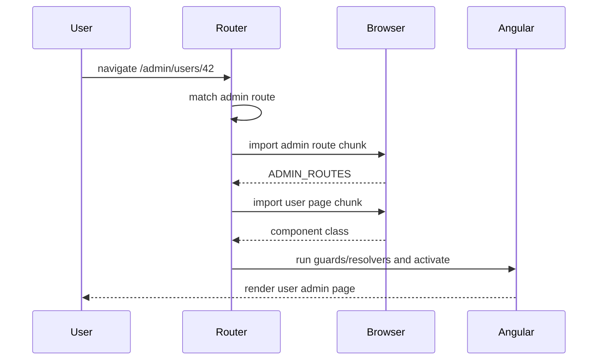

**Four examples:** the primary landing page may be eager when immediate paint matters; a rarely visited admin area should usually be lazy; a small settings page can use `loadComponent`; a larger billing feature with several nested screens can use `loadChildren` so its routes and providers remain grouped.

**What lazy loading does not do:** it does not authorize the route, hide secrets already shipped elsewhere, or guarantee a faster transition. It moves code out of the initial bundle and introduces a later chunk request. Route-level providers and the loader's injection context can scope dependencies, but backend authorization still protects data and mutations.

**Invariants and errors:** route order is significant, so put specific routes before `**`; exported names in `.then(...)` must match the module; avoid accidental eager imports of the same feature from root code; and handle chunk-load failure with navigation error policy and deployment-compatible caching. A stale HTML document that references removed hashed chunks is a deployment/versioning problem, not a reason to disable lazy loading.

**Cost and trade-off:** the initial JavaScript download/parse cost drops by the bytes moved into lazy chunks. First navigation then pays a network round trip plus transfer, parse and initialization for those chunks. Route matching is proportional to the candidate configuration examined, while rendering remains proportional to produced view output. Excessive nested lazy boundaries can create a request waterfall; choose boundaries around meaningful features and measure real bundle and navigation timings.

<a id="q39"></a>
## Q39. Guard vs resolver

**Requirement:** redirect unauthenticated users before entering `/orders/:id`, then obtain the order required by the page. A **guard decides whether or how navigation may proceed**. A **resolver obtains required route data before activation**. Neither substitutes for backend authorization.

```typescript
import {inject} from '@angular/core';
import {
  CanActivateFn, ResolveFn, Router, Routes
} from '@angular/router';
import {Observable} from 'rxjs';

type Order = Readonly<{id: string; status: string; totalCents: number}>;

export const signedInGuard: CanActivateFn = (_route, state) => {
  const session = inject(SessionService);
  const router = inject(Router);
  return session.isSignedIn()
    ? true
    : router.createUrlTree(['/sign-in'], {queryParams: {returnUrl: state.url}});
};

export const orderResolver: ResolveFn<Order> = route => {
  const orders = inject(OrderService);
  const id = route.paramMap.get('id');
  if (id === null) throw new Error('Route contract requires id');
  return orders.get(id);
};

export const orderRoutes: Routes = [
  {
    path: 'orders/:id',
    canActivate: [signedInGuard],
    resolve: {order: orderResolver},
    loadComponent: () => import('./order.page').then(m => m.OrderPage)
  }
];
```

With `provideRouter(routes, withComponentInputBinding())`, the component can declare `order = input.required<Order>()`; otherwise it can read `ActivatedRoute.data`. The router waits for the resolver's result before activation. That makes resolvers suitable for essential first-render data but poor for optional or slow secondary panels that should load progressively.

| Scenario | Correct tool | Expected behavior |
|---|---|---|
| Not signed in | `CanActivate` | return a `UrlTree`/`RedirectCommand` to sign-in |
| Unsaved editor | `CanDeactivate` | ask whether leaving is allowed |
| Feature-flagged route variants | `CanMatch` | `false` tries another matching route |
| Order required to render page | `ResolveFn<Order>` | load before component activation |

**Return contracts:** guards may return a boolean, redirect object, Promise or Observable; the router uses the first async result and unsubscribes. Return a redirect rather than returning `false` and imperatively calling `navigate`. Multiple asynchronous guards in one array may start concurrently, so one guard must not depend on another guard's side effect. Resolvers can also return synchronous values, Promises or Observables; define an error/redirect policy so failed required data does not produce an unexplained navigation failure.

**Navigation invariant:** activation occurs only after route matching and the required guard/resolver phase succeeds. A guard protects user experience, not the API. The server must validate the token, tenant, role and resource ownership on every protected request.

**Cost:** a synchronous guard is typically O(1). Remote guards/resolvers add network latency to the critical navigation path; several independent requests can run concurrently, but the slowest required one determines readiness. Resolved data occupies O(d) memory for payload size d and rendering it costs at least O(d) or O(number of displayed records). Prefer route resources or component-level loading for non-blocking data.

<a id="q40"></a>
## Q40. How do `HttpClient` interceptors work?

**Requirement:** attach a bearer token only to the trusted API origin, add a correlation ID, and preserve predictable ordering. Functional interceptors are request/response middleware registered with `withInterceptors`. Requests travel through them in listed order; response events unwind through the same nested chain in reverse.

```typescript
import {inject} from '@angular/core';
import {
  HttpInterceptorFn, provideHttpClient, withInterceptors
} from '@angular/common/http';
import {finalize} from 'rxjs';

const API_ORIGIN = 'https://api.example.com';

export const correlationInterceptor: HttpInterceptorFn = (request, next) => {
  const requestId = crypto.randomUUID();
  const tagged = request.clone({
    setHeaders: {'X-Request-ID': requestId}
  });
  const startedAt = performance.now();
  return next(tagged).pipe(
    finalize(() => console.debug(requestId, performance.now() - startedAt))
  );
};

export const authInterceptor: HttpInterceptorFn = (request, next) => {
  const token = inject(SessionService).accessToken();
  const trusted = request.url.startsWith('/api/') ||
    request.url.startsWith(`${API_ORIGIN}/`);
  const authenticated = token && trusted
    ? request.clone({setHeaders: {Authorization: `Bearer ${token}`}})
    : request;
  return next(authenticated);
};

export const httpProviders = provideHttpClient(
  withInterceptors([correlationInterceptor, authInterceptor])
);
```

```mermaid
sequenceDiagram
 participant C as Caller
 participant I1 as Correlation
 participant I2 as Auth
 participant B as Backend
 C->>I1: original request
 I1->>I2: cloned + request ID
 I2->>B: cloned + trusted auth
 B-->>I2: response/error
 I2-->>I1: response/error
 I1-->>C: finalize timing
```

**Four uses:** auth headers scoped to trusted origins; correlation IDs and timing; bounded retry for explicitly safe/idempotent operations; short-lived GET caching with a clear invalidation key. A loading indicator is also possible, but concurrent requests require a reference count rather than a single boolean.

**Immutability invariant:** `HttpRequest`, `HttpHeaders` and `HttpParams` use immutable-style updates. Clone to change them and pass exactly one request to `next` unless deliberate fan-out is the contract. Bodies are not deeply immutable, so mutating an object body in place can break idempotence when retries re-enter the chain.

**Security and retry boundaries:** do not send credentials to every absolute URL; allowlist trusted origins. Do not blindly retry non-idempotent POST/payment operations. Prevent token-refresh recursion by excluding the refresh endpoint and coordinating concurrent 401s. An interceptor is cross-cutting infrastructure, not the place for order-specific UI copy.

**Cost:** with i interceptors, chain traversal is O(i) around the underlying network request, plus the work each interceptor performs. Cloning headers is small but not free; deep body copies would be O(body size) and are normally unnecessary. Cache memory is O(total retained response bytes), so define capacity, lifetime, key identity and mutation invalidation.

<a id="q41"></a>
## Q41. Where should HTTP error handling live?

**Requirement:** place each decision in the lowest layer with enough context to make it correctly, while preserving a useful error for the next layer.

| Layer | Owns | Example |
|---|---|---|
| Interceptor | transport-wide mechanics | correlation, one coordinated refresh, telemetry, safe retry policy |
| Domain service | API-to-domain translation | map 404 order to `OrderNotFound`, validate payload shape |
| Component/facade | user workflow and presentation | retry button, inline message, route fallback |
| Global handler | truly unexpected failures | last-resort logging and recovery shell |

```typescript
import {HttpClient, HttpErrorResponse} from '@angular/common/http';
import {inject, Injectable} from '@angular/core';
import {catchError, Observable, throwError} from 'rxjs';

export class OrderNotFound extends Error {
  constructor(readonly orderId: string, options?: ErrorOptions) {
    super(`Order ${orderId} was not found`, options);
  }
}

@Injectable({providedIn: 'root'})
export class OrderService {
  private readonly http = inject(HttpClient);

  get(id: string): Observable<Order> {
    return this.http.get<Order>(`/api/orders/${encodeURIComponent(id)}`).pipe(
      catchError((error: unknown) => {
        if (error instanceof HttpErrorResponse && error.status === 404) {
          return throwError(() => new OrderNotFound(id, {cause: error}));
        }
        return throwError(() => error);
      })
    );
  }
}
```

**Four cases:** status 401 may trigger one application-wide session refresh or sign-out policy; status 404 for a known order becomes a domain error in `OrderService`; status 409 on Save belongs to the editor workflow and may restore field/form errors; status 0 can represent a network/connection failure and should offer retry or offline guidance rather than pretending the server rejected the domain command.

**Error-translation invariant:** one layer translates only what it understands, preserves the cause, and rethrows unknown failures. Returning `EMPTY` from a broad interceptor silently converts “failed” into “completed with no value” and can leave callers waiting for state that never arrives. Likewise, retry belongs behind an explicit safety policy: retry transient reads with bounds/backoff, not validation failures or unprotected mutations.

**Boundary details:** `HttpClient` reports network, timeout and backend failures through `HttpErrorResponse`; backend status and body require separate interpretation. Error bodies are untrusted input. A global toast for every failure causes duplicates and exposes transport details; let the component decide whether the current workflow needs inline feedback, navigation, a retry affordance or silence.

**Cost:** translating an error is O(1) aside from logging/serialization. With r retries, network/backend work can approach O(r) times one request and total latency accumulates across attempts and backoff. Logging full bodies costs O(payload bytes) and may leak secrets, so use structured redaction and size limits.

<a id="q42"></a>
## Q42. How do you cancel stale HTTP requests in Angular?

**Requirement:** a typeahead should display only the newest query result, avoid a request per raw key event, and cancel the previous in-flight subscription when a newer normalized query supersedes it. `switchMap` expresses exactly that **latest-wins** policy.

```typescript
import {AsyncPipe} from '@angular/common';
import {HttpClient} from '@angular/common/http';
import {Component, inject} from '@angular/core';
import {FormControl, ReactiveFormsModule} from '@angular/forms';
import {
  catchError, debounceTime, distinctUntilChanged, map, of,
  startWith, switchMap
} from 'rxjs';

type SearchResult = Readonly<{id: string; title: string}>;
type SearchState =
  | {kind: 'idle'}
  | {kind: 'loading'; query: string}
  | {kind: 'ready'; query: string; items: readonly SearchResult[]}
  | {kind: 'error'; query: string; message: string};

@Component({
  selector: 'app-search',
  imports: [AsyncPipe, ReactiveFormsModule],
  template: `
    <label>Search <input [formControl]="query"></label>
    @if (state$ | async; as state) {
      @switch (state.kind) {
        @case ('idle') { <p>Enter at least two characters.</p> }
        @case ('loading') { <p>Searching for {{ state.query }}…</p> }
        @case ('ready') {
          <ul>@for (item of state.items; track item.id) { <li>{{ item.title }}</li> }</ul>
        }
        @case ('error') { <p role="alert">{{ state.message }}</p> }
      }
    }
  `
})
export class SearchComponent {
  private readonly http = inject(HttpClient);
  readonly query = new FormControl('', {nonNullable: true});

  readonly state$ = this.query.valueChanges.pipe(
    map(value => value.trim()),
    debounceTime(250),
    distinctUntilChanged(),
    switchMap(query => {
      if (query.length < 2) return of<SearchState>({kind: 'idle'});
      return this.http.get<readonly SearchResult[]>('/api/search', {
        params: {q: query}
      }).pipe(
        map(items => ({kind: 'ready', query, items}) as const),
        startWith({kind: 'loading', query} as const),
        catchError(() => of<SearchState>({
          kind: 'error', query, message: 'Search is temporarily unavailable.'
        }))
      );
    }),
    startWith<SearchState>({kind: 'idle'})
  );
}
```

### A→AB stale-request trace

```mermaid
sequenceDiagram
 participant U as User
 participant S as switchMap
 participant A as GET q=a
 participant AB as GET q=ab
 U->>S: normalized "a"
 S->>A: subscribe
 U->>S: normalized "ab"
 S--xA: unsubscribe / abort in progress
 S->>AB: subscribe
 A--xS: late result cannot reach view
 AB-->>S: newest result
 S-->>U: render q=ab
```

**Four policies:** search/typeahead uses `switchMap` because only the latest read matters; Save button spam often uses `exhaustMap` because the first mutation must finish; queued writes may use `concatMap`; independent telemetry or bulk reads may use bounded `mergeMap`. Operator choice is a business concurrency decision, not a style preference.

**Cancellation invariant:** after a newer outer value arrives, the previous inner subscription cannot emit to this chain. Angular aborts an in-progress `HttpClient` request when that subscription is removed, so work and bandwidth may be saved. However, cancellation is not transaction rollback: the server may already have received or completed the operation. Do not use `switchMap` for a mutation whose effects must be observed unless the API supplies idempotency/transaction semantics and the product explicitly wants latest-wins behavior.

**Ownership and errors:** `AsyncPipe` owns the outer subscription and disposes it when the view is destroyed. If code subscribes imperatively, bind the lifetime with `takeUntilDestroyed` or another explicit owner. Put `catchError` inside the inner request when one failed search should not kill future searches. Debouncing reduces request frequency; `distinctUntilChanged` suppresses adjacent equivalent normalized values.

**Cost:** normalization is O(L) for query length L; each accepted query creates at most one active inner request, so retained request state is O(1) plus response data. Rendering k results costs O(k) time and DOM/state. Debouncing changes request count and latency, not the asymptotic output cost. The server still needs rate limits, indexed search, bounded result sizes and authorization.

<a id="q43"></a>
## Q43. When should you use a service with signals instead of NgRx?

**Requirement:** choose the smallest state model that keeps ownership, transitions, side effects and debugging explicit. Signals are a reactive primitive, a service is an ownership boundary, and NgRx supplies state-management architectures. They solve related but different problems.

| State shape | Default fit | Why | Escalation signal |
|---|---|---|---|
| One component's menu, draft tab or disclosure state | Component signals | The component owns the lifetime and mutations | Siblings or routes need the same state |
| One feature's cart, filters or editor session | Feature-provided service with private signals | One owner, explicit commands, derived `computed` views | Transitions/effects become difficult to audit |
| Time-based events such as WebSocket messages or autosave | RxJS inside the owner | Cancellation, ordering, concurrency and errors are event-stream concerns | Many features must coordinate the same events |
| Application-wide identity, normalized entities or multi-step workflow | NgRx Store plus Effects/Entity as justified | Named events, pure reducers, selectors, effect boundaries and devtools support a large coordination surface | Never adopt it only because the application is “large” |
| Signal-first feature state needing reusable store composition | NgRx SignalStore | Structured signal state and features without assuming classic Global Store | Cross-feature event history or reducer conventions are required |

Angular's current signal API supports writable signals, `asReadonly()` and lazy memoized `computed` values. NgRx's current documentation presents **Global Store** and **SignalStore** as separate learning paths. Therefore, “signals replaced NgRx” and “every shared value belongs in NgRx” are both category errors.

### Four concrete decisions

1. A product-card accordion is destroyed with its card: keep `expanded = signal(false)` in the component.
2. A checkout route has three sibling steps sharing a cart: provide `CartStore` at the route boundary and expose readonly signals plus commands.
3. A trading console combines normalized instruments, user permissions, reconnect effects and actions dispatched by independently owned features: Global Store's event/reducer/effect conventions can repay their ceremony.
4. A typeahead has one owner but a latest-request-wins rule: keep the state local and use `switchMap`; a global store does not remove the need to define concurrency.

```mermaid
flowchart TD
 A["Who owns the state?"] --> B{"One component?"}
 B -->|yes| C["Component signals"]
 B -->|no| D{"One bounded feature?"}
 D -->|yes| E["Scoped signal service or SignalStore"]
 D -->|no| F{"Auditable cross-feature events/effects?"}
 F -->|yes| G["NgRx Global Store"]
 F -->|no| H["Recheck ownership; avoid accidental global state"]
```

**Decision trace:** begin with ownership, not library preference. (1) Name the authoritative owner and lifetime. (2) List commands and derived views. (3) Mark async boundaries and choose cancellation/ordering rules. (4) Count independent writers and features. (5) Ask whether event history, reducer purity, devtools and organization-wide conventions will lower the debugging cost enough to justify more indirection. Re-evaluate as the coordination surface changes.

**Core invariants:** exactly one authoritative owner writes a state fact; consumers observe readonly or derived views; a derived value is computed rather than stored twice; side effects stay outside pure derivations; and every asynchronous command has an explicit concurrency and error policy. NgRx does not make an ambiguous domain model correct, while a small service does not make cross-team transitions observable.

**Migration boundary:** component signals can move behind a feature service without changing every template if the public readonly view remains stable. A service can later adapt to NgRx selectors/actions. Migrate by behavior slice, keep one source of truth during the transition, and do not mirror the same fact in a service signal and Global Store indefinitely.

**Cost:** reading a signal is O(1). A `computed` derivation is cached between dependency changes but costs whatever its body costs when invalidated—for example, filtering n rows is O(n) time and up to O(n) output space. A reducer that shallow-copies a normalized entity map may copy O(n) keys even when lookup is O(1). NgRx adds action/reducer/effect/selector code and runtime objects; its benefit is organizational traceability, not a lower universal Big-O.

**Common errors:** root-providing every feature store and leaking state after navigation; exposing a `WritableSignal`; mutating an array held inside a readonly signal (readonly is not deep immutability); using `effect` to propagate derived state; dispatching actions as setters without domain meaning; putting HTTP inside a reducer or `computed`; and choosing a global store before defining request cancellation, retry and authorization boundaries.

**Interview variations:** local vs global state; ComponentStore/SignalStore vs Global Store; when Redux-style events help; how devtools change incident diagnosis; how to migrate without two authorities; signals and RxJS interoperability.

<a id="q44"></a>
## Q44. How do you design a signal-based feature store?

**Requirement:** keep writable state private, expose readonly source state and `computed` projections, mutate only through named commands, scope the provider to the feature lifetime, and isolate asynchronous work. The example deliberately rejects edits during a save; that makes its single-flight policy and response reconciliation provable.

```typescript
import {DestroyRef, Injectable, computed, inject, signal} from '@angular/core';
import {HttpClient} from '@angular/common/http';
import {takeUntilDestroyed} from '@angular/core/rxjs-interop';

export type CartItem = Readonly<{
  id: string;
  name: string;
  unitPriceCents: number;
  quantity: number;
}>;
type Phase = 'idle' | 'saving' | 'error';
type CartState = Readonly<{
  items: readonly CartItem[];
  phase: Phase;
  error: string | null;
}>;

const INITIAL_STATE: CartState = {items: [], phase: 'idle', error: null};

@Injectable() // intentionally no providedIn: 'root'
export class CartStore {
  private readonly http = inject(HttpClient);
  private readonly destroyRef = inject(DestroyRef);
  private readonly writableState = signal<CartState>(INITIAL_STATE);

  readonly state = this.writableState.asReadonly();
  readonly items = computed(() => this.writableState().items);
  readonly phase = computed(() => this.writableState().phase);
  readonly error = computed(() => this.writableState().error);
  readonly totalCents = computed(() =>
    this.writableState().items.reduce(
      (sum, item) => sum + item.unitPriceCents * item.quantity,
      0
    )
  );

  upsert(item: CartItem): 'inserted' | 'replaced' | 'busy' {
    const current = this.writableState();
    if (current.phase === 'saving') return 'busy';

    const found = current.items.some(existing => existing.id === item.id);
    const items = found
      ? current.items.map(existing => existing.id === item.id ? item : existing)
      : [...current.items, item];
    this.writableState.set({...current, items, phase: 'idle', error: null});
    return found ? 'replaced' : 'inserted';
  }

  remove(id: string): boolean {
    const current = this.writableState();
    if (current.phase === 'saving') return false;
    const items = current.items.filter(item => item.id !== id);
    if (items.length === current.items.length) return false;
    this.writableState.set({...current, items, phase: 'idle', error: null});
    return true;
  }

  save(): void {
    const current = this.writableState();
    if (current.phase === 'saving') return; // exhaust/single-flight policy

    const requestItems = current.items;
    this.writableState.set({...current, phase: 'saving', error: null});
    this.http.put<readonly CartItem[]>('/api/cart', requestItems).pipe(
      takeUntilDestroyed(this.destroyRef)
    ).subscribe({
      next: saved => this.writableState.set({
        items: saved.map(item => ({...item})),
        phase: 'idle',
        error: null
      }),
      error: () => this.writableState.update(state => ({
        ...state,
        phase: 'error',
        error: 'Cart could not be saved. Your local items are retained.'
      }))
    });
  }
}
```

Provide it where the feature lifetime begins, not automatically for the whole application:

```typescript
import {Routes} from '@angular/router';

export const CHECKOUT_ROUTES: Routes = [{
  path: '',
  providers: [CartStore],
  loadComponent: () => import('./checkout.component')
    .then(module => module.CheckoutComponent)
}];
```

### State-machine invariant and dry run

```mermaid
stateDiagram-v2
 [*] --> idle
 idle --> idle: upsert / remove
 idle --> saving: save
 saving --> idle: success + canonical items
 saving --> error: failure + retain local items
 error --> idle: edit
 error --> saving: retry save
```

| Step | Command/result | `items` | phase | `totalCents` |
|---:|---|---|---|---:|
| 0 | initial | `[]` | idle | 0 |
| 1 | upsert `{A, 250, 2}` → inserted | `[A×2]` | idle | 500 |
| 2 | upsert `{B, 100, 1}` → inserted | `[A×2,B×1]` | idle | 600 |
| 3 | upsert `{A, 250, 3}` → replaced | `[A×3,B×1]` | idle | 850 |
| 4 | save; second save → ignored | unchanged snapshot | saving | 850 |
| 5a | server returns canonical items | copied response | idle | recomputed lazily |
| 5b | or request fails | local snapshot retained | error | 850 |

**Why the code is correct:** all writes pass through `upsert`, `remove`, `save` or the request callbacks. Each synchronous transition replaces the entire `CartState` once, so consumers cannot observe “new items, old phase” between separate signal writes. `totalCents` depends only on `items` and is therefore never stale as separately stored state. The saving guard makes at most one save subscription active and prevents local edits from being overwritten by its response. Feature injector destruction unsubscribes an in-flight request. This cancels client observation; it does **not** roll back a server mutation.

**Four boundary examples:** duplicate ID replaces one logical item rather than creating a duplicate; removing an unknown ID leaves the same state and returns false; a double Save creates one request; a failed Save retains items and permits either an edit (clearing the error) or retry. Real checkout systems should additionally validate positive quantities/prices at the boundary, use server-calculated totals, authorize every request and define idempotency/version-conflict behavior.

**Complexity derivation:** for n items, `upsert` scans with `some` and may map/copy, so it is O(n) time and O(n) output space; `remove` is O(n) time and O(n) output space. A successful response copy is O(n). The first `totalCents()` read after `items` changes is O(n), while subsequent reads before another dependency change use the memoized result. Source-state reads and phase checks are O(1). Retained store state is O(n). If n is large and keyed updates dominate, a normalized `Map`/entity adapter can improve lookup/update strategy, though immutable snapshots still incur allocation or structural-sharing costs.

**Testing:** instantiate through Angular's test injector with an HTTP testing backend; assert command return values and state snapshots; read `totalCents()` before and after edits; flush success/error responses; issue Save twice and assert one request; destroy the fixture during a request and assert no later state transition. A pure reducer extracted from the command transitions can be property-tested independently—for example, generated sequences must never produce duplicate IDs or a negative total when inputs are valid.

**Common errors and trade-offs:** exposing `writableState`; mutating `items.push` and retaining the same reference; storing `totalCents` independently; starting HTTP in a constructor or `computed`; root-scoping disposable feature state; subscribing without a destruction owner; accepting concurrent saves without request IDs or an ordering policy; optimistic updates without rollback; and assuming TypeScript `readonly` prevents runtime deep mutation. A single state signal gives atomic snapshots; multiple fine-grained signals can reduce invalidation but require care to preserve cross-field invariants.

**Interview variations:** optimistic update with rollback/version token; latest-wins load with request generation IDs or `switchMap`; normalized entities; persisted state and schema migration; SSR request isolation; replacing the hand-written service with NgRx SignalStore; extracting domain transitions to pure functions.

<a id="q45"></a>
## Q45. What are deferrable views (`@defer`)?

**Requirement:** remove non-critical code from the initial JavaScript graph, load it on an explicit trigger, preserve accessible layout while waiting, and define loading and failure states. `@defer` is both a template state machine and a compiler-recognized lazy boundary; hiding an eagerly imported component with `@if` does not create the same code split.

```html
@defer (on viewport; prefetch on idle) {
  <app-recommendations />
} @placeholder (minimum 300ms) {
  <section class="recommendation-skeleton"
           aria-label="Recommendations loading"></section>
} @loading (after 150ms; minimum 300ms) {
  <p role="status">Loading recommendations…</p>
} @error {
  <p role="alert">Recommendations could not be loaded.</p>
}
```

Angular emits dynamic imports for eligible components, directives and pipes in the main block. To remain deferred, a dependency must be standalone and must not also be referenced outside a defer block in the same file, including through a `ViewChild` query. Placeholder, loading and error dependencies are eager, so a heavyweight “skeleton component” can accidentally return bytes to the initial bundle.

### Trigger and state model

| Trigger/policy | Suitable example | Boundary to remember |
|---|---|---|
| default / `on idle` | analytics-rich related-content panel | Idle may occur before the user approaches it |
| `on viewport` | below-fold reviews | Needs a placeholder or explicit trigger element for observation |
| `on interaction` | optional configurator opened by click/keydown | Do not make keyboard users wait without a status state |
| `on hover` | desktop preview | Hover is not a complete mobile/accessibility interaction model |
| `when condition` | admin-only tool after permission state resolves | One-shot: becoming false later does not restore the placeholder |
| `prefetch on idle` + render on interaction | likely next action with expensive code | Prefetch fetches code; the main trigger controls rendering |

```mermaid
stateDiagram-v2
 [*] --> placeholder
 placeholder --> loading: render trigger
 placeholder --> placeholder: prefetch only
 loading --> content: imports resolve
 loading --> error: import fails
 content --> content: trigger condition later false
```

**Four examples:** defer below-fold reviews on viewport; prefetch a product customizer on idle but render only on interaction; render a permissions-gated audit panel when its signal becomes true; keep the above-fold price and primary purchase action eager because they define the page's purpose and likely LCP.

**Step-by-step trace:** (1) the eager view renders the placeholder. (2) During idle time, the browser may fetch the deferred JavaScript. (3) The placeholder enters the viewport. (4) If bytes are not ready, the loading block appears after its `after` delay. (5) All deferred imports resolve and Angular instantiates the main block. (6) An import failure selects `@error`; a data-request failure inside the child still needs the child's own error handling.

**Invariants:** a defer block triggers at most once for a rendered instance; prefetching does not render; placeholder/loading/error dependencies stay eager; and code splitting happens only for compiler-eligible references. Reserve stable dimensions to limit layout shift. A timer or viewport trigger is a performance decision, not an authorization boundary—do not download secrets or omit backend checks based on whether a block rendered.

**Cost model:** let the original initial JavaScript be B bytes and eligible deferred code be D bytes. The initial code-transfer target becomes roughly B − D plus the eager sub-block dependencies; total bytes may be similar or slightly higher because of chunk/runtime overhead. The first use adds a chunk request and parse/compile cost O(D); prefetch moves that cost earlier but does not eliminate it. Rendering k deferred rows still costs O(k) DOM work and O(k) output nodes. Measure LCP, INP, CLS, transferred bytes, request priority and real cache-hit behavior rather than counting chunks.

**Testing and common errors:** use Angular's manual defer-block test behavior to step through placeholder/loading/complete/error states; also test keyboard activation, slow and failed chunks, reduced bandwidth, layout stability and a client-side revisit. Common errors are deferring critical content, referencing the same dependency eagerly, placing large libraries in the placeholder, creating dozens of tiny chunks, confusing code-load errors with data errors, and using hover as the only trigger.

**Interview variations:** `@defer` vs route lazy loading; prefetch vs render triggers; nested defer blocks; SSR behavior; incremental hydration boundaries; bundle inspection and Core Web Vitals.

<a id="q46"></a>
## Q46. How do CSR, SSR and prerendering differ?

**Requirement:** choose a render mode per route from data freshness, personalization, indexability, cacheability, runtime cost and browser-only dependencies. Rendering mode is not an application-wide identity.

```typescript
import {RenderMode, ServerRoute} from '@angular/ssr';

export const serverRoutes: ServerRoute[] = [
  {path: '', renderMode: RenderMode.Prerender},
  {path: 'docs/**', renderMode: RenderMode.Prerender},
  {path: 'account', renderMode: RenderMode.Server},
  {path: 'workspace/**', renderMode: RenderMode.Client},
  {path: '**', renderMode: RenderMode.Server}
];
```

| Mode | HTML produced | Best fit | Main trade-off |
|---|---|---|---|
| CSR / `RenderMode.Client` | Browser after JavaScript runs | authenticated app shell, offline-capable tool, browser-only library | slower first meaningful content; device performs work |
| SSR / `RenderMode.Server` | server on every request | personalized/fresh public page, request-specific metadata/status | server latency/capacity, hydration and universal-code constraints |
| SSG / `RenderMode.Prerender` | build time, stored as static HTML | docs, marketing, finite product/category pages | stale until rebuild; parameter explosion increases build/storage |

### Route decision flow

```mermaid
flowchart TD
 A["Can all route data exist at build time?"] -->|yes| B{"Finite routes and acceptable rebuild?"}
 B -->|yes| C["Prerender / SSG"]
 B -->|no| D["SSR or CSR"]
 A -->|no| E{"First response needs fresh or indexable HTML?"}
 E -->|yes| F["SSR"]
 E -->|no| G["CSR"]
```

**Four decisions:** a versioned documentation site is prerendered and CDN-cached; a public product page with rapidly changing availability may use SSR while client requests refresh volatile inventory; a signed-in analytics workspace can use CSR because it is not indexed and heavily depends on browser interaction; a marketing home page can be prerendered while `/account` uses SSR and `/editor` uses CSR.

**Request traces:** CSR returns a shell and JavaScript, then the browser renders and may fetch data. SSR runs Angular and data access for that request, sends populated HTML, then the browser hydrates it. Prerendering runs Angular during the build, stores one HTML artifact per generated route, and serves those bytes from a CDN/static server; subsequent interactivity still needs client JavaScript unless the content remains static.

**Correctness boundaries:** SSR is not hydration—HTML can arrive without becoming interactive. SSR also is not authorization or automatic caching. Never serialize credentials, private user data, request-scoped services or server-only configuration into shared HTML/transfer state. Guard browser globals such as `window` and `document`; use server-compatible libraries. A CDN cache key must vary on every response dimension that changes content, or personalized data can leak.

**Cost derivation:** for R requests and server render cost S, uncached SSR uses about O(R·S) render work plus data-source work. For P prerendered paths, build work is O(P·S) and stored HTML is O(P·H) for average document size H, while request render work approaches O(1) static-file serving. CSR minimizes application render work on the server but transfers JavaScript and moves render/data cost to each device. These are capacity models, not guarantees of faster pages; profile TTFB, LCP, INP, cache hit ratio, build duration and origin CPU.

**Failure cases and tests:** test a direct deep link, 404/status/redirect behavior, slow data, crawler-visible metadata, disabled JavaScript, hydration mismatch, a cold origin and warm CDN, browser-global access during SSR, and parameter counts for prerendering. Avoid prerendering unbounded IDs, SSR-fetching your own public endpoint through unnecessary network hops, or selecting SSR solely as an SEO slogan.

**Interview variations:** ISR/revalidation patterns outside the core three modes; app shell; CDN and cache keys; transfer cache; per-route headers/status; prerender fallback; streaming; edge SSR.

<a id="q47"></a>
## Q47. What are hydration and incremental hydration?

**Requirement:** reuse server-rendered DOM, attach Angular runtime state and listeners without rebuilding the page, then delay selected hydration boundaries until their interaction or visibility justifies client work.

```typescript
import {ApplicationConfig} from '@angular/core';
import {provideClientHydration} from '@angular/platform-browser';

export const appConfig: ApplicationConfig = {
  providers: [provideClientHydration()]
};
```

In Angular 22, `provideClientHydration()` enables incremental hydration by default. The older `withIncrementalHydration()` feature is deprecated, so adding it to new Angular 22 code is unnecessary. Incremental hydration also enables event replay.

```html
@defer (on viewport; hydrate on interaction) {
  <app-review-editor />
} @placeholder {
  <button type="button">Write a review</button>
}
```

On the initial server-rendered navigation, the hydrate trigger makes the server render the main block. The browser can leave that DOM dehydrated until interaction, queue supported pre-hydration events, fetch the block's code and replay the events after hydration. On a later client-only navigation, the regular `on viewport` trigger applies. The placeholder remains necessary for that client-rendered case.

### Server-to-interactive trace

```mermaid
sequenceDiagram
 participant S as Server
 participant B as Browser DOM
 participant H as Angular hydration
 participant U as User
 S-->>B: rendered HTML + markers
 B-->>U: visible content before client activation
 U->>B: click dehydrated boundary
 B->>H: queue event; load boundary code
 H->>B: match and claim existing nodes
 H->>B: attach listeners and replay click
 B-->>U: interactive result
```

**Four examples:** hydrate the primary navigation immediately because it is above-fold and interactive; hydrate below-fold reviews on viewport; hydrate a server-rendered “Add to cart” island on interaction so event replay preserves an early click; isolate an incompatible DOM-mutating chart temporarily with `ngSkipHydration`, knowing Angular will destroy/re-render that subtree and the annotation is a migration workaround, not the desired end state.

**Hydration invariants:** the server and client must produce the same valid DOM structure, including Angular-significant comment/whitespace nodes; intermediaries must not rewrite it; direct DOM manipulation before hydration is unsafe; and a child boundary cannot hydrate before its dehydrated parent. Triggering a nested child hydrates the required ancestor path first. `hydrate never` leaves the initial SSR subtree static and prevents nested hydration there.

**Hydration vs rendering:** CSR has no server DOM to hydrate. SSR/SSG can display HTML without hydration, but Angular interactions will not be active. Full hydration claims the application eagerly; incremental hydration retains selected server-rendered subtrees and activates them later. Hydration saves DOM recreation and reduces flicker, but it does not eliminate the JavaScript required for a component that must become interactive.

**Mismatch dry run:** server renders `<table><tr>…`; the browser inserts `<tbody>`; Angular expects the original tree and reports a mismatch. The fix is valid, identical markup—explicitly render `<tbody>`—not broadly adding `ngSkipHydration`. The same reasoning applies to `appendChild`, browser-only conditionals, third-party scripts that rewrite nodes and inconsistent whitespace settings.

**Cost model:** with full hydration, client startup work is roughly proportional to the components/nodes claimed plus listener/runtime setup. If n total nodes are divided into an initially hydrated set h and deferred boundaries d, initial claim work targets O(h), with later work paid per triggered boundary; total eventual work may still reach O(n). Event queues and hydration metadata consume memory proportional to retained boundaries/events. Measure server HTML bytes, client JavaScript, LCP, CLS, INP, hydration duration, mismatch rate and interaction latency—incremental hydration shifts work; it does not make work free.

**Testing:** compare server HTML with the pre-hydration browser DOM; fail tests on hydration console errors; click/type before a boundary hydrates and verify one replayed outcome; verify nested-parent order; test JavaScript disabled for readable content; test client-side navigation where ordinary defer triggers apply; exercise invalid HTML and third-party DOM changes; and monitor application stability because unresolved tasks can delay hydration cleanup.

**Common errors:** calling deprecated `withIncrementalHydration()` in new v22 code; confusing visibility with interactivity; server/client branches that produce different nodes; random/time-dependent initial markup; duplicate HTTP work instead of transfer-cache-aware ownership; modifying HTML at a CDN; root-level `ngSkipHydration`; and believing event replay makes every arbitrary browser event or external widget safe.

**Interview variations:** event replay; `hydrate on viewport/interaction/idle/timer`; `hydrate when`; `hydrate never`; nested boundaries; transfer cache; DOM mismatch debugging; SSR without hydration; partial/island architecture.

<a id="q48"></a>
## Q48. How would you diagnose and optimize a slow Angular list?

**Requirement:** improve a measured user interaction without changing which records appear, their order, row-local state, focus behavior or accessibility. Treat “the list is slow” as a hypothesis: first identify whether time is spent deriving data, checking components, reconciling DOM, laying out/painting too many nodes, fetching data or running row work.

Angular DevTools records change-detection cycles and identifies expensive components/directives; a browser performance trace adds scripting, layout, paint and frame timing. Reproduce one named interaction with production-sized data, capture a baseline, change one cause, then repeat the same trace. A smaller development data set or a faster warm-cache run is not a valid comparison.

```mermaid
flowchart TD
 A["Reproduce and profile"] --> B{"Where is time spent?"}
 B -->|derive/check| C["Memoize state; narrow notifications"]
 B -->|DOM reconcile| D["Stable unique track key"]
 B -->|layout/paint| E["Paginate or virtualize"]
 B -->|row work| F["Simplify, split or defer noncritical work"]
 C --> G["Repeat trace and correctness tests"]
 D --> G
 E --> G
 F --> G
```

### First fix identity and repeated derivation

```typescript
import {ChangeDetectionStrategy, Component, computed, signal} from '@angular/core';

type Product = Readonly<{id: string; name: string; priceCents: number}>;

@Component({
  selector: 'app-product-list',
  changeDetection: ChangeDetectionStrategy.OnPush,
  template: `
    <label>
      Filter
      <input [value]="query()"
             (input)="query.set($any($event.target).value)" />
    </label>

    <p aria-live="polite">{{ visibleProducts().length }} results</p>
    <ul>
      @for (product of visibleProducts(); track product.id) {
        <li>{{ product.name }} — {{ product.priceCents }} cents</li>
      } @empty {
        <li>No matching products</li>
      }
    </ul>
  `
})
export class ProductListComponent {
  readonly products = signal<readonly Product[]>([]);
  readonly query = signal('');

  readonly visibleProducts = computed(() => {
    const needle = this.query().trim().toLocaleLowerCase();
    return this.products()
      .filter(product => product.name.toLocaleLowerCase().includes(needle))
      .sort((a, b) => a.name.localeCompare(b.name)); // filter() made a new array
  });

  replaceProduct(changed: Product): void {
    this.products.update(items =>
      items.map(item => item.id === changed.id ? changed : item));
  }
}
```

The `computed` value reruns only when `products` or `query` changes; it does not allocate a fresh filtered/sorted array every time an unrelated binding is checked. `track product.id` maps logical records to views, so Angular can move and update existing row views instead of treating a reorder as unrelated DOM. The key must be unique among current siblings and stable for that record's lifetime. `$index` is safe only for a static collection whose insertion, removal and reorder semantics cannot change; tracking by object identity loses reuse when a server refresh creates new objects.

Angular 22 uses `OnPush` by default. That reduces checks for unaffected subtrees, but it is not a substitute for stable identity or bounded DOM. An OnPush child is eligible to be checked when it receives a new bound input or an event occurs in its subtree; mutating an input object while retaining the same reference can therefore leave stale UI. Prefer immutable replacement as above. Signals read by the template provide targeted notifications; do not add manual `detectChanges()` calls until a trace and ownership contract justify them.

### When the DOM itself is the bottleneck, virtualize

```typescript
import {Component, computed, signal} from '@angular/core';
import {ScrollingModule} from '@angular/cdk/scrolling';

type Product = Readonly<{id: string; name: string; priceCents: number}>;

@Component({
  selector: 'app-virtual-products',
  standalone: true,
  imports: [ScrollingModule],
  styles: [`.viewport { height: 440px; } .row { height: 44px; }`],
  template: `
    <cdk-virtual-scroll-viewport class="viewport" itemSize="44"
                                 minBufferPx="220" maxBufferPx="440">
      <div class="row"
           *cdkVirtualFor="let product of visibleProducts();
                           trackBy: trackById; templateCacheSize: 20">
        {{ product.name }} — {{ product.priceCents }} cents
      </div>
    </cdk-virtual-scroll-viewport>
  `
})
export class VirtualProductsComponent {
  readonly products = signal<readonly Product[]>([]);
  readonly visibleProducts = computed(() => this.products());
  readonly trackById = (_index: number, product: Product): string => product.id;
}
```

The fixed-size CDK strategy gives the scroll container the full logical height while rendering a viewport-sized window plus buffers. `*cdkVirtualFor` can recycle cached views, and its `trackBy` index refers to the data source—not merely the rendered window. Here the declared 44 px row height must match the measured row box. Variable-height rows, sticky/table semantics, focus across recycled views, screen-reader navigation, printing and browser find all need explicit product testing; server pagination may be a better boundary when clients should not receive the full data set.

### Four concrete scenarios

| Scenario | Correct move | Observable result |
|---|---|---|
| Replace 10,000 API objects but preserve IDs | `track product.id` | Existing row views are reused and bindings update; row state is not attached to array position. |
| Sort `[A#7, B#2, C#9]` to `[C#9, A#7, B#2]` | Track IDs, never `$index` | DOM/view identity moves `9, 7, 2`; focused or stateful row `#7` remains record `#7`. |
| Filter and sort after typing | One `computed` derivation | One derivation per dependency change, rather than one new array per template evaluation. |
| Display 100,000 fixed-height records in a 440 px viewport | `itemSize=44` plus measured buffers | Roughly the visible ten rows plus buffered rows exist as rendered views, not 100,000 row elements. |

### Identity dry run

Start with keys `[7, 2, 9]` and three existing views `V7, V2, V9`. The next server response contains new object references in key order `[9, 7, 4]`.

| Reconciliation step | Key | Correct action | Why |
|---:|---:|---|---|
| 1 | 9 | Move/rebind `V9` to index 0 | Stable key 9 already owns a view. |
| 2 | 7 | Move/rebind `V7` to index 1 | Stable key 7 already owns a view. |
| 3 | 4 | Create `V4` at index 2 | Key 4 is new. |
| finish | 2 | Destroy `V2` | Key 2 no longer exists. |

Tracking by `$index` would instead reuse the old index-zero view for record 9 and the old index-one view for record 7. Text may look correct after rebinding, but input values, selection, animation or child-local state can follow the position rather than the record—the worst kind of “fast” result because it is semantically wrong.

### Invariants, costs and boundaries

- **Identity invariant:** each displayed record has one stable, unique key; never silently change key meaning between refreshes.
- **Derivation invariant:** filtering/sorting is pure and owned outside the template. If source size is `n` and `m` records survive, filtering is O(n), sorting is O(m log m), and constructing the result costs O(m) space; memoization avoids paying again while dependencies are unchanged, not the first cost.
- **DOM invariant:** without virtualization the list has O(m) row views. With a fixed-size viewport it has O(v + b) rendered views for visible count `v` and buffer count `b`, while the client-side source and filtered result can still consume O(n) and O(m) memory.
- **Reconciliation cost:** even with stable keys Angular must inspect the collection, so a refresh is generally O(m) diff work; the gain is minimizing expensive create/destroy and preserving correct view identity, not making every refresh O(1).
- **Server boundary:** for unbounded data, combine server filtering/sorting with cursor pagination or a windowed data source. Virtualizing a million already-downloaded objects only solves DOM pressure.

**Common errors:** invoking `filter()`, `sort()` or a heavy formatter directly from the template; using an impure pipe; tracking a reorderable list by `$index`; mutating an OnPush input in place; subscribing once per row to the same source; stacking nested full lists; rendering hidden rows instead of removing/virtualizing them; guessing `itemSize`; retaining subscriptions in a custom data source after `disconnect`; adding `@defer` to every row while still creating the same huge DOM; and claiming OnPush alone fixes layout or paint.

**Verification plan:** preserve a production-sized fixture and the same CPU/network conditions; record Angular and browser traces for initial render, append, middle deletion, reorder and filter typing; assert unique keys; spy on row construction/destruction to prove reuse; place focus and editable state in a row before reorder; test empty/singleton/duplicate-key rejection; scroll from first to last record and back; verify keyboard and screen-reader behavior; compare result order with an independent filter/sort oracle; and set a regression budget for change-detection time, long tasks, rendered row count and interaction latency. This guide's code was inspected, but not Angular-compiled or browser-profiled in this environment.

**Interview variations:** `@for track` versus legacy `*ngFor trackBy`; Signals versus `AsyncPipe`; zoneless notification sources; Web Workers for CPU-heavy pure transforms; incremental/server pagination; custom `DataSource`; view-cache memory; variable-height virtualization; CDK table integration; preserving selection/focus; performance budgets.

<a id="q49"></a>
## Q49. What conceptually causes `ExpressionChangedAfterItHasBeenCheckedError`?

**Requirement:** find the bound value that changed during one Angular checking traversal, identify who wrote it and why the write happened too late, then repair state ownership or lifecycle timing. Do not merely silence the development diagnostic.

Angular walks the component tree from top to bottom and checks each component once per traversal. In development mode it performs an additional verification after change detection; if a template binding no longer has the value just observed, Angular reports `NG0100`. Production mode does not throw this extra-check error, but removing the warning does not make an unstable state flow correct. The UI could otherwise depend on traversal order, flicker, show stale parent data or enter a feedback loop.

### Minimal failing trace

```typescript
import {AfterViewInit, Component, EventEmitter, Output} from '@angular/core';

@Component({
  selector: 'app-child',
  template: `Ready`,
})
export class ChildComponent implements AfterViewInit {
  @Output() ready = new EventEmitter<void>();

  ngAfterViewInit(): void {
    this.ready.emit(); // synchronous write back into an already-checked parent
  }
}

@Component({
  selector: 'app-parent',
  imports: [ChildComponent],
  template: `
    <p>Child ready: {{ childReady }}</p>
    <app-child (ready)="childReady = true" />
  `,
})
export class ParentComponent {
  childReady = false;
}
```

```mermaid
sequenceDiagram
 participant A as Angular
 participant P as Parent binding
 participant C as Child hook
 A->>P: check childReady = false
 A->>C: create/check child
 C->>P: synchronous ready sets true
 A->>P: development verification reads true
 P-->>A: false != true; NG0100
```

The problem is not that `true` is illegal. It is that the child changes an ancestor binding after that ancestor was already checked in the same traversal. A later independent user event or HTTP completion may legitimately change state and schedule a new traversal; the error concerns a value that failed to remain stable across the completed check and its development verification.

### Repair the ownership, not the symptom

For the example above, if readiness means “the child exists,” the parent already owns enough information and should initialize `childReady` before its template check. If readiness represents a real user action or a genuinely later asynchronous completion, the child may emit then; that event starts from the correct semantic boundary. Do not invent asynchrony solely to evade the verification.

```typescript
import {Component, computed, input} from '@angular/core';

@Component({
  selector: 'app-profile-heading',
  template: `<h2>{{ heading() }}</h2>`,
})
export class ProfileHeadingComponent {
  readonly first = input.required<string>();
  readonly last = input.required<string>();
  readonly heading = computed(() => `${this.first()} ${this.last()}`.trim());
}
```

Here the heading is a pure derivation of inputs rather than a field assigned in `ngAfterViewInit`. `ngOnChanges` or `ngOnInit` is also appropriate for imperative initialization based on inputs because those hooks run before the component's own template is checked. Prefer a `computed` value when the state is purely derived and should stay synchronized for later input changes.

### Four root-cause families

| Symptom | Unstable write | Principled repair | Why it is stable |
|---|---|---|---|
| Parent shows `loading=false`, child initialization flips it to `true` | Child synchronously mutates/emits into an already-checked ancestor | Parent owns initial loading state; later request events update it | The first observed parent value is already authoritative. |
| `ngAfterViewInit` assigns a field derived only from inputs | Initialization occurs after the view was checked | Use `computed`, `ngOnChanges` or `ngOnInit` | Derivation exists before the template consumes it. |
| `{{ nextSequence() }}` increments a counter, or a getter returns `Date.now()`/`Math.random()` | Reading the binding itself changes or produces a new value | Make template reads pure; snapshot on an explicit event/state transition | Repeated reads of unchanged state return the same value. |
| Layout measurement is required before positioning a third-party widget | View hook reads DOM and immediately rewrites a bound value mid-traversal | Use `afterNextRender` with explicit write/read phases and a browser/SSR policy | DOM work occurs after rendering rather than during the tree walk. |

### DOM-dependent work with a render callback

```typescript
import {
  Component, ElementRef, afterNextRender, signal, viewChild
} from '@angular/core';

@Component({
  selector: 'app-measured-panel',
  template: `
    <section #panel class="panel">Account summary</section>
    <p>Measured height: {{ heightPx() ?? 'pending' }}</p>
  `,
})
export class MeasuredPanelComponent {
  readonly panel = viewChild.required<ElementRef<HTMLElement>>('panel');
  readonly heightPx = signal<number | null>(null);

  constructor() {
    afterNextRender({
      read: () => {
        const next = Math.round(
          this.panel().nativeElement.getBoundingClientRect().height
        );
        if (next !== this.heightPx()) this.heightPx.set(next);
      },
    });
  }
}
```

`afterNextRender` must be registered in an injection context, normally the constructor. It runs once after the next application render, on browser platforms only; it does not run during SSR or build-time prerendering. Therefore `null` is a real initial/SSR state, not an impossible branch. Use render callbacks for actual DOM integration, not as a generic queue for ordinary business state. For layout work, separate writes from reads when both are needed; this reduces layout thrashing. Angular also warns that hydration may not be complete before every callback, so direct DOM integration still needs hydration-specific testing.

### Debugging workflow

1. **Read the old/new values and component named by NG0100.** Follow source-mapped stack frames to the template binding; the last framework frame is rarely the real owner.
2. **Reproduce with one development-mode `detectChanges` path.** Production absence is not evidence of correctness.
3. **Find the first write, not the final read.** Search output handlers, child service initialization, impure getters/methods, effects and `ngAfterContentInit`/`Checked` or `ngAfterViewInit`/`Checked` hooks.
4. **Classify the state.** Is it input-derived, parent-owned, event-owned, async-resource state or DOM measurement?
5. **Move it to the semantic owner/time.** Use `computed`; initialize in the constructor/field, `ngOnChanges` or `ngOnInit`; respond to the real later event; or use a browser-only render callback for DOM work.
6. **Prove stability and behavior.** Re-run the exact path, assert the intended UI, and ensure there is no extra render loop, stale SSR state or lost interaction.

### Stability invariants and costs

- **Check invariant:** once Angular has observed a binding during a traversal, application code must not make that binding produce a different value before verification completes.
- **Purity invariant:** evaluating a template expression with unchanged inputs has no side effect and returns a stable result. Memoization is an optimization; purity is the correctness requirement.
- **Ownership invariant:** data flows down as inputs; semantic events flow up. A child should not synchronously initialize parent-owned display state during its after-view hook.
- **Lifecycle invariant:** content/view `Init` and `Checked` hooks may inspect initialized queries, but they are too late to rewrite state already bound in that traversal. `Checked` hooks are also frequent and must not become a hidden scheduler.
- **Render invariant:** `afterNextRender` is browser-only DOM coordination. A server-rendered value must not depend exclusively on it.

The development verification adds diagnostic work proportional to the bindings Angular rechecks. Moving a pure O(1) derivation to `computed` does not make the first calculation free, but it prevents repeated work while dependencies are unchanged. An arbitrary `setTimeout`, `Promise.resolve`, `detectChanges()` or application tick can add another traversal—roughly O(B) binding work for B visited bindings—and may turn one ownership bug into extra frames or a loop. Use such scheduling only when the domain truly defines a later event, not as an NG0100 eraser.

### Tests and failure boundaries

```typescript
import {TestBed} from '@angular/core/testing';

it('keeps the first checked heading stable', () => {
  const fixture = TestBed.createComponent(ProfileHeadingComponent);
  fixture.componentRef.setInput('first', 'Ada');
  fixture.componentRef.setInput('last', 'Lovelace');

  expect(() => fixture.detectChanges()).not.toThrow();
  expect(fixture.nativeElement.textContent).toContain('Ada Lovelace');
  expect(() => fixture.detectChanges()).not.toThrow();
});
```

Also test the original failing parent/child order, later input replacement, a real click/HTTP completion, repeated getter evaluation, server rendering where render callbacks do not run, hydration, and component destruction before delayed external callbacks. Keep the negative test while refactoring: it should demonstrate NG0100 before the repair, then the behavioral assertion should replace reliance on the error text.

**Common wrong fixes:** wrapping every write in `setTimeout(..., 0)`; calling `detectChanges()` from `ngAfterViewChecked`; switching to production mode; ignoring a child-to-parent initialization cycle; moving side effects into a getter; assuming Signals prohibit unstable writes; using `afterNextRender` for ordinary input derivation; or confusing NG0100 with hydration mismatch, an OnPush notification bug or a changed JavaScript object whose bound expression still evaluates identically.

**Interview variations:** dev-mode verification; parent/child feedback; lifecycle ordering; signal effects; impure getters; OnPush and zoneless behavior; DOM measurement; `afterNextRender` phases; SSR absence; hydration timing; testing with `ComponentFixture`; why timers hide rather than repair the issue.

<a id="q50"></a>
## Q50. How should a large Angular application be structured?

**Requirement:** Design boundaries that let several teams add features without turning every change into an application-wide edit. The organizing unit is a **business capability** such as orders or billing—not a technical bucket such as `components`, `services` or `models`. A boundary should state what it owns, what it exports and which direction dependencies may cross.

### Start with one deployable application, then earn extraction

Do not confuse a large codebase with a need for dozens of publishable packages. Begin with feature folders inside the application. Extract a workspace library when code has a stable consumer-facing API, is used by multiple projects, needs independent ownership or benefits from an enforced build boundary. A folder move alone does not create architecture; import rules and deliberately small public APIs do.

```text
src/app/
├── shell/                         # composition root, top-level layout and routes
├── orders/                        # one business feature
│   ├── feature-order-list/        # routed/container UI
│   ├── feature-order-edit/
│   ├── ui-order-card/             # order-specific presentation
│   ├── data-access/               # HTTP adapter + DTO mapping
│   ├── application/               # facade/use cases and feature state
│   ├── domain/                    # Order, rules, ports; no Angular UI imports
│   └── orders.routes.ts           # public route composition
├── billing/
├── design-system/                 # domain-neutral visual primitives
└── platform/                      # auth, telemetry, runtime configuration
```

Names describe responsibility rather than prescribe an exact folder template. A small feature may keep five cohesive files together; split only when navigation, ownership or dependency control improves. `core`, `common`, `shared`, `helpers` and `utils` are warning labels unless each has a narrow, documented purpose.

### Dependency rule

```mermaid
flowchart TD
  Shell["Shell and route composition"] --> Feature["Orders feature UI"]
  Feature --> App["Application facade / use cases"]
  App --> Domain["Domain model and ports"]
  Data["HTTP and storage adapters"] --> Domain
  Shell --> Data
  Feature --> DS["Design-system primitives"]
```

The arrows mean “may import.” Domain code must not import feature components, router configuration or concrete HTTP adapters. The shell is the composition root: it connects ports to adapters and composes routes. A feature may use domain-neutral design-system primitives, while the design system must not know what an `Order`, `Claim` or `Invoice` is. This direction prevents a reusable-looking button library from quietly depending on half the application.

| Scenario | Boundary decision | Expected result |
|---|---|---|
| Orders page used only by one app | Keep it under `orders/`; lazy-load its routes | One cohesive feature, no premature package |
| Button, dialog and spacing tokens used by three apps | Extract a design-system library with accessibility and visual tests | Domain-neutral public UI API |
| REST payload changes but business model should not | Map `OrderDto` inside `orders/data-access` | Transport churn does not leak into templates |
| Two teams edit checkout every week | Give checkout an owned entry point and import constraints | Smaller review surface and explicit contract |

### Example 1 — the route is the feature entry point

```typescript
// app.routes.ts — composition, not feature implementation
import {Routes} from '@angular/router';

export const APP_ROUTES: Routes = [
  {path: '', loadComponent: () => import('./home/home-page')},
  {
    path: 'orders',
    loadChildren: () => import('./orders/orders.routes'),
  },
];

// orders/orders.routes.ts — the bounded public entry point
import {Routes} from '@angular/router';
import {provideOrdersApi} from './data-access/provide-orders-api';

export default [
  {
    path: '',
    providers: [provideOrdersApi()],
    children: [
      {path: '', loadComponent: () => import('./feature-order-list/order-list-page')},
      {path: ':id', loadComponent: () => import('./feature-order-edit/order-edit-page')},
    ],
  },
] satisfies Routes;
```

`loadChildren` makes the feature route file a chunk boundary; nested pages can remain separate chunks. Route-scoped providers also give each loaded feature tree a lifecycle boundary. Do not lazy-load every tiny component: excessive nested boundaries add requests and navigation waterfalls. Keep the primary landing path eager when that improves first paint, and measure the production bundle and navigation trace.

### Example 2 — typed port, adapter and mapping boundary

```typescript
// orders/domain/order.ts
export type OrderStatus = 'draft' | 'submitted' | 'fulfilled';
export interface Order { readonly id: string; readonly totalCents: number; readonly status: OrderStatus; }

// orders/domain/orders-repository.ts
import {InjectionToken} from '@angular/core';
import {Observable} from 'rxjs';
import {Order} from './order';

export interface OrdersRepository { list(): Observable<readonly Order[]>; }
export const ORDERS_REPOSITORY = new InjectionToken<OrdersRepository>('ORDERS_REPOSITORY');

// orders/data-access/http-orders-repository.ts
import {inject, Injectable} from '@angular/core';
import {HttpClient} from '@angular/common/http';
import {map} from 'rxjs';
import {Order, OrderStatus} from '../domain/order';
import {OrdersRepository} from '../domain/orders-repository';

interface OrderDto { id: string; total_minor: number; state: string; }

@Injectable()
export class HttpOrdersRepository implements OrdersRepository {
  private readonly http = inject(HttpClient);

  list() {
    return this.http.get<readonly OrderDto[]>('/api/orders').pipe(
      map(rows => rows.map(toOrder)),
    );
  }
}

function toOrder(dto: OrderDto): Order {
  const allowed = new Set<OrderStatus>(['draft', 'submitted', 'fulfilled']);
  if (!allowed.has(dto.state as OrderStatus)) throw new Error(`Unknown order state: ${dto.state}`);
  return {id: dto.id, totalCents: dto.total_minor, status: dto.state as OrderStatus};
}
```

The adapter owns protocol names, validation and mapping; components consume the domain shape. Compile-time types do not validate untrusted JSON, so a production adapter needs schema validation where the boundary risk warrants it. Do not add interfaces merely to imitate another language—add a port when substitution, testing or dependency inversion has concrete value.

### Example 3 — a facade is a feature API, not a second backend

```typescript
import {computed, inject, Injectable, signal} from '@angular/core';
import {finalize} from 'rxjs';
import {ORDERS_REPOSITORY} from '../domain/orders-repository';
import {Order} from '../domain/order';

@Injectable()
export class OrdersFacade {
  private readonly repository = inject(ORDERS_REPOSITORY);
  private readonly rowsState = signal<readonly Order[]>([]);
  private readonly loadingState = signal(false);

  readonly rows = this.rowsState.asReadonly();
  readonly loading = this.loadingState.asReadonly();
  readonly submittedCount = computed(() =>
    this.rowsState().filter(order => order.status === 'submitted').length,
  );

  refresh(): void {
    if (this.loadingState()) return;
    this.loadingState.set(true);
    this.repository.list().pipe(finalize(() => this.loadingState.set(false)))
      .subscribe({next: rows => this.rowsState.set(rows)});
  }
}
```

The facade exposes feature vocabulary (`refresh`, `submittedCount`) and hides where state and transport live. It is useful when several feature components coordinate the same workflow. For a single small component, injecting a focused service directly may be clearer. A facade that only renames every service method one-for-one is ceremony, not a boundary.

### Example 4 — public APIs and monorepo ownership

If the design system becomes a workspace library, expose only supported entry points:

```typescript
// projects/design-system/src/public-api.ts
export {ButtonComponent} from './lib/button/button';
export {DialogComponent} from './lib/dialog/dialog';
export {provideDesignSystem} from './lib/provide-design-system';
```

Consumers import from `@company/design-system`, never from `projects/design-system/src/lib/...`. Deep imports couple callers to private layout and make refactoring or packaging unsafe. Secondary entry points such as `@company/design-system/button` are appropriate only when they are deliberate public contracts or chunk boundaries. A monorepo provides shared versioning and tooling, but it does **not** make every project mutually importable: CODEOWNERS, lint/module-boundary rules, dependency graphs and CI affected-project checks enforce the intended ownership.

### Request and dependency dry run

For navigation to `/orders/42`:

1. The root router matches `orders` and downloads `orders.routes` if its chunk is absent.
2. The route injector installs the concrete repository provider for this feature tree.
3. The edit page asks for `OrdersFacade`; DI follows the configured token to `HttpOrdersRepository`.
4. The adapter fetches `/api/orders/42`, validates/maps the DTO and emits a domain `Order`.
5. The facade performs the workflow transition; the component renders readonly state through the design system.
6. Leaving the feature destroys route-scoped providers and view-owned subscriptions. Application-singleton platform services remain.

The important trace is not folder traversal—it is dependency resolution and data ownership. No domain file imports the router, the concrete adapter or a UI component.

### Enforceable invariants

- **Feature cohesion:** code that changes for one business capability is colocated unless a real shared contract exists.
- **Acyclic direction:** shell composes; feature UI calls application/domain APIs; infrastructure implements domain ports. Reverse imports and cycles fail CI.
- **Small public surface:** consumers see an entry point, not internal paths. Moving a private file should not require unrelated feature edits.
- **Transport isolation:** DTOs, headers, endpoints and retry policy stop at data-access boundaries; domain models do not pretend raw JSON is trusted.
- **UI neutrality:** design-system code accepts visual/interaction data and emits events; it does not fetch orders or inject feature stores.
- **State locality:** keep state at the narrowest lifetime that needs it—component, route feature or application—not automatically global.
- **Team alignment:** a boundary has an owner and review policy; an ownerless “shared” library becomes a change bottleneck.

### Cost model and trade-offs

Let F be feature boundaries, E allowed dependency edges, C consumers of a public API and Δ the files affected by a change. Runtime Big-O usually does not improve merely because folders are reorganized. Architecture aims to keep review/build impact closer to the affected subgraph rather than all projects. A clean feature change should touch O(|Δ|) cohesive files; changing a stable public contract may require O(C) migrations. Static dependency checks walk roughly O(F + E). Lazy loading reduces initial JavaScript by the deferred chunk sizes but adds a later request, parse and initialization cost. More libraries add build graph nodes, API/version work and possible duplicate dependencies; use measurements and ownership needs, not package count, as the success metric.

### Tests, migration and failure boundaries

Test behavior at each boundary: pure domain rules without TestBed; adapter mapping with malformed/unknown DTOs; facade transitions with a fake repository; routed components with provider overrides; public entry points with a production build. Add an import-boundary rule that rejects `domain -> data-access`, feature-to-feature private imports, and design-system-to-domain imports. Run a cycle detector and build every published entry point.

To migrate a type-bucket application safely: choose one frequently changed feature, map its current imports, define its entry point, move code without behavior changes, introduce DTO mapping, redirect callers to the entry point, add boundary checks, then repeat. Do not stop all delivery for a “big-bang clean architecture” rewrite.

**Common wrong approaches:** global `components/services/models` folders; a `SharedModule` or `common` barrel exporting everything; one global store for all transient state; domain models equal to API DTOs; deep imports into another feature; circular facades; one library per class; extracting code before a second real consumer; putting feature-aware widgets into the design system; assuming lazy loading is always faster; and calling a repository layout a micro-frontend architecture.

**Interview variations:** modular monolith vs micro-frontends; standalone route boundaries; route/provider lifetime; facades versus direct services; monorepo ownership; when to extract a library; primary versus secondary entry points; DTO/domain mapping; design-system governance; dependency-cycle prevention; affected builds; strangler migration from type folders; measuring chunk and team-boundary costs.

<a id="q51"></a>
## Q51. Are smart and presentational components still useful?

**Requirement:** Explain the pattern without treating two labels as mandatory Angular types. A **container/orchestration component** coordinates feature state, routing, data access and user intentions. A **presentational component** receives the data needed to render and reports semantic events. The useful idea is an ownership boundary—not a suffix, folder or rule that every component must be split in two.

Signals, standalone components and `inject()` reduce wiring, but they do not answer who owns state, who may start I/O, or whether a component can be reused without a feature injector. Split when the boundary makes the public contract clearer, permits reuse, isolates volatile orchestration or enables focused tests. Keep a cohesive component whole when a split only forwards every property and event.

| Situation | Recommended ownership | Why |
|---|---|---|
| Routed order list coordinates loading, filters and navigation | Container/page injects the facade and router | Feature workflow and route lifetime belong here |
| Order card appears in list, search and dashboard | Presentational card takes a view model and emits `selected` | Reusable without API/store/router dependencies |
| One date picker owns only its open/closed and focused-day state | Keep local UI state inside the picker | “Presentational” does not mean stateless |
| Tiny page used once with one query and no reusable subtree | Keep one cohesive component initially | Avoid a pass-through component pair |

### Modern ownership model

```mermaid
flowchart TD
  Route["Route / feature boundary"] --> Page["Container page"]
  Page --> Facade["Facade or use case"]
  Page --> Card["Presentational component"]
  Facade --> Page
  Card --> Page
```

The two return arrows represent different contracts: the facade exposes feature state to the page, while the card emits a user intention such as `selected(orderId)`. The card does not call the facade, navigate or decide which HTTP endpoint to use. It may still own hover, focus, expanded/collapsed or draft-input state that exists only for its view.

### Example 1 — a narrow presentational contract

```typescript
import {ChangeDetectionStrategy, Component, computed, input, output} from '@angular/core';

export interface OrderCardVm {
  readonly id: string;
  readonly customerName: string;
  readonly totalCents: number;
  readonly statusLabel: string;
}

@Component({
  selector: 'app-order-card',
  changeDetection: ChangeDetectionStrategy.OnPush,
  template: `
    <article>
      <h3>{{ order().customerName }}</h3>
      <p>{{ totalLabel() }} · {{ order().statusLabel }}</p>
      <button type="button" (click)="selectOrder()">Open order</button>
    </article>
  `,
})
export class OrderCardComponent {
  readonly order = input.required<OrderCardVm>();
  readonly selected = output<string>();
  protected readonly totalLabel = computed(() =>
    new Intl.NumberFormat('en-US', {style: 'currency', currency: 'USD'})
      .format(this.order().totalCents / 100),
  );

  protected selectOrder(): void {
    this.selected.emit(this.order().id);
  }
}
```

The input is the complete render contract and the output describes meaning, not DOM mechanics. Prefer `selected` or `orderOpened` over `buttonClicked`. The child does not mutate the input or expose its button element. For a hot list, avoid constructing `Intl.NumberFormat` per recomputation—inject or share a formatter, or use a pipe; the inline form keeps the ownership example self-contained.

### Example 2 — the container composes state and effects

```typescript
import {ChangeDetectionStrategy, Component, computed, inject} from '@angular/core';
import {Router} from '@angular/router';
import {OrderCardComponent, OrderCardVm} from '../ui-order-card/order-card';
import {OrdersFacade} from '../application/orders-facade';

@Component({
  selector: 'app-order-list-page',
  imports: [OrderCardComponent],
  changeDetection: ChangeDetectionStrategy.OnPush,
  template: `
    @if (loading()) {
      <p role="status">Loading orders…</p>
    } @else if (cards().length === 0) {
      <p>No orders found.</p>
    } @else {
      @for (card of cards(); track card.id) {
        <app-order-card [order]="card" (selected)="openOrder($event)" />
      }
    }
  `,
})
export default class OrderListPage {
  private readonly facade = inject(OrdersFacade);
  private readonly router = inject(Router);

  protected readonly loading = this.facade.loading;
  protected readonly cards = computed<readonly OrderCardVm[]>(() =>
    this.facade.rows().map(order => ({
      id: order.id,
      customerName: order.customerName,
      totalCents: order.totalCents,
      statusLabel: order.status.toUpperCase(),
    })),
  );

  protected openOrder(id: string): void {
    void this.router.navigate(['/orders', id]);
  }
}
```

The page owns navigation and converts domain state into a render-focused view model. Mapping here is appropriate while it is page-specific; move it to a pure presenter function when multiple pages need the same projection or the mapping deserves direct tests. Do not create a facade solely so that the page never injects a service—the facade must hide a meaningful workflow or state boundary.

### Example 3 — a reusable component can own local state

```typescript
import {Component, input, output, signal} from '@angular/core';

@Component({
  selector: 'app-filter-panel',
  template: `
    <button type="button" [attr.aria-expanded]="expanded()" (click)="toggle()">
      Filters
    </button>
    @if (expanded()) {
      <label>
        Query
        <input [value]="query()" (input)="queryChanged.emit(readValue($event))" />
      </label>
    }
  `,
})
export class FilterPanelComponent {
  readonly query = input('');
  readonly queryChanged = output<string>();
  protected readonly expanded = signal(false);

  protected toggle(): void {
    this.expanded.update(value => !value);
  }

  protected readValue(event: Event): string {
    return (event.target as HTMLInputElement).value;
  }
}
```

`expanded` is ephemeral visual state, so forcing it into a global store would weaken ownership. The parent owns the search query because it affects data selection and URL/filter behavior; the child reports edits. If the component is a form control, a `model()` contract or ControlValueAccessor may be more natural than a separate input/output pair. Use two-way state only for a genuine shared value, not for commands such as “save order.”

### Example 4 — know when not to split

Suppose `AccountAvatarComponent` is used once, injects a small current-user service and renders eight lines of markup. Creating `AccountAvatarContainer` plus `AccountAvatarView` would add an input, output, extra selector and duplicate tests without establishing reuse or isolating volatile logic. Keep it cohesive. Extract the view later if a second consumer, Storybook/design-system requirement, complex orchestration or independent ownership appears.

### Click-to-effect dry run

For the order-card example:

1. The facade publishes two domain orders; the page's `computed` maps them to two immutable card view models.
2. `@for` tracks each card by `id`, so reorder/refresh preserves the correct component identity.
3. The user clicks “Open order” in card B.
4. Card B emits only `selected('B')`; it does not know the route.
5. The page handles the semantic event and navigates to `/orders/B`.
6. A different parent could handle the same event by opening a dialog or selecting a dashboard row without changing the card.

This is the substitution test for a presentation boundary: can another parent supply valid inputs and interpret outputs without recreating hidden providers or route context?

### Invariants and decision test

- **Input invariant:** inputs are sufficient to render every externally controlled state, including loading-disabled or selected appearance where relevant.
- **Event invariant:** outputs report semantic user intentions; the child does not perform feature navigation, global mutation or transport calls behind the parent's back.
- **Locality invariant:** transient view state stays local. Shared feature/server state lives at the nearest common owner.
- **Dependency invariant:** a reusable presentation component does not inject a feature facade/store merely for convenience. Domain-neutral services such as accessibility helpers can be legitimate.
- **Purity invariant:** transforming inputs to display values is deterministic; I/O and cross-feature effects remain in orchestration/application boundaries.
- **Pragmatism invariant:** every split must improve at least one of reuse, test isolation, ownership, readability or change containment.

Ask four questions before splitting: (1) Will the view have another consumer? (2) Do data/effect dependencies change for different hosts? (3) Can the child contract be expressed with a small set of values and events? (4) Will separate tests exercise meaningful behavior rather than forwarding? A “yes” to none is a strong signal to keep one component.

### Costs and trade-offs

For n visible cards, mapping to view models costs O(n) time and O(n) output space; rendering still depends on the affected views and DOM. A `computed` avoids remapping while its signal dependencies are unchanged, but a changed rows reference recomputes the projection. Component separation does not automatically improve runtime speed: it adds instances and bindings, while OnPush and stable identities can reduce unrelated checks. Measure before claiming a performance win.

Architecturally, a narrow contract reduces the number of feature dependencies a reusable child can reach. The trade-off is interface surface: I inputs plus O outputs must be named, documented and evolved. If a child needs twenty pass-through properties, prefer a cohesive typed view model, content projection or reconsider the boundary; do not hide coupling by injecting global state.

### Tests and failure boundaries

```typescript
import {TestBed} from '@angular/core/testing';

it('emits the semantic order id', () => {
  const fixture = TestBed.createComponent(OrderCardComponent);
  fixture.componentRef.setInput('order', {
    id: 'B',
    customerName: 'Ada',
    totalCents: 2599,
    statusLabel: 'SUBMITTED',
  } satisfies OrderCardVm);
  const selected: string[] = [];
  fixture.componentInstance.selected.subscribe(id => selected.push(id));

  fixture.detectChanges();
  fixture.nativeElement.querySelector('button').click();

  expect(selected).toEqual(['B']);
});
```

Test the presentation component's rendered contract and semantic events with no router or HTTP mock. Test the container with a fake facade/router for mapping, empty/loading/error states and event orchestration. Also test changed input, repeated click policy, keyboard interaction, removed rows, duplicate IDs, error states, localization and destruction. A child unit test cannot prove the page wired every input/output correctly, so retain one composition test.

**Common wrong approaches:** interpreting “presentational” as zero local state; injecting a global store into every leaf; wrapping every component in a container; passing raw API DTOs to UI; outputs named after DOM events; a child navigating directly despite a reusable contract; twenty scalar pass-through inputs; mutating an input object; using `model()` for commands; asserting private methods instead of rendered behavior; and assuming Signals remove ownership decisions.

**Interview variations:** container/presentational vs feature/UI terminology; smart components with Signals; local vs feature vs global state; input/output vs `model()`; facade usefulness; OnPush; view-model mapping; content projection; design-system boundaries; component harnesses; when to merge an over-split pair; and when a routed page should remain cohesive.

<a id="q52"></a>
## Q52. What should you test in Angular components?

**Requirement:** Test the component's observable contract: what it renders for meaningful inputs and dependency states, how a user can interact with it, what semantic outputs or effects follow, and how it moves between states. A component combines a class and template, so a class-only test cannot prove that a binding, event handler, accessibility attribute or child composition works. Conversely, a DOM fixture is unnecessary for a pure projection function.

Current Angular CLI projects use Vitest with `jsdom` by default, while `TestBed` creates Angular-aware fixtures. These solve different concerns: Vitest supplies the runner, assertions, spies and timer control; `TestBed` supplies dependency injection, component creation, metadata overrides and Angular rendering. A test should choose the smallest environment that can observe the promised behavior.

| Contract to protect | Smallest useful test | Avoid |
|---|---|---|
| Pure view-model projection or validation rule | Plain TypeScript unit test | Booting `TestBed` for a deterministic function |
| Input → rendered DOM and user action → output | Focused `TestBed` component test | Calling the click handler directly |
| Loading, empty, ready and error states from a dependency | Fixture plus controlled fake at the owned service/facade boundary | Real network, global store or router by accident |
| Focus, layout, overlays, browser APIs or full navigation | Browser component/integration test or Angular harness | Assuming `jsdom` proves layout or browser behavior |

### Contract-first test loop

```mermaid
flowchart TD
  A["Arrange inputs and fakes"] --> C["Create fixture"]
  C --> I["Interact through DOM"]
  I --> S["Settle owned scheduler"]
  S --> O["Observe DOM, output or effect"]
```

The important direction is outside-in. Set inputs as a parent would, trigger an element as a user would, settle the scheduler that the component actually uses, then assert public evidence. Private fields, helper methods and the exact number of internal signal recomputations are refactoring details unless they are themselves a supported API.

### Example 1 — input, rendering and semantic output

This test reuses `OrderCardComponent` from Q51. It verifies three public facts together: the parent can supply the required input, Angular renders it, and the button emits the order ID.

```typescript
import {TestBed} from '@angular/core/testing';
import {describe, expect, it, vi} from 'vitest';
import {OrderCardComponent, OrderCardVm} from './order-card';

describe('OrderCardComponent', () => {
  it('renders an order and emits its id when opened', async () => {
    const fixture = TestBed.createComponent(OrderCardComponent);
    const order: OrderCardVm = {
      id: 'B',
      customerName: 'Ada',
      totalCents: 2599,
      statusLabel: 'SUBMITTED',
    };
    const selected = vi.fn<(id: string) => void>();
    fixture.componentInstance.selected.subscribe(selected);

    fixture.componentRef.setInput('order', order);
    await fixture.whenStable();

    const host: HTMLElement = fixture.nativeElement;
    expect(host.querySelector('h3')?.textContent).toContain('Ada');
    expect(host.textContent).toContain('$25.99');

    host.querySelector('button')!.click();
    expect(selected).toHaveBeenCalledOnce();
    expect(selected).toHaveBeenCalledWith('B');
  });
});
```

`componentRef.setInput` follows the Angular input path; assigning an internal backing field would bypass input transforms and lifecycle semantics. Clicking the button proves the template is wired. Calling `selectOrder()` directly would miss a broken `(click)` binding and couple the test to a protected method.

### Example 2 — local state and a real DOM event

The Q51 filter panel owns expanded/collapsed state but reports query edits. The test changes the DOM property **and dispatches `input`**; changing `HTMLInputElement.value` alone does not notify Angular.

```typescript
import {TestBed} from '@angular/core/testing';
import {expect, it, vi} from 'vitest';
import {FilterPanelComponent} from './filter-panel';

it('reveals the field and reports the entered query', async () => {
  const fixture = TestBed.createComponent(FilterPanelComponent);
  const changed = vi.fn<(query: string) => void>();
  fixture.componentInstance.queryChanged.subscribe(changed);
  fixture.componentRef.setInput('query', 'old');
  await fixture.whenStable();

  const host: HTMLElement = fixture.nativeElement;
  const toggle = host.querySelector('button')!;
  expect(toggle.getAttribute('aria-expanded')).toBe('false');

  toggle.click();
  await fixture.whenStable();
  expect(toggle.getAttribute('aria-expanded')).toBe('true');

  const input = host.querySelector('input')!;
  expect(input.value).toBe('old');
  input.value = 'priority';
  input.dispatchEvent(new Event('input'));

  expect(changed).toHaveBeenCalledWith('priority');
});
```

This protects behavior without asserting that the component uses a `signal`, the name of that signal, or its `toggle()` implementation. An accessibility regression in `aria-expanded` is observable and worth testing; a rename of a private helper is not.

### Example 3 — drive dependency states with a controlled fake

For the Q51 order-list page, replace the route-scoped facade and router at their public boundaries. Mutable test signals let one fixture traverse loading → empty → ready; a router spy verifies orchestration without starting real navigation.

```typescript
import {signal} from '@angular/core';
import {TestBed} from '@angular/core/testing';
import {Router} from '@angular/router';
import {describe, expect, it, vi} from 'vitest';
import OrderListPage from './order-list-page';
import {OrdersFacade} from '../application/orders-facade';

describe('OrderListPage', () => {
  it('renders dependency states and navigates for the selected order', async () => {
    interface OrderRow {
      readonly id: string;
      readonly customerName: string;
      readonly totalCents: number;
      readonly status: string;
    }
    const loading = signal(true);
    const rows = signal<readonly OrderRow[]>([]);
    const navigate = vi.fn().mockResolvedValue(true);

    TestBed.configureTestingModule({
      providers: [
        {provide: OrdersFacade, useValue: {loading, rows}},
        {provide: Router, useValue: {navigate}},
      ],
    });
    const fixture = TestBed.createComponent(OrderListPage);
    await fixture.whenStable();
    const host: HTMLElement = fixture.nativeElement;
    expect(host.querySelector('[role="status"]')?.textContent).toContain('Loading');

    loading.set(false);
    await fixture.whenStable();
    expect(host.textContent).toContain('No orders found');

    rows.set([{
      id: 'B', customerName: 'Ada', totalCents: 2599, status: 'submitted',
    }]);
    await fixture.whenStable();
    host.querySelector('app-order-card button')!.click();
    expect(navigate).toHaveBeenCalledWith(['/orders', 'B']);
  });
});
```

In the repository, import the real domain row type rather than redeclaring the small shape shown here. Add an error-state assertion when the page owns error presentation. If HTTP request shape belongs to `OrdersFacade`, test it in the facade/service spec with HTTP testing utilities rather than repeating transport assertions in the component spec.

### Example 4 — choose a real browser when emulation is insufficient

Suppose a menu promises: opening moves focus to its first option, ArrowDown changes the active option, Escape closes it, and focus returns to the trigger. A fast `TestBed` test can protect semantic attributes and emitted actions, but `jsdom` does not prove layout, scrolling, computed styles or every native focus interaction. Keep the behavior contract in a browser component test or a reusable component harness, and retain at least one application-level integration test for the parent wiring. The correct test boundary follows the promise, not a target percentage of “unit” tests.

### Step-by-step render trace

For Example 1:

1. `TestBed.createComponent` constructs the component and host element but does not synchronously guarantee the bound DOM is current.
2. `setInput('order', order)` supplies the value through Angular's input contract before the first settled render.
3. `await fixture.whenStable()` lets Angular complete the scheduled render; the heading and formatted total become observable.
4. The DOM button receives a click and invokes the template binding.
5. `OutputEmitterRef` synchronously notifies the test subscriber with `'B'`.
6. No additional stabilization is required for that output assertion; a subsequent DOM change would require settling rendering before inspecting the DOM.

### Invariants and scheduler ownership

- **Observable-behavior invariant:** assert DOM, accessibility state, outputs or calls to an owned dependency—not private implementation choreography.
- **Input invariant:** use `componentRef.setInput`, a host component or signal `inputBinding`; do not mutate a hidden input field.
- **Interaction invariant:** dispatch the browser event Angular listens for. Property assignment without `dispatchEvent` is not user input.
- **State invariant:** cover meaningful loading, empty, ready, error, disabled and retry states that the component owns; do not multiply tests for equivalent branches.
- **Isolation invariant:** fake the nearest owned boundary. A component test generally fakes a facade/service; a service test owns URL, method, body and header assertions.
- **Scheduler invariant:** settle the mechanism that created pending work. Use `fixture.whenStable()` for Angular-scheduled rendering and Vitest fake timers for code that actually uses timers; restore fake timers after the test.
- **Realism invariant:** DOM emulation is not proof of layout, animation, focus, scrolling or browser-only APIs. Escalate those promises to a real browser.

Avoid arbitrary sleeps. They make a test slower without proving which work completed. Also avoid mixing several timer systems in one test unless the component truly owns them and the order is explicit: run the controlled timers, then wait for Angular to stabilize, then assert.

### Correctness and cost model

A contract test is correct when every assertion follows from a user- or parent-visible requirement and the arranged boundary controls all nondeterministic inputs. It is robust under an internal refactor that preserves the same contract and fails when rendering, event wiring, state selection or effect delegation breaks.

Let D be the rendered descendant count, B the number of bindings checked, and E the number of dispatched interactions. Fixture creation plus the initial render is at least O(B + D) time and O(D) DOM space. A selector may scan up to O(D); E interactions add their application work and affected rendering. Recreating a large fixture in every assertion therefore has real cost, but sharing mutable fixtures across tests leaks order dependence. Prefer a small focused fixture per test or per isolated setup, and move deterministic transformations into plain O(1)/O(n) TypeScript tests.

Browser tests add process startup, page navigation and rendering costs, so reserve them for browser contracts rather than duplicating every unit assertion. Coverage can reveal unexecuted code; it cannot prove meaningful assertions, correct accessibility or complete state combinations.

### Failure boundaries and interview checklist

Test: required and changed inputs; visible output; semantic output payload; keyboard and pointer interactions; accessible name/state; loading/empty/ready/error; dependency success/failure; repeated or disabled actions; teardown of subscriptions/timers; parent composition; and browser-only behavior where promised. Prefer role, label, stable test ID or component harness locators over CSS classes used only for styling.

**Common wrong approaches:** only asserting “should create”; testing every private method; calling handlers instead of interacting with the DOM; setting `input.value` without an event; inspecting DOM before stabilization; real network or navigation; over-mocking until the template cannot fail; `NO_ERRORS_SCHEMA` hiding misspelled elements/inputs; snapshots as the only behavioral evidence; arbitrary sleeps; fake timers not restored; asserting framework internals; and treating 100% line coverage as correctness.

**Interview variations:** plain class test vs `TestBed`; Vitest vs Angular testing utilities; `fixture.whenStable()` vs controlled timers; host component vs `setInput`; service fake vs HTTP testing controller; shallow vs integrated component test; component harnesses; router testing; Signals and zoneless rendering; accessibility tests; browser mode; flaky-test diagnosis; coverage trade-offs; and testing deferred content.

<a id="q53"></a>
## Q53. How do you test HTTP code?

**Requirement:** prove the application-to-server contract without opening a socket. Trigger the public service API, let Angular create its real `HttpRequest`, capture that request at the testing backend, assert the URL/method/parameters/body/headers that matter, deliver a controlled success or failure, and assert the service's public result. A component test normally replaces this service instead; repeating URL assertions in every component couples presentation tests to transport details.

Angular's `provideHttpClientTesting()` replaces the normal backend and exposes `HttpTestingController`. When the test also configures client features, put `provideHttpClient(...)` **before** `provideHttpClientTesting()` because the latter overwrites backend-related providers. The production service and interceptor chain still run; only the final network boundary is replaced.

| Contract | Assert at this boundary | Do not confuse it with |
|---|---|---|
| Component renders loading/error/ready | Component + fake `OrdersApi` | Whether the request used `GET` |
| Service builds and maps a request | `HttpTestingController` service test | A live backend integration test |
| Interceptor adds or withholds metadata | Focused interceptor test with testing backend | Testing every interceptor at once |
| Client and deployed server agree | Contract/integration test against a controlled server | A deterministic unit test |

### Minimal service under test

The runtime response is `unknown` in the trust model even when `HttpClient` is given a TypeScript generic: the generic is a compile-time assertion, not JSON validation. A production boundary should validate untrusted data before mapping it. This compact example concentrates on the HTTP-test mechanics.

```typescript
import {Injectable, inject} from '@angular/core';
import {HttpClient, HttpErrorResponse} from '@angular/common/http';
import {catchError, map, throwError} from 'rxjs';

type OrderDto = Readonly<{
  id: string;
  total_cents: number;
  status: 'draft' | 'submitted';
}>;
type Order = Readonly<{
  id: string;
  totalCents: number;
  status: 'draft' | 'submitted';
}>;
type CreateOrder = Readonly<{totalCents: number}>;

export class OrderApiError extends Error {
  constructor(
    readonly kind: 'not-found' | 'network' | 'server',
    readonly status: number,
  ) {
    super(`Order request failed: ${kind}`);
  }
}

@Injectable()
export class OrdersApi {
  private readonly http = inject(HttpClient);

  load(id: string) {
    return this.http
      .get<OrderDto>(`/api/orders/${encodeURIComponent(id)}`)
      .pipe(map(this.toOrder), catchError(error => this.mapError(error)));
  }

  create(command: CreateOrder, idempotencyKey: string) {
    return this.http.post<OrderDto>(
      '/api/orders',
      {total_cents: command.totalCents},
      {headers: {'Idempotency-Key': idempotencyKey}},
    ).pipe(map(this.toOrder), catchError(error => this.mapError(error)));
  }

  private readonly toOrder = (dto: OrderDto): Order => ({
    id: dto.id,
    totalCents: dto.total_cents,
    status: dto.status,
  });

  private mapError(error: unknown) {
    const status = error instanceof HttpErrorResponse ? error.status : -1;
    const kind = status === 404 ? 'not-found'
      : status === 0 ? 'network'
      : 'server';
    return throwError(() => new OrderApiError(kind, status));
  }
}
```

### Shared test setup — provider order is part of correctness

```typescript
import {provideHttpClient} from '@angular/common/http';
import {
  HttpTestingController,
  provideHttpClientTesting,
} from '@angular/common/http/testing';
import {TestBed} from '@angular/core/testing';
import {afterEach, beforeEach} from 'vitest';

let api: OrdersApi;
let httpTesting: HttpTestingController;

beforeEach(() => {
  TestBed.configureTestingModule({
    providers: [
      provideHttpClient(),          // client features first
      provideHttpClientTesting(),   // test backend last
      OrdersApi,
    ],
  });
  api = TestBed.inject(OrdersApi);
  httpTesting = TestBed.inject(HttpTestingController);
});

afterEach(() => httpTesting.verify());
```

`verify()` is the request-leak assertion: every issued request must have been matched and handled. Put it in `afterEach` so a test cannot silently pass after checking only its preferred request. The default also reports an unmatched cancelled request; use `verify({ignoreCancelled: true})` only when cancellation is deliberately verified elsewhere.

### Example 1 — exact GET request and mapped success

```typescript
import {firstValueFrom} from 'rxjs';
import {expect, it} from 'vitest';

it('loads an encoded order and maps its DTO', async () => {
  const result = firstValueFrom(api.load('A/B')); // subscribes: request now exists

  const request = httpTesting.expectOne(
    {method: 'GET', url: '/api/orders/A%2FB'},
    'load the selected order',
  );
  expect(request.request.body).toBeNull();

  request.flush({id: 'A/B', total_cents: 2599, status: 'submitted'});

  await expect(result).resolves.toEqual({
    id: 'A/B', totalCents: 2599, status: 'submitted',
  });
});
```

`firstValueFrom` performs the subscription. Without a subscriber, `HttpClient`'s Observable is cold and `expectOne` correctly finds no request. `expectOne` also fails if two requests match, which turns accidental duplicate traffic into a test failure. URL matching uses the full URL including query parameters; for order-insensitive query checks, use a predicate and inspect `request.params` instead of comparing a fragile string.

### Example 2 — mutation body, header and response status

```typescript
it('creates an order with the exact wire DTO and idempotency key', async () => {
  const result = firstValueFrom(api.create({totalCents: 5000}, 'create-17'));

  const request = httpTesting.expectOne({method: 'POST', url: '/api/orders'});
  expect(request.request.body).toEqual({total_cents: 5000});
  expect(request.request.headers.get('Idempotency-Key')).toBe('create-17');

  request.flush(
    {id: 'O-17', total_cents: 5000, status: 'draft'},
    {status: 201, statusText: 'Created'},
  );

  await expect(result).resolves.toEqual({
    id: 'O-17', totalCents: 5000, status: 'draft',
  });
});
```

This test protects the application's wire contract and mapping. It does **not** prove that the real server honors the idempotency key or accepts the body—that needs a server contract/integration test. Avoid asserting incidental headers that Angular or a browser may own unless the application contract depends on them.

### Example 3 — distinguish backend and transport failures

An HTTP status failure is still a completed HTTP exchange, so return it with `flush`. A network failure has no meaningful backend status; deliver a `ProgressEvent` through `error`.

```typescript
it('maps a 404 response to a domain-facing error', async () => {
  const result = firstValueFrom(api.load('missing'));
  const request = httpTesting.expectOne('/api/orders/missing');

  request.flush(
    {message: 'no such order'},
    {status: 404, statusText: 'Not Found'},
  );

  await expect(result).rejects.toMatchObject({kind: 'not-found', status: 404});
});

it('maps a connection failure separately', async () => {
  const result = firstValueFrom(api.load('O-9'));
  const request = httpTesting.expectOne('/api/orders/O-9');

  request.error(new ProgressEvent('network error'));

  await expect(result).rejects.toMatchObject({kind: 'network', status: 0});
});
```

Do not use the deprecated `ErrorEvent` overload. Add cases for 401/403, 409, 429 and malformed success payloads when the application gives them distinct behavior; otherwise table-drive equivalent server failures instead of duplicating mechanics.

### Example 4 — test an interceptor and its negative case

The highest-value security assertion is often what an interceptor **does not** modify. This focused test proves that an auth header reaches the API origin but is not leaked to an absolute third-party URL.

```typescript
import {
  HttpClient,
  HttpInterceptorFn,
  provideHttpClient,
  withInterceptors,
} from '@angular/common/http';
import {firstValueFrom} from 'rxjs';

const apiAuthInterceptor: HttpInterceptorFn = (request, next) => {
  const isOwnedApi = request.url.startsWith('/api/');
  return next(isOwnedApi ? request.clone({
    setHeaders: {Authorization: 'Bearer test-token'},
  }) : request);
};

it('adds auth only to the owned API origin', async () => {
  TestBed.resetTestingModule();
  TestBed.configureTestingModule({providers: [
    provideHttpClient(withInterceptors([apiAuthInterceptor])),
    provideHttpClientTesting(),
  ]});
  const client = TestBed.inject(HttpClient);
  const controller = TestBed.inject(HttpTestingController);

  const owned = firstValueFrom(client.get('/api/orders'));
  const external = firstValueFrom(client.get('https://metrics.example/pixel'));

  const apiRequest = controller.expectOne('/api/orders');
  const externalRequest = controller.expectOne('https://metrics.example/pixel');
  expect(apiRequest.request.headers.get('Authorization')).toBe('Bearer test-token');
  expect(externalRequest.request.headers.has('Authorization')).toBe(false);

  apiRequest.flush([]);
  externalRequest.flush({ok: true});
  await Promise.all([owned, external]);
  controller.verify();
});
```

In a real spec, keep this in a separate `describe` with its own setup rather than resetting a shared module mid-suite. Test one interceptor at a time when its contract can be isolated; retain a small ordered-chain test only when order itself is behavior.

### Request/response trace and ledger

```mermaid
sequenceDiagram
  participant T as Test
  participant S as OrdersApi
  participant H as HttpClient + interceptors
  participant B as Test backend
  participant C as HttpTestingController
  T->>S: subscribe to load("A/B")
  S->>H: GET /api/orders/A%2FB
  H->>B: captured request
  T->>C: expectOne(method + full URL)
  C-->>T: TestRequest
  T->>B: flush(200 DTO)
  B-->>S: HttpResponse
  S-->>T: mapped Order
  T->>C: verify no outstanding requests
```

| Step | Pending request ledger | Observable state | Failure caught |
|---:|---|---|---|
| Before subscription | `[]` | cold, no value | Eager/unintended request assumptions |
| After `firstValueFrom` | `[GET /api/orders/A%2FB]` | waiting | Wrong URL/method or duplicate request |
| After `expectOne` | request claimed by test | waiting | Ambiguous matcher |
| After `flush` | no unhandled response | resolves mapped order | DTO mapping/status handling |
| After `verify` | `[]` | complete | Any forgotten extra request |

For deliberately concurrent requests, use `match()` and assert the returned count before flushing every request. Once matched, those requests are removed from later matching; the test owns all of them. Use `expectNone()` for a meaningful forbidden action—for example, no POST after invalid input—not as a substitute for `verify()`.

### Invariants, correctness and costs

- **Isolation invariant:** the final backend is fake, so no result depends on DNS, a port, credentials, clock skew or remote data.
- **Causality invariant:** trigger and subscribe before matching. The request is evidence produced by the action under test, not a fixture invented in advance.
- **Shape invariant:** assert only contract-significant method, full URL or parameters, body and headers; still include negative security assertions where leakage would matter.
- **Resolution invariant:** each matched request is deliberately flushed, failed or cancelled, and every returned Promise/Observable assertion is awaited.
- **Exhaustiveness invariant:** `verify()` leaves no unmatched request. `expectOne` proves cardinality one; `match` transfers responsibility for a set to the test.
- **Boundary invariant:** a mocked backend proves client construction/mapping, not server routing, authorization, persistence or schema compatibility. Retain narrower component tests and fewer real contract/integration tests.

For `R` pending requests, a controller match must inspect candidate requests until it can determine the matching set; keep each test's ledger small and unambiguous rather than depending on an implementation-specific constant. Constructing/asserting a body of `P` bytes and materializing a response is at least O(P) time and O(P) test-data space. A `match()` result for `K` requests requires O(K) references, and the application mapping cost must be added separately. These tests remove network latency and nondeterminism, but they do not make oversized fixtures free.

### Common failures and interview checklist

**Common errors:** reversing the two provider functions; expecting before subscription; forgetting to flush; forgetting to await the consumer; a string matcher that omits query parameters; matching only by URL when method matters; using `match()` but not handling every returned request; broad predicates that accept the wrong call; treating `HttpClient<T>` as runtime validation; using `error()` for an HTTP 500 instead of `flush(..., {status: 500})`; failing to test status `0`; asserting implementation-owned incidental headers; leaking auth to third-party origins; omitting `verify()`; real HTTP in unit tests; and repeating transport assertions in component tests.

**Interview variations:** `expectOne` vs `match` vs `expectNone`; query-parameter matching; concurrent request order; cancellation and `verify({ignoreCancelled})`; progress events; retry counts; interceptor order; auth refresh recursion; transfer cache; `httpResource`; timeout/error mapping; malformed payload validation; fake service vs HTTP controller; consumer-driven contracts; and when to run a real backend integration test.

**Primary references:** Angular's [HTTP testing guide](https://angular.dev/guide/http/testing), [`HttpTestingController` API](https://angular.dev/api/common/http/testing/HttpTestingController) and [`TestRequest` API](https://angular.dev/api/common/http/testing/TestRequest). The examples, boundary model, ledger, complexity derivation and negative security case above are added teaching material.

<a id="q54"></a>
## Q54. How does Angular help prevent XSS?

**Requirement:** keep attacker-controlled data as data from its source to the final DOM sink. Use normal Angular interpolation and property binding so Angular can apply the destination's security context; never construct executable templates from data; minimize direct DOM sinks and security-bypass APIs; and add CSP plus Trusted Types as defense in depth. XSS prevention is a source-to-sink property, not a one-time “clean this string” operation.

Cross-site scripting occurs when an attacker-controlled value reaches a browser location that interprets it as HTML, a URL, CSS or executable code. A `<script>` element is only one payload: event attributes, `javascript:` URLs, `iframe srcdoc`, dangerous resource URLs and third-party DOM APIs can also execute or import attacker content.

### The context determines the protection

| Destination | Angular context/behavior | Preferred design | Important boundary |
|---|---|---|---|
| `{{ comment }}` or ordinary text property | Escapes as text | Interpolation or `textContent`-like binding | Markup is displayed, not interpreted |
| `[innerHTML]="articleHtml"` | Sanitizes HTML | Use only when formatted HTML is a real requirement | Unsafe elements/attributes can be removed |
| `[href]="link"` | Sanitizes URL protocols | Also validate application-allowed scheme/origin | Sanitization is not business redirect policy |
| `[src]` of an iframe/script-like resource | Resource URL may execute code; arbitrary values cannot be made safe automatically | Construct from a fixed trusted origin and validated identifier | A resource URL is more powerful than a navigation URL |
| `ElementRef.nativeElement.innerHTML`, `document.write`, third-party widget sink | Outside normal template-binding protection | Refactor to templates/text sinks; otherwise explicitly sanitize for the exact context | Direct DOM APIs do not inherit Angular sanitization |
| Dynamically concatenated template source | Angular treats templates as executable/trusted | Compile static templates with AOT; express data through bindings | Never turn user input into template syntax |

Angular's four documented contexts are HTML, style, URL and resource URL. HTML and URL values can be sanitized. A resource URL names content loaded as code, so Angular cannot generically sanitize an arbitrary value into a safe executable resource. Context matters: HTML escaping is not a safe way to construct JavaScript, and URL encoding does not prove that a URL's scheme or origin is permitted.

### Example 1 — text interpolation versus sanitized HTML

Use interpolation when the requirement is “show exactly what the user wrote.” Use `[innerHTML]` only when the requirement is “render supported rich text.”

```typescript
import {Component, input} from '@angular/core';

@Component({
  selector: 'app-comment-preview',
  template: `
    <h3>Plain preview</h3>
    <p class="plain">{{ content() }}</p>

    <h3>Rich preview</h3>
    <div class="rich" [innerHTML]="content()"></div>
  `,
})
export class CommentPreviewComponent {
  readonly content = input.required<string>();
}
```

For this input:

```text
Hello <b>Ada</b><script>attack()</script>
```

- `.plain` displays the angle brackets and attribute text; the string is not parsed as markup.
- `.rich` may retain supported formatting such as `<b>Ada</b>`, but Angular removes unsafe script/event content before assigning HTML.
- The application must not depend on the sanitizer preserving a particular cosmetic tag. Sanitization is a security transformation, not a rich-text compatibility contract.

Do not pre-encode the value and then interpolate it: double encoding can display `&lt;` to the user. Keep the original string as data and let the final context choose the transformation.

### Example 2 — sanitize rich HTML without converting it to “trusted bypass” data

If several consumers need one explicit boundary, wrap `DomSanitizer.sanitize` with the exact `SecurityContext`. Returning a plain string means later `[innerHTML]` binding still receives ordinary data; it is not a capability to bypass checks.

```typescript
import {Injectable, SecurityContext, inject} from '@angular/core';
import {DomSanitizer} from '@angular/platform-browser';

@Injectable({providedIn: 'root'})
export class ArticleHtmlPolicy {
  private readonly sanitizer = inject(DomSanitizer);

  sanitize(untrustedHtml: string): string {
    return this.sanitizer.sanitize(SecurityContext.HTML, untrustedHtml) ?? '';
  }
}
```

For stored user-authored HTML, define an allowed-format contract, sanitize on ingestion or rendering as appropriate, patch the sanitizer, and retain the unsanitized source only where operationally necessary. If sanitized HTML is modified afterward or passed to a library that reparses/mutates it, the earlier safety result may no longer hold. Server-side sanitization is still needed for non-Angular consumers; client-side protection cannot repair every downstream renderer.

`bypassSecurityTrustHtml(untrustedHtml)` is the opposite of the method above. It wraps the value as `SafeHtml` and instructs Angular not to sanitize it. It is not “stronger sanitization,” and placing it in a reusable `safeHtml` pipe hides a security-sensitive decision from reviewers.

### Example 3 — a narrowly constructed resource URL

An iframe source can load active content, so accept a small identifier—not an arbitrary URL—and construct the only allowed origin in the same function that creates the `SafeResourceUrl`.

```typescript
import {Component, inject, signal} from '@angular/core';
import {DomSanitizer, SafeResourceUrl} from '@angular/platform-browser';

@Component({
  selector: 'app-training-video',
  template: `
    @if (videoUrl(); as url) {
      <iframe [src]="url" title="Training video"></iframe>
    } @else {
      <p>Invalid video identifier</p>
    }
  `,
})
export class TrainingVideoComponent {
  private readonly sanitizer = inject(DomSanitizer);
  readonly videoUrl = signal<SafeResourceUrl | null>(null);

  selectVideo(id: string): void {
    if (!/^[A-Za-z0-9_-]{11}$/.test(id)) {
      this.videoUrl.set(null);
      return;
    }
    const url = `https://www.youtube-nocookie.com/embed/${id}`;
    this.videoUrl.set(
      this.sanitizer.bypassSecurityTrustResourceUrl(url),
    );
  }
}
```

The trust call is reviewable because the attacker controls only an allowlisted 11-character path segment; the scheme, host and route are constants. If requirements allow several hosts, parse with `new URL`, require `https:`, compare `url.origin` against an exact allowlist and reject credentials/ambiguous host suffixes. A check such as `hostname.endsWith('youtube.com')` is unsafe because an attacker can register `notyoutube.com`.

### Example 4 — defense in depth with CSP and Trusted Types

Template sanitization is the primary framework defense. A server-delivered Content Security Policy limits which code the browser may run, and Trusted Types makes important DOM-XSS sinks reject plain strings in supporting browsers. A representative policy must be adapted and tested against the application's actual assets:

```http
Content-Security-Policy:
  default-src 'self';
  script-src 'self' 'nonce-{unique-per-response}';
  style-src 'self' 'nonce-{unique-per-response}';
  object-src 'none';
  base-uri 'self';
  trusted-types angular angular#bundler;
  require-trusted-types-for 'script';
```

The nonce must be cryptographically unpredictable and unique per response; do not hard-code one into cacheable HTML. `angular#bundler` is needed when the CLI bundler creates lazy chunks. Add `angular#unsafe-bypass` only if reviewed code truly uses a `bypassSecurityTrust…` method—the policy name honestly signals that an escape hatch exists; it does not make the bypass safe. Roll out CSP/Trusted Types in report-only or test environments first, inventory violations, remove unsafe sinks, then enforce. Do not weaken the policy with broad wildcards merely to silence reports.

### Source-to-sink trace

```mermaid
flowchart TD
  S["Untrusted source"] --> B{"Binding / sink"}
  B -->|interpolation| T["Escaped text"]
  B -->|innerHTML / URL| C["Context sanitizer"]
  B -->|direct DOM / bypass| R["Explicit security review"]
  C --> D["Browser DOM"]
  T --> D
  R --> D
```

The dangerous branch is not automatically wrong—some third-party integrations are unavoidable—but it has lost the ordinary safe default. The review must identify the source, exact sink, allowed syntax, sanitizer/allowlist, lifetime, third-party behavior, CSP/Trusted Types impact and regression tests.

### Malicious-value dry run

Suppose a profile biography arrives as `<b>Ada</b>`.

| Step | Plain-text biography | Rich-text biography | Unsafe direct sink |
|---:|---|---|---|
| 1. Source | Original string remains data | Original string remains untrusted HTML | Original string remains untrusted |
| 2. Destination selected | `{{ bio }}` | `[innerHTML]="bio"` | `nativeElement.innerHTML = bio` |
| 3. Context action | Escapes `<`, `>` and quotes for text | Parses/sanitizes HTML context | No Angular template sanitizer |
| 4. DOM result | Literal markup is visible | Bold text may remain; `onerror` is removed | Event handler may reach an executable sink |
| 5. Defense in depth | CSP/Trusted Types still active | CSP/Trusted Types still active | Trusted Types should block plain-string assignment where enforced |

Correctness means no attacker-controlled byte reaches an executable interpretation unless a narrow, explicitly reviewed policy intentionally grants that capability. It does not mean “the payload contained no `<script>` string.”

### Tests that prove the contract

```typescript
import {TestBed} from '@angular/core/testing';
import {expect, it} from 'vitest';

it('renders text literally and strips executable rich-html sinks', async () => {
  const fixture = TestBed.createComponent(CommentPreviewComponent);
  const payload =
    '<b>Ada</b><script>attack()</script>';
  fixture.componentRef.setInput('content', payload);
  await fixture.whenStable();

  const host: HTMLElement = fixture.nativeElement;
  const plain = host.querySelector('.plain')!;
  const rich = host.querySelector('.rich')!;

  expect(plain.textContent).toBe(payload);
  expect(plain.querySelector('b')).toBeNull();
  expect(rich.querySelector('b')?.textContent).toBe('Ada');
  expect(rich.querySelector('script')).toBeNull();
  expect(rich.querySelector('[onerror]')).toBeNull();
});
```

Add adversarial cases for mixed-case/encoded protocols, SVG/MathML, `srcdoc`, malformed markup, Unicode hostnames, redirected URLs and every allowed rich-text feature. Unit tests are necessary but not sufficient: run a real browser with the production CSP and Trusted Types headers, fail on policy violations, inspect final DOM properties rather than only source strings, and use maintained security scanners plus human review. Exact sanitized serialization can vary, so assert prohibited capabilities are absent and required content remains rather than snapshotting every character.

### Invariants, costs and boundaries

- **Data/code invariant:** template source is application code; user values enter only through bindings. Never concatenate data into a template and compile it.
- **Context invariant:** every value is protected for its final sink. HTML, URL, style and executable resource URL are not interchangeable.
- **Least-power invariant:** prefer text over HTML, ordinary URLs over resource URLs, templates over direct DOM, and sanitized values over bypassed `SafeValue`s.
- **Provenance invariant:** a `SafeHtml`/`SafeResourceUrl` is a trust capability, not proof that sanitization happened. Keep creation close to a fixed origin or audited source.
- **End-to-end invariant:** sanitization remains valid only while downstream code does not reinterpret or mutate the result into a more powerful context.
- **Defense-depth invariant:** CSP and Trusted Types reduce damage and catch unsafe sinks, but do not replace validation, contextual binding, patching or review.

Escaping plain text is O(n) in the input length and produces O(n) output in the worst case because characters may expand into entities. HTML sanitization must parse/inspect a document proportional to its nodes/attributes and serialize the retained result: approximately O(n) time and O(n) output/working space for input size `n`, subject to sanitizer/parser implementation and pathological markup. An allowlist check over a fixed-length video ID is O(1); parsing a URL is O(u) in URL length. CSP/Trusted Types add policy checks and reporting, but their practical cost is usually dominated by parsing, application rendering and network work—measure rather than disabling controls based on assumption.

Angular's protections do **not** authorize data, stop SQL/command injection, secure a compromised third-party script, guarantee a custom DOM library is safe, or replace server-side escaping for server-rendered HTML. XSS is also distinct from CSRF/XSRF: XSS runs attacker code in the trusted origin, while CSRF tricks a browser into sending an authenticated request. A successful XSS can bypass many client-side assumptions, so backend authorization and secure cookie/token design remain mandatory.

### Common failures and interview checklist

**Common errors:** calling `bypassSecurityTrustHtml` on API/user content; a generic “safe” pipe; assigning to `innerHTML`, `outerHTML`, `srcdoc` or `document.write`; building templates from strings; assuming TypeScript types validate HTML; validating a URL with substring/suffix matching; letting users choose a tag or attribute name; sanitizing and then concatenating more markup; trusting server sanitation for a different output context; storing only already-encoded text and double encoding later; stale sanitizer dependencies; static CSP nonces; adding `unsafe-inline` broadly; testing only `<script>`; treating CSP/WAF as the primary fix; and assuming SSR or hydration changes the browser sink.

**Interview variations:** interpolation vs `[innerHTML]`; security-context selection; URL vs resource URL; `DomSanitizer.sanitize` vs bypass methods; rich-text editors/Markdown; direct DOM and `ElementRef`; third-party widgets; AOT vs runtime template compilation; CSP nonces and `autoCsp`; Trusted Types policy names; SSR/template injection; DOM clobbering; security tests; and the XSS/CSRF distinction.

**Primary references:** Angular's [security guide](https://angular.dev/best-practices/security) and [`DomSanitizer` API](https://angular.dev/api/platform-browser/DomSanitizer), plus OWASP's [Cross-Site Scripting Prevention Cheat Sheet](https://cheatsheetseries.owasp.org/cheatsheets/Cross_Site_Scripting_Prevention_Cheat_Sheet.html). The examples, source-to-sink model, dry run, policy review checklist and cost derivation above are added teaching material.

<a id="q55"></a>
## Q55. What is route guard security versus server authorization?

**Requirement:** use an Angular guard to make navigation coherent—redirect a signed-out user, avoid rendering a route they cannot use, select a feature route, or warn about unsaved changes. Treat every browser decision as forgeable. The API must independently authenticate the caller and authorize the requested **action on the specific resource** for every protected request.

The shortest interview answer is:

> **A route guard is a UX boundary. Backend authorization is the security boundary.**

The browser belongs to the user. They can edit JavaScript, replace a service result, call a component directly, remove a guard, replay a captured request, or skip Angular and use `curl`. A hidden menu and a rejected navigation reduce confusion; neither prevents a request from reaching `/api/orders/42`.

### Put each decision at the correct boundary

| Boundary | Useful decision | What it cannot prove |
|---|---|---|
| `CanActivate` / `CanActivateChild` | Whether the current client should enter a route | That the API caller is genuine or may access a particular object |
| `CanMatch` | Which route/configuration should match; feature rollout or alternate UI | That a lazy bundle or API is inaccessible to an attacker |
| `CanDeactivate` | Whether to warn before abandoning local edits | That server data is protected |
| API authentication filter | Whether credentials are valid for this request | That this identity may perform every action |
| Request-level authorization | Broad endpoint/method rule such as `orders:read` | That the caller owns order `42` or belongs to its tenant |
| Service/domain authorization | Action + resource + tenant/relationship policy close to data | Nothing downstream should silently widen the decision |

Authentication answers **who is calling**. Authorization answers **whether that caller may perform this action on this resource under the current policy**. A valid token is therefore necessary for many endpoints but never equivalent to permission.

### Example 1 — an Angular guard that redirects cleanly

Return a `UrlTree`; do not return `false` and start a second imperative navigation. Keep the guard focused on the client snapshot needed for routing.

```typescript
import {inject} from '@angular/core';
import {CanActivateFn, Router} from '@angular/router';

export const signedInGuard: CanActivateFn = (_route, state) => {
  const session = inject(SessionStore);
  const router = inject(Router);

  return session.isAuthenticated()
    ? true
    : router.createUrlTree(['/sign-in'], {
        queryParams: {returnUrl: state.url},
      });
};

export const routes = [
  {
    path: 'orders/:id',
    canActivate: [signedInGuard],
    loadComponent: () =>
      import('./order-page.component').then(m => m.OrderPageComponent),
  },
];
```

This improves first navigation and preserves a return URL. It does **not** authorize `:id`. Even if the store says the user is an administrator, the claim can be stale, locally modified, or valid for a different tenant. The order API must still decide.

If the guard returns an `Observable` or `Promise`, Angular uses the first emitted/resolved value. Do not make guards depend on side effects from an earlier guard in the same array: current Angular starts guard functions in array order but asynchronous guards can run concurrently. Share one initialized session source or combine dependent checks into one guard.

### Example 2 — bypass the guard without attacking Angular

Assume Alice may read order `42`; Mallory is signed in but may not. Mallory does not need to open the guarded page:

```bash
curl -i \
  -H 'Authorization: Bearer <mallory-token>' \
  https://api.example.com/api/orders/42
```

Correct server behavior is a denial (commonly `403`, or `404` when the product deliberately conceals resource existence). The following response is a broken-object-level-authorization defect even if the Angular guard is perfect:

```http
HTTP/1.1 200 OK
Content-Type: application/json

{"id":42,"owner":"alice","total":149.00}
```

Changing `/orders/41` to `/orders/42`, editing a hidden field, calling `fetch()` in DevTools, or replaying a mobile request are the same trust-boundary test. Unpredictable UUIDs reduce guessing; they do not replace an ownership/tenant check.

### Example 3 — Spring Security enforces broad and object-level rules

Use request rules for a deny-by-default outer boundary, then protect domain operations close to the resource. This Java is intentionally paired with the Angular example because a full-stack interview should show both sides of the contract.

```java
import static org.springframework.http.HttpMethod.GET;

import org.springframework.context.annotation.Bean;
import org.springframework.context.annotation.Configuration;
import org.springframework.security.config.annotation.method.configuration.EnableMethodSecurity;
import org.springframework.security.config.annotation.web.builders.HttpSecurity;
import org.springframework.security.web.SecurityFilterChain;

@Configuration
@EnableMethodSecurity
class SecurityConfig {
    @Bean
    SecurityFilterChain apiSecurity(HttpSecurity http) throws Exception {
        return http
            .authorizeHttpRequests(auth -> auth
                .requestMatchers(GET, "/api/catalog/**").permitAll()
                .requestMatchers("/api/admin/**").hasAuthority("orders:admin")
                .requestMatchers("/api/orders/**").authenticated()
                .anyRequest().denyAll())
            .build();
    }
}
```

`authenticated()` protects the endpoint family, but object authorization must bind the authenticated identity to the requested order:

```java
import org.springframework.security.access.prepost.PreAuthorize;
import org.springframework.stereotype.Service;
import org.springframework.transaction.annotation.Transactional;

@Service
class OrderService {
    private final OrderRepository orders;

    OrderService(OrderRepository orders) {
        this.orders = orders;
    }

    @PreAuthorize("hasAuthority('orders:admin') or " +
                  "@orderPolicy.canRead(authentication, #orderId)")
    @Transactional(readOnly = true)
    public OrderView read(long orderId) {
        return orders.findViewById(orderId)
            .orElseThrow(OrderNotFoundException::new);
    }
}
```

`orderPolicy.canRead` should derive identity from the verified `Authentication`, not from `ownerId` supplied by the client. It must include tenant/relationship rules where applicable. For a mutation, avoid a check-then-update race: authorize and modify in one transaction or use an ownership-scoped update such as `UPDATE ... WHERE id = ? AND owner_id = ?`, then require exactly one affected row.

Method rules are defense in depth for alternate callers such as another controller, message consumer or scheduled workflow. Define an explicit policy for those non-HTTP identities instead of bypassing the service.

### Example 4 — map server outcomes without changing authority

| API result | Meaning | Angular response |
|---|---|---|
| `401 Unauthorized` | Missing/invalid authentication credentials | Refresh once if the protocol permits; otherwise clear the session and redirect to sign-in with a validated local return URL |
| `403 Forbidden` | Identity is known but policy refuses the action | Render an access-denied state; do not loop through sign-in or retry automatically |
| `404 Not Found` | Resource is absent, or the API intentionally conceals its existence | Render not-found without revealing another tenant's metadata |
| `200/204` | Server authorized and completed the operation | Update the UI from the returned authoritative result |

The awkward HTTP name `401 Unauthorized` means “lacks valid authentication credentials” in RFC 9110, while `403` means the server understood and refused the request. A client interceptor may centralize session-expiry handling, but it must not turn every `403` into logout or treat a guard decision as permission to retry a forbidden mutation.

### End-to-end trace, including the bypass path

```mermaid
sequenceDiagram
  participant B as Browser
  participant R as Angular router
  participant A as API
  participant P as Policy + data
  B->>R: Navigate /orders/42
  R-->>B: Allow or redirect (UX)
  B->>A: GET /api/orders/42 + credential
  A->>P: Authenticate; authorize action + object
  alt allowed
    P-->>A: Visible order
    A-->>B: 200 OrderView
  else denied
    P-->>A: Deny
    A-->>B: 401 / 403 / chosen 404
  end
  B->>A: Direct request that skips router
  A->>P: Run the same authorization
```

The second API request is the invariant test: skipping the router changes no server outcome.

### Authorization dry run

Assume order `42` belongs to Alice in tenant `north`.

| Caller and request | Guard view | Server facts | Result |
|---|---|---|---|
| Signed-out user opens `/orders/42` | Redirect to sign-in | No credential if API is called directly | `401`; no order data |
| Alice reads `42` | Allow | Subject Alice, tenant north, read action, owner match | `200` with permitted fields |
| Mallory changes URL from `41` to `42` | May still allow because she is signed in | Subject Mallory, owner mismatch | `403` or policy-consistent `404` |
| North admin reads `42` | Allow if client claim is current | Verified server authority and tenant match | `200` |
| South admin reads `42` | Client might display admin UI | Admin role but tenant mismatch | Deny |
| Alice updates `42` after ownership is transferred | Stale page may remain open | Policy evaluated at mutation time sees new owner | Deny; no stale-client override |

### Tests that prove the boundary

Test the guard for navigation behavior, then test API authorization independently. A guard test alone can never establish backend security.

```typescript
it('redirects a signed-out user and preserves the attempted URL', async () => {
  TestBed.configureTestingModule({
    providers: [
      provideRouter(routes),
      {provide: SessionStore, useValue: {isAuthenticated: () => false}},
    ],
  });
  const harness = await RouterTestingHarness.create();

  await harness.navigateByUrl('/orders/42');

  expect(TestBed.inject(Router).url)
    .toBe('/sign-in?returnUrl=%2Forders%2F42');
});
```

```java
@Test
@WithMockUser(username = "mallory", authorities = "orders:read")
void authenticatedUserCannotReadAnotherOwnersOrder() throws Exception {
    mockMvc.perform(get("/api/orders/42"))
        .andExpect(status().isForbidden())
        .andExpect(content().string(""));
}

@Test
@WithMockUser(username = "alice", authorities = "orders:read")
void ownerCanReadOrder() throws Exception {
    mockMvc.perform(get("/api/orders/42"))
        .andExpect(status().isOk())
        .andExpect(jsonPath("$.id").value(42));
}
```

Add an unauthenticated request, cross-tenant admin, read-versus-write distinction, unknown ID, disabled account, expired credential, revoked role, direct API call, alternate controller/message-consumer entry point and concurrent ownership change. Assert denial and absence of sensitive response fields/log leakage, not only a status code. If the product uses concealment, expect the same outward `404` shape and timing policy for missing and unauthorized objects.

### Invariants, costs and boundaries

- **Untrusted-client invariant:** route, button, state, token claims decoded in the browser and hidden DOM are presentation inputs, not authorization evidence.
- **Every-request invariant:** authenticate and authorize every protected operation, regardless of Angular navigation, HTTP method, alternate client or cached page.
- **Action-object invariant:** check subject + action + resource + tenant/relationship; “authenticated” and a broad role are often insufficient.
- **Deny-default invariant:** unmatched endpoints and policy branches deny. Public access is an explicit rule.
- **Server-identity invariant:** derive the principal from verified credentials. Never accept `ownerId`, tenant or privileged role from a writable request field as truth.
- **Fresh-decision invariant:** evaluate authorization when the operation occurs. A guard or earlier read cannot authorize a later mutation after roles/ownership change.
- **Atomic-mutation invariant:** keep the final authorization predicate and state change in one safe transaction/boundary to avoid time-of-check/time-of-use gaps.
- **Consistent-denial invariant:** choose `403` versus concealed `404`, response body, logging and audit behavior deliberately; do not leak sensitive object existence.

A local boolean guard is O(1). A guard that waits for one session request adds network latency and should share that request rather than duplicate it. Server role/authority membership is approximately O(1) with a set. Object authorization normally costs the indexed lookup needed to find the resource/relationship: typically O(log n) in an index with O(1) returned policy data, though the actual database plan controls cost. Returning an authorized payload of `p` bytes necessarily costs O(p) construction/serialization and output space. A guard does not eliminate these server costs; it only avoids some pointless navigations/requests.

Client guards do not replace CSRF protection, XSS prevention, token validation, secure cookies, rate limits, audit logs or domain invariants. Server authorization also does not decide whether leaving a dirty form is good UX; that remains a `CanDeactivate` concern.

### Common failures and interview checklist

**Common errors:** calling a route “secure” because it has `canActivate`; hiding a button instead of rejecting its API; trusting decoded JWT claims in the browser; checking only authentication; accepting owner/tenant from the request body; global role without object/tenant scope; predictable-ID denial omitted; `CanMatch` treated as bundle secrecy; relying on guard order for async initialization; imperative navigation inside a guard; API rules ending in `permitAll`; missing alternate service entry points; stale authorization cached indefinitely; check-then-update race; retrying forbidden writes; mapping every `403` to logout; inconsistent `403`/`404` leakage; and tests that cover only permitted users.

**Interview variations:** `CanActivate` vs `CanMatch`; guard return types and redirects; parallel async guards; UI permissions vs API permissions; authentication vs authorization; RBAC vs ABAC/ReBAC; horizontal vs vertical privilege escalation; multi-tenant isolation; IDOR/BOLA; field-level authorization; 401 vs 403 vs concealed 404; method security; deny by default; role revocation; TOCTOU; WebSocket/message authorization; SSR; micro-frontends; backend-for-frontend; and how to test direct requests.

**Primary references:** Angular's [route-guard guide](https://angular.dev/guide/routing/route-guards), OWASP's [Authorization Cheat Sheet](https://cheatsheetseries.owasp.org/cheatsheets/Authorization_Cheat_Sheet.html), Spring Security's [request authorization](https://docs.spring.io/spring-security/reference/servlet/authorization/authorize-http-requests.html) and [method security](https://docs.spring.io/spring-security/reference/servlet/authorization/method-security.html), and RFC 9110's [HTTP status semantics](https://www.rfc-editor.org/rfc/rfc9110.html#section-15.5). The boundary table, four scenarios, trace, dry run, tests, invariants and cost derivation above are added teaching material.

<a id="q56"></a>
## Q56. How would you migrate a legacy NgModule + ZoneJS application?

**Requirement:** modernize a production application without turning several independent risks into one release. Preserve observable behavior first, upgrade through supported framework/toolchain versions, convert bounded dependency leaves to standalone, move root providers and routing deliberately, make state changes notify Angular explicitly, and remove ZoneJS only after compatibility evidence says the application no longer depends on its global patches.

The senior-level answer is not “run a schematic” or “rewrite it with signals.” It is a sequence of **small, independently reversible changes**:

> **Baseline → framework upgrade → standalone leaves → standalone bootstrap → notification compatibility → zoneless canary → ZoneJS removal.**

Angular's schematics remove mechanical work, but they cannot prove runtime behavior, third-party compatibility, provider scope, test assumptions, SSR stability or architectural ownership. Keep the application deployable after every phase.

### First separate the migrations

| Change axis | Primary goal | Evidence before advancing | Keep out of the same change |
|---|---|---|---|
| Framework/toolchain | Reach a supported Angular, Node.js, TypeScript and RxJS combination | Production build, tests, smoke journeys, bundle/error/performance comparison | State rewrite and design-system replacement |
| Standalone declarations | Make component dependencies explicit and shrink module ceremony | Converted leaf compiles; route and focused tests pass | Root bootstrap and ZoneJS removal |
| Standalone bootstrap | Replace `bootstrapModule` with `bootstrapApplication`; preserve providers/routes | DI scopes, initializers, interceptors, lazy routes and SSR bootstrap behave identically | Zoneless behavior change |
| Notification compatibility | Remove hidden reliance on a global async patch | Template-visible mutations arrive through signals, `AsyncPipe`, listeners, `setInput` or `markForCheck` | Removing ZoneJS immediately |
| Zoneless runtime | Stop using ZoneJS to schedule change detection | Canary metrics and browser/SSR tests show no stale UI or early serialization | Unrelated product refactors |
| Cleanup | Delete bridge modules, polyfills and obsolete dependencies | Search/audit finds no consumer; rollback window has passed | “While we are here” rewrites |

This order is a risk-control strategy, not a rule that every application must finish every phase. A stable NgModule feature can interoperate with standalone code. `importProvidersFrom` is a bridge, not a failure; remove it when the owning library offers or the team creates explicit provider functions.

### Phase 0 — make behavior measurable

Before changing packages, capture the exact starting point:

1. Record `ng version`, lockfile, Node/TypeScript/RxJS versions, builders, polyfills, browsers, SSR/hydration mode and third-party packages that touch `NgZone` or direct DOM.
2. Establish a clean build and a production-like smoke suite for login, a lazy route, a protected route, forms, overlays, HTTP/interceptors, timers/web sockets, error handling and SSR if used.
3. Record bundle bytes, first navigation, error rate, long tasks and change-detection/profile samples. Performance is a comparison, not an assumed benefit.
4. Freeze unrelated architecture changes and define a rollback per phase: package-lock revert, route flag, canary cohort or previous deploy.

If the baseline already fails, fix or explicitly quarantine that failure. Angular's standalone schematic relies on a compilable, statically analyzable project and `tsconfig` inclusion; proceeding through unexplained red builds makes migration output untrustworthy.

### Example 1 — upgrade the framework before rewriting architecture

Use Angular's Update Guide for the application's exact source/target versions and move by supported major-version steps. Check the target's Node.js, TypeScript and RxJS compatibility before changing the framework.

```bash
# Inspect first; do not use --force to hide peer-dependency conflicts.
ng version
ng update

# Example shape for one planned major step; choose the actual next supported major.
ng update @angular/cli@^21 @angular/core@^21 --create-commits

npm ci
ng build --configuration production
ng test --watch=false
```

`--create-commits` can create mechanical checkpoints, but team-owned commits should still explain manual fixes. Investigate peer conflicts; `--force` changes the warning, not package compatibility. After every major step, deploy to a test environment, exercise critical journeys, and compare telemetry. Only then move to the next major.

**Boundary case:** if the application is AngularJS 1.x hybrid, that is an `ngUpgrade` migration with a different strangler plan. “NgModule” means Angular 2+ metadata and should not be confused with AngularJS.

### Example 2 — convert a dependency leaf, not the root first

Pick a low-coupling component/pipe/directive with direct tests. Convert its template dependencies into its own `imports`; leave its consuming NgModule as an interoperability shell while callers migrate.

```typescript
import {ChangeDetectionStrategy, Component, input, output} from '@angular/core';
import {CurrencyPipe} from '@angular/common';

@Component({
  selector: 'app-order-total',
  imports: [CurrencyPipe],
  template: `
    <strong>{{ amount() | currency: currency() }}</strong>
    <button type="button" (click)="confirmed.emit()">Confirm</button>
  `,
  changeDetection: ChangeDetectionStrategy.OnPush,
})
export class OrderTotalComponent {
  readonly amount = input.required<number>();
  readonly currency = input('USD');
  readonly confirmed = output<void>();
}
```

A remaining NgModule may import and export the standalone declaration during transition:

```typescript
@NgModule({
  imports: [OrderTotalComponent],
  exports: [OrderTotalComponent],
})
export class LegacyOrdersUiModule {}
```

Run the official migration incrementally by `path`: convert declarations, remove only modules that are genuinely unnecessary, then switch bootstrap. Review every generated import and `TODO(standalone-migration)`; the schematic cannot fully understand custom test wrappers, dynamic metadata or code outside analyzed `tsconfig`s.

```bash
ng generate @angular/core:standalone
# Mode 1: convert declarations
# Mode 2: remove unnecessary NgModules
# Mode 3: switch to standalone bootstrap
```

The sequence is important. Deleting a module that owns providers, a `ModuleWithProviders`, an initializer or class-side behavior can silently change injector scope or startup order.

### Example 3 — move the root while preserving runtime semantics

Make root composition explicit in an `ApplicationConfig`. Prefer current provider functions; bridge module-only libraries temporarily. In this phase, keep ZoneJS scheduling explicit so a bootstrap change and a change-detection change do not share one failure surface.

```typescript
// app.config.ts
import {ApplicationConfig, provideZoneChangeDetection} from '@angular/core';
import {provideHttpClient, withInterceptors} from '@angular/common/http';
import {provideRouter, withComponentInputBinding} from '@angular/router';
import {importProvidersFrom} from '@angular/core';

export const appConfig: ApplicationConfig = {
  providers: [
    provideZoneChangeDetection({eventCoalescing: true}), // temporary compatibility
    provideRouter(routes, withComponentInputBinding()),
    provideHttpClient(withInterceptors([authInterceptor, correlationInterceptor])),
    importProvidersFrom(LegacyVendorModule.forRoot(vendorConfig)), // migration bridge
  ],
};
```

```typescript
// main.ts
import {bootstrapApplication} from '@angular/platform-browser';
import {AppComponent} from './app/app.component';
import {appConfig} from './app/app.config';

bootstrapApplication(AppComponent, appConfig)
  .catch(error => console.error(error));
```

Audit root providers one by one: router features and route order, HTTP backend/interceptor order, animations, locale, error handler, app/environment initializers, service-worker registration, hydration/SSR providers, testability requirements, and library `forRoot()` results. A provider accidentally moved from a lazy/route injector to the application injector changes instance lifetime and may leak tenant/user state.

Prove bootstrap parity with tests for initial URL, one lazy route, one guarded route, provider identity/scope, interceptor order and initialization failure. Keep the old deploy available until production smoke metrics are stable.

### Example 4 — prove zoneless compatibility before deleting ZoneJS

Angular 21+ is zoneless by default, but a migrated application may explicitly keep `provideZoneChangeDetection()` during compatibility work. Removing that provider is not enough if application code still mutates plain fields from unobserved callbacks.

Bad legacy dependency on “some async task will make Angular check later”:

```typescript
export class LegacyTickerComponent {
  price = 0;

  constructor(feed: LegacyFeed) {
    feed.onPrice(value => {
      this.price = value; // plain write; no Angular notification contract
    });
  }
}
```

Make the integration boundary notify Angular explicitly:

```typescript
import {Component, DestroyRef, inject, signal} from '@angular/core';

@Component({
  selector: 'app-ticker',
  template: `<output>{{ price() }}</output>`,
})
export class TickerComponent {
  readonly price = signal(0);
  private readonly destroyRef = inject(DestroyRef);

  constructor(feed: LegacyFeed) {
    const unsubscribe = feed.onPrice(value => this.price.set(value));
    this.destroyRef.onDestroy(unsubscribe);
  }
}
```

Valid notification paths include a template/host listener, a signal read by the template, `AsyncPipe`, `ComponentRef.setInput`, or `ChangeDetectorRef.markForCheck`. `OnPush` is a useful compatibility discipline, not a magic switch and not mandatory. Replace `NgZone.onStable`/`onMicrotaskEmpty` timing with the actual intent—often `afterNextRender`, `afterEveryRender`, `MutationObserver`, or a domain event. `NgZone.run` and `runOutsideAngular` need not be mechanically deleted.

For SSR, register application-owned asynchronous work with `PendingTasks` or `pendingUntilEvent`; otherwise serialization can happen before the resulting view state is ready. For reactive forms, model changes emit form observables but do not by themselves guarantee a view notification in zoneless execution; bridge template-visible state through signals/`AsyncPipe` or mark the owning view deliberately.

Only after notification audits and canary tests pass should the team remove `zone.js` and `zone.js/testing` from build/test polyfills and uninstall the package:

```bash
npm uninstall zone.js
# Also remove zone.js imports/polyfill entries from build and test configuration.
```

### Migration state trace

```mermaid
stateDiagram-v2
  [*] --> Baseline: lockfile + tests + metrics
  Baseline --> Upgraded: one supported major at a time
  Upgraded --> LeafStandalone: convert bounded declarations
  LeafStandalone --> StandaloneRoot: preserve providers and routes
  StandaloneRoot --> Compatible: explicit UI notifications
  Compatible --> ZonelessCanary: cohort + browser/SSR tests
  ZonelessCanary --> ZoneRemoved: remove polyfills and dependency
  ZonelessCanary --> Compatible: stale UI or ecosystem failure
  ZoneRemoved --> [*]
```

Every forward edge has a concrete verification gate. The rollback edge is not embarrassment; it is the mechanism that keeps modernization from becoming an outage.

### Dry run — migrating one orders feature

| Step | Change | Verification | Failure means |
|---|---|---|---|
| 0 | Record current Angular/toolchain, route and production metrics | Clean build; login → orders → edit smoke journey | Establish/fix baseline; do not migrate through unknown red |
| 1 | Update one Angular major and its compatible toolchain | Unit/integration/e2e, bundle diff, canary telemetry | Revert package checkpoint; resolve migration/dependency issue |
| 2 | Convert `OrderTotalComponent` to standalone | Component test plus legacy module consumer still passes | Import/template contract is incomplete |
| 3 | Lazy route imports standalone orders entry | Direct navigation, guard, resolver and chunk-failure tests | Route/provider ownership changed |
| 4 | Root uses `bootstrapApplication` while ZoneJS remains explicit | Initializer, interceptor order, singleton identity, SSR bootstrap | Restore old bootstrap; reconcile providers |
| 5 | Adapt feed callback and form/status reads to notification APIs | Zoneless `TestBed`, timer/socket/form/overlay tests | A hidden ZoneJS dependency remains |
| 6 | Enable zoneless for an internal cohort | Error/stale-view/long-task/SSR metrics compared with baseline | Roll back cohort; repair a specific boundary |
| 7 | Remove ZoneJS build/test entries and dependency | Clean install/build/test, real browsers, SSR/hydration and smoke | Configuration or dependency still requires ZoneJS |

### Tests and release gates

Do not make `fixture.detectChanges()` after every mutation the only evidence: that can mask a missing production notification. Prefer updating through the same public signal/input/listener/observable path used by the application and awaiting stability.

```typescript
it('renders a legacy feed callback without a ZoneJS tick', async () => {
  const feed = new FakeLegacyFeed();
  TestBed.configureTestingModule({
    imports: [TickerComponent],
    providers: [
      provideZonelessChangeDetection(),
      {provide: LegacyFeed, useValue: feed},
    ],
  });

  const fixture = TestBed.createComponent(TickerComponent);
  feed.emit(125);
  await fixture.whenStable();

  expect(fixture.nativeElement.querySelector('output').textContent).toContain('125');
});
```

Add contract tests for lazy chunks, provider scope/teardown, dialogs/overlays, router guards/resolvers, HTTP/interceptors, global error handling, timers, animation callbacks, websockets, third-party widgets, forms, SSR completion, hydration equality and test wrappers. Run at least one production build and real-browser critical journey. A DOM-emulated unit suite cannot prove layout, animation, patched-browser API or third-party runtime compatibility.

Use feature flags or cohort routing only for behavior that can coexist safely. Do not ship two provider graphs that write incompatible state or render different SSR/client DOM for the same hydration boundary. Database/API contracts remain backward-compatible throughout a frontend rollback window.

### Invariants, costs and completion criteria

- **One-axis invariant:** each checkpoint primarily changes one risk axis; upgrade, state rewrite, design-system rewrite and zoneless conversion are not one task.
- **Deployable-checkpoint invariant:** main builds and critical journeys pass after every migration phase.
- **Scope-preservation invariant:** provider lifetime, route ownership, initializer/interceptor order and public behavior remain unchanged unless the phase explicitly changes them.
- **Notification invariant:** every template-visible state change reaches Angular through a documented notification mechanism; no correctness depends on an unrelated future async event.
- **Interop invariant:** standalone and NgModule code may coexist; bridges are explicit, tested and assigned an owner/removal condition.
- **Evidence invariant:** remove ZoneJS only after dependency audit, zoneless tests, real-browser canary and SSR checks—not because a sample component works.
- **Rollback invariant:** every released phase has a compatible previous artifact and data/API contract.

For `N` declarations and `E` import/provider edges, inventorying and reviewing the migration graph is O(N + E). A schematic must analyze source proportional to project size; its practical time also includes TypeScript program creation and disk I/O. Converting one component with `d` direct template dependencies is O(d) code/import work before tests. A full build is dominated by the build graph and emitted output; if the resulting JavaScript/CSS payload is `B` bytes, constructing and writing it costs at least O(B) time and output space. Running `T` tests costs the sum of their setup and execution, not O(T) when individual tests differ. Canary comparison costs depend on requests/users observed; keep cohorts large and long enough to detect the agreed error/performance regression rather than claiming “no errors” from a trivial sample.

Standalone conversion does not automatically improve runtime speed, signals do not require deleting RxJS, `OnPush` is not equivalent to zoneless, and zoneless does not mean “manual change detection everywhere.” Completion means the team can explain and test dependency/provider ownership and notification behavior; it is not merely the absence of `AppModule` or `zone.js` in `package.json`.

### Common failures and interview checklist

**Common errors:** big-bang rewrite; jumping several unsupported majors; ignoring Node/TypeScript/RxJS compatibility; `ng update --force`; running schematics on a failing tree; root-first conversion; deleting provider-bearing modules; copying every module into `importProvidersFrom` forever; changing injector scope accidentally; assuming standalone means tree-shaken or faster; replacing all observables with signals; deleting ZoneJS before auditing callbacks/forms/SSR; wrapping every callback in `detectChanges`; removing all `NgZone.runOutsideAngular`; using only unit tests; forcing `fixture.detectChanges` and hiding missed notifications; no real-browser/SSR test; canary without metrics; unrelated design-system/state changes; and no rollback artifact.

**Interview variations:** module-to-standalone interoperability; `bootstrapModule` versus `bootstrapApplication`; `ApplicationConfig`; provider functions versus `importProvidersFrom`; lazy route migration; schematics and their limits; supported version/toolchain matrices; third-party library blockers; OnPush compatibility; notification sources; `NgZone.onStable` replacement; reactive forms; `PendingTasks` in SSR; Karma-to-Vitest as a separate migration; micro-frontends; monorepos; feature flags; success metrics; and deciding when not to remove an NgModule yet.

**Primary references:** Angular's [Update Guide](https://angular.dev/update-guide), [`ng update`](https://angular.dev/cli/update), [version compatibility](https://angular.dev/reference/versions), [standalone migration](https://angular.dev/reference/migrations/standalone), [`bootstrapApplication`](https://angular.dev/api/platform-browser/bootstrapApplication), and [zoneless guide](https://angular.dev/guide/zoneless). The phased rollout, four examples, state trace, orders dry run, test gates, invariants and cost derivation above are added teaching material.

<a id="q57"></a>
## Q57. A search page issues duplicate HTTP calls. What do you inspect?

**Requirement:** determine whether the observed requests are accidental duplicates or separate intended executions, identify the subscription edges that created them, and apply the narrowest ownership or sharing fix without inventing an unsafe global cache.

Start with the execution rule, not with `shareReplay`:

> An `HttpClient` call returns a cold observable description. Constructing it sends nothing. **Each subscription executes the request pipeline again.** Unsubscription can abort that execution; `retry` is another subscription by design.

If one search generation should produce one request, then all views of that generation must share one upstream execution or consume one owner-produced state. If each subscriber genuinely needs independent freshness, separate requests can be correct.

### First prove what is duplicated

Use the browser Network panel and application tracing together. Compare method, full URL including normalized query parameters, request body, initiator stack, start time, cancellation status, correlation ID and response. Then reproduce with one user action and count these edges:

| Evidence | Likely cause | Question before changing code |
|---|---|---|
| Same GET begins at the same time from two views | Two subscriptions to one cold source | Can the template bind once or can both consumers share one generation? |
| Earlier request is cancelled, then the same URL starts again during change detection | A getter/factory returned a new observable reference | Why is observable construction in a template-accessed getter? |
| First attempt fails, then the next begins after the configured delay | `retry`/`retryWhen` resubscription | Is the extra attempt within the explicit retry policy? |
| New request follows every keystroke | Missing debounce/distinctness or imperative nested subscriptions | What is the query identity, and should stale work be cancelled? |
| Server render and browser both request once | SSR transfer-cache/configuration boundary | Is the duplicate across runtimes rather than within one browser subscription graph? |
| Two successful POSTs carry different idempotency keys or click timestamps | Duplicate user actions or handler registration | Never hide mutation duplication with replay caching; fix command ownership/idempotency |

A correlation interceptor is useful evidence, but do not let it change request semantics. Log a locally generated execution ID, method, sanitized URL, start/end/cancel outcome and elapsed time; never log secrets or full sensitive bodies. Server access logs then distinguish two browser executions from a proxy redirect, retry or backend fan-out.

### Internal subscription topology

```mermaid
sequenceDiagram
  participant A as Results view
  participant B as Count view
  participant S as Shared search stream
  participant H as HttpClient/backend
  A->>S: subscribe
  S->>H: one upstream subscribe/request
  B->>S: subscribe
  H-->>S: response
  S-->>A: same generation
  S-->>B: same generation
```

Without the sharing boundary, A and B subscribe directly to the cold HTTP observable and the `HttpClient` handler/backend chain runs twice. With a sharing boundary, the first downstream subscriber creates the upstream subscription and overlapping subscribers join it. Replay additionally retains a bounded number of emissions for late subscribers; that retention is a cache policy, not a synonym for “make duplicates disappear.”

### Example 1 — bind once when one template owns the result

This template subscribes twice. The two expressions may look harmless, but each `AsyncPipe` instance owns a subscription:

```html
<!-- Bad for a cold HTTP source: two AsyncPipe subscriptions. -->
<app-results [items]="results$ | async" />
<p>{{ (results$ | async)?.length ?? 0 }} matches</p>
```

Alias one subscription and reuse its emitted value:

```html
@if (results$ | async; as results) {
  <app-results [items]="results" />
  <p>{{ results.length }} matches</p>
} @else {
  <app-search-skeleton />
}
```

This is the simplest correct repair when both consumers have the same lifetime and owner. `AsyncPipe` also disposes its subscription when the view is destroyed or the bound observable reference changes. If two independently created subtrees need the same generation, put the sharing boundary in the service/facade instead of forcing awkward template ownership.

### Example 2 — never manufacture request observables in a template getter

```typescript
// Bad: change detection can observe a fresh reference, so AsyncPipe replaces
// its subscription; an in-flight request may be aborted and reissued.
get results$(): Observable<readonly SearchResult[]> {
  return this.http.get<readonly SearchResult[]>('/api/search', {
    params: {q: this.query()},
  });
}
```

Model query changes once and make cancellation/distinctness explicit:

```typescript
import {HttpClient} from '@angular/common/http';
import {inject, Injectable} from '@angular/core';
import {BehaviorSubject, Observable, of} from 'rxjs';
import {debounceTime, distinctUntilChanged, map, shareReplay, switchMap} from 'rxjs/operators';

@Injectable()
export class SearchFacade {
  private readonly http = inject(HttpClient);
  private readonly querySubject = new BehaviorSubject('');

  readonly results$: Observable<readonly SearchResult[]> = this.querySubject.pipe(
    map(query => query.trim()),
    debounceTime(250),
    distinctUntilChanged(),
    switchMap(query => query === ''
      ? of([])
      : this.http.get<readonly SearchResult[]>('/api/search', {params: {q: query}})),
    shareReplay({bufferSize: 1, refCount: true}),
  );

  search(query: string): void {
    this.querySubject.next(query);
  }
}
```

Here `switchMap` gives the search box a latest-query policy: a new distinct query unsubscribes from the previous in-flight read. `shareReplay` lets overlapping view consumers share the current upstream generation and receive its latest value. `refCount: true` ties the upstream lifetime to active consumers; because the outer query stream stays alive rather than completing after one HTTP result, losing the last consumer tears down that generation. Re-entering the feature can legitimately run the latest query again.

Do not read the operator name as a full product policy. Decide service scope, retention, refresh, error reset, identity/tenant key and logout behavior explicitly. A root-scoped replay of user A's response that survives authentication change is a data-leak bug, not an optimization.

### Example 3 — nested subscriptions hide ownership; flatten the graph

```typescript
// Bad: every route emission creates another manually owned inner subscription.
this.route.queryParamMap.subscribe(params => {
  this.api.search(params.get('q') ?? '').subscribe(items => {
    this.items.set(items);
  });
});
```

```typescript
readonly results$ = this.route.queryParamMap.pipe(
  map(params => (params.get('q') ?? '').trim()),
  distinctUntilChanged(),
  switchMap(query => query === '' ? of([]) : this.api.search(query)),
  shareReplay({bufferSize: 1, refCount: true}),
);
```

Flattening makes the subscription owner, stale-request cancellation and sharing point visible. It also prevents an old slow response from overwriting a newer query. If the required policy is “finish every write,” `switchMap` is wrong; choose `concatMap`, `exhaustMap` or `mergeMap` deliberately and enforce server-side idempotency for mutations.

### Example 4 — make refresh and retry separate, visible policies

```typescript
import {HttpClient} from '@angular/common/http';
import {inject, Injectable} from '@angular/core';
import {retry, shareReplay, startWith, Subject, switchMap, timer} from 'rxjs';

@Injectable()
export class ProfileService {
  private readonly http = inject(HttpClient);
  private readonly refreshSubject = new Subject<void>();

  readonly profile$ = this.refreshSubject.pipe(
    startWith(undefined),
    switchMap(() => this.http.get<UserProfile>('/api/me').pipe(
      retry({count: 2, delay: (_error, retryIndex) => timer(retryIndex * 250)}),
    )),
    shareReplay({bufferSize: 1, refCount: true}),
  );

  refresh(): void {
    this.refreshSubject.next();
  }
}
```

One refresh generation can make up to three transport attempts: the original plus two retries. That is not a duplicate-subscription bug, but the policy must be bounded and restricted to operations safe to retry. A successful mutation whose response was lost may already have committed; retries require an idempotency key or an operation-specific reconciliation strategy. Place `retry` inside the refresh `switchMap` so one exhausted generation errors according to the chosen UI policy; decide whether the outer stream should recover for later refreshes.

### Dry run — `laptop` typed and two widgets visible

| Step | Observable event | Active upstream HTTP | What is proved |
|---|---|---:|---|
| 1 | Results widget subscribes to shared `results$` | 0 until debounced query emits | Subscription alone does not invent a query |
| 2 | Count widget subscribes to the same shared instance | 0 | Second consumer joins the shared downstream graph |
| 3 | Query emits `laptop`; debounce expires | 1 | One generation creates one request |
| 4 | Query emits `laptops` before response | Old request unsubscribed; 1 new request | `switchMap` enforces latest-read ownership |
| 5 | Response arrives | 0 | One payload is delivered to both consumers |
| 6 | Count widget is destroyed | 0 | Results widget retains the shared generation |
| 7 | Last widget is destroyed | 0 | Ref-counted outer subscription is released |
| 8 | Feature is recreated | At most 1 for the latest query | A new lifetime is allowed to refetch; this is not an overlap duplicate |

### Prove request cardinality with the HTTP testing backend

The failing shape is easy to expose: subscribe twice to a cold `http.get`, call `httpTesting.match(...)`, and observe two pending requests. The repaired contract should assert one:

```typescript
it('shares one current-user request between overlapping consumers', () => {
  TestBed.configureTestingModule({
    providers: [
      provideHttpClient(),
      provideHttpClientTesting(),
      ProfileService,
    ],
  });

  const service = TestBed.inject(ProfileService);
  const httpTesting = TestBed.inject(HttpTestingController);
  const first: UserProfile[] = [];
  const second: UserProfile[] = [];

  service.profile$.subscribe(value => first.push(value));
  service.profile$.subscribe(value => second.push(value));

  const request = httpTesting.expectOne({method: 'GET', url: '/api/me'});
  request.flush({id: 'u-1', displayName: 'Asha'});

  expect(first).toEqual([{id: 'u-1', displayName: 'Asha'}]);
  expect(second).toEqual(first);
  httpTesting.verify();
});
```

Also test: second subscriber while the request is pending; subscriber after emission; all subscribers leaving before completion; component destroy/recreate; refresh; logout/account switch; one retryable error; permanent error; two different query keys; SSR followed by hydration; and rapid A→B query replacement. `expectOne` intentionally fails when more than one request matches, while `match` is the diagnostic API when duplicates are the subject of the test.

### Invariants, cost model and boundaries

- **Identity invariant:** only executions with the same semantic request identity may share—method, URL/query, representation headers, body, tenant/user and authorization context all matter.
- **Lifetime invariant:** place the sharing owner at the narrowest scope that matches the data lifetime. Route data usually should not become an unbounded application-global cache.
- **Invalidation invariant:** name every event that makes replayed data stale: refresh, mutation, role/account change, expiry or route lifetime.
- **Mutation invariant:** never use replay to conceal duplicate POST/PUT/DELETE commands. Own the click/command once and use server idempotency where repetition is possible.
- **Cancellation invariant:** browser unsubscription can abort client work, but it cannot prove that a server operation rolled back.
- **Error invariant:** decide whether an error is replayed, reset or transformed. An accidental permanent error cache can make recovery impossible without reload.
- **Observation invariant:** interceptor, service-worker, browser, proxy and backend retries can produce multiple wire attempts even with one Angular subscriber; use correlation evidence before blaming the template.

For a response payload of `b` bytes and `k` independent cold subscribers, accidental duplication can cost approximately `k` network requests, `O(kb)` transferred/parsed bytes and `k` backend executions. A shared generation reduces the upstream portion to one request and `O(b)` retained replay space, while delivery and rendering still cost at least `O(k)` notifications plus each consumer's DOM/output construction. Query filtering over `n` results remains `O(n)` per recomputation unless derived work is also shared/memoized. A keyed cache holding `m` payloads of average size `b` costs `O(mb)` memory and therefore needs eviction; `shareReplay` does not supply a multi-key eviction policy.

**Common errors:** adding `shareReplay(1)` everywhere; confusing construction with execution; two `AsyncPipe`s on a cold source; returning observables from getters called by templates; manual nested subscriptions; providing the same facade separately in sibling subtrees; sharing after the HTTP source has already been subscribed independently; sharing responses across users/tenants; replaying mutations; unbounded keyed maps; no invalidation; treating retry attempts as duplicates; placing `retry` around non-idempotent writes; assuming unsubscription rolls back the server; suppressing evidence with `distinctUntilChanged` on the wrong identity; and tests that flush only the first unexpected request.

**Interview variations:** cold versus hot; multicast versus replay; `share` versus `shareReplay`; `refCount`; late subscribers; completed HTTP streams; error/reset behavior; template aliasing; `AsyncPipe` replacement; `switchMap` cancellation; retry cardinality; refresh; polling; route-scoped providers; SSR transfer cache; service workers; request coalescing; keyed caches; logout invalidation; memory leaks; command idempotency; and request-count testing.

**Primary references:** Angular's [making HTTP requests](https://angular.dev/guide/http/making-requests), [`AsyncPipe`](https://angular.dev/api/common/AsyncPipe), and [HTTP testing](https://angular.dev/guide/http/testing); RxJS [`shareReplay`](https://rxjs.dev/api/index/function/shareReplay), [`share`](https://rxjs.dev/api/operators/share), [`retry`](https://rxjs.dev/api/operators/retry), and [Observable guide](https://rxjs.dev/guide/observable). The topology table, four examples, sequence diagram, dry run, test matrix, invariants and cost derivation above are added teaching material.

<a id="q58"></a>
## Q58. The UI does not update after a third-party callback in zoneless Angular. What do you do?

**Requirement:** adapt the callback once at the integration boundary so that every template-visible state transition uses a notification Angular understands, while also preserving teardown, error, burst-rate and SSR behavior.

The failure is not that the callback is "outside a zone." In a zoneless application, Angular intentionally does not treat every browser task as evidence that state changed. A callback that only assigns a plain field can therefore leave the DOM stale:

```typescript
// The SDK invoked the callback, but this plain assignment is not a
// zoneless change-detection notification.
chatSdk.onMessage(message => {
  this.latestMessage = message;
});
```

Use one of Angular's real notification paths: update a signal read by the template, let `AsyncPipe` consume an observable emission, call `ChangeDetectorRef.markForCheck()` after changing legacy plain state, or use `ComponentRef.setInput()` for a dynamically created child. A bound template/host listener is also a notification, but an arbitrary SDK callback is not. `NgZone.run()` can remain for zoneful compatibility; it is not a replacement for modeling the state transition through one of these explicit paths.

### Choose the boundary from the state owner

| Integration shape | Preferred adapter | Why |
|---|---|---|
| One component owns SDK state | Write a private signal exposed readonly | The write notifies Angular and keeps ownership/local teardown visible |
| Several views consume an event stream | Wrap registration as an observable, then use `AsyncPipe` or `toSignal` | Subscription lifetime and notification are framework-owned |
| Legacy component must keep plain fields | Assign, then call `markForCheck()` once at the callback boundary | Small migration bridge without global forced checks |
| Dynamically created component receives callback data | `componentRef.setInput(...)` | Uses the component input contract and schedules the correct view |
| Detached view with an intentional local render loop | Bounded `detectChanges()` on that detached view | Local/manual rendering is explicit; this is not the default repair |

### Internal event-to-render trace

```mermaid
sequenceDiagram
  participant SDK as Third-party SDK
  participant A as Angular adapter
  participant N as Notification API
  participant CD as Scheduler / change detection
  participant DOM as Dependent view
  SDK->>A: callback(payload)
  A->>A: validate + map + deduplicate
  A->>N: signal.set / markForCheck / setInput
  N->>CD: mark affected view dirty
  CD->>DOM: render latest state
```

The adapter is responsible for translating an untrusted, imperative payload into application state. Angular is responsible for scheduling and checking the notified view. Keeping those jobs separate prevents the common anti-pattern of calling `detectChanges()` throughout domain code.

### Example 1 — translate one SDK callback into a signal

```typescript
import {ChangeDetectionStrategy, Component, DestroyRef, inject, signal} from '@angular/core';

type Presence = 'offline' | 'online' | 'away';

interface PresenceSdk {
  onPresence(listener: (raw: unknown) => void): () => void;
}

@Component({
  selector: 'app-presence-badge',
  changeDetection: ChangeDetectionStrategy.OnPush,
  template: `<span [class.online]="presence() === 'online'">{{ presence() }}</span>`,
})
export class PresenceBadge {
  private readonly sdk = inject<PresenceSdk>(PRESENCE_SDK);
  private readonly destroyRef = inject(DestroyRef);
  readonly presence = signal<Presence>('offline');

  constructor() {
    const unregister = this.sdk.onPresence(raw => {
      this.presence.set(parsePresence(raw));
    });
    this.destroyRef.onDestroy(unregister);
  }
}

function parsePresence(raw: unknown): Presence {
  return raw === 'online' || raw === 'away' ? raw : 'offline';
}
```

Because the template reads `presence()`, `set` is both the state mutation and the Angular notification. The unregister function is just as important: otherwise a destroyed component can remain retained by the SDK and receive stale callbacks.

### Example 2 — expose a reusable callback source as an observable

```typescript
import {Observable} from 'rxjs';

function messagesFrom(sdk: ChatSdk): Observable<ChatMessage> {
  return new Observable(subscriber => {
    const unregister = sdk.onMessage(raw => {
      try {
        subscriber.next(parseChatMessage(raw));
      } catch (error) {
        subscriber.error(error);
      }
    });
    return unregister;
  });
}
```

```typescript
import {ChangeDetectionStrategy, Component, inject} from '@angular/core';
import {toSignal} from '@angular/core/rxjs-interop';

@Component({
  selector: 'app-chat-status',
  changeDetection: ChangeDetectionStrategy.OnPush,
  template: `@if (latest(); as message) { <p>{{ message.text }}</p> }`,
})
export class ChatStatus {
  private readonly sdk = inject(CHAT_SDK);
  readonly latest = toSignal(messagesFrom(this.sdk), {initialValue: null});
}
```

`toSignal` owns the subscription in the injection context and turns each emission into a signal update. `AsyncPipe` is the equivalent template-owned option. Merely calling `.subscribe()` and assigning an ordinary field would still need a notification and explicit teardown.

### Example 3 — bridge a legacy plain-field component with `markForCheck`

```typescript
import {ChangeDetectionStrategy, ChangeDetectorRef, Component, DestroyRef, inject} from '@angular/core';

@Component({
  selector: 'app-map-status',
  changeDetection: ChangeDetectionStrategy.OnPush,
  template: `<p>Zoom: {{ zoom }}</p>`,
})
export class MapStatus {
  private readonly map = inject(MAP_SDK);
  private readonly cdr = inject(ChangeDetectorRef);
  private readonly destroyRef = inject(DestroyRef);
  zoom = 1;

  constructor() {
    const unregister = this.map.onZoomChanged(value => {
      if (value === this.zoom) return;
      this.zoom = value;
      this.cdr.markForCheck();
    });
    this.destroyRef.onDestroy(unregister);
  }
}
```

`markForCheck()` is the deliberate compatibility bridge: it marks the attached view for a scheduled check. `detectChanges()` immediately checks the view and descendants; reserve it for an explicitly detached/local rendering design, not as a reflex after every callback.

### Example 4 — update a dynamically created component through its input

```typescript
const widgetRef = this.host.createComponent(PriceWidget);

const unregister = priceSdk.onQuote(raw => {
  const quote = parseQuote(raw);
  widgetRef.setInput('quote', quote);
});

this.destroyRef.onDestroy(() => {
  unregister();
  widgetRef.destroy();
});
```

Avoid mutating `widgetRef.instance.quote` directly. `setInput` preserves input transforms/change records and is one of Angular's documented zoneless notification mechanisms. The dynamic view must also be attached through the normal view-container/application lifecycle.

### Dry run — three rapid price callbacks

Assume the widget begins at `$100`, the SDK emits `$101`, `$101`, `$102`, and the adapter ignores equal consecutive values:

| Step | Integration state | Notification/render consequence |
|---|---|---|
| 1 | Callback `$101` is parsed and accepted | Signal/input changes; dependent view is scheduled |
| 2 | Duplicate `$101` arrives before synchronization | Adapter rejects it; no extra logical transition |
| 3 | Callback `$102` is accepted | State now holds the latest quote; view remains scheduled |
| 4 | Angular synchronizes | Template renders `$102`; an intermediate DOM write is unnecessary |
| 5 | Component is destroyed | SDK listener is unregistered; later callbacks cannot retain or mutate it |

Do not promise that all producers or schedulers coalesce identically. If every intermediate event matters—for example an audit trail—store each event or process it in the domain layer rather than relying on render timing. If callbacks arrive faster than the UI can render, define a sampling/buffering policy explicitly (`auditTime`, `throttleTime`, animation-frame scheduling, or SDK-specific backpressure) and test what may be dropped.

### Test the notification, not a forced render

```typescript
it('renders an SDK callback without calling fixture.detectChanges()', async () => {
  const sdk = new FakePresenceSdk();

  TestBed.configureTestingModule({
    imports: [PresenceBadge],
    providers: [{provide: PRESENCE_SDK, useValue: sdk}],
  });

  const fixture = TestBed.createComponent(PresenceBadge);
  await fixture.whenStable();

  sdk.emit('online');
  await fixture.whenStable();

  expect(fixture.nativeElement.textContent).toContain('online');
  fixture.destroy();
  expect(sdk.listenerCount).toBe(0);
});
```

Calling `fixture.detectChanges()` after `sdk.emit()` would hide the exact production bug the test should catch. Also test malformed payloads, duplicate/burst events, callback after destroy, SDK registration failure, multiple component instances, and a zoneful compatibility build if the library supports both modes. Browser-only SDKs need a platform boundary or deferred client-only initialization; never reference `window` during server rendering. If asynchronous work must complete before SSR serialization, register that work with `PendingTasks`—a rendering notification alone is not an SSR-stability contract.

### Invariants, costs and common errors

- **Notification invariant:** every state value read by a template must change through a path that notifies Angular.
- **Ownership invariant:** register, adapt and unregister at the same component/service lifetime boundary.
- **Validity invariant:** validate and normalize external payloads before they enter trusted application state.
- **Rate invariant:** define whether all callbacks matter or only the latest; UI coalescing must not silently become business-data loss.
- **Isolation invariant:** one SDK callback should not trigger unrelated application-wide work by default.
- **SSR invariant:** browser SDK availability, Angular rendering notification and server serialization stability are three separate concerns.
- **Error invariant:** callback exceptions need an owned reporting/recovery path; do not throw asynchronously and assume Angular will convert it into UI state.

For `c` callback events, adapter work is `O(c)` plus payload parsing. A signal write or `markForCheck` is `O(1)` at the API boundary, but the later render cost depends on the affected view and derived computations: if `v` bindings are checked and output construction costs `r`, the total is approximately `O(c(v + r))` without effective coalescing. An explicit latest-value policy that renders `f <= c` frames changes DOM work to `O(f(v + r))` while event validation remains `O(c)`. Retaining only the latest payload costs `O(b)` for payload size `b`; buffering `q` payloads costs `O(qb)`. Calling application-wide `tick()` or broad manual `detectChanges()` per event can needlessly expand `v` to much of the application tree.

**Common errors:** plain-field assignment from a callback; using `NgZone.run()` as the only supposed notification in a zoneless app; sprinkling `detectChanges()` everywhere; forgetting SDK unregister/destroy; multiple registrations after recreation; mutating a dynamic component instance instead of `setInput`; manual observable subscription without teardown or notification; converting a hot producer separately per consumer; accepting malformed payloads; hiding callback loss with aggressive throttling; touching browser globals during SSR; assuming signal notification makes SSR wait; and tests that force `fixture.detectChanges()` after the external event.

**Interview variations:** signals versus `markForCheck`; `AsyncPipe` versus `toSignal`; `markForCheck` versus `detectChanges`; dynamic `ComponentRef.setInput`; detached views; callback error channels; teardown with `DestroyRef`; callback burst policy; websockets and observers; zoneful/zoneless library compatibility; SSR `PendingTasks`; browser-only initialization; and proving the integration with `whenStable`.

**Primary references:** Angular's [zoneless guide](https://angular.dev/guide/zoneless), [signals guide](https://angular.dev/guide/signals), [`ChangeDetectorRef`](https://angular.dev/api/core/ChangeDetectorRef), [`ComponentRef`](https://angular.dev/api/core/ComponentRef), [`toSignal`](https://angular.dev/api/core/rxjs-interop/toSignal), [`DestroyRef`](https://angular.dev/api/core/DestroyRef), and [`PendingTasks`](https://angular.dev/api/core/PendingTasks). The decision table, four adapters, sequence trace, dry run, test strategy, invariants and cost derivation above are added teaching material.

<a id="q59"></a>
## Q59. How do you prevent duplicate payment submissions with RxJS?

**Requirement:** accept at most one payment command from this UI while its request is active, keep later clicks from queuing or cancelling that command, recover after success or failure, and make repeated delivery of the same logical command safe at the server.

The concise interview answer is **`exhaustMap` when clicks during the active request should be ignored**. It subscribes to the first projected inner observable, ignores source emissions until that inner observable terminates, and then admits a later source emission. That is an admission policy for one subscription—not an exactly-once guarantee for a distributed payment.

### Define three different problems first

| Problem | Correct owner | Contract |
|---|---|---|
| Human double-click in one live component | RxJS stream plus disabled UI | At most one active client request from this command stream |
| Ambiguous transport result or automatic retry | Stable idempotency key | Every retry of one logical payment carries the same key and request identity |
| Two tabs, refresh, another client or replay | Server transaction and payment-provider key | Atomically recognize an already claimed key and return/reconcile its stored result |

Disabling the button is useful feedback, but DOM state is neither a security boundary nor an atomic lock. `exhaustMap` closes the race in this stream even if two click events were already queued before Angular rendered the disabled state. Server idempotency closes the wider race that the browser cannot see.

### Choose the flattening policy by business meaning

| Operator | A second click while payment A is active | Good payment-submit default? |
|---|---|---|
| `exhaustMap` | Ignore it; admit a later click only after A terminates | **Yes**, when repeat clicks mean “the same impatient user action” |
| `concatMap` | Queue it and run it after A | Usually no: two clicks become two payments; use only when every command is intentionally durable |
| `switchMap` | Unsubscribe from A and start B | No: client cancellation does not prove that the server rolled A back |
| `mergeMap` | Run A and B concurrently | No for a single checkout action; both can charge |

`debounceTime` is not a correctness substitute. Two clicks outside its time window can still overlap, while a slow deliberate click can be delayed. Choose the operator from the command semantics, not from a guessed human-click interval.

### Example 1 — one command stream, explicit state and inner error recovery

```typescript
import {HttpClient, HttpHeaders} from '@angular/common/http';
import {Component, DestroyRef, Injectable, inject, input, signal} from '@angular/core';
import {EMPTY, Subject, catchError, exhaustMap, tap} from 'rxjs';
import {takeUntilDestroyed} from '@angular/core/rxjs-interop';

type Receipt = {paymentId: string; status: 'accepted' | 'settled'};
type PayState =
  | {kind: 'idle'}
  | {kind: 'submitting'; key: string}
  | {kind: 'paid'; receipt: Receipt}
  | {kind: 'failed'; key: string; message: string};

@Injectable({providedIn: 'root'})
class PaymentApi {
  private readonly http = inject(HttpClient);

  pay(orderId: string, idempotencyKey: string) {
    return this.http.post<Receipt>(`/api/orders/${orderId}/payments`, {}, {
      headers: new HttpHeaders({'Idempotency-Key': idempotencyKey}),
    });
  }
}

@Component({
  selector: 'app-checkout-payment',
  template: `
    <button type="button"
            [disabled]="state().kind === 'submitting'"
            (click)="submit()">
      {{ state().kind === 'submitting' ? 'Paying…' : 'Pay' }}
    </button>
    @if (state().kind === 'failed') {
      <p role="alert">Payment status is uncertain. Check the order before retrying.</p>
    }
  `,
})
export class CheckoutPayment {
  readonly orderId = input.required<string>();
  private readonly api = inject(PaymentApi);
  private readonly destroyRef = inject(DestroyRef);
  private readonly payClicks = new Subject<void>();
  readonly state = signal<PayState>({kind: 'idle'});

  constructor() {
    this.payClicks.pipe(
      exhaustMap(() => {
        // Created only for an admitted logical attempt, not for ignored clicks.
        const key = crypto.randomUUID();
        this.state.set({kind: 'submitting', key});

        return this.api.pay(this.orderId(), key).pipe(
          tap(receipt => this.state.set({kind: 'paid', receipt})),
          // Keep recovery inside the projection so one failure does not terminate
          // the outer click stream permanently.
          catchError(error => {
            console.error('payment request failed', error);
            this.state.set({
              kind: 'failed', key,
              message: 'Confirm payment status before another logical attempt.',
            });
            return EMPTY;
          }),
        );
      }),
      takeUntilDestroyed(this.destroyRef),
    ).subscribe();
  }

  submit(): void {
    this.payClicks.next();
  }
}
```

The key line is `exhaustMap(() => this.api.pay(...))`: `payClicks` may emit many times, but the projection is not called again while the admitted HTTP observable is active. Keeping `catchError` inside that projection converts the failed attempt to a completed inner stream, so the gate opens for a later, deliberate reconciliation/retry path. In production, inject a UUID/key factory for deterministic tests and browser compatibility instead of coupling domain code directly to `crypto`.

Do not automatically tell the user “payment failed” merely because the connection failed. The server or payment provider might have committed after the client lost the response. “Status uncertain; check/reconcile” is the safer state until an idempotent retry or status lookup resolves it.

### Example 2 — preserve one key across a transport retry

If the API's documented contract supports idempotent retries, create the key outside the retried subscription and reuse it:

```typescript
exhaustMap(() => {
  const key = this.keyFactory.newKey();
  const request$ = this.api.pay(this.orderId(), key);

  return request$.pipe(
    retry({
      count: 2,
      delay: (_error, retryIndex) => timer(250 * 2 ** (retryIndex - 1)),
    }),
    catchError(error => this.reconcileUnknownResult(key, error)),
  );
})
```

Calling `newKey()` inside `retry` or an interceptor retry callback would describe each wire attempt as a new payment and defeat deduplication. Conversely, never reuse one key for a different order, amount, currency or authenticated principal. Store or compare a canonical request fingerprint so a key reused with different parameters is rejected.

### Example 3 — server-side idempotency is an atomic state machine

A simplified durable record can use a unique constraint on `(principal_id, idempotency_key)` and retain a request hash, state and response:

```sql
CREATE TABLE payment_attempt (
  principal_id   VARCHAR(128) NOT NULL,
  idempotency_key VARCHAR(255) NOT NULL,
  request_hash   CHAR(64) NOT NULL,
  state          VARCHAR(24) NOT NULL,
  response_json  TEXT,
  PRIMARY KEY (principal_id, idempotency_key)
);
```

For one logical command, the server should atomically perform this transition:

1. Authenticate the principal, validate order ownership and compute a canonical request hash.
2. Try to claim the scoped key. A uniqueness conflict means another request already owns it.
3. If the existing hash differs, reject the key reuse. If a terminal response exists, replay it.
4. If the attempt is still processing, return a documented in-progress response or coordinate on that record—do not start a second provider charge.
5. Call the payment provider with the same idempotency key, persist the final response, then return it.

This design also requires a retention policy longer than the client's retry/reconciliation window. A database insert followed by an unrelated provider call is not magically one transaction across both systems; the provider key, durable attempt state and a reconciliation job handle the unavoidable distributed boundary.

### Example 4 — assert request cardinality, then assert the gate reopens

Angular's HTTP testing backend can prove the observable behavior rather than relying on a disabled-button screenshot:

```typescript
import {provideHttpClient} from '@angular/common/http';
import {
  HttpTestingController,
  provideHttpClientTesting,
} from '@angular/common/http/testing';
import {TestBed} from '@angular/core/testing';

it('ignores overlapping Pay clicks and admits a later attempt', () => {
  TestBed.configureTestingModule({
    imports: [CheckoutPayment],
    providers: [
      PaymentApi,
      provideHttpClient(),
      provideHttpClientTesting(),
    ],
  });

  const fixture = TestBed.createComponent(CheckoutPayment);
  fixture.componentRef.setInput('orderId', 'order-42');
  fixture.detectChanges();
  const http = TestBed.inject(HttpTestingController);
  const button: HTMLButtonElement = fixture.nativeElement.querySelector('button');

  button.click();
  button.click();
  const firstWave = http.match('/api/orders/order-42/payments');
  expect(firstWave.length).toBe(1);
  expect(firstWave[0].request.headers.has('Idempotency-Key')).toBe(true);

  firstWave[0].flush({paymentId: 'p-1', status: 'accepted'});
  fixture.detectChanges();

  button.click();
  const secondWave = http.match('/api/orders/order-42/payments');
  expect(secondWave.length).toBe(1);
  secondWave[0].flush({paymentId: 'p-2', status: 'accepted'});
  http.verify();
});
```

A real suite should inject a deterministic key factory and also cover an HTTP error, a response lost after server commit, component destruction, a never-completing inner observable, different order IDs, retries retaining the same key, two concurrent server requests with the same key, same key/different body, two tabs, provider timeout, and reconciliation after an in-progress response.

### End-to-end trace — double-click plus lost response

```mermaid
sequenceDiagram
  participant U as User
  participant A as Angular stream
  participant S as Payment API
  participant D as Idempotency store
  participant P as Provider
  U->>A: click 1
  A->>S: POST key K
  U->>A: click 2
  A-->>U: ignored while active
  S->>D: atomically claim K + hash
  S->>P: charge with K
  P-->>S: accepted P-7
  S->>D: store terminal response
  S--xA: response lost
  A->>S: reconcile/retry with K
  S->>D: find K + matching hash
  D-->>S: replay P-7
  S-->>A: same logical result
```

**Step-by-step dry run:** at `t=0`, click A is admitted, key `K` is generated and the state becomes `submitting`. At `t=20 ms`, click B is ignored; it is not buffered. At `t=80 ms`, the server claims `(user,K)` and starts one provider operation. At `t=900 ms`, the provider accepts it, but the response connection breaks. The inner stream errors, local state becomes `failed/uncertain`, and `exhaustMap` opens again because the inner terminated. A blind new click would create a new logical key, so the recovery action instead retries or queries with `K`. The server finds the matching terminal record and returns the same receipt without another charge.

### Invariants, costs and boundaries

- **Admission invariant:** for one active subscription, `exhaustMap` has at most one inner subscription at a time. It provides no cross-tab, cross-device or server lock.
- **Termination invariant:** the gate reopens only when the inner observable completes or errors. A hung request needs a deliberate timeout/status policy; indiscriminate timeout-and-new-key can duplicate a committed payment.
- **Identity invariant:** one logical attempt has one stable key, scoped to the authenticated principal and bound to the same canonical request parameters.
- **Atomicity invariant:** claiming a key and deciding whether to execute must be atomic at the server. “Check, then insert” without a uniqueness constraint races.
- **Replay invariant:** a repeated matching key returns or converges on the original result; it does not initiate another side effect.
- **Cancellation invariant:** `switchMap`, component destruction or browser abort can stop client observation. None proves that a remote charge rolled back.
- **Authorization invariant:** idempotency never substitutes for authentication, order ownership, amount validation or provider-side controls.
- **Observability invariant:** log the key, correlation ID and payment-attempt ID without placing card data, credentials or personal data in the key or logs.

For `c` clicks that occur during one request interval, the client gate examines `c` source notifications in `O(c)` total work but creates one inner subscription and does not buffer the ignored `c-1` clicks, so additional operator space is `O(1)`. Across `a` retained logical attempts, a server idempotency table uses `O(a)` records plus response payload storage; indexed lookup is typically `O(log a)` for a tree index (or expected `O(1)` for an appropriate hash index), while returning a cached response of `b` bytes still costs `O(b)` construction/transfer. These bounds do not include provider latency, database durability or rendering work. `concatMap` instead may retain `O(c)` queued commands, while `mergeMap` can create `O(c)` concurrent work.

**Common errors:** disabling only the button; placing `catchError` outside `exhaustMap` and permanently killing the click stream; using `switchMap` for a mutation; using `concatMap` and accidentally charging once per click; generating a new key per retry; reusing a key for different request data; trusting a browser-local flag across tabs; non-atomic server check-then-act; marking a timeout as a definite failure; letting a provider and local record use unrelated identities; retaining idempotency records for less time than retry clients; putting PII in a key; and testing only the button state rather than request/provider cardinality.

**Interview variations:** `exhaustMap` versus `auditTime`; queued saves versus ignored submits; retry placement; error recovery; never-completing inners; cancelable reads versus non-rollback mutations; idempotency-key scope and TTL; request fingerprinting; concurrent duplicate keys; crash between provider success and local persistence; outbox/reconciliation workers; webhook deduplication; redirect-based payment flows; multi-tab coordination; HTTP method idempotence versus application-level idempotency; and proving at-most-one provider operation under races.

**Primary references:** RxJS [`exhaustMap`](https://rxjs.dev/api/operators/exhaustMap), [`concatMap`](https://rxjs.dev/api/operators/concatMap), [`switchMap`](https://rxjs.dev/api/operators/switchMap), [`mergeMap`](https://rxjs.dev/api/operators/mergeMap), and [`retry`](https://rxjs.dev/api/operators/retry); Angular's [making HTTP requests](https://angular.dev/guide/http/making-requests) and [HTTP testing](https://angular.dev/guide/http/testing); Stripe's [idempotent request contract](https://docs.stripe.com/api/idempotent_requests); and RFC 9110's [HTTP idempotent-method semantics](https://www.rfc-editor.org/rfc/rfc9110.html#section-9.2.2). The three-layer model, operator matrix, four examples, state machine, sequence trace, dry run, invariants and cost derivation above are added teaching material.

<a id="q60"></a>
## Q60. Why do old details flash when the route changes quickly?

**Requirement:** whenever the active route key changes, make that key the owner of loading, ready and error state; unsubscribe from the previous read; prevent any late result from becoming visible; and decide deliberately whether the old view is cleared, retained or replaced by a skeleton while the new key loads.

The common race is **A starts, B starts, B finishes, then A finishes and overwrites B**. Angular can reuse the same component instance when only a route parameter changes, so `snapshot`-only initialization or nested subscriptions often miss the ownership change. The source workbook's core repair is correct: derive the ID from `ActivatedRoute.paramMap`, remove consecutive duplicates, and use `switchMap` so a new ID replaces the previous inner subscription.

There is a second, different “flash” to diagnose: even when A can no longer emit, a stream that emits only successful users may keep A's last rendered value visible while B is loading. Emit `{kind: 'loading', id: 'B'}` immediately inside B's switched generation if the UI must clear A. Cancellation and presentation-state replacement solve different problems.

### Identify the symptom before choosing the repair

| Symptom | Root cause | Repair |
|---|---|---|
| A response arrives after B and overwrites it | Independent/nested subscriptions | Route-key stream plus `switchMap` |
| URL is B but A remains until B responds | No B loading emission; old successful state is retained | Emit loading state inside each switched generation |
| Parameter changes but no new request starts | Read only `route.snapshot` in a reused component | Subscribe to `paramMap`, use a bound input, or use a resolver/resource |
| Two B requests appear | More than one subscription to a cold HTTP-derived stream | Bind once or share one explicitly owned generation |
| Child route ID is always missing | Reading the wrong `ActivatedRoute` node | Select the route level that owns `:id` |

### Example 1 — the broken nested-subscription race

```typescript
// Anti-pattern: each route emission creates an independent subscription.
this.route.paramMap.subscribe(params => {
  const id = params.get('id');
  if (!id) return;

  this.api.getUser(id).subscribe(user => {
    this.user.set(user); // Slow A can overwrite fast B.
  });
});
```

Destroying only the outer subscription does not retroactively give B ownership over the already-created inner subscriptions. A boolean such as `isLatest` is also fragile unless it is keyed and checked at every emission. Express replacement directly in the observable topology.

### Example 2 — one route-keyed state stream

```typescript
import {AsyncPipe} from '@angular/common';
import {HttpClient} from '@angular/common/http';
import {Component, Injectable, inject} from '@angular/core';
import {ActivatedRoute} from '@angular/router';
import {
  Observable, catchError, concat, distinctUntilChanged,
  map, of, switchMap,
} from 'rxjs';

type User = {id: string; displayName: string; biography: string};
type UserState =
  | {kind: 'loading'; id: string}
  | {kind: 'ready'; id: string; user: User}
  | {kind: 'error'; id: string; message: string};

@Injectable({providedIn: 'root'})
class UserApi {
  private readonly http = inject(HttpClient);
  getUser(id: string): Observable<User> {
    return this.http.get<User>(`/api/users/${encodeURIComponent(id)}`);
  }
}

@Component({
  selector: 'app-user-detail',
  imports: [AsyncPipe],
  template: `
    @if (state$ | async; as state) {
      @switch (state.kind) {
        @case ('loading') {
          <p aria-live="polite">Loading user {{ state.id }}…</p>
        }
        @case ('ready') {
          <article>
            <h1 class="user-name">{{ state.user.displayName }}</h1>
            <p>{{ state.user.biography }}</p>
          </article>
        }
        @case ('error') {
          <p role="alert">{{ state.message }}</p>
        }
      }
    }
  `,
})
export class UserDetail {
  private readonly route = inject(ActivatedRoute);
  private readonly api = inject(UserApi);

  readonly state$: Observable<UserState> = this.route.paramMap.pipe(
    map(params => params.get('id')),
    distinctUntilChanged(),
    switchMap(id => {
      if (!id) {
        return of<UserState>({
          kind: 'error', id: '', message: 'The route is missing a user ID.',
        });
      }

      return concat(
        // This synchronous first emission replaces the previous user's view.
        of<UserState>({kind: 'loading', id}),
        this.api.getUser(id).pipe(
          map((user): UserState => ({kind: 'ready', id, user})),
          // Inner recovery keeps the outer route stream alive for later IDs.
          catchError(() => of<UserState>({
            kind: 'error', id, message: `Could not load user ${id}.`,
          })),
        ),
      );
    }),
  );
}
```

**Key lines:** `switchMap` transfers ownership to the latest ID, `concat(of(loading), request$)` clears or replaces stale presentation synchronously, and `catchError` stays inside the projection so one failed user does not terminate future route updates. The template has one `AsyncPipe` subscription, so it does not duplicate the cold HTTP execution and Angular owns teardown.

If product design intentionally keeps A visible while B loads, encode that as a distinct `refreshing` state carrying `previousUser` and `requestedId`. Never accidentally label A as B merely because the URL changed.

### Example 3 — resolver when detail data is an activation prerequisite

```typescript
import {Routes, ResolveFn} from '@angular/router';
import {inject} from '@angular/core';

export const userResolver: ResolveFn<User> = route => {
  const id = route.paramMap.get('id');
  if (!id) throw new Error('Missing required route parameter: id');
  return inject(UserApi).getUser(id);
};

export const routes: Routes = [{
  path: 'users/:id',
  loadComponent: () => import('./user-detail')
    .then(module => module.UserDetail),
  resolve: {user: userResolver},
}];
```

A resolver is appropriate when the route should not activate without essential data and the team has an explicit navigation-error/loading policy. The trade-off is delayed activation: for a slow backend, a component-level skeleton can feel more responsive. Do not add both a resolver and a component fetch for the same identity unless they intentionally share one cache/transfer contract.

### Example 4 — prove that A is cancelled and only B renders

```typescript
import {provideHttpClient} from '@angular/common/http';
import {
  HttpTestingController,
  provideHttpClientTesting,
} from '@angular/common/http/testing';
import {TestBed} from '@angular/core/testing';
import {ActivatedRoute, ParamMap, convertToParamMap} from '@angular/router';
import {Subject} from 'rxjs';

it('cancels stale A when route B arrives', () => {
  const params = new Subject<ParamMap>();
  TestBed.configureTestingModule({
    imports: [UserDetail],
    providers: [
      UserApi,
      provideHttpClient(),
      provideHttpClientTesting(),
      {provide: ActivatedRoute, useValue: {paramMap: params}},
    ],
  });

  const fixture = TestBed.createComponent(UserDetail);
  const http = TestBed.inject(HttpTestingController);
  fixture.detectChanges(); // AsyncPipe subscribes to state$.

  params.next(convertToParamMap({id: 'A'}));
  fixture.detectChanges();
  const requestA = http.expectOne('/api/users/A');

  params.next(convertToParamMap({id: 'B'}));
  fixture.detectChanges();
  expect(requestA.cancelled).toBe(true);
  expect(fixture.nativeElement.textContent).toContain('Loading user B');

  const requestB = http.expectOne('/api/users/B');
  requestB.flush({id: 'B', displayName: 'Bina', biography: 'Current user'});
  fixture.detectChanges();

  expect(fixture.nativeElement.querySelector('.user-name').textContent)
    .toContain('Bina');
  expect(fixture.nativeElement.textContent).not.toContain('Loading user A');
  http.verify({ignoreCancelled: true});
});
```

Also test A→B→A, duplicate consecutive B IDs, a missing ID, B returning 404, B failing after A was ready, destruction during a request, the component being reused rather than recreated, child-route parameter ownership, multiple template consumers, SSR/hydration, and a transport/backend that continues doing work after the browser aborts.

### A→B race trace

```mermaid
sequenceDiagram
  participant R as Router
  participant C as Detail component
  participant S as switchMap
  participant H as HttpClient
  participant V as View
  R->>C: paramMap emits A
  C->>S: generation A
  S->>H: GET /users/A
  S->>V: loading A
  R->>C: paramMap emits B
  C->>S: generation B replaces A
  S-xH: unsubscribe request A
  S->>V: loading B
  S->>H: GET /users/B
  H-->>S: user B
  S-->>V: ready B
```

**Step-by-step dry run:** at `t=0`, `/users/A` emits A, displays `loading A`, and starts request A. At `t=20 ms`, the URL becomes `/users/B`; `switchMap` unsubscribes A, emits `loading B`, and starts request B. At `t=80 ms`, B returns and the view renders Bina. If A's server work completes at `t=500 ms`, its client subscription no longer owns an observer, so it cannot overwrite B. Browser abort is a resource optimization, not the correctness proof—the ownership topology is. If the transport cannot cancel, the stale response is still unobserved.

### Invariants, costs and boundaries

- **Identity invariant:** every loading/ready/error state carries the route key that owns it. Never combine URL B with user A without explicitly labeling it `previousUser`.
- **Latest-read invariant:** one component stream has at most one active detail-read subscription. Use `switchMap` for replaceable reads, not for writes whose server effects must complete.
- **Loading invariant:** switching subscriptions does not itself erase the last DOM value. Emit the chosen B loading/refreshing state deliberately.
- **Error invariant:** recover inside the switched generation; outer recovery would terminate or detach the route-key lifecycle.
- **Route-node invariant:** read `paramMap` from the `ActivatedRoute` node that declares `:id`; parent, child and query parameters are not interchangeable.
- **Snapshot invariant:** `snapshot` is a static view. It is valid for one-time reads only when component recreation is guaranteed or later changes are irrelevant.
- **Cancellation boundary:** Angular documents that unsubscribing an `HttpClient` observable aborts the in-progress browser request. That does not guarantee the origin stopped computation, so authorization, quotas and efficient server cancellation remain server concerns.
- **Subscription invariant:** `HttpClient` observables are cold. Two independent consumers can still issue two current-ID requests unless the template binds once or a deliberately scoped shared generation owns them.

For `k` route-key emissions, mapping and equality checks cost `O(k)`. At most one detail request is subscribed at a time, while as many as `k` requests can have been dispatched over the whole navigation sequence. The latest-only operator holds `O(1)` active-subscription state; the current response consumes `O(b)` memory for payload size `b`, and rendering/output construction remains `O(b)` or proportional to the displayed fields/DOM. If a keyed cache retains `m` responses, memory becomes `O(mb)` and needs eviction/invalidation. Cancellation can reduce transferred bytes and parsing work, but already-dispatched server work is not included in that client bound.

**Common errors:** nested subscriptions; using `mergeMap` and accepting out-of-order results; using `concatMap` and showing obsolete IDs sequentially; using `exhaustMap` and ignoring a newer route; reading only `snapshot`; placing `catchError` outside `switchMap`; assuming unsubscription proves server cancellation; retaining A without an explicit refreshing label; clearing state after B returns and causing a reverse flash; reading the wrong route level; issuing one request per `AsyncPipe`; caching by URL without tenant/auth identity; and tests that only assert the final value without proving A was cancelled.

**Interview variations:** component reuse; `paramMap` versus snapshot; route input binding; resolver versus component fetch; `switchMap` versus `mergeMap`/`concatMap`/`exhaustMap`; loading-state ownership; keep-previous-data UX; request cancellation versus ignored results; pagination/query parameters; child route keys; cache invalidation; SSR transfer cache; prefetching; polling; websocket details; and testing A-slow/B-fast timing.

**Primary references:** Angular's [route-state guide](https://angular.dev/guide/routing/read-route-state), [`ActivatedRoute`](https://angular.dev/api/router/ActivatedRoute), [making HTTP requests](https://angular.dev/guide/http/making-requests), and [HTTP testing](https://angular.dev/guide/http/testing), plus RxJS [`switchMap`](https://rxjs.dev/api/operators/switchMap), [`distinctUntilChanged`](https://rxjs.dev/api/operators/distinctUntilChanged), and [`catchError`](https://rxjs.dev/api/operators/catchError). The symptom matrix, four examples, loading-state refinement, race trace, dry run, tests, invariants and cost derivation above are added teaching material.

<a id="q61"></a>
## Q61. A 5,000-row table is slow. What is the senior-level answer?

**Requirement:** name the slow user interaction, reproduce it with production-shaped data, attribute time to the correct layer, choose the smallest remedy that preserves data semantics, selection, focus and accessibility, then repeat the same measurement. “Use OnPush” or “add virtual scrolling” without evidence is not a senior answer.

Q48 explains the individual list mechanisms in depth. This scenario adds the **operational decision** around them. Five thousand records are not automatically too many for memory or filtering, but 5,000 rendered rows multiplied by many cells, child components, listeners and layout boxes can overwhelm a frame. Keep these quantities separate:

| Cost owner | Evidence to collect | Likely remedy when dominant |
|---|---|---|
| Network and JSON | Payload bytes, request latency, parse time, fields never displayed | Server projection, filtering and cursor/page limit; compress transport |
| Data derivation | CPU profile of filter/sort/group/format; allocations per interaction | Better algorithm, pre-normalized search key, memoized `computed`/pure pipe, worker or server |
| Angular synchronization | Angular DevTools cycle/component time and number of passes | Narrow state ownership and notifications; stable row inputs; remove lifecycle/template work |
| DOM reconciliation | Row construction/destruction count; duplicate/unstable keys | `track row.id`; immutable replacement only for changed records |
| Browser rendering | DOM node count, long tasks, layout, style, paint and memory | Pagination or virtual scrolling; simpler cells; fixed/measured layout |
| Per-row side effects | Subscriptions, observers, tooltips or requests multiplied by 5,000 | Lift shared work, lazily attach behavior, teardown correctly |

Define the baseline before changing code. For example: production build, the same 5,000-row fixture, cold initial render, sort, filter keystroke, one middle-row update and first-to-last navigation; record median and slow-tail interaction time, rendered row/node count, heap and correctness. Angular DevTools attributes change-detection and lifecycle work to components, while the correlated Chrome trace distinguishes application/template work from layout, paint and third-party scripts. A development-only profiler recording helps diagnosis; the acceptance budget still belongs to a representative production build and device class.

### Example 1 — move an unbounded query to the server

If the user needs 50 visible results rather than an offline copy of all 5,000, do not download and render the entire relation. Make query ownership explicit and cancel obsolete reads:

```typescript
import {Component, inject, signal} from '@angular/core';
import {toObservable, toSignal} from '@angular/core/rxjs-interop';
import {HttpClient, HttpParams} from '@angular/common/http';
import {catchError, concat, debounceTime, distinctUntilChanged, map, of, switchMap} from 'rxjs';

type ProductRow = Readonly<{id: string; name: string; priceCents: number}>;
type ProductPage = Readonly<{
  rows: readonly ProductRow[];
  nextCursor: string | null;
  totalEstimate?: number;
}>;
type Query = Readonly<{term: string; cursor: string | null; limit: 50}>;
type PageState =
  | {kind: 'loading'; query: Query}
  | {kind: 'ready'; query: Query; page: ProductPage}
  | {kind: 'error'; query: Query; message: string};

@Component({selector: 'app-product-table', templateUrl: './product-table.html'})
export class ProductTable {
  private readonly http = inject(HttpClient);
  readonly query = signal<Query>({term: '', cursor: null, limit: 50});

  readonly state = toSignal(
    toObservable(this.query).pipe(
      debounceTime(150),
      distinctUntilChanged((a, b) =>
        a.term === b.term && a.cursor === b.cursor && a.limit === b.limit),
      switchMap(query => concat(
        of({kind: 'loading', query} as PageState),
        this.loadPage(query).pipe(
          map(page => ({kind: 'ready', query, page}) as PageState),
          catchError(() => of({
            kind: 'error', query, message: 'Products could not be loaded.',
          } as PageState)),
        ),
      )),
    ),
    {initialValue: {kind: 'loading', query: this.query()} as PageState},
  );

  search(term: string): void {
    this.query.set({term: term.trim(), cursor: null, limit: 50});
  }

  private loadPage(query: Query) {
    let params = new HttpParams()
      .set('q', query.term)
      .set('limit', query.limit);
    if (query.cursor) params = params.set('cursor', query.cursor);
    return this.http.get<ProductPage>('/api/products', {params});
  }
}
```

The backend must own the matching sort/filter semantics and use an indexed seek or another appropriate query plan; moving an O(n) scan to a server does not make it free. Cursor pagination avoids offset drift for changing data, but the cursor needs a deterministic ordering and tie-breaker. If the product requires “select all 5,000,” export, offline access or cross-page totals, design those as server operations or explicit data modes rather than pretending a 50-row page is the whole set.

### Example 2 — virtualize when all client records are genuinely needed

When the 5,000 rows must remain client-side, bound rendered DOM to the viewport. Fixed-size CDK virtual scrolling is predictable when the row box really is fixed:

```typescript
import {Component, input} from '@angular/core';
import {ScrollingModule} from '@angular/cdk/scrolling';

type ProductRow = Readonly<{id: string; name: string; priceCents: number}>;

@Component({
  selector: 'app-virtual-product-table',
  imports: [ScrollingModule],
  styles: [`
    .viewport { height: 480px; }
    .row { height: 48px; display: grid; grid-template-columns: 8rem 1fr 8rem; }
  `],
  template: `
    <div role="table" aria-label="Products">
      <div role="row" class="row">
        <strong role="columnheader">ID</strong>
        <strong role="columnheader">Name</strong>
        <strong role="columnheader">Price</strong>
      </div>
      <cdk-virtual-scroll-viewport class="viewport"
          itemSize="48" minBufferPx="240" maxBufferPx="480">
        <div role="row" class="row"
             *cdkVirtualFor="let row of rows(); trackBy: trackById">
          <span role="cell">{{ row.id }}</span>
          <span role="cell">{{ row.name }}</span>
          <span role="cell">{{ row.priceCents / 100 }}</span>
        </div>
      </cdk-virtual-scroll-viewport>
    </div>
  `,
})
export class VirtualProductTable {
  readonly rows = input.required<readonly ProductRow[]>();
  readonly trackById = (_: number, row: ProductRow) => row.id;
}
```

The example demonstrates rendering pressure, not a promise that a `role="table"` composite is automatically accessible. Validate row/column relationships, announcements, keyboard navigation, focus retention, browser find, printing, sticky content and variable-height cells with assistive technology and a real browser. A conventional native table plus server paging may be the safer product choice.

### Example 3 — preserve identity and isolate one changed row

Stable keys avoid attaching local state to an array position. Stable references also let unchanged row components remain unchanged when one record is replaced:

```typescript
import {computed, signal} from '@angular/core';

type ProductRow = Readonly<{
  id: string;
  name: string;
  priceCents: number;
  searchKey: string;
}>;

export class ProductTableState {
  readonly rows = signal<readonly ProductRow[]>([]);
  readonly term = signal('');
  readonly filtered = computed(() => {
    const needle = this.term().trim().toLocaleLowerCase();
    return needle === ''
      ? this.rows()
      : this.rows().filter(row => row.searchKey.includes(needle));
  });

  updatePrice(id: string, priceCents: number): void {
    this.rows.update(rows => rows.map(row =>
      row.id === id ? {...row, priceCents} : row));
  }
}
```

```html
@for (row of filtered(); track row.id) {
  <app-product-row [row]="row" />
}
```

This immutable update scans O(n) references and creates one replacement object; it does not recreate the other 4,999 row objects. `track row.id` lets reconciliation retain the record-to-view mapping. Precomputing `searchKey` at the data boundary avoids repeatedly normalizing every name on each keystroke. For very frequent point updates, normalize state as `Map<id,row>` plus an ordered ID list or use an entity store—but measure the additional mapping and memory before adding that complexity.

### Example 4 — gate optimization on both a budget and correctness

The test plan needs two kinds of assertions:

1. **Deterministic contract tests:** 5,000 unique IDs; filter/sort output equals an independent oracle; a reorder preserves the selected/focused record; a point update changes only the target value; empty, singleton and duplicate-key inputs have defined behavior.
2. **Browser performance checks:** after stabilization, the virtualized implementation keeps rendered data rows below a documented viewport-plus-buffer ceiling; initial render, sort and filter stay within the team's percentile budget on controlled hardware; first/last keyboard navigation works; heap does not grow after repeated scroll cycles.
3. **Request checks:** server mode sends only the intended query generation, never appends duplicate pages, rejects stale pages and does not report a page count as the total result count.
4. **Regression trace:** keep the fixture, device/throttling profile, interaction script, build mode and measured before/after artifacts together. A faster run with a warm cache or different data is not proof.

Do not put a millisecond constant into a unit test running on arbitrary CI hardware. Use functional tests for semantics and a controlled browser benchmark for timing; compare distributions, not one lucky sample.

### 5,000-row decision trace

```mermaid
sequenceDiagram
  participant U as User action
  participant P as Browser + Angular profile
  participant D as Data boundary
  participant V as View strategy
  participant G as Regression gate
  U->>P: filter / sort / update / scroll
  P->>P: attribute network, CPU, CD, layout, paint
  alt payload or query dominates
    P->>D: server filter + page/window
  else DOM/layout dominates
    P->>V: virtualize or paginate
  else derivation/check dominates
    P->>V: memoize, narrow updates, simplify rows
  end
  D-->>G: query and correctness evidence
  V-->>G: row budget and trace evidence
  G-->>U: same semantics within target budget
```

### Dry run — choosing the fix from evidence

Assume a 5,000-row, 12-column table: the first profile shows a 9 MB response, 45 ms parsing, 25 ms Angular synchronization and 420 ms layout/paint for roughly 60,000 cells.

| Step | Observation | Decision |
|---:|---|---|
| 1 | DOM/layout dominates the named first-render interaction | Do not start by changing change-detection flags |
| 2 | Product needs all rows locally for offline comparison | Server-only paging would violate the requirement |
| 3 | Rows are fixed at 48 px and only ~10 are visible | Virtualize with a measured buffer; retain all source rows |
| 4 | Re-profile shows ~30 rendered rows and layout/paint falls sharply | Keep the DOM fix; now inspect the still-large payload separately |
| 5 | Reorder test loses focus when keyed by index | Replace the key with immutable row ID before release |
| 6 | Accessibility test cannot traverse the virtual grid correctly | Repair the interaction model or choose accessible pagination |

The numbers are an example, not universal budgets. The logic is the invariant: choose the remedy from the dominant measured cost while preserving the product contract.

### Invariants, derived costs and failure boundaries

- **Measurement invariant:** compare the same build mode, data, interaction, cache state and device class; keep the before/after trace.
- **Semantic invariant:** optimization cannot change ordering, completeness, selection, editing, focus or accessibility without an explicit product decision.
- **Identity invariant:** each live row has one stable unique key; neither array index nor a regenerated random value identifies a mutable record set.
- **Work-placement invariant:** network, server query, derivation, Angular synchronization and browser layout are separate budgets. Moving work is not deleting work.
- **DOM invariant:** rendering all `n` rows with `c` cells needs O(nc) DOM/binding space. A virtual window with `v` visible and `b` buffered rows reduces rendered space to O((v+b)c), but the client data still costs O(nc) fields and collection reconciliation may remain O(n).
- **Page invariant:** server paging with page size `p` reduces each response, client page memory and rendered rows toward O(pc); total traversal still transfers O(nc) across pages, plus request and server-query overhead.
- **Derivation invariant:** filtering is O(n), sorting is O(n log n), and materializing `m` results costs O(m) space. `computed` avoids repeating an unchanged derivation; it does not make its first execution free.
- **Update invariant:** stable keys minimize create/destroy work and preserve view identity, but Angular must still reconcile the supplied iterable. Replacing one object does not justify claiming the whole update is O(1).
- **Lifecycle invariant:** every row-owned subscription, observer or widget multiplies by rendered row instances and must be torn down; prefer one shared source plus narrow inputs.

**Common errors:** optimizing a development trace only; using `OnPush` as a slogan; virtualizing after already rendering hidden rows; paginating when the user contract requires all rows; filtering/sorting/formatting in template methods; tracking by index during reorder; recreating every row object on every emission; one HTTP call or subscription per row; a guessed virtual `itemSize`; nested scroll containers; variable row height under a fixed-size strategy; timing assertions in ordinary unit tests; ignoring parse/memory after fixing DOM; breaking native table semantics, focus, assistive navigation, browser find, print or export; and reporting an average while slow-tail interactions regress.

**Interview variations:** server pagination versus virtualization; cursor versus offset paging; native table versus ARIA grid; `@for track` versus `*cdkVirtualFor trackBy`; fixed versus variable height; Signals versus `AsyncPipe`; expensive pure transforms in a worker; frequent live price updates; row component boundaries; selection across pages; sticky columns; export-all; memory leaks; performance budgets; and proving that the optimization did not change behavior.

**Primary references:** Angular's [DevTools profiler](https://angular.dev/tools/devtools/profiler), [Chrome DevTools integration](https://angular.dev/best-practices/profiling-with-chrome-devtools), [slow-computation guidance](https://angular.dev/best-practices/slow-computations), [`@for` tracking](https://angular.dev/guide/templates/control-flow#why-is-track-in-for-blocks-important), [Signals/computed guide](https://angular.dev/guide/signals#computed-signals-are-both-lazily-evaluated-and-memoized), [subtree-skipping guidance](https://angular.dev/best-practices/skipping-subtrees), and the Angular Components repository's [CDK scrolling guide](https://github.com/angular/components/blob/main/src/cdk/scrolling/scrolling.md). The cost-owner matrix, four examples, 5,000-row trace, dry run, invariants, regression gates and complexity derivations above are added teaching material.

<a id="q62"></a>
## Q62. What changed about Angular 22's default change-detection strategy?

**Requirement:** separate three facts that are easy to blur together:

1. In Angular 22, a component that omits `changeDetection` is compiled with **OnPush** semantics by default.
2. **Eager** is the explicit opt-out. The old `ChangeDetectionStrategy.Default` name is a deprecated alias for the same numeric Eager value; do not describe it as a third runtime strategy.
3. The update migration preserves an existing application's behavior by adding explicit Eager metadata to components that previously relied on the old implicit default. Therefore, “the workspace is on Angular 22” does **not** prove every migrated component is OnPush.

This is a default-selection change, not a new change-detection engine. OnPush still means notification-driven checking: Angular can skip a clean component subtree, then re-enter it when an input changes, an event occurs in that subtree, a template-read signal changes, `AsyncPipe`/another framework integration marks it, `ChangeDetectorRef.markForCheck()` is called, or `ComponentRef.setInput()` supplies an input. “Eager” means Angular checks the view whenever normal traversal reaches it; an Eager descendant hidden below a clean OnPush ancestor is not a magic traversal root.

### Version matrix

| Situation | Effective strategy | Why |
|---|---|---|
| New Angular 22 component with no `changeDetection` field | OnPush | Angular 22's compiler default |
| Component with `changeDetection: ChangeDetectionStrategy.OnPush` | OnPush | Explicit, valid but normally redundant on v22+ |
| Component with `changeDetection: ChangeDetectionStrategy.Eager` | Eager | Explicit opt-out for code that needs check-always traversal |
| Component with deprecated `ChangeDetectionStrategy.Default` | Eager | Compatibility alias; migrate the name |
| Pre-v22 component updated by the v22 migration | Usually explicit Eager | The schematic preserves its former behavior |
| Library consumed from compiled output | Its compiled metadata | The consuming app's source default does not rewrite published component metadata |

As of **2026-10-13**, the current Angular stable release is 22.2.2. Defaults and migrations are version-sensitive: state the major/minor and inspect the actual compiled/test path instead of repeating an older “Default everywhere” interview answer.

### Example 1 — omission now means OnPush; Eager is deliberate

```typescript
import {
  ChangeDetectionStrategy,
  Component,
  computed,
  input,
} from '@angular/core';

@Component({
  selector: 'app-order-total',
  template: `<strong>{{ label() }}</strong>`,
  // Angular 22+: omitted changeDetection means OnPush.
})
export class OrderTotal {
  readonly cents = input.required<number>();
  readonly label = computed(() => `Total: $${(this.cents() / 100).toFixed(2)}`);
}

@Component({
  selector: 'app-legacy-widget-host',
  changeDetection: ChangeDetectionStrategy.Eager,
  template: `<legacy-widget />`,
})
export class LegacyWidgetHost {}
```

Omitting metadata is the normal v22 declaration. Choose Eager only for a measured compatibility boundary—for example, a legacy integration whose visible state changes during ordinary traversal without producing supported notifications—then give that exception an owner and removal test. Do not apply Eager globally to avoid learning which state transition failed to notify Angular.

### Example 2 — the migration preserves behavior, not the new default

Suppose this component was authored on Angular 21:

```typescript
@Component({
  selector: 'app-price',
  template: `{{ price }}`,
})
export class PriceComponent {
  price = 0;
}
```

Before v22, omission selected the former check-always behavior. The v22 migration can make that dependency explicit:

```typescript
import {ChangeDetectionStrategy, Component} from '@angular/core';

@Component({
  selector: 'app-price',
  template: `{{ price }}`,
  changeDetection: ChangeDetectionStrategy.Eager,
})
export class PriceComponent {
  price = 0;
}
```

That edit is intentionally conservative. It lets `ng update @angular/core` change the framework version without silently changing every component's checking contract in the same deployment. Modernize afterward in bounded batches:

1. Run the official update and commit the mechanical Eager additions separately.
2. Inventory timer, SDK, socket, DOM-callback and in-place-mutation paths.
3. Convert one feature to implicit OnPush by removing Eager.
4. Add a notification-focused regression test and profile the same production interaction.
5. Deploy, observe and continue; do not delete every Eager marker in one unreviewable change.

### Example 3 — OnPush does not observe arbitrary object mutation

```typescript
import {Component, input, signal} from '@angular/core';

type User = Readonly<{id: string; name: string}>;

@Component({
  selector: 'app-user-name',
  template: `<p>{{ user().name }}</p>`,
})
export class UserName {
  readonly user = input.required<User>();
}

@Component({
  selector: 'app-user-page',
  imports: [UserName],
  template: `
    <button (click)="renameCorrectly()">Rename</button>
    <app-user-name [user]="user()" />
  `,
})
export class UserPage {
  readonly user = signal<User>({id: 'u-7', name: 'Ada'});

  renameCorrectly(): void {
    this.user.update(current => ({...current, name: 'Grace'}));
  }
}
```

The replacement creates a new object reference, the signal writes a notification, and the child input receives a changed value. By contrast, mutating `this.user().name` (if the type allowed it) and returning the same object does not create an input-reference change. A later event inside the child's own subtree might make that mutation appear to work, which is precisely why the bug is intermittent. Signals track signal reads and writes; they do not proxy every property of a mutable object.

### Example 4 — make test semantics match production

The production contract should be tested, not inferred from a convenient extra `fixture.detectChanges()`:

```typescript
import {ChangeDetectionStrategy} from '@angular/core';
import {TestBed} from '@angular/core/testing';

beforeEach(async () => {
  await TestBed.configureTestingModule({imports: [OrderTotal]})
    // Temporary compatibility guard for a JIT-based test pipeline.
    .overrideComponent(OrderTotal, {
      set: {changeDetection: ChangeDetectionStrategy.OnPush},
    })
    .compileComponents();
});
```

There is a current implementation caveat: Angular issue [#70262](https://github.com/angular/angular/issues/70262) reports that v22.1.2 production AOT compilation applies the OnPush default while JIT-created components—including affected TestBed paths—can still default to Eager. The corresponding fix, [PR #69898](https://github.com/angular/angular/pull/69898), remained open when this section was verified on 2026-10-13. A separate current report, [#71107](https://github.com/angular/angular/issues/71107), describes the inverse JIT/AOT mismatch for partial declarations from pre-v22 libraries. Angular's CLI Vitest path uses AOT by default, but custom Jest, Karma, JIT or runtime-compiled setups need their own verification. Pin tool versions, test an implicit-default component without unconditional manual detection, and use an explicit temporary strategy only where the environment discrepancy is proven; remove the workaround when the fix reaches the pinned version.

### Notification-to-render trace

```mermaid
sequenceDiagram
  participant S as State source
  participant A as Angular scheduler
  participant P as Ancestor path
  participant T as Target view
  participant X as Clean sibling
  S->>A: signal/input/event/markForCheck
  A->>P: mark reachable path for checking
  A->>P: run scheduled traversal
  P->>T: check notified subtree
  T->>T: evaluate bindings and patch changed DOM
  P--xX: skip clean OnPush subtree
```

The notification does not immediately “render the whole application.” It makes work eligible and schedules traversal. During that pass Angular evaluates the relevant templates, compares binding results and writes only changed DOM values. An event in an OnPush subtree makes that subtree eligible; a new input is compared using Angular's documented equality rule; a signal read in a template records a dependency whose later write marks the consumer.

### Dry run — one changed input, one skipped sibling

Assume root `R` has OnPush children `A` and `B`; `A` contains Eager child `A1`. A service updates a signal read only by `A`.

| Step | State | Consequence |
|---:|---|---|
| 1 | Initial render records `A` as a consumer of signal `price` | Both subtrees are now clean |
| 2 | `price.set(42)` runs | Angular marks `A` and the required ancestor path |
| 3 | A scheduled traversal reaches `R` and `A` | `A` is checked because it was notified |
| 4 | Traversal reaches `A1` | Its Eager template is checked because its reachable parent path is active |
| 5 | Traversal considers `B` | Clean OnPush `B` is skipped |
| 6 | `A`'s binding changed | Angular performs the necessary DOM write; unchanged bindings do not require output writes |

If `A` were clean, `A1` being Eager would not force Angular to enter the skipped `A` subtree. If code mutates a plain field without a notification, “wait for another global tick” is not a valid v22 design.

### Invariants, costs and boundaries

- **Default invariant:** omission means OnPush only for code compiled under the v22 default. Migrated explicit metadata and precompiled libraries keep their declared/compiled strategy.
- **Migration invariant:** the official migration prioritizes behavioral preservation by adding Eager. Framework upgrade and notification-model refactoring are two separately testable changes.
- **Reachability invariant:** Eager means “check whenever reached,” not “ignore a clean OnPush ancestor.”
- **Notification invariant:** every template-visible state transition needs a supported notification path. Zone activity alone is not a data dependency.
- **Identity invariant:** input notification is about the input value/reference; deep in-place mutations are not automatically observable.
- **Scheduling invariant:** a notification schedules/marks work. It does not guarantee a synchronous DOM write at the mutation statement.
- **Detach invariant:** a detached view remains outside the normal tree until explicitly reattached or locally checked; OnPush/Eager does not override detachment.
- **Test invariant:** extra `detectChanges()` calls can hide missing notifications. Assert the user-visible transition under the same compiler and scheduler mode used in production.

For `V` attached views and `B` evaluated bindings, a full reachable check is O(V + B) before DOM/output work. OnPush can reduce the checked set to the reachable notified paths, their required ancestors and other views the traversal contract must inspect; the worst case remains O(V + B) when everything is dirty. If `W` binding values change, DOM patch/output construction adds O(W) writes plus browser style/layout/paint costs. Strategy metadata and dirty flags are O(V) framework state overall and O(1) per view. OnPush is a work-elision contract, not an asymptotic promise that every update is O(1).

**Common errors:** saying “Default was removed” when it is a deprecated Eager alias; claiming every upgraded component becomes OnPush; deleting migration-added Eager markers without an audit; adding explicit OnPush everywhere without checking the pinned version; treating Eager as a root that pierces clean ancestors; assuming signals observe deep mutation; expecting ZoneJS to notify Angular 22 about unsupported state changes; calling `detectChanges()` repeatedly until a test passes; using `markForCheck()` without fixing state ownership; confusing input equality with deep equality; forgetting `AsyncPipe`, events and `ComponentRef.setInput()` are notification paths; ignoring detached views; and benchmarking only the number of change-detection passes while DOM/layout dominates.

**Interview variations:** v21 versus v22 omission semantics; OnPush versus Eager; deprecated Default alias; update-schematic behavior; migrated versus newly generated component; notification sources; signal input versus mutable object input; Eager descendant under OnPush parent; zoneless operation; `markForCheck` versus `detectChanges`; detach/reattach; AOT versus JIT/TestBed behavior; library metadata; performance measurement; and a safe feature-by-feature conversion plan.

**Primary references:** Angular's [`ChangeDetectionStrategy` API](https://angular.dev/api/core/ChangeDetectionStrategy), [component metadata API](https://angular.dev/api/core/Component), [skipping-subtrees guide](https://angular.dev/best-practices/skipping-subtrees), [zoneless notification guide](https://angular.dev/guide/zoneless), and [v22 OnPush-by-default RFC](https://github.com/angular/angular/discussions/69633), plus the current [JIT default issue #70262](https://github.com/angular/angular/issues/70262), [fix PR #69898](https://github.com/angular/angular/pull/69898), and [pre-v22 partial-library JIT issue #71107](https://github.com/angular/angular/issues/71107). The version matrix, four examples, migration sequence, trace, dry run, tests, invariants and cost derivation above are added teaching material.

<a id="q63"></a>
## Q63. When should you use `toSignal` versus `toObservable`?

**Requirement:** put the adapter at a stable ownership boundary and keep each side in its natural model:

- Use **`toSignal(observable$)`** when an RxJS producer already exists but Angular code needs a synchronously readable latest value for a template, `computed` or another signal consumer.
- Use **`toObservable(signal)`** when signal-owned state must enter an RxJS pipeline whose operators express time, cancellation, concurrency or multi-stream coordination.
- Create either adapter once per owner—normally as a field during component/service construction—and reuse the result. Do not convert back and forth at every method or template read.

The two functions are bridges, not equivalent casts. `toSignal` subscribes immediately and stores the source's newest notification. `toObservable` creates one effect that reads the signal and forwards stabilized values through a `ReplaySubject(1)`. This timing difference decides whether every intermediate transition is observable.

### Decision table

| Need | Boundary | Critical contract |
|---|---|---|
| Render an existing service/route Observable | `Observable<T> -> toSignal -> Signal<T | initial>` | One eager subscription; choose initial-value and teardown policy |
| Debounce/cancel a signal query | `Signal<string> -> toObservable -> RxJS operators` | Effect-based, stabilized emissions; rapid writes may coalesce |
| Synchronously seeded RxJS state | `BehaviorSubject<T> -> toSignal(..., {requireSync: true})` | Throws during adapter creation if no synchronous first emission occurs |
| Template only consumes one Observable | `Observable<T> -> AsyncPipe` | Template owns subscription; an imperative signal bridge may be unnecessary |
| Pure synchronous derivation | `Signal<T> -> computed` | No RxJS adapter needed |
| Every domain layer converts both directions | Redesign ownership | Adapter ping-pong obscures lifetime, timing, errors and request cardinality |

### Example 1 — adapt one service Observable once

```typescript
import {Component, computed, inject, Injectable} from '@angular/core';
import {toSignal} from '@angular/core/rxjs-interop';
import {BehaviorSubject, distinctUntilChanged} from 'rxjs';

type Session = Readonly<{userId: string; displayName: string}> | null;

@Injectable({providedIn: 'root'})
class SessionService {
  private readonly writableSession = new BehaviorSubject<Session>(null);
  readonly session$ = this.writableSession.asObservable();
}

@Component({
  selector: 'app-user-badge',
  template: `
    @if (session()) {
      <span>{{ greeting() }}</span>
    } @else {
      <a href="/login">Sign in</a>
    }
  `,
})
export class UserBadge {
  private readonly sessions = inject(SessionService);

  // Stable field: exactly one subscription for this component instance.
  readonly session = toSignal(
    this.sessions.session$.pipe(
      distinctUntilChanged((a, b) => a?.userId === b?.userId),
    ),
    {initialValue: null},
  );

  readonly greeting = computed(
    () => `Hello, ${this.session()?.displayName ?? 'guest'}`,
  );
}
```

`toSignal` subscribes as soon as the field is initialized—even if no template reads `session`. That is useful when the component owns the subscription, but it can trigger a cold HTTP source immediately. Calling `toSignal(this.sessions.session$)` from a getter, `computed`, event handler or template-facing method would create subscriptions repeatedly. Keep the returned signal and read it many times.

By default Angular gets a `DestroyRef` from the creation injector and unsubscribes when that context is destroyed. `manualCleanup: true` deliberately disables that teardown and should be reserved for a source that owns and guarantees its own completion; it is not a general leak workaround.

### Example 2 — move a signal query into a cancellable RxJS pipeline

```typescript
import {Component, inject, signal} from '@angular/core';
import {toObservable, toSignal} from '@angular/core/rxjs-interop';
import {HttpClient} from '@angular/common/http';
import {
  catchError,
  debounceTime,
  distinctUntilChanged,
  map,
  of,
  startWith,
  switchMap,
} from 'rxjs';

type Result = Readonly<{id: string; label: string}>;
type SearchState =
  | {kind: 'idle'}
  | {kind: 'loading'; query: string}
  | {kind: 'ready'; query: string; results: readonly Result[]}
  | {kind: 'error'; query: string};

@Component({selector: 'app-search', templateUrl: './search.html'})
export class SearchPage {
  private readonly http = inject(HttpClient);
  readonly query = signal('');

  private readonly query$ = toObservable(this.query);
  private readonly state$ = this.query$.pipe(
    map(value => value.trim()),
    debounceTime(200),
    distinctUntilChanged(),
    switchMap(query => query === ''
      ? of<SearchState>({kind: 'idle'})
      : this.http.get<readonly Result[]>('/api/search', {params: {q: query}}).pipe(
          map(results => ({kind: 'ready', query, results}) as SearchState),
          startWith({kind: 'loading', query} as SearchState),
          catchError(() => of<SearchState>({kind: 'error', query})),
        )),
  );

  readonly state = toSignal(this.state$, {
    initialValue: {kind: 'idle'} as SearchState,
  });
}
```

This is a legitimate round trip because each model owns a different part of the workflow: the input and template are signal-native; RxJS owns debounce and latest-request cancellation; one final signal exposes the UI state. The fields are stable, so the component has one `toObservable` effect and one `toSignal` subscription—not a new pair for each keystroke.

Do not infer that every `query.set` becomes an RxJS event. `toObservable`'s effect runs asynchronously after signal stabilization. If code writes `'a'`, `'an'` and `'ang'` before the effect runs, the Observable can emit only `'ang'`. That is right for state. If every key event, audit record or transaction must be preserved, model those events as an Observable at their source rather than using a signal as a lossless event bus.

### Example 3 — make the initial-value contract explicit

```typescript
import {Injectable} from '@angular/core';
import {toSignal} from '@angular/core/rxjs-interop';
import {BehaviorSubject, timer} from 'rxjs';

@Injectable()
export class ClockState {
  private readonly theme$ = new BehaviorSubject<'light' | 'dark'>('light');

  // Signal<'light' | 'dark'>: BehaviorSubject emits synchronously on subscribe.
  readonly theme = toSignal(this.theme$, {requireSync: true});

  // Signal<number>: timer is asynchronous, so provide a domain-valid initial value.
  readonly seconds = toSignal(timer(0, 1000), {initialValue: 0});

  // Without initialValue, the type and first read are number | undefined.
  readonly maybeSeconds = toSignal(timer(0, 1000));
}
```

`requireSync: true` is an executable assertion, not a performance option. It removes `undefined` from the type because construction fails if the source does not emit synchronously. Do not use it for HTTP, timers, delayed streams or a shared stream whose replay/reset policy does not guarantee a synchronous value.

An Observable error is stored and thrown when the returned signal is read. Completion has no signal equivalent: after completion, the signal keeps the last value. Convert expected remote failures into explicit domain state in the RxJS pipeline if the template needs a recoverable error view.

### Example 4 — equality suppresses equal state, not source work

```typescript
import {inject, Injectable} from '@angular/core';
import {toSignal} from '@angular/core/rxjs-interop';
import {map, Observable} from 'rxjs';

type Temperature = Readonly<{celsius: number; sensorSequence: number}>;
type SensorReading = Readonly<{celsius: number; sequence: number}>;

abstract class SensorService {
  abstract readonly readings$: Observable<SensorReading>;
}

@Injectable()
export class TemperatureAdapter {
  private readonly sensor = inject(SensorService);

  readonly temperature = toSignal<Temperature>(
    this.sensor.readings$.pipe(
      map(reading => ({
        celsius: Math.round(reading.celsius * 10) / 10,
        sensorSequence: reading.sequence,
      })),
    ),
    {
      initialValue: {celsius: 0, sensorSequence: 0},
      equal: (previous, current) => previous.celsius === current.celsius,
    },
  );
}
```

The `equal` function can prevent dependent computations and views from rerunning when the projected state is semantically unchanged. It does not stop the Observable subscription, upstream I/O, mapping or the comparison itself. It also intentionally hides `sensorSequence` changes from signal consumers in this example; equality must match the consumer's full semantic contract.

### Internal topology and lifetime

```mermaid
flowchart TB
  O["Observable producer"] -->|"subscribe now"| TS["toSignal state cell"]
  TS --> S["Signal / computed / template"]
  G["Writable or computed signal"] -->|"effect after stabilization"| TO["toObservable ReplaySubject(1)"]
  TO --> R["RxJS pipeline + subscribers"]
  D["Owner DestroyRef"] -->|"unsubscribe"| TS
  D -->|"destroy effect + complete subject"| TO
```

One `toSignal` call creates one source subscription. If the source is cold, that call creates one producer execution. One `toObservable` call creates one effect and one replay subject; subscribers to that returned Observable share that adapter, though downstream operators may still be cold per subscriber. Both functions normally require an injection context; when construction happens elsewhere, pass an explicit `Injector` rather than inventing a global lifetime.

### Stabilization dry run

Assume `query` starts as `''`, the adapter effect has produced that value, and a subscriber exists:

| Step | Action | Adapter state | Observable consequence |
|---:|---|---|---|
| 1 | Subscriber attaches | Replay buffer contains `''` | It may receive `''` synchronously |
| 2 | Same task calls `set('a')` | Signal is `'a'`; effect is scheduled | No guaranteed synchronous emission |
| 3 | Same task calls `set('an')`, then `set('ang')` | Final stabilized value is `'ang'` | Intermediate state writes may coalesce |
| 4 | Effect runs | It reads `'ang'` once | Subject emits `'ang'` to current subscribers |
| 5 | Pipeline's 200 ms debounce expires | Query is still `'ang'` | `switchMap` starts only the `ang` request |
| 6 | Owner injector is destroyed | Effect is destroyed; subject completes | Adapter stops producing values |

The first replayed value may be synchronous when already available; later signal changes are effect-driven and asynchronous. Tests should wait for Angular stabilization rather than asserting immediately after `set`.

### Boundary-focused tests

| Test | Action | Required assertion |
|---|---|---|
| One bridge, one subscription | Wrap a cold Observable that increments a subscribe/finalize ledger; read the returned signal many times | Exactly one subscribe; reads do not resubscribe; owner destruction records one finalize |
| Initial-value modes | Adapt a delayed source with no option, with `initialValue`, and with `requireSync: true` | First reads are `undefined`, the chosen initial value, and a construction-time failure respectively |
| Stabilized signal state | Subscribe to one `toObservable`, perform three same-turn `set` calls, then await Angular stability | The last value is emitted; the test does not require every intermediate write |
| Error and completion | Make the source error; separately make it emit then complete | Reading the errored signal throws; the completed source leaves the last value readable |
| Adapter lifetime | Create the bridge in a route/component injector, subscribe, then destroy that fixture/injector | `toSignal` unsubscribes; `toObservable` completes and emits no later values |
| Equality boundary | Emit two objects equal under the configured semantic comparator while counting upstream mapping | Dependent signal work is suppressed, but both upstream emissions/mappings still occurred |

For HTTP-backed examples, add an `HttpTestingController.expectOne` assertion so the bridge topology cannot silently multiply requests. For `toObservable`, prefer `await fixture.whenStable()` (or the matching scheduler primitive in the pinned test stack) over timers guessed from implementation details.

### Correctness, costs and failure boundaries

- **Direction invariant:** choose the adapter from the consumer's need, not from a preference to make the whole application use one reactive type.
- **Identity invariant:** construct once and reuse. A `toSignal` call inside a reactive context would create side-effecting subscriptions as that context reruns and is rejected in Angular development mode.
- **Current-state invariant:** signals have a value now. Supply `initialValue`, accept `undefined`, or prove `requireSync`; do not lie to the type system.
- **Timing invariant:** `toObservable` communicates stabilized state, not every mutation event. Multiple writes before its effect runs may collapse to the last value.
- **Lifetime invariant:** the injector that creates the adapter owns it. A root-provided service creates a root-length bridge; a route/component provider creates a shorter-lived bridge.
- **Error invariant:** `toSignal` throws a source error on read; `toObservable` forwards a throwing signal as an Observable error. Map recoverable failures before they cross the UI boundary.
- **Completion invariant:** `toSignal` retains the last value when its source completes; `toObservable` completes when its owner is destroyed.
- **Equality invariant:** custom equality suppresses downstream signal invalidation only; it neither deduplicates upstream side effects nor changes Observable delivery.

For `n` source emissions, `toSignal` performs O(n) state updates/comparisons and holds O(1) latest-value adapter state, excluding the value's own size. With `d` dependent signal consumers, invalidation/evaluation work is proportional to the affected dependency graph and output construction remains proportional to changed DOM/data. For `w` stabilized signal values and `s` current Observable subscribers, the replay subject dispatches O(ws) notifications and stores one latest value, O(1) adapter slots. Debounce and `switchMap` may reduce downstream requests, but do not make upstream signal writes or adapter effects free. Calling either bridge `k` times multiplies subscriptions/effects and retained latest-value slots by O(k).

**Common errors:** calling `toSignal` from a getter, `computed`, loop or frequently invoked method; assuming it is lazy; using `requireSync` with HTTP; forgetting the `undefined` initial state; choosing `manualCleanup` without guaranteed source completion; expecting completion to clear a signal; expecting every signal write to appear in `toObservable`; asserting synchronously after `set`; treating a signal as an event log; converting both directions in every layer; using `equal` to hide fields consumers actually need; passing a root injector for component-local work; ignoring error-on-read; adding `shareReplay` without defining reset/cache ownership; and assuming a bridge cancels or retries work without an explicit RxJS operator.

**Interview variations:** `toSignal` versus `AsyncPipe`; `toObservable` versus a Subject; initial value versus `requireSync`; `BehaviorSubject` versus writable signal; cold HTTP source; repeated bridge creation; injection context versus explicit injector; component versus root lifetime; `manualCleanup`; source error and completion; custom equality; stabilized writes; debounced search; cancellation; multiple subscribers; SSR ownership; testing with `whenStable`; and when `rxResource` expresses the boundary better.

**Primary references:** Angular's [RxJS interop guide](https://angular.dev/ecosystem/rxjs-interop), [`toSignal` API](https://angular.dev/api/core/rxjs-interop/toSignal), [`ToSignalOptions`](https://angular.dev/api/core/rxjs-interop/ToSignalOptions), [`toObservable` API](https://angular.dev/api/core/rxjs-interop/toObservable), and [`ToObservableOptions`](https://angular.dev/api/core/rxjs-interop/ToObservableOptions), plus the Angular repository's [`to_signal.ts`](https://github.com/angular/angular/blob/main/packages/core/rxjs-interop/src/to_signal.ts) and [`to_observable.ts`](https://github.com/angular/angular/blob/main/packages/core/rxjs-interop/src/to_observable.ts). The decision table, four examples, topology, dry run, invariants, tests and cost derivation above are added teaching material.

<a id="q64"></a>
## Q64. What are `afterNextRender` and `afterEveryRender`?

**Requirement:** coordinate imperative DOM work with Angular's completed application render, choose one-shot versus recurring ownership deliberately, put geometry writes before reads, clean up owned resources, and preserve a correct server-rendering and hydration fallback.

`afterNextRender` registers work for the **next** completed application render; `afterEveryRender` registers work after **each** completed application render until its registration is destroyed. They are standalone, application-wide render hooks—not component lifecycle methods. Register them in an injection context, usually a constructor, or pass an explicit injector. They run in browsers only: neither callback supplies server-rendered state during SSR or build-time prerendering.

“After render” means after Angular has committed the render for that cycle. It does **not** promise that the browser has painted a frame, that every component is hydrated, or that an arbitrary third-party widget has finished its own asynchronous layout.

### Choose the boundary before choosing the API

| Requirement | Better boundary | Why |
|---|---|---|
| Initialize one chart after its host exists | `afterNextRender` | Exactly one post-render integration point |
| Measure after each Angular render | `afterEveryRender` with a change guard | Repeats intentionally and can update only on a real size change |
| Read a view query after this component's view initializes | `ngAfterViewInit` | Component-instance lifecycle is the actual requirement |
| Derive state from inputs/signals | `computed`, `ngOnChanges` or ordinary state ownership | No DOM coordination is needed |
| Observe element resizing independent of Angular renders | `ResizeObserver` with teardown | Resize is the event; Angular render count is only a proxy |
| Wait for an actual browser frame | Explicit paint/frame scheduling | Render completion is not a paint guarantee |

The callback registration is application-wide even when created by a component. By default Angular associates it with the current `DestroyRef`, so it is removed when that injection owner is destroyed. The returned `AfterRenderRef.destroy()` can stop it earlier. Setting `manualCleanup: true` transfers that cleanup responsibility to the application and should be exceptional.

### The four global phases

Angular orders all registered callbacks by phase:

1. **`earlyRead`** — read only when a later write genuinely depends on that value.
2. **`write`** — change layout-affecting DOM; do not read geometry here.
3. **`mixedReadWrite`** — escape hatch for inseparable legacy code; avoid when work can be split.
4. **`read`** — measure the DOM after writes; do not mutate layout here.

Prefer `write` and `read`. Angular cannot inspect a callback and enforce that it obeys its phase. The return value of one phase is passed to the next phase declared in the same registration, which avoids a shared mutable scratch field.

```mermaid
flowchart TD
 R["Angular completes one app render"] --> E["earlyRead callbacks"]
 E --> W["write callbacks"]
 W --> M["mixedReadWrite callbacks"]
 M --> Q["read callbacks"]
 Q --> P["Browser may later paint"]
```

Callbacks in the same phase run in registration order. The important batching property is that registered writes run before registered reads for the render; Angular does not guarantee that arbitrary third-party code inside a callback obeys the declared phase or that the browser performs exactly one layout calculation.

### Example 1 — one write, one measurement, typed phase handoff

```typescript
import {
  Component, ElementRef, afterNextRender, signal, viewChild
} from '@angular/core';

@Component({
  selector: 'app-summary-card',
  template: `
    <article #card>Quarterly summary</article>
    <p>Height: {{ heightPx() ?? 'not measured' }}</p>
  `,
})
export class SummaryCard {
  readonly card = viewChild.required<ElementRef<HTMLElement>>('card');
  readonly heightPx = signal<number | null>(null);
  private appliedPadding = '';

  constructor() {
    afterNextRender({
      write: () => {
        const element = this.card().nativeElement;
        const nextPadding = element.dataset['density'] === 'compact'
          ? '8px'
          : '16px';
        const changed = nextPadding !== this.appliedPadding;
        if (changed) {
          element.style.padding = nextPadding;
          this.appliedPadding = nextPadding;
        }
        return changed;
      },
      read: (paddingChanged) => {
        if (!paddingChanged) return;
        const next = Math.round(
          this.card().nativeElement.getBoundingClientRect().height
        );
        if (next !== this.heightPx()) this.heightPx.set(next);
      },
    });
  }
}
```

The `write` callback changes a geometric property and returns one boolean. The `read` callback receives that boolean, measures only when useful and guards the signal write. This is not “read after every statement”; it is one explicitly ordered write phase followed by a read phase.

### Example 2 — initialize and destroy a third-party widget

```typescript
import {
  Component, DestroyRef, ElementRef, afterNextRender,
  inject, viewChild
} from '@angular/core';

type ChartHandle = {destroy(): void};
declare function createChart(host: HTMLElement): ChartHandle;

@Component({
  selector: 'app-sales-chart',
  template: `<div #chartHost aria-label="Sales chart"></div>`,
})
export class SalesChart {
  readonly chartHost = viewChild.required<ElementRef<HTMLElement>>('chartHost');
  private readonly destroyRef = inject(DestroyRef);
  private chart: ChartHandle | null = null;

  constructor() {
    afterNextRender({
      write: () => {
        this.chart = createChart(this.chartHost().nativeElement);
      },
    });

    this.destroyRef.onDestroy(() => {
      this.chart?.destroy();
      this.chart = null;
    });
  }
}
```

The render registration itself is automatically cleaned up by its injection owner. The chart is a separate acquired resource, so the component must call the chart library's destructor. Give an imperative library a dedicated host; do not let it rewrite DOM nodes that Angular also owns. If `createChart` internally mixes geometry reads and writes, its documented behavior—not the outer `write` label—determines the actual layout cost.

### Example 3 — recurring measurement without a render loop

```typescript
import {
  Component, ElementRef, afterEveryRender, signal, viewChild
} from '@angular/core';

@Component({
  selector: 'app-responsive-panel',
  template: `
    <section #panel><ng-content /></section>
    <output>{{ widthPx() }} px</output>
  `,
})
export class ResponsivePanel {
  readonly panel = viewChild.required<ElementRef<HTMLElement>>('panel');
  readonly widthPx = signal(0);

  constructor() {
    afterEveryRender({
      read: () => {
        const next = Math.round(
          this.panel().nativeElement.getBoundingClientRect().width
        );
        if (next !== this.widthPx()) this.widthPx.set(next);
      },
    });
  }
}
```

The equality guard is a correctness boundary: without it, every read could write a template-consumed signal, schedule another render, invoke `afterEveryRender` again and create an avoidable loop. Even with the guard, this callback measures after **Angular renders**, not after every possible resize. Use a `ResizeObserver` when the element-size event itself is the requirement, and disconnect it on destruction.

### Example 4 — stop a recurring registration early

```typescript
import {Component, AfterRenderRef, afterEveryRender} from '@angular/core';

@Component({selector: 'app-render-probe', template: `Probe`})
export class RenderProbe {
  private samplesLeft = 3;
  private readonly probe: AfterRenderRef;

  constructor() {
    this.probe = afterEveryRender({
      read: () => {
        recordRenderSample();
        this.samplesLeft--;
        if (this.samplesLeft === 0) this.probe.destroy();
      },
    });
  }
}

declare function recordRenderSample(): void;
```

This callback would also be cleaned up automatically when its injection owner is destroyed, but `destroy()` expresses the narrower three-sample lifetime. Do not enable `manualCleanup` merely because a reference is returned.

### Dry run with two registrations

Suppose component A registers `write A` and `read A`, then component B registers `write B` and `read B`.

| Step | Execution | State/guarantee |
|---:|---|---|
| 1 | Angular renders the application | Bound DOM for this cycle is committed |
| 2 | `write A`, then `write B` | Same-phase registration order; layout-affecting work is grouped |
| 3 | `read A`, then `read B` | Reads observe the preceding registered writes |
| 4 | A returns a value from `write A` | Only A's next declared phase receives A's value |
| 5 | Browser may paint | No render callback promised an already-painted frame |
| 6 | A's owner is destroyed | A's registration is removed by default; B is unaffected |

If A used `afterNextRender`, it is finished after this cycle. If B used `afterEveryRender`, it participates in later completed renders until cleanup. Neither runs on the server, and neither alone proves that the component subtree was already hydrated.

### SSR, hydration and ownership boundaries

- **Server fallback:** HTML, accessibility text and required data must be correct without the callback. A value written only in `afterNextRender` is absent from SSR/prerender output.
- **Hydration:** browser-only is not equivalent to hydration-safe. Angular explicitly warns that components are not guaranteed hydrated before a render callback. Test the real SSR-to-hydration path and avoid mutating Angular-owned DOM.
- **Component lifetime:** an application-wide hook can outlive the element unless cleanup follows the element's injector. Keep the default cleanup or destroy the returned reference.
- **State ownership:** a render callback is for DOM coordination. Use ordinary signal/input/service ownership for business state.
- **Notification:** writing a template-read signal is a render notification in zoneless Angular. In a recurring callback, guard equality and reason about the next cycle.

### Correctness, costs and test matrix

- **Phase invariant:** `write` performs no geometry read; `read` performs no layout write. Use `earlyRead` only when a later write truly depends on the early measurement.
- **Frequency invariant:** choose `afterNextRender` for a one-shot requirement and `afterEveryRender` only when every render is semantically relevant.
- **Lifetime invariant:** registration lifetime and third-party resource lifetime are separate; both must have an owner.
- **Platform invariant:** server correctness is independent of these browser-only callbacks.
- **Hydration invariant:** callback execution does not prove that a particular component has hydrated.
- **Paint invariant:** post-render is not post-paint.

For `c` registered callbacks whose bodies cost `t1 ... tc`, one render adds `O(t1 + ... + tc)` application callback work. Across `r` renders, an unchanged recurring set costs `O(r * sum(ti))`; one-shot callbacks contribute once. Holding `c` registrations needs O(c) framework records plus captured data and third-party resources. Reading or writing `n` elements is O(n) application work. Phase separation can reduce forced layout thrashing, but no portable fixed number of style/layout passes follows from the API because CSS, browser scheduling and third-party code also participate.

Test at least these boundaries: one-shot count is exactly one; recurring count matches controlled renders; callbacks do not run in an SSR/prerender test; writes precede reads; a phase return value reaches the next phase; `AfterRenderRef.destroy()` prevents future calls; injector destruction cleans up the default registration; third-party teardown runs; equality guards prevent a render loop; the initial server DOM remains valid; the hydrated path does not duplicate widget ownership; and direct DOM code touches only its dedicated host. Use a real browser for geometry, paint and hydration claims—DOM shims do not implement browser layout faithfully.

**Common errors:** treating these functions as component hooks; calling outside an injection context without an injector; using a plain callback and accepting the default `mixedReadWrite` phase; reading geometry in `write`; changing layout in `read`; assuming callback order across different phases follows registration order; using `afterEveryRender` for one-time initialization; setting a signal unconditionally from a recurring callback; forgetting library/observer/listener cleanup; using `manualCleanup` without destroying the ref; making SSR output depend on the callback; assuming browser-only means hydrated; calling `detectChanges()` or `setTimeout()` to guess render completion; and saying “after render” means “after paint.”

**Interview variations:** `ngAfterViewInit` versus `afterNextRender`; `afterEveryRender` versus `ResizeObserver`; phase handoff typing; same-phase ordering; layout thrashing; zoneless signal notification; third-party chart ownership; SSR and prerender absence; hydration timing; `AfterRenderRef`; automatic versus manual cleanup; fake-DOM versus browser tests; and when a later frame is actually required.

**Primary references:** Angular's [component lifecycle guide](https://angular.dev/guide/components/lifecycle), [`afterNextRender`](https://angular.dev/api/core/afterNextRender), [`afterEveryRender`](https://angular.dev/api/core/afterEveryRender), [`AfterRenderOptions`](https://angular.dev/api/core/AfterRenderOptions), and [`AfterRenderRef`](https://angular.dev/api/core/AfterRenderRef). The decision table, four examples, global-phase diagram, dry run, invariants, cost derivation and test matrix above are added teaching material.

<a id="q65"></a>
## Q65. Why use required signal inputs and input transforms?

**Requirement:** design a component boundary that (1) rejects omitted essential configuration during template compilation, (2) accepts only an intentional set of public write types, (3) exposes one stable internal read type, and (4) normalizes each incoming value with a statically analyzable, pure and inexpensive transform.

`input.required<T>()` declares a read-only `InputSignal<T>` with no automatic `undefined` member. When a template uses the component without binding that input, Angular reports a build-time template error. By contrast, `input<T>()` has the read type `T | undefined`, and `input(defaultValue)` is optional because the component already has a usable fallback.

An input transform is a **boundary adapter**. Angular passes the bound value to the transform whenever it sets the input; the component reads only the transformed result. Its two types can therefore differ:

```typescript
InputSignalWithTransform<ReadT, WriteT>
```

`WriteT` is the type accepted from a template and `ReadT` is the type returned by `this.inputName()`. This is valuable for small representation conversions—attribute-like booleans, numeric coercion, whitespace normalization—not for validation, I/O, logging or hidden business policy.

| Declaration | Consumer obligation | Child read type | Good use |
|---|---|---|---|
| `input.required<Order>()` | Must bind an `Order` | `Order` | Essential domain data |
| `input<Order>()` | May omit | `Order \| undefined` | Truly absent-until-supplied data |
| `input(DEFAULTS)` | May omit | Inferred non-null type | Meaningful component default |
| `input(false, {transform: booleanAttribute})` | May bind attribute/string/boolean-like input | `boolean` | HTML-style presence semantics |

Required means **the binding must exist**; it does not prove that a runtime object is authorized, fresh, non-empty or semantically valid. A required `string` can still be `''`; a required object can still contain bad domain values. Keep server validation and authorization at their real trust boundaries.

### Example 1 — an essential typed object

```typescript
import {Component, input} from '@angular/core';

type ProductCardVm = Readonly<{
  id: string;
  name: string;
  priceCents: number;
}>;

@Component({
  selector: 'app-product-card',
  template: `
    <article>
      <h2>{{ product().name }}</h2>
      <span>{{ product().priceCents }} cents</span>
    </article>
  `,
})
export class ProductCard {
  readonly product = input.required<ProductCardVm>();
}
```

`<app-product-card [product]="selected()" />` is valid. `<app-product-card />` produces a missing-required-input template diagnostic, and `[product]="17"` produces a template type error. The child cannot call `product.set(...)` because an input signal is read-only. This sharpens the Q9 parent/child ownership rule: the parent supplies the value; the child consumes it.

### Example 2 — built-in attribute coercion

```typescript
import {
  Component, booleanAttribute, input, numberAttribute
} from '@angular/core';

@Component({
  selector: 'app-page-size',
  template: `Rows: {{ rows() }}; disabled: {{ disabled() }}`,
})
export class PageSize {
  readonly rows = input(25, {transform: numberAttribute});
  readonly disabled = input(false, {transform: booleanAttribute});
}
```

| Parent usage | `rows()` | `disabled()` | Important detail |
|---|---:|---:|---|
| `<app-page-size />` | `25` | `false` | Defaults apply because inputs are optional |
| `<app-page-size rows="50" />` | `50` | `false` | Static attribute text is converted to a number |
| `<app-page-size disabled />` | `25` | `true` | Presence follows boolean-attribute intent |
| `<app-page-size disabled="false" />` | `25` | `false` | Angular's helper treats literal `"false"` specially |

`numberAttribute` returns `NaN` when conversion fails unless its optional fallback argument is used. If `NaN` is not a valid component state, do not silently accept it: choose a deliberate wrapper transform, reject the API shape earlier, or model parsing failure explicitly.

### Example 3 — a required input with a custom write type

```typescript
import {Component, input} from '@angular/core';

function normalizeLabel(value: string | null | undefined): string {
  return value?.trim() ?? '';
}

@Component({
  selector: 'app-field-label',
  template: `<label>{{ label() }}</label>`,
})
export class FieldLabel {
  readonly label = input.required<
    string,
    string | null | undefined
  >({transform: normalizeLabel});
}
```

The public write contract accepts `string | null | undefined`; the component always reads a `string`. Binding `'  Email  '` yields `'Email'`; `null` and `undefined` yield `''`. Required still means the parent must bind `[label]`; deliberately binding `undefined` is allowed here because **this transform's parameter type** explicitly accepts it. If that would violate the product contract, narrow `WriteT` to `string` instead of using requiredness as a substitute for the correct type.

### Example 4 — preserve an old template name while improving internals

```typescript
import {Component, input, numberAttribute} from '@angular/core';

@Component({
  selector: 'app-progress-meter',
  template: `<progress [value]="percent()" max="100"></progress>`,
})
export class ProgressMeter {
  readonly percent = input.required<number, unknown>({
    alias: 'value',
    transform: numberAttribute,
  });
}
```

Consumers keep `<app-progress-meter value="75" />`, while class code reads `percent() === 75`. The alias changes only the template-facing name. This can support a migration, but aliases should be exceptional: two vocabularies increase API-search and maintenance cost. Also note that `numberAttribute` may yield `NaN`; a progress component with a stricter 0–100 invariant needs a purpose-built pure transform or explicit validation rather than pretending coercion supplies range validation.

### Update trace — write type becomes read type once

```mermaid
flowchart TD
 P["Parent expression or attribute"] --> W["Template write-type check"]
 W --> X["Pure input transform"]
 X --> S["Read-only InputSignal<ReadT>"]
 S --> C["computed / child template"]
 C --> D["Rendered DOM"]
```

For `<app-field-label [label]="caption()" />`, assume the parent changes `caption` from `'  Email  '` to `' Work email '`:

| Step | Value | Contract checked |
|---:|---|---|
| 1 | parent produces `' Work email '` | Assignable to transform parameter `string \| null \| undefined` |
| 2 | Angular invokes `normalizeLabel` | Transform is the boundary, not a template getter |
| 3 | transform returns `'Work email'` | Assignable to the signal read type `string` |
| 4 | `label()` holds `'Work email'` | Child code never needs trimming or null branching |
| 5 | dependent template/computed work reruns | Normal signal dependency rules apply |

The transform runs when Angular sets the input, not whenever the child reads it. If the parent mutates a field inside the same object reference without causing an input update, a transform is not a deep-change detector. Preserve immutable ownership and replace values when semantic state changes.

### Invariants, costs and boundaries

- **Presence invariant:** every compiled template consumer supplies each required input. Dynamic creation and non-template callers still need explicit integration tests; compile-time requiredness is not runtime schema validation.
- **Type invariant:** the transform parameter defines accepted template values; its return type defines what the child signal yields.
- **Purity invariant:** a transform depends only on its argument. No service calls, clock reads, analytics, random IDs, signal writes or mutable external state.
- **Static invariant:** the transform reference is statically analyzable; do not choose it conditionally or construct it from an expression.
- **Ownership invariant:** the input signal is read-only in the child. Use `computed` for derived values and `model()` only for intentional two-way ownership; model inputs do not support transforms.
- **Meaning invariant:** normalization may change representation, not silently reinterpret the domain. Emit an output or invoke a command for behavior; validate business rules explicitly.

If one input is updated `u` times and its transform costs `T`, normalization costs O(uT), plus downstream reactive/rendering work. Reading the stored transformed signal is O(1) framework access aside from its consumers. Trimming a string of length `m` is O(m) time and allocates up to O(m) output; parsing a numeric string is O(m). Copying or sorting an `n`-item collection inside a transform makes every input update O(n) (or O(n log n)) and allocates accordingly—usually a sign to keep the boundary cheap and move memoized derivation into `computed`. Requiredness itself adds no per-read algorithmic cost.

### Testing and common failures

Use a real host template with template type checking for the compile-time contract, then test representative runtime mappings through the public binding:

| Test | Expected result |
|---|---|
| Omit `[product]` | Compilation fails for missing required input |
| Bind the wrong `product` type | Template type checking fails |
| Bind `rows="50"`, `disabled`, and `disabled="false"` | Reads `50`, `true`, and `false` respectively |
| Bind `'  Email  '`, `null`, `undefined` to `label` | Reads `'Email'`, `''`, `''` |
| Update parent value twice | Transform is reflected for each set; child reads latest normalized value |
| Destroy and recreate the child | No transform-owned external state leaks because the transform is pure |

Test custom transform functions directly as ordinary pure functions, including empty, nullish, Unicode and malformed inputs. Test component integration through a host or Angular's public input-setting path; do not assign to the `InputSignal` field itself. Keep a separate domain test for range, authorization and server validation.

**Common errors:** confusing required with non-null runtime validation; using `input.required<T>()` while the parent legitimately has an initial loading gap; widening `WriteT` to `unknown` without defining malformed-value policy; using `Boolean(value)` and accidentally treating the string `'false'` as true; forgetting that failed `numberAttribute` parsing yields `NaN`; putting HTTP calls, analytics or signal writes in a transform; allocating/sorting large collections on every set; transforming a mutable object and expecting nested mutations to retrigger it; duplicating the same normalization in a setter, lifecycle hook and template; adding an alias without a migration reason; and expecting a child to write a normal input signal.

**Interview variations:** `input.required<T>()` versus `input<T>()`; default value versus requiredness; read type versus transform write type; built-in boolean/number transforms; pure and statically analyzable requirements; transform versus `computed`; decorator `@Input({required: true, transform})` compatibility; aliases; model inputs; template compile tests; dynamic component creation; and why boundary normalization is not domain validation.

**Primary references:** Angular's [input guide](https://angular.dev/guide/components/inputs), [`input` overloads](https://angular.dev/api/core/input), [`InputSignalWithTransform`](https://angular.dev/api/core/InputSignalWithTransform), [`booleanAttribute`](https://angular.dev/api/core/booleanAttribute), and [`numberAttribute`](https://angular.dev/api/core/numberAttribute). The decision table, four examples, update trace, invariants, cost derivation and test matrix above are added teaching material.

<a id="q66"></a>
## Q66. What is `model()` and when is two-way component binding appropriate?

**Requirement:** use `model()` only when a reusable component is an editor or control for **one clearly named value** and its public contract intentionally allows both directions: the parent supplies the current value, and a child interaction may replace that value. Prefer a read-only `input()` plus a semantic `output()` for display/configuration, commands, patches, workflow events and arbitrary domain mutation.

`model<T>()` returns a `ModelSignal<T>`. The child reads it like a signal and writes with `set` or `update`; externally it acts as an input plus an automatically created output named `<property>Change`. The parent shorthand

```html
<app-quantity-stepper [(value)]="quantity" />
```

is conceptually the same contract as this property/event pair when `quantity` is a plain property:

```html
<app-quantity-stepper
  [value]="quantity"
  (valueChange)="quantity = $event"
/>
```

The `[()]` syntax is commonly called “banana in a box.” It does not make every parent and child field mutually mutable. It composes one input direction with one output direction under a naming convention.

| Boundary | Declaration | Child authority | Suitable example |
|---|---|---|---|
| Display/config only | `label = input.required<string>()` | Read | Card title, minimum, feature option |
| Semantic event | `saved = output<Order>()` | Emit an occurrence | Save, retry, row selected |
| Shared control value | `value = model.required<number>()` | Read and replace value | Stepper, checkbox, tabs |
| Angular forms contract | `ControlValueAccessor` or Signal Forms control | Form-controlled | Validation/touched/disabled form integration |

When the parent expression is a writable signal, pass the **signal instance**, not its current value:

```typescript
readonly quantity = signal(2);
```

```html
<app-quantity-stepper [(value)]="quantity" />
```

Writing `[(value)]="quantity()"` is wrong because a function-call result is not an assignable binding target. Angular's model-input contract accepts either a writable signal or a plain assignable property at the parent boundary.

### Example 1 — required quantity stepper with separate configuration

```typescript
import {Component, input, model} from '@angular/core';

@Component({
  selector: 'app-quantity-stepper',
  template: `
    <button type="button" (click)="decrement()" [disabled]="value() <= min()">−</button>
    <output aria-live="polite">{{ value() }}</output>
    <button type="button" (click)="increment()" [disabled]="value() >= max()">+</button>
  `,
})
export class QuantityStepper {
  readonly value = model.required<number>();
  readonly min = input(1);
  readonly max = input(99);

  protected increment(): void {
    this.value.update(current => Math.min(this.max(), current + 1));
  }

  protected decrement(): void {
    this.value.update(current => Math.max(this.min(), current - 1));
  }
}
```

```typescript
readonly quantity = signal(2);
```

```html
<app-quantity-stepper [(value)]="quantity" [min]="1" [max]="10" />
```

`value` is the one intentionally co-owned control value. `min` and `max` remain one-way configuration. Missing `value` is a template-compile error because the model is required. This component still needs a policy for invalid initial values such as `0` or `NaN`; requiredness and two-way binding are not validation.

### Example 2 — checkbox with an optional default

```typescript
import {Component, model} from '@angular/core';

@Component({
  selector: 'app-disclosure-toggle',
  template: `
    <label>
      <input
        type="checkbox"
        [checked]="checked()"
        (change)="checked.set(readChecked($event))"
      />
      Show advanced settings
    </label>
  `,
})
export class DisclosureToggle {
  readonly checked = model(false);

  protected readChecked(event: Event): boolean {
    return (event.target as HTMLInputElement).checked;
  }
}
```

A parent may use `<app-disclosure-toggle [(checked)]="advanced" />`, where `advanced` is a boolean property or writable signal. The implicit output is `checkedChange`. A consumer may also bind only `[checked]` or only listen to `(checkedChange)`, but use the full two-way form only when the parent accepts the child as an editor of that value.

### Example 3 — aliasing a tab selection during an API migration

```typescript
import {Component, model} from '@angular/core';

@Component({
  selector: 'app-tabs',
  template: `
    @for (tab of ['overview', 'history', 'audit']; track tab) {
      <button type="button" (click)="active.set(tab)"
              [attr.aria-selected]="active() === tab">
        {{ tab }}
      </button>
    }
  `,
})
export class Tabs {
  readonly active = model('overview', {alias: 'selectedTab'});
}
```

The template-facing pair is `selectedTab` / `selectedTabChange`, while class code reads `active()`. That can preserve an established public name, but aliases create two vocabularies and should have a migration or compatibility reason. Unlike ordinary signal inputs, model inputs do **not** support transforms. Normalize before binding or choose an explicit event contract when malformed values require rejection or explanation.

### Example 4 — do not model an entire business object

An order editor should not expose `order = model<Order>()` merely to avoid naming changes. That would allow a reusable child to replace a domain aggregate and would hide whether the user changed an address, applied a discount or requested submission. Prefer immutable input plus a typed patch or command:

```typescript
import {Component, input, output} from '@angular/core';

type Order = Readonly<{id: string; note: string; status: string}>;
type OrderPatch = Readonly<{note: string}>;

@Component({
  selector: 'app-order-note-editor',
  template: `
    <textarea #note [value]="order().note"></textarea>
    <button type="button" (click)="noteChanged.emit({note: note.value})">Apply note</button>
  `,
})
export class OrderNoteEditor {
  readonly order = input.required<Order>();
  readonly noteChanged = output<OrderPatch>();
}
```

The parent can authorize, validate, persist or reject the patch. The output describes an occurrence; it is not pretending that parent and child jointly own the whole order.

### Internal path and a concrete dry run

```mermaid
flowchart TD
 P["Parent value or WritableSignal"] --> I["model input side"]
 I --> R["Child reads ModelSignal"]
 R --> U["User interaction"]
 U --> W["set / update"]
 W --> O["implicit valueChange output"]
 O --> P
```

Assume the quantity parent signal starts at `2`, the range is 1–10 and the user presses `+` twice:

| Step | Model value | Output | Parent value | Reason |
|---:|---:|---|---:|---|
| 1 | 2 | none | 2 | Parent-to-child binding initializes the model side |
| 2 | 3 | `valueChange(3)` | 3 | Child `update` replaces the value and emits |
| 3 | 4 | `valueChange(4)` | 4 | The second interaction repeats the same contract |
| 4 | 4 | none | 4 | A later `set(4)` is equal under the signal's equality check |
| 5 | 10 | `valueChange(10)` | 10 | Parent may also replace the value; UI reads latest state |

Angular's current implementation performs the equality check before emitting the model output: `set` updates and emits only when the signal value actually changes under its equality rule, and `update` delegates to `set`. Do not build correctness around duplicate same-value emissions. A `ModelSignal` is also an `OutputRef`: programmatic subscriptions are automatically cleaned up when the declaring directive/component is destroyed.

### Invariants, costs and decision boundaries

- **Single-value invariant:** one model represents one coherent control value. Configuration and commands use separate APIs.
- **Authority invariant:** choosing `model()` is an API decision that grants the child replacement authority; it is not merely shorter syntax.
- **Naming invariant:** property `value` creates output `valueChange`; an alias changes the public pair consistently.
- **Assignment invariant:** a two-way parent target is a writable signal or assignable property, never `someSignal()` or an arbitrary expression.
- **Immutability invariant:** replace objects rather than mutate nested fields in place. A deep mutation neither communicates a clear event nor guarantees reactive notification.
- **Validation invariant:** model inputs do not support transforms, and required models do not validate content. Keep normalization, domain validation and server authorization explicit.
- **Loop invariant:** parent effects that write back to the same model must converge or guard equality. Two-way syntax does not prevent feedback loops caused by application code.

For a scalar model write, the component's own update and output dispatch are O(1), plus O(s) synchronous subscriber work for `s` listeners and whatever downstream rendering or effects the new value invalidates. Updating an immutable object of `k` copied fields costs O(k) time and O(k) new output space; copying an `n`-item collection costs O(n). DOM reconciliation, persistence and network requests are separate costs—`model()` starts none of them by itself. The model signal and its output retain O(1) framework state per model, plus subscriber records.

### Tests and common failures

Test the public parent/child contract rather than directly overwriting a private field:

| Test | Expected evidence |
|---|---|
| Parent initializes plain property and writable-signal hosts | Child renders the supplied value in both hosts |
| User clicks `+` once | Child renders next value; parent receives exactly one change |
| Child writes an equal value | No duplicate change output under the current signal equality rule |
| Required model is omitted | Template compilation fails |
| Aliased model is used | `selectedTab` / `selectedTabChange` are the public names |
| Parent changes the value after creation | Child reads the replacement without emitting a child-originated command |
| Component is destroyed | Programmatic output subscriptions owned by it are cleaned up |
| Boundary receives min/max, malformed or unauthorized data | Explicit validation policy handles it; `model()` does not |

Also test keyboard/accessibility behavior and repeated interactions in a real browser when the control promises them. A focused Angular host test can prove binding and emission, but no Angular CLI template compilation, Vitest run or browser interaction was executed for this source-only pass.

**Common errors:** using `model()` for every input because `[()]` is concise; binding `[(value)]="quantity()"`; manually declaring `valueChange` beside a model and producing duplicate/conflicting APIs; expecting a transform option; mutating `modelObject().field`; hiding save/delete/navigation commands in a model; confusing component model inputs with Forms `[(ngModel)]`; assuming requiredness validates range or authorization; using an alias without documenting the public output name; normalizing from a parent effect that writes back forever; and treating two-way binding as proof of a single source of truth.

**Interview variations:** `model()` versus `input` + `output`; plain property versus writable-signal parent targets; implicit `Change` output naming; required/default models; aliasing; equality and repeated writes; transforms not supported; `ModelSignal` as `WritableSignal`, `InputSignal` and `OutputRef`; two-way component binding versus `ngModel`; ControlValueAccessor/Signal Forms; immutable object updates; feedback loops; and when a semantic patch is safer than shared ownership.

**Primary references:** Angular's [accepting data with inputs](https://angular.dev/guide/components/inputs#model-inputs), [two-way binding guide](https://angular.dev/guide/templates/two-way-binding), [`model` API](https://angular.dev/api/core/model), [`ModelSignal` API](https://angular.dev/api/core/ModelSignal), and current [`createModelSignal` implementation](https://github.com/angular/angular/blob/main/packages/core/src/authoring/model/model_signal.ts). The decision table, four examples, state trace, ownership invariants, cost derivation and test matrix above are added teaching material.

<a id="q67"></a>
## Q67. How should Angular code use browser-only APIs in SSR applications?

**Requirement:** render the same meaningful initial Angular-owned DOM on the server and browser while ensuring that code touching `window`, global `document`, `navigator`, `location`, storage, layout, observers or browser-only libraries is neither evaluated nor invoked on the server. Model the capability behind a platform boundary; use a browser-only render callback for DOM-dependent initialization; use Angular's platform abstractions when the operation is valid on both platforms.

SSR executes application code in a server runtime to produce HTML. Prerendering executes it at build time. Neither environment promises browser globals or real layout. Later, a browser loads that HTML and Angular hydrates it by matching the existing nodes to the client view. Therefore, “the server did not throw” is only the first correctness condition: the initial DOM must also remain structurally compatible for hydration.

| Need | Preferred boundary | Why |
|---|---|---|
| Focus, geometry, observer, browser widget | `afterNextRender` / `afterEveryRender` | Skipped during SSR and build-time prerendering |
| Different server/browser behavior | Platform-specific DI implementations | Centralizes policy; keeps consumers platform-neutral |
| Create server-rendered metadata/DOM | Inject `DOCUMENT`, or use `Meta`/`Title` | Uses Angular's rendering document rather than a global |
| Current SSR request or response | `REQUEST`, `RESPONSE_INIT`, `REQUEST_CONTEXT` | Request-scoped server information; tokens can be `null` elsewhere |
| Small unavoidable runtime capability check | `isPlatformBrowser(PLATFORM_ID)` | Guard the complete access, but do not branch initial template structure |

`Renderer2` is not a universal SSR escape hatch. Angular documents narrow styling/animation benefits, but its DOM methods do not make arbitrary browser manipulation supported during SSR or prerendering. Prefer templates and bindings for structure.

### Example 1 — initialize a browser-only widget after rendering

Keep a stable host in the server and client template. Import the browser-dependent adapter **inside** the browser-only callback so a package that reads `window` during module evaluation cannot crash the server bundle.

```typescript
import {
  Component, DestroyRef, ElementRef, afterNextRender, inject, viewChild
} from '@angular/core';

@Component({
  selector: 'app-sales-chart',
  template: `<div #host class="chart-host" role="img" aria-label="Monthly sales"></div>`,
})
export class SalesChart {
  private readonly host = viewChild.required<ElementRef<HTMLElement>>('host');
  private readonly destroyRef = inject(DestroyRef);

  constructor() {
    afterNextRender(async () => {
      const {createSalesChart} = await import('./browser-sales-chart');
      if (this.destroyRef.destroyed) return;

      const chart = createSalesChart(this.host().nativeElement);
      this.destroyRef.onDestroy(() => chart.destroy());
    });
  }
}
```

The server emits the host element but never imports or initializes the chart adapter. The browser preserves that host, then initializes the widget. The adapter should own only the dedicated host. A render callback is browser-only, but it is **not** a promise that every component is already hydrated; a library that restructures Angular-owned nodes can still break hydration. Refactor such a library boundary, isolate a host, and treat `ngSkipHydration` as a temporary last resort.

### Example 2 — select behavior with platform-specific providers

Components should not repeat platform checks around every analytics or storage call. Give them one capability interface and replace its implementation in the server configuration.

```typescript
import {Injectable} from '@angular/core';

export abstract class AnalyticsPort {
  abstract track(name: string): void;
}

@Injectable()
export class BrowserAnalytics implements AnalyticsPort {
  track(name: string): void {
    // Adapter is the only layer allowed to call the browser SDK.
    window.dispatchEvent(new CustomEvent('app-analytics', {detail: {name}}));
  }
}

@Injectable()
export class ServerAnalytics implements AnalyticsPort {
  track(_name: string): void {
    // Deliberate no-op; alternatively use a server-native telemetry client.
  }
}
```

```typescript
// app.config.ts
providers: [{provide: AnalyticsPort, useClass: BrowserAnalytics}]

// app.config.server.ts — merged after the shared configuration
providers: [{provide: AnalyticsPort, useClass: ServerAnalytics}]
```

A component injects `AnalyticsPort` and calls `track` from the same semantic action on either platform. The browser global is confined to the browser implementation. Still avoid top-level browser access in that module: static imports and field initializers may execute before a method-level guard. Also avoid request data in long-lived server `useValue` providers; Angular recommends a factory for per-request values because top-level values can survive across requests.

### Example 3 — use the injected rendering document for canonical metadata

Some DOM work is valid during SSR because it belongs in the generated HTML. Inject the platform rendering document instead of reading global `document`:

```typescript
import {DOCUMENT} from '@angular/common';
import {Injectable, inject} from '@angular/core';

@Injectable({providedIn: 'root'})
export class CanonicalLinkService {
  private readonly document = inject(DOCUMENT);

  setCanonical(href: string): void {
    let link = this.document.head.querySelector<HTMLLinkElement>(
      'link[rel="canonical"]',
    );
    if (!link) {
      link = this.document.createElement('link');
      link.rel = 'canonical';
      this.document.head.appendChild(link);
    }
    link.href = href;
  }
}
```

During SSR, Angular supplies a server rendering `Document`; in a browser, it supplies the browser document. This abstraction supports document creation, not real viewport/layout semantics: server `scrollHeight`, focus, `matchMedia` and observer behavior are not meaningful merely because a document object exists. For title and meta tags, prefer Angular's `Title` and `Meta` services.

### Example 4 — a narrow runtime guard for an optional user action

When DI replacement would be heavier than the capability, guard the entire browser access. Keep the result out of the initial structural template so server and client do not render competing trees.

```typescript
import {isPlatformBrowser} from '@angular/common';
import {Injectable, PLATFORM_ID, inject} from '@angular/core';

@Injectable({providedIn: 'root'})
export class ShareCapability {
  private readonly browser = isPlatformBrowser(inject(PLATFORM_ID));

  async share(title: string, url: string): Promise<'shared' | 'unavailable'> {
    if (!this.browser || !navigator.share) return 'unavailable';
    await navigator.share({title, url});
    return 'shared';
  }
}
```

Call this from a click handler and provide an accessible copy-link fallback. Do **not** write `@if (isBrowser) { <app-widget/> } @else { ... }` for initial content. Angular explicitly warns that platform checks which produce different server/client template structures cause hydration mismatches and layout shifts. If the capability governs substantial client-only content, design an SSR-stable placeholder and a deliberate hydration/defer boundary rather than scattering guards.

### Request-to-hydration trace

```mermaid
flowchart TD
 R["HTTP request"] --> S["Server injector + SSR render"]
 S --> H["Stable HTML + serialized state"]
 H --> B["Browser loads identical DOM"]
 B --> Y["Angular hydrates existing nodes"]
 Y --> C["Browser render callback / capability"]
 C --> I["Observer, focus or third-party adapter"]
```

Dry-run the chart example:

1. The server imports the Angular component and renders one empty, labelled `.chart-host`; it does not import `browser-sales-chart` because the callback is skipped.
2. The response contains that host. No server-only timestamp, random ID, browser width or storage value changes its structure.
3. The browser builds the same Angular view and claims the existing host during hydration.
4. After a browser render, the callback dynamically imports the chart adapter. If the component was destroyed while the import was pending, the guard stops initialization.
5. The chart attaches only within its host; `DestroyRef` destroys it with the component.
6. Subsequent route navigation neither leaks the chart nor leaves a server-created global singleton containing request-specific state.

### Invariants, costs and failure boundaries

- **Evaluation invariant:** no browser global is read at module top level, in a server-executed constructor/field initializer, or by a statically imported browser-only package.
- **DOM-parity invariant:** server and initial browser renders produce the same Angular-owned node structure. Capability checks do not choose different initial template trees.
- **Abstraction invariant:** prefer platform-specific providers for cross-platform behavior, render callbacks for browser DOM timing, and `DOCUMENT`/Angular services for platform-valid rendering work.
- **Hydration invariant:** browser-only execution is not hydration-complete execution. Do not restructure nodes that Angular must claim.
- **Request-isolation invariant:** per-request server values come from request-scoped tokens or factories, not mutable module globals or persistent `useValue` objects.
- **Fallback invariant:** unsupported capabilities have a useful, accessible fallback; SSR output remains meaningful without the enhancement.
- **Lifetime invariant:** observers, listeners, SDK instances and pending dynamic imports respect component destruction.
- **Security invariant:** neither `DOCUMENT` nor `Renderer2` makes untrusted HTML safe. Keep Angular template sanitization and the Q54 trust-boundary rules.

An `isPlatformBrowser` check is O(1). DI selection is O(1) per lookup aside from normal injector traversal. A one-shot render callback adds its own application work once; an observer or recurring callback costs O(e × t) for `e` delivered events and handler cost `t`. Dynamically importing a browser adapter transfers and parses its chunk once per browser cache/load policy; if the adapter has `b` bytes and initializes `n` nodes, network/parse cost is proportional to `b` and application initialization is at least O(n). Server rendering still pays component/template and serialization cost, but correctly gated browser enhancement adds no server DOM-layout cost. Always measure bundle, hydration, interaction and server-render latency separately.

### Test matrix and common failures

| Boundary test | Expected evidence |
|---|---|
| SSR and prerender the route | No `window/document/navigator` reference error; meaningful HTML exists |
| Hydrate the server HTML | No node-mismatch diagnostic; initial structure is unchanged |
| Browser render completes | Browser adapter initializes once, after its host exists |
| Component is destroyed before/after dynamic import | No late initialization; observer/widget cleanup runs |
| Server and browser inject `AnalyticsPort` | Correct implementation is selected without component branching |
| Two concurrent SSR requests | Request-specific URL/user data cannot leak between responses |
| Browser lacks `navigator.share` | Accessible fallback remains usable |
| Canonical service runs twice | One canonical link is updated rather than duplicated |
| Direct DOM library mutates child nodes | Browser hydration test catches the mismatch or boundary is explicitly isolated |

Use an actual server-render build plus browser hydration test for the end-to-end contract. A unit test that defines a fake `window` can prove a branch but cannot prove server module evaluation, serialized HTML parity, layout, hydration or cleanup. Test both server and browser provider configurations, and test packages suspected of touching globals during import.

**Common errors:** reading `window` in a field initializer; guarding a method after a browser-only static import has already executed; using `typeof window !== 'undefined'` throughout components instead of creating a capability boundary; rendering different `@if` trees from `isPlatformBrowser`; assuming `DOCUMENT` supplies real server layout; treating `Renderer2` as an SSR browser emulator; using `setTimeout` as a hydration signal; mutating Angular-owned DOM before it is claimed; initializing a widget twice after navigation; forgetting observer/listener teardown; putting request-specific data in a persistent server singleton; relying on local storage for server HTML; and using `ngSkipHydration` as a permanent substitute for a correct boundary.

**Interview variations:** SSR versus prerender evaluation; `afterNextRender` versus platform guards; provider replacement versus branching; injected `DOCUMENT` versus global `document`; request tokens; dynamic imports and module evaluation; browser-only libraries; stable placeholders; hydration parity; third-party DOM ownership; `Renderer2` limits; request isolation; cleanup; capability fallback; and how to test a package that references `window` at import time.

**Primary references:** Angular's [server-side and hybrid-rendering guide](https://angular.dev/guide/ssr), [`isPlatformBrowser`](https://angular.dev/api/common/isPlatformBrowser), [`DOCUMENT`](https://angular.dev/api/common/DOCUMENT), [DOM APIs guide](https://angular.dev/guide/components/dom-apis), [`afterNextRender`](https://angular.dev/api/core/afterNextRender), and [hydration constraints](https://angular.dev/guide/hydration#constraints). The decision table, four examples, request-to-hydration trace, dry run, invariants, cost derivation and test matrix above are added teaching material.

<a id="q68"></a>
## Q68. What are `@defer` triggers, how do you choose one, and what happens during SSR?

**Requirement:** choose a trigger from user intent and measurable delivery cost, not from syntax preference. State separately when Angular may **fetch** the deferred JavaScript, when it may **render** the block, and—on an SSR initial load—when it may **hydrate** server-rendered content. Preserve meaningful accessible fallback content, stable geometry and a recoverable error state. Confirm that dependencies are actually eligible for deferral and that the resulting chunk graph improves a named metric.

`@defer` is a compiler-supported lazy boundary. Eligible standalone components, directives, pipes and their CSS can become dynamic imports; the main block renders only after its render trigger fires and all required imports resolve. A dependency referenced outside the block in the same file, including through a `ViewChild` query, stays eager. Placeholder, loading and error dependencies are also eager, so a visually elaborate placeholder can defeat the intended saving.

Keep the three clocks distinct:

| Clock | Syntax | Decides | It does **not** decide |
|---|---|---|---|
| Fetch | `prefetch on ...` / `prefetch when ...` | When the browser may download the deferred code early | When the main view becomes visible |
| Render | `on ...` / `when ...` | When a CSR navigation may fetch if needed and replace fallback with the main view | What normal SSR emits by default |
| Hydrate | `hydrate on ...` / `hydrate when ...` / `hydrate never` | On the initial server-rendered visit, when a server-rendered defer boundary becomes interactive | What later client-side navigations do |

Multiple event triggers separated by semicolons are OR conditions. A `when expression` becomes a one-way latch: once truthy, the block does not return to its placeholder when the expression becomes false. Prefetch changes readiness, not visibility. Hydrate triggers apply to the initial server-rendered load; later client-side navigation uses the regular render trigger.

### Trigger decision table

| User/value signal | Good starting trigger | Example | Main risk and verification |
|---|---|---|---|
| Content is below the fold and likely to be viewed | `on viewport` | Reviews, related products | Reserve height; measure CLS and bytes loaded before visibility |
| User explicitly asks for the feature | `on interaction` | “Open editor”, map controls | Make the trigger keyboard-operable; measure first-interaction latency |
| Code is useful soon but not critical now | default `on idle` | Recommendations, secondary insights | Idle may occur too late on a busy device; add a justified timeout and measure |
| Domain state, consent or entitlement makes content valid | `when ready()` | Authenticated chart after consent/data | The condition is a latch, not visibility toggling; test false → true once |
| Content must follow a known delay | `on timer(...)` | Noncritical guided hint | Timer is not user intent and can contend with active work |
| Enhancement should start just after eager rendering | `on immediate` | Small noncritical enhancement | Often erases the startup benefit; compare bundle and main-thread budgets |
| Likely future interaction should feel instant | render on interaction + prefetch on idle | Optional editor | Prefetch spends bandwidth even if unused; measure hit rate and data-saver policy |

`hover` can improve pointer latency, but Angular also responds to `focusin`; it still needs a keyboard-usable control and must not be the only way to discover functionality. `viewport`, `interaction` and `hover` can use the placeholder as the trigger, in which case that placeholder needs one root element, or they can name a template reference. Use a stable explicit trigger element when the placeholder is complex.

### Example 1 — below-the-fold reviews: viewport plus reserved geometry

```typescript
import {Component} from '@angular/core';
import {ProductReviews} from './product-reviews';

@Component({
  selector: 'app-product-page',
  imports: [ProductReviews],
  template: `
    <h1>Trail shoes</h1>
    <p>Primary product content...</p>

    @defer (on viewport; prefetch on idle(1500)) {
      <app-product-reviews />
    } @placeholder (minimum 250ms) {
      <section class="reviews-shell" aria-label="Customer reviews">
        <p>Reviews load as this section approaches the viewport.</p>
      </section>
    } @loading (after 150ms; minimum 300ms) {
      <section class="reviews-shell" aria-live="polite">Loading reviews…</section>
    } @error {
      <p role="alert">Reviews could not be loaded. Reload the page to retry.</p>
    }
  `,
})
export class ProductPage {}
```

The render trigger protects startup work; the earlier prefetch may hide network latency. Give `.reviews-shell` approximately the final height so replacement does not create avoidable layout shift. On a normal SSR/SSG render, Angular emits the placeholder and does not invoke these browser triggers. The browser hydrates that placeholder, activates the triggers, and later swaps in the reviews.

### Example 2 — an optional editor: interaction controls visibility

```html
<button #edit type="button">Edit delivery instructions</button>

@defer (on interaction(edit); prefetch on idle) {
  <app-delivery-editor />
} @placeholder {
  <p id="editor-status">The editor opens when requested.</p>
} @loading (after 100ms; minimum 200ms) {
  <p aria-live="polite">Opening editor…</p>
} @error {
  <p role="alert">Editor unavailable. Your current instructions are unchanged.</p>
}
```

The button exists eagerly, so click and keyboard activation have the same intent. Prefetch is useful only if the probability of interaction justifies the extra transfer. Record the p75/p95 time from activation to usable editor, the prefetch hit rate and bytes downloaded but never used. Do not replace this with `hover` alone: touch and keyboard users may never produce the assumed event.

### Example 3 — application readiness: `when` is a latch

```typescript
import {Component, signal} from '@angular/core';
import {PortfolioChart} from './portfolio-chart';

@Component({
  selector: 'app-portfolio',
  imports: [PortfolioChart],
  template: `
    @defer (when chartAllowed()) {
      <app-portfolio-chart />
    } @placeholder {
      <p>Accept analytics and load an account before showing the chart.</p>
    }
  `,
})
export class PortfolioPage {
  readonly chartAllowed = signal(false);
}
```

This fits a state transition such as `false → true`. It does **not** implement show/hide behavior: after the first truthy value, later `false` values do not restore the placeholder. Put reversible visibility inside the loaded component or an `@if`, and keep authorization on the server; a defer condition only controls client delivery/rendering.

### Example 4 — above-the-fold SSR content: render on the server, hydrate on interaction

```typescript
// app.config.ts
import {ApplicationConfig} from '@angular/core';
import {provideClientHydration} from '@angular/platform-browser';

export const appConfig: ApplicationConfig = {
  providers: [provideClientHydration()],
};
```

```html
@defer (on viewport; hydrate on interaction) {
  <app-price-calculator />
} @placeholder {
  <section class="calculator-shell" aria-label="Price calculator">
    Calculator preview
  </section>
}
```

With incremental hydration on the initial SSR/SSG visit, the `hydrate` trigger tells Angular to load the boundary's dependencies while server-rendering and emit the **main calculator markup**, not the placeholder. In the browser that markup initially remains dehydrated; interaction causes code loading/hydration, and event replay preserves supported pre-hydration listener events. On a later client-side navigation, there is no initial server boundary, so `on viewport` governs the normal defer block and the placeholder still matters.

Do not add `hydrate on interaction` merely because it sounds fast. The server now pays to load and render the main boundary, and the response contains its HTML. This is appropriate when visible HTML/SEO/layout stability matters but interactivity can wait. For static content that truly never needs client behavior on the initial load, `hydrate never` exists; it also prevents hydration of its entire nested subtree and therefore requires an explicit product contract and navigation tests.

### SSR-to-hydration state trace

```mermaid
stateDiagram-v2
  [*] --> ServerChoice
  ServerChoice --> PlaceholderHTML: no hydrate trigger
  ServerChoice --> MainHTMLDehydrated: incremental hydration + hydrate trigger
  PlaceholderHTML --> PlaceholderHydrated: browser boot
  PlaceholderHydrated --> ChunkReady: prefetch trigger optional
  ChunkReady --> MainInteractive: render trigger + imports resolved
  MainHTMLDehydrated --> MainInteractive: hydrate trigger + imports + replay
  MainInteractive --> [*]
```

Dry-run Example 4:

1. The SSR request reaches the calculator boundary with incremental hydration enabled and a `hydrate on interaction` clause.
2. Angular loads the boundary dependencies on the server and serializes the main calculator view. The placeholder is still compiled for later CSR navigation but is not the initial response content.
3. The browser displays the calculator HTML without replacing it. Its Angular boundary is not yet interactive.
4. A user clicks or presses a key on an element with a registered listener. Event replay records the supported event while Angular loads the client code.
5. Angular hydrates parent dehydrated boundaries first if necessary, then the calculator, and replays the queued event.
6. A later in-app navigation to the same route is CSR, so the regular `on viewport` trigger—not the initial-load hydrate trigger—controls rendering.

### Internal rules, invariants and cost model

- **Eligibility invariant:** every dependency intended to split is standalone and referenced only inside eligible defer blocks in that file. Confirm a real lazy chunk in the production build; barrel imports and outside references can retain eager code.
- **Three-clock invariant:** fetch, render and hydration policies are named separately. A prefetch must not accidentally disclose/show content, and a render trigger is not an SSR execution rule.
- **SSR invariant:** without a hydrate trigger, SSR/SSG emits the placeholder (or nothing) and does not invoke regular triggers. With incremental hydration plus a hydrate trigger, it emits the main block and delays client hydration.
- **Geometry invariant:** placeholder, loading, content and error states reserve compatible space for visible boundaries; measure CLS rather than assuming similarity.
- **Accessibility invariant:** trigger controls are focusable and keyboard-operable; state transitions use useful labels/live regions without noisy announcements; meaningful content is not stranded behind hover.
- **One-way invariant:** a fired `when` trigger is not a reversible conditional. Use application state inside the loaded view for later hiding.
- **Hierarchy invariant:** hydrating a nested boundary requires its dehydrated parents first. Do not assume a child can become interactive while an ancestor remains dehydrated.
- **Failure invariant:** chunk/network failures produce an actionable `@error` state. Business/API failures inside the loaded component still need their own handling.
- **Measurement invariant:** retain the boundary only if production-build evidence improves a named outcome after accounting for request, parse, layout and interaction costs.

Let `B` be deferred JavaScript/CSS bytes, `E` eagerly retained fallback bytes, `R` the number of chunk requests, `P(B)` parse/compile work, `H(n)` hydration work for `n` server-rendered nodes, and `U` bytes prefetched but never used. Deferring can remove roughly `B` from the eager code path only when eligibility and the bundler graph permit it; it adds request scheduling/latency and eventual transfer/parse work `O(B) + P(B)`. Placeholder/loading/error dependencies contribute `E` to the eager path. A prefetch moves the `O(B)` transfer earlier and may reduce interaction latency, but wasted transfer is `U` and can be substantial when intent prediction is poor. Incremental hydration can keep initial interactivity work near `H(n)` out of the eager client path until the hydrate trigger, but SSR still constructs and serializes the main HTML, which costs at least O(n) node/output work plus the component's data work. Counting blocks is not a performance model: measure emitted chunks, request waterfall, transferred/unused bytes, LCP, CLS, INP and server response latency.

Avoid many tiny boundaries. If `k` nested or adjacent blocks all trigger together, fixed request/scheduling overhead can approach O(k), and dependency waterfalls can dominate the bytes saved. Group dependencies that share one user intent; give nested boundaries different policies only when the interaction sequence is genuinely staged.

### Verification plan, common failures and interview variations

| Check | Expected evidence |
|---|---|
| Production build chunk graph | Deferred dependency has a lazy chunk; fallback dependencies remain eager; no accidental outside/barrel retention |
| Manual defer-block unit test | Placeholder, loading, complete and error states render deterministically |
| Browser trigger tests | Viewport, click/keydown, idle timeout and `when` produce exactly one transition |
| Default SSR/SSG response | Placeholder or empty boundary appears; main deferred component is absent |
| Incremental-hydration SSR response | Main boundary HTML appears; placeholder is not substituted on initial hydration |
| Pre-hydration interaction | Supported event is replayed once after the boundary hydrates |
| Later client navigation | Regular render trigger applies; placeholder remains correct and accessible |
| Slow/failed chunk | Loading timing does not flicker; error state is useful and layout remains stable |
| Nested boundaries | Parent hydrates before child; no request cascade or duplicate initialization |
| Performance budget | Build bytes, LCP, CLS, INP, unused bytes and SSR latency beat the agreed baseline |

Angular's TestBed can set defer behavior to manual and use `fixture.getDeferBlocks()` plus `DeferBlockState` to step through local states. That proves template transitions, not IntersectionObserver timing, production chunking, server HTML or event replay; cover those with a production build, SSR response assertions and a real browser. Test under cache hit/miss, CPU/network throttling, data-saver policy where relevant, direct SSR entry and in-app navigation.

**Common errors:** treating `@defer` as a visibility toggle; assuming all imports inside it become lazy; putting the same dependency outside the block; overlooking eager placeholder/loading/error dependencies; using a barrel and never checking the chunk graph; relying on hover only; using `immediate` everywhere; prefetching every optional feature; omitting the single-root placeholder or explicit reference required by an implicit trigger; changing layout drastically between states; confusing render and hydrate triggers; expecting normal SSR to fire viewport/idle; removing placeholders because the first SSR visit uses incremental hydration; using `hydrate never` around interactive descendants; nesting identical triggers into a waterfall; hiding authorization behind `when`; and accepting unit-state tests as SSR/performance proof.

**Interview variations:** default idle behavior; `on` versus `when`; OR semantics for multiple triggers; viewport/interaction/hover trigger references; prefetch versus render; placeholder/loading/error timing; standalone eligibility; external references and barrel files; SSR placeholder behavior; incremental hydration; initial SSR visit versus later CSR navigation; event replay; nested hydration order; `hydrate never`; accessibility and CLS; chunk granularity; HMR eager fetching; and how to verify the optimization in a production build.

**Primary references:** Angular's [`@defer` guide](https://angular.dev/guide/templates/defer), [incremental hydration guide](https://angular.dev/guide/incremental-hydration), [hydration guide](https://angular.dev/guide/hydration), and [server/hybrid-rendering guide](https://angular.dev/guide/ssr). The three-clock model, decision table, four examples, state trace, dry run, invariants, cost derivation and verification matrix above are added teaching material.

<a id="q69"></a>
## Q69. How do you implement a single-flight token refresh interceptor?

**Requirement:** when several eligible API requests fail with `401` for the same expired access token, start at most one refresh request in that browser execution context. Every other eligible request joins that flight, then each original request is replayed at most once with the accepted token. The refresh request must bypass refresh handling, refresh failure must clear the session once, and unsafe mutations must not be replayed without an explicit server-backed idempotency contract.

“Single flight” means many callers share one in-progress operation and its terminal result. It is not merely “put `catchError` around every request”: that naive form can spend the same rotating refresh token several times, race session writes, create a retry loop, or repeat a mutation whose first response was lost.

### State machine and invariants

```mermaid
stateDiagram-v2
  [*] --> Idle
  Idle --> Refreshing: first eligible 401 for current token
  Refreshing --> Refreshing: later eligible 401 joins flight
  Refreshing --> Idle: accept new token, replay each once
  Refreshing --> SignedOut: refresh fails, clear once
  Idle --> Idle: late old-token 401 retries current token
  SignedOut --> [*]
```

Keep these values separate:

| Value | Scope | Purpose |
|---|---|---|
| Token used by the failed request | Captured per original request | Detect a late `401` from an old generation |
| Current accepted access token | Session-wide | Retry directly when another flight already advanced the session |
| `refreshFlight$` | One interceptor/session instance | Let all current waiters observe exactly one refresh result |
| `AUTH_RETRIED` | Per request through `HttpContext` | Bound automatic replay to one attempt |
| `SKIP_AUTH` | Per refresh/login request | Prevent recursive interception |
| `ALLOW_AUTH_REPLAY` | Per mutation, default false | Record an explicit replay/idempotency decision |

Core invariants:

1. **Single-flight:** while `refreshFlight$` exists, no second refresh call starts in the same injector/browser realm.
2. **Generation:** a `401` for token A must not start another refresh after token B has already been accepted; retry once with B.
3. **Bounded replay:** `AUTH_RETRIED` makes the replay terminal. A second `401` is propagated.
4. **No recursion:** refresh/login/logout endpoints carry `SKIP_AUTH` and never receive the bearer-injection or refresh-recovery path.
5. **Trusted origin:** attach credentials only to an explicit API-origin allowlist. Never leak a bearer token to arbitrary absolute URLs.
6. **One session transition:** token acceptance or session clearing happens upstream of the shared replay, once per refresh flight—not once per waiter.
7. **Replay safety:** GET/HEAD/OPTIONS are reasonable automatic candidates; a POST/PATCH/PUT/DELETE needs explicit opt-in plus a stable idempotency key and a backend contract that deduplicates the operation.

### A functional interceptor with one shared refresh flight

This Angular/RxJS 7-shaped example assumes `AuthSession.refresh()` calls the refresh endpoint with `SKIP_AUTH`, `accept()` atomically stores the returned token pair, and `clear()` is idempotent. The access token should normally be held in memory; if a refresh credential is browser-managed, prefer a hardened `HttpOnly`, `Secure`, appropriately `SameSite` cookie rather than exposing it to application JavaScript.

```typescript
import {
  HttpContextToken,
  HttpErrorResponse,
  HttpHandlerFn,
  HttpInterceptorFn,
  HttpRequest,
} from '@angular/common/http';
import {inject} from '@angular/core';
import {Observable, catchError, finalize, map, of, shareReplay, switchMap, tap, throwError} from 'rxjs';

export const SKIP_AUTH = new HttpContextToken<boolean>(() => false);
export const AUTH_RETRIED = new HttpContextToken<boolean>(() => false);
export const ALLOW_AUTH_REPLAY = new HttpContextToken<boolean>(() => false);

let refreshFlight$: Observable<string> | undefined;

export const authRefreshInterceptor: HttpInterceptorFn = (request, next) => {
  const session = inject(AuthSession);

  if (request.context.get(SKIP_AUTH) || !isTrustedApiUrl(request.url)) {
    return next(request);
  }

  const usedToken = session.accessToken();
  const firstAttempt = addBearer(request, usedToken);

  return next(firstAttempt).pipe(
    catchError(error => {
      if (
        !(error instanceof HttpErrorResponse) ||
        error.status !== 401 ||
        request.context.get(AUTH_RETRIED) ||
        usedToken === null ||
        !isReplayAllowed(request)
      ) {
        return throwError(() => error);
      }

      const currentToken = session.accessToken();
      const replacementToken$ =
        currentToken !== null && currentToken !== usedToken
          ? of(currentToken) // another flight already committed a newer token
          : startOrJoinRefresh(session);

      return replacementToken$.pipe(
        switchMap(token => {
          const replay = request.clone({
            context: request.context.set(AUTH_RETRIED, true),
          });
          return next(addBearer(replay, token));
        }),
      );
    }),
  );
};

function startOrJoinRefresh(session: AuthSession): Observable<string> {
  if (refreshFlight$ === undefined) {
    refreshFlight$ = session.refresh().pipe(
      tap(tokens => session.accept(tokens)),
      map(tokens => tokens.accessToken),
      tap({error: () => session.clear()}),
      // This finalize is upstream of sharing, so it runs once per flight.
      finalize(() => {
        refreshFlight$ = undefined;
      }),
      shareReplay({bufferSize: 1, refCount: false}),
    );
  }
  return refreshFlight$;
}

function addBearer<T>(request: HttpRequest<T>, token: string | null): HttpRequest<T> {
  return token === null
    ? request
    : request.clone({setHeaders: {Authorization: `Bearer ${token}`}});
}

function isReplayAllowed(request: HttpRequest<unknown>): boolean {
  return ['GET', 'HEAD', 'OPTIONS'].includes(request.method) ||
    request.context.get(ALLOW_AUTH_REPLAY);
}

function isTrustedApiUrl(url: string): boolean {
  const parsed = new URL(url, document.baseURI);
  return parsed.origin === new URL('/api/', document.baseURI).origin &&
    parsed.pathname.startsWith('/api/');
}
```

Keep one canonical helper rather than hiding this behavior in a generic retry operator. If SSR can execute the interceptor, replace the `document`-based URL resolution with an injected, platform-valid API origin; Q67's browser/server boundary still applies.

The key ordering is `finalize(...), shareReplay(...)`. The refresh side effects and cleanup belong to the one upstream subscription. `refCount: false` keeps that refresh alive if one waiting component is destroyed; another waiter must not accidentally cancel the shared credential transition. The variable is cleared at termination, so a future genuinely expired generation may create a new flight. Pin and test the exact RxJS version because sharing/reset semantics are version-sensitive.

The refresh call itself carries the bypass:

```typescript
import {HttpClient, HttpContext} from '@angular/common/http';
import {inject, Injectable} from '@angular/core';

@Injectable({providedIn: 'root'})
export class AuthSession {
  private readonly http = inject(HttpClient);

  refresh() {
    return this.http.post<TokenPair>('/auth/refresh', {}, {
      context: new HttpContext().set(SKIP_AUTH, true),
      withCredentials: true,
    });
  }

  // accessToken(), accept(...) and clear() are application-specific.
}
```

Do not attach the expired access token to this request. A cookie-based refresh endpoint also needs the server's CSRF/origin defenses; `HttpOnly` reduces script access but does not itself prevent cross-site requests.

### Four concrete scenarios

| Scenario | Result | Why |
|---|---|---|
| Three concurrent GETs fail with token A | One refresh; all three wait; each replays once with B | All waiters subscribe to the same `refreshFlight$` |
| Refresh fails with 401/400/network error | `clear()` runs once; every waiter receives the error; no replay loop | Failure side effect is upstream of sharing; refresh has `SKIP_AUTH` |
| A slow response for A returns after B was accepted | Retry once with B; do not refresh again | Captured `usedToken` differs from the current token |
| `POST /payments` returns 401 | Fail closed by default; opt in only with a stable idempotency key and server deduplication | The client cannot prove the first attempt had no side effect |

For an explicitly replayable mutation, create the operation identity once, not during retry:

```typescript
const operationId = crypto.randomUUID();
const context = new HttpContext().set(ALLOW_AUTH_REPLAY, true);

this.http.post('/api/payments', command, {
  context,
  headers: {'Idempotency-Key': operationId},
});
```

That header has meaning only if the server stores and compares the key under an authenticated caller/operation scope, returns the original result for an identical replay, and rejects key reuse with different input. Client opt-in alone does not make a mutation idempotent.

### Packet trace: three failures, one refresh

```mermaid
sequenceDiagram
  participant A as GET A
  participant B as GET B
  participant C as GET C
  participant I as Interceptor
  participant R as Refresh endpoint
  A->>I: 401 with token t0
  I->>R: refresh once (SKIP_AUTH)
  B->>I: 401 with token t0
  C->>I: 401 with token t0
  I-->>B: join shared flight
  I-->>C: join shared flight
  R-->>I: token t1
  I->>A: replay once with t1
  I->>B: replay once with t1
  I->>C: replay once with t1
```

Detailed dry run:

1. Requests A, B and C capture `usedToken = t0` and leave with `Authorization: Bearer t0`.
2. A's `401` arrives first. No flight exists, so A constructs the shared refresh observable and subscribes; exactly one `/auth/refresh` request begins.
3. B and C receive `401`. Their current session token is still t0, so both obtain the existing flight rather than creating another.
4. The refresh endpoint returns `{accessToken: t1, refreshToken: r1}`. `accept()` commits the pair once before the shared value reaches waiters.
5. A, B and C each clone their own original request, set `AUTH_RETRIED`, attach t1 and call the remainder of the interceptor chain once.
6. The refresh observable completes; its upstream `finalize` clears the flight slot. A later old-t0 `401` observes current t1 and replays directly with t1 instead of spending r1.
7. If any replay returns `401`, `AUTH_RETRIED` propagates it. Authentication UI/session policy handles the terminal failure; no second refresh is hidden inside this request.

### Verification with the HTTP testing backend

The most important assertion is **request cardinality**, not just final values:

```typescript
it('coalesces concurrent 401s into one refresh and one replay each', () => {
  const values: unknown[] = [];
  forkJoin([
    http.get('/api/a'),
    http.get('/api/b'),
    http.get('/api/c'),
  ]).subscribe(value => values.push(value));

  for (const url of ['/api/a', '/api/b', '/api/c']) {
    const first = testing.expectOne(url);
    expect(first.request.headers.get('Authorization')).toBe('Bearer t0');
    first.flush(null, {status: 401, statusText: 'Unauthorized'});
  }

  const refreshes = testing.match('/auth/refresh');
  expect(refreshes).toHaveLength(1);
  refreshes[0].flush({accessToken: 't1', refreshToken: 'r1'});

  for (const url of ['/api/a', '/api/b', '/api/c']) {
    const replay = testing.expectOne(url);
    expect(replay.request.headers.get('Authorization')).toBe('Bearer t1');
    replay.flush({ok: true});
  }

  expect(values).toHaveLength(1);
  testing.verify();
});
```

Add independent tests for refresh failure, a replayed request's second `401`, a late t0 response after t1 is accepted, untrusted absolute URLs, `SKIP_AUTH`, request cancellation, and mutation opt-in with a stable idempotency key.

### Cost, boundaries and common failures

For `n` eligible requests that fail during one expiry wave, this design issues 1 refresh and at most `n` replays: `n + 1` follow-up network requests, versus as many as `2n` follow-ups in a naive per-request refresh/replay scheme. Each waiter performs O(1) interceptor work, so total coordination and replay work is O(n). The flight reference and token-generation state are O(1); retaining `n` waiting subscriptions/request objects is O(n) until the shared result terminates. If refresh latency is `R` and replay latency for request `i` is `Pᵢ`, that caller adds approximately `R + Pᵢ` after its `401`, except a late stale-token failure can skip `R`. Response parsing/output construction costs remain those of each individual replay and are not erased by sharing the refresh.

This is single-flight only inside the interceptor/session instance. Separate tabs, workers, server-render requests or duplicated Angular injectors can each start a flight. Cross-tab coordination requires a deliberate protocol (for example, a short server grace window plus rotating-token family semantics, or carefully designed browser coordination); a module variable is not a distributed lock. The authorization server still owns refresh-token rotation, reuse detection, revocation and expiry. OAuth 2.0 Security BCP requires public-client refresh tokens to be sender-constrained or rotated, and token replacement must be committed atomically.

**Common errors:** calling refresh in every `catchError`; using a boolean without a shared result, leaving waiters hanging; placing `shareReplay` inside each request; running `clear()` once per waiter; intercepting the refresh call recursively; retrying any `401` forever; treating every `401` as expiry instead of respecting backend error contracts; forgetting the late old-token race; attaching bearer tokens to third-party URLs; replaying POST/PATCH/DELETE because “the server returned 401”; generating a new idempotency key during retry; assuming client cancellation rolls back the server; storing refresh credentials in broadly accessible JavaScript state; trusting `HttpOnly` as CSRF protection; and assuming one browser tab's flight coordinates every tab or SSR request.

**Interview variations:** `BehaviorSubject` gate versus a shared cold flight; `shareReplay` lifetime/reset semantics; token generation comparison; refresh-token rotation races; injector scope; multi-tab coordination; safe-method versus business-operation idempotency; logout exactly once; cancellation; refresh timeouts; offline errors; origin allowlists; cookie/CSRF boundaries; queued request memory; and proving “one refresh” with `HttpTestingController.match()`.

**Primary references:** Angular's [interceptor guide](https://angular.dev/guide/http/interceptors), [making HTTP requests](https://angular.dev/guide/http/making-requests), [HTTP testing guide](https://angular.dev/guide/http/testing), [`HttpContext`](https://angular.dev/api/common/http/HttpContext) and [`HttpContextToken`](https://angular.dev/api/common/http/HttpContextToken); the RxJS [`shareReplay` implementation and contract](https://github.com/ReactiveX/rxjs/blob/master/packages/rxjs/src/internal/operators/shareReplay.ts); and OAuth 2.0 Security Best Current Practice [RFC 9700 §4.14](https://www.rfc-editor.org/rfc/rfc9700.html#section-4.14). The state machine, code composition, four scenarios, packet trace, dry run, cost derivation and test strategy above are added teaching material.

<a id="exercise"></a>
## Integrated senior interview exercise

Keep the reusable order card behind a readonly view-model input and semantic `selected` output; let it own only local view state while the page owns navigation, feature state and effects. Give a reusable page-size or quantity control one required `model()` value only when parent and child intentionally co-own that editable scalar; keep order aggregates readonly and report typed patches or commands instead of hiding business mutation behind two-way binding. Preserve the same order-page structure during SSR and browser startup: put analytics/storage behind platform-specific providers, create canonical metadata through injected `DOCUMENT`, and initialize a browser-only chart in `afterNextRender` against one dedicated host with teardown—never make an `isPlatformBrowser` template branch or top-level `window` access the hydration boundary.

Plan the legacy application's modernization as deployable checkpoints: capture a clean behavioral/performance baseline; use the Update Guide and supported toolchain matrix for one major-version step at a time; convert the leaf order card to standalone while its NgModule consumer remains valid; migrate the lazy orders route; then replace root bootstrap while preserving provider scopes, initializers, interceptor order and ZoneJS scheduling explicitly. Audit every template-visible timer, SDK, socket, form and SSR update for a real Angular notification, prove it in zoneless tests and a measured canary, and only then remove ZoneJS polyfills/dependency. Keep state-management and design-system rewrites outside these checkpoints, assign every `importProvidersFrom` bridge an owner/removal gate, and demonstrate the rollback after each phase. For the search page, draw the subscriber graph before adding an operator: bind a cold request once when one view owns it, expose a stable field rather than a template getter, flatten route/query changes with `switchMap`, and share only one explicitly identified query generation across overlapping consumers. Separate refresh from bounded retry, key/invalidate retained data by user and query, and prove request cardinality with `expectOne`/`match` rather than trusting the Network panel alone.

Test the card through its input, rendered DOM and semantic output; test the page through controlled loading/empty/ready dependency states and navigation effect. Make its immutable order view model a required signal input, use a pure transform only for a small representation boundary such as trimming an optional label, and test both the missing-binding compile failure and the transform's accepted write types; do not mistake requiredness or coercion for domain validation. Test the order API separately with the HTTP testing backend: subscribe, assert method/full URL/body/headers, flush success and status/network failures, await the mapped result and verify no request remains. Treat order notes as untrusted data: interpolate plain text, sanitize genuinely rich HTML for its destination, forbid generic trust-bypass pipes, construct executable resource URLs only from fixed origins plus validated IDs, and enforce/test CSP and Trusted Types. Use a real browser for promised focus/layout behavior, and do not assert private signals or call click handlers directly. Put each RxJS/signal bridge at one stable owner: adapt an existing stream once with `toSignal`, move signal state into RxJS once when debounce/cancellation is required, and test stabilized rather than imaginary per-write emissions. Initialize one imperative chart with `afterNextRender`, give it a dedicated host and explicit destructor, and place geometric writes before reads. Use `afterEveryRender` only for a genuinely recurring render concern, guard signal writes against equality, prove automatic/early cleanup, and keep SSR output correct without either browser-only callback. Do not equate completed Angular rendering with browser paint or completed hydration.

Place `/orders/:id` behind one public orders feature entry point. Keep order domain rules independent of Angular UI and concrete HTTP code, map DTOs in data access, inject the repository port at route composition, expose workflow state through a route-scoped facade, and prove import rules reject reverse/deep dependencies. Design `/orders/:id` as a lazy route group. Redirect unsigned users with a returned `UrlTree`, resolve only the order essential for first paint, and explain why backend authorization still owns access control. On the server, deny unmatched endpoints, derive identity from verified credentials, enforce broad request rules plus order/tenant ownership near the domain operation, and make mutation authorization atomic with the write. Resolve an application-wide HTTP service by DI and provide one scoped `DraftSession` per editor subtree. Add a typed configuration token, a backwards-compatible `useExisting` alias and a multi-provider audit hook list; explain instance identity and the token lookup path. Register ordered functional interceptors for allowlisted-origin authentication, correlation and bounded retry; keep domain error translation in the order service and presentation policy in the component. Expose the selected order through a signal-aware request boundary. Display loading/error/empty states, filter n returned orders in O(n) time and O(n) result space, and track visible rows by immutable IDs. Use `computed` for derived filters, `linkedSignal` for a selection that must remain valid, and OnPush-compatible notifications for visible state. Profile the production-sized order list, preserve row identity during refresh/reorder, virtualize or paginate only when DOM pressure is measured, and derive data, view and rendered-DOM costs. Split a parent page, editor child and projected card shell. Pass the immutable draft down, emit Save up, query only DOM owned by the relevant component, and prevent synchronous child initialization from rewriting an already-checked parent binding; demonstrate the NG0100 trace and repair the ownership rather than adding a timer. Cancel superseded reads with `switchMap`. Use `combineLatest` for live filter inputs and `forkJoin` for a finite parallel dashboard load; state the first-emission and completion contracts. Prevent duplicate saves with an explicit `exhaustMap` or queued `concatMap` policy, and explain why client unsubscription does not roll back a server mutation. Share one current-user HTTP generation with an explicit replay/reset/invalidation policy, key it by identity, and prove that two overlapping views do not duplicate the request. Bind the view model once with `AsyncPipe`, alias its discriminated loading/ready/error state, and use `takeUntilDestroyed` for imperative route side effects. Build an editor form with an explicit typed model, a cross-field rule and a finite server-backed uniqueness check; justify Reactive Forms, Signal Forms or template-driven forms, show `PENDING`, define the network-error policy and explain the atomic server constraint. Add a keyboard-accessible host-metadata directive and a legacy SDK callback; explain whether to adapt the callback to a signal or call `markForCheck`. Choose component signals, a route-scoped signal service, NgRx SignalStore or Global Store for each state owner and justify the ceremony. For a scoped order-draft store, keep writable state private, expose readonly/computed views, express named commands, preserve atomic snapshots, and define save concurrency, failure recovery and injector-destruction behavior. Choose CSR, SSR or prerendering separately for the public catalog, account and editor routes; derive build, origin and browser costs. Defer only the non-critical recommendation panel, separate prefetch from render triggers and preserve layout. Hydrate the server-rendered purchase boundary on interaction, explain event replay and prove the server/client DOM is identical. Test: forbidden import direction, deep import, dependency cycle, malformed DTO, route-provider teardown, lazy chunk failure, guard redirect, `CanMatch` fallback, concurrent guards, resolver failure, direct unauthenticated API call, authenticated other-owner and cross-tenant API calls, role revocation, alternate service entry point and ownership change concurrent with mutation, interceptor ordering, auth-origin leakage prevention, refresh recursion, unsafe mutation retry, two editor scopes, missing/optional provider, alias identity, duplicate multi contribution, empty list, reordered list with focused child state, duplicate list key, virtual viewport first/last navigation, rendered-row budget, removed selection, child-after-view parent mutation, impure binding getter, DOM measurement in browser and SSR, A→B request race, route destruction during a request, duplicate Save clicks, a never-completing forkJoin source, a combineLatest source without an initial value, two subscribers to cold and shared HTTP sources, late replay subscriber, logout cache invalidation, repeated `async` use, an `@if`-destroyed async view, partial versus exact form writes, disabled-value serialization, cross-field validation, never-completing async validation, uniqueness race, validation-service failure, 401/403/404/409/network failures, malformed payload, same-reference input mutation, missing zoneless notification, detach/reattach cleanup, component recreation without stale observers, host keyboard behavior, feature-store duplicate IDs, writes during save, failed-save item retention, provider-scope recreation, and SSR work registered with `PendingTasks`. Do **not** claim route guards, request cancellation or client validation enforce backend authorization, rollback or integrity.

## Verification and primary sources

- Both **actual Library source texts** were inspected for Q1–Q69. This pass was bounded to Markdown lines 1431–1444 and DOCX extracted lines 959–969 for Q69; both sources require one shared refresh while concurrent failed requests wait, replay with the new token, recursion prevention, explicit failure/logout behavior and attention to replay safety. This edition adds a token-generation race guard; trusted-origin, one-retry and mutation-idempotency invariants; a functional interceptor and bypassed refresh call; four scenarios; a three-request packet trace and dry run; request-cardinality tests; multi-context/security boundaries; and derived network, latency and retained-state costs. The Markdown source hash is `b1d89bb0461fa6ee0e9aa826a0093700731ca12348169b4aefd6c3d5f96bf42e` per the intake manifest. No DOCX byte hash is claimed.
- Code snippets and traces were checked conceptually against the linked official Angular 22.2.2, RxJS and OAuth sources. The deterministic reader validator and JavaScript syntax checks were executed, but **no Angular CLI template compilation, TypeScript compilation, Vitest/JIT execution, controlled-browser execution, hydration test, SSR test or live server call was executed** during this source-comparison pass.
- Official Angular (reviewed 2026-10-11): [supported versions](https://angular.dev/reference/versions), [release timetable](https://angular.dev/reference/releases), [components/imports](https://angular.dev/guide/components/importing), [inputs and model](https://angular.dev/guide/components/inputs), [outputs](https://angular.dev/guide/components/outputs), [lifecycle](https://angular.dev/guide/components/lifecycle), [queries](https://angular.dev/guide/components/queries), [content projection](https://angular.dev/guide/components/content-projection), [pipes](https://angular.dev/guide/templates/pipes), [AOT compiler](https://angular.dev/tools/cli/aot-compiler), [control flow](https://angular.dev/guide/templates/control-flow), [signals](https://angular.dev/guide/signals), [services](https://angular.dev/guide/di/creating-and-using-services), [linkedSignal](https://angular.dev/guide/signals/linked-signal), [resource](https://angular.dev/guide/signals/resource), [httpResource](https://angular.dev/guide/http/http-resource), [route loading strategies](https://angular.dev/guide/routing/loading-strategies), [route guards](https://angular.dev/guide/routing/route-guards), [data resolvers](https://angular.dev/guide/routing/data-resolvers), [HTTP interceptors](https://angular.dev/guide/http/interceptors), [making HTTP requests](https://angular.dev/guide/http/making-requests), [skipping subtrees](https://angular.dev/best-practices/skipping-subtrees), [zoneless](https://angular.dev/guide/zoneless), [`ChangeDetectorRef`](https://angular.dev/api/core/ChangeDetectorRef), [hierarchical injectors](https://angular.dev/guide/di/hierarchical-dependency-injection), [defining providers](https://angular.dev/guide/di/defining-dependency-providers), [injection context](https://angular.dev/guide/di/dependency-injection-context), [`inject`](https://angular.dev/api/core/inject), [`HostBinding`](https://angular.dev/api/core/HostBinding), [`HostListener`](https://angular.dev/api/core/HostListener), [`AsyncPipe`](https://angular.dev/api/common/AsyncPipe), [`takeUntilDestroyed`](https://angular.dev/api/core/rxjs-interop/takeUntilDestroyed), [forms comparison](https://angular.dev/guide/forms), [Reactive Forms](https://angular.dev/guide/forms/reactive-forms), [Signal Forms](https://angular.dev/guide/forms/signals/overview), [Signal Forms validation](https://angular.dev/guide/forms/signals/validation), [form validation](https://angular.dev/guide/forms/form-validation), [`AsyncValidatorFn`](https://angular.dev/api/forms/AsyncValidatorFn), [`afterNextRender`](https://angular.dev/api/core/afterNextRender).
- Official Angular rendering and hydration (reviewed 2026-10-11): [`@defer`](https://angular.dev/guide/templates/defer), [server and hybrid rendering](https://angular.dev/guide/ssr), [hydration](https://angular.dev/guide/hydration), [incremental hydration](https://angular.dev/guide/incremental-hydration), and the deprecated [`withIncrementalHydration`](https://angular.dev/api/platform-browser/withIncrementalHydration) API reference.
- Official Angular performance material (reviewed 2026-10-12): [`@for` tracking](https://angular.dev/guide/templates/control-flow#why-is-track-in-for-blocks-important), [Angular DevTools profiler](https://angular.dev/tools/devtools/profiler), [Chrome DevTools profiling integration](https://angular.dev/best-practices/profiling-with-chrome-devtools), [slow computations](https://angular.dev/best-practices/slow-computations), [skipping component subtrees](https://angular.dev/best-practices/skipping-subtrees), [Signals/computed](https://angular.dev/guide/signals#computed-signals-are-both-lazily-evaluated-and-memoized), and the Angular Components repository's [CDK scrolling guide](https://github.com/angular/components/blob/main/src/cdk/scrolling/scrolling.md).
- Official Angular 22 change-detection material (reviewed 2026-10-13): [`ChangeDetectionStrategy`](https://angular.dev/api/core/ChangeDetectionStrategy), [component metadata](https://angular.dev/api/core/Component), [skipping subtrees](https://angular.dev/best-practices/skipping-subtrees), [zoneless notifications](https://angular.dev/guide/zoneless), the [OnPush-by-default RFC](https://github.com/angular/angular/discussions/69633), [JIT issue #70262](https://github.com/angular/angular/issues/70262), open [fix PR #69898](https://github.com/angular/angular/pull/69898), and [pre-v22 partial-library issue #71107](https://github.com/angular/angular/issues/71107). Angular's release page listed 22.2.2 as the current stable version on that review date.
- Official Angular lifecycle and render-callback material (reviewed 2026-10-13): [NG0100 error encyclopedia](https://angular.dev/errors/NG0100), [component lifecycle](https://angular.dev/guide/components/lifecycle), [`afterNextRender`](https://angular.dev/api/core/afterNextRender), [`afterEveryRender`](https://angular.dev/api/core/afterEveryRender), [`AfterRenderOptions`](https://angular.dev/api/core/AfterRenderOptions), and [`AfterRenderRef`](https://angular.dev/api/core/AfterRenderRef). The current API pages identify these callbacks as stable since Angular 20 and were built against Angular 22.2.2 when reviewed.
- Official Angular input-contract material (reviewed 2026-10-13): [accepting data with inputs](https://angular.dev/guide/components/inputs), [`input` overloads](https://angular.dev/api/core/input), [`InputSignal`](https://angular.dev/api/core/InputSignal), [`InputSignalWithTransform`](https://angular.dev/api/core/InputSignalWithTransform), [`booleanAttribute`](https://angular.dev/api/core/booleanAttribute), and [`numberAttribute`](https://angular.dev/api/core/numberAttribute). The current pages state that required template inputs are build-time enforced, transforms must be statically analyzable and pure, transform parameter types define accepted template values, model inputs do not support transforms, failed built-in numeric coercion yields `NaN` unless a fallback is used, and these pages were built against Angular 22.2.2 when reviewed.
- Official Angular model-input material (reviewed 2026-10-13): [model inputs](https://angular.dev/guide/components/inputs#model-inputs), [two-way binding](https://angular.dev/guide/templates/two-way-binding), [`model`](https://angular.dev/api/core/model), [`ModelSignal`](https://angular.dev/api/core/ModelSignal), and the current [`createModelSignal`](https://github.com/angular/angular/blob/main/packages/core/src/authoring/model/model_signal.ts) implementation. The Angular 22.2.2 pages define the writable input/implicit `Change` output pair, plain-property and writable-signal parent targets, required/default/alias forms, no-transform restriction and automatic output subscription cleanup; the current source confirms that equal values are not re-emitted.
- Official Angular server/browser-boundary material (reviewed 2026-10-13): [server-side and hybrid rendering](https://angular.dev/guide/ssr), [`isPlatformBrowser`](https://angular.dev/api/common/isPlatformBrowser), [`DOCUMENT`](https://angular.dev/api/common/DOCUMENT), [using DOM APIs](https://angular.dev/guide/components/dom-apis), [`afterNextRender`](https://angular.dev/api/core/afterNextRender), and [hydration constraints](https://angular.dev/guide/hydration#constraints). The Angular 22.2.2 pages state that browser globals and layout capabilities are not available during SSR; render callbacks are browser-only; platform-specific providers are preferred over scattered runtime checks; platform-driven template differences can cause hydration mismatch/layout shift; `DOCUMENT` represents the current rendering document; render callbacks are not a hydration-completion guarantee; and Angular-owned server/client DOM structure must match.
- Official Angular deferrable-view material (reviewed 2026-10-13): [`@defer`](https://angular.dev/guide/templates/defer), [incremental hydration](https://angular.dev/guide/incremental-hydration), [hydration](https://angular.dev/guide/hydration), and [server/hybrid rendering](https://angular.dev/guide/ssr). The Angular 22.2.2 pages distinguish render, prefetch and hydrate triggers; state that ordinary SSR/SSG emits the placeholder without invoking regular triggers; document that incremental hydration plus a hydrate trigger emits the main block and delays client interactivity; and require regular placeholders for later CSR navigations.
- Official Angular/RxJS/OAuth refresh-concurrency material (reviewed 2026-10-13): Angular's [interceptors](https://angular.dev/guide/http/interceptors), [making HTTP requests](https://angular.dev/guide/http/making-requests), [HTTP testing](https://angular.dev/guide/http/testing), [`HttpContext`](https://angular.dev/api/common/http/HttpContext) and [`HttpContextToken`](https://angular.dev/api/common/http/HttpContextToken); RxJS's current [`shareReplay`](https://github.com/ReactiveX/rxjs/blob/master/packages/rxjs/src/internal/operators/shareReplay.ts) implementation; and [RFC 9700 §4.14](https://www.rfc-editor.org/rfc/rfc9700.html#section-4.14). Angular documents immutable request cloning, mutable retry context and cold HTTP observables; RFC 9700 requires sender-constrained or rotated refresh tokens for public clients. Sharing/reset details remain tied to the pinned RxJS version.
- Official Angular application-structure and component-contract material (reviewed 2026-10-11): [coding style guide](https://angular.dev/style-guide), [inputs and model](https://angular.dev/guide/components/inputs), [outputs](https://angular.dev/guide/components/outputs), [signals](https://angular.dev/guide/signals), [services and DI](https://angular.dev/guide/di/creating-and-using-services), [workspace file structure](https://angular.dev/reference/configs/file-structure), [workspace configuration](https://angular.dev/reference/configs/workspace-config), [creating libraries](https://angular.dev/tools/libraries/creating-libraries), and [route loading strategies](https://angular.dev/guide/routing/loading-strategies).
- Official Angular testing material (reviewed 2026-10-11): [testing overview and Vitest setup](https://angular.dev/guide/testing), [component-testing basics](https://angular.dev/guide/testing/components-basics), [component-testing scenarios](https://angular.dev/guide/testing/components-scenarios), [testing utility APIs](https://angular.dev/guide/testing/utility-apis), [component harnesses](https://angular.dev/guide/testing/component-harnesses-overview), and [migrating from Karma to Vitest](https://angular.dev/guide/testing/migrating-to-vitest).
- Official Angular HTTP-testing material (reviewed 2026-10-11): [testing HTTP requests](https://angular.dev/guide/http/testing), [`provideHttpClientTesting`](https://angular.dev/api/common/http/testing/provideHttpClientTesting), [`HttpTestingController`](https://angular.dev/api/common/http/testing/HttpTestingController), and [`TestRequest`](https://angular.dev/api/common/http/testing/TestRequest).
- Official XSS-prevention material (reviewed 2026-10-11): Angular's [security guide](https://angular.dev/best-practices/security) and [`DomSanitizer` API](https://angular.dev/api/platform-browser/DomSanitizer), and OWASP's [Cross-Site Scripting Prevention Cheat Sheet](https://cheatsheetseries.owasp.org/cheatsheets/Cross_Site_Scripting_Prevention_Cheat_Sheet.html).
- Official authorization-boundary material (reviewed 2026-10-11): Angular's [route-guard guide](https://angular.dev/guide/routing/route-guards), OWASP's [Authorization Cheat Sheet](https://cheatsheetseries.owasp.org/cheatsheets/Authorization_Cheat_Sheet.html), Spring Security's [request authorization](https://docs.spring.io/spring-security/reference/servlet/authorization/authorize-http-requests.html) and [method security](https://docs.spring.io/spring-security/reference/servlet/authorization/method-security.html), and RFC 9110's [401/403 status semantics](https://www.rfc-editor.org/rfc/rfc9110.html#section-15.5).
- Official Angular migration material (reviewed 2026-10-12): [keeping projects up to date](https://angular.dev/update), [Update Guide](https://angular.dev/update-guide), [`ng update`](https://angular.dev/cli/update), [version compatibility](https://angular.dev/reference/versions), [standalone migration](https://angular.dev/reference/migrations/standalone), [`bootstrapApplication`](https://angular.dev/api/platform-browser/bootstrapApplication), [`provideZonelessChangeDetection`](https://angular.dev/api/core/provideZonelessChangeDetection), [zoneless guide](https://angular.dev/guide/zoneless), and [testing overview](https://angular.dev/guide/testing).
- Official Angular/RxJS request-cardinality material (reviewed 2026-10-12): Angular's [making HTTP requests](https://angular.dev/guide/http/making-requests), [`AsyncPipe`](https://angular.dev/api/common/AsyncPipe), and [HTTP testing](https://angular.dev/guide/http/testing); RxJS [`shareReplay`](https://rxjs.dev/api/index/function/shareReplay), [`share`](https://rxjs.dev/api/operators/share), [`retry`](https://rxjs.dev/api/operators/retry), and [Observable guide](https://rxjs.dev/guide/observable). Sharing/reset behavior is package-version-sensitive; the concrete examples use the RxJS 7 configuration shape compatible with the guide's Angular baseline.
- Official Angular zoneless-integration material (reviewed 2026-10-12): [zoneless compatibility and notifications](https://angular.dev/guide/zoneless), [signals](https://angular.dev/guide/signals), [`ChangeDetectorRef`](https://angular.dev/api/core/ChangeDetectorRef), [`ComponentRef`](https://angular.dev/api/core/ComponentRef), [`toSignal`](https://angular.dev/api/core/rxjs-interop/toSignal), [`DestroyRef`](https://angular.dev/api/core/DestroyRef), and [`PendingTasks`](https://angular.dev/api/core/PendingTasks).
- Official Angular RxJS/signal interop material (reviewed 2026-10-13): [RxJS interop guide](https://angular.dev/ecosystem/rxjs-interop), [`toSignal`](https://angular.dev/api/core/rxjs-interop/toSignal), [`ToSignalOptions`](https://angular.dev/api/core/rxjs-interop/ToSignalOptions), [`toObservable`](https://angular.dev/api/core/rxjs-interop/toObservable), and [`ToObservableOptions`](https://angular.dev/api/core/rxjs-interop/ToObservableOptions), plus the current Angular [`to_signal.ts`](https://github.com/angular/angular/blob/main/packages/core/rxjs-interop/src/to_signal.ts) and [`to_observable.ts`](https://github.com/angular/angular/blob/main/packages/core/rxjs-interop/src/to_observable.ts) implementations. Adapter semantics are tied to the pinned Angular version; this pass verified v22.2.2 documentation.
- Official RxJS/payment-concurrency material (reviewed 2026-10-12): RxJS [`exhaustMap`](https://rxjs.dev/api/operators/exhaustMap), [`concatMap`](https://rxjs.dev/api/operators/concatMap), [`switchMap`](https://rxjs.dev/api/operators/switchMap), [`mergeMap`](https://rxjs.dev/api/operators/mergeMap), and [`retry`](https://rxjs.dev/api/operators/retry); Angular's [making HTTP requests](https://angular.dev/guide/http/making-requests) and [HTTP testing](https://angular.dev/guide/http/testing); Stripe's [idempotent requests](https://docs.stripe.com/api/idempotent_requests); and RFC 9110 [§9.2.2, Idempotent Methods](https://www.rfc-editor.org/rfc/rfc9110.html#section-9.2.2). Stripe is an example of a provider contract, not a claim that every payment API has identical retention or replay semantics.
- Official Angular/RxJS stale-route material (reviewed 2026-10-12): Angular's [route-state guide](https://angular.dev/guide/routing/read-route-state), [`ActivatedRoute`](https://angular.dev/api/router/ActivatedRoute), [making HTTP requests](https://angular.dev/guide/http/making-requests), and [HTTP testing](https://angular.dev/guide/http/testing), plus RxJS [`switchMap`](https://rxjs.dev/api/operators/switchMap), [`distinctUntilChanged`](https://rxjs.dev/api/operators/distinctUntilChanged), and [`catchError`](https://rxjs.dev/api/operators/catchError). Angular documents that route snapshots are static and that unsubscribing an `HttpClient` observable aborts the in-progress client request; the guide does not infer that this necessarily halts already-started origin work.
- Official NgRx (reviewed 2026-10-11): [Global Store](https://ngrx.io/guide/store), [Effects](https://ngrx.io/guide/effects), [Signals and SignalStore](https://ngrx.io/guide/signals), and the [NgRx platform repository](https://github.com/ngrx/platform). NgRx APIs are version-sensitive; choose and pin the package version that matches the application's Angular version.
- Official RxJS (reviewed 2026-10-11): [overview](https://rxjs.dev/guide/overview), [Subject variants](https://rxjs.dev/guide/subject), [`switchMap`](https://rxjs.dev/api/operators/switchMap), [`mergeMap`](https://rxjs.dev/api/operators/mergeMap), [`concatMap`](https://rxjs.dev/api/operators/concatMap), [`exhaustMap`](https://rxjs.dev/api/operators/exhaustMap), [`combineLatest`](https://rxjs.dev/api/index/function/combineLatest), [`forkJoin`](https://rxjs.dev/api/index/function/forkJoin), [`share`](https://rxjs.dev/api/operators/share), [`shareReplay`](https://rxjs.dev/api/operators/shareReplay), and the current [share](https://github.com/ReactiveX/rxjs/blob/master/packages/rxjs/src/share.ts), [shareReplay](https://github.com/ReactiveX/rxjs/blob/master/packages/rxjs/src/share-replay.ts) and [Subject](https://github.com/ReactiveX/rxjs/blob/master/packages/rxjs/src/subject.ts) source contracts. RxJS reset details are version-sensitive; the guide's concrete Angular code uses the RxJS 7 configuration shape.
- Added explanations, examples, traces, cost derivations and diagrams are teaching material, not copied source prose.
- **Next:** continue with bounded Q70 (`catchError` placement with `switchMap`) in both sources. It begins at Markdown anchor line 1445 / heading line 1447 and DOCX extracted line 970; resolve the exact section end before reading it and keep extending this one canonical guide.

