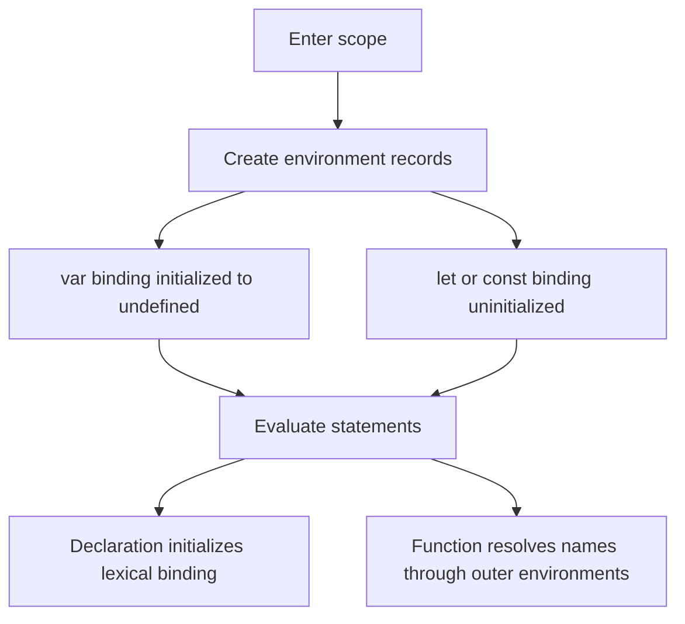
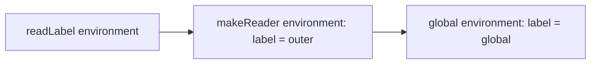
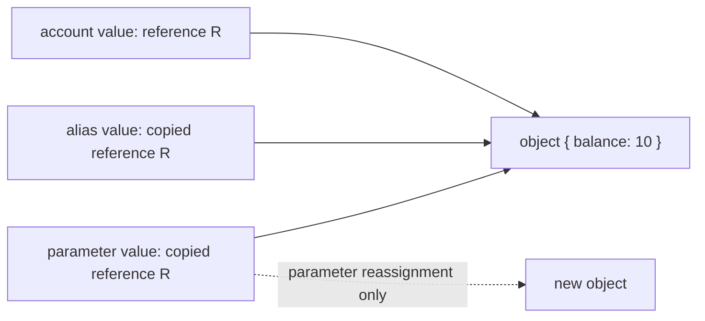
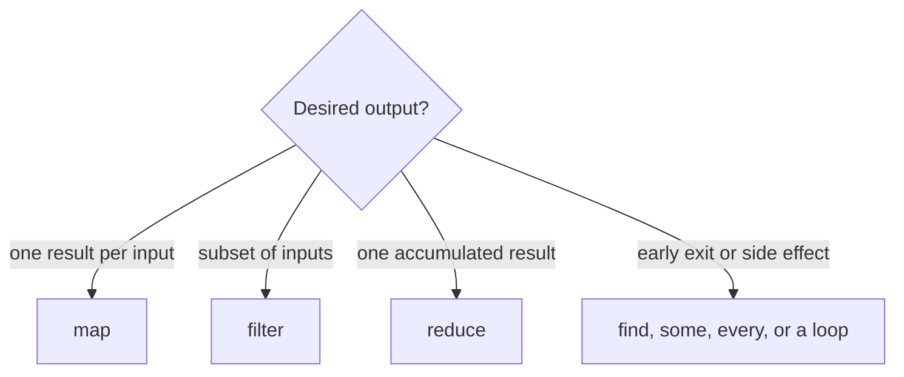

# JavaScript, HTML and CSS Interview Guide

This is the canonical incremental guide for the paired JavaScript/HTML/CSS workbooks. It currently reconciles **Q1–Q10**: bindings and lexical environments, then value/reference behavior, equality, missing values, copying, array transforms, and null-safe access. Later questions remain queued; this is not a claim that the complete workbook has been promoted.

## Module map

- [Q1 — `var`, `let`, and `const`](#q1)
- [Q2 — Hoisting and the temporal dead zone](#q2)
- [Q3 — Lexical scope](#q3)
- [Q4 — Loop capture with `var` and `let`](#q4)
- [Q5 — Primitive values and object references](#q5)
- [Q6 — `==` and `===`](#q6)
- [Q7 — `null`, `undefined`, undeclared names, and `NaN`](#q7)
- [Q8 — Shallow and deep copies](#q8)
- [Q9 — `map`, `filter`, and `reduce`](#q9)
- [Q10 — Optional chaining and nullish coalescing](#q10)
- [Source provenance and verification](#sources)
- [Next bounded section](#next)

## The model before the syntax

An interview answer is stronger when it separates four questions:

1. **Where is the binding stored?** Function/global variable environment or a lexical block environment?
2. **When is the binding created?** Before statements execute, during declaration instantiation.
3. **When is the binding initialized?** `var` starts as `undefined`; a lexical binding cannot be read until its declaration initializes it.
4. **Which binding does a function close over?** The one found through the lexical environment chain where the function was created.



The phrase “JavaScript moves declarations to the top” is only a mnemonic. No source text moves. The specification describes environment creation, binding creation, initialization, and later statement evaluation.

<a id="q1"></a>

## Q1. What is the difference between `var`, `let`, and `const`?

### What the interviewer is asking

Given a declaration, identify its scope, redeclaration rules, initialization timing, and whether the **binding** may be assigned again. Do not confuse a constant binding with an immutable object.

| Declaration | Scope | Before declaration executes | Same-scope redeclaration | Reassignment |
|---|---|---|---|---|
| `var` | nearest function or script/global variable environment | readable as `undefined` | generally allowed for another `var` | allowed |
| `let` | nearest block | binding exists but is uninitialized | syntax error | allowed after initialization |
| `const` | nearest block | binding exists but is uninitialized | syntax error | forbidden after initialization |

### Example 1 — the binding is constant, not the object

```javascript
const profile = { name: "Ada", skills: ["JS"] };
profile.name = "Grace";          // allowed: mutate the object
profile.skills.push("HTML");     // allowed
// profile = {};                 // TypeError: assignment to a constant

console.log(profile);
// { name: "Grace", skills: ["JS", "HTML"] }
```

Trace:

| Step | Binding `profile` | Referenced object |
|---:|---|---|
| declaration | initialized once | `{ name: "Ada", skills: ["JS"] }` |
| property write | unchanged | `name` becomes `"Grace"` |
| `push` | unchanged | array gains `"HTML"` |

Use `Object.freeze()` when shallow runtime mutation prevention is the actual requirement; it solves a different problem from `const`.

<a id="q2"></a>

## Q2. Explain hoisting and the Temporal Dead Zone with output

### Requirement

Predict the output in two phases: first declaration instantiation, then statement evaluation. A lexical binding’s temporal dead zone (TDZ) lasts from entering its scope until its declaration initializes it.

### Example 2 — distinguish created from initialized

```javascript
console.log(total); // undefined
printReady();       // ready

var total = 7;
function printReady() {
  console.log("ready");
}

try {
  console.log(status); // ReferenceError
} catch (error) {
  console.log(error.name);
}
let status = "done";
```

Expected output:

```text
undefined
ready
ReferenceError
```

Dry run:

| Phase | `total` | `printReady` | `status` |
|---|---|---|---|
| declaration instantiation | initialized to `undefined` | initialized to function object | created, uninitialized |
| first log | prints `undefined` | — | — |
| call | — | prints `ready` | — |
| `var` initializer | becomes `7` | — | — |
| attempted lexical read | — | — | throws `ReferenceError` |
| lexical declaration | — | — | initialized to `"done"` |

Interview trap: `typeof missingName` returns `"undefined"`, but `typeof tdzName` can throw when `tdzName` is an uninitialized lexical binding in the current scope.

<a id="q3"></a>

## Q3. What is lexical scope?

### Requirement

Resolve an identifier from the function’s **definition environment**, not from whichever function happens to call it. The environment chain is determined by source nesting.

### Example 3 — call site does not replace the definition environment

```javascript
const label = "global";

function makeReader() {
  const label = "outer";
  return function readLabel() {
    return label;
  };
}

function invokeWithAnotherLabel(fn) {
  const label = "caller";
  return fn();
}

const read = makeReader();
console.log(invokeWithAnotherLabel(read)); // outer
```

Lookup trace for `label` inside `readLabel`:



The lookup stops at `makeReader`’s binding. `invokeWithAnotherLabel` is on the call stack, but it is not on `readLabel`’s lexical environment chain.

<a id="q4"></a>

## Q4. Why does a `var` loop print `3,3,3`, while a `let` loop prints `0,1,2`?

### Requirement

Count captured **bindings**, not captured values. A `var` loop reuses one function-scoped binding. A `for` loop with a lexical declaration creates a fresh per-iteration environment.

### Example 4 — callbacks read their bindings after the loop

```javascript
for (var i = 0; i < 3; i += 1) {
  setTimeout(() => console.log(i), 0);
}
// 3, 3, 3

for (let j = 0; j < 3; j += 1) {
  setTimeout(() => console.log(j), 0);
}
// 0, 1, 2
```

Dry run:

| Registration | `var` callback closes over | `let` callback closes over |
|---:|---|---|
| 1 | shared `i` | iteration binding `j = 0` |
| 2 | shared `i` | iteration binding `j = 1` |
| 3 | shared `i` | iteration binding `j = 2` |
| after both loops | shared `i` is `3` | three `j` bindings remain `0`, `1`, `2` |

The zero-millisecond delay does not mean “run now.” Each timer callback is queued for later processing by the host. The runnable [examples module](examples.mjs) checks the outputs without relying on console inspection.

### ES5-era repair and why `let` is clearer

Before per-iteration lexical bindings were available, an immediately invoked function could create a fresh parameter binding:

```javascript
for (var i = 0; i < 3; i += 1) {
  ((captured) => setTimeout(() => console.log(captured), 0))(i);
}
// 0, 1, 2
```

Prefer `let` for this case: it states the lifetime rule directly and removes the extra wrapper function.

<a id="q5"></a>

## Q5. Are objects “passed by reference” in JavaScript?

### Requirement

Say precisely what is copied. Every assignment and argument pass copies a value. A primitive value is the data itself; an object value is a reference to an object. Two copied references can therefore reach the same mutable object, but assigning a new reference to one variable never redirects the other variable.



### Example 5 — distinguish mutation from reassignment

```javascript
const account = { balance: 10 };
const alias = account;

function update(local) {
  local.balance += 5;      // mutates the shared object
  local = { balance: 0 };  // reassigns only the local parameter
  return local;
}

const replacement = update(account);
console.log(account.balance);     // 15
console.log(alias.balance);       // 15
console.log(replacement.balance); // 0
console.log(account === alias);   // true
console.log(account === replacement); // false
```

Trace:

| Step | `account` / `alias` | local parameter | Visible result |
|---:|---|---|---|
| call | reference R | copy of R | all three reach the original object |
| property update | R | R | original object becomes `{ balance: 15 }` |
| parameter assignment | R | new reference S | caller bindings still hold R |
| return | R | S | `replacement` receives S |

For primitives, the same copy rule is easier to see because there is no separately mutable object: changing a copied number or string only changes that binding.

<a id="q6"></a>

## Q6. What is the difference between `==` and `===`?

### Requirement

Use strict equality by default and explain the result from the specification rule, not from “truthiness.” `===` returns false for different types and otherwise compares without coercion. `==` follows the abstract equality algorithm: it has an explicit `null`/`undefined` match and may convert booleans, strings, numbers, BigInts, or objects before retrying the comparison.

### Example 6 — classify before evaluating

```javascript
console.log(0 === false);          // false: different types
console.log(0 == false);           // true: false -> 0
console.log("" == 0);             // true: "" -> 0
console.log(null == undefined);    // true: explicit loose-equality rule
console.log(null == 0);            // false: null is not converted to 0 here
console.log([5] == 5);             // true: [5] -> "5" -> 5
console.log(Number.NaN === Number.NaN); // false
```

Decision trace:

| Expression | First decisive rule | Result |
|---|---|---:|
| `0 === false` | strict equality rejects different types | `false` |
| `0 == false` | boolean converts with `ToNumber(false)` | `true` |
| `null == undefined` | dedicated abstract-equality case | `true` |
| `null == 0` | no applicable conversion makes them equal | `false` |
| `[5] == 5` | object converts to primitive, then string to number | `true` |

Loose equality is not the same as comparing `Boolean(left)` and `Boolean(right)`. For example, both `"0"` and `[]` are truthy, but the actual `==` algorithm follows type-directed conversions. In application code, explicit normalization such as `Number(input) === expected` makes the contract reviewable.

<a id="q7"></a>

## Q7. How do `null`, `undefined`, undeclared names, and `NaN` differ?

### Requirement

Separate four states instead of calling all of them “empty”:

| State | Meaning | Safe test |
|---|---|---|
| `undefined` | a value often produced by an uninitialized variable, missing property, or absent return | `value === undefined` |
| `null` | an explicit null value chosen by code or an API | `value === null` |
| undeclared identifier | no resolvable binding exists | `typeof maybeMissing === "undefined"` only when probing is intentional |
| `NaN` | a Number value representing a failed/undefined numeric result | `Number.isNaN(value)` |

### Example 7 — preserve the distinction at an input boundary

```javascript
function classify(value) {
  if (value === null) return "explicit-null";
  if (value === undefined) return "missing";
  if (Number.isNaN(value)) return "invalid-number";
  return "present";
}

const record = { nickname: null };
console.log(classify(record.nickname)); // explicit-null
console.log(classify(record.age));      // missing
console.log(classify(Number("oops"))); // invalid-number
console.log(classify(0));               // present
console.log(typeof neverDeclared);      // undefined
// console.log(neverDeclared);          // ReferenceError
```

Important edges:

- `typeof null` is the historical string `"object"`; it is not a reliable null test.
- `NaN` is the only ECMAScript value that is not strictly equal to itself. `Object.is(NaN, NaN)` and `Number.isNaN(NaN)` are both true.
- Global `isNaN("oops")` coerces first and returns true; `Number.isNaN("oops")` returns false. Prefer the non-coercing method when validating typed data.
- A declared lexical binding in its TDZ is different from an undeclared name: even `typeof` can throw before that binding is initialized.

<a id="q8"></a>

## Q8. What is a shallow copy versus a deep copy?

### Requirement

Define the object-graph boundary. A shallow copy creates a new outer container and copies its property values; nested object values are still references to the original nested objects. A deep copy recursively produces separate supported graph nodes. “Deep” does not mean “copies every possible JavaScript value.”

### Example 8 — choose the copy that matches the update boundary

```javascript
const original = {
  owner: { name: "Ada" },
  tags: ["js"],
  created: new Date("2026-01-02T00:00:00Z")
};

const shallow = { ...original };
shallow.owner.name = "Grace";
console.log(original.owner.name); // Grace: nested owner is shared

const isolated = structuredClone(original);
isolated.owner.name = "Lin";
isolated.tags.push("css");
console.log(original.owner.name); // Grace
console.log(original.tags);       // ["js"]
console.log(isolated.created instanceof Date); // true
```

Graph trace:

| Copy | Outer object | `owner` | `tags` | `Date` |
|---|---|---|---|---|
| spread | new | shared | shared | shared |
| `structuredClone` | new | cloned | cloned | cloned as a `Date` |

`structuredClone()` supports cycles and many built-in data types, and can transfer eligible buffers. It throws `DataCloneError` for non-serializable values such as functions. JSON stringify/parse is a text-serialization round trip, not a general clone: it rejects cycles, loses `undefined` properties, and converts dates to strings. Often the clearest immutable update is to copy only the path being changed rather than clone an entire graph.

<a id="q9"></a>

## Q9. What do `map`, `filter`, and `reduce` communicate?

### Requirement

Choose the operation from the output shape. `map` preserves the number of array slots while transforming values, `filter` keeps a subset, and `reduce` folds visited elements into an accumulator. The callbacks are invoked in ascending index order for assigned elements; these methods do not mutate the source array by themselves, although a callback still can.



### Example 9 — a readable transformation pipeline

```javascript
const orders = [
  { id: "A", paid: true, cents: 1250 },
  { id: "B", paid: false, cents: 900 },
  { id: "C", paid: true, cents: 750 }
];

const paidIds = orders
  .filter(order => order.paid)
  .map(order => order.id);

const paidCents = orders.reduce(
  (sum, order) => order.paid ? sum + order.cents : sum,
  0
);

console.log(paidIds);   // ["A", "C"]
console.log(paidCents); // 2000
```

Dry run of the reducer:

| Order | Accumulator before | Action | Accumulator after |
|---|---:|---|---:|
| A, paid | 0 | add 1250 | 1250 |
| B, unpaid | 1250 | keep | 1250 |
| C, paid | 1250 | add 750 | 2000 |

Each method is linear in the array length for a full pass. The `filter().map()` pipeline is expressive but allocates an intermediate array and performs two passes. A single loop or reducer may be appropriate on a measured hot path. Always supply an explicit initial accumulator unless the empty-array behavior and first-element semantics are deliberately part of the contract.

<a id="q10"></a>

## Q10. How do optional chaining and nullish coalescing work?

### Requirement

Use `?.` to stop one continuous property, element, or call chain when the value immediately to its left is `null` or `undefined`. Use `??` to default only those two nullish values. Neither operator treats `0`, `false`, or `""` as missing.

### Example 10 — default missing configuration without erasing valid falsy values

```javascript
function readOptions(config) {
  return {
    retries: config?.network?.retries ?? 3,
    label: config?.ui?.label ?? "default",
    onReadyResult: config?.hooks?.onReady?.() ?? "not-run"
  };
}

console.log(readOptions({
  network: { retries: 0 },
  ui: { label: "" },
  hooks: { onReady: () => false }
}));
// { retries: 0, label: "", onReadyResult: false }

console.log(readOptions(null));
// { retries: 3, label: "default", onReadyResult: "not-run" }
```

Trace for `config?.network?.retries ?? 3`:

| Value reached | Optional chain result | `?? 3` result |
|---|---|---:|
| `config` is `null` | `undefined` | `3` |
| `network` is missing | `undefined` | `3` |
| `retries` is `0` | `0` | `0` |
| `retries` is `false` | `false` | `false` |

Grouping can end a chain: `(config?.network).retries` may still throw because `.retries` is outside the optional chain. Optional chaining also cannot be used as an assignment target. When mixing `??` with `&&` or `||`, add parentheses; the grammar intentionally rejects an unparenthesized mixture.

## Decision checklist

- Use `const` by default when the binding should not change; use `let` when reassignment is part of the model.
- Treat `var` as function-scoped legacy syntax whose initialization and redeclaration rules matter when reading older code.
- For an output question, write the environment state before simulating statements.
- For a closure question, draw the source nesting and follow outer-environment links.
- For a loop/callback question, ask whether callbacks share one binding or receive one per iteration.
- For mutation questions, draw bindings separately from the object graph and mark exactly which reference is copied.
- For equality questions, classify operand types before following a coercion rule; do not substitute truthiness.
- For copying, state which nested nodes must be isolated and which values the chosen mechanism supports.
- For collection transforms, choose from the desired output shape before optimizing pass count.
- For defaults, use `??` when `0`, `false`, or an empty string is valid data.

<a id="sources"></a>

## Source provenance and verification

Paired source comparison performed through 2026-10-15:

- `JavaScript_HTML_CSS_Interview_Mermaid_Workbook.md`, SHA-256 `742ef1042828659004807171e384cfa22decd4589dbbb384d59910df6217fdd0`, lines 166–447. The newly processed Q5–Q10 range is lines 292–447, bounded by the Q11 anchor at line 448. This later Mermaid edition supplies the broader structure, mental models, key rules, and traps.
- `JavaScript_HTML_CSS_Interview_Workbook.docx`, SHA-256 `790f96df8880d825180a99171978d4fd301eeb7f3e1490c570a42028d5778bfb`, extracted paragraphs 21–150. The newly processed Q5–Q10 range is paragraphs 82–150, bounded by Q11 at paragraph 151. It agrees on the six topics but is not promoted as a competing guide.
- The repository edition adds precise requirements, six connected examples, value/object-graph and operation-choice diagrams, decision traces, boundary cases, executable assertions, and current normative links.

Primary references checked through 2026-10-15:

- [ECMAScript 2026 — Environment Records](https://tc39.es/ecma262/2026/multipage/executable-code-and-execution-contexts.html#sec-environment-records)
- [ECMAScript 2026 — `let`, `const`, and `var` declarations](https://tc39.es/ecma262/2026/multipage/ecmascript-language-statements-and-declarations.html#sec-let-and-const-declarations)
- [ECMAScript 2026 — `for` loop per-iteration environments](https://tc39.es/ecma262/2026/multipage/ecmascript-language-statements-and-declarations.html#sec-createperiterationenvironment)
- [HTML Living Standard — timers](https://html.spec.whatwg.org/multipage/timers-and-user-prompts.html#timers)
- [ECMAScript — language types](https://tc39.es/ecma262/multipage/ecmascript-data-types-and-values.html)
- [ECMAScript — strict and abstract equality](https://tc39.es/ecma262/multipage/abstract-operations.html#sec-islooselyequal)
- [ECMAScript — `Number.isNaN`](https://tc39.es/ecma262/multipage/numbers-and-dates.html#sec-number.isnan)
- [HTML Living Standard — structured cloning API](https://html.spec.whatwg.org/multipage/structured-data.html#structured-cloning-api)
- [ECMAScript — indexed collection methods](https://tc39.es/ecma262/multipage/indexed-collections.html#sec-properties-of-the-array-prototype-object)
- [ECMAScript — optional chains](https://tc39.es/ecma262/multipage/ecmascript-language-expressions.html#sec-optional-chains)
- [ECMAScript — nullish coalescing](https://tc39.es/ecma262/multipage/ecmascript-language-expressions.html#sec-coalesce-expression)

<a id="next"></a>

## Next bounded section

Continue with source Q11–Q18: function forms, closures, `this`, call/apply/bind, constructor calls, prototypes, classes, and inheritance. Re-read both sources at that boundary before editing this canonical guide.
