# JavaScript, HTML and CSS Interview Guide

This is the canonical incremental guide for the paired JavaScript/HTML/CSS workbooks. It currently reconciles **Q1–Q30**: execution fundamentals, value semantics, the function/object model, asynchronous JavaScript, browser events and rendering, storage, cross-origin policy, and web security. Later questions remain queued; this is not a claim that the complete workbook has been promoted.

## Module map

- [Q1 — `var`, `let`, and `const`](#q1)
- [Q2 — Hoisting and the temporal dead zone](#q2)
- [Q3 — Lexical scope](#q3)
- [Q4 — Loop capture with `var` and `let`](#q4)
- [Q5 — Primitive values and object references](#q5)
- [Q6 — `==` and `===`](#q6)
- [Q7 — `null`, `undefined`, undeclared names, and `NaN`](#q7)
- [Q8 — Shallow and deep copies](#q8)
- [Q9 — `map`, `filter`, and `reduce`](#q9)
- [Q10 — Optional chaining and nullish coalescing](#q10)
- [Q11 — Closures](#q11)
- [Q12 — How `this` is determined](#q12)
- [Q13 — `call`, `apply`, and `bind`](#q13)
- [Q14 — Prototype chains](#q14)
- [Q15 — Classes and prototypes](#q15)
- [Q16 — Function forms](#q16)
- [Q17 — Currying and partial application](#q17)
- [Q18 — Memoization](#q18)
- [Q19 — Event-loop ordering](#q19)
- [Q20 — `async` and `await`](#q20)
- [Q21 — Promise combinators](#q21)
- [Q22 — Async error boundaries](#q22)
- [Q23 — Debounce](#q23)
- [Q24 — Throttle](#q24)
- [Q25 — Cancelling `fetch`](#q25)
- [Q26 — Event propagation and delegation](#q26)
- [Q27 — Layout and paint costs](#q27)
- [Q28 — Browser storage](#q28)
- [Q29 — Same-origin policy and CORS](#q29)
- [Q30 — XSS and CSRF](#q30)
- [Source provenance and verification](#sources)
- [Next bounded section](#next)

## The model before the syntax

An interview answer is stronger when it separates four questions:

1. **Where is the binding stored?** Function/global variable environment or a lexical block environment?
2. **When is the binding created?** Before statements execute, during declaration instantiation.
3. **When is the binding initialized?** `var` starts as `undefined`; a lexical binding cannot be read until its declaration initializes it.
4. **Which binding does a function close over?** The one found through the lexical environment chain where the function was created.

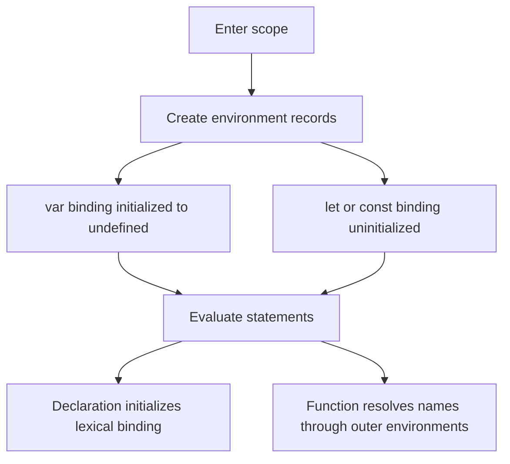

The phrase “JavaScript moves declarations to the top” is only a mnemonic. No source text moves. The specification describes environment creation, binding creation, initialization, and later statement evaluation.

<a id="q1"></a>

## Q1. What is the difference between `var`, `let`, and `const`?

### What the interviewer is asking

Given a declaration, identify its scope, redeclaration rules, initialization timing, and whether the **binding** may be assigned again. Do not confuse a constant binding with an immutable object.

| Declaration | Scope | Before declaration executes | Same-scope redeclaration | Reassignment |
|---|---|---|---|---|
| `var` | nearest function or script/global variable environment | readable as `undefined` | generally allowed for another `var` | allowed |
| `let` | nearest block | binding exists but is uninitialized | syntax error | allowed after initialization |
| `const` | nearest block | binding exists but is uninitialized | syntax error | forbidden after initialization |

### Example 1 — the binding is constant, not the object

```javascript
const profile = { name: "Ada", skills: ["JS"] };
profile.name = "Grace";          // allowed: mutate the object
profile.skills.push("HTML");     // allowed
// profile = {};                 // TypeError: assignment to a constant

console.log(profile);
// { name: "Grace", skills: ["JS", "HTML"] }
```

Trace:

| Step | Binding `profile` | Referenced object |
|---:|---|---|
| declaration | initialized once | `{ name: "Ada", skills: ["JS"] }` |
| property write | unchanged | `name` becomes `"Grace"` |
| `push` | unchanged | array gains `"HTML"` |

Use `Object.freeze()` when shallow runtime mutation prevention is the actual requirement; it solves a different problem from `const`.

<a id="q2"></a>

## Q2. Explain hoisting and the Temporal Dead Zone with output

### Requirement

Predict the output in two phases: first declaration instantiation, then statement evaluation. A lexical binding’s temporal dead zone (TDZ) lasts from entering its scope until its declaration initializes it.

### Example 2 — distinguish created from initialized

```javascript
console.log(total); // undefined
printReady();       // ready

var total = 7;
function printReady() {
  console.log("ready");
}

try {
  console.log(status); // ReferenceError
} catch (error) {
  console.log(error.name);
}
let status = "done";
```

Expected output:

```text
undefined
ready
ReferenceError
```

Dry run:

| Phase | `total` | `printReady` | `status` |
|---|---|---|---|
| declaration instantiation | initialized to `undefined` | initialized to function object | created, uninitialized |
| first log | prints `undefined` | — | — |
| call | — | prints `ready` | — |
| `var` initializer | becomes `7` | — | — |
| attempted lexical read | — | — | throws `ReferenceError` |
| lexical declaration | — | — | initialized to `"done"` |

Interview trap: `typeof missingName` returns `"undefined"`, but `typeof tdzName` can throw when `tdzName` is an uninitialized lexical binding in the current scope.

<a id="q3"></a>

## Q3. What is lexical scope?

### Requirement

Resolve an identifier from the function’s **definition environment**, not from whichever function happens to call it. The environment chain is determined by source nesting.

### Example 3 — call site does not replace the definition environment

```javascript
const label = "global";

function makeReader() {
  const label = "outer";
  return function readLabel() {
    return label;
  };
}

function invokeWithAnotherLabel(fn) {
  const label = "caller";
  return fn();
}

const read = makeReader();
console.log(invokeWithAnotherLabel(read)); // outer
```

Lookup trace for `label` inside `readLabel`:

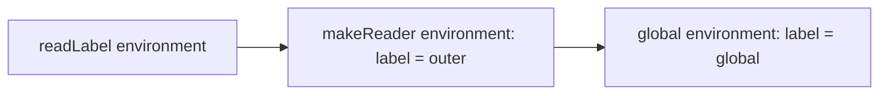

The lookup stops at `makeReader`’s binding. `invokeWithAnotherLabel` is on the call stack, but it is not on `readLabel`’s lexical environment chain.

<a id="q4"></a>

## Q4. Why does a `var` loop print `3,3,3`, while a `let` loop prints `0,1,2`?

### Requirement

Count captured **bindings**, not captured values. A `var` loop reuses one function-scoped binding. A `for` loop with a lexical declaration creates a fresh per-iteration environment.

### Example 4 — callbacks read their bindings after the loop

```javascript
for (var i = 0; i < 3; i += 1) {
  setTimeout(() => console.log(i), 0);
}
// 3, 3, 3

for (let j = 0; j < 3; j += 1) {
  setTimeout(() => console.log(j), 0);
}
// 0, 1, 2
```

Dry run:

| Registration | `var` callback closes over | `let` callback closes over |
|---:|---|---|
| 1 | shared `i` | iteration binding `j = 0` |
| 2 | shared `i` | iteration binding `j = 1` |
| 3 | shared `i` | iteration binding `j = 2` |
| after both loops | shared `i` is `3` | three `j` bindings remain `0`, `1`, `2` |

The zero-millisecond delay does not mean “run now.” Each timer callback is queued for later processing by the host. The runnable [examples module](examples.mjs) checks the outputs without relying on console inspection.

### ES5-era repair and why `let` is clearer

Before per-iteration lexical bindings were available, an immediately invoked function could create a fresh parameter binding:

```javascript
for (var i = 0; i < 3; i += 1) {
  ((captured) => setTimeout(() => console.log(captured), 0))(i);
}
// 0, 1, 2
```

Prefer `let` for this case: it states the lifetime rule directly and removes the extra wrapper function.

<a id="q5"></a>

## Q5. Are objects “passed by reference” in JavaScript?

### Requirement

Say precisely what is copied. Every assignment and argument pass copies a value. A primitive value is the data itself; an object value is a reference to an object. Two copied references can therefore reach the same mutable object, but assigning a new reference to one variable never redirects the other variable.

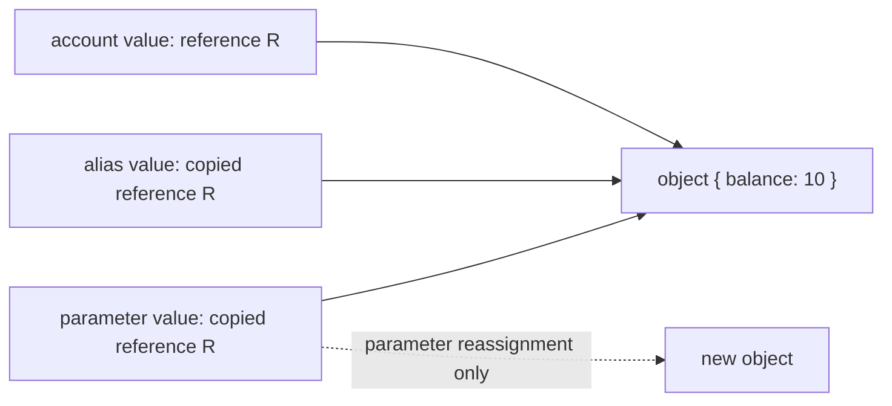

### Example 5 — distinguish mutation from reassignment

```javascript
const account = { balance: 10 };
const alias = account;

function update(local) {
  local.balance += 5;      // mutates the shared object
  local = { balance: 0 };  // reassigns only the local parameter
  return local;
}

const replacement = update(account);
console.log(account.balance);     // 15
console.log(alias.balance);       // 15
console.log(replacement.balance); // 0
console.log(account === alias);   // true
console.log(account === replacement); // false
```

Trace:

| Step | `account` / `alias` | local parameter | Visible result |
|---:|---|---|---|
| call | reference R | copy of R | all three reach the original object |
| property update | R | R | original object becomes `{ balance: 15 }` |
| parameter assignment | R | new reference S | caller bindings still hold R |
| return | R | S | `replacement` receives S |

For primitives, the same copy rule is easier to see because there is no separately mutable object: changing a copied number or string only changes that binding.

<a id="q6"></a>

## Q6. What is the difference between `==` and `===`?

### Requirement

Use strict equality by default and explain the result from the specification rule, not from “truthiness.” `===` returns false for different types and otherwise compares without coercion. `==` follows the abstract equality algorithm: it has an explicit `null`/`undefined` match and may convert booleans, strings, numbers, BigInts, or objects before retrying the comparison.

### Example 6 — classify before evaluating

```javascript
console.log(0 === false);          // false: different types
console.log(0 == false);           // true: false -> 0
console.log("" == 0);             // true: "" -> 0
console.log(null == undefined);    // true: explicit loose-equality rule
console.log(null == 0);            // false: null is not converted to 0 here
console.log([5] == 5);             // true: [5] -> "5" -> 5
console.log(Number.NaN === Number.NaN); // false
```

Decision trace:

| Expression | First decisive rule | Result |
|---|---|---:|
| `0 === false` | strict equality rejects different types | `false` |
| `0 == false` | boolean converts with `ToNumber(false)` | `true` |
| `null == undefined` | dedicated abstract-equality case | `true` |
| `null == 0` | no applicable conversion makes them equal | `false` |
| `[5] == 5` | object converts to primitive, then string to number | `true` |

Loose equality is not the same as comparing `Boolean(left)` and `Boolean(right)`. For example, both `"0"` and `[]` are truthy, but the actual `==` algorithm follows type-directed conversions. In application code, explicit normalization such as `Number(input) === expected` makes the contract reviewable.

<a id="q7"></a>

## Q7. How do `null`, `undefined`, undeclared names, and `NaN` differ?

### Requirement

Separate four states instead of calling all of them “empty”:

| State | Meaning | Safe test |
|---|---|---|
| `undefined` | a value often produced by an uninitialized variable, missing property, or absent return | `value === undefined` |
| `null` | an explicit null value chosen by code or an API | `value === null` |
| undeclared identifier | no resolvable binding exists | `typeof maybeMissing === "undefined"` only when probing is intentional |
| `NaN` | a Number value representing a failed/undefined numeric result | `Number.isNaN(value)` |

### Example 7 — preserve the distinction at an input boundary

```javascript
function classify(value) {
  if (value === null) return "explicit-null";
  if (value === undefined) return "missing";
  if (Number.isNaN(value)) return "invalid-number";
  return "present";
}

const record = { nickname: null };
console.log(classify(record.nickname)); // explicit-null
console.log(classify(record.age));      // missing
console.log(classify(Number("oops"))); // invalid-number
console.log(classify(0));               // present
console.log(typeof neverDeclared);      // undefined
// console.log(neverDeclared);          // ReferenceError
```

Important edges:

- `typeof null` is the historical string `"object"`; it is not a reliable null test.
- `NaN` is the only ECMAScript value that is not strictly equal to itself. `Object.is(NaN, NaN)` and `Number.isNaN(NaN)` are both true.
- Global `isNaN("oops")` coerces first and returns true; `Number.isNaN("oops")` returns false. Prefer the non-coercing method when validating typed data.
- A declared lexical binding in its TDZ is different from an undeclared name: even `typeof` can throw before that binding is initialized.

<a id="q8"></a>

## Q8. What is a shallow copy versus a deep copy?

### Requirement

Define the object-graph boundary. A shallow copy creates a new outer container and copies its property values; nested object values are still references to the original nested objects. A deep copy recursively produces separate supported graph nodes. “Deep” does not mean “copies every possible JavaScript value.”

### Example 8 — choose the copy that matches the update boundary

```javascript
const original = {
  owner: { name: "Ada" },
  tags: ["js"],
  created: new Date("2026-01-02T00:00:00Z")
};

const shallow = { ...original };
shallow.owner.name = "Grace";
console.log(original.owner.name); // Grace: nested owner is shared

const isolated = structuredClone(original);
isolated.owner.name = "Lin";
isolated.tags.push("css");
console.log(original.owner.name); // Grace
console.log(original.tags);       // ["js"]
console.log(isolated.created instanceof Date); // true
```

Graph trace:

| Copy | Outer object | `owner` | `tags` | `Date` |
|---|---|---|---|---|
| spread | new | shared | shared | shared |
| `structuredClone` | new | cloned | cloned | cloned as a `Date` |

`structuredClone()` supports cycles and many built-in data types, and can transfer eligible buffers. It throws `DataCloneError` for non-serializable values such as functions. JSON stringify/parse is a text-serialization round trip, not a general clone: it rejects cycles, loses `undefined` properties, and converts dates to strings. Often the clearest immutable update is to copy only the path being changed rather than clone an entire graph.

<a id="q9"></a>

## Q9. What do `map`, `filter`, and `reduce` communicate?

### Requirement

Choose the operation from the output shape. `map` preserves the number of array slots while transforming values, `filter` keeps a subset, and `reduce` folds visited elements into an accumulator. The callbacks are invoked in ascending index order for assigned elements; these methods do not mutate the source array by themselves, although a callback still can.

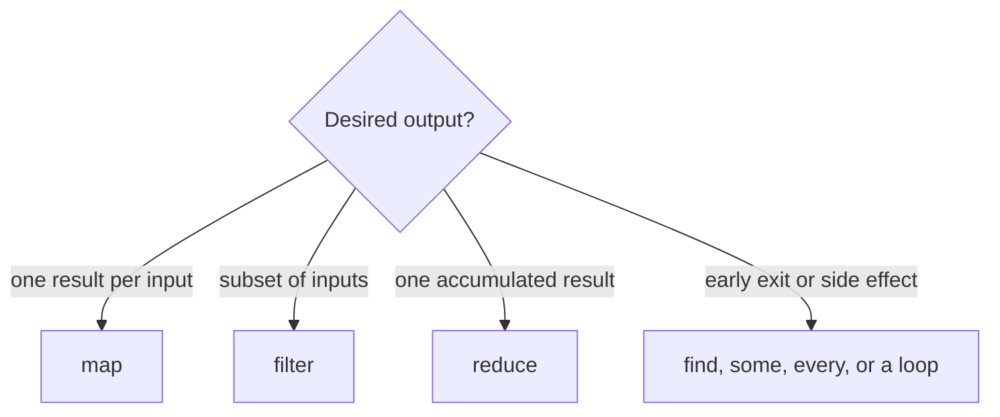

### Example 9 — a readable transformation pipeline

```javascript
const orders = [
  { id: "A", paid: true, cents: 1250 },
  { id: "B", paid: false, cents: 900 },
  { id: "C", paid: true, cents: 750 }
];

const paidIds = orders
  .filter(order => order.paid)
  .map(order => order.id);

const paidCents = orders.reduce(
  (sum, order) => order.paid ? sum + order.cents : sum,
  0
);

console.log(paidIds);   // ["A", "C"]
console.log(paidCents); // 2000
```

Dry run of the reducer:

| Order | Accumulator before | Action | Accumulator after |
|---|---:|---|---:|
| A, paid | 0 | add 1250 | 1250 |
| B, unpaid | 1250 | keep | 1250 |
| C, paid | 1250 | add 750 | 2000 |

Each method is linear in the array length for a full pass. The `filter().map()` pipeline is expressive but allocates an intermediate array and performs two passes. A single loop or reducer may be appropriate on a measured hot path. Always supply an explicit initial accumulator unless the empty-array behavior and first-element semantics are deliberately part of the contract.

<a id="q10"></a>

## Q10. How do optional chaining and nullish coalescing work?

### Requirement

Use `?.` to stop one continuous property, element, or call chain when the value immediately to its left is `null` or `undefined`. Use `??` to default only those two nullish values. Neither operator treats `0`, `false`, or `""` as missing.

### Example 10 — default missing configuration without erasing valid falsy values

```javascript
function readOptions(config) {
  return {
    retries: config?.network?.retries ?? 3,
    label: config?.ui?.label ?? "default",
    onReadyResult: config?.hooks?.onReady?.() ?? "not-run"
  };
}

console.log(readOptions({
  network: { retries: 0 },
  ui: { label: "" },
  hooks: { onReady: () => false }
}));
// { retries: 0, label: "", onReadyResult: false }

console.log(readOptions(null));
// { retries: 3, label: "default", onReadyResult: "not-run" }
```

Trace for `config?.network?.retries ?? 3`:

| Value reached | Optional chain result | `?? 3` result |
|---|---|---:|
| `config` is `null` | `undefined` | `3` |
| `network` is missing | `undefined` | `3` |
| `retries` is `0` | `0` | `0` |
| `retries` is `false` | `false` | `false` |

Grouping can end a chain: `(config?.network).retries` may still throw because `.retries` is outside the optional chain. Optional chaining also cannot be used as an assignment target. When mixing `??` with `&&` or `||`, add parentheses; the grammar intentionally rejects an unparenthesized mixture.

<a id="q11"></a>

## Q11. What is a closure, and why is it useful?

### Requirement

A closure is a function together with access to the lexical environment where that function was created. The important fact is not that one function is textually inside another; it is that a reachable function retains the bindings it needs even after the outer call has returned.

### Example 11 — independent factories retain independent bindings

```javascript
function makeCounter(start = 0) {
  let count = start;
  return {
    next() { count += 1; return count; },
    value() { return count; }
  };
}

const first = makeCounter(0);
const second = makeCounter(10);

console.log(first.next());  // 1
console.log(first.next());  // 2
console.log(second.next()); // 11
console.log(first.value()); // 2
```

Trace:

| Event | `first` environment | `second` environment |
|---|---:|---:|
| factory calls return | `count = 0` | `count = 10` |
| `first.next()` twice | `count = 2` | `count = 10` |
| `second.next()` | `count = 2` | `count = 11` |

This pattern enables factories, callbacks, module-private state, currying, and memoization. It also creates a lifetime obligation: if a long-lived closure captures a large object or DOM subtree, that object stays reachable. Capture the smallest state needed, and unsubscribe or discard callbacks when their owner is finished.

<a id="q12"></a>

## Q12. How is `this` determined in JavaScript?

### Requirement

For a normal function, inspect the call expression. For an arrow function, inspect where it was created because arrows use lexical `this`. A practical precedence model is:

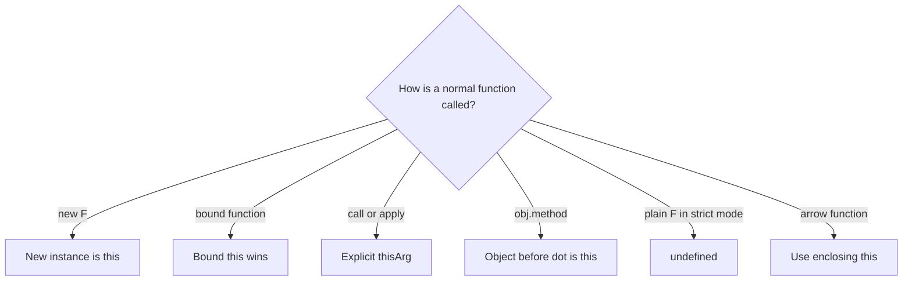

`new` has higher precedence than a bound `this`: when a constructable bound function is invoked with `new`, the newly created instance becomes `this`; the bound arguments still participate.

### Example 12 — call shape, not storage location, chooses the receiver

```javascript
"use strict";

const account = {
  owner: "Ada",
  readOwner() { return this?.owner; },
  makeArrow() { return () => this.owner; }
};

const detached = account.readOwner;
const arrow = account.makeArrow();

console.log(account.readOwner());          // Ada: method call
console.log(detached());                   // undefined: plain strict call
console.log(detached.call({ owner: "Lin" })); // Lin: explicit receiver
console.log(arrow.call({ owner: "Ignored" })); // Ada: lexical this
```

| Expression | Rule | Effective `this` |
|---|---|---|
| `account.readOwner()` | implicit receiver | `account` |
| `detached()` | strict plain call | `undefined` |
| `detached.call(other)` | explicit binding | `other` |
| `arrow.call(other)` | arrow ignores rebinding | `account` captured by `makeArrow()` |

Avoid arrow properties for methods that need a dynamic receiver. Conversely, an arrow created inside a method is useful for a callback that must keep the method's receiver.

<a id="q13"></a>

## Q13. How do `call`, `apply`, and `bind` differ?

### Requirement

- `fn.call(thisArg, a, b)` invokes immediately with positional arguments.
- `fn.apply(thisArg, [a, b])` invokes immediately with an array-like argument list.
- `fn.bind(thisArg, a)` returns a new function for later calls and may pre-fill leading arguments.

```javascript
function format(prefix, suffix) {
  return `${prefix}${this.name}${suffix}`;
}

const user = { name: "Sam" };
console.log(format.call(user, "[", "]"));      // [Sam]
console.log(format.apply(user, ["<", ">"])); // <Sam>

const greetSam = format.bind(user, "Hello ");
console.log(greetSam("!"));                    // Hello Sam!
```

Spread syntax often replaces `apply` for ordinary argument forwarding: `fn(...args)`. Binding an arrow cannot replace its lexical `this`, and rebinding an already-bound function does not replace its original bound receiver.

<a id="q14"></a>

## Q14. How does the prototype chain resolve a property?

### Requirement

Property lookup starts with the object itself. If the property is absent, lookup follows the object's internal `[[Prototype]]` link until it finds the first matching property or reaches `null`. An own property can shadow an inherited property without changing the prototype.

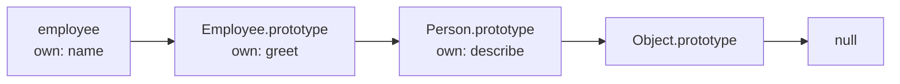

### Example 13 — lookup, shadowing, and deletion

```javascript
const personMethods = {
  describe() { return `person:${this.name}`; }
};

const employeeMethods = Object.create(personMethods);
employeeMethods.describe = function () {
  return `employee:${this.name}`;
};

const employee = Object.create(employeeMethods);
employee.name = "Mia";

console.log(employee.describe()); // employee:Mia
delete employeeMethods.describe;
console.log(employee.describe()); // person:Mia
console.log(Object.hasOwn(employee, "describe")); // false
```

Lookup trace:

| State | Instance | `employeeMethods` | `personMethods` | Result |
|---|---|---|---|---|
| before delete | absent | own `describe` | own `describe` | first inherited method wins |
| after delete | absent | absent | own `describe` | lookup continues to base |

`Constructor.prototype` is the object assigned as the prototype of instances created by `new Constructor()`. It is not the internal prototype of the constructor function itself.

<a id="q15"></a>

## Q15. Are classes fundamentally different from prototypes?

### Requirement

Class syntax adds declarative constructors, `extends`, `super`, private elements, strict semantics, and a prohibition on calling a class without `new`. Instance method lookup still uses prototype links; methods declared in the class body live on the class's `.prototype`, not as a separate function copy on every instance.

```javascript
class Person {
  constructor(name) { this.name = name; }
  describe() { return `person:${this.name}`; }
}

class Employee extends Person {
  describe() { return `employee:${this.name}`; }
}

const employee = new Employee("Mia");
console.log(employee.describe()); // employee:Mia
console.log(Object.getPrototypeOf(employee) === Employee.prototype); // true
console.log(Object.getPrototypeOf(Employee.prototype) === Person.prototype); // true
console.log(Object.hasOwn(employee, "describe")); // false
```

Do not reduce classes to “only syntactic sugar” in an interview. Their method delegation is prototype-based, but class declarations also impose observable semantics such as strict mode, non-enumerable prototype methods, TDZ behavior, and `new`-only construction.

<a id="q16"></a>

## Q16. When should you choose a declaration, expression, or arrow function?

### Requirement

Choose by semantics:

| Form | Availability before definition | Own `this` / `arguments` | Constructable with `new` | Typical use |
|---|---|---|---|---|
| function declaration | initialized during declaration instantiation | yes | normally yes | named reusable operation |
| function expression assigned to `const` | follows the lexical binding's TDZ | yes | normally yes | value selected/created conditionally |
| arrow function | follows its variable's declaration rule | no; resolves lexically | no | callback that inherits surrounding context |

```javascript
console.log(declared(2)); // 4
function declared(x) { return x * 2; }

const expressed = function square(x) { return x * x; };
const doubled = [1, 2, 3].map(x => x * 2);

console.log(expressed(3)); // 9
console.log(doubled);      // [2, 4, 6]
// new (() => {});        // TypeError: arrow is not a constructor
```

A named function expression improves stack traces and permits internal recursion without leaking that name to the outer scope.

<a id="q17"></a>

## Q17. How does currying differ from partial application?

### Requirement

Currying changes a function of multiple parameters into a chain that accepts one parameter at each step. Partial application fixes any subset—commonly a leading prefix—of a function's arguments and returns a function that accepts the remainder. Both use closures, but they are different transformations.

### Example 14 — compare the resulting call shapes

```javascript
const curryPrice = taxRate => discount => amount =>
  amount * (1 - discount) * (1 + taxRate);

function price(taxRate, discount, amount) {
  return amount * (1 - discount) * (1 + taxRate);
}

const georgiaPrice = curryPrice(0.08);     // curried: still one arg at a time
const salePrice = price.bind(null, 0.08, 0.10); // partial: two args fixed

console.log(georgiaPrice(0.10)(100)); // 97.2
console.log(salePrice(100));          // 97.2
```

Currying helps composition and reusable staged configuration. Partial application is often the more direct choice when an existing multi-parameter API should be specialized.

<a id="q18"></a>

## Q18. What makes memoization correct—and dangerous?

### Requirement

Memoization reuses a previous result for an equivalent input. Correctness requires a stable equivalence/key strategy and a result that does not silently depend on changing external state. Production design additionally needs a memory/freshness policy: size bounds, TTL, explicit invalidation, weak keys, or an owner lifetime.

```javascript
function memoizeUnary(fn, { maxEntries = 2 } = {}) {
  const cache = new Map();
  return function memoized(input) {
    if (cache.has(input)) {
      const value = cache.get(input);
      cache.delete(input);
      cache.set(input, value); // refresh recency
      return value;
    }
    const value = fn(input);
    cache.set(input, value);
    if (cache.size > maxEntries) {
      cache.delete(cache.keys().next().value);
    }
    return value;
  };
}

let computations = 0;
const square = memoizeUnary(x => { computations += 1; return x * x; });
console.log(square(4), square(4), computations); // 16 16 1
```

The `has` check is essential because cached results may legitimately be `0`, `false`, or `undefined`. A `Map` uses object identity for object keys; structurally equal object literals are different keys. JSON stringification is not a universal structural key because order, unsupported values, cycles, and serialization cost matter. Memoizing time-, user-, locale-, permission-, or database-dependent work without including those dependencies and an invalidation policy returns stale or unsafe results.

## Asynchronous JavaScript: separate scheduling from execution

JavaScript promises do not create a second JavaScript thread. The host runs tasks such as timer callbacks; ECMAScript promise reactions run as jobs, which browsers integrate with the microtask queue. A useful browser model is:

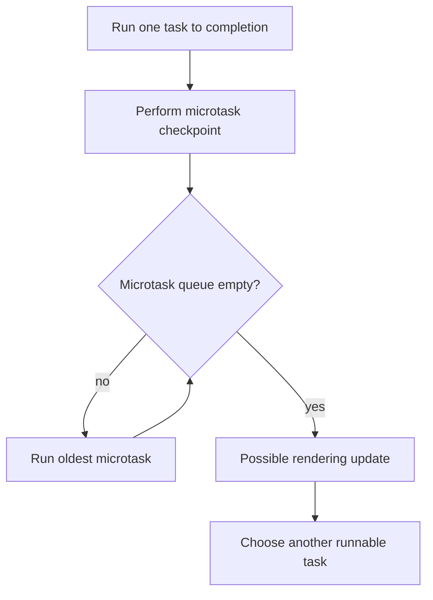

This is a scheduling model, not a promise that every task source is globally FIFO. A zero-millisecond timer means “eligible after the minimum delay,” not “execute immediately.” Microtasks queued by other microtasks are drained in the same checkpoint; an unbounded microtask chain can therefore delay rendering and later tasks.

<a id="q19"></a>

## Q19. How do you predict event-loop output?

### Requirement

First run the current script to completion. Record promise reactions and `queueMicrotask` callbacks in registration order. At the checkpoint, keep draining microtasks—including newly queued ones—before a later timer task can run.

### Example 15 — a nested microtask joins the same checkpoint

```javascript
const output = [];

output.push("A");
setTimeout(() => output.push("timer"), 0);
Promise.resolve().then(() => {
  output.push("promise-1");
  queueMicrotask(() => output.push("nested"));
});
queueMicrotask(() => output.push("microtask-1"));
output.push("B");

// after the timer: A, B, promise-1, microtask-1, nested, timer
```

Trace:

| Step | Running work | Microtask queue after step | Output |
|---:|---|---|---|
| 1 | current script | — | `A` |
| 2 | register timer task | — | `A` |
| 3 | register promise reaction | `promise-1` | `A` |
| 4 | `queueMicrotask` | `promise-1`, `microtask-1` | `A` |
| 5 | finish script | unchanged | `A, B` |
| 6 | run promise reaction | `microtask-1`, `nested` | `A, B, promise-1` |
| 7 | drain remaining microtasks | empty | `…, microtask-1, nested` |
| 8 | timer task becomes selected | empty | `…, timer` |

Do not say “promises always beat timers” without scope. A promise reaction registered inside a later timer obviously cannot run before the code that registers it. Analyze one task and its following checkpoint at a time.

<a id="q20"></a>

## Q20. What do `async` and `await` actually do?

### Requirement

Calling an `async` function returns a promise. `await expression` obtains a promise from the expression, suspends only that async function, and schedules its continuation after settlement. The JavaScript thread is free to run other work. Even an already-fulfilled promise does not make the continuation run inline with the current stack.

### Example 16 — start independent work before awaiting it

```javascript
async function loadDashboard(loadUser, loadOrders) {
  const userPromise = loadUser();     // starts now
  const ordersPromise = loadOrders(); // starts now
  const [user, orders] = await Promise.all([userPromise, ordersPromise]);
  return { user, orders };
}
```

Compare the timelines:

| Shape | Timeline | Approximate wall time for 80 ms + 120 ms jobs |
|---|---|---:|
| serial | start user → await → start orders → await | 200 ms |
| concurrent | start both → await both | 120 ms |

Concurrency is correct only when the operations are independent and the resource budget permits it. If the second operation needs the first result, serial `await` expresses the real dependency. For a large input collection, use a concurrency limit rather than launching every operation at once.

<a id="q21"></a>

## Q21. When should you use `Promise.all`, `allSettled`, `race`, or `any`?

### Requirement

Choose the success condition before choosing the API. Each method accepts an iterable and returns a new promise; none of them cancels losing or rejected input operations.

| Combinator | Returned promise fulfills when | Rejects when | Output ordering / reason |
|---|---|---|---|
| `Promise.all` | every input fulfills | first observed rejection | values stay in input order |
| `Promise.allSettled` | every input settles | not because an input rejects | result records stay in input order |
| `Promise.race` | first input settles successfully | first input settles by rejection | first settlement wins |
| `Promise.any` | first input fulfills | every input rejects | rejects with `AggregateError` |

### Example 17 — select semantics, then handle the non-winners

```javascript
const audit = await Promise.allSettled([
  Promise.resolve({ region: "east", latency: 42 }),
  Promise.reject(new Error("west unavailable"))
]);
// [{ status: "fulfilled", value: ... }, { status: "rejected", reason: ... }]

const firstHealthy = await Promise.any([
  Promise.reject(new Error("east unavailable")),
  Promise.resolve({ region: "west", latency: 55 })
]);
// { region: "west", latency: 55 }
```

Important edge cases:

- `Promise.all([])` and `Promise.allSettled([])` fulfill with `[]`.
- `Promise.any([])` rejects with an `AggregateError` because no input can fulfill.
- `Promise.race([])` remains pending because no input can settle it.
- “Fail fast” does not mean “stop the other jobs.” Connect explicit cancellation when wasted work or stale effects matter.

<a id="q22"></a>

## Q22. Where should asynchronous errors be handled?

### Requirement

Await or return every promise so its failure remains in the caller's chain. Catch an error only where the code can add useful context, recover, translate it into a domain result, or perform cleanup. Otherwise let it propagate to the operation's owner.

```javascript
async function loadUser(fetchImpl, id) {
  try {
    const response = await fetchImpl(`/api/users/${encodeURIComponent(id)}`);
    if (!response.ok) {
      throw new Error(`HTTP ${response.status}`);
    }
    return await response.json();
  } catch (error) {
    throw new Error(`Could not load user ${id}`, { cause: error });
  }
}
```

`fetch()` rejects for failures such as a network error or abort, but an HTTP 404 or 500 normally arrives as a `Response`; checking `response.ok` creates the application-level failure. Preserve the original error as `cause` rather than replacing all diagnostic information.

One subtle boundary:

```javascript
async function notCaught() {
  try {
    return failingOperation(); // rejection occurs after this try block returns
  } catch {
    return "fallback";
  }
}

async function caughtHere() {
  try {
    return await failingOperation(); // rejection is thrown at this await
  } catch {
    return "fallback";
  }
}
```

Both functions return promises; the difference is where the rejection is observed. Use `finally` for cleanup that must run for either outcome, but do not return from `finally` because that can replace the original result or error.

<a id="q23"></a>

## Q23. How do you implement debounce without losing the latest call?

### Requirement

Debounce is the “after silence” policy: every call replaces the pending timer, and one trailing invocation uses the latest arguments and receiver. This is appropriate when intermediate events are disposable, such as autocomplete text or resize recomputation.

```javascript
function debounce(fn, wait) {
  let timerId;
  return function debounced(...args) {
    const receiver = this;
    clearTimeout(timerId);
    timerId = setTimeout(() => {
      timerId = undefined;
      fn.apply(receiver, args);
    }, wait);
  };
}
```

Dry run for calls at 0, 40, and 90 ms with `wait = 100`:

| Time | Event | Pending deadline | Invocation |
|---:|---|---:|---|
| 0 | call `"a"` | 100 | — |
| 40 | call `"ab"`; cancel prior timer | 140 | — |
| 90 | call `"abc"`; cancel prior timer | 190 | — |
| 190 | quiet period completes | none | `fn("abc")` |

Production wrappers may also expose `cancel()` and `flush()`. Define leading/trailing behavior explicitly instead of combining options until calls can fire twice at one boundary.

<a id="q24"></a>

## Q24. How does throttle differ from debounce?

### Requirement

Throttle is the “at most once per interval” policy. It suits continuous signals such as scroll sampling when periodic progress matters. A leading-plus-trailing version invokes immediately, then remembers the latest suppressed call for the end of the window.

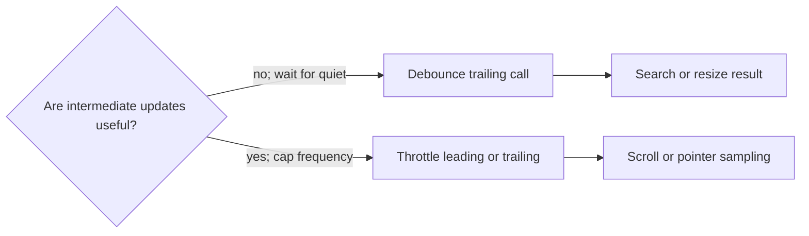

```javascript
function throttle(fn, wait) {
  let lastInvoke = -Infinity;
  let timerId;
  let pending;

  return function throttled(...args) {
    const now = Date.now();
    pending = { receiver: this, args };
    const remaining = wait - (now - lastInvoke);

    const invoke = () => {
      lastInvoke = Date.now();
      timerId = undefined;
      const call = pending;
      pending = undefined;
      fn.apply(call.receiver, call.args);
    };

    if (remaining <= 0) {
      if (timerId !== undefined) clearTimeout(timerId);
      invoke();
    } else if (timerId === undefined) {
      timerId = setTimeout(invoke, remaining);
    }
  };
}
```

| Policy | Burst at 0, 40, 90 ms; wait 100 ms | Best fit |
|---|---|---|
| trailing debounce | only latest call at 190 ms | final value matters |
| leading + trailing throttle | first call at 0 ms, latest suppressed call near 100 ms | periodic progress matters |

Timers are host scheduling requests, not hard real-time deadlines. Long tasks can delay either wrapper. For visual updates, `requestAnimationFrame` may be a better pacing mechanism because it aligns work with rendering rather than an arbitrary millisecond interval.

<a id="q25"></a>

## Q25. How do you cancel a `fetch()` request, and what problem does cancellation solve?

### Requirement

Create an `AbortController`, pass its `signal` to `fetch()`, and call `abort()` from the operation that owns the request. Cancellation saves work and gives an unmounted view, superseded search, timeout, or explicit user action a defined cleanup path. It does **not** by itself prove that an older server operation was rolled back, so idempotency and stale-result guards may still matter.

### Example 18 — latest search owns the active request

```javascript
function createLatestSearch(fetchImpl) {
  let active;
  let generation = 0;

  return async function search(query) {
    active?.abort();
    const controller = new AbortController();
    const mine = ++generation;
    active = controller;

    try {
      const response = await fetchImpl(
        `/api/search?q=${encodeURIComponent(query)}`,
        { signal: controller.signal }
      );
      if (!response.ok) throw new Error(`HTTP ${response.status}`);
      const data = await response.json();
      return mine === generation ? data : undefined;
    } catch (error) {
      if (error.name === "AbortError") return undefined;
      throw error;
    } finally {
      if (mine === generation) active = undefined;
    }
  };
}
```

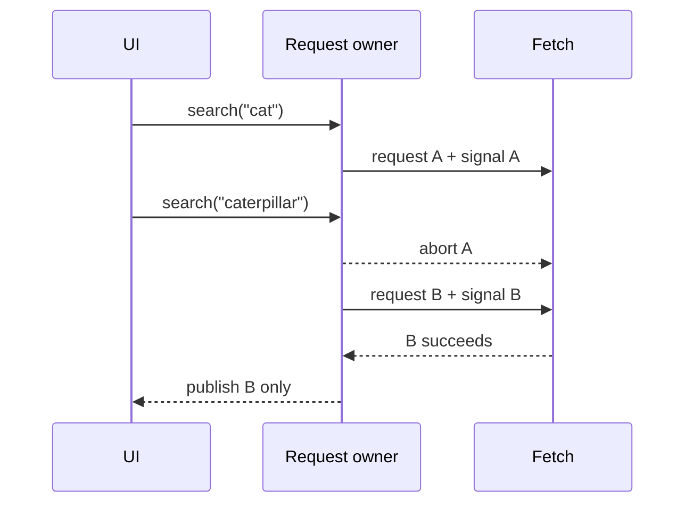

Trace:

| Step | Generation | Active signal | Observable result |
|---:|---:|---|---|
| search `"cat"` | 1 | A | A pending |
| search `"caterpillar"` | 2 | B | A rejects with `AbortError` |
| B completes | 2 | none after cleanup | B may update the UI |

An abort is an expected control-flow outcome, not a generic network failure. Do not show an alarming error toast for every `AbortError`. Conversely, do not swallow real HTTP, parsing, or network failures. In current runtimes, `AbortSignal.timeout()` and `AbortSignal.any()` can express timeouts and combined ownership, but explicit controllers remain the portable mental model.

<a id="q26"></a>

## Q26. Explain event capturing, bubbling, and delegation

### Requirement

An event path is computed from the target through its ancestors. Capture listeners run toward the target, target listeners run at the target, and bubbling listeners run back toward the root when the event bubbles. `event.target` is where dispatch began; `event.currentTarget` is the node whose listener is currently running.

Delegation attaches one listener to a stable ancestor and derives the intended descendant action from the event. It reduces listener churn and also handles children added later.

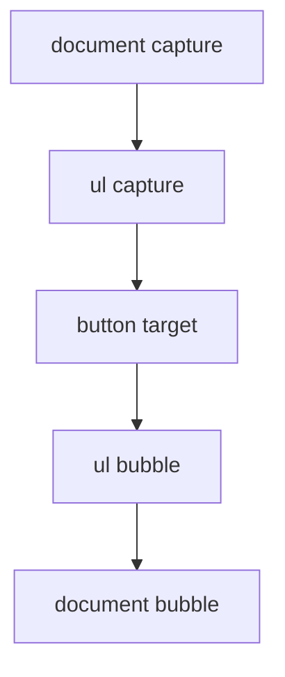

### Example 19 — delegate at a boundary, not merely at a selector

```javascript
list.addEventListener("click", event => {
  const button = event.target.closest("[data-delete]");
  if (!button || !list.contains(button)) return;

  const item = button.closest("[data-item-id]");
  if (!item || !list.contains(item)) return;
  removeItem(item.dataset.itemId);
});
```

The containment checks prevent a selector match outside the component boundary from being accepted. `closest()` also handles clicks on an icon nested inside the button. For Shadow DOM, retargeting can change `target`; `event.composedPath()` is the explicit path tool when an event is composed across a shadow boundary.

| API/property | Meaning | Does not mean |
|---|---|---|
| `target` | original/retargeted dispatch target visible here | node whose listener is running |
| `currentTarget` | node for the listener currently executing | deepest clicked node |
| `stopPropagation()` | stop later traversal to other nodes | cancel link/form default behavior |
| `preventDefault()` | cancel a cancelable default action | stop propagation |

<a id="q27"></a>

## Q27. What are layout/reflow and repaint, and how do you avoid layout thrashing?

### Requirement

Style calculation determines computed styles; layout determines geometry; paint records visual drawing; compositing assembles layers. A change need not trigger every stage: changing geometry can require layout and paint, while a compositor-friendly transform may avoid layout and paint for that frame. Treat those as browser-dependent optimization opportunities, not guarantees.

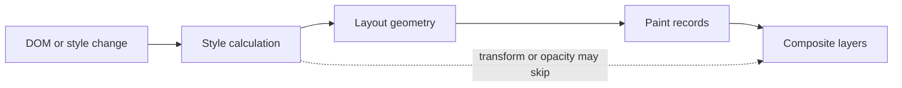

### Example 20 — batch reads, then writes

```javascript
// Bad: each write can invalidate geometry before the next read.
for (const row of rows) {
  row.style.width = `${container.offsetWidth / 2}px`;
}

// Better: read once, then perform the writes together.
const width = container.offsetWidth / 2;
requestAnimationFrame(() => {
  for (const row of rows) row.style.width = `${width}px`;
});
```

The problematic pattern is an alternating sequence of layout-invalidating **write → geometry read → write → geometry read**. A geometry API such as `offsetWidth` or `getBoundingClientRect()` may force the browser to make pending layout information current. Read the necessary measurements together, compute in ordinary JavaScript, then write together. `requestAnimationFrame()` aligns a write batch with a rendering opportunity; it does not make expensive work free, and a callback can still miss the frame budget.

Dry run for four rows:

| Plan | Geometry reads | DOM writes | Potential forced layout boundaries |
|---|---:|---:|---:|
| interleaved loop | 4 | 4 | up to 4 |
| batched read then writes | 1 | 4 | 1 measurement boundary |

Measure actual behavior with browser performance tooling because engines can coalesce work and layer promotion consumes memory.

<a id="q28"></a>

## Q28. Compare `localStorage`, `sessionStorage`, cookies, and IndexedDB

### Requirement

Choose storage by data shape, lifetime, access pattern, and security—not by memorized capacity numbers. Browser quotas and eviction policies vary, and none of these APIs is a safe vault for secrets exposed to script.

| Mechanism | API/model | Lifetime/scope | Network behavior | Good fit / principal warning |
|---|---|---|---|---|
| `localStorage` | synchronous string key/value | origin; persists until cleared/evicted | not sent automatically | tiny preferences; blocks the main thread and needs serialization |
| `sessionStorage` | synchronous string key/value | origin plus top-level browsing context; tab session | not sent automatically | per-tab workflow state; not cross-tab persistence |
| cookie | small string name/value plus attributes | domain/path and expiry rules | matching cookies are attached to requests | server sessions and request state; use `Secure`, `HttpOnly`, and deliberate `SameSite` |
| IndexedDB | asynchronous object stores, indexes, transactions | origin; persists subject to policy | not sent automatically | larger structured/offline data; schema/version and transaction discipline required |

### Example 21 — make the policy explicit

```javascript
const storagePolicy = {
  theme: "localStorage",
  checkoutDraftForThisTab: "sessionStorage",
  serverSessionIdentifier: "Secure HttpOnly SameSite cookie",
  offlineCatalog: "IndexedDB"
};
```

Store the minimum data needed. XSS can read script-accessible Web Storage and IndexedDB. An `HttpOnly` cookie blocks direct JavaScript reads, but the browser may still attach it to requests, so CSRF defenses and server-side authorization remain necessary. Client storage is a cache or persistence mechanism, not the source of truth for permissions.

<a id="q29"></a>

## Q29. What are the Same-Origin Policy and CORS?

### Requirement

An origin is the tuple **scheme + host + port**. The Same-Origin Policy restricts how a document or script from one origin can read/interact with resources from another. Cross-origin requests can still be sent in several cases; the important default restriction is often whether script may read the response.

CORS is the Fetch protocol by which a server opts selected origins into cross-origin response sharing. A non-simple request can trigger a preflight `OPTIONS` request before the actual request. CORS is not authentication, authorization, or a general CSRF defense.

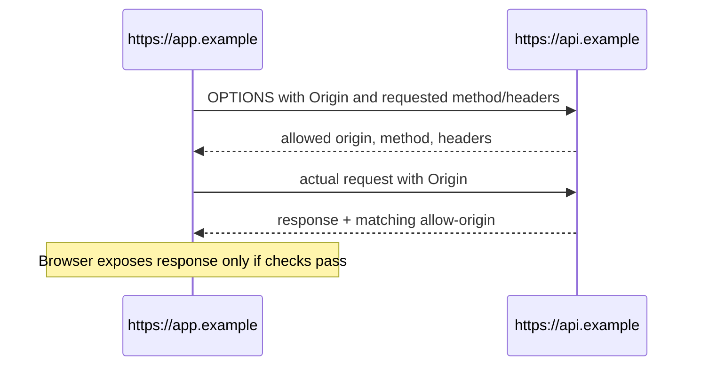

For a credentialed browser request, the client must opt in (for example, `credentials: "include"`), the server must return a specific allowed origin rather than `*`, and it must allow credentials. `mode: "no-cors"` is not a bypass: it deliberately produces an opaque response that JavaScript cannot inspect.

| Situation | Request may reach server? | JavaScript can read response? |
|---|---|---|
| same origin | normally yes | normally yes |
| allowed CORS response | yes | yes, within exposed-header rules |
| disallowed cross-origin response | may do so | no |
| failed preflight | actual request is not sent | no |
| `no-cors` request | limited request may be sent | opaque response; no body/status access |

Validate authorization on the server for every request. A successful CORS check only says the browser may share the response with that origin.

<a id="q30"></a>

## Q30. How do XSS and CSRF differ, and how are they prevented?

### Requirement

**Cross-site scripting (XSS)** gets attacker-controlled content interpreted in a trusted page's execution context. **Cross-site request forgery (CSRF)** causes a victim's browser to send an unwanted state-changing request using ambient authority such as cookies. They have different primary controls, and an XSS flaw can often defeat in-page CSRF defenses.

| Threat | Broken boundary | Primary controls | Common mistake |
|---|---|---|---|
| XSS | untrusted data becomes executable markup, script, URL, CSS, or DOM | context-appropriate output encoding; safe DOM sinks; sanitization for intentionally allowed HTML; CSP as defense-in-depth | one generic escaping function for every context |
| CSRF | server accepts a cross-site state change backed by ambient credentials | anti-CSRF token; `SameSite` cookies; Origin/Referer or Fetch Metadata validation; no state changes through safe methods | assuming CORS alone blocks forged requests |

Safer DOM construction keeps data as text:

```javascript
const message = document.createElement("p");
message.textContent = untrustedMessage; // data, not HTML source
container.replaceChildren(message);
```

If product requirements intentionally accept HTML, use a maintained sanitizer configured for that exact context; do not repair it with regular expressions. On the server, protect state-changing routes with a framework-supported token pattern, intentional cookie attributes, origin signals, and authorization. `SameSite` is valuable defense-in-depth but compatibility, sibling domains, and application flows still require a complete policy.

Security trace:

1. The browser attaches a session cookie to an eligible request.
2. The server authenticates the session **and** verifies authorization.
3. For a state change, the server also verifies the anti-CSRF/origin policy.
4. Returned untrusted data is encoded for its output context; it is never concatenated into an executable sink.
5. CSP limits impact if a markup injection bug remains, but does not replace correct data handling.

## Decision checklist

- Use `const` by default when the binding should not change; use `let` when reassignment is part of the model.
- Treat `var` as function-scoped legacy syntax whose initialization and redeclaration rules matter when reading older code.
- For an output question, write the environment state before simulating statements.
- For a closure question, draw the source nesting and follow outer-environment links.
- For a loop/callback question, ask whether callbacks share one binding or receive one per iteration.
- For mutation questions, draw bindings separately from the object graph and mark exactly which reference is copied.
- For equality questions, classify operand types before following a coercion rule; do not substitute truthiness.
- For copying, state which nested nodes must be isolated and which values the chosen mechanism supports.
- For collection transforms, choose from the desired output shape before optimizing pass count.
- For defaults, use `??` when `0`, `false`, or an empty string is valid data.
- For closures, identify the exact captured bindings and their intended owner lifetime.
- For normal-function `this`, read the call expression; for arrow `this`, read the creation environment.
- For prototype questions, separate own properties, inherited properties, and the `.prototype` property on constructors.
- For memoization, define input equivalence, falsy-result handling, eviction, freshness, and invalidation before discussing speed.
- For event-loop output, finish the current task, drain the entire microtask checkpoint, then consider a later task.
- For `await`, distinguish dependency ordering from independent work that can be started together.
- For promise combinators, name the required success condition and remember that settlement does not cancel sibling work.
- For async errors, keep the promise in the caller's chain and catch only at a meaningful ownership boundary.
- Choose debounce when only the final value matters; choose throttle when bounded periodic progress matters.
- Give each request an owner; abort superseded work and distinguish cancellation from failure.
- Delegate events at a stable ancestor, but validate the matched node stays within the component boundary.
- Batch geometry reads before DOM writes, then verify the result in browser performance tooling.
- Choose browser storage by shape, lifetime, access, and threat model; never treat client storage as authorization state.
- Treat CORS as controlled response sharing, not as authentication or CSRF protection.
- For XSS, keep untrusted data out of executable contexts; for CSRF, validate state-changing requests beyond ambient cookies.

<a id="sources"></a>

## Source provenance and verification

Paired source comparison performed through 2026-10-15:

- `JavaScript_HTML_CSS_Interview_Mermaid_Workbook.md`, SHA-256 `742ef1042828659004807171e384cfa22decd4589dbbb384d59910df6217fdd0`, lines 166–968. The newly processed Q25–Q30 range is lines 843–968, bounded by Q31 at line 969.
- `JavaScript_HTML_CSS_Interview_Workbook.docx`, SHA-256 `790f96df8880d825180a99171978d4fd301eeb7f3e1490c570a42028d5778bfb`, rendered lines 606–691 for Q25–Q30, bounded by Q31 at rendered line 692. It agrees on all six topics but is not promoted as a competing guide.
- The repository edition adds exact requirements, four connected example groups, cancellation/propagation/rendering/CORS diagrams, ownership and policy traces, browser-security boundaries, deterministic executable policy assertions, and current normative links.

Primary references checked through 2026-10-15:

- [ECMAScript 2026 — Environment Records](https://tc39.es/ecma262/2026/multipage/executable-code-and-execution-contexts.html#sec-environment-records)
- [ECMAScript 2026 — `let`, `const`, and `var` declarations](https://tc39.es/ecma262/2026/multipage/ecmascript-language-statements-and-declarations.html#sec-let-and-const-declarations)
- [ECMAScript 2026 — `for` loop per-iteration environments](https://tc39.es/ecma262/2026/multipage/ecmascript-language-statements-and-declarations.html#sec-createperiterationenvironment)
- [HTML Living Standard — timers](https://html.spec.whatwg.org/multipage/timers-and-user-prompts.html#timers)
- [ECMAScript — language types](https://tc39.es/ecma262/multipage/ecmascript-data-types-and-values.html)
- [ECMAScript — strict and abstract equality](https://tc39.es/ecma262/multipage/abstract-operations.html#sec-islooselyequal)
- [ECMAScript — `Number.isNaN`](https://tc39.es/ecma262/multipage/numbers-and-dates.html#sec-number.isnan)
- [HTML Living Standard — structured cloning API](https://html.spec.whatwg.org/multipage/structured-data.html#structured-cloning-api)
- [ECMAScript — indexed collection methods](https://tc39.es/ecma262/multipage/indexed-collections.html#sec-properties-of-the-array-prototype-object)
- [ECMAScript — optional chains](https://tc39.es/ecma262/multipage/ecmascript-language-expressions.html#sec-optional-chains)
- [ECMAScript — nullish coalescing](https://tc39.es/ecma262/multipage/ecmascript-language-expressions.html#sec-coalesce-expression)
- [ECMAScript — ECMAScript function objects and captured environments](https://tc39.es/ecma262/multipage/ordinary-and-exotic-objects-behaviours.html#sec-ecmascript-function-objects)
- [ECMAScript — ordinary function calls and `this`](https://tc39.es/ecma262/multipage/ordinary-and-exotic-objects-behaviours.html#sec-ordinarycallbindthis)
- [ECMAScript — `Function.prototype.call`, `apply`, and `bind`](https://tc39.es/ecma262/multipage/fundamental-objects.html#sec-properties-of-the-function-prototype-object)
- [ECMAScript — ordinary property lookup](https://tc39.es/ecma262/multipage/ordinary-and-exotic-objects-behaviours.html#sec-ordinary-object-internal-methods-and-internal-slots-get-p-receiver)
- [ECMAScript — class definitions](https://tc39.es/ecma262/multipage/ecmascript-language-functions-and-classes.html#sec-class-definitions)
- [ECMAScript — arrow function definitions](https://tc39.es/ecma262/multipage/ecmascript-language-functions-and-classes.html#sec-arrow-function-definitions)
- [HTML Living Standard — event loops and microtask checkpoints](https://html.spec.whatwg.org/multipage/webappapis.html#event-loops)
- [ECMAScript 2026 — async functions](https://tc39.es/ecma262/2026/multipage/ecmascript-language-functions-and-classes.html#sec-async-function-definitions)
- [ECMAScript 2026 — promise combinators and reactions](https://tc39.es/ecma262/2026/multipage/control-abstraction-objects.html#sec-promise-objects)
- [ECMAScript 2026 — error cause](https://tc39.es/ecma262/2026/multipage/fundamental-objects.html#sec-installerrorcause)
- [Fetch Standard — fetch and network errors](https://fetch.spec.whatwg.org/#fetch-method)
- [HTML Living Standard — timers](https://html.spec.whatwg.org/multipage/timers-and-user-prompts.html#timers)
- [DOM Standard — event dispatch](https://dom.spec.whatwg.org/#dispatching-events)
- [Fetch Standard — CORS protocol](https://fetch.spec.whatwg.org/#http-cors-protocol)
- [HTML Living Standard — Web Storage](https://html.spec.whatwg.org/multipage/webstorage.html)
- [Indexed Database API](https://w3c.github.io/IndexedDB/)
- [Content Security Policy Level 3](https://www.w3.org/TR/CSP3/)
- [OWASP Cross Site Scripting Prevention Cheat Sheet](https://cheatsheetseries.owasp.org/cheatsheets/Cross_Site_Scripting_Prevention_Cheat_Sheet.html)
- [OWASP Cross-Site Request Forgery Prevention Cheat Sheet](https://cheatsheetseries.owasp.org/cheatsheets/Cross-Site_Request_Forgery_Prevention_Cheat_Sheet.html)

<a id="next"></a>

## Next bounded section

Continue with source Q31–Q36: default-action versus propagation control, semantic HTML, `async`/`defer`, accessible forms, viewport configuration, and responsive images. Re-read both sources at that boundary before editing this canonical guide.
