# JavaScript, HTML and CSS Interview Guide

This is the canonical guide for the paired JavaScript/HTML/CSS workbooks. It reconciles **Q1–Q72, rapid-fire items 1–32, and the Final Revision Sheet**: execution fundamentals, value semantics, the function/object model, asynchronous JavaScript, browser events and rendering, storage and cache ownership, web security, semantic HTML, script delivery, accessible forms and dialogs, responsive media, CSS layout and layers, module optimization, collection and promise implementations, lifecycle-safe utilities, stale-safe autocomplete, observers, worker selection, Service Workers, resilient browser security, native accessibility, logical CSS, Shadow DOM, the critical rendering path, and a final interview-diagnosis system. The paired workbook intake is fully reconciled; the wider repository intake and placeholder backlog remain separate and incomplete.

## Module map

- [Q1 — `var`, `let`, and `const`](#q1)
- [Q2 — Hoisting and the temporal dead zone](#q2)
- [Q3 — Lexical scope](#q3)
- [Q4 — Loop capture with `var` and `let`](#q4)
- [Q5 — Primitive values and object references](#q5)
- [Q6 — `==` and `===`](#q6)
- [Q7 — `null`, `undefined`, undeclared names, and `NaN`](#q7)
- [Q8 — Shallow and deep copies](#q8)
- [Q9 — `map`, `filter`, and `reduce`](#q9)
- [Q10 — Optional chaining and nullish coalescing](#q10)
- [Q11 — Closures](#q11)
- [Q12 — How `this` is determined](#q12)
- [Q13 — `call`, `apply`, and `bind`](#q13)
- [Q14 — Prototype chains](#q14)
- [Q15 — Classes and prototypes](#q15)
- [Q16 — Function forms](#q16)
- [Q17 — Currying and partial application](#q17)
- [Q18 — Memoization](#q18)
- [Q19 — Event-loop ordering](#q19)
- [Q20 — `async` and `await`](#q20)
- [Q21 — Promise combinators](#q21)
- [Q22 — Async error boundaries](#q22)
- [Q23 — Debounce](#q23)
- [Q24 — Throttle](#q24)
- [Q25 — Cancelling `fetch`](#q25)
- [Q26 — Event propagation and delegation](#q26)
- [Q27 — Layout and paint costs](#q27)
- [Q28 — Browser storage](#q28)
- [Q29 — Same-origin policy and CORS](#q29)
- [Q30 — XSS and CSRF](#q30)
- [Q31 — Default actions and propagation](#q31)
- [Q32 — Semantic HTML](#q32)
- [Q33 — `async` and `defer`](#q33)
- [Q34 — Accessible forms](#q34)
- [Q35 — The viewport meta element](#q35)
- [Q36 — Responsive images](#q36)
- [Q37 — Visibility and accessibility](#q37)
- [Q38 — Native lazy loading](#q38)
- [Q39 — SEO without accessibility regressions](#q39)
- [Q40 — Cascade and specificity](#q40)
- [Q41 — The CSS box model](#q41)
- [Q42 — Flexbox versus Grid](#q42)
- [Q43 — Automatic minimum sizes and overflow](#q43)
- [Q44 — CSS positioning schemes](#q44)
- [Q45 — Stacking contexts and `z-index`](#q45)
- [Q46 — Centering by layout context](#q46)
- [Q47 — CSS length units](#q47)
- [Q48 — Container queries](#q48)
- [Q49 — CSS custom properties and Sass variables](#q49)
- [Q50 — Preventing layout shift](#q50)
- [Q51 — BEM and naming ownership](#q51)
- [Q52 — Implement `map`](#q52)
- [Q53 — Implement `reduce`](#q53)
- [Q54 — Flatten a nested array](#q54)
- [Q55 — Implement `groupBy`](#q55)
- [Q56 — Implement `Promise.all`](#q56)
- [Q57 — Implement `once`](#q57)
- [Q58 — Implement an event emitter](#q58)
- [Q59 — Limit promise-task concurrency](#q59)
- [Q60 — Predict nested event-loop ordering](#q60)
- [Q61 — Prevent closure-retention leaks](#q61)
- [Q62 — Own versus inherited properties](#q62)
- [Q63 — Implement a simplified `bind`](#q63)
- [Q64 — Async iterators and `for await...of`](#q64)
- [Q65 — Idempotent retry with exponential backoff](#q65)
- [Q66 — When to use a Web Worker](#q66)
- [Q67 — HTTP cache versus Service Worker cache](#q67)
- [Q68 — ES modules and tree shaking](#q68)
- [Q69 — `:is()` and `:where()` specificity](#q69)
- [Q70 — Cascade layers](#q70)
- [Q71 — Stale-safe autocomplete](#q71)
- [Q72 — Accessible modal focus management](#q72)
- [Rapid-fire 1–16 — language, iteration, scheduling, observers, and workers](#rapid-fire-1-16)
- [Rapid-fire 17–32 — offline, security, accessibility, CSS, Shadow DOM, and rendering](#rapid-fire-17-32)
- [Final Revision Sheet — trigger map and 30-second answers](#final-revision)
- [Source provenance and verification](#sources)
- [Next bounded intake](#next)

## The model before the syntax

An interview answer is stronger when it separates four questions:

1. **Where is the binding stored?** Function/global variable environment or a lexical block environment?
2. **When is the binding created?** Before statements execute, during declaration instantiation.
3. **When is the binding initialized?** `var` starts as `undefined`; a lexical binding cannot be read until its declaration initializes it.
4. **Which binding does a function close over?** The one found through the lexical environment chain where the function was created.

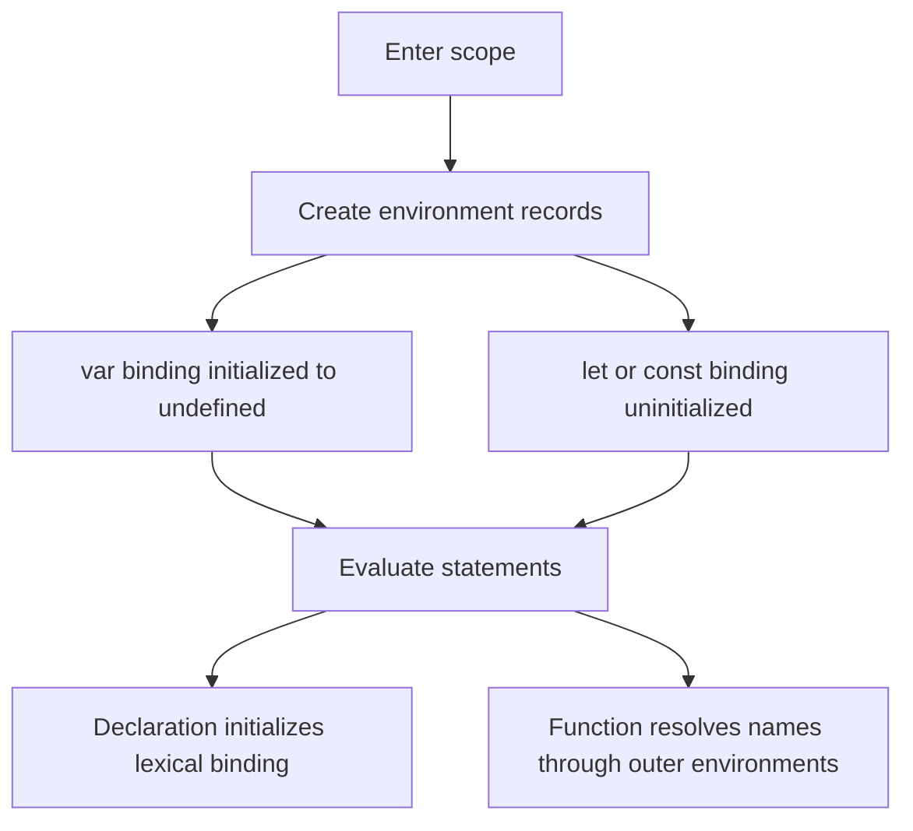

The phrase “JavaScript moves declarations to the top” is only a mnemonic. No source text moves. The specification describes environment creation, binding creation, initialization, and later statement evaluation.

<a id="q1"></a>

## Q1. What is the difference between `var`, `let`, and `const`?

### What the interviewer is asking

Given a declaration, identify its scope, redeclaration rules, initialization timing, and whether the **binding** may be assigned again. Do not confuse a constant binding with an immutable object.

| Declaration | Scope | Before declaration executes | Same-scope redeclaration | Reassignment |
|---|---|---|---|---|
| `var` | nearest function or script/global variable environment | readable as `undefined` | generally allowed for another `var` | allowed |
| `let` | nearest block | binding exists but is uninitialized | syntax error | allowed after initialization |
| `const` | nearest block | binding exists but is uninitialized | syntax error | forbidden after initialization |

### Example 1 — the binding is constant, not the object

```javascript
const profile = { name: "Ada", skills: ["JS"] };
profile.name = "Grace";          // allowed: mutate the object
profile.skills.push("HTML");     // allowed
// profile = {};                 // TypeError: assignment to a constant

console.log(profile);
// { name: "Grace", skills: ["JS", "HTML"] }
```

Trace:

| Step | Binding `profile` | Referenced object |
|---:|---|---|
| declaration | initialized once | `{ name: "Ada", skills: ["JS"] }` |
| property write | unchanged | `name` becomes `"Grace"` |
| `push` | unchanged | array gains `"HTML"` |

Use `Object.freeze()` when shallow runtime mutation prevention is the actual requirement; it solves a different problem from `const`.

<a id="q2"></a>

## Q2. Explain hoisting and the Temporal Dead Zone with output

### Requirement

Predict the output in two phases: first declaration instantiation, then statement evaluation. A lexical binding’s temporal dead zone (TDZ) lasts from entering its scope until its declaration initializes it.

### Example 2 — distinguish created from initialized

```javascript
console.log(total); // undefined
printReady();       // ready

var total = 7;
function printReady() {
  console.log("ready");
}

try {
  console.log(status); // ReferenceError
} catch (error) {
  console.log(error.name);
}
let status = "done";
```

Expected output:

```text
undefined
ready
ReferenceError
```

Dry run:

| Phase | `total` | `printReady` | `status` |
|---|---|---|---|
| declaration instantiation | initialized to `undefined` | initialized to function object | created, uninitialized |
| first log | prints `undefined` | — | — |
| call | — | prints `ready` | — |
| `var` initializer | becomes `7` | — | — |
| attempted lexical read | — | — | throws `ReferenceError` |
| lexical declaration | — | — | initialized to `"done"` |

Interview trap: `typeof missingName` returns `"undefined"`, but `typeof tdzName` can throw when `tdzName` is an uninitialized lexical binding in the current scope.

<a id="q3"></a>

## Q3. What is lexical scope?

### Requirement

Resolve an identifier from the function’s **definition environment**, not from whichever function happens to call it. The environment chain is determined by source nesting.

### Example 3 — call site does not replace the definition environment

```javascript
const label = "global";

function makeReader() {
  const label = "outer";
  return function readLabel() {
    return label;
  };
}

function invokeWithAnotherLabel(fn) {
  const label = "caller";
  return fn();
}

const read = makeReader();
console.log(invokeWithAnotherLabel(read)); // outer
```

Lookup trace for `label` inside `readLabel`:

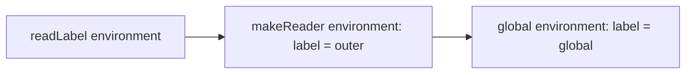

The lookup stops at `makeReader`’s binding. `invokeWithAnotherLabel` is on the call stack, but it is not on `readLabel`’s lexical environment chain.

<a id="q4"></a>

## Q4. Why does a `var` loop print `3,3,3`, while a `let` loop prints `0,1,2`?

### Requirement

Count captured **bindings**, not captured values. A `var` loop reuses one function-scoped binding. A `for` loop with a lexical declaration creates a fresh per-iteration environment.

### Example 4 — callbacks read their bindings after the loop

```javascript
for (var i = 0; i < 3; i += 1) {
  setTimeout(() => console.log(i), 0);
}
// 3, 3, 3

for (let j = 0; j < 3; j += 1) {
  setTimeout(() => console.log(j), 0);
}
// 0, 1, 2
```

Dry run:

| Registration | `var` callback closes over | `let` callback closes over |
|---:|---|---|
| 1 | shared `i` | iteration binding `j = 0` |
| 2 | shared `i` | iteration binding `j = 1` |
| 3 | shared `i` | iteration binding `j = 2` |
| after both loops | shared `i` is `3` | three `j` bindings remain `0`, `1`, `2` |

The zero-millisecond delay does not mean “run now.” Each timer callback is queued for later processing by the host. The runnable [examples module](examples.mjs) checks the outputs without relying on console inspection.

### ES5-era repair and why `let` is clearer

Before per-iteration lexical bindings were available, an immediately invoked function could create a fresh parameter binding:

```javascript
for (var i = 0; i < 3; i += 1) {
  ((captured) => setTimeout(() => console.log(captured), 0))(i);
}
// 0, 1, 2
```

Prefer `let` for this case: it states the lifetime rule directly and removes the extra wrapper function.

<a id="q5"></a>

## Q5. Are objects “passed by reference” in JavaScript?

### Requirement

Say precisely what is copied. Every assignment and argument pass copies a value. A primitive value is the data itself; an object value is a reference to an object. Two copied references can therefore reach the same mutable object, but assigning a new reference to one variable never redirects the other variable.

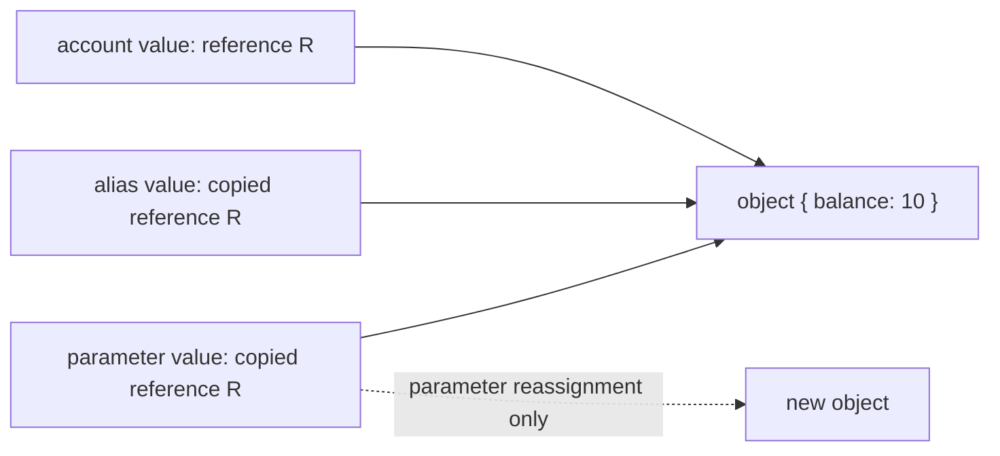

### Example 5 — distinguish mutation from reassignment

```javascript
const account = { balance: 10 };
const alias = account;

function update(local) {
  local.balance += 5;      // mutates the shared object
  local = { balance: 0 };  // reassigns only the local parameter
  return local;
}

const replacement = update(account);
console.log(account.balance);     // 15
console.log(alias.balance);       // 15
console.log(replacement.balance); // 0
console.log(account === alias);   // true
console.log(account === replacement); // false
```

Trace:

| Step | `account` / `alias` | local parameter | Visible result |
|---:|---|---|---|
| call | reference R | copy of R | all three reach the original object |
| property update | R | R | original object becomes `{ balance: 15 }` |
| parameter assignment | R | new reference S | caller bindings still hold R |
| return | R | S | `replacement` receives S |

For primitives, the same copy rule is easier to see because there is no separately mutable object: changing a copied number or string only changes that binding.

<a id="q6"></a>

## Q6. What is the difference between `==` and `===`?

### Requirement

Use strict equality by default and explain the result from the specification rule, not from “truthiness.” `===` returns false for different types and otherwise compares without coercion. `==` follows the abstract equality algorithm: it has an explicit `null`/`undefined` match and may convert booleans, strings, numbers, BigInts, or objects before retrying the comparison.

### Example 6 — classify before evaluating

```javascript
console.log(0 === false);          // false: different types
console.log(0 == false);           // true: false -> 0
console.log("" == 0);             // true: "" -> 0
console.log(null == undefined);    // true: explicit loose-equality rule
console.log(null == 0);            // false: null is not converted to 0 here
console.log([5] == 5);             // true: [5] -> "5" -> 5
console.log(Number.NaN === Number.NaN); // false
```

Decision trace:

| Expression | First decisive rule | Result |
|---|---|---:|
| `0 === false` | strict equality rejects different types | `false` |
| `0 == false` | boolean converts with `ToNumber(false)` | `true` |
| `null == undefined` | dedicated abstract-equality case | `true` |
| `null == 0` | no applicable conversion makes them equal | `false` |
| `[5] == 5` | object converts to primitive, then string to number | `true` |

Loose equality is not the same as comparing `Boolean(left)` and `Boolean(right)`. For example, both `"0"` and `[]` are truthy, but the actual `==` algorithm follows type-directed conversions. In application code, explicit normalization such as `Number(input) === expected` makes the contract reviewable.

<a id="q7"></a>

## Q7. How do `null`, `undefined`, undeclared names, and `NaN` differ?

### Requirement

Separate four states instead of calling all of them “empty”:

| State | Meaning | Safe test |
|---|---|---|
| `undefined` | a value often produced by an uninitialized variable, missing property, or absent return | `value === undefined` |
| `null` | an explicit null value chosen by code or an API | `value === null` |
| undeclared identifier | no resolvable binding exists | `typeof maybeMissing === "undefined"` only when probing is intentional |
| `NaN` | a Number value representing a failed/undefined numeric result | `Number.isNaN(value)` |

### Example 7 — preserve the distinction at an input boundary

```javascript
function classify(value) {
  if (value === null) return "explicit-null";
  if (value === undefined) return "missing";
  if (Number.isNaN(value)) return "invalid-number";
  return "present";
}

const record = { nickname: null };
console.log(classify(record.nickname)); // explicit-null
console.log(classify(record.age));      // missing
console.log(classify(Number("oops"))); // invalid-number
console.log(classify(0));               // present
console.log(typeof neverDeclared);      // undefined
// console.log(neverDeclared);          // ReferenceError
```

Important edges:

- `typeof null` is the historical string `"object"`; it is not a reliable null test.
- `NaN` is the only ECMAScript value that is not strictly equal to itself. `Object.is(NaN, NaN)` and `Number.isNaN(NaN)` are both true.
- Global `isNaN("oops")` coerces first and returns true; `Number.isNaN("oops")` returns false. Prefer the non-coercing method when validating typed data.
- A declared lexical binding in its TDZ is different from an undeclared name: even `typeof` can throw before that binding is initialized.

<a id="q8"></a>

## Q8. What is a shallow copy versus a deep copy?

### Requirement

Define the object-graph boundary. A shallow copy creates a new outer container and copies its property values; nested object values are still references to the original nested objects. A deep copy recursively produces separate supported graph nodes. “Deep” does not mean “copies every possible JavaScript value.”

### Example 8 — choose the copy that matches the update boundary

```javascript
const original = {
  owner: { name: "Ada" },
  tags: ["js"],
  created: new Date("2026-01-02T00:00:00Z")
};

const shallow = { ...original };
shallow.owner.name = "Grace";
console.log(original.owner.name); // Grace: nested owner is shared

const isolated = structuredClone(original);
isolated.owner.name = "Lin";
isolated.tags.push("css");
console.log(original.owner.name); // Grace
console.log(original.tags);       // ["js"]
console.log(isolated.created instanceof Date); // true
```

Graph trace:

| Copy | Outer object | `owner` | `tags` | `Date` |
|---|---|---|---|---|
| spread | new | shared | shared | shared |
| `structuredClone` | new | cloned | cloned | cloned as a `Date` |

`structuredClone()` supports cycles and many built-in data types, and can transfer eligible buffers. It throws `DataCloneError` for non-serializable values such as functions. JSON stringify/parse is a text-serialization round trip, not a general clone: it rejects cycles, loses `undefined` properties, and converts dates to strings. Often the clearest immutable update is to copy only the path being changed rather than clone an entire graph.

<a id="q9"></a>

## Q9. What do `map`, `filter`, and `reduce` communicate?

### Requirement

Choose the operation from the output shape. `map` preserves the number of array slots while transforming values, `filter` keeps a subset, and `reduce` folds visited elements into an accumulator. The callbacks are invoked in ascending index order for assigned elements; these methods do not mutate the source array by themselves, although a callback still can.

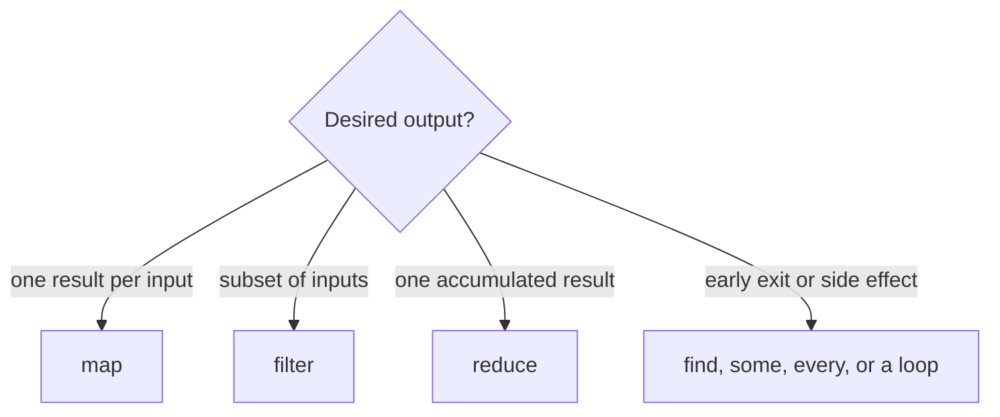

### Example 9 — a readable transformation pipeline

```javascript
const orders = [
  { id: "A", paid: true, cents: 1250 },
  { id: "B", paid: false, cents: 900 },
  { id: "C", paid: true, cents: 750 }
];

const paidIds = orders
  .filter(order => order.paid)
  .map(order => order.id);

const paidCents = orders.reduce(
  (sum, order) => order.paid ? sum + order.cents : sum,
  0
);

console.log(paidIds);   // ["A", "C"]
console.log(paidCents); // 2000
```

Dry run of the reducer:

| Order | Accumulator before | Action | Accumulator after |
|---|---:|---|---:|
| A, paid | 0 | add 1250 | 1250 |
| B, unpaid | 1250 | keep | 1250 |
| C, paid | 1250 | add 750 | 2000 |

Each method is linear in the array length for a full pass. The `filter().map()` pipeline is expressive but allocates an intermediate array and performs two passes. A single loop or reducer may be appropriate on a measured hot path. Always supply an explicit initial accumulator unless the empty-array behavior and first-element semantics are deliberately part of the contract.

<a id="q10"></a>

## Q10. How do optional chaining and nullish coalescing work?

### Requirement

Use `?.` to stop one continuous property, element, or call chain when the value immediately to its left is `null` or `undefined`. Use `??` to default only those two nullish values. Neither operator treats `0`, `false`, or `""` as missing.

### Example 10 — default missing configuration without erasing valid falsy values

```javascript
function readOptions(config) {
  return {
    retries: config?.network?.retries ?? 3,
    label: config?.ui?.label ?? "default",
    onReadyResult: config?.hooks?.onReady?.() ?? "not-run"
  };
}

console.log(readOptions({
  network: { retries: 0 },
  ui: { label: "" },
  hooks: { onReady: () => false }
}));
// { retries: 0, label: "", onReadyResult: false }

console.log(readOptions(null));
// { retries: 3, label: "default", onReadyResult: "not-run" }
```

Trace for `config?.network?.retries ?? 3`:

| Value reached | Optional chain result | `?? 3` result |
|---|---|---:|
| `config` is `null` | `undefined` | `3` |
| `network` is missing | `undefined` | `3` |
| `retries` is `0` | `0` | `0` |
| `retries` is `false` | `false` | `false` |

Grouping can end a chain: `(config?.network).retries` may still throw because `.retries` is outside the optional chain. Optional chaining also cannot be used as an assignment target. When mixing `??` with `&&` or `||`, add parentheses; the grammar intentionally rejects an unparenthesized mixture.

<a id="q11"></a>

## Q11. What is a closure, and why is it useful?

### Requirement

A closure is a function together with access to the lexical environment where that function was created. The important fact is not that one function is textually inside another; it is that a reachable function retains the bindings it needs even after the outer call has returned.

### Example 11 — independent factories retain independent bindings

```javascript
function makeCounter(start = 0) {
  let count = start;
  return {
    next() { count += 1; return count; },
    value() { return count; }
  };
}

const first = makeCounter(0);
const second = makeCounter(10);

console.log(first.next());  // 1
console.log(first.next());  // 2
console.log(second.next()); // 11
console.log(first.value()); // 2
```

Trace:

| Event | `first` environment | `second` environment |
|---|---:|---:|
| factory calls return | `count = 0` | `count = 10` |
| `first.next()` twice | `count = 2` | `count = 10` |
| `second.next()` | `count = 2` | `count = 11` |

This pattern enables factories, callbacks, module-private state, currying, and memoization. It also creates a lifetime obligation: if a long-lived closure captures a large object or DOM subtree, that object stays reachable. Capture the smallest state needed, and unsubscribe or discard callbacks when their owner is finished.

<a id="q12"></a>

## Q12. How is `this` determined in JavaScript?

### Requirement

For a normal function, inspect the call expression. For an arrow function, inspect where it was created because arrows use lexical `this`. A practical precedence model is:

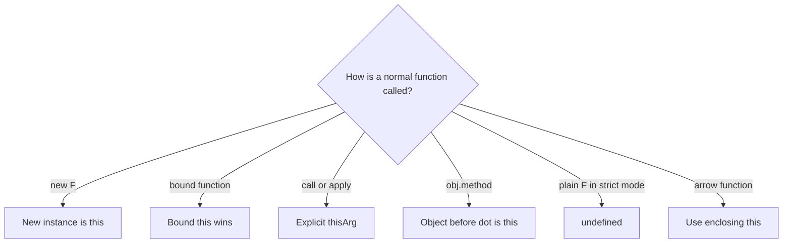

`new` has higher precedence than a bound `this`: when a constructable bound function is invoked with `new`, the newly created instance becomes `this`; the bound arguments still participate.

### Example 12 — call shape, not storage location, chooses the receiver

```javascript
"use strict";

const account = {
  owner: "Ada",
  readOwner() { return this?.owner; },
  makeArrow() { return () => this.owner; }
};

const detached = account.readOwner;
const arrow = account.makeArrow();

console.log(account.readOwner());          // Ada: method call
console.log(detached());                   // undefined: plain strict call
console.log(detached.call({ owner: "Lin" })); // Lin: explicit receiver
console.log(arrow.call({ owner: "Ignored" })); // Ada: lexical this
```

| Expression | Rule | Effective `this` |
|---|---|---|
| `account.readOwner()` | implicit receiver | `account` |
| `detached()` | strict plain call | `undefined` |
| `detached.call(other)` | explicit binding | `other` |
| `arrow.call(other)` | arrow ignores rebinding | `account` captured by `makeArrow()` |

Avoid arrow properties for methods that need a dynamic receiver. Conversely, an arrow created inside a method is useful for a callback that must keep the method's receiver.

<a id="q13"></a>

## Q13. How do `call`, `apply`, and `bind` differ?

### Requirement

- `fn.call(thisArg, a, b)` invokes immediately with positional arguments.
- `fn.apply(thisArg, [a, b])` invokes immediately with an array-like argument list.
- `fn.bind(thisArg, a)` returns a new function for later calls and may pre-fill leading arguments.

```javascript
function format(prefix, suffix) {
  return `${prefix}${this.name}${suffix}`;
}

const user = { name: "Sam" };
console.log(format.call(user, "[", "]"));      // [Sam]
console.log(format.apply(user, ["<", ">"])); // <Sam>

const greetSam = format.bind(user, "Hello ");
console.log(greetSam("!"));                    // Hello Sam!
```

Spread syntax often replaces `apply` for ordinary argument forwarding: `fn(...args)`. Binding an arrow cannot replace its lexical `this`, and rebinding an already-bound function does not replace its original bound receiver.

<a id="q14"></a>

## Q14. How does the prototype chain resolve a property?

### Requirement

Property lookup starts with the object itself. If the property is absent, lookup follows the object's internal `[[Prototype]]` link until it finds the first matching property or reaches `null`. An own property can shadow an inherited property without changing the prototype.

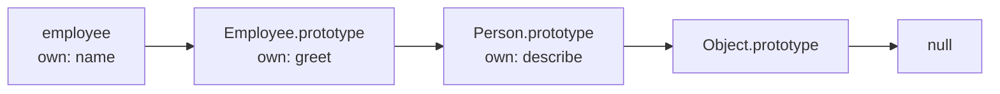

### Example 13 — lookup, shadowing, and deletion

```javascript
const personMethods = {
  describe() { return `person:${this.name}`; }
};

const employeeMethods = Object.create(personMethods);
employeeMethods.describe = function () {
  return `employee:${this.name}`;
};

const employee = Object.create(employeeMethods);
employee.name = "Mia";

console.log(employee.describe()); // employee:Mia
delete employeeMethods.describe;
console.log(employee.describe()); // person:Mia
console.log(Object.hasOwn(employee, "describe")); // false
```

Lookup trace:

| State | Instance | `employeeMethods` | `personMethods` | Result |
|---|---|---|---|---|
| before delete | absent | own `describe` | own `describe` | first inherited method wins |
| after delete | absent | absent | own `describe` | lookup continues to base |

`Constructor.prototype` is the object assigned as the prototype of instances created by `new Constructor()`. It is not the internal prototype of the constructor function itself.

<a id="q15"></a>

## Q15. Are classes fundamentally different from prototypes?

### Requirement

Class syntax adds declarative constructors, `extends`, `super`, private elements, strict semantics, and a prohibition on calling a class without `new`. Instance method lookup still uses prototype links; methods declared in the class body live on the class's `.prototype`, not as a separate function copy on every instance.

```javascript
class Person {
  constructor(name) { this.name = name; }
  describe() { return `person:${this.name}`; }
}

class Employee extends Person {
  describe() { return `employee:${this.name}`; }
}

const employee = new Employee("Mia");
console.log(employee.describe()); // employee:Mia
console.log(Object.getPrototypeOf(employee) === Employee.prototype); // true
console.log(Object.getPrototypeOf(Employee.prototype) === Person.prototype); // true
console.log(Object.hasOwn(employee, "describe")); // false
```

Do not reduce classes to “only syntactic sugar” in an interview. Their method delegation is prototype-based, but class declarations also impose observable semantics such as strict mode, non-enumerable prototype methods, TDZ behavior, and `new`-only construction.

<a id="q16"></a>

## Q16. When should you choose a declaration, expression, or arrow function?

### Requirement

Choose by semantics:

| Form | Availability before definition | Own `this` / `arguments` | Constructable with `new` | Typical use |
|---|---|---|---|---|
| function declaration | initialized during declaration instantiation | yes | normally yes | named reusable operation |
| function expression assigned to `const` | follows the lexical binding's TDZ | yes | normally yes | value selected/created conditionally |
| arrow function | follows its variable's declaration rule | no; resolves lexically | no | callback that inherits surrounding context |

```javascript
console.log(declared(2)); // 4
function declared(x) { return x * 2; }

const expressed = function square(x) { return x * x; };
const doubled = [1, 2, 3].map(x => x * 2);

console.log(expressed(3)); // 9
console.log(doubled);      // [2, 4, 6]
// new (() => {});        // TypeError: arrow is not a constructor
```

A named function expression improves stack traces and permits internal recursion without leaking that name to the outer scope.

<a id="q17"></a>

## Q17. How does currying differ from partial application?

### Requirement

Currying changes a function of multiple parameters into a chain that accepts one parameter at each step. Partial application fixes any subset—commonly a leading prefix—of a function's arguments and returns a function that accepts the remainder. Both use closures, but they are different transformations.

### Example 14 — compare the resulting call shapes

```javascript
const curryPrice = taxRate => discount => amount =>
  amount * (1 - discount) * (1 + taxRate);

function price(taxRate, discount, amount) {
  return amount * (1 - discount) * (1 + taxRate);
}

const georgiaPrice = curryPrice(0.08);     // curried: still one arg at a time
const salePrice = price.bind(null, 0.08, 0.10); // partial: two args fixed

console.log(georgiaPrice(0.10)(100)); // 97.2
console.log(salePrice(100));          // 97.2
```

Currying helps composition and reusable staged configuration. Partial application is often the more direct choice when an existing multi-parameter API should be specialized.

<a id="q18"></a>

## Q18. What makes memoization correct—and dangerous?

### Requirement

Memoization reuses a previous result for an equivalent input. Correctness requires a stable equivalence/key strategy and a result that does not silently depend on changing external state. Production design additionally needs a memory/freshness policy: size bounds, TTL, explicit invalidation, weak keys, or an owner lifetime.

```javascript
function memoizeUnary(fn, { maxEntries = 2 } = {}) {
  const cache = new Map();
  return function memoized(input) {
    if (cache.has(input)) {
      const value = cache.get(input);
      cache.delete(input);
      cache.set(input, value); // refresh recency
      return value;
    }
    const value = fn(input);
    cache.set(input, value);
    if (cache.size > maxEntries) {
      cache.delete(cache.keys().next().value);
    }
    return value;
  };
}

let computations = 0;
const square = memoizeUnary(x => { computations += 1; return x * x; });
console.log(square(4), square(4), computations); // 16 16 1
```

The `has` check is essential because cached results may legitimately be `0`, `false`, or `undefined`. A `Map` uses object identity for object keys; structurally equal object literals are different keys. JSON stringification is not a universal structural key because order, unsupported values, cycles, and serialization cost matter. Memoizing time-, user-, locale-, permission-, or database-dependent work without including those dependencies and an invalidation policy returns stale or unsafe results.

## Asynchronous JavaScript: separate scheduling from execution

JavaScript promises do not create a second JavaScript thread. The host runs tasks such as timer callbacks; ECMAScript promise reactions run as jobs, which browsers integrate with the microtask queue. A useful browser model is:

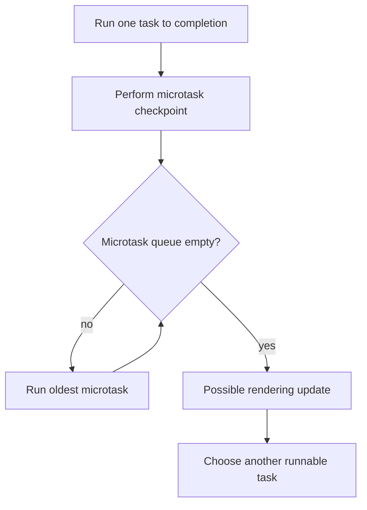

This is a scheduling model, not a promise that every task source is globally FIFO. A zero-millisecond timer means “eligible after the minimum delay,” not “execute immediately.” Microtasks queued by other microtasks are drained in the same checkpoint; an unbounded microtask chain can therefore delay rendering and later tasks.

<a id="q19"></a>

## Q19. How do you predict event-loop output?

### Requirement

First run the current script to completion. Record promise reactions and `queueMicrotask` callbacks in registration order. At the checkpoint, keep draining microtasks—including newly queued ones—before a later timer task can run.

### Example 15 — a nested microtask joins the same checkpoint

```javascript
const output = [];

output.push("A");
setTimeout(() => output.push("timer"), 0);
Promise.resolve().then(() => {
  output.push("promise-1");
  queueMicrotask(() => output.push("nested"));
});
queueMicrotask(() => output.push("microtask-1"));
output.push("B");

// after the timer: A, B, promise-1, microtask-1, nested, timer
```

Trace:

| Step | Running work | Microtask queue after step | Output |
|---:|---|---|---|
| 1 | current script | — | `A` |
| 2 | register timer task | — | `A` |
| 3 | register promise reaction | `promise-1` | `A` |
| 4 | `queueMicrotask` | `promise-1`, `microtask-1` | `A` |
| 5 | finish script | unchanged | `A, B` |
| 6 | run promise reaction | `microtask-1`, `nested` | `A, B, promise-1` |
| 7 | drain remaining microtasks | empty | `…, microtask-1, nested` |
| 8 | timer task becomes selected | empty | `…, timer` |

Do not say “promises always beat timers” without scope. A promise reaction registered inside a later timer obviously cannot run before the code that registers it. Analyze one task and its following checkpoint at a time.

<a id="q20"></a>

## Q20. What do `async` and `await` actually do?

### Requirement

Calling an `async` function returns a promise. `await expression` obtains a promise from the expression, suspends only that async function, and schedules its continuation after settlement. The JavaScript thread is free to run other work. Even an already-fulfilled promise does not make the continuation run inline with the current stack.

### Example 16 — start independent work before awaiting it

```javascript
async function loadDashboard(loadUser, loadOrders) {
  const userPromise = loadUser();     // starts now
  const ordersPromise = loadOrders(); // starts now
  const [user, orders] = await Promise.all([userPromise, ordersPromise]);
  return { user, orders };
}
```

Compare the timelines:

| Shape | Timeline | Approximate wall time for 80 ms + 120 ms jobs |
|---|---|---:|
| serial | start user → await → start orders → await | 200 ms |
| concurrent | start both → await both | 120 ms |

Concurrency is correct only when the operations are independent and the resource budget permits it. If the second operation needs the first result, serial `await` expresses the real dependency. For a large input collection, use a concurrency limit rather than launching every operation at once.

<a id="q21"></a>

## Q21. When should you use `Promise.all`, `allSettled`, `race`, or `any`?

### Requirement

Choose the success condition before choosing the API. Each method accepts an iterable and returns a new promise; none of them cancels losing or rejected input operations.

| Combinator | Returned promise fulfills when | Rejects when | Output ordering / reason |
|---|---|---|---|
| `Promise.all` | every input fulfills | first observed rejection | values stay in input order |
| `Promise.allSettled` | every input settles | not because an input rejects | result records stay in input order |
| `Promise.race` | first input settles successfully | first input settles by rejection | first settlement wins |
| `Promise.any` | first input fulfills | every input rejects | rejects with `AggregateError` |

### Example 17 — select semantics, then handle the non-winners

```javascript
const audit = await Promise.allSettled([
  Promise.resolve({ region: "east", latency: 42 }),
  Promise.reject(new Error("west unavailable"))
]);
// [{ status: "fulfilled", value: ... }, { status: "rejected", reason: ... }]

const firstHealthy = await Promise.any([
  Promise.reject(new Error("east unavailable")),
  Promise.resolve({ region: "west", latency: 55 })
]);
// { region: "west", latency: 55 }
```

Important edge cases:

- `Promise.all([])` and `Promise.allSettled([])` fulfill with `[]`.
- `Promise.any([])` rejects with an `AggregateError` because no input can fulfill.
- `Promise.race([])` remains pending because no input can settle it.
- “Fail fast” does not mean “stop the other jobs.” Connect explicit cancellation when wasted work or stale effects matter.

<a id="q22"></a>

## Q22. Where should asynchronous errors be handled?

### Requirement

Await or return every promise so its failure remains in the caller's chain. Catch an error only where the code can add useful context, recover, translate it into a domain result, or perform cleanup. Otherwise let it propagate to the operation's owner.

```javascript
async function loadUser(fetchImpl, id) {
  try {
    const response = await fetchImpl(`/api/users/${encodeURIComponent(id)}`);
    if (!response.ok) {
      throw new Error(`HTTP ${response.status}`);
    }
    return await response.json();
  } catch (error) {
    throw new Error(`Could not load user ${id}`, { cause: error });
  }
}
```

`fetch()` rejects for failures such as a network error or abort, but an HTTP 404 or 500 normally arrives as a `Response`; checking `response.ok` creates the application-level failure. Preserve the original error as `cause` rather than replacing all diagnostic information.

One subtle boundary:

```javascript
async function notCaught() {
  try {
    return failingOperation(); // rejection occurs after this try block returns
  } catch {
    return "fallback";
  }
}

async function caughtHere() {
  try {
    return await failingOperation(); // rejection is thrown at this await
  } catch {
    return "fallback";
  }
}
```

Both functions return promises; the difference is where the rejection is observed. Use `finally` for cleanup that must run for either outcome, but do not return from `finally` because that can replace the original result or error.

<a id="q23"></a>

## Q23. How do you implement debounce without losing the latest call?

### Requirement

Debounce is the “after silence” policy: every call replaces the pending timer, and one trailing invocation uses the latest arguments and receiver. This is appropriate when intermediate events are disposable, such as autocomplete text or resize recomputation.

```javascript
function debounce(fn, wait) {
  let timerId;
  return function debounced(...args) {
    const receiver = this;
    clearTimeout(timerId);
    timerId = setTimeout(() => {
      timerId = undefined;
      fn.apply(receiver, args);
    }, wait);
  };
}
```

Dry run for calls at 0, 40, and 90 ms with `wait = 100`:

| Time | Event | Pending deadline | Invocation |
|---:|---|---:|---|
| 0 | call `"a"` | 100 | — |
| 40 | call `"ab"`; cancel prior timer | 140 | — |
| 90 | call `"abc"`; cancel prior timer | 190 | — |
| 190 | quiet period completes | none | `fn("abc")` |

Production wrappers may also expose `cancel()` and `flush()`. Define leading/trailing behavior explicitly instead of combining options until calls can fire twice at one boundary.

<a id="q24"></a>

## Q24. How does throttle differ from debounce?

### Requirement

Throttle is the “at most once per interval” policy. It suits continuous signals such as scroll sampling when periodic progress matters. A leading-plus-trailing version invokes immediately, then remembers the latest suppressed call for the end of the window.

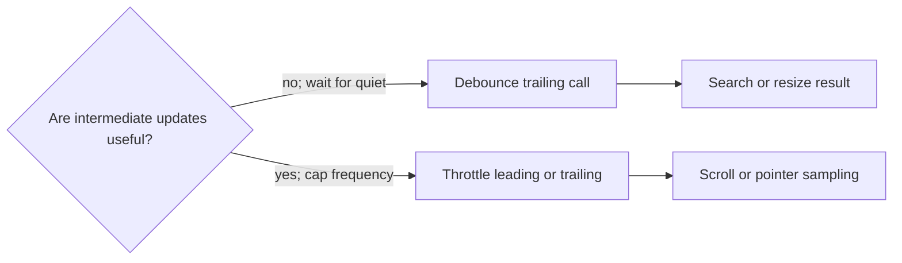

```javascript
function throttle(fn, wait) {
  let lastInvoke = -Infinity;
  let timerId;
  let pending;

  return function throttled(...args) {
    const now = Date.now();
    pending = { receiver: this, args };
    const remaining = wait - (now - lastInvoke);

    const invoke = () => {
      lastInvoke = Date.now();
      timerId = undefined;
      const call = pending;
      pending = undefined;
      fn.apply(call.receiver, call.args);
    };

    if (remaining <= 0) {
      if (timerId !== undefined) clearTimeout(timerId);
      invoke();
    } else if (timerId === undefined) {
      timerId = setTimeout(invoke, remaining);
    }
  };
}
```

| Policy | Burst at 0, 40, 90 ms; wait 100 ms | Best fit |
|---|---|---|
| trailing debounce | only latest call at 190 ms | final value matters |
| leading + trailing throttle | first call at 0 ms, latest suppressed call near 100 ms | periodic progress matters |

Timers are host scheduling requests, not hard real-time deadlines. Long tasks can delay either wrapper. For visual updates, `requestAnimationFrame` may be a better pacing mechanism because it aligns work with rendering rather than an arbitrary millisecond interval.

<a id="q25"></a>

## Q25. How do you cancel a `fetch()` request, and what problem does cancellation solve?

### Requirement

Create an `AbortController`, pass its `signal` to `fetch()`, and call `abort()` from the operation that owns the request. Cancellation saves work and gives an unmounted view, superseded search, timeout, or explicit user action a defined cleanup path. It does **not** by itself prove that an older server operation was rolled back, so idempotency and stale-result guards may still matter.

### Example 18 — latest search owns the active request

```javascript
function createLatestSearch(fetchImpl) {
  let active;
  let generation = 0;

  return async function search(query) {
    active?.abort();
    const controller = new AbortController();
    const mine = ++generation;
    active = controller;

    try {
      const response = await fetchImpl(
        `/api/search?q=${encodeURIComponent(query)}`,
        { signal: controller.signal }
      );
      if (!response.ok) throw new Error(`HTTP ${response.status}`);
      const data = await response.json();
      return mine === generation ? data : undefined;
    } catch (error) {
      if (error.name === "AbortError") return undefined;
      throw error;
    } finally {
      if (mine === generation) active = undefined;
    }
  };
}
```

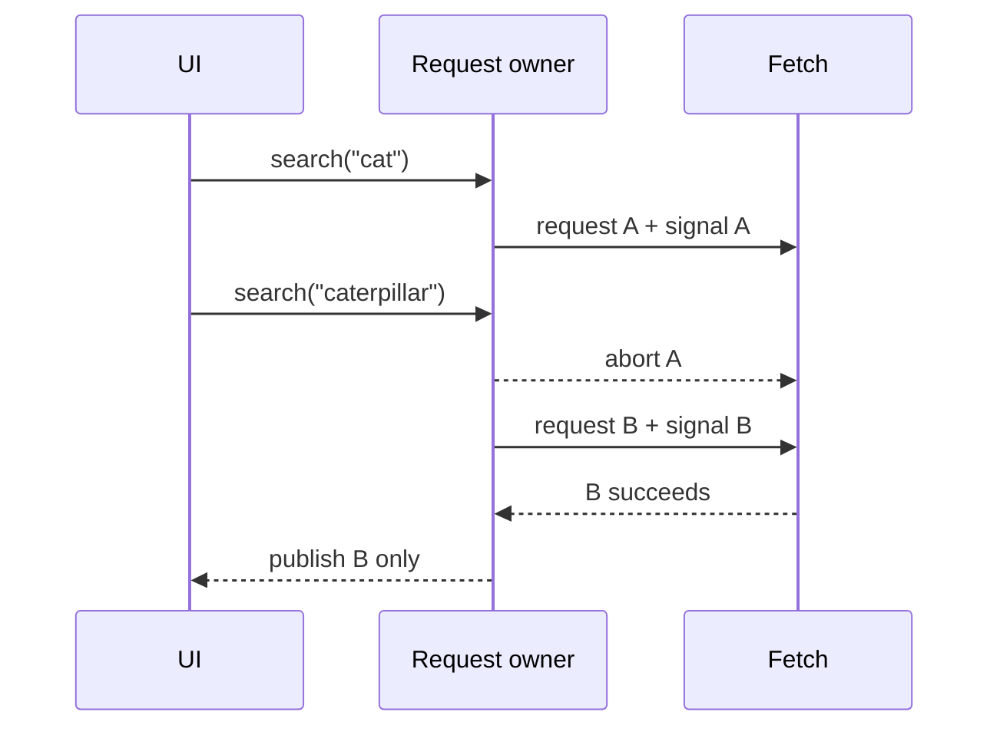

Trace:

| Step | Generation | Active signal | Observable result |
|---:|---:|---|---|
| search `"cat"` | 1 | A | A pending |
| search `"caterpillar"` | 2 | B | A rejects with `AbortError` |
| B completes | 2 | none after cleanup | B may update the UI |

An abort is an expected control-flow outcome, not a generic network failure. Do not show an alarming error toast for every `AbortError`. Conversely, do not swallow real HTTP, parsing, or network failures. In current runtimes, `AbortSignal.timeout()` and `AbortSignal.any()` can express timeouts and combined ownership, but explicit controllers remain the portable mental model.

<a id="q26"></a>

## Q26. Explain event capturing, bubbling, and delegation

### Requirement

An event path is computed from the target through its ancestors. Capture listeners run toward the target, target listeners run at the target, and bubbling listeners run back toward the root when the event bubbles. `event.target` is where dispatch began; `event.currentTarget` is the node whose listener is currently running.

Delegation attaches one listener to a stable ancestor and derives the intended descendant action from the event. It reduces listener churn and also handles children added later.

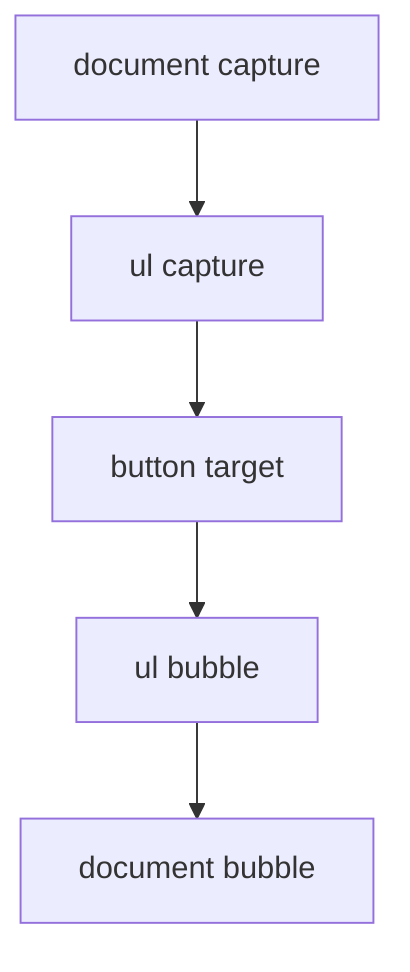

### Example 19 — delegate at a boundary, not merely at a selector

```javascript
list.addEventListener("click", event => {
  const button = event.target.closest("[data-delete]");
  if (!button || !list.contains(button)) return;

  const item = button.closest("[data-item-id]");
  if (!item || !list.contains(item)) return;
  removeItem(item.dataset.itemId);
});
```

The containment checks prevent a selector match outside the component boundary from being accepted. `closest()` also handles clicks on an icon nested inside the button. For Shadow DOM, retargeting can change `target`; `event.composedPath()` is the explicit path tool when an event is composed across a shadow boundary.

| API/property | Meaning | Does not mean |
|---|---|---|
| `target` | original/retargeted dispatch target visible here | node whose listener is running |
| `currentTarget` | node for the listener currently executing | deepest clicked node |
| `stopPropagation()` | stop later traversal to other nodes | cancel link/form default behavior |
| `preventDefault()` | cancel a cancelable default action | stop propagation |

<a id="q27"></a>

## Q27. What are layout/reflow and repaint, and how do you avoid layout thrashing?

### Requirement

Style calculation determines computed styles; layout determines geometry; paint records visual drawing; compositing assembles layers. A change need not trigger every stage: changing geometry can require layout and paint, while a compositor-friendly transform may avoid layout and paint for that frame. Treat those as browser-dependent optimization opportunities, not guarantees.

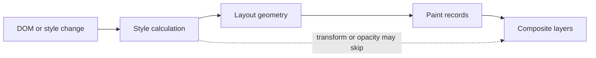

### Example 20 — batch reads, then writes

```javascript
// Bad: each write can invalidate geometry before the next read.
for (const row of rows) {
  row.style.width = `${container.offsetWidth / 2}px`;
}

// Better: read once, then perform the writes together.
const width = container.offsetWidth / 2;
requestAnimationFrame(() => {
  for (const row of rows) row.style.width = `${width}px`;
});
```

The problematic pattern is an alternating sequence of layout-invalidating **write → geometry read → write → geometry read**. A geometry API such as `offsetWidth` or `getBoundingClientRect()` may force the browser to make pending layout information current. Read the necessary measurements together, compute in ordinary JavaScript, then write together. `requestAnimationFrame()` aligns a write batch with a rendering opportunity; it does not make expensive work free, and a callback can still miss the frame budget.

Dry run for four rows:

| Plan | Geometry reads | DOM writes | Potential forced layout boundaries |
|---|---:|---:|---:|
| interleaved loop | 4 | 4 | up to 4 |
| batched read then writes | 1 | 4 | 1 measurement boundary |

Measure actual behavior with browser performance tooling because engines can coalesce work and layer promotion consumes memory.

<a id="q28"></a>

## Q28. Compare `localStorage`, `sessionStorage`, cookies, and IndexedDB

### Requirement

Choose storage by data shape, lifetime, access pattern, and security—not by memorized capacity numbers. Browser quotas and eviction policies vary, and none of these APIs is a safe vault for secrets exposed to script.

| Mechanism | API/model | Lifetime/scope | Network behavior | Good fit / principal warning |
|---|---|---|---|---|
| `localStorage` | synchronous string key/value | origin; persists until cleared/evicted | not sent automatically | tiny preferences; blocks the main thread and needs serialization |
| `sessionStorage` | synchronous string key/value | origin plus top-level browsing context; tab session | not sent automatically | per-tab workflow state; not cross-tab persistence |
| cookie | small string name/value plus attributes | domain/path and expiry rules | matching cookies are attached to requests | server sessions and request state; use `Secure`, `HttpOnly`, and deliberate `SameSite` |
| IndexedDB | asynchronous object stores, indexes, transactions | origin; persists subject to policy | not sent automatically | larger structured/offline data; schema/version and transaction discipline required |

### Example 21 — make the policy explicit

```javascript
const storagePolicy = {
  theme: "localStorage",
  checkoutDraftForThisTab: "sessionStorage",
  serverSessionIdentifier: "Secure HttpOnly SameSite cookie",
  offlineCatalog: "IndexedDB"
};
```

Store the minimum data needed. XSS can read script-accessible Web Storage and IndexedDB. An `HttpOnly` cookie blocks direct JavaScript reads, but the browser may still attach it to requests, so CSRF defenses and server-side authorization remain necessary. Client storage is a cache or persistence mechanism, not the source of truth for permissions.

<a id="q29"></a>

## Q29. What are the Same-Origin Policy and CORS?

### Requirement

An origin is the tuple **scheme + host + port**. The Same-Origin Policy restricts how a document or script from one origin can read/interact with resources from another. Cross-origin requests can still be sent in several cases; the important default restriction is often whether script may read the response.

CORS is the Fetch protocol by which a server opts selected origins into cross-origin response sharing. A non-simple request can trigger a preflight `OPTIONS` request before the actual request. CORS is not authentication, authorization, or a general CSRF defense.

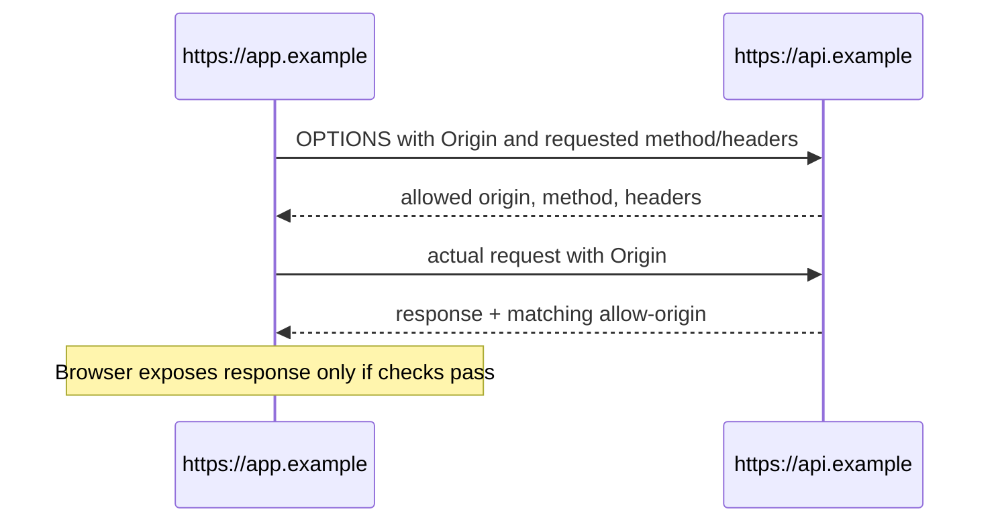

For a credentialed browser request, the client must opt in (for example, `credentials: "include"`), the server must return a specific allowed origin rather than `*`, and it must allow credentials. `mode: "no-cors"` is not a bypass: it deliberately produces an opaque response that JavaScript cannot inspect.

| Situation | Request may reach server? | JavaScript can read response? |
|---|---|---|
| same origin | normally yes | normally yes |
| allowed CORS response | yes | yes, within exposed-header rules |
| disallowed cross-origin response | may do so | no |
| failed preflight | actual request is not sent | no |
| `no-cors` request | limited request may be sent | opaque response; no body/status access |

Validate authorization on the server for every request. A successful CORS check only says the browser may share the response with that origin.

<a id="q30"></a>

## Q30. How do XSS and CSRF differ, and how are they prevented?

### Requirement

**Cross-site scripting (XSS)** gets attacker-controlled content interpreted in a trusted page's execution context. **Cross-site request forgery (CSRF)** causes a victim's browser to send an unwanted state-changing request using ambient authority such as cookies. They have different primary controls, and an XSS flaw can often defeat in-page CSRF defenses.

| Threat | Broken boundary | Primary controls | Common mistake |
|---|---|---|---|
| XSS | untrusted data becomes executable markup, script, URL, CSS, or DOM | context-appropriate output encoding; safe DOM sinks; sanitization for intentionally allowed HTML; CSP as defense-in-depth | one generic escaping function for every context |
| CSRF | server accepts a cross-site state change backed by ambient credentials | anti-CSRF token; `SameSite` cookies; Origin/Referer or Fetch Metadata validation; no state changes through safe methods | assuming CORS alone blocks forged requests |

Safer DOM construction keeps data as text:

```javascript
const message = document.createElement("p");
message.textContent = untrustedMessage; // data, not HTML source
container.replaceChildren(message);
```

If product requirements intentionally accept HTML, use a maintained sanitizer configured for that exact context; do not repair it with regular expressions. On the server, protect state-changing routes with a framework-supported token pattern, intentional cookie attributes, origin signals, and authorization. `SameSite` is valuable defense-in-depth but compatibility, sibling domains, and application flows still require a complete policy.

Security trace:

1. The browser attaches a session cookie to an eligible request.
2. The server authenticates the session **and** verifies authorization.
3. For a state change, the server also verifies the anti-CSRF/origin policy.
4. Returned untrusted data is encoded for its output context; it is never concatenated into an executable sink.
5. CSP limits impact if a markup injection bug remains, but does not replace correct data handling.

<a id="q31"></a>

## Q31. What is the difference between `preventDefault()` and `stopPropagation()`?

### Requirement

They control independent parts of event dispatch:

- `event.preventDefault()` requests cancellation of the event's **default action**, such as following a link or submitting a form. It does not stop listeners on ancestors.
- `event.stopPropagation()` stops further capture/bubble traversal, but does not cancel the default action and does not stop other listeners already registered on the current target.
- `event.stopImmediatePropagation()` also prevents later listeners on the current target from running.

Cancellation works only when `event.cancelable` is true. A listener registered with `{ passive: true }` promises not to cancel, so its `preventDefault()` call has no effect. When later code needs to know whether cancellation won, inspect `event.defaultPrevented`. Returning `false` is not a generic substitute in `addEventListener()`.

### Example 22 — intercept only an ordinary same-origin navigation

```javascript
document.addEventListener("click", event => {
  const link = event.target.closest("a[href]");
  if (!link || !document.contains(link)) return;

  const destination = new URL(link.href, location.href);
  const modified = event.button !== 0 || event.metaKey || event.ctrlKey ||
    event.shiftKey || event.altKey;

  if (modified || link.target || link.hasAttribute("download") ||
      destination.origin !== location.origin) return;

  event.preventDefault();
  router.navigate(destination.pathname + destination.search + destination.hash);
  // Deliberately allow bubbling: an ancestor may record the navigation intent.
});
```

Decision trace:

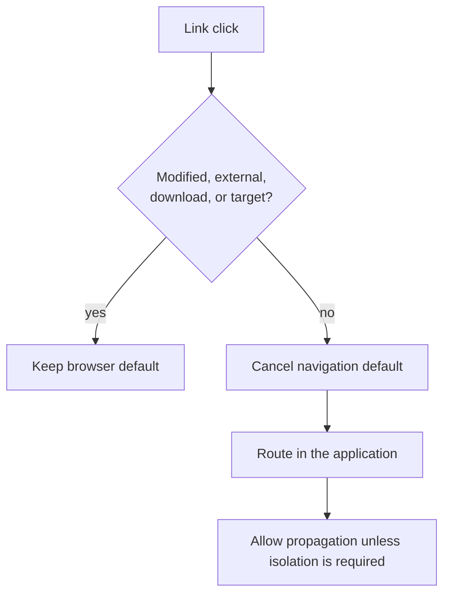

Do not stop propagation merely to avoid duplicate handling; a narrow selector, component-boundary check, or `defaultPrevented` convention is usually easier to compose.

<a id="q32"></a>

## Q32. What is semantic HTML, and why does it matter?

### Requirement

Semantic HTML chooses elements for their meaning and behavior, not their default appearance. Native landmarks, headings, lists, links, buttons, tables, and form controls expose useful structure to browsers and assistive technology while providing tested keyboard/focus behavior. CSS can change presentation without changing that contract.

Use a link for navigation and a button for an action. Prefer a real `<button>` over a clickable `<div role="button">`: the latter still needs keyboard activation, focus behavior, disabled-state handling, and other semantics implemented correctly. Semantics can also help search and maintenance, but they are not an automatic ranking trick.

### Example 23 — a small page with native contracts

```html
<header>
  <a href="/" aria-label="Acme home">Acme</a>
  <nav aria-label="Primary">
    <a href="/docs">Documentation</a>
  </nav>
</header>
<main>
  <article>
    <h1>Deployment checklist</h1>
    <p>Verify the release before promotion.</p>
    <button type="button" id="run-checks">Run checks</button>
  </article>
</main>
<footer><small>Last reviewed 2026-10-15</small></footer>
```

The document has one main content region, a named navigation region, a meaningful heading, a navigation link, and an action button. Do not add redundant ARIA roles to elements that already have the needed native semantics; add names only where the visible context is insufficient.

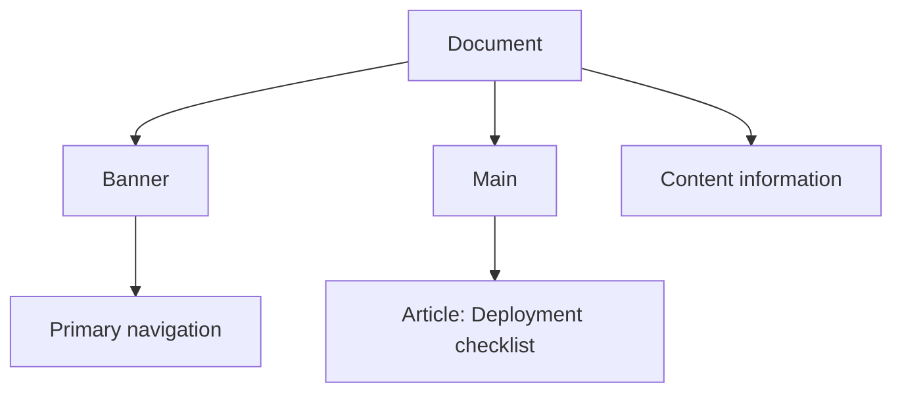

<a id="q33"></a>

## Q33. What is the difference between `async` and `defer` on scripts?

### Requirement

For parser-inserted classic external scripts, both attributes let fetching proceed while HTML parsing continues, but execution differs.

| Script | Fetch | Execution | Relative order | `DOMContentLoaded` |
|---|---|---|---|---|
| classic, no attribute | blocks parsing while fetched and run | immediately at the parser position | document order | parsing continues afterward |
| classic `async` | parallel with parsing | as soon as the script is ready | not guaranteed | does not wait for it unless it happens to run first |
| classic `defer` | parallel with parsing | after parsing, before the event | document order | waits for deferred scripts |
| module | module graph fetched in parallel | deferred by default after parsing | dependency graph controls readiness | waits for default-deferred modules |

An inline classic script does not gain deferred behavior from `defer`. Adding `async` to a module opts that module graph into async-style execution when ready. Dynamically inserted scripts have separate rules, so do not infer their ordering from this table.

### Example 24 — choose ordering from dependencies

```html
<script async src="/analytics.js"></script>
<script defer src="/config.js"></script>
<script defer src="/application.js"></script>
<script type="module" src="/enhance.js"></script>
```

Use `async` for independent code whose timing relative to the page is unimportant. Use `defer` when classic scripts depend on document order or a parsed DOM. Modules should express JavaScript dependencies with `import`, not parallel `<script>` tags whose network completion order is accidental.

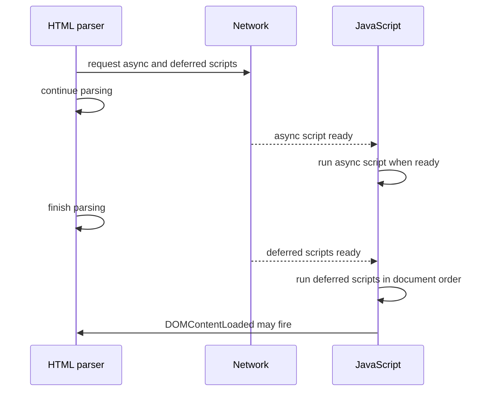

The diagram expresses ordering constraints, not guaranteed download durations.

<a id="q34"></a>

## Q34. How do you build an accessible form?

### Requirement

Start with native controls and visible labels. Associate each label with its control, group related choices with `<fieldset>` and `<legend>`, choose the correct input type and autocomplete token, and explain formats or requirements before submission. Do not use a placeholder as the only label.

On failure, identify the field in text, set `aria-invalid="true"`, associate its message with `aria-describedby`, and move focus to an error summary or the first invalid control according to a documented policy. Do not rely on color alone. Server validation remains authoritative even when client validation improves feedback.

### Example 25 — a form and profile image that keep their contracts

```html
<form id="signup" novalidate>
  <h2>Create your profile</h2>
  <p id="required-note">Fields marked “required” must be completed.</p>

  <div>
    <label for="email">Work email (required)</label>
    <input id="email" name="email" type="email" autocomplete="email"
           required aria-describedby="email-hint email-error">
    <p id="email-hint">Use the address where release alerts should arrive.</p>
    <p id="email-error" role="alert" hidden>Enter a valid email address.</p>
  </div>

  <fieldset>
    <legend>Alert frequency</legend>
    <label><input type="radio" name="frequency" value="daily" required> Daily</label>
    <label><input type="radio" name="frequency" value="weekly"> Weekly</label>
  </fieldset>
  <button type="submit">Create profile</button>
</form>
```

If validation fails, reveal the error, set `email.setAttribute("aria-invalid", "true")`, and focus the chosen error destination. When the value becomes valid, remove the invalid state and stale message. Test the completed flow with a keyboard, browser accessibility inspection, and representative assistive technology rather than treating markup review as sufficient.

<a id="q35"></a>

## Q35. What does the viewport meta element do?

### Requirement

Mobile browsers may otherwise use a wider default layout viewport and scale the page down. This element asks for a layout viewport that follows the device width and establishes a 1:1 initial CSS-pixel scale:

```html
<meta name="viewport" content="width=device-width, initial-scale=1">
```

It enables responsive CSS to operate against the intended viewport; it does not make a fixed-width layout responsive by itself. The **layout viewport** is the coordinate space used for layout, while the **visual viewport** is the portion currently visible and can change with zoom or an on-screen keyboard.

Avoid `user-scalable=no` and restrictive `maximum-scale` values: zoom is an important accessibility mechanism, and browsers may ignore such restrictions. Prefer fluid sizing, wrapping, media/container queries, and testing at zoomed and narrow viewports.

<a id="q36"></a>

## Q36. How do `srcset`, `sizes`, and `<picture>` support responsive images?

### Requirement

Use resolution switching when the same composition works at different pixel densities or layout widths. With width descriptors, `srcset` states each candidate's intrinsic width and `sizes` states the image's expected rendered slot width. The browser combines that information with device pixel ratio and other conditions to choose a candidate; application code should not hard-code the choice.

Use `<picture>` when the source itself should change, such as a tighter crop at narrow widths or a preferred format with fallback. Keep an `` as the final fallback and as the owner of the alternative text. Supplying intrinsic `width` and `height` gives the browser an aspect ratio before download and helps prevent layout shift.

```html
<picture>
  <source media="(max-width: 40rem)"
          srcset="/team-close-480.webp 480w, /team-close-960.webp 960w"
          sizes="92vw" type="image/webp">
  <source srcset="/team-800.webp 800w, /team-1600.webp 1600w"
          sizes="(max-width: 70rem) 92vw, 70rem" type="image/webp">
  
</picture>
```

Trace for a 400 CSS-pixel slot at device-pixel ratio 2:

1. The teaching estimate is `400 × 2 = 800` source pixels.
2. A compatible source list is chosen by `<picture>` media/type conditions.
3. The browser may choose an 800w candidate, but cache, network, zoom, and implementation policy can justify another candidate.
4. The selected image is decoded into the reserved 16:9 box.

Do not mix `w` and `x` descriptors in one `srcset`. Use `1x`/`2x` descriptors for a fixed CSS-size asset; use `w` plus an accurate `sizes` list for a fluid layout. `sizes` describes the rendered slot, not which file the author wants.

<a id="q37"></a>

## Q37. How do `hidden`, `aria-hidden`, `display: none`, and `visibility: hidden` differ?

### Requirement

Choose along three separate axes: whether the content generates layout boxes, whether it is painted/interactive, and whether it is exposed to accessibility APIs. “Invisible” is not one state.

| Mechanism | Layout space | Visual/interactable | Accessibility exposure | Appropriate intent |
|---|---|---|---|---|
| HTML `hidden` | normally none | no | normally removed | content is not currently relevant to any user |
| CSS `display: none` | none; no boxes generated | no | normally removed | presentation rule removes a subtree from layout/rendering |
| CSS `visibility: hidden` | retained | not painted or interactive | not rendered to speech/navigation under the CSS model | temporarily hide while preserving layout geometry |
| `aria-hidden="true"` | unchanged | unchanged | subtree is hidden from assistive technology | remove redundant/decorative content from the accessibility tree only |

`aria-hidden` does not visually hide anything. Its state is inherited by descendants, and `aria-hidden="false"` on a child cannot restore a child whose ancestor is hidden. Never place `aria-hidden="true"` on a focusable element or an ancestor containing focusable controls: keyboard focus could reach an element that assistive technology cannot perceive.

The HTML state `hidden="until-found"` is a distinct current feature. Its content remains discoverable by find-in-page and fragment navigation; the browser reveals the ancestor before scrolling to a match. It is not interchangeable with an ordinary collapsed application panel.

### Example 26 — one source of truth for a disclosure

```html
<button id="filters-toggle" type="button"
        aria-expanded="false" aria-controls="filters-panel">
  <svg aria-hidden="true" focusable="false" viewBox="0 0 16 16">
    <path d="M2 4h12M4 8h8M6 12h4"></path>
  </svg>
  Filters
</button>
<section id="filters-panel" hidden>
  <h2>Filter results</h2>
  <label><input type="checkbox" name="remote"> Remote</label>
</section>
```

```javascript
const toggle = document.querySelector("#filters-toggle");
const panel = document.querySelector("#filters-panel");

toggle.addEventListener("click", () => {
  const open = toggle.getAttribute("aria-expanded") === "true";
  toggle.setAttribute("aria-expanded", String(!open));
  panel.hidden = open;
});
```

The panel is either relevant, visible, focusable, and exposed—or absent from all of those modes. Only the redundant icon is `aria-hidden`. Do not add `aria-hidden` to the panel as a second, independently mutable visibility state.

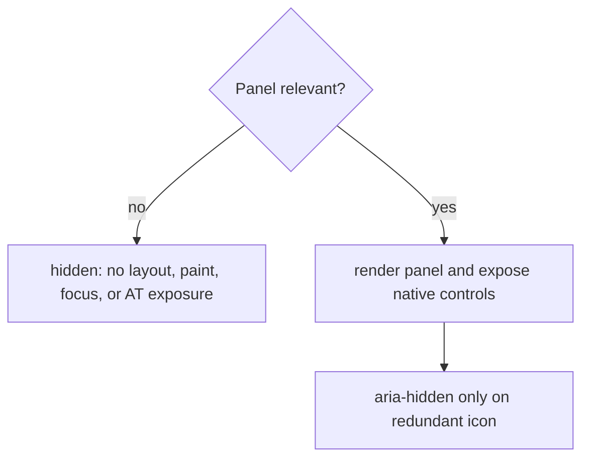

<a id="q38"></a>

## Q38. What is native lazy loading in HTML?

### Requirement

`loading="lazy"` is a browser hint that eligible offscreen images or iframes may be deferred until they approach the viewport. This can reduce initial requests, transfer, decoding, and embedded-document work. The browser chooses the distance threshold and may still load a resource earlier than expected; do not use lazy loading as an authorization, privacy, or exact scheduling boundary.

Use it for below-the-fold media—not for the likely Largest Contentful Paint hero. Reserve image dimensions to prevent layout shift, keep responsive `srcset`/`sizes` when needed, supply useful image `alt` text, and give iframes a descriptive `title`. `decoding="async"` controls decode scheduling, not network laziness.

### Example 27 — prioritize the hero, defer the gallery

```html


<iframe src="/examples/cache-simulator" loading="lazy"
        width="800" height="450"
        title="Interactive cache hit-rate simulator"></iframe>
```

Loading trace:

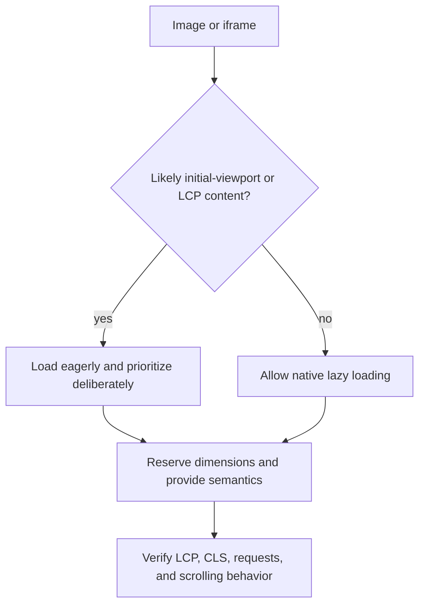

Test with production-like pages and throttled browser tooling. A gallery can still overload the network if many lazy candidates sit near the threshold, and lazy iframes can postpone code the user expects immediately.

<a id="q39"></a>

## Q39. Which HTML choices improve SEO without hurting accessibility?

### Requirement

Build one understandable document for people, assistive technology, browsers, and crawlers. Useful overlap includes:

- a concise, unique `<title>` and a truthful description of the page;
- the correct document language, meaningful landmarks, and descriptive headings that reflect the content hierarchy;
- ordinary crawlable `<a href>` links with anchor text that makes sense out of context;
- text alternatives for meaningful images and empty `alt=""` for truly decorative images;
- helpful, visible, people-first content using the same words readers use;
- structured data only when it accurately describes visible page content.

Good heading order helps navigation for screen-reader users, but there is no magic heading count or semantic-markup score that guarantees search ranking. A description can influence a search-result snippet but is not a promise of ranking or even of the exact snippet shown. Avoid keyword stuffing, hidden text/links, misleading structured data, generic “click here” links, and visual-only reading order.

### Example 28 — one article, consistent signals

```html
<!doctype html>
<html lang="en">
<head>
  <meta charset="utf-8">
  <meta name="viewport" content="width=device-width, initial-scale=1">
  <title>Spring Boot Cache Stampede Guide | Acme Engineering</title>
  <meta name="description"
        content="Learn request coalescing, jitter, stale-while-revalidate, and load testing for Spring Boot caches.">
  <link rel="canonical" href="https://example.com/guides/cache-stampede">
</head>
<body>
  <header><a href="/">Acme Engineering</a></header>
  <main>
    <article>
      <h1>Preventing cache stampedes in Spring Boot</h1>
      <p>A cache stampede occurs when many requests rebuild the same expired value.</p>
      <figure>
        
        <figcaption>Request coalescing allows one refresh owner.</figcaption>
      </figure>
      <h2>Choose a refresh policy</h2>
      <p>Compare <a href="/guides/stale-while-revalidate">stale-while-revalidate trade-offs</a>.</p>
    </article>
  </main>
</body>
</html>
```

Before publishing, verify that the title/description match the visible article, every link works without click handlers, the heading outline is understandable, image alternatives convey purpose, canonical/robots directives are intentional, and any structured data matches the page. Then test keyboard navigation, accessibility structure, crawlability, rendered content, and relevant search tooling.

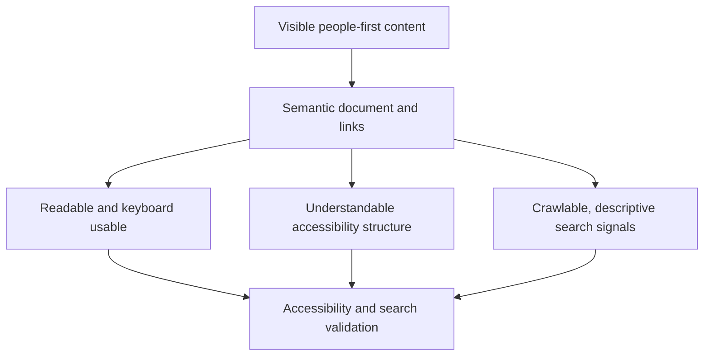

<a id="q40"></a>

## Q40. Explain the cascade and specificity

### Requirement

Given several declarations for one property on one element, eliminate rules that do not apply and then compare the survivors in cascade order. Specificity is only one late tie-breaker; it cannot jump across an origin, importance level, encapsulation context, or cascade layer.

For an interview, use this debugging ladder:

1. **Relevance and match:** does the stylesheet apply, and does the selector match this element?
2. **Origin and importance:** transitions, important declarations, animations, and normal author/user/UA declarations have defined precedence.
3. **Encapsulation, style attributes, and layers:** Shadow DOM context and inline style declarations have special positions; within an origin, layer order precedes selector specificity. Normal unlayered author rules outrank normal layered rules. For important layered rules, layer order reverses.
4. **Specificity:** compare selector weights only among declarations still tied in the earlier stages.
5. **Scope proximity:** for competing scoped rules, the closer scoping root wins.
6. **Order of appearance:** the later declaration wins the remaining tie.

`!important` does not merely add a huge specificity score. It changes the importance band, also reverses origin and layer precedence where the cascade defines that reversal, and should normally protect contracts such as user overrides—not compensate for uncontrolled selectors.

### Example 29 — trace a normal author declaration

```css
@layer reset, components, overrides;

@layer components {
  .card { color: navy; }             /* layer 2, specificity 0-1-0 */
  .card.featured { color: teal; }    /* layer 2, specificity 0-2-0 */
}

@layer overrides {
  .card { color: purple; }           /* later layer 3 */
}

.card { color: darkgreen; }          /* unlayered normal author rule */
```

For `<article class="card featured">`, all four selectors match:

| Comparison | Survivor | Why |
|---|---|---|
| within `components` | `teal` | same layer; `0-2-0` beats `0-1-0` |
| `components` versus `overrides` | `purple` | layer order is compared before specificity |
| layered versus unlayered normal author rule | `darkgreen` | normal unlayered declarations come after all named layers |

The computed color is `darkgreen`. Adding more classes or an ID inside `components` would not cross the layer boundary.

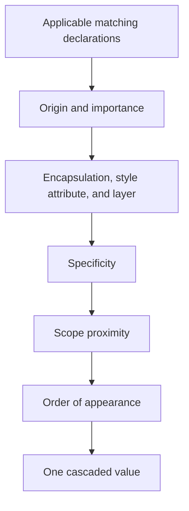

<a id="q41"></a>

## Q41. What is the CSS box model?

### Requirement

Every generated box has a content area, padding around the content, a border around the padding, and margin outside the border. For an ordinary rectangular box, horizontal outer size is:

```text
margin-left + border-left + padding-left + content width
+ padding-right + border-right + margin-right
```

With `box-sizing: content-box` (the initial value), declared `width` controls the content box. With `box-sizing: border-box`, declared `width` controls the border box; padding and border are taken from that available width. Margins always remain outside the declared width. Min/max constraints, intrinsic sizes, replaced elements, and overflow can still affect the final used geometry.

### Example 30 — calculate both sizing modes

```css
.panel {
  width: 240px;
  padding-inline: 16px;
  border: 2px solid;
  margin-inline: 12px;
}
```

| Mode | Content width | Border-box width | Outer width including margins |
|---|---:|---:|---:|
| `content-box` | 240px | `240 + 32 + 4 = 276px` | `276 + 24 = 300px` |
| `border-box` | `240 - 32 - 4 = 204px` | 240px | `240 + 24 = 264px` |

A common baseline makes component widths easier to reason about:

```css
*, *::before, *::after { box-sizing: border-box; }
```

It does not eliminate the need to budget padding, borders, minimum content sizes, or margins.

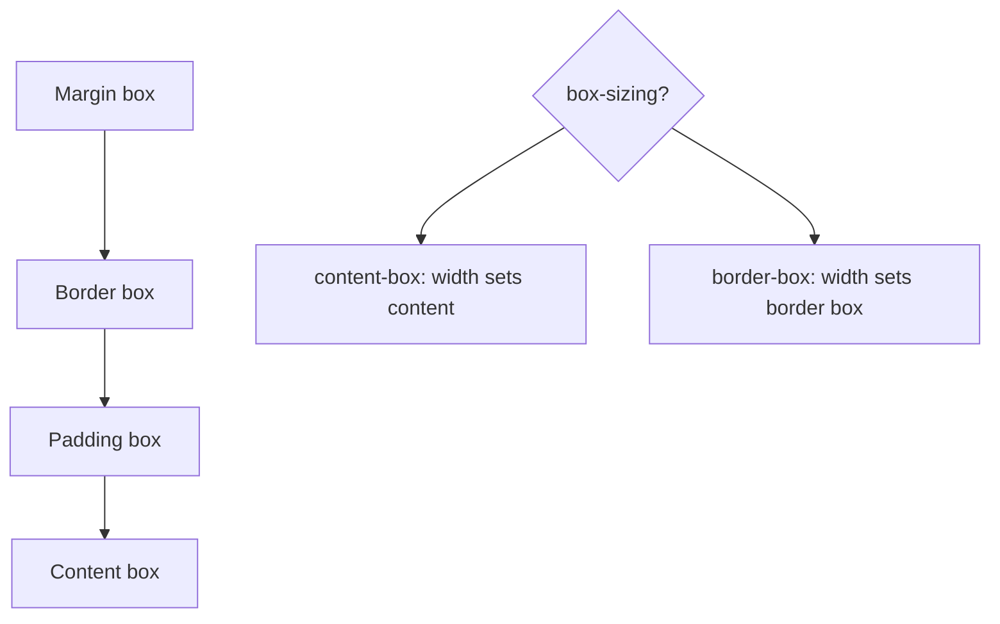

<a id="q42"></a>

## Q42. Flexbox versus Grid: when do you choose each?

### Requirement

Choose from the relationships the layout must preserve:

- **Flexbox** lays items out and distributes free space along one main axis at a time. It is a strong fit for toolbars, navigation, button groups, and components whose items form one row or column and may wrap.
- **Grid** defines rows and columns together. It is a strong fit when cards, regions, or form fields must align to shared tracks in two dimensions.
- They compose naturally: Grid can place page regions while Flexbox aligns controls inside one region.

Do not use visual reordering to repair an incorrect document order. `order` and grid placement can change visual position without creating a better keyboard or reading sequence.

### Example 31 — Grid outside, Flexbox inside

```html
<main class="dashboard">
  <article class="card">
    <header class="card__toolbar">
      <h2>Orders</h2><button type="button">Refresh</button>
    </header>
    <p class="card__summary">12 orders require review</p>
  </article>
  <article class="card">Inventory</article>
  <article class="card">Latency</article>
</main>
```

```css
.dashboard {
  display: grid;
  grid-template-columns: repeat(auto-fit, minmax(min(18rem, 100%), 1fr));
  gap: 1rem;
}

.card__toolbar {
  display: flex;
  align-items: center;
  justify-content: space-between;
  gap: .75rem;
}
```

```mermaid
flowchart TD
    Need[Layout relationship] --> Axis{One primary axis?}
    Axis -- yes --> Flex[Flexbox distributes items along row or column]
    Axis -- no --> Tracks{Shared rows and columns?}
    Tracks -- yes --> Grid[Grid defines two-dimensional tracks]
    Tracks -- mixed --> Compose[Grid regions with Flexbox internals]
```

<a id="q43"></a>

## Q43. Why does `min-width: 0` fix overflowing Flexbox or Grid children?

### Requirement

The initial `min-width: auto` is not always zero. A non-scrollable flex item can receive a content-based automatic minimum in its main axis. Grid items also receive content-based automatic minimums under defined track and span conditions. A long unbreakable token, intrinsic image width, or nested component can therefore establish a floor larger than the available track.

`flex-shrink: 1` distributes negative free space only until an item reaches its minimum. Setting `min-inline-size: 0` (or physical `min-width: 0` in a horizontal writing mode) explicitly permits further shrinking. For Grid, `minmax(0, 1fr)` also removes the track's implicit content floor when that is the actual constraint.

### Example 32 — make ellipsis reachable

```html
<div class="result-row">
  
  <div class="result-row__body">
    <strong class="result-row__title">customer-export-2026-10-15-final-reviewed.csv</strong>
    <span>Ready for download</span>
  </div>
</div>
```

```css
.result-row { display: flex; gap: .75rem; max-inline-size: 22rem; }
.result-row__body { flex: 1 1 auto; min-inline-size: 0; }
.result-row__title {
  display: block;
  overflow: hidden;
  white-space: nowrap;
  text-overflow: ellipsis;
}
```

Shrink trace:

| Step | Without explicit minimum | With `min-inline-size: 0` |
|---|---|---|
| available width drops | negative free space is calculated | same |
| item reaches automatic minimum | stops near its min-content width | may shrink below min-content width |
| title overflow | row can overflow | title box becomes narrower |
| ellipsis | may never activate usefully | overflow is clipped and ellipsis can paint |

<a id="q44"></a>

## Q44. Explain `static`, `relative`, `absolute`, `fixed`, and `sticky` positioning

### Requirement

| Position | Normal-flow space retained? | Offset/containing-block model | Common use |
|---|---|---|---|
| `static` | yes | normal layout; inset properties do not position it | ordinary document flow |
| `relative` | yes | laid out normally, then visually offset; establishes the containing block for positioned descendants | local badge/overlay anchor |
| `absolute` | no | positioned against its containing block, commonly the nearest positioned ancestor | component-local overlay |
| `fixed` | no | fixed-position containing block, usually the viewport; transforms and other properties can create an ancestor containing block | viewport action/control |
| `sticky` | yes | participates in flow, then is shifted within its scrollport/containing block after crossing an inset | section/table headers |

Sticky positioning needs an inset such as `inset-block-start: 0` and enough scroll range. Inspect every ancestor that establishes scrolling or clipping; the relevant scroll container may not be the viewport.

### Example 33 — local badge and sticky heading

```css
.card { position: relative; }
.card__badge {
  position: absolute;
  inset-block-start: .5rem;
  inset-inline-end: .5rem;
}

.results__heading {
  position: sticky;
  inset-block-start: 0;
  z-index: 1;
  background: Canvas;
}
```

Debugging trace: first ask whether the element remains in flow, then identify its containing block, then identify its scroll container, and only then inspect inset values and clipping.

<a id="q45"></a>

## Q45. What creates a stacking context, and why does `z-index` sometimes fail?

### Requirement

A stacking context is an atomic painting group. Descendants are ordered inside their context; after that context is painted as one unit, no descendant `z-index` can interleave with a sibling outside it. A child at `z-index: 9999` can therefore remain behind a sibling whose parent context is higher.

Common context creators include the root element; positioned elements with a non-`auto` `z-index`; fixed and sticky positioned boxes; flex/grid items with non-`auto` `z-index`; `opacity` below 1; transforms, filters, and some masking/compositing properties; `isolation: isolate`; and relevant containment or `will-change` values. Check the specification for a property's exact effect instead of memorizing one frozen list.

### Example 34 — the trapped tooltip

```html
<section class="workspace">
  <article class="card"><button>Open tooltip</button><aside class="tooltip">Details</aside></article>
  <aside class="sidebar">Navigation</aside>
</section>
```

```css
.card { position: relative; z-index: 1; }
.tooltip { position: absolute; z-index: 9999; }
.sidebar { position: relative; z-index: 2; }
```

The tooltip cannot outrank `.sidebar` because its entire parent context (`1`) paints below the sidebar context (`2`). Fix the ownership: render the overlay in an appropriate shared overlay layer, remove the accidental parent context, or use a top-layer primitive such as a modal `<dialog>` or the Popover API when its semantics fit. Do not start an arbitrary `z-index` arms race.

```mermaid
flowchart TD
    Root[Root stacking context] --> Card[Card context: z 1]
    Root --> Sidebar[Sidebar context: z 2]
    Card --> Tooltip[Tooltip: z 9999 inside card]
    Card --> Atomic[Card and tooltip paint as one unit]
    Atomic --> Behind[Whole card context remains behind sidebar]
```

<a id="q46"></a>

## Q46. How would you center an element?

### Requirement

First identify the axis, the formatting context, and whether the parent has usable free space. Centering is not one magic declaration:

- In **Grid**, `place-items: center` centers each item in its grid area on both axes.
- In **Flexbox**, `justify-content: center` acts on the main axis and `align-items: center` on the cross axis. Those physical directions change with `flex-direction` and writing mode.
- For one block with a definite or constrained inline size, `margin-inline: auto` consumes equal free space on both sides.
- For text or inline content inside a block, `text-align: center` centers the inline content, not the block itself.
- For an overlay, absolute positioning plus `inset: 50% auto auto 50%` and `translate: -50% -50%` can be appropriate, but it removes the box from normal flow and should not be the default layout technique.

### Example 35 — choose from the relationship

```css
.empty-state {
  display: grid;
  min-block-size: 12rem;
  place-items: center;
}

.dialog-actions {
  display: flex;
  justify-content: center;
  align-items: center;
  gap: .75rem;
}

.article { max-inline-size: 70ch; margin-inline: auto; }
.article__title { text-align: center; }
```

```mermaid
flowchart TD
    Need[What must be centered?] --> Context{Existing layout context?}
    Context -- Grid --> Grid[place-items or place-self]
    Context -- Flex --> Flex[main axis plus cross axis]
    Context -- Normal flow --> Kind{Box or inline content?}
    Kind -- Box --> Margin[Constrain size and use margin-inline auto]
    Kind -- Inline --> Text[text-align center]
```

### Trace

For a row flex container, main-axis centering is usually horizontal and cross-axis centering vertical. Change it to `flex-direction: column` and those roles swap. Say the axis names in an interview; “horizontal equals `justify-content`” is not a reliable rule.

<a id="q47"></a>

## Q47. `rem` versus `em` versus `px` versus `%` versus `vw`/`vh`

### Requirement

Choose the reference quantity deliberately:

| Unit | Reference | Strong use | Common trap |
|---|---|---|---|
| `rem` | root element's font size | page-level spacing and type scale that follows user font settings | assuming it is always exactly 16px |
| `em` | element's computed font size; on `font-size`, the inherited font size | a component whose padding/radius scales with its own type | compounding sizes through deep nesting |
| `px` | CSS reference pixel, not necessarily one device pixel | borders, icons, and exact CSS-space constraints | treating it as immune to zoom or display density |
| `%` | property-specific reference, often a containing block dimension | fluid track/box relationships | assuming every vertical percentage uses parent height |
| `vw`/`vh` | 1% of the large viewport size in current CSS Values | viewport-coupled art or bounded fluid sizing | mobile browser UI and unbounded text scaling |

Small, large, and dynamic viewport variants (`svh`, `lvh`, `dvh`, and their width/inline/block counterparts) make the intended mobile viewport behavior explicit. Bound fluid values with `min()`, `max()`, or `clamp()` and keep readable text sensitive to user scaling.

### Example 36 — preserve the dependency you mean

```css
:root { font-size: 100%; }

.prose {
  inline-size: min(70ch, 100% - 2rem);
  margin-inline: auto;
  font-size: clamp(1rem, .94rem + .3vw, 1.25rem);
}

.button {
  padding: .6em 1em;
  border: 1px solid;
}

.full-height-panel { min-block-size: 100dvh; }
```

With a 20px root font size, `2rem` is 40 CSS px. A `.button` at 18px has horizontal padding of 18 CSS px. The references are different on purpose.

<a id="q48"></a>

## Q48. What are container queries, and when are they better than media queries?

### Requirement

A media query asks about the viewport or environment; a container query lets descendants respond to an eligible ancestor's size, style, or scroll state. Use a size container query when one reusable component can appear in a narrow sidebar and a wide main region at the same viewport width. Keep media queries for page-wide/environment policy such as print, reduced motion, or top-level navigation.

For inline-size queries, establish a query container with `container-type: inline-size`; optionally name it. The `@container` rule styles descendants of the matching container, not the container itself. Container query length units such as `cqi` are relative to the selected query container.

### Example 37 — one card, two hosts

```html
<section class="rail"><article class="product-card">…</article></section>
<main class="catalog"><article class="product-card">…</article></main>
```

```css
.rail, .catalog { container: product-host / inline-size; }
.product-card { display: grid; gap: 1rem; }

@container product-host (inline-size >= 32rem) {
  .product-card { grid-template-columns: 10rem 1fr; }
}

@media (prefers-reduced-motion: reduce) {
  .product-card { scroll-behavior: auto; }
}
```

```mermaid
flowchart TD
    Component[Same product card] --> Rail[Narrow rail container]
    Component --> Main[Wide catalog container]
    Rail --> Stack[Single-column card]
    Main --> Split[Image plus details]
    Env[Reduced-motion environment] --> Both[Policy applies to both hosts]
```

The viewport may be 1440px in both cases. A media breakpoint cannot distinguish those two card allocations without coupling the component to page placement; the container query can.

<a id="q49"></a>

## Q49. How do CSS custom properties differ from Sass variables?

### Requirement

Sass variables are resolved by a preprocessor and disappear from the emitted stylesheet. CSS custom properties are real properties: they cascade, normally inherit, remain in the computed style, can vary by selector or query, and can be updated at runtime. `var(--token, fallback)` substitutes a fallback only when the referenced custom property is missing or guaranteed-invalid—not whenever the eventual property value happens to be undesirable.

Use Sass variables for compile-time composition and generation. Use custom properties for design tokens whose value must participate in themes, component inheritance, queries, animation, or runtime changes. `@property` can register a custom property with syntax, inheritance behavior, and an initial value, allowing earlier validation and typed interpolation.

### Example 38 — compile-time structure, runtime token

```scss
$button-selector: '.button';

:root { --brand-hue: 220; }
[data-theme='warm'] { --brand-hue: 18; }

@property --button-progress {
  syntax: '<number>';
  inherits: false;
  initial-value: 0;
}

#{$button-selector} {
  --button-bg: hsl(var(--brand-hue) 70% 45%);
  background: var(--button-bg, royalblue);
  transform: scaleX(var(--button-progress));
}
```

```mermaid
flowchart TD
    Sass[Sass variables and loops] --> Build[Build emits CSS]
    Build --> Cascade[Selectors and cascade choose custom-property values]
    Theme[Theme, query, inline style, or script] --> Cascade
    Cascade --> Var[var substitution at computed-value time]
    Var --> Used[Used component property]
```

### Failure mode

```css
.card { --gap: 12bogus; gap: var(--gap, 1rem); }
```

`--gap` exists, so the `var()` fallback is not selected. After substitution the `gap` value is invalid. Registering the token with `@property` or supplying a valid token prevents that invalid-at-computed-value-time surprise.

<a id="q50"></a>

## Q50. How would you avoid layout shift from images and components?

### Requirement

Layout shift occurs when visible content changes position between rendered frames without the expected user-driven exclusion. Prevention is primarily a space-reservation problem:

- give images and video correct intrinsic `width` and `height` attributes; responsive CSS can still use `max-inline-size: 100%; block-size: auto`;
- reserve component slots with a stable size, `aspect-ratio`, or a skeleton that matches the final geometry;
- do not insert banners, consent UI, ads, or errors above already-rendered content unless space was reserved;
- keep fallback and final font metrics compatible and use an intentional loading strategy;
- animate `transform` and `opacity` when motion need not affect layout;
- diagnose actual shifted elements with `PerformanceObserver` rather than guessing from a single screenshot.

### Example 39 — dimensions establish the ratio before bytes arrive

```html

```

```css
img { display: block; max-inline-size: 100%; block-size: auto; }
.recommendations { min-block-size: 18rem; }
.toast { transform: translateY(var(--offset)); }
```

```mermaid
flowchart TD
    Discover[HTML discovered] --> Reserve[Intrinsic ratio or stable slot reserves space]
    Reserve --> Load[Media, font, or component loads]
    Load --> Same{Final geometry fits reservation?}
    Same -- yes --> Stable[No displacement from this resource]
    Same -- no --> Shift[Visible content may shift]
```

CLS is an aggregate score derived from layout-shift entries, not “the number of slow images.” A resource can load slowly without shifting anything if its geometry was reserved.

<a id="q51"></a>

## Q51. What is BEM, and do you have to use it?

### Requirement

BEM names ownership explicitly:

- **Block:** independent component, such as `.card`.
- **Element:** a part that belongs to that block, such as `.card__title`.
- **Modifier:** a variation or state, such as `.card--featured` or `.card__title--muted`.

It is a convention, not a browser feature and not a requirement. Its value is predictable flat selectors and recognizable ownership in a global namespace. CSS Modules, scoped styles, utility classes, cascade layers, and component frameworks can provide other scoping or composition mechanisms. Choose one coherent ownership model; do not mix conventions randomly.

### Example 40 — name the component contract

```html
<article class="product-card product-card--featured">
  <h2 class="product-card__title">Noise-cancelling headphones</h2>
  <p class="product-card__price">$199</p>
</article>
```

```css
.product-card { padding: 1rem; border: 1px solid; }
.product-card__title { margin-block: 0 .5rem; }
.product-card__price { font-weight: 700; }
.product-card--featured { border-color: var(--brand); }
```

Avoid selectors such as `.page .sidebar article.product-card h2.title`: they encode page placement and DOM depth, raise specificity, and make the component harder to move. Also avoid inventing “elements of elements” such as `.card__body__title`; the element belongs to the block, so `.card__title` is enough.

<a id="q52"></a>

## Q52. Implement `Array.prototype.map` behavior without using `map`

### Requirement

An interview implementation should state its contract before writing the loop. `map` snapshots the source length, visits integer indices in ascending order, calls the callback only for properties that exist, and leaves corresponding holes in the result. The callback receives `(value, index, source)` and an optional `thisArg`. Because the existence check is dynamic, deleting an unvisited property can make it disappear from the visit, while appending beyond the original length does not extend the pass.

The helper below deliberately covers those observable interview semantics and generic array-like receivers. A production polyfill must additionally reproduce realm and species behavior, exact abstract coercions, and property-creation failure semantics; do not advertise a teaching helper as a drop-in specification implementation.

### Example 41 — sparse `map` and seed-aware `reduce`

```javascript
function toSafeLength(value) {
  const number = Number(value);
  if (Number.isNaN(number) || number <= 0) return 0;
  if (number === Infinity) return Number.MAX_SAFE_INTEGER;
  return Math.min(Math.floor(number), Number.MAX_SAFE_INTEGER);
}

function mapLike(arrayLike, callback, thisArg) {
  if (arrayLike == null) throw new TypeError("receiver is null or undefined");
  if (typeof callback !== "function") throw new TypeError("callback must be callable");

  const source = Object(arrayLike);
  const length = toSafeLength(source.length); // snapshot once
  const output = new Array(length);
  for (let index = 0; index < length; index += 1) {
    if (index in source) {
      output[index] = callback.call(thisArg, source[index], index, source);
    }
  }
  return output;
}

const sparse = [, 2, , 4];
const tripled = mapLike(sparse, function (value) {
  return value * this.factor;
}, {factor: 3});

console.log(tripled.length);       // 4
console.log(Object.keys(tripled)); // ["1", "3"]
console.log(tripled[1], tripled[3]); // 6 12
```

```mermaid
flowchart TD
    Start[Snapshot length 4] --> I0[Index 0 absent: leave hole]
    I0 --> I1[Index 1 present: callback gives 6]
    I1 --> I2[Index 2 absent: leave hole]
    I2 --> I3[Index 3 present: callback gives 12]
    I3 --> Result[Result length 4 with keys 1 and 3]
```

Complexity is `O(length)` property checks and `O(length)` result capacity; callback work is additional. The output's sparse shape is part of correctness, not an optimization detail.

<a id="q53"></a>

## Q53. Implement `reduce`

### Requirement

`reduce` also snapshots length and skips missing properties. The hard branch is accumulator initialization:

- if an initial value was supplied—even explicit `undefined`—use it and start searching from index `0`;
- otherwise, scan for the first present property, use its value as the accumulator, and begin callback execution at the following index;
- if no initial value exists and no present property is found, throw `TypeError`.

Checking `arguments.length` in a fixed-parameter helper can distinguish omitted from explicit `undefined`; a rest parameter makes that distinction clearer. Do not seed blindly from `source[0]`, and do not call the reducer for holes.

```javascript
function reduceLike(arrayLike, callback, ...initial) {
  if (arrayLike == null) throw new TypeError("receiver is null or undefined");
  if (typeof callback !== "function") throw new TypeError("callback must be callable");

  const source = Object(arrayLike);
  const length = toSafeLength(source.length);
  let index = 0;
  let accumulator;

  if (initial.length > 0) {
    [accumulator] = initial;
  } else {
    while (index < length && !(index in source)) index += 1;
    if (index === length) throw new TypeError("no value can seed the reduction");
    accumulator = source[index];
    index += 1;
  }

  for (; index < length; index += 1) {
    if (index in source) {
      accumulator = callback(accumulator, source[index], index, source);
    }
  }
  return accumulator;
}

console.log(reduceLike([, 2, , 4], (sum, value) => sum + value)); // 6
console.log(reduceLike([1], (acc, value) => [acc, value], undefined));
// [undefined, 1] — explicit undefined is still an initial value
```

Seed trace for `[, , 5, , 7]` without an initial value:

| Scan/index | Present? | Accumulator/action |
|---:|---|---|
| 0 | no | keep searching |
| 1 | no | keep searching |
| 2 | yes | seed with `5`; do not call callback |
| 3 | no | skip |
| 4 | yes | call callback with `(5, 7, 4, source)` |

```mermaid
flowchart TD
    Begin[Reduction begins] --> Initial{Initial argument supplied?}
    Initial -- yes --> Seed[Use it, even undefined]
    Initial -- no --> Search[Find first present property]
    Search --> Found{Found one?}
    Found -- no --> Throw[Throw TypeError]
    Found -- yes --> First[Use first value as seed]
    Seed --> Fold[Visit remaining present properties]
    First --> Fold
```

The loop performs at most `length` existence checks: `O(length)` time and `O(1)` auxiliary space, excluding callback-owned allocations.

<a id="q54"></a>

## Q54. Flatten a nested array

### Requirement

Clarify whether the desired depth is one level or all levels. Native `flat()` defaults to depth `1`, flattens only actual arrays, and removes holes in levels it traverses. A recursive depth-first solution is concise, but adversarial nesting can exhaust the call stack. The iterative version below stores traversal frames explicitly, preserves left-to-right order, supports a finite depth or `Infinity`, and skips holes.

### Example 42 — explicit stack instead of recursive call depth

```javascript
function flattenArray(source, depth = Infinity) {
  if (!Array.isArray(source)) throw new TypeError("expected an array");
  const numericDepth = Number(depth);
  const normalizedDepth = Number.isNaN(numericDepth)
    ? 0
    : Math.max(0, Math.trunc(numericDepth));
  const output = [];
  const stack = [{array: source, index: 0, depth: normalizedDepth}];

  while (stack.length > 0) {
    const frame = stack.at(-1);
    if (frame.index >= frame.array.length) {
      stack.pop();
      continue;
    }
    const index = frame.index;
    frame.index += 1;
    if (!(index in frame.array)) continue;

    const value = frame.array[index];
    if (Array.isArray(value) && frame.depth > 0) {
      stack.push({array: value, index: 0, depth: frame.depth - 1});
    } else {
      output.push(value);
    }
  }
  return output;
}

const nested = [1, [2, , [3, [4]]], 5];
console.log(flattenArray(nested, 1)); // [1, 2, [3, [4]], 5]
console.log(flattenArray(nested, 2)); // [1, 2, 3, [4], 5]
console.log(flattenArray(nested));    // [1, 2, 3, 4, 5]
```

```mermaid
flowchart TD
    Inspect[Inspect next present value] --> Nested{Array and depth remains?}
    Nested -- yes --> Push[Push child frame]
    Nested -- no --> Emit[Append value]
    Push --> Inspect
    Emit --> More{Current frame finished?}
    More -- no --> Inspect
    More -- yes --> Pop[Pop frame and resume parent]
```

For `n` visited slots and maximum active nesting `h`, time is `O(n)` and explicit traversal space is `O(h)` plus the output. Cyclic arrays are outside the native `flat` contract's practical safe-use boundary too; add cycle detection only if the application contract requires it, because that changes behavior and memory cost.

<a id="q55"></a>

## Q55. Implement `groupBy`

### Requirement

Grouping is a single-pass partition: derive one key for each item, create a bucket on its first occurrence, then append while preserving input order inside each bucket. Choose the result type by key semantics:

- `Map.groupBy(items, keySelector)` retains object and primitive key identity using `Map` key semantics.
- `Object.groupBy(items, keySelector)` converts each key to a property key and returns a null-prototype object.

A plain `{}` silently string-coerces keys and exposes prototype names such as `__proto__`; it is the wrong default for arbitrary keys. This helper intentionally models the `Map` form and accepts any iterable.

### Example 43 — preserve object identity

```javascript
function groupByToMap(items, keySelector) {
  if (typeof keySelector !== "function") throw new TypeError("selector must be callable");
  const groups = new Map();
  let index = 0;
  for (const item of items) {
    const key = keySelector(item, index++);
    if (!groups.has(key)) groups.set(key, []);
    groups.get(key).push(item);
  }
  return groups;
}

const north = {region: "north"};
const south = {region: "south"};
const rows = [
  {id: "A", owner: north},
  {id: "B", owner: south},
  {id: "C", owner: north}
];
const byOwner = groupByToMap(rows, row => row.owner);
console.log(byOwner.get(north).map(row => row.id)); // ["A", "C"]
console.log(byOwner.get(south).map(row => row.id)); // ["B"]
```

```mermaid
flowchart TD
    Item[Read iterable item and index] --> Key[Derive key once]
    Key --> Exists{Bucket exists?}
    Exists -- no --> Create[Create empty bucket]
    Exists -- yes --> Reuse[Reuse existing bucket]
    Create --> Append[Append item]
    Reuse --> Append
    Append --> Item
```

For `n` items, expected time is `O(n)` assuming expected constant-time `Map` operations; storage is `O(n + k)` for `k` groups and all bucket references. Selector cost remains additive.

<a id="q56"></a>

## Q56. Implement a simple `Promise.all`

### Requirement

`Promise.all` consumes an iterable, assimilates values and thenables through `Promise.resolve`, and fulfills only after every input fulfills. The result array follows **iteration order**, not settlement order. The first observed rejection rejects the aggregate, but already-started work is not cancelled. An empty iterable produces a fulfilled promise; attached reactions still run as promise jobs rather than inline with the current stack.

The implementation below is intentionally a base-`Promise` teaching version, not a subclass/species-compatible replacement. The sentinel count (`remaining = 1`) prevents an empty iterable and synchronously iterated inputs from racing the end-of-iteration decision. `Promise.resolve` guarantees that each installed fulfillment handler runs at most once, even for hostile thenables.

### Example 44 — settlement order differs from result order

```javascript
function promiseAllLike(iterable) {
  return new Promise((resolve, reject) => {
    const output = [];
    let remaining = 1; // iteration sentinel
    let index = 0;
    try {
      for (const value of iterable) {
        const currentIndex = index++;
        output[currentIndex] = undefined;
        remaining += 1;
        Promise.resolve(value).then(resolved => {
          output[currentIndex] = resolved;
          remaining -= 1;
          if (remaining === 0) resolve(output);
        }, reject);
      }
      remaining -= 1;
      if (remaining === 0) resolve(output);
    } catch (error) {
      reject(error); // iterator creation/advancement can throw
    }
  });
}

const wait = (label, ms) => new Promise(resolve => setTimeout(resolve, ms, label));
console.log(await promiseAllLike([wait("slow", 20), 7, wait("fast", 0)]));
// ["slow", 7, "fast"]

await promiseAllLike(new Set([Promise.resolve("ok"), Promise.reject("boom")]))
  .catch(reason => console.log(reason)); // boom
```

| Moment | Settled input | Stored state | Aggregate |
|---|---|---|---|
| after iteration | none required | three reserved indexes | pending |
| first | index 1 (`7`) | `[empty, 7, empty]` | pending |
| second | index 2 (`"fast"`) | `[empty, 7, "fast"]` | pending |
| third | index 0 (`"slow"`) | `["slow", 7, "fast"]` | fulfilled in input order |

```mermaid
flowchart TD
    Iterate[Iterate and reserve stable indexes] --> Adopt[Promise.resolve each value]
    Adopt --> Settle{Input settles}
    Settle -- reject --> Reject[Reject aggregate; no implicit cancellation]
    Settle -- fulfill --> Store[Store at original index]
    Store --> Remaining{All inputs fulfilled?}
    Remaining -- no --> Settle
    Remaining -- yes --> Resolve[Resolve ordered result array]
```

Iteration and storage are `O(n)`. The elapsed time to fulfillment is governed by the slowest fulfilling input, while rejection latency is governed by the first rejection that reaches the aggregate. This is coordination, not parallel execution: the underlying operations start when their promises/tasks are created.

<a id="q57"></a>

## Q57. Implement a `once` function

### Requirement

`once(fn)` must call `fn` at most once, preserve the first call's receiver and arguments, and return the same outcome later. “Outcome” needs a policy: this implementation caches either the returned value **or the synchronous exception**. A failed first attempt is therefore consumed and the same error object is thrown on later calls. A retry-on-error helper is a different contract and should have a different name.

### Example 45 — make the state machine explicit

```javascript
function onceStable(fn) {
  if (typeof fn !== "function") throw new TypeError("fn must be callable");
  let state = "idle";
  let value;
  let error;

  return function (...args) {
    if (state === "fulfilled") return value;
    if (state === "rejected") throw error;
    if (state === "running") throw new Error("reentrant once invocation");

    state = "running"; // claim the call before user code can re-enter
    try {
      value = fn.apply(this, args);
      state = "fulfilled";
      return value;
    } catch (cause) {
      error = cause;
      state = "rejected";
      throw cause;
    }
  };
}

const counter = {
  total: 0,
  add: onceStable(function (amount) {
    this.total += amount;
    return this.total;
  })
};
console.log(counter.add(3), counter.add(100), counter.total); // 3 3 3
```

| Call/state | Action | Durable state |
|---|---|---|
| first call / `idle` | set `running`, invoke with original `this` and arguments | `fulfilled` + value, or `rejected` + error |
| recursive call / `running` | reject ambiguous re-entry | original invocation continues |
| later call / `fulfilled` | return cached value, including `undefined` | unchanged |
| later call / `rejected` | throw cached error object | unchanged |

```mermaid
stateDiagram-v2
    [*] --> idle
    idle --> running: first call
    running --> fulfilled: return
    running --> rejected: throw
    fulfilled --> fulfilled: replay value
    rejected --> rejected: replay error
```

If `fn` returns a promise, the cached value is that promise: all callers observe the same eventual fulfillment or rejection. This helper does not turn a rejected asynchronous operation into a retry. Time and auxiliary storage are `O(1)` per wrapper, excluding `fn`.

<a id="q58"></a>

## Q58. Implement a basic event emitter

### Requirement

Store listeners by event key, preserve insertion order, support removal, and define mutation behavior during dispatch. A `Map<event, Set<listener>>` accepts string or symbol keys and naturally prevents the same function from being registered twice for one event. `emit` takes a snapshot: removals and additions during one emission affect the **next** emission, not the active pass.

### Example 46 — stable dispatch and one-shot listeners

```javascript
class StudyEventEmitter {
  #events = new Map();

  on(event, listener) {
    if (typeof listener !== "function") throw new TypeError("listener must be callable");
    const listeners = this.#events.get(event) ?? new Set();
    listeners.add(listener);
    this.#events.set(event, listeners);
    let active = true;
    return () => {
      if (!active) return false;
      active = false;
      return this.off(event, listener);
    };
  }

  once(event, listener) {
    let unsubscribe;
    const wrapper = (...args) => {
      unsubscribe(); // remove before user code can recursively emit
      return listener.apply(this, args);
    };
    unsubscribe = this.on(event, wrapper);
    return unsubscribe;
  }

  off(event, listener) {
    const listeners = this.#events.get(event);
    if (!listeners) return false;
    const removed = listeners.delete(listener);
    if (listeners.size === 0) this.#events.delete(event);
    return removed;
  }

  emit(event, ...args) {
    const snapshot = [...(this.#events.get(event) ?? [])];
    for (const listener of snapshot) listener.apply(this, args);
    return snapshot.length;
  }

  listenerCount(event) {
    return this.#events.get(event)?.size ?? 0;
  }
}
```

For listeners `A, B`, suppose `A` removes `B` and adds `C` while handling the first emission:

| Emission | Snapshot at start | Calls in this pass | Registry afterward |
|---:|---|---|---|
| 1 | `A, B` | `A, B` | `A, C` |
| 2 | `A, C` | `A, C` | `A, C` |

```mermaid
flowchart TD
    Registry["Registry: A, B"] --> Snapshot["Snapshot: A, B"]
    Snapshot --> A["Call A: remove B, add C"]
    A --> B["Call B from snapshot"]
    B --> Next["Next registry: A, C"]
```

This teaching emitter propagates a listener's synchronous exception and stops that emission. Production systems may isolate listener failures instead, but must document that policy. Snapshot creation is `O(l)` and dispatch is `O(l)` for `l` listeners; registration and removal have expected `O(1)` cost.

<a id="q59"></a>

## Q59. Limit promise-task concurrency

### Requirement

Accept **lazy task factories**, not already-started promises. Start at most `limit` tasks at once and keep results in input order. This helper supports two explicit error policies:

- default fail-fast: reject the aggregate and stop admitting queued work when a worker observes an error; already-started work is not cancelled and may still complete;
- `{settle: true}`: wait for every task and return `{status, value|reason}` records, analogous to `Promise.allSettled`.

### Example 47 — worker pool with an ordered result ledger

```javascript
async function runLimited(tasks, limit, {settle = false} = {}) {
  if (!Array.isArray(tasks) || tasks.some(task => typeof task !== "function")) {
    throw new TypeError("tasks must be an array of functions");
  }
  if (!Number.isInteger(limit) || limit < 1) {
    throw new RangeError("limit must be a positive integer");
  }

  const results = new Array(tasks.length);
  let nextIndex = 0;
  let failed = false;
  async function worker() {
    while (true) {
      if (!settle && failed) return;
      const index = nextIndex++;
      if (index >= tasks.length) return;
      try {
        const value = await tasks[index]();
        results[index] = settle ? {status: "fulfilled", value} : value;
      } catch (reason) {
        if (!settle) {
          failed = true; // active work continues; queued work is not admitted
          throw reason;
        }
        results[index] = {status: "rejected", reason};
      }
    }
  }

  const workerCount = Math.min(limit, tasks.length);
  await Promise.all(Array.from({length: workerCount}, () => worker()));
  return results;
}

const wait = (label, ms) => () =>
  new Promise(resolve => setTimeout(resolve, ms, label));
console.log(await runLimited([
  wait("A", 20), wait("B", 2), wait("C", 3), wait("D", 0)
], 2));
// ["A", "B", "C", "D"] even though completion is B, C, D, A
```

| Time landmark | Active before completion | Completion | Newly admitted | Active after admission |
|---|---|---|---|---|
| start | — | — | A, B | A, B |
| B finishes | A, B | B | C | A, C |
| C finishes | A, C | C | D | A, D |
| D finishes | A, D | D | none | A |
| A finishes | A | A | none | none |

```mermaid
flowchart TD
    Queue["Lazy factories A, B, C, D"] --> Pool["Two workers"]
    Pool --> W1["Worker 1: A"]
    Pool --> W2["Worker 2: B → C → D"]
    W1 --> Ledger["Ordered result ledger"]
    W2 --> Ledger
```

At most `min(limit, n)` tasks are in flight. Total work is `O(n)`, result storage is `O(n)`, and worker bookkeeping is `O(limit)`. Promise rejection alone cannot undo a network request or other side effect; cancellation requires a task-specific signal and cooperative task code.

<a id="q60"></a>

## Q60. Predict nested event-loop ordering

### Requirement

Separate synchronous execution, promise/microtask jobs, and later tasks such as timers. An `await` of an already-fulfilled promise still suspends the async function and queues its continuation. During a microtask checkpoint, newly queued microtasks join the same checkpoint behind jobs already queued.

### Example 48 — follow queue insertion, not source indentation

```javascript
console.log("1");
async function run() {
  console.log("2");
  await Promise.resolve();
  console.log("3");
  queueMicrotask(() => console.log("7"));
}
run();
Promise.resolve().then(() => {
  console.log("4");
  queueMicrotask(() => console.log("8"));
});
setTimeout(() => console.log("5"), 0);
console.log("6");
// 1 2 6 3 4 7 8 5
```

| Step | Running | Microtask queue afterward | Timer queue |
|---:|---|---|---|
| 1 | script logs `1`, `2` | async continuation `3` | — |
| 2 | script registers `.then` | `3`, then-handler `4` | — |
| 3 | script registers timer, logs `6`, ends | `3`, `4` | `5` |
| 4 | continuation logs `3`, queues `7` | `4`, `7` | `5` |
| 5 | handler logs `4`, queues `8` | `7`, `8` | `5` |
| 6 | checkpoint logs `7`, then `8` | empty | `5` |
| 7 | later timer task logs `5` | empty | empty |

The exact delay before a timer task is not promised; the ordering claim is that the timer cannot run until the current task and its microtask checkpoint finish.

<a id="q61"></a>

## Q61. How do closures retain memory, and how do you prevent leaks?

### Requirement

A function object carries an internal `[[Environment]]` reference to the environment where it was created. A closure is not automatically a leak: memory becomes a problem when a long-lived owner—an event registry, timer, cache, subscription, or global—keeps the callback reachable, and the callback's reachable environment keeps data alive longer than intended.

```javascript
function attachSelection(emitter, hugeModel, render) {
  const id = hugeModel.id; // retain the small value this handler needs
  const unsubscribe = emitter.on("select", () => render(id));
  return unsubscribe;      // owner can end the listener lifetime explicitly
}

const dispose = attachSelection(emitter, hugeModel, renderSelection);
// Component unmount or feature shutdown:
dispose();
```

```mermaid
flowchart LR
    Owner["Long-lived emitter"] --> Callback["Registered callback"]
    Callback --> Environment["Closed-over environment"]
    Environment --> Data["Reachable data graph"]
    Dispose["unsubscribe()"] -. breaks .-> Owner
```

Use this diagnosis order:

1. identify the long-lived root and the registration path;
2. return and call an idempotent disposer, or use an API's `AbortSignal` cleanup support;
3. capture only the values the callback actually needs;
4. bound caches and clear timers/subscriptions at the owning lifecycle boundary;
5. verify retained paths with memory tooling instead of claiming that a particular object was collected.

`WeakMap`, `WeakRef`, and `FinalizationRegistry` are specialized tools, not substitutes for lifecycle ownership. Garbage-collection timing is intentionally not observable enough for a deterministic unit test; test registration/disposal behavior, then use heap snapshots for retention evidence.

<a id="q62"></a>

## Q62. How do you distinguish own and inherited properties?

### Requirement

`Object.create(proto)` creates a new ordinary object whose `[[Prototype]]` is `proto`; it does not copy the prototype's properties. `key in object` asks whether a property exists anywhere along the lookup chain, while `Object.hasOwn(object, key)` asks whether the object itself owns that key. Prefer `Object.hasOwn` over `object.hasOwnProperty(...)`: a null-prototype dictionary has no inherited method, and ordinary input may shadow that name.

### Example 49 — configuration inheritance without ownership confusion

```javascript
const defaults = {theme: "system", retries: 3};
const settings = Object.create(defaults);
settings.theme = "dark";

Object.hasOwn(settings, "theme");   // true
"theme" in settings;                // true
Object.hasOwn(settings, "retries"); // false
"retries" in settings;              // true
settings.retries;                    // 3, found on defaults
```

```mermaid
flowchart LR
    Settings["settings own: theme"] -->|"[[Prototype]]"| Defaults["defaults own: retries"]
    Own["Object.hasOwn(settings, key)"] --> Settings
    In["key in settings"] --> Settings
    In --> Defaults
```

| Probe | `theme` | `retries` | `missing` |
|---|---:|---:|---:|
| `Object.hasOwn(settings, key)` | true | false | false |
| `key in settings` | true | true | false |
| `settings[key]` | `"dark"` | `3` | `undefined` |

Use ownership when validating record fields, serializing deliberate input, or distinguishing an override from a default. Use `in` when inherited capability is intentionally part of the contract. Neither operation is an authorization check, and both can invoke proxy traps.

<a id="q63"></a>

## Q63. Implement a simplified `bind`

### Requirement

A useful interview implementation fixes a receiver, prepends partial arguments, forwards later arguments, and preserves the return or thrown value. Label it **simplified**, not a polyfill: native bound functions are exotic objects with specified `name`/`length` behavior and special construction semantics. If a constructable target is called with `new boundFn(...)`, native `bind` ignores the stored receiver and forwards construction to the target.

### Example 50 — call binding and the constructor boundary

```javascript
function simpleBind(fn, thisArg, ...boundArgs) {
  if (typeof fn !== "function") throw new TypeError("fn must be callable");
  return function simplifiedBound(...laterArgs) {
    return Reflect.apply(fn, thisArg, [...boundArgs, ...laterArgs]);
  };
}

function format(prefix, suffix) {
  return `${prefix}${this.name}${suffix}`;
}
const helloAda = simpleBind(format, {name: "Ada"}, "Hello ");
helloAda("!"); // "Hello Ada!"
```

```mermaid
flowchart TD
    Call["wrapper(laterArgs)"] --> Merge["boundArgs + laterArgs"]
    Merge --> Apply["Reflect.apply(target, fixedThis, args)"]
    New["new nativeBound(...)"] --> Construct["construct target; ignore fixedThis"]
    Warning["simpleBind does not implement this branch"] -.-> New
```

| Invocation | Native `bind` | This simplified helper |
|---|---|---|
| normal call | fixed receiver, merged arguments | same teaching behavior |
| `.call(other)` on result | stored receiver still wins | stored receiver still wins |
| `new result()` | constructs target when target is constructable | incorrectly applies target to stored receiver |
| arrow target | lexical `this` still wins | lexical `this` still wins |

Do not “repair” this helper casually with `instanceof wrapper`: exact native behavior also includes `new.target`, constructability, prototype, metadata, and proxy-observable details. Use native `bind` in production.

<a id="q64"></a>

## Q64. What are async iterators and `for await...of`?

### Requirement

An async iterable exposes `Symbol.asyncIterator`; its iterator's `next()` returns a promise for an iterator result. An async generator implements that protocol conveniently. `for await...of` awaits each step, so a demand-driven producer can fetch only when the consumer asks for the next page. Breaking the loop performs iterator closing and gives an async generator's `finally` block a cleanup opportunity.

### Example 51 — paged demand, early exit, and cleanup

```javascript
async function* pages(fetchPage, signal) {
  let cursor = "start";
  try {
    while (cursor !== null) {
      signal?.throwIfAborted();
      const page = await fetchPage(cursor, {signal});
      cursor = page.nextCursor;
      yield page.items;
    }
  } finally {
    console.log("iterator closed");
  }
}

for await (const page of pages(fetchPage, controller.signal)) {
  await renderPage(page);
  if (userHasEnough()) break;
}
```

```mermaid
sequenceDiagram
    participant C as Consumer
    participant I as Async iterator
    participant S as Source
    C->>I: next()
    I->>S: fetch page 1
    S-->>I: items
    I-->>C: await result
    C->>C: process page
    C->>I: next() only when ready
    C->>I: return() on break
    I->>I: finally cleanup
```

Trace for the executable example: `fetch:1 → consume:item-1 → fetch:2 → consume:item-2 → closed`; page 3 is never requested. This is pull-based pacing, not a universal memory guarantee: a producer may prebuffer internally, and collecting every yielded value still creates an unbounded result. Pass cancellation to the underlying I/O and keep cleanup in `finally`.

<a id="q65"></a>

## Q65. How do you retry an idempotent HTTP request with exponential backoff?

### Requirement

Retry only when both dimensions allow it: the operation is safe to repeat **and** the failure is plausibly transient. HTTP defines GET, HEAD, PUT, DELETE, OPTIONS, and TRACE as idempotent methods; an application can also make a write repeatable with a server-enforced idempotency key. Do not automatically replay an arbitrary POST because a transport failure may have happened after the server committed it.

### Example 52 — bounded full-jitter backoff with `Retry-After`

```javascript
const abortableDelay = (ms, signal) => new Promise((resolve, reject) => {
  const timer = setTimeout(resolve, ms);
  signal?.addEventListener("abort", () => {
    clearTimeout(timer);
    reject(signal.reason ?? new DOMException("Aborted", "AbortError"));
  }, {once: true});
});

async function retryIdempotent(operation, {
  attempts = 3, baseDelayMs = 100, maxDelayMs = 5000,
  signal, random = Math.random, sleep = abortableDelay,
  shouldRetry = error => error.retryable === true
} = {}) {
  for (let attempt = 1; attempt <= attempts; attempt += 1) {
    signal?.throwIfAborted();
    try {
      return await operation(attempt);
    } catch (error) {
      if (attempt === attempts || !shouldRetry(error)) throw error;
      const cap = Math.min(maxDelayMs, baseDelayMs * 2 ** (attempt - 1));
      const wait = Number.isFinite(error.retryAfterMs)
        ? Math.min(maxDelayMs, Math.max(0, error.retryAfterMs))
        : Math.floor(random() * cap); // full jitter
      await sleep(wait, signal);
    }
  }
}
```

The runnable module additionally rejects automatic retries for non-idempotent methods unless an idempotency key is supplied and parses both forms of `Retry-After`.

| Attempt | Result | Exponential cap | Selected delay | Why |
|---:|---|---:|---:|---|
| 1 | retryable failure | 200 ms | 700 ms | server `Retry-After` wins |
| 2 | retryable failure | 400 ms | 200 ms | deterministic 0.5 full jitter |
| 3 | success | — | — | return result |

Production policy must cap attempts and delay, honor cancellation and `Retry-After`, classify status/network failures explicitly, record attempt metrics, and use jitter so many clients do not synchronize. A 503 can carry `Retry-After`; it is not a command to retry forever.

<a id="q66"></a>

## Q66. When should work move to a Web Worker?

### Requirement

A dedicated worker runs script in a separate worker global scope and communicates with its creator through messages. It cannot directly manipulate the creator's DOM. Choose it for measured CPU work that blocks responsiveness long enough to justify startup and data-transfer cost—not merely because an operation is asynchronous. Network waiting is already non-blocking; moving a fetch alone usually does not remove CPU pressure.

```javascript
// main.js
const worker = new Worker(new URL("./score-worker.js", import.meta.url), {type: "module"});
worker.onmessage = ({data}) => renderScores(data);
const buffer = rows.buffer;
worker.postMessage({buffer}, [buffer]); // transfers ownership; buffer is detached here

// score-worker.js
self.onmessage = ({data}) => {
  const rows = new Float64Array(data.buffer);
  const scores = calculateScores(rows);
  self.postMessage(scores.buffer, [scores.buffer]);
};
```

```mermaid
flowchart LR
    Main["Main thread: UI and DOM"] -->|"message + transfer"| Worker["Worker: CPU calculation"]
    Worker -->|"result message + transfer"| Main
    Main --> Measure["Performance and Long Tasks evidence"]
    Measure --> Decide["Benefit exceeds startup and transfer cost"]
```

| Workload | First choice | Reason |
|---|---|---|
| 3 ms formatting task | main thread | worker overhead may dominate |
| repeated 80 ms image/data transform | profile a worker | CPU work risks long tasks |
| code that needs `document` | main thread or split the model | worker has no direct DOM access |
| slow API response with little parsing | async fetch on main | waiting is not CPU contention |
| large `ArrayBuffer` transform | worker + transfer list | avoids cloning bytes when ownership can move |

The Long Tasks API's 50 ms threshold is a useful diagnostic signal, not a universal offload rule. Validate total interaction latency, transfer/clone cost, memory, error propagation, lifecycle (`terminate()` or cooperative cancellation), and fallback behavior on representative devices.

<a id="q67"></a>

## Q67. When do you use the HTTP cache versus a Service Worker cache?

### Requirement

Use the HTTP cache as the default transport cache. Response directives such as `Cache-Control`, freshness, validators (`ETag` or `Last-Modified`), request cache modes, and revalidation already integrate with browser fetches. Add a Service Worker only when the product needs application-controlled behavior such as an offline shell, custom fallbacks, route-specific cache strategies, or background coordination.

The Cache API used by a Service Worker is a separate, persistent store. It does not automatically evict a response because its HTTP freshness lifetime expired, and updating the worker script does not update or delete old Cache objects. The application therefore owns cache names, matching rules, expiry/version metadata, migration, deletion, quota failure, and the security boundary. A `fetch()` made inside the worker can still be satisfied by the HTTP cache before it reaches the network.

### Example 53 — put each cache under one clear owner

| Resource | First policy | Add Service Worker storage when… | Main failure mode |
|---|---|---|---|
| hashed JS/CSS | long-lived HTTP cache + immutable URL | an offline shell must start | old named caches never deleted |
| HTML/API response | short freshness + validator | a deliberate offline/stale fallback exists | serving stale or user-mismatched data |
| personalized dashboard | `private`/no shared reuse as appropriate | data is safely keyed and an explicit offline requirement exists | cross-account disclosure |
| image catalog | HTTP cache | route policy needs cache-first or offline browsing | quota growth and silent staleness |

```mermaid
sequenceDiagram
    participant P as Page
    participant S as Service Worker
    participant C as CacheStorage
    participant H as HTTP cache or network
    P->>S: fetch request
    S->>C: match versioned key
    C-->>S: miss
    S->>H: fetch(request)
    H-->>S: response
    S->>C: put safe clone
    S-->>P: response
```

```javascript
const CACHE = "app-shell-v4";
const SHELL = ["/", "/app.8f3a.js", "/app.41c2.css"];

self.addEventListener("install", event => {
  event.waitUntil(caches.open(CACHE).then(cache => cache.addAll(SHELL)));
});

self.addEventListener("activate", event => {
  event.waitUntil(caches.keys().then(names => Promise.all(
    names.filter(name => name.startsWith("app-shell-") && name !== CACHE)
      .map(name => caches.delete(name))
  )));
});

self.addEventListener("fetch", event => {
  if (event.request.method !== "GET" || event.request.mode === "navigate") return;
  event.respondWith(caches.match(event.request).then(async cached => {
    if (cached) return cached;
    const response = await fetch(event.request);
    if (response.ok && response.type === "basic") {
      const cache = await caches.open(CACHE);
      await cache.put(event.request, response.clone());
    }
    return response;
  }));
});
```

This sketch intentionally does not cache navigation or cross-origin/personalized responses. A production strategy also needs update UX, safe failure when offline, bounded storage, and tests across install/waiting/activate/controller transitions. Service Workers require a secure context (with the usual localhost development exception).

<a id="q68"></a>

## Q68. How do ES modules enable tree shaking?

### Requirement

Static `import` and `export` declarations give a bundler a module graph and named bindings it can analyze without executing the program. Starting from entry points, a production build can retain reachable exports and eliminate code proven unused. This is **build-time dead-code elimination**, not runtime garbage collection, and the exact result is tool- and configuration-dependent.

Side effects constrain removal. Top-level polyfills, registrations, global listeners, CSS imports, or an inaccurately broad `"sideEffects": false` declaration can change behavior or cause required work to disappear. CommonJS indirection and opaque computed loading are also harder to analyze. Dynamic `import()` normally creates an asynchronous module boundary/code-split chunk; it is not evidence that the whole module can be discarded.

### Example 54 — trace reachability and effects separately

```javascript
// math.js
export const add = (a, b) => a + b;
export const square = value => value * value;

// telemetry.js — importing this module performs registration
registerTelemetry();

// app.js
import {add} from "./math.js";
import "./telemetry.js";
console.log(add(2, 3));

export const openAdmin = () => import("./admin.js");
```

```mermaid
flowchart TD
    Entry[app entry] --> Add[math.add retained]
    Entry -. unused .-> Square[math.square removable]
    Entry --> Effect[telemetry retained for side effect]
    Entry --> Dynamic[admin separate async chunk]
```

| Node | Main chunk? | Why |
|---|---:|---|
| `app` | yes | entry point |
| `math.add` | yes | statically imported and used |
| `math.square` | normally no | export is unreachable and pure |
| `telemetry` | yes | import-time effect must run |
| `admin` | separate chunk | reachable through `import()` when invoked |

Verify a production build with a bundle analyzer and a focused consumer fixture. Preserve side-effectful files explicitly (for example, `"sideEffects": ["**/*.css", "./telemetry.js"]`) rather than making a package-wide purity promise that is not true.

<a id="q69"></a>

## Q69. How do `:is()` and `:where()` affect specificity?

### Requirement

Both functional pseudo-classes accept a forgiving selector list and reduce repetition. The difference is deliberate cascade weight:

- `:is(...)` contributes the specificity of the **most specific selector in its argument list**, not necessarily the branch that matched.
- `:where(...)` and its arguments contribute zero specificity.

The rest of the compound selector still contributes normally. This makes `:is()` useful for concise alternatives and `:where()` useful for low-priority defaults that consumers can override without an arms race.

<a id="q70"></a>

## Q70. What problem do cascade layers solve?

### Requirement

Cascade layers let an origin declare priority among concerns—such as reset, vendor, components, and utilities—before comparing selector specificity within a layer. For normal declarations, later layers win; unlayered normal declarations occupy an implicit final layer and outrank explicitly layered normal declarations. For `!important`, layer order reverses: earlier layers win, and explicitly layered important declarations outrank unlayered important declarations. This inversion preserves the protective purpose of early reset/guardrail layers.

### Example 55 — zero-weight defaults and explicit layer policy

```css
@layer reset, vendor, components, utilities;

@layer reset {
  :where(button, input, select) { font: inherit; }
}

@layer components {
  .checkout:is(.primary, #express) { color: firebrick; }
}

@layer utilities {
  .text-blue { color: royalblue; }
}
```

| Selector | Specificity |
|---|---:|
| `:where(.prose h1, .prose h2)` | `(0,0,0)` |
| `button:is(:hover, :focus-visible)` | `(0,1,1)` |
| `.checkout:is(.primary, #express)` | `(1,1,0)` |

```mermaid
flowchart TD
    Match[Matching declarations] --> Importance[Origin and importance]
    Importance --> Layer[Layer order]
    Layer --> Specificity[Specificity within winning layer]
    Specificity --> Scope[Scope proximity if relevant]
    Scope --> Order[Source order]
```

Even though the component selector contains an ID and the utility selector does not, the later `utilities` layer wins for normal declarations. A later unlayered normal rule would win over both. Do not use `!important` merely to restore an accidental layer order; establish the layer statement once near the stylesheet entry point and keep third-party CSS in a named low-priority layer.

<a id="q71"></a>

## Q71. How do you build autocomplete without stale-result races?

### Requirement

Treat the current normalized query and a monotonically increasing request identity as the correctness boundary. Debounce keystrokes to reduce calls, abort superseded work to save resources, and still reject a late result whose identity/query is no longer current—an abort can race with completion or a transport may ignore it. Cache only under the normalized query (and every other result-shaping dimension such as locale/account), with an explicit freshness/invalidation policy.

The UI state machine should distinguish idle/too-short, loading, results, empty, failure, and cancelled/superseded. For an editable combobox, keep DOM focus on the input, expose the popup relationship and expanded state, use `aria-activedescendant` for the active option when appropriate, and support Arrow keys, Enter, and Escape. Rate limiting, minimum length, server-side bounds, and safe text rendering remain necessary.

### Example 56 — one ownership model for transient browser interaction

```javascript
let sequence = 0;
let currentController;
const cache = new Map();

async function search(rawQuery) {
  const query = rawQuery.trim().toLowerCase();
  const token = ++sequence;
  if (query.length < 2) return renderIdle();
  if (cache.has(query)) return renderResults(cache.get(query));

  currentController?.abort();
  const controller = new AbortController();
  currentController = controller;
  renderLoading();
  try {
    const response = await fetch(`/api/search?q=${encodeURIComponent(query)}`, {
      signal: controller.signal
    });
    if (!response.ok) throw new Error(`HTTP ${response.status}`);
    const results = await response.json();
    cache.set(query, results);
    if (token !== sequence) return; // correctness gate even if abort lost the race
    renderResults(results);
  } catch (error) {
    if (error.name !== "AbortError" && token === sequence) renderError(error);
  }
}
```

```mermaid
sequenceDiagram
    participant U as User
    participant A as Autocomplete
    participant R as Requests
    U->>A: query ca
    A->>R: request 7
    U->>A: query cat
    A->>R: abort 7; request 8
    R-->>A: response 7 arrives late
    A->>A: token 7 is stale; ignore
    R-->>A: response 8
    A->>U: render cat results
```

The executable fixture deliberately lets the aborted request resolve and proves that identity fencing—not cancellation alone—prevents the stale render.

<a id="q72"></a>

## Q72. How do you manage focus in an accessible modal?

### Requirement

Prefer the native `<dialog>` element with `showModal()` when it fits. The modal must have an accessible name, move focus to a sensible element inside on open, keep keyboard navigation within its logical contents, support Escape (unless a critical flow has an explicitly justified alternative), make the rest of the document inert, and return focus to the invoking control when it closes. `aria-modal="true"` only communicates semantics; by itself it does not trap focus or disable the background.

Choose initial focus for the task, not merely the first control. Focus a heading or other static element for long/structured content, the least destructive action for an irreversible confirmation, or the primary field for a short form. A visible close button should remain available.

```html
<button id="open-delete" type="button">Delete project</button>
<dialog id="confirm-delete" aria-labelledby="delete-title">
  <h2 id="delete-title" tabindex="-1" autofocus>Delete project?</h2>
  <p>This action cannot be undone.</p>
  <form method="dialog">
    <button value="cancel">Cancel</button>
    <button value="confirm">Delete</button>
  </form>
</dialog>

<script>
  const trigger = document.querySelector("#open-delete");
  const dialog = document.querySelector("#confirm-delete");
  trigger.addEventListener("click", () => dialog.showModal());
  dialog.addEventListener("close", () => {
    if (trigger.isConnected) trigger.focus();
  });
</script>
```

```mermaid
flowchart TD
    Trigger[Invoking control] --> Open[showModal and initial focus]
    Open --> Inside[Tab and Shift+Tab stay inside]
    Inside --> Close[Close button, form result, or Escape]
    Close --> Trigger
```

Native modal dialog provides the top-layer and document-inert behavior; test actual focus order, browser/assistive-technology combinations, nested modal policy, trigger removal, validation errors, and reduced viewport/zoom. For a custom dialog, the application must implement and test those contracts itself rather than adding ARIA alone.

<a id="rapid-fire-1-16"></a>

## Rapid-fire bank 1–16

These answers are short enough to say in an interview, but each names the boundary that prevents a misleading one-line answer.

### 1. What is strict mode?

Strict mode selects stricter syntax and runtime semantics. A classic script or ordinary function opts in with a directive prologue containing exactly `"use strict"`; module code and every part of a class are strict automatically. Among the observable differences, assigning an unresolvable name throws instead of creating a global property, several silent write failures throw, duplicate parameter names are restricted, and a plain call to a non-arrow function receives `undefined` as `this` rather than substituting the global object.

### 2. Why is `typeof null` `"object"`?

It is a historical compatibility artifact, not evidence that `null` is an object. The language has a distinct Null type with the single value `null`; test it with `value === null`. Use `typeof value === "object" && value !== null` only when the requirement is the broad object category, and remember that arrays and ordinary objects both pass that broad test.

### 3. `Object.freeze` versus `const`

`const` prevents assigning a different value to a binding. `Object.freeze(value)` changes one object's integrity level: the object becomes non-extensible and its existing own data properties become non-writable and non-configurable. Freeze is shallow—an unfrozen nested object can still change—and accessors may still expose mutable external state. Neither operation is a general deep-immutability system.

### 4. `Map` versus `Object`

Use `Map` when keys are arbitrary values, insertion-order iteration and a direct `size` are part of the contract, or prototype-key collisions should not exist. Use an object when modeling a record with named property keys and normal property/JSON semantics. `Map` key equality is `SameValueZero`; object keys are property keys, so non-symbol inputs are coerced to strings.

### 5. What is a `Set` for?

A `Set` models unique values and membership. Equality is `SameValueZero`, so repeated `NaN` values collapse and `0`/`-0` are the same entry. The ECMAScript contract requires average access time sublinear in collection size; it does **not** promise a particular hash-table implementation or worst-case O(1).

### 6. What is the advantage of `WeakMap`?

A `WeakMap` associates metadata with object or non-registered-symbol keys without keeping those keys alive solely because of the association. It is deliberately non-enumerable: exposing its keys would make garbage-collection timing observable. Use it for private per-object state or caches whose lifetime should follow the key, not for data that must be listed, counted, serialized, or retained independently.

### Example 57 — separate binding, object, and collection ownership

```javascript
const settings = Object.freeze({theme: "dark", nested: {retries: 2}});
settings.nested.retries = 3;          // allowed: nested object was not frozen
// settings.theme = "light";          // TypeError in strict/module code
// settings = {};                      // TypeError: const binding

const account = {id: "A"};
const metadata = new WeakMap([[account, {lastSeen: 7}]]);
const roles = new Map([[account, new Set(["reader", "reader", "writer"])]]);

console.log(typeof null, settings.nested.retries, roles.get(account).size,
            metadata.get(account).lastSeen);
// object 3 2 7
```

Trace:

| Operation | Binding changes? | Top object changes? | Nested/key-owned state changes? |
|---|---:|---:|---:|
| mutate `settings.nested.retries` | no | no | yes |
| assign `settings.theme` in strict code | no | rejected | no |
| add duplicate `"reader"` to the set | no | no | no new entry |
| drop the last strong reference to `account` | n/a | n/a | WeakMap entry may later be reclaimed; timing is unobservable |

```mermaid
flowchart TD
    Binding["const binding"] --> Frozen["frozen top object"]
    Frozen --> Nested["unfrozen nested object"]
    Key["account object"] --> Map["Map retains key and roles"]
    Key -. "weak association" .-> WeakMap["WeakMap metadata"]
```

### 7. `for...in` versus `for...of`

`for...in` visits enumerable **string property keys**, including inherited ones, using the language's enumeration rules. It is usually the wrong loop for array values. `for...of` asks a value for its iterator and consumes the iterator's **values**; arrays, strings, maps, sets, and generators are iterable. For an own-property record use `Object.keys`, `Object.values`, or `Object.entries` explicitly.

### 8. Destructuring rest versus spread

Rest is a binding/parameter operation that collects what remains: `const [head, ...tail] = input`. Spread is expression syntax that expands values into an array, argument list, or object literal: `[head, ...tail]`. Array/argument spread consumes an iterable; object spread copies enumerable own properties into a new object. Both are shallow with respect to nested referenced objects.

### 9. What is a generator function?

A generator function (`function*`) returns a generator object without running its body to completion. Each `next(value)` resumes execution until the next `yield`, return, or throw and produces an iterator-result object. A generator is both an iterator and iterable, which makes it useful for lazy sequences and state machines. It is synchronous; use an async generator when producing awaited values over time.

### Example 58 — choose keys, values, or a lazy sequence deliberately

```javascript
const inherited = {legacy: true};
const record = Object.assign(Object.create(inherited), {first: 10, second: 20});

console.log([...Object.keys(record)]);       // ["first", "second"]
for (const key in record) console.log(key); // first, second, legacy
for (const value of Object.values(record)) console.log(value); // 10, 20

const [head, ...tail] = [1, 2, 3];
const copy = [0, ...tail];

function* ids(prefix, count) {
  for (let index = 1; index <= count; index += 1) yield `${prefix}-${index}`;
}
console.log(head, copy, [...ids("item", 3)]);
// 1 [0, 2, 3] ["item-1", "item-2", "item-3"]
```

Generator trace:

| Call | Suspended/resumed point | Result |
|---|---|---|
| `iterator.next()` | enter; first `yield` | `{value: "item-1", done: false}` |
| `iterator.next()` | after first `yield`; second `yield` | `{value: "item-2", done: false}` |
| `iterator.return("stop")` | close generator | `{value: "stop", done: true}` |

```mermaid
stateDiagram-v2
    [*] --> SuspendedStart: call generator
    SuspendedStart --> SuspendedYield: next() reaches yield
    SuspendedYield --> SuspendedYield: next() reaches next yield
    SuspendedYield --> Completed: return(), return, or exhaustion
    Completed --> [*]
```

### 10. What are examples of microtasks?

Promise reaction jobs and callbacks passed to `queueMicrotask` enter the microtask queue. Mutation observer delivery is also scheduled by a microtask. After a task finishes, the event loop performs a microtask checkpoint and keeps draining newly queued microtasks before selecting a later task. An unbounded chain can therefore delay rendering and timers; “microtask” does not mean “free” or “parallel.”

### 11. What is tree shaking?

Tree shaking is build-time dead-code elimination based on the statically analyzable `import`/`export` graph. Removal is a bundler result, not an ESM runtime guarantee. Reachability, top-level side effects, package `sideEffects` metadata, re-export structure, compilation mode, and minification all affect the output; verify a production artifact rather than promising that every unused export disappears. See the deeper [Q68 module graph](#q68).

### 12. What are ESM live bindings?

An import is a read-only view of the exporting module's binding, not a copied value. If the exporter later assigns that binding, importers observe the new value. The importer cannot assign through the import name. Object mutation is a separate question: a live binding can continue to reference one mutable object even when the binding itself never changes.

### 13. `DOMContentLoaded` versus `load`

`DOMContentLoaded` fires after parsing completes and scripts scheduled to run when parsing finishes—including deferred classic scripts and module scripts—have run. It does not wait for every image and subresource. The window `load` event occurs later, after nothing remains that delays the load event. Async scripts and dynamically created resources follow their own timing, so use the event that matches the dependency rather than treating `load` as a universal initialization hook.

### Example 59 — keep language jobs, build analysis, and document lifecycle separate

```javascript
// counter.js
export let count = 0;
export const increment = () => { count += 1; };

// app.js
import {count, increment} from "./counter.js";
console.log(count); // 0
increment();
console.log(count); // 1: the import observes the exporter binding

console.log("task");
Promise.resolve().then(() => console.log("promise"));
queueMicrotask(() => console.log("queued"));
// task, promise, queued
```

Lifecycle trace for a page containing a deferred script and an image:

| Order | Milestone | What it proves |
|---:|---|---|
| 1 | parser reaches end of document | DOM construction is complete |
| 2 | deferred script executes | deferred work precedes `DOMContentLoaded` |
| 3 | `DOMContentLoaded` | DOM-dependent initialization may run |
| 4 | image finishes | this resource did not block `DOMContentLoaded` |
| 5 | window `load` | load-delaying resources are complete |

```mermaid
flowchart TD
    Source["ES module source"] --> Graph["static import/export graph"]
    Graph --> Bundle["bundler reachability + side effects"]
    Task["current task"] --> Micro["drain promise/queued microtasks"]
    Parse["parse + deferred scripts"] --> DCL["DOMContentLoaded"]
    DCL --> Load["load-delaying resources finish → load"]
```

### 14. What is `MutationObserver`?

`MutationObserver` batches records for configured DOM changes—child-list, attribute, and/or character-data mutations—and invokes its callback asynchronously through mutation-observer microtask delivery. Configure only the scope and record types needed, process records in batches, and call `disconnect()` when the owner ends. It reports mutations, not layout geometry or user-visible intersection.

### 15. What is `IntersectionObserver`?

`IntersectionObserver` asynchronously reports when a target crosses configured intersection thresholds relative to a root element or the viewport. It avoids continuous scroll polling and synchronous geometry reads, but it is not pixel-perfect visibility, occlusion, or immediate layout information. Choose thresholds/root margins from product behavior, and `unobserve` or `disconnect` when observation is no longer needed.

### 16. What is a Web Worker?

A dedicated Web Worker runs script in a separate worker global scope and communicates with the creator through messages. It has no direct ownership of the page DOM. Use it for measured CPU work whose responsiveness benefit exceeds startup, memory, serialization, and transfer costs; ordinary network waiting is already asynchronous. Workers are relatively heavyweight, so prefer a bounded, long-lived worker or pool over one worker per tiny operation. See the transfer and profiling boundary in [Q66](#q66).

### Example 60 — choose the observer or execution boundary from the signal

```javascript
const mutations = new MutationObserver(records => reconcile(records));
mutations.observe(list, {childList: true, subtree: true});

const intersections = new IntersectionObserver(entries => {
  for (const entry of entries) {
    if (entry.isIntersecting) preload(entry.target);
  }
}, {rootMargin: "200px", threshold: 0});
intersections.observe(card);

const worker = new Worker(new URL("./index-worker.js", import.meta.url), {type: "module"});
worker.postMessage({buffer}, [buffer]); // transfer ownership of the ArrayBuffer
worker.onmessage = ({data}) => renderIndex(data); // DOM remains on the main thread
```

| Requirement | Correct primitive | Cleanup/ownership boundary |
|---|---|---|
| react to nodes added/removed | `MutationObserver` | `disconnect()` with component |
| prefetch near viewport | `IntersectionObserver` | `unobserve(target)` after fulfillment |
| calculate a large index | Web Worker | terminate/pool/cancel; transfer large buffers |
| update page markup | main thread DOM code | validate message and render safely |

```mermaid
flowchart LR
    DOM["DOM mutations"] --> MO["MutationObserver records"]
    View["root intersection"] --> IO["IntersectionObserver entries"]
    Main["main: DOM + UI"] -->|"message / transfer"| Worker["worker: CPU state"]
    Worker -->|"result"| Main
```

<a id="rapid-fire-17-32"></a>

## Rapid-fire bank 17–32

These answers connect browser primitives to their ownership boundaries. The important interview move is to state what each primitive controls, what it does **not** control, and which behavior still needs browser or assistive-technology testing.

### 17. What is a Service Worker?

A Service Worker is an event-driven worker registered for an origin and scope. The browser may start it to handle lifecycle events, intercepted requests, push, or background work even when no page execution context is alive. A controlled request can be answered from `CacheStorage`, synthesized, forwarded to `fetch`, or allowed to follow the network stack. This does not make CacheStorage an HTTP cache: the application owns its keys, freshness, version migration, quota failures, and eviction behavior.

Installation and control are deliberately separate. A new worker normally installs, waits while an older worker controls clients, activates, and then controls a later navigation (or explicitly claimed clients). Version cache names and delete obsolete caches during activation; do not let two worker versions silently interpret one mutable cache differently. Service Workers require a secure context, with the usual localhost development exception, and every fetch strategy needs an offline/error outcome.

### 18. Repaint versus composite

Layout determines geometry; paint records/draws pixels for visual effects; compositing assembles painted layers into the final frame. A geometry change such as `width` can require layout, paint, and compositing. A color change ordinarily needs paint and compositing. Animating `transform` or `opacity` is often eligible for compositing without layout and may avoid repaint, but layer promotion and rasterization are implementation decisions—not a CSS guarantee. Excess layers cost memory, uploads, and management, so measure in browser performance tooling before adding `will-change`.

### 19. What is CSP?

Content Security Policy is a response policy that restricts where executable code and other resources may come from. A strong script policy authorizes intended scripts with nonces or hashes and avoids broad allowances such as `'unsafe-inline'`; `object-src 'none'` and a constrained `base-uri` commonly close additional injection paths. Deploy `Content-Security-Policy-Report-Only` first when compatibility risk is high, examine violations, and then enforce.

CSP reduces the impact of markup/script injection; it does not validate input, perform output encoding, sanitize HTML, fix dangerous DOM sinks, or replace dependency integrity and server-side authorization. A nonce must be unpredictable and unique per response, attached only to trusted script elements, and not copied indiscriminately into attacker-controlled markup.

### 20. What do `SameSite` cookies control?

`SameSite` restricts when a cookie is attached to cross-site requests. `Strict` is the narrowest; `Lax` permits same-site use plus a limited class of cross-site top-level navigations; `None` opts into cross-site use and requires `Secure`. “Site” is not the same concept as origin, so subdomains and scheme rules matter. `HttpOnly`, `Secure`, a narrow `Path`/`Domain`, and appropriate lifetime are separate controls.

Treat `SameSite` as defense in depth against CSRF, not the only proof that a state-changing request is intentional. Keep unsafe actions off `GET`, validate an anti-CSRF token or equivalent request-bound signal, verify origin information where appropriate, and remember that XSS can defeat many in-origin defenses.

### Example 61 — route requests and security controls by owner

```javascript
self.addEventListener("install", event => {
  event.waitUntil(caches.open("shell-v3").then(cache =>
    cache.addAll(["/", "/app.7f31.js", "/styles.a19c.css"])
  ));
});

self.addEventListener("activate", event => {
  event.waitUntil(
    caches.keys().then(keys => Promise.all(
      keys.filter(key => key.startsWith("shell-") && key !== "shell-v3")
          .map(key => caches.delete(key))
    ))
  );
});

self.addEventListener("fetch", event => {
  if (event.request.mode === "navigate") {
    event.respondWith(fetch(event.request).catch(() => caches.match("/")));
  }
});
```

One compatible response might add:

```http
Content-Security-Policy: default-src 'self'; script-src 'nonce-{RANDOM_PER_RESPONSE}'; object-src 'none'; base-uri 'none'
Set-Cookie: session=opaque; Secure; HttpOnly; SameSite=Lax; Path=/
```

The placeholder above describes a server-generated unpredictable nonce; it is not a literal reusable value. The deterministic fixture in [`examples.mjs`](examples.mjs) checks the policy matrix, while a real browser test must exercise upgrade timing, offline navigation, quota/eviction, CSP violation reporting, cookie redirects, and cross-site requests.

| Request or threat | Primary owner | Fallback / independent defense |
|---|---|---|
| hashed static asset | HTTP cache or explicit CacheStorage strategy | versioned URL and bounded eviction |
| offline document navigation | Service Worker route | cached shell or explicit offline response |
| injected inline script | context-safe output handling | enforced nonce/hash CSP |
| cross-site state-changing request | server CSRF validation | `SameSite`, origin checks, safe-method discipline |

```mermaid
flowchart TD
    Request["controlled request"] --> SW{"Service Worker route?"}
    SW -->|"cached/versioned"| Cache["CacheStorage response"]
    SW -->|"network policy"| Fetch["Fetch → HTTP cache/network"]
    Fetch --> Response["response constrained by CSP/cookie policy"]
    Cache --> Response
```

### 21. Semantic `<button>` versus `role="button"`

A native `<button>` already participates in focus navigation, responds to keyboard and pointer activation, exposes button semantics, supports disabled/form behavior, and emits the expected events. `role="button"` changes accessibility semantics only. A custom element still needs focusability, Enter/Space handling without duplicate activation, disabled-state behavior, high-contrast focus styling, and form semantics when relevant.

Use the native element whenever its contract matches. If visual styling motivated a `<div role="button">`, style the `<button>` instead. Also set `type="button"` for non-submit actions inside forms so the default submit behavior is intentional.

### 22. When should an image use `alt=""`?

Use an empty `alt` for an `` whose only purpose is decoration or whose information is already completely conveyed by adjacent text. That tells user agents the image contributes no text alternative. Omit the image from markup or use a CSS background when it is purely decorative and has no semantic reason to exist.

Do **not** use empty alternative text for an informative chart, an image containing essential text, or the only content of a functional link/button. Describe the information or function, not the pixels. The decision depends on the image's purpose in this context, so the same file may need different alternatives in different uses.

### 23. `aria-label` versus a visible label

Prefer visible text associated through native HTML because everyone can perceive it, translators can find it, and speech-input users can say it. For a form control, use `<label for>` or a wrapping label. Use `aria-labelledby` when existing visible text should supply the accessible name. Use `aria-label` when there is genuinely no suitable visible label, such as an icon-only close button—and localize and test that name.

An ARIA name can override descendant text in the accessibility API, so keep visible and programmatic names aligned. A placeholder is not a durable label. ARIA changes exposed semantics; it does not add keyboard behavior, focusability, validation, or visible instructions.

### Example 62 — preserve native interaction and name every meaningful object

```html
<button type="button" class="save">
  
  Save draft
</button>

<label for="email">Work email</label>
<input id="email" name="email" type="email" autocomplete="email">

<button type="button" aria-label="Close settings">
  <svg aria-hidden="true" focusable="false"><!-- decorative icon --></svg>
</button>

<figure>
  
  <figcaption>Revenue by quarter</figcaption>
</figure>
```

| Node | Visible name | Programmatic name | Keyboard contract |
|---|---|---|---|
| Save `<button>` | Save draft | text content; icon ignored | native Enter/Space/click |
| email input | Work email | associated `<label>` | native editing |
| Close `<button>` | icon only | `aria-label` | native button behavior |
| revenue image | chart + caption | informative `alt` | not interactive |

```mermaid
flowchart TD
    Intent["What does the user do or learn?"] --> Native{"Native element fits?"}
    Native -->|"yes"| Contract["Use native semantics + behavior"]
    Native -->|"no"| Custom["Implement semantics, focus, keyboard, state"]
    Contract --> Name["Prefer visible associated name"]
    Custom --> Name
```

### 24. What is CSS inheritance?

Inheritance is the computed-value transfer from a parent to a child for an inherited property when the child has no winning declaration. Text-oriented properties such as `color` and many font properties usually inherit; box geometry such as margins, padding, borders, and layout modes generally does not. Every property also accepts CSS-wide keywords: `inherit`, `initial`, `unset`, `revert`, and `revert-layer`, each with a different purpose.

Inheritance is only one stage after the cascade selects a declaration. Custom properties inherit by default, but their token stream is substituted when another property computes; a missing or invalid variable can invalidate that later declaration. Inspect the computed value and winning rule rather than assuming “the parent style did not apply.”

### 25. Pseudo-class versus pseudo-element

A pseudo-class selects an existing element in a state or relationship, such as `:hover`, `:focus-visible`, `:checked`, or `:nth-child(2)`. A pseudo-element represents an abstract subpart or generated box, such as `::before`, `::marker`, `::selection`, or `::first-line`. The double-colon spelling distinguishes pseudo-elements, although legacy single-colon forms remain compatible for a few old ones.

Generated content is not a substitute for essential document content or controls. Its accessibility exposure is not the durable source of truth, and a pseudo-element is not a normal DOM child that application code can own like an element.

### 26. `display: none` versus `opacity: 0`

`display: none` causes the element and descendants to generate no boxes; hidden descendants are also absent from normal focus and accessibility exposure. `opacity: 0` keeps layout boxes, hit testing, descendants, and possible focusability while painting them fully transparent. An invisible-but-interactive control is usually a defect.

Choose the property from the state model. For a removed panel use `hidden`/`display: none`; for a fading panel coordinate opacity with visibility, inertness, focus, and transition completion. Do not infer accessibility from pixels alone. Also remember that `opacity` below `1` creates a stacking context.

### 27. `gap` versus margins

`gap`, `row-gap`, and `column-gap` create gutters between tracks, flex items/lines, or columns according to the formatting context; they do not add an outer gutter before the first or after the last item. Margins belong to individual boxes and are appropriate for external separation or when spacing must travel with the component. Vertical block margins can collapse; gaps do not.

Prefer a parent-owned gap when the container owns repeated-item rhythm. Prefer component margins when the item owns separation from unrelated neighbors. Avoid global “every child except last” selectors when the actual contract is a container gutter.

### 28. What does `aspect-ratio` do?

`aspect-ratio` supplies a preferred width-to-height ratio used by automatic sizing. It affects the result only when at least one dimension is automatic; min/max constraints and content can still win. Replaced elements such as images also have a natural ratio, and `auto <ratio>` can use a supplied ratio until intrinsic data is available.

Use HTML `width` and `height` attributes for images when the intrinsic dimensions are known; the browser can reserve the ratio before CSS and image bytes arrive. Use CSS `aspect-ratio` for component boxes or intentional cropping, usually with `object-fit`. A ratio reserves shape, not necessarily a fixed size.

### 29. What is `prefers-reduced-motion`?

`prefers-reduced-motion: reduce` indicates that the user requested less nonessential motion. Use it to remove or shorten large translations, parallax, zooming, autoplay movement, and decorative looping while keeping state changes understandable. Do not replace motion with an abrupt change that hides essential feedback; a short fade or immediate stable state may be better.

Treat the default/no-preference branch as permission to use only purposeful motion, not as a request for maximum animation. Test both modes and avoid JavaScript-only assumptions; if script must react, use `matchMedia` and handle preference changes.

### 30. What are logical CSS properties?

Logical properties express layout in flow-relative axes. `margin-inline-start` follows the inline start edge, `padding-block` follows the block axis, and `inline-size`/`block-size` replace width/height when the intent is writing-mode relative. In left-to-right horizontal writing, inline start is left; in right-to-left it is right; vertical writing changes the axes again.

Use logical properties for layout intent, not as blind search-and-replace. A physical property is still correct for a physical object such as a screen-edge safe area or directional artwork. When physical and logical declarations target the same used side, normal cascade order determines the winner, which can create subtle overrides.

### Example 63 — encode layout, visibility, motion, and direction as separate policies

```css
.card-list {
  display: grid;
  grid-template-columns: repeat(auto-fit, minmax(min(16rem, 100%), 1fr));
  gap: 1rem;
}
.card {
  color: var(--text);
  margin-block: 0;
}
.card__media {
  inline-size: 100%;
  aspect-ratio: 16 / 9;
  object-fit: cover;
}
.card__action::before { content: "→"; }
.card__action:hover { text-decoration: underline; }
.panel[hidden] { display: none; }
.panel[data-fading] {
  opacity: 0;
  visibility: hidden;
  pointer-events: none;
}
.slide { transform: translateX(0); transition: transform 240ms; }
@media (prefers-reduced-motion: reduce) {
  .slide { transition: none; }
}
```

`transform` remains physical in current interoperable CSS, so test directional movement for each supported writing mode; use logical positioning when flow-relative movement is the actual contract.

Rendering trace:

| Change | Likely earliest invalidated work | Interview caveat |
|---|---|---|
| `inline-size`/`width` | layout | descendants and paint regions may change |
| `color` | paint | geometry usually stays stable |
| `transform` | composite candidate | promotion/raster behavior is browser-specific |
| `[hidden]` | layout/box tree | focus must not be left inside |
| `opacity: 0` | compositing/paint state | layout and interaction can remain |

```mermaid
flowchart TD
    Style["computed style change"] --> Geometry{"Geometry changes?"}
    Geometry -->|"yes"| Layout["layout"]
    Geometry -->|"no"| Pixels{"Pixels change?"}
    Layout --> Paint["paint"]
    Pixels -->|"yes"| Paint
    Pixels -->|"transform/opacity candidate"| Composite["composite"]
    Paint --> Composite
```

### 31. What is Shadow DOM?

A shadow root is a node tree attached to a host that establishes encapsulation boundaries for DOM traversal, event retargeting, and CSS scoping. Light-DOM children can be composed into the rendered shadow tree through named or default `<slot>` elements. Open mode exposes `host.shadowRoot`; closed mode hides that convenience reference, but it is not a security boundary.

Encapsulation is intentionally permeable through defined mechanisms: inherited properties and custom properties can cross the host boundary, slotted nodes remain owned by light DOM, events may be composed and retargeted, and component authors can expose parts or slots. Accessibility still depends on meaningful host/inner semantics, names, focus order, and tested browser/assistive-technology behavior.

### 32. What is the critical rendering path?

The phrase describes the dependency chain from response bytes to the first pixels: parse HTML into a DOM, obtain and parse render-blocking CSS into a CSSOM, compute styles, build the relevant box/render structures, lay out geometry, paint, and composite. This is a useful performance model, not one single normative algorithm shared byte-for-byte by every engine. Parsing, preload discovery, script execution, style work, layout, and painting can overlap or repeat.

Inline only truly critical CSS, load the rest without breaking the cascade, avoid parser-blocking scripts on the critical path, preload only high-confidence critical resources, reserve media dimensions, reduce dependency chains, and measure real LCP/render timing. `async` scripts execute when ready and do not preserve document order; deferred/module scripts and stylesheet dependencies have their own ordering rules.

### Example 64 — compose a component while tracing first-render dependencies

```javascript
class ProfileCard extends HTMLElement {
  constructor() {
    super();
    const root = this.attachShadow({mode: "open"});
    root.innerHTML = \`
      <style>
        :host { display: block; color: var(--profile-color, CanvasText); }
        article { border: 1px solid; padding: 1rem; }
      </style>
      <article>
        <slot name="name"></slot>
        <slot></slot>
      </article>\`;
  }
}
customElements.define("profile-card", ProfileCard);
```

```html
<profile-card>
  <h2 slot="name">Ada</h2>
  <p>Compiler engineer</p>
</profile-card>
```

| Step | Required input | Useful optimization question |
|---:|---|---|
| parse HTML / discover resources | document bytes | is server response fast and streamable? |
| build CSSOM / execute blocking work | critical styles and scripts | is it truly required before first render? |
| style and layout | DOM, CSSOM, fonts/intrinsic sizes | are dimensions reserved and selectors/layout bounded? |
| paint and composite | geometry and visual properties | is the changing property measured as a bottleneck? |

```mermaid
flowchart TD
    HTML["HTML bytes"] --> DOM["DOM + discovered resources"]
    CSS["critical CSS"] --> CSSOM["CSSOM"]
    DOM --> Style["style / box construction"]
    CSSOM --> Style
    Style --> Layout["layout"]
    Layout --> Paint["paint"]
    Paint --> Composite["composite pixels"]
```

<a id="final-revision"></a>

## Final Revision Sheet

The two retained workbooks agree on ten high-value clue-to-model mappings and one answer shape. Treat the map as a **starting hypothesis**, not a keyword oracle: restate the evidence, select the owning mechanism, trace one concrete case, and name the boundary that would falsify the diagnosis.

### Pattern / trigger map

| Interview clue | First model to test | Fast verification | Important boundary |
|---|---|---|---|
| timer + Promise output | current stack → microtask checkpoint → later task | write queue append order before output | rendering and host task selection are outside ECMAScript |
| returned callback remembers value | closure + lexical environment | draw creation scope and reachable bindings | a closure retains reachable values, not a frozen snapshot |
| detached method / arrow | call-site `this` vs lexical `this` | mark reference form at each invocation | `bind` and construction add separate rules |
| property missing on object | own property → prototype-chain lookup | inspect own descriptor, then prototypes | `Object.hasOwn` and `in` answer different questions |
| nested object changed after spread | shallow copy + shared reference | draw two outer objects pointing to one child | clone depth and supported value types are explicit contracts |
| hundreds of child click handlers | event delegation | locate stable ancestor and closest actionable target | non-bubbling or retargeted events need separate handling |
| stale network response | cancellation + request identity | reverse completion order in a test | abort saves work; identity fencing preserves correctness |
| style not applying | matching → cascade → specificity → scope proximity → source order | inspect the winning computed-style declaration | inheritance happens after the cascade chooses/omits a value |
| `z-index` not working | ancestor stacking context | walk ancestors that establish contexts | larger numbers cannot escape a parent context |
| component responds to parent width | container query | name the query container and containment feature | viewport policy still belongs to media queries |

```mermaid
flowchart TD
    Clue["Restate the observed clue"] --> Owner{"Which owner?"}
    Owner -->|language| Env["bindings / call site / queues"]
    Owner -->|browser| Browser["events / requests / rendering"]
    Owner -->|CSS + UI| UI["cascade / layout / semantics"]
    Env --> Verify["trace one counterexample"]
    Browser --> Verify
    UI --> Verify
    Verify --> Boundary["state trade-off and boundary"]
```

### Example 65 — diagnose runtime clues before calculating output

```javascript
export function runtimeDiagnosisRevisionExample() {
  const diagnose = clue => ({
    "timer + Promise output": "stack-microtasks-next-task",
    "returned callback remembers value": "closure-lexical-environment",
    "detached method / arrow": "call-site-this-vs-lexical-this",
    "property missing on object": "own-then-prototype-lookup",
    "nested object changed after spread": "shallow-copy-shared-reference"
  })[clue] ?? "collect-more-evidence";

  const output = ["script"];
  setTimeout(() => output.push("timer"), 0);
  Promise.resolve().then(() => output.push("promise"));
  return Promise.resolve().then(() => ({
    diagnoses: [
      diagnose("timer + Promise output"),
      diagnose("returned callback remembers value"),
      diagnose("detached method / arrow"),
      diagnose("property missing on object"),
      diagnose("nested object changed after spread")
    ],
    outputBeforeNextTask: [...output]
  }));
}
```

Trace the event-loop case without guessing:

| Moment | Stack / action | Microtask queue | Timer task source | Output |
|---|---|---|---|---|
| script begins | run script | empty | empty | `script` |
| timer scheduled | run script | empty | timer callback | `script` |
| reaction scheduled | run script | promise reaction | timer callback | `script` |
| script ends | checkpoint begins | reaction | timer callback | `script` |
| reaction runs | append `promise` | empty | timer callback | `script, promise` |
| later task | append `timer` | empty | empty | `script, promise, timer` |

The executable example intentionally observes only through the microtask checkpoint; the timer belongs to a later task. For a real output question, also state any host assumptions instead of presenting one browser schedule as a universal ECMAScript rule.

### Example 66 — assign browser behavior to the correct owner

```javascript
export function browserOwnershipRevisionExample() {
  const owner = clue => ({
    "hundreds of child click handlers": "delegated-listener-on-stable-ancestor",
    "stale network response": "abort-plus-request-identity",
    "slow first render": "network-script-style-layout-paint-measurement",
    "cross-site mutation": "server-csrf-validation-plus-cookie-defense"
  })[clue];
  return {
    owners: [
      owner("hundreds of child click handlers"),
      owner("stale network response"),
      owner("slow first render"),
      owner("cross-site mutation")
    ],
    staleResponseTrace: ["request:A", "request:B", "resolve:B/render", "resolve:A/ignore"],
    invariant: "only-the-current-request-may-render"
  };
}
```

Four prompts that sound like “JavaScript problems” have different owners:

| Prompt | Mechanism | Verification | Do not claim |
|---|---|---|---|
| 500 row actions | one stable ancestor listener + target resolution | insert/remove rows during a dispatch test | delegation eliminates every per-item need |
| A then B, but A finishes last | abort old request and fence commits by identity | resolve promises in reverse order | abort alone prevents every late result |
| page feels slow | instrument request, script, style/layout, paint and long tasks | compare repeated traces, not one screenshot | all slowness is “the DOM” |
| forged state-changing request | server validates intent and authorization | cross-site and direct-request tests | `SameSite` or CORS is authorization |

### Example 67 — debug CSS and interface clues in dependency order

```javascript
export function interfaceDiagnosisRevisionExample() {
  const plan = clue => ({
    "style not applying": ["selector-match", "origin-importance-layer", "specificity", "scope-proximity", "source-order"],
    "z-index not working": ["find-stacking-context", "compare-within-context", "move-or-use-top-layer"],
    "component responsive to parent width": ["establish-query-container", "query-inline-size", "test-narrow-and-wide"],
    "icon-only action": ["native-button", "localized-accessible-name", "keyboard-and-focus-test"]
  })[clue];
  return {
    cascade: plan("style not applying"),
    stacking: plan("z-index not working"),
    container: plan("component responsive to parent width"),
    accessibility: plan("icon-only action")
  };
}
```

The diagnostic order matters. A non-matching selector cannot win the cascade; a winning `z-index` cannot escape an ancestor stacking context; a container query has no size query without the intended query container; and ARIA cannot add the activation behavior that a native button already owns.

```mermaid
flowchart TD
    Symptom["UI symptom"] --> Match{"Rule matches?"}
    Match -->|no| Selector["fix selector / state"]
    Match -->|yes| Cascade["origin → importance → layer → specificity → scope → order"]
    Cascade --> Geometry{"Geometry or overlap?"}
    Geometry -->|overlap| Stack["inspect ancestor stacking contexts"]
    Geometry -->|responsive| Container["inspect query container + size"]
    Geometry -->|interaction| Semantics["native semantics + name + focus"]
```

### Example 68 — build a 30-second answer that can expand

```javascript
export function speakingFrameRevisionExample() {
  const frame = ({definition, value, mechanism, example, boundary}) =>
    [definition, value, mechanism, example, boundary];
  return {
    closure: frame({
      definition: "A closure is a function plus its captured lexical environment.",
      value: "It preserves state after the creating call returns.",
      mechanism: "Name resolution follows outer-environment links from creation scope.",
      example: "A counter callback retains its private count binding.",
      boundary: "A long-lived callback can retain more state than intended."
    }),
    specializations: {
      output: "narrate-environments-and-queues-before-final-output",
      htmlCss: "describe-browser-and-assistive-technology-behavior",
      performance: "identify-network-script-layout-paint-or-unnecessary-work",
      security: "state-threat-model-before-mitigation"
    }
  };
}
```

The answer frame is:

1. **Definition:** one precise sentence.
2. **Why it matters:** the problem or user impact it addresses.
3. **Mechanism:** the state transition or ownership rule.
4. **Example:** one concrete trace, preferably with a counterexample.
5. **Trade-off / edge case:** where the model stops or the cost appears.

Do not begin with a code dump unless asked. For an output question, narrate environments and queues before the output. For HTML/CSS, include browser and assistive-technology behavior. For performance, identify the measured bottleneck. For security, state the threat model and enforcement boundary before naming mitigations.

### Final self-test

- Can I explain each trigger without using the trigger word as its own definition?
- Can I draw the owning state: environment, queue, object graph, request identity, cascade, stacking context, or query container?
- Can I give one counterexample that would change the diagnosis?
- Can I say what must be verified in a browser, assistive technology, network trace, or production bundle?
- Can I stop after 30 seconds, then expand into the linked deep section when prompted?

## Decision checklist

- Use `const` by default when the binding should not change; use `let` when reassignment is part of the model.
- Treat `var` as function-scoped legacy syntax whose initialization and redeclaration rules matter when reading older code.
- For an output question, write the environment state before simulating statements.
- For a closure question, draw the source nesting and follow outer-environment links.
- For a loop/callback question, ask whether callbacks share one binding or receive one per iteration.
- For mutation questions, draw bindings separately from the object graph and mark exactly which reference is copied.
- For equality questions, classify operand types before following a coercion rule; do not substitute truthiness.
- For copying, state which nested nodes must be isolated and which values the chosen mechanism supports.
- For collection transforms, choose from the desired output shape before optimizing pass count.
- For defaults, use `??` when `0`, `false`, or an empty string is valid data.
- For closures, identify the exact captured bindings and their intended owner lifetime.
- For normal-function `this`, read the call expression; for arrow `this`, read the creation environment.
- For prototype questions, separate own properties, inherited properties, and the `.prototype` property on constructors.
- For memoization, define input equivalence, falsy-result handling, eviction, freshness, and invalidation before discussing speed.
- For event-loop output, finish the current task, drain the entire microtask checkpoint, then consider a later task.
- For `await`, distinguish dependency ordering from independent work that can be started together.
- For promise combinators, name the required success condition and remember that settlement does not cancel sibling work.
- For async errors, keep the promise in the caller's chain and catch only at a meaningful ownership boundary.
- Choose debounce when only the final value matters; choose throttle when bounded periodic progress matters.
- Give each request an owner; abort superseded work and distinguish cancellation from failure.
- Delegate events at a stable ancestor, but validate the matched node stays within the component boundary.
- Batch geometry reads before DOM writes, then verify the result in browser performance tooling.
- Choose browser storage by shape, lifetime, access, and threat model; never treat client storage as authorization state.
- Treat CORS as controlled response sharing, not as authentication or CSRF protection.
- For XSS, keep untrusted data out of executable contexts; for CSRF, validate state-changing requests beyond ambient cookies.
- Decide default-action cancellation separately from propagation; check cancelability and passive-listener constraints.
- Choose native elements for their contracts: links navigate, buttons act, labels name controls, and headings describe structure.
- Use `async` only for independent scripts; use `defer` or modules when parse completion and ordering matter.
- Make form names, instructions, required state, and errors programmatically available and keyboard-test the completed flow.
- Treat the viewport element as layout configuration, not a substitute for fluid responsive CSS or user zoom.
- Use `srcset`/`sizes` for resolution switching and `<picture>` for art direction; leave final selection to the browser.
- Keep visual, layout, focus, and accessibility-tree visibility as separate decisions; never hide reachable focus with `aria-hidden`.
- Lazy-load eligible below-the-fold media, not the likely LCP resource, and reserve dimensions before it arrives.
- Prefer one honest semantic document for readers, assistive technology, and crawlers; verify rather than chase markup myths.
- Debug the cascade from applicability and origin through layers, specificity, scope proximity, and source order; never start with a specificity arms race.
- Calculate content, padding, border, and margin separately; `border-box` changes the declared sizing box, not the physical existence of those edges.
- Use Flexbox for one-axis distribution, Grid for shared two-axis tracks, and preserve a logical source order in either layout.
- When flex/grid content overflows, identify the automatic minimum before adding clipping; use `min-inline-size: 0` or a zero track minimum deliberately.
- For positioned elements, identify flow participation, containing block, scroll container, insets, and clipping in that order.
- Treat each stacking context as an atomic group; fix overlay ownership or use the top layer instead of escalating `z-index` numbers.
- Center according to the formatting context and named axes; do not memorize one physical-direction recipe.
- Choose CSS units by the quantity that should control the value, and bound viewport-driven type or spacing.
- Use container queries for reusable component allocation and media queries for viewport or environment policy.
- Use CSS custom properties when values must cascade or change at runtime; use Sass variables for build-time composition.
- Prevent layout shift by reserving final geometry before asynchronous content arrives, then measure actual shift entries.
- Treat BEM as one ownership convention, not a requirement; prefer flat predictable selectors over DOM-coupled chains.
- For `map` and `reduce`, snapshot length, distinguish missing properties from `undefined`, and state how the initial accumulator is chosen.
- For flattening, agree on depth and hole behavior before choosing recursion or an explicit traversal stack.
- Choose `Map` grouping when key identity matters; choose object grouping only when property-key coercion is intentional.
- For promise aggregation, reserve stable indexes, adopt every input, count fulfillment, and remember that rejection does not cancel source work.
- For `once`, define whether exceptions are cached or retried and claim the call before invoking re-entrant user code.
- For emitters, define active-dispatch mutation and listener-error behavior; return an idempotent disposer.
- Limit concurrency with lazy factories and an explicit error/cancellation policy, not with promises that already started.
- For nested event-loop output, append jobs to the queues in registration order and drain the full microtask checkpoint.
- Diagnose closure retention from a long-lived root through the callback and its environment; end the owning lifecycle explicitly.
- Use `Object.hasOwn` for record ownership and `in` only when inherited presence is part of the contract.
- Call a teaching `bind` implementation simplified unless it faithfully covers native construction and metadata semantics.
- Treat async iteration as demand-driven; propagate cancellation and close the iterator on early exit.
- Retry only repeatable operations and transient failures; cap attempts/delay, add jitter, honor `Retry-After`, and abort promptly.
- Move measured CPU contention—not ordinary network waiting—to a worker, and include serialization/transfer cost in the decision.
- Let HTTP semantics own ordinary transport reuse; add Service Worker storage only for an explicit offline or custom-routing requirement, then own its versioning and eviction.
- Treat tree shaking as production-build reachability constrained by side effects; verify the emitted bundle instead of promising removal from syntax alone.
- Use `:is()` for concise alternatives and `:where()` for zero-weight defaults; remember that `:is()` takes the strongest argument specificity.
- Establish cascade-layer order once, compare layers before specificity, and remember that important declarations reverse layer precedence.
- For autocomplete, debounce for load, abort for efficiency, and fence every render by request identity for correctness.
- For a modal, provide an accessible name, intentional initial focus, contained navigation, inert background, Escape/close behavior, and focus restoration.
- Separate binding reassignment (`const`) from shallow object integrity (`Object.freeze`), and choose Map/Set/WeakMap from key and lifetime ownership.
- Use `for...in` for enumerable property keys and `for...of` for iterable values; say whether rest collects or spread expands.
- Keep microtask scheduling, module build analysis, live runtime bindings, and document lifecycle events as four different models.
- Choose MutationObserver for DOM records, IntersectionObserver for asynchronous root intersection, and a Worker for measured CPU contention.
- Give every Service Worker route an explicit freshness, version, offline, quota, and failure policy; do not confuse CacheStorage with the HTTP cache.
- Treat CSP and `SameSite` as defense-in-depth layers, not replacements for context-safe output handling, CSRF validation, or authorization.
- Prefer native controls and visible labels; ARIA changes exposed semantics but does not manufacture keyboard behavior or focus ownership.
- Separate layout presence, painted visibility, hit testing, focusability, and accessibility exposure when hiding or fading UI.
- Use container-owned `gap`, flow-relative logical properties, reserved aspect ratios, and reduced-motion alternatives from their named contracts.
- Treat Shadow DOM as an encapsulation/composition boundary rather than a security boundary, and test its focus and accessible-name behavior.
- Use the critical rendering path as a measurement model: reduce blocking dependencies, reserve geometry, and verify in browser tooling.

<a id="sources"></a>

## Source provenance and verification

Paired source comparison completed on 2026-10-16:

- `JavaScript_HTML_CSS_Interview_Mermaid_Workbook.md`, SHA-256 `742ef1042828659004807171e384cfa22decd4589dbbb384d59910df6217fdd0`, lines 166–2041. The final processed range is the Final Revision Sheet at lines 1991–2041; earlier Q1–Q72 and rapid-fire 1–32 are retained.
- `JavaScript_HTML_CSS_Interview_Workbook.docx`, SHA-256 `790f96df8880d825180a99171978d4fd301eeb7f3e1490c570a42028d5778bfb`, rendered lines 1396–1445 for the Final Revision Sheet. It corroborates the ten trigger mappings, speaking template and official-reading list but is not promoted as a competing guide.
- The repository edition turns the source's compact sheet into four executable diagnosis examples, two focused decision diagrams, trace tables, counterexample boundaries, a five-part answer frame, and a final self-test while retaining links to the deeper Q1–Q72 and rapid-fire coverage.

Primary references checked through 2026-10-16:

- [ECMAScript 2026 — Environment Records](https://tc39.es/ecma262/2026/multipage/executable-code-and-execution-contexts.html#sec-environment-records)
- [ECMAScript 2026 — `let`, `const`, and `var` declarations](https://tc39.es/ecma262/2026/multipage/ecmascript-language-statements-and-declarations.html#sec-let-and-const-declarations)
- [ECMAScript 2026 — `for` loop per-iteration environments](https://tc39.es/ecma262/2026/multipage/ecmascript-language-statements-and-declarations.html#sec-createperiterationenvironment)
- [HTML Living Standard — timers](https://html.spec.whatwg.org/multipage/timers-and-user-prompts.html#timers)
- [ECMAScript — language types](https://tc39.es/ecma262/multipage/ecmascript-data-types-and-values.html)
- [ECMAScript — strict and abstract equality](https://tc39.es/ecma262/multipage/abstract-operations.html#sec-islooselyequal)
- [ECMAScript — `Number.isNaN`](https://tc39.es/ecma262/multipage/numbers-and-dates.html#sec-number.isnan)
- [HTML Living Standard — structured cloning API](https://html.spec.whatwg.org/multipage/structured-data.html#structured-cloning-api)
- [ECMAScript — indexed collection methods](https://tc39.es/ecma262/multipage/indexed-collections.html#sec-properties-of-the-array-prototype-object)
- [ECMAScript — optional chains](https://tc39.es/ecma262/multipage/ecmascript-language-expressions.html#sec-optional-chains)
- [ECMAScript — nullish coalescing](https://tc39.es/ecma262/multipage/ecmascript-language-expressions.html#sec-coalesce-expression)
- [ECMAScript — ECMAScript function objects and captured environments](https://tc39.es/ecma262/multipage/ordinary-and-exotic-objects-behaviours.html#sec-ecmascript-function-objects)
- [ECMAScript — ordinary function calls and `this`](https://tc39.es/ecma262/multipage/ordinary-and-exotic-objects-behaviours.html#sec-ordinarycallbindthis)
- [ECMAScript — `Function.prototype.call`, `apply`, and `bind`](https://tc39.es/ecma262/multipage/fundamental-objects.html#sec-properties-of-the-function-prototype-object)
- [ECMAScript — ordinary property lookup](https://tc39.es/ecma262/multipage/ordinary-and-exotic-objects-behaviours.html#sec-ordinary-object-internal-methods-and-internal-slots-get-p-receiver)
- [ECMAScript — class definitions](https://tc39.es/ecma262/multipage/ecmascript-language-functions-and-classes.html#sec-class-definitions)
- [ECMAScript — arrow function definitions](https://tc39.es/ecma262/multipage/ecmascript-language-functions-and-classes.html#sec-arrow-function-definitions)
- [HTML Living Standard — event loops and microtask checkpoints](https://html.spec.whatwg.org/multipage/webappapis.html#event-loops)
- [ECMAScript 2026 — async functions](https://tc39.es/ecma262/2026/multipage/ecmascript-language-functions-and-classes.html#sec-async-function-definitions)
- [ECMAScript 2026 — promise combinators and reactions](https://tc39.es/ecma262/2026/multipage/control-abstraction-objects.html#sec-promise-objects)
- [ECMAScript 2026 — error cause](https://tc39.es/ecma262/2026/multipage/fundamental-objects.html#sec-installerrorcause)
- [Fetch Standard — fetch and network errors](https://fetch.spec.whatwg.org/#fetch-method)
- [HTML Living Standard — timers](https://html.spec.whatwg.org/multipage/timers-and-user-prompts.html#timers)
- [DOM Standard — event dispatch](https://dom.spec.whatwg.org/#dispatching-events)
- [Fetch Standard — CORS protocol](https://fetch.spec.whatwg.org/#http-cors-protocol)
- [HTML Living Standard — Web Storage](https://html.spec.whatwg.org/multipage/webstorage.html)
- [Indexed Database API](https://w3c.github.io/IndexedDB/)
- [Content Security Policy Level 3](https://www.w3.org/TR/CSP3/)
- [OWASP Cross Site Scripting Prevention Cheat Sheet](https://cheatsheetseries.owasp.org/cheatsheets/Cross_Site_Scripting_Prevention_Cheat_Sheet.html)
- [OWASP Cross-Site Request Forgery Prevention Cheat Sheet](https://cheatsheetseries.owasp.org/cheatsheets/Cross-Site_Request_Forgery_Prevention_Cheat_Sheet.html)
- [HTML Living Standard — semantics](https://html.spec.whatwg.org/multipage/dom.html#semantics-2)
- [HTML Living Standard — scripting](https://html.spec.whatwg.org/multipage/scripting.html)
- [HTML Living Standard — forms](https://html.spec.whatwg.org/multipage/forms.html)
- [WAI Forms Tutorial — labeling controls](https://www.w3.org/WAI/tutorials/forms/labels/)
- [CSS Viewport Module Level 1](https://drafts.csswg.org/css-viewport/)
- [HTML Living Standard — responsive images](https://html.spec.whatwg.org/multipage/images.html#responsive-images)
- [HTML Living Standard — the `hidden` attribute](https://html.spec.whatwg.org/multipage/interaction.html#the-hidden-attribute)
- [ARIA in HTML — author requirements](https://www.w3.org/TR/html-aria/)
- [CSS Display — invisibility and box generation](https://drafts.csswg.org/css-display-4/#visibility)
- [HTML Living Standard — lazy loading](https://html.spec.whatwg.org/multipage/urls-and-fetching.html#lazy-loading-attributes)
- [Google Search Essentials](https://developers.google.com/search/docs/essentials)
- [Google SEO Starter Guide](https://developers.google.com/search/docs/fundamentals/seo-starter-guide)
- [Google link best practices](https://developers.google.com/search/docs/crawling-indexing/links-crawlable)
- [CSS Cascading and Inheritance Level 6 — cascade sorting order](https://drafts.csswg.org/css-cascade-6/#cascade-sort)
- [CSS Box Model Level 3](https://drafts.csswg.org/css-box-3/)
- [CSS Box Sizing Level 3](https://drafts.csswg.org/css-sizing-3/)
- [CSS Flexible Box Layout Level 2 — automatic minimum size](https://drafts.csswg.org/css-flexbox-2/#min-size-auto)
- [CSS Grid Layout Level 2 — automatic minimum size](https://drafts.csswg.org/css-grid/#min-size-auto)
- [CSS Positioned Layout Level 3](https://drafts.csswg.org/css-position-3/)
- [CSS Positioned Layout Level 4 — stacking and the top layer](https://drafts.csswg.org/css-position-4/)
- [CSS Box Alignment Level 3](https://drafts.csswg.org/css-align/)
- [CSS Values and Units Level 4](https://drafts.csswg.org/css-values-4/)
- [CSS Conditional Rules Level 5 — container queries](https://drafts.csswg.org/css-conditional-5/)
- [CSS Containment Level 3](https://drafts.csswg.org/css-contain-3/)
- [CSS Custom Properties for Cascading Variables](https://drafts.csswg.org/css-variables/)
- [CSS Properties and Values API Level 1](https://drafts.css-houdini.org/css-properties-values-api-1/)
- [Layout Instability API](https://wicg.github.io/layout-instability/)
- [HTML Living Standard — responsive images and intrinsic dimensions](https://html.spec.whatwg.org/multipage/images.html)
- [BEM methodology — naming](https://getbem.com/naming/)
- [ECMAScript — `Array.prototype.map`](https://tc39.es/ecma262/multipage/indexed-collections.html#sec-array.prototype.map)
- [ECMAScript — `Array.prototype.reduce`](https://tc39.es/ecma262/multipage/indexed-collections.html#sec-array.prototype.reduce)
- [ECMAScript — `Array.prototype.flat` and `FlattenIntoArray`](https://tc39.es/ecma262/multipage/indexed-collections.html#sec-array.prototype.flat)
- [ECMAScript — `Object.groupBy`](https://tc39.es/ecma262/multipage/fundamental-objects.html#sec-object.groupby)
- [ECMAScript — `Map.groupBy`](https://tc39.es/ecma262/multipage/keyed-collections.html#sec-map.groupby)
- [ECMAScript — `Promise.all`](https://tc39.es/ecma262/multipage/control-abstraction-objects.html#sec-promise.all)
- [HTML Living Standard — event loops and microtask checkpoints](https://html.spec.whatwg.org/multipage/webappapis.html#event-loops)
- [DOM Standard — removing event listeners and abortable listeners](https://dom.spec.whatwg.org/#dom-eventtarget-removeeventlistener)
- [Node.js — Events and `EventEmitter`](https://nodejs.org/api/events.html)
- [ECMAScript — `Object.create`, `Object.hasOwn`, and fundamental objects](https://tc39.es/ecma262/multipage/fundamental-objects.html)
- [ECMAScript — `Function.prototype.bind`](https://tc39.es/ecma262/multipage/fundamental-objects.html#sec-function.prototype.bind)
- [ECMAScript — async iterator objects and `for-await-of`](https://tc39.es/ecma262/multipage/control-abstraction-objects.html#sec-asynciterator-interface)
- [RFC 9110 — idempotent methods](https://www.rfc-editor.org/rfc/rfc9110.html#name-idempotent-methods)
- [RFC 9110 — `Retry-After`](https://www.rfc-editor.org/rfc/rfc9110.html#field.retry-after)
- [DOM Standard — `AbortSignal`](https://dom.spec.whatwg.org/#interface-AbortSignal)
- [HTML Living Standard — Web workers](https://html.spec.whatwg.org/multipage/workers.html)
- [Service Workers — lifecycle, fetch, and CacheStorage](https://w3c.github.io/ServiceWorker/)
- [Content Security Policy Level 3](https://www.w3.org/TR/CSP3/)
- [HTTP State Management Mechanism draft — `SameSite`](https://httpwg.org/http-extensions/draft-ietf-httpbis-rfc6265bis.html)
- [HTML Living Standard — the `button` element](https://html.spec.whatwg.org/multipage/form-elements.html#the-button-element)
- [WAI Images Tutorial — decorative images](https://www.w3.org/WAI/tutorials/images/decorative/)
- [WAI Forms Tutorial — labeling controls](https://www.w3.org/WAI/tutorials/forms/labels/)
- [CSS Cascading and Inheritance](https://drafts.csswg.org/css-cascade/)
- [CSS Pseudo-Elements Level 4](https://drafts.csswg.org/css-pseudo-4/)
- [CSS Display — box generation](https://drafts.csswg.org/css-display/)
- [CSS Color — opacity](https://drafts.csswg.org/css-color/#transparency)
- [CSS Box Alignment — gaps](https://drafts.csswg.org/css-align/#gaps)
- [CSS Sizing Level 4 — preferred aspect ratios](https://drafts.csswg.org/css-sizing-4/#aspect-ratio)
- [Media Queries Level 5 — `prefers-reduced-motion`](https://drafts.csswg.org/mediaqueries-5/#prefers-reduced-motion)
- [CSS Logical Properties and Values](https://drafts.csswg.org/css-logical/)
- [HTML Living Standard — Shadow DOM and slots](https://html.spec.whatwg.org/multipage/scripting.html#the-slot-element)
- [DOM Standard — shadow trees](https://dom.spec.whatwg.org/#shadow-trees)
- [HTML Living Standard — parsing](https://html.spec.whatwg.org/multipage/parsing.html)
- [HTML Living Standard — structured clone and transferable objects](https://html.spec.whatwg.org/multipage/structured-data.html#transferable-objects)
- [Long Tasks API](https://w3c.github.io/longtasks/)
- [RFC 9111 — HTTP Caching](https://www.rfc-editor.org/rfc/rfc9111.html)
- [Service Workers — lifecycle, fetch and Cache](https://w3c.github.io/ServiceWorker/)
- [webpack — tree shaking and side effects](https://webpack.js.org/guides/tree-shaking/)
- [Selectors Level 4 — specificity of `:is()` and `:where()`](https://drafts.csswg.org/selectors/#specificity-rules)
- [CSS Cascade Level 5 — cascade layers and layer order](https://drafts.csswg.org/css-cascade-5/#layer-order)
- [WAI-ARIA Authoring Practices — combobox pattern](https://www.w3.org/WAI/ARIA/apg/patterns/combobox/)
- [WAI-ARIA Authoring Practices — modal dialog pattern](https://www.w3.org/WAI/ARIA/apg/patterns/dialog-modal/)
- [HTML Living Standard — the `dialog` element](https://html.spec.whatwg.org/multipage/interactive-elements.html#the-dialog-element)
- [ECMAScript — strict mode code](https://tc39.es/ecma262/multipage/ecmascript-language-source-code.html#sec-strict-mode-code)
- [ECMAScript — `typeof`](https://tc39.es/ecma262/multipage/ecmascript-language-expressions.html#sec-typeof-operator)
- [ECMAScript — `Object.freeze`](https://tc39.es/ecma262/multipage/fundamental-objects.html#sec-object.freeze)
- [ECMAScript — Map, Set, and WeakMap](https://tc39.es/ecma262/multipage/keyed-collections.html)
- [ECMAScript — `for...in` and `for...of`](https://tc39.es/ecma262/multipage/ecmascript-language-statements-and-declarations.html#sec-for-in-and-for-of-statements)
- [ECMAScript — array and object spread](https://tc39.es/ecma262/multipage/ecmascript-language-expressions.html)
- [ECMAScript — binding rest elements](https://tc39.es/ecma262/multipage/ecmascript-language-statements-and-declarations.html#sec-destructuring-binding-patterns)
- [ECMAScript — generator objects](https://tc39.es/ecma262/multipage/control-abstraction-objects.html#sec-generator-objects)
- [ECMAScript — modules and module namespace bindings](https://tc39.es/ecma262/multipage/ecmascript-language-scripts-and-modules.html#sec-modules)
- [HTML Living Standard — event loops and microtask checkpoints](https://html.spec.whatwg.org/multipage/webappapis.html#event-loops)
- [webpack — tree shaking](https://webpack.js.org/guides/tree-shaking/)
- [HTML Living Standard — stopping the parser, `DOMContentLoaded`, and `load`](https://html.spec.whatwg.org/multipage/parsing.html#the-end)
- [DOM Standard — Mutation observers](https://dom.spec.whatwg.org/#mutation-observers)
- [Intersection Observer](https://w3c.github.io/IntersectionObserver/)
- [HTML Living Standard — Web workers](https://html.spec.whatwg.org/multipage/workers.html)
- [HTML Living Standard — event loops and microtask checkpoints](https://html.spec.whatwg.org/multipage/webappapis.html#event-loops)
- [ECMAScript — ordinary object property lookup](https://tc39.es/ecma262/multipage/ordinary-and-exotic-objects-behaviours.html#sec-ordinary-object-internal-methods-and-internal-slots-get-p-receiver)
- [CSS Cascading and Inheritance Level 6 — cascade sorting order](https://drafts.csswg.org/css-cascade-6/#cascade-sort)
- [WAI-ARIA Authoring Practices — accessible names and descriptions](https://www.w3.org/WAI/ARIA/apg/practices/names-and-descriptions/)

<a id="next"></a>

## Next bounded intake

The paired JavaScript/HTML/CSS workbook is fully reconciled. Rotate to the confirmed System design/data source `database_internals_caching_java_master_guide.md` (Library file `file_00000000dadc81f59cf6b82ca990a48a`) and compare/deepen **Section 1, “ACID, BASE, and the misleading SQL/NoSQL split,” source lines 62–133 only**. The wider repository intake and live Java-placeholder backlog remain incomplete.
