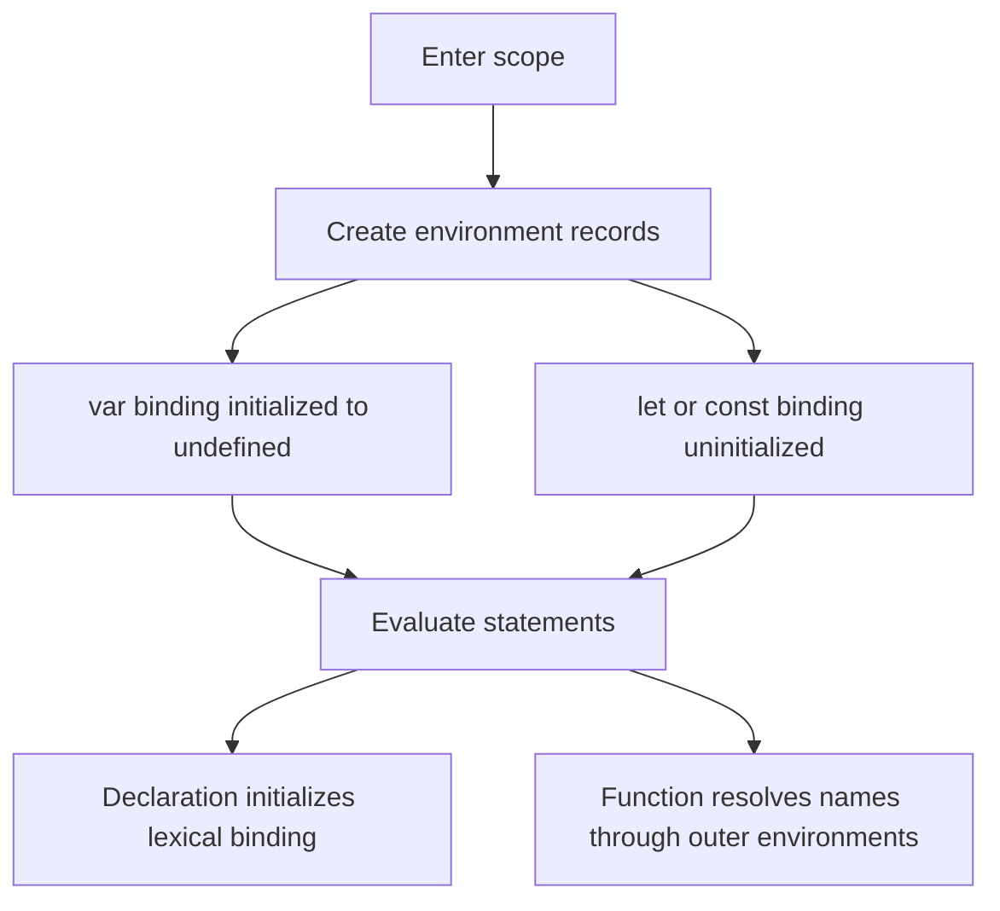
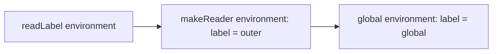

# JavaScript, HTML and CSS Interview Guide

This is the canonical incremental guide for the paired JavaScript/HTML/CSS workbooks. This first bounded module reconciles **Q1–Q4 only**: bindings, declaration instantiation, lexical scope, and loop capture. Later questions remain queued; this is not a claim that the complete workbook has been promoted.

## Module map

- [Q1 — `var`, `let`, and `const`](#q1)
- [Q2 — Hoisting and the temporal dead zone](#q2)
- [Q3 — Lexical scope](#q3)
- [Q4 — Loop capture with `var` and `let`](#q4)
- [Source provenance and verification](#sources)
- [Next bounded section](#next)

## The model before the syntax

An interview answer is stronger when it separates four questions:

1. **Where is the binding stored?** Function/global variable environment or a lexical block environment?
2. **When is the binding created?** Before statements execute, during declaration instantiation.
3. **When is the binding initialized?** `var` starts as `undefined`; a lexical binding cannot be read until its declaration initializes it.
4. **Which binding does a function close over?** The one found through the lexical environment chain where the function was created.



The phrase “JavaScript moves declarations to the top” is only a mnemonic. No source text moves. The specification describes environment creation, binding creation, initialization, and later statement evaluation.

<a id="q1"></a>

## Q1. What is the difference between `var`, `let`, and `const`?

### What the interviewer is asking

Given a declaration, identify its scope, redeclaration rules, initialization timing, and whether the **binding** may be assigned again. Do not confuse a constant binding with an immutable object.

| Declaration | Scope | Before declaration executes | Same-scope redeclaration | Reassignment |
|---|---|---|---|---|
| `var` | nearest function or script/global variable environment | readable as `undefined` | generally allowed for another `var` | allowed |
| `let` | nearest block | binding exists but is uninitialized | syntax error | allowed after initialization |
| `const` | nearest block | binding exists but is uninitialized | syntax error | forbidden after initialization |

### Example 1 — the binding is constant, not the object

```javascript
const profile = { name: "Ada", skills: ["JS"] };
profile.name = "Grace";          // allowed: mutate the object
profile.skills.push("HTML");     // allowed
// profile = {};                 // TypeError: assignment to a constant

console.log(profile);
// { name: "Grace", skills: ["JS", "HTML"] }
```

Trace:

| Step | Binding `profile` | Referenced object |
|---:|---|---|
| declaration | initialized once | `{ name: "Ada", skills: ["JS"] }` |
| property write | unchanged | `name` becomes `"Grace"` |
| `push` | unchanged | array gains `"HTML"` |

Use `Object.freeze()` when shallow runtime mutation prevention is the actual requirement; it solves a different problem from `const`.

<a id="q2"></a>

## Q2. Explain hoisting and the Temporal Dead Zone with output

### Requirement

Predict the output in two phases: first declaration instantiation, then statement evaluation. A lexical binding’s temporal dead zone (TDZ) lasts from entering its scope until its declaration initializes it.

### Example 2 — distinguish created from initialized

```javascript
console.log(total); // undefined
printReady();       // ready

var total = 7;
function printReady() {
  console.log("ready");
}

try {
  console.log(status); // ReferenceError
} catch (error) {
  console.log(error.name);
}
let status = "done";
```

Expected output:

```text
undefined
ready
ReferenceError
```

Dry run:

| Phase | `total` | `printReady` | `status` |
|---|---|---|---|
| declaration instantiation | initialized to `undefined` | initialized to function object | created, uninitialized |
| first log | prints `undefined` | — | — |
| call | — | prints `ready` | — |
| `var` initializer | becomes `7` | — | — |
| attempted lexical read | — | — | throws `ReferenceError` |
| lexical declaration | — | — | initialized to `"done"` |

Interview trap: `typeof missingName` returns `"undefined"`, but `typeof tdzName` can throw when `tdzName` is an uninitialized lexical binding in the current scope.

<a id="q3"></a>

## Q3. What is lexical scope?

### Requirement

Resolve an identifier from the function’s **definition environment**, not from whichever function happens to call it. The environment chain is determined by source nesting.

### Example 3 — call site does not replace the definition environment

```javascript
const label = "global";

function makeReader() {
  const label = "outer";
  return function readLabel() {
    return label;
  };
}

function invokeWithAnotherLabel(fn) {
  const label = "caller";
  return fn();
}

const read = makeReader();
console.log(invokeWithAnotherLabel(read)); // outer
```

Lookup trace for `label` inside `readLabel`:



The lookup stops at `makeReader`’s binding. `invokeWithAnotherLabel` is on the call stack, but it is not on `readLabel`’s lexical environment chain.

<a id="q4"></a>

## Q4. Why does a `var` loop print `3,3,3`, while a `let` loop prints `0,1,2`?

### Requirement

Count captured **bindings**, not captured values. A `var` loop reuses one function-scoped binding. A `for` loop with a lexical declaration creates a fresh per-iteration environment.

### Example 4 — callbacks read their bindings after the loop

```javascript
for (var i = 0; i < 3; i += 1) {
  setTimeout(() => console.log(i), 0);
}
// 3, 3, 3

for (let j = 0; j < 3; j += 1) {
  setTimeout(() => console.log(j), 0);
}
// 0, 1, 2
```

Dry run:

| Registration | `var` callback closes over | `let` callback closes over |
|---:|---|---|
| 1 | shared `i` | iteration binding `j = 0` |
| 2 | shared `i` | iteration binding `j = 1` |
| 3 | shared `i` | iteration binding `j = 2` |
| after both loops | shared `i` is `3` | three `j` bindings remain `0`, `1`, `2` |

The zero-millisecond delay does not mean “run now.” Each timer callback is queued for later processing by the host. The runnable [examples module](examples.mjs) checks the outputs without relying on console inspection.

### ES5-era repair and why `let` is clearer

Before per-iteration lexical bindings were available, an immediately invoked function could create a fresh parameter binding:

```javascript
for (var i = 0; i < 3; i += 1) {
  ((captured) => setTimeout(() => console.log(captured), 0))(i);
}
// 0, 1, 2
```

Prefer `let` for this case: it states the lifetime rule directly and removes the extra wrapper function.

## Decision checklist

- Use `const` by default when the binding should not change; use `let` when reassignment is part of the model.
- Treat `var` as function-scoped legacy syntax whose initialization and redeclaration rules matter when reading older code.
- For an output question, write the environment state before simulating statements.
- For a closure question, draw the source nesting and follow outer-environment links.
- For a loop/callback question, ask whether callbacks share one binding or receive one per iteration.

<a id="sources"></a>

## Source provenance and verification

Paired source comparison performed 2026-10-14:

- `JavaScript_HTML_CSS_Interview_Mermaid_Workbook.md`, SHA-256 `742ef1042828659004807171e384cfa22decd4589dbbb384d59910df6217fdd0`, lines 166–291. This later Mermaid edition supplies the broader structure, explicit mental model, intuition, key rules, and traps.
- `JavaScript_HTML_CSS_Interview_Workbook.docx`, SHA-256 `790f96df8880d825180a99171978d4fd301eeb7f3e1490c570a42028d5778bfb`, extracted paragraphs 21–81. It agrees on Q1–Q4 and their code/dry runs, but is not promoted as a competing guide.
- The repository edition adds the four connected examples, explicit requirements, environment traces, runnable assertions, and current normative links.

Primary references checked on 2026-10-14:

- [ECMAScript 2026 — Environment Records](https://tc39.es/ecma262/2026/multipage/executable-code-and-execution-contexts.html#sec-environment-records)
- [ECMAScript 2026 — `let`, `const`, and `var` declarations](https://tc39.es/ecma262/2026/multipage/ecmascript-language-statements-and-declarations.html#sec-let-and-const-declarations)
- [ECMAScript 2026 — `for` loop per-iteration environments](https://tc39.es/ecma262/2026/multipage/ecmascript-language-statements-and-declarations.html#sec-createperiterationenvironment)
- [HTML Living Standard — timers](https://html.spec.whatwg.org/multipage/timers-and-user-prompts.html#timers)
- [MDN — Closures](https://developer.mozilla.org/en-US/docs/Web/JavaScript/Guide/Closures)

<a id="next"></a>

## Next bounded section

Continue with source Q5–Q10: primitive/reference values, equality, missing numeric values, shallow/deep copy, array transforms, optional chaining, and nullish coalescing. Re-read both sources at that boundary before editing this canonical guide.
