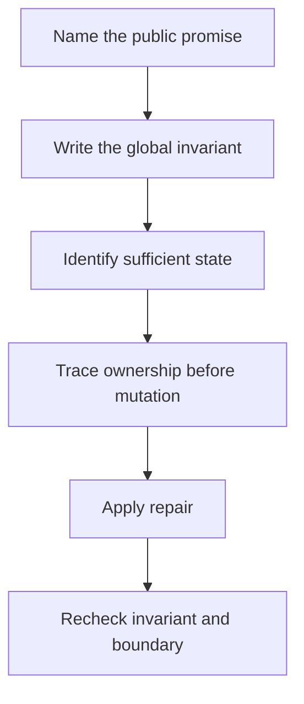
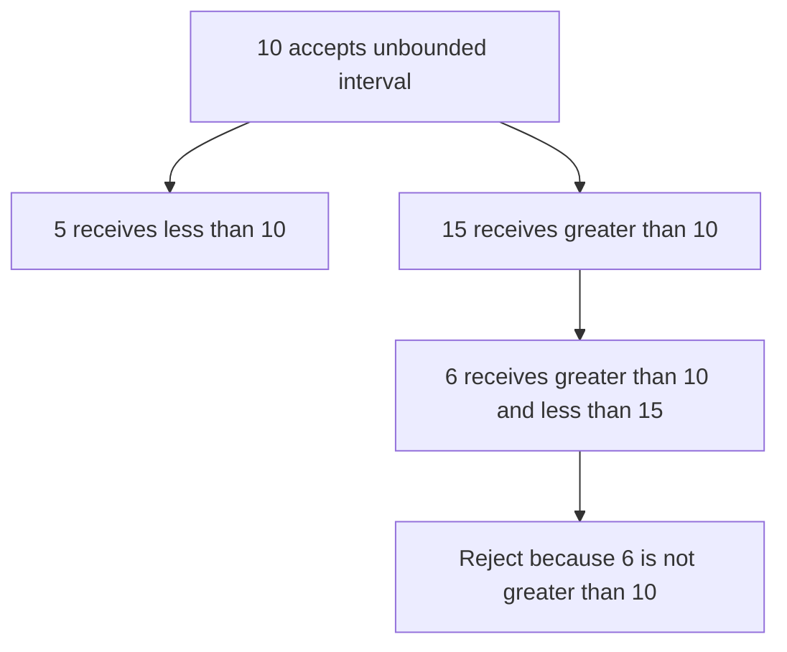
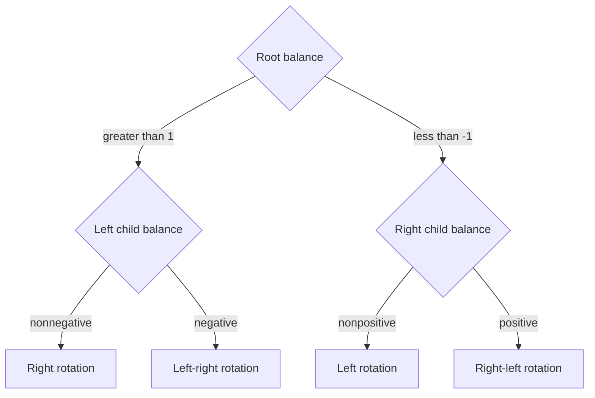
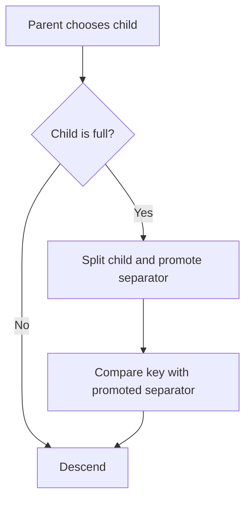
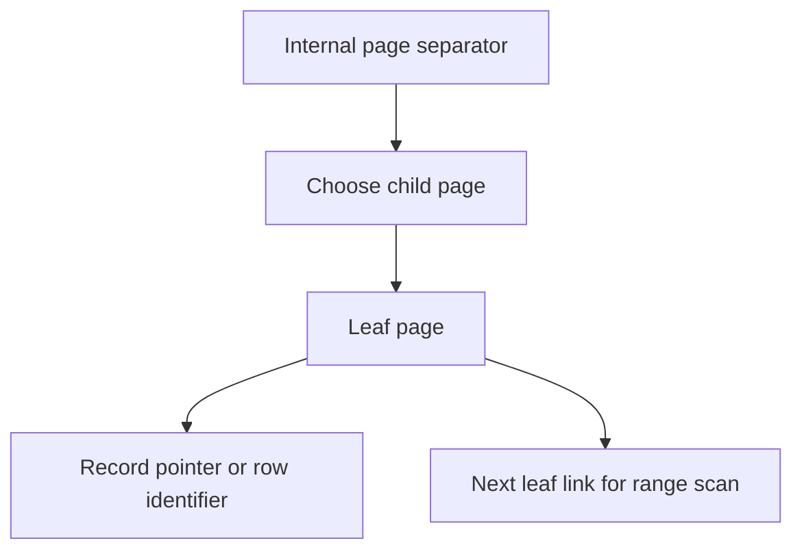
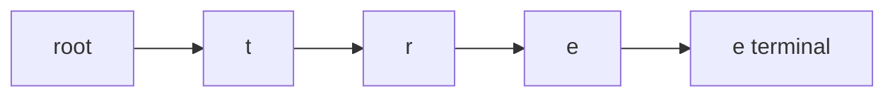
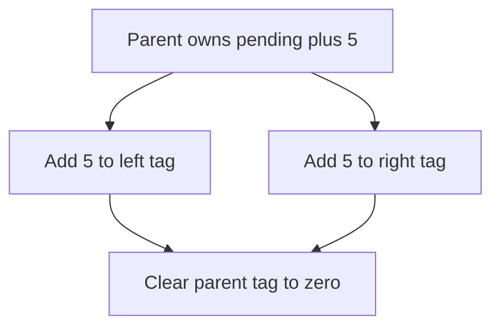

# Advanced Trees — Common Mistakes and Interview Traps

> Incremental status: this guide promotes source Section 13, “Common Mistakes & Interview Traps,” at selected Markdown lines 1317–1332 and corroborating DOCX Pandoc lines 1929–1945. Sections 14–15 remain queued.

## Contents

- [Requirement contract](#requirement-contract)
- [Example 1 — repair the invariant, not the symptom](#example-1--repair-the-invariant-not-the-symptom)
- [Example 2 — split routing from record ownership](#example-2--split-routing-from-record-ownership)
- [Example 3 — distinguish structural order from query semantics](#example-3--distinguish-structural-order-from-query-semantics)
- [Example 4 — make deferred range state explicit](#example-4--make-deferred-range-state-explicit)
- [Executable mistake contracts](#executable-mistake-contracts)
- [References and provenance](#references-and-provenance)

## Requirement contract

The twelve source traps share one failure pattern: code relies on a local shape while the data structure promises a global invariant or a different public operation. Diagnose the promised observation first, then identify the state that is sufficient to prove it.

| Structure | Promise to the caller | State the implementation must preserve | Typical invalid shortcut |
|---|---|---|---|
| strict BST | every inorder key is strictly increasing | all ancestor bounds | compare only parent and child |
| AVL | BST order and balance factor in `[-1,1]` | child heights after structural movement | use the deleted key to select a case |
| red-black tree | BST order, black root, no red-red edge, equal black height | color plus local shape, normalized through the root | memorize cases without checking invariants |
| B-tree | bounded page occupancy during every descent | child occupancy before recursion | descend into a full child |
| B+ tree | internal routing; records and ordered scan at leaves | separator/record role and leaf links | treat a separator as a full record |
| heap | extremum at the root | parent-child priority | assume the backing array is sorted |
| trie | prefix reachability and exact word membership are distinct | terminal bit at the final node | return `true` for every reachable prefix |
| segment tree | aggregate over a declared interval | interval length and aggregate operator | add a range delta only once |
| lazy propagation | deferred update is applied exactly once per descendant | tag ownership before and after push | copy a tag downward but leave it at the parent |
| Fenwick tree | prefix sums over a documented API index convention | one conversion boundary plus lowbit traversal | mix zero-based and one-based loops |



The repair is not “add another `if`.” It is to restore the proof obligation. That framing keeps the same reasoning valid across insertion, deletion, range updates and read-only queries.

## Example 1 — repair the invariant, not the symptom

This tree passes every direct parent-child comparison but is not a strict BST:

```text
       10
      /  \
     5    15
         /
        6
```

The node `6` is below its parent `15`, yet it violates the lower bound inherited from ancestor `10`.



```java
static boolean inside(Node node, long lowExclusive, long highExclusive) {
    if (node == null) return true;
    if (node.key <= lowExclusive || node.key >= highExclusive) return false;
    return inside(node.left, lowExclusive, node.key)
            && inside(node.right, node.key, highExclusive);
}
```

| Visit | Local parent test | Inherited interval | Correct decision |
|---:|---|---|---|
| `10` | root | `(-∞,+∞)` | accept |
| `15` | `15 > 10` | `(10,+∞)` | accept |
| `6` | `6 < 15` | `(10,15)` | reject |

AVL deletion has the same diagnosis rule. After deletion, the deleted key no longer identifies which grandchild is heavy. Recompute balance from the surviving children:

| Unbalanced node | Heavy child balance | Repair |
|---:|---:|---|
| `+2` | `>= 0` | single right rotation |
| `+2` | `< 0` | left child left, then parent right |
| `-2` | `<= 0` | single left rotation |
| `-2` | `> 0` | right child right, then parent left |



After a rotation, update the node moved downward before the new local root; the new root's height depends on the moved-down node's repaired height. For a red-black tree, finish the top-level update by forcing the root black. That does not replace the red-red and black-height repairs—it closes the root-specific invariant after them.

Correctness comes from carrying the information the invariant quantifies over: ancestor intervals for BST order and surviving subtree heights/colors for balancing. A key that was deleted is not part of the post-state and cannot be a reliable repair witness.

## Example 2 — split routing from record ownership

For a B-tree with maximum five keys per node, suppose the root contains `[20,40]` and the middle child is full:

```text
root: [20 | 40]
middle child: [22 | 25 | 30 | 35 | 38]
insert: 33
```

Descending first would ask an already-full child to accept a sixth key. Top-down insertion instead splits the full child before recursion, promotes the median separator, and then chooses one non-full side.



One possible split trace for minimum degree `t = 3`:

| State | Parent separators | Candidate children | Decision for `33` |
|---|---|---|---|
| before split | `[20,40]` | middle `[22,25,30,35,38]` full | do not descend |
| after split | `[20,30,40]` | `[22,25]`, `[35,38]` | choose interval `(30,40)` |
| after leaf insert | `[20,30,40]` | right half `[33,35,38]` | occupancy remains legal |

The exact promoted key and occupancy bounds depend on the declared B-tree convention; this guide uses minimum degree `t`, where a full node has `2t-1` keys. State that convention before the dry run.

A B+ tree separates another pair of roles:



Internal separators are routing evidence. Leaf entries own the indexed record references. A separator may repeat a boundary key, but it is not by itself an extra full record. Current PostgreSQL documentation makes the same structural distinction: internal tuples point to the next level, while leaf tuples point to table rows.

The B-tree proof is inductive: recursion begins only in a non-full child, so the leaf insertion has capacity; a split can add one separator to the current parent, whose capacity was guaranteed by the caller. The B+ role split preserves lookup and range-scan semantics because routing ends at the leaf level where records and sibling links live.

## Example 3 — distinguish structural order from query semantics

A min-heap array such as `[1,4,2,9,7,5]` satisfies `parent <= child`, but it is not globally sorted: `4` appears before `2`, and `9` before `7`.

| Operation | Guaranteed result | Not guaranteed |
|---|---|---|
| `peek()` | one minimum element | second-smallest element |
| `poll()` repeatedly | nondecreasing sequence | preservation of the original queue |
| iterator/backing-array scan | every stored element | priority order |

```java
static List<Integer> sortedDrain(PriorityQueue<Integer> queue) {
    PriorityQueue<Integer> ownedCopy = new PriorityQueue<>(queue);
    List<Integer> ordered = new ArrayList<>();
    while (!ownedCopy.isEmpty()) ordered.add(ownedCopy.remove());
    return List.copyOf(ordered);
}
```

Oracle Java SE 25 explicitly states that `PriorityQueue` iteration has no particular order. Repeated removal is the queue operation that exposes priority order. Copy first when the caller retains ownership of the original queue.

A trie has a parallel semantic distinction. After inserting `tree`, nodes for `t`, `tr` and `tre` exist, so all are prefixes; only the final `tree` node is terminal.



| Query | Traversal ends at | Terminal? | Result |
|---|---|---:|---|
| `startsWith("tr")` | `r` node | no | `true` |
| `contains("tr")` | `r` node | no | `false` |
| `contains("tree")` | final `e` node | yes | `true` |
| `contains("trip")` | missing `i` edge | n/a | `false` |

Heap shape answers “which item has highest priority next?” Trie reachability answers “is this path present?” Neither promise silently expands into sorted enumeration or complete-word membership. The public method must name and enforce the intended observation.

## Example 4 — make deferred range state explicit

For a range-sum segment tree, adding `+3` to a fully covered segment of length four changes the stored sum by `12`, not `3`:

```text
before: [2, 1, 4, 3] sum = 10
after:  [5, 4, 7, 6] sum = 22
```

```java
static long applyRangeSum(long sum, long delta, int length) {
    if (length <= 0) throw new IllegalArgumentException();
    return Math.addExact(sum, Math.multiplyExact(delta, length));
}
```

A lazy tag means “this update belongs to the descendants but has not yet been materialized there.” Pushing transfers that ownership once:



| State | Parent tag | Left tag | Right tag |
|---|---:|---:|---:|
| before push | `5` | `2` | `-1` |
| after transfer | `0` | `7` | `4` |
| erroneous second push if parent were not cleared | `5` | `12` | `9` |

Fenwick trees need an equally explicit index boundary. Offer a zero-based public API if that is natural for Java arrays, but convert exactly once to the one-based internal representation:

```java
void addAtZeroBased(int index, long delta) {
    for (int i = index + 1; i < tree.length; i += i & -i) {
        tree[i] += delta;
    }
}

long prefixThroughZeroBased(int index) {
    long sum = 0;
    for (int i = index + 1; i > 0; i -= i & -i) sum += tree[i];
    return sum;
}
```

For an array of length five, public index `0` maps to internal index `1`; public index `4` maps to `5`. Validate the public index before conversion. Allowing `-1` only as the documented empty-prefix query is safe; allowing `0` into a one-based update loop is not, because `lowbit(0) = 0` and progress stops.

The range-update proof is conservation of ownership. The aggregate immediately reflects the whole covered interval, while the lazy tag records exactly one deferred child update. Push moves that obligation to both children and clears the parent. The Fenwick proof is partitioned-prefix coverage: subtracting lowbit visits disjoint buckets whose union is the requested prefix.

## Executable mistake contracts

[`TreeMistakeContracts.java`](java/TreeMistakeContracts.java) encodes the four repair families and all twelve source traps: ancestor-bound BST validation; AVL post-state classification; red-black root normalization; B-tree pre-split and B+ role separation; heap ordered drain; trie terminal membership; length-aware segment aggregation; one-time lazy transfer; and a zero-based Fenwick API over one-based internals.

Twenty deterministic groups cover explicit boundary and failure cases. Then 20,000 seeded trials perform 80,000 independent checks across ancestor traps, AVL rotation classification, repeated-versus-multiplied range updates and Fenwick prefixes.

```bash
java -ea study-guides/local-project-notes/advanced-trees/java/TreeMistakeContracts.java
```

Expected result:

```text
PASS groups=20 trials=20000 checks=80000
```

## References and provenance

- Oracle, [Java SE 25 `PriorityQueue`](https://docs.oracle.com/en/java/javase/25/docs/api/java.base/java/util/PriorityQueue.html) — head operations expose priority order; iterator and spliterator order is unspecified.
- PostgreSQL 19, [B-Tree Indexes](https://www.postgresql.org/docs/current/btree.html) — current internal-page routing and leaf-page table-row pointer roles.
- G. M. Adel'son-Vel'skii and E. M. Landis, [“An algorithm for organization of information”](https://www.mathnet.ru/php/archive.phtml?jrnid=dan&option_lang=eng&paperid=26964&wshow=paper), 1962 — original height-balanced search-tree work.
- Leo J. Guibas and Robert Sedgewick, [“A Dichromatic Framework for Balanced Trees”](https://doi.org/10.1109/SFCS.1978.3), 1978 — color-based invariants and balanced-tree repair framework.
- Rudolf Bayer and Edward McCreight, [“Organization and Maintenance of Large Ordered Indexes”](https://doi.org/10.1007/BF00288683), 1972 — original B-tree page organization and logarithmic maintenance analysis.
- Peter M. Fenwick, [“A New Data Structure for Cumulative Frequency Tables”](https://doi.org/10.1002/SPE.4380240306), 1994 — binary indexed tree decomposition and logarithmic prefix/update traversal.

Source intake:

- Selected `Advanced_Trees_FAANG_Mermaid_Study_Guide.md`, Library file `libfile_7346abf23a3c81918843c9a9f5b5d80f`, 68,775 bytes, SHA-256 `86cb65f3d6d0f327e5d22c03b5d587144eb11cc9ff27a5b523b298b09ad7f5b1`. This pass promotes only Section 13 at lines 1317–1332, bounded before the Section 14 anchor.
- Compared `Tree_Advanced_FAANG_Study_Guide.docx`, Library file `libfile_b71f27c80d4c81918c672303add6bfb5`, 227,748 bytes, SHA-256 `fb1dc6f7d9990c04691a69e2345dac5e6a08f3d36448e0e9c3a67b96b55ee58f`. A fresh Pandoc GFM conversion places the matching Section 13 table at lines 1929–1945, bounded before Section 14; the older queue range `1792–1807` pointed into Section 12 and is corrected by this pass.
- The earlier broad `advanced_trees_interview_guide.md` and focused Sections 3–12 remain comparison/canonical material. This guide consolidates the distinct trap checklist and does not duplicate their full implementations.

The requirement table, four worked repair traces, seven diagrams, executable contract and randomized oracles are newly authored teaching material. Source Sections 14–15 and the wider 170-placeholder backlog remain incomplete.
