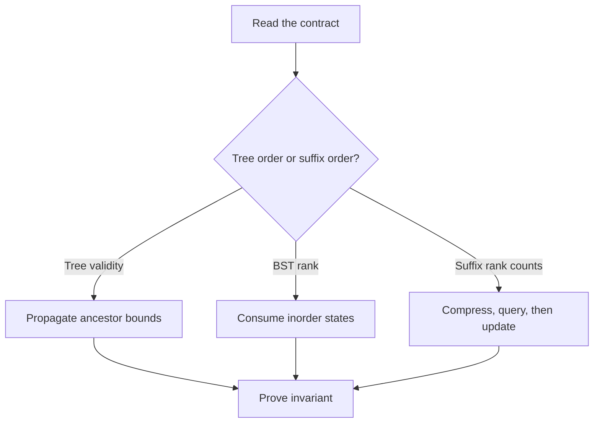
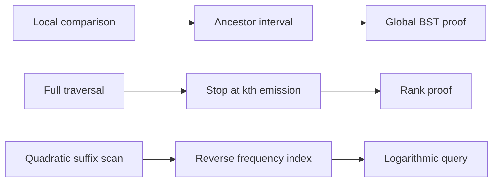
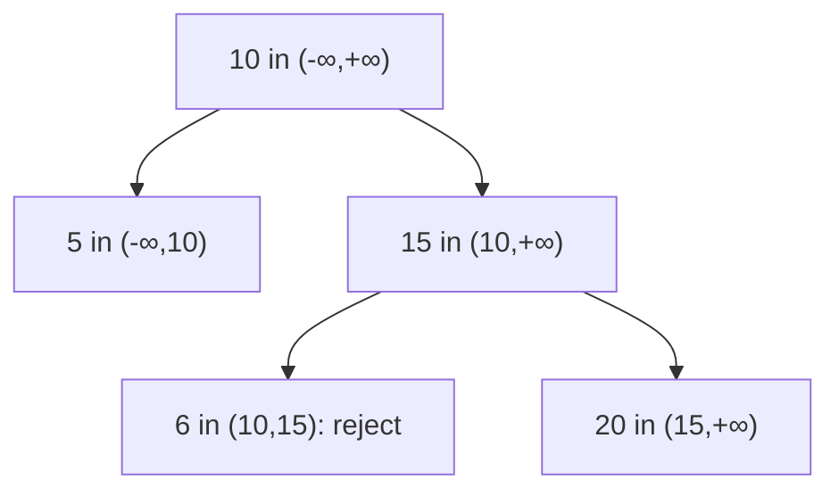
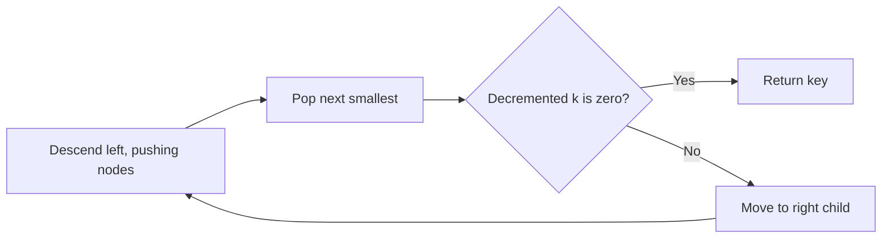
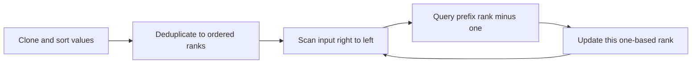
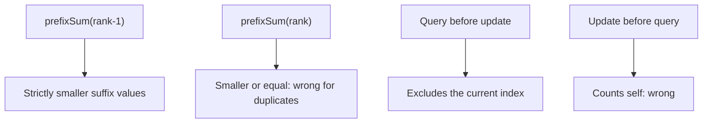

# Advanced Trees — FAANG Problem Ladder

> Incremental status: this guide promotes source Section 12, “FAANG Problem Ladder — Easy / Medium / Hard,” at selected Markdown lines 1188–1314 and corroborating DOCX Pandoc lines 1587–1791. Sections 13–15 remain queued.

## Contents

- [Requirement contract](#requirement-contract)
- [The three-proof ladder](#the-three-proof-ladder)
- [Example 1 — validate a BST with ancestor bounds](#example-1--validate-a-bst-with-ancestor-bounds)
- [Example 2 — preserve the full integer domain](#example-2--preserve-the-full-integer-domain)
- [Example 3 — kth smallest by iterative inorder](#example-3--kth-smallest-by-iterative-inorder)
- [Example 4 — count smaller values after self](#example-4--count-smaller-values-after-self)
- [Executable problem contracts](#executable-problem-contracts)
- [References and provenance](#references-and-provenance)

## Requirement contract

The difficulty labels are less useful than the invariant each problem demands. State the contract before choosing the traversal or data structure.

| Problem | Input contract | Required output | Equality rule | Ownership and failure |
|---|---|---|---|---|
| validate BST | any binary tree of `int` keys; empty allowed by this guide | whether every key lies inside all ancestor bounds | strict: duplicates are invalid | do not mutate; use a wider bound type |
| kth smallest | valid strict BST; `k` is one-based | the key with inorder rank `k` | distinct structural keys | reject null root, `k <= 0`, or `k > n` |
| count smaller after self | any non-null `int[]`, including duplicates and extremes | one count per input index | equal values do not count | do not mutate the caller's array |



The source's hard-problem snippet contains a critical formatting defect: `bit.add(idx, 1)` follows a line comment and is therefore commented out. It also mixes zero-based ranks with a Fenwick implementation whose index convention is not shown. The implementation here makes the one-based Fenwick boundary explicit and executes query-before-update as two separate statements.

## The three-proof ladder

| Level | Recognition clue | State that must be sufficient | Proof obligation |
|---|---|---|---|
| easy | “every node satisfies BST order” | open interval `(low, high)` inherited from ancestors | each child receives the intersection of all ancestor constraints |
| medium | “kth in a BST” | explicit stack plus count of emitted inorder nodes | inorder emits every valid BST key exactly once in increasing order |
| hard | “smaller values to the right” | frequencies of already-seen compressed ranks | reverse scan makes the right suffix equal the inserted multiset |



## Example 1 — validate a BST with ancestor bounds

Consider this tree:

```text
       10
      /  \
     5    15
         /  \
        6    20
```

The edge `15 -> 6` is locally ordered, but `6` is in the right subtree of `10` and violates the inherited lower bound `10`.



```java
static boolean isValidBst(Node root) {
    return within(root, Long.MIN_VALUE, Long.MAX_VALUE);
}

static boolean within(Node node, long lowExclusive, long highExclusive) {
    if (node == null) return true;
    if (node.key <= lowExclusive || node.key >= highExclusive) return false;
    return within(node.left, lowExclusive, node.key)
            && within(node.right, node.key, highExclusive);
}
```

Dry run:

| Visit | Received interval | Decision | Child intervals |
|---:|---|---|---|
| 10 | `(-∞,+∞)` | accept | left `(-∞,10)`, right `(10,+∞)` |
| 5 | `(-∞,10)` | accept | both null |
| 15 | `(10,+∞)` | accept | left `(10,15)`, right `(15,+∞)` |
| 6 | `(10,15)` | reject | `6 <= 10` |

Correctness follows by induction. The root starts with no finite restriction. If a node lies inside its inherited interval, its left subtree must additionally be below the node and its right subtree must additionally be above it. Those new intervals retain every ancestor restriction. A rejected key violates at least one ancestor; if all recursive calls accept, every node satisfies the strict BST definition.

Time is `O(n)` because each reachable node is examined once. Space is `O(h)` for recursion depth, becoming `O(n)` on a skewed tree. For untrusted very deep trees, use an explicit stack carrying `(node, low, high)` to avoid call-stack exhaustion.

## Example 2 — preserve the full integer domain

Sentinel bounds must not consume valid keys. With `int` node values, this tree is valid:

```text
          0
        /   \
  -2147483648 2147483647
```

Using `int low = Integer.MIN_VALUE` and a strict `node.key <= low` check would incorrectly reject the left key. `long` bounds keep both endpoints available as real data.

Four boundary checks:

| Tree | Expected | Reason |
|---|---:|---|
| empty | `true` | no ordering violation |
| single `Integer.MIN_VALUE` | `true` | key lies inside `long` bounds |
| root `2`, left `2` | `false` | strict BSTs reject duplicates |
| root `0`, left `MIN_VALUE`, right `MAX_VALUE` | `true` | both extreme keys remain representable |

This is a general interview rule: do not borrow an in-domain value as an out-of-band sentinel when a wider type or explicit absence state is available.

## Example 3 — kth smallest by iterative inorder

For the BST below, inorder is `[2,3,4,5,6,7,8]`; `k = 4` returns `5`.



```java
static int kthSmallest(Node root, int k) {
    if (root == null || k <= 0) throw new IllegalArgumentException();
    ArrayDeque<Node> stack = new ArrayDeque<>();
    Node current = root;
    while (current != null || !stack.isEmpty()) {
        while (current != null) {
            stack.push(current);
            current = current.left;
        }
        current = stack.pop();
        if (--k == 0) return current.key;
        current = current.right;
    }
    throw new IllegalArgumentException("k exceeds the node count");
}
```

| Emitted key | `k` before | `k` after | Action |
|---:|---:|---:|---|
| 2 | 4 | 3 | continue |
| 3 | 3 | 2 | continue |
| 4 | 2 | 1 | continue |
| 5 | 1 | 0 | return `5` |

The stack represents the path to the smallest not-yet-emitted key. Popping emits one key; moving to its right subtree and descending left restores the same invariant. Therefore the `k`th emission is the `k`th smallest key. Time is `O(h + k)` with early stopping and worst-case `O(n)`; auxiliary space is `O(h)`.

For frequent rank queries under mutation, augment each node with subtree size and maintain that field through insertions, deletions and rotations. Then selection follows left-subtree sizes in `O(h)`, which is `O(log n)` only when height is kept logarithmic.

## Example 4 — count smaller values after self

For each position, count strictly smaller values to its right. The source example is:

`[5,2,6,1,3,2,7,0] -> [5,2,4,1,2,1,1,0]`

Three transformations remove the quadratic scan:



Sorted unique values are `[0,1,2,3,5,6,7]`. Their one-based ranks are `1..7`. A Fenwick prefix query at `rank - 1` excludes equal values.

| `i` | value | rank | suffix frequencies before step | query result | update |
|---:|---:|---:|---|---:|---|
| 7 | 0 | 1 | `{}` | 0 | add rank 1 |
| 6 | 7 | 7 | `{0}` | 1 | add rank 7 |
| 5 | 2 | 3 | `{0,7}` | 1 | add rank 3 |
| 4 | 3 | 4 | `{0,2,7}` | 2 | add rank 4 |
| 3 | 1 | 2 | `{0,2,3,7}` | 1 | add rank 2 |
| 2 | 6 | 6 | `{0,1,2,3,7}` | 4 | add rank 6 |
| 1 | 2 | 3 | `{0,1,2,3,6,7}` | 2 | add rank 3 |
| 0 | 5 | 5 | `{0,1,2,2,3,6,7}` | 5 | add rank 5 |



The reverse-scan invariant is: before processing index `i`, the Fenwick tree stores exactly the multiset of ranks from indices `i+1..n-1`. The prefix through `rank(i)-1` therefore counts exactly the strictly smaller suffix values. Updating afterward establishes the invariant for `i-1`.

Sorting costs `O(n log n)`. Each of `n` lower-bound searches, prefix queries and updates costs `O(log n)`, so total time is `O(n log n)` and space is `O(n)`. The implementation clones before sorting and does not mutate the caller's input.

## Executable problem contracts

[`TreeProblemLadderContracts.java`](java/TreeProblemLadderContracts.java) contains all three implementations with explicit contracts. Twenty deterministic groups cover global bounds, duplicates, integer extremes, one-based rank boundaries, out-of-range failures, strict suffix counts and input ownership. Then 20,000 seeded trials perform 80,000 checks against independent inorder, sorted-set, quadratic-count and ownership oracles.

```bash
java -ea study-guides/local-project-notes/advanced-trees/java/TreeProblemLadderContracts.java
```

Expected result:

```text
PASS groups=20 trials=20000 checks=80000
```

## References and provenance

- [LeetCode 98, *Validate Binary Search Tree*](https://leetcode.com/problems/validate-binary-search-tree/) — official strict left/right subtree definition and full signed-`int` value domain.
- [LeetCode 230, *Kth Smallest Element in a BST*](https://leetcode.com/problems/kth-smallest-element-in-a-bst/) — official one-based rank contract and frequent-mutation follow-up.
- [LeetCode 315, *Count of Smaller Numbers After Self*](https://leetcode.com/problems/count-of-smaller-numbers-after-self/) — official strict-smaller suffix contract, duplicates and input limits.
- [Java SE 25 `ArrayDeque`](https://docs.oracle.com/en/java/javase/25/docs/api/java.base/java/util/ArrayDeque.html) — current official stack-capable deque contract.
- [Java SE 25 `Arrays`](https://docs.oracle.com/en/java/javase/25/docs/api/java.base/java/util/Arrays.html) — current official primitive-array cloning/sorting companion API and ascending `int[]` sort contract.
- Peter M. Fenwick, [“A new data structure for cumulative frequency tables”](https://doi.org/10.1002/spe.4380240306), 1994 — original binary indexed tree paper.

Source intake:

- Selected `Advanced_Trees_FAANG_Mermaid_Study_Guide.md`, Library file `libfile_7346abf23a3c81918843c9a9f5b5d80f`, 68,775 bytes, SHA-256 `86cb65f3d6d0f327e5d22c03b5d587144eb11cc9ff27a5b523b298b09ad7f5b1`. This pass promotes only Section 12 at lines 1188–1314, bounded before the Section 13 anchor.
- Compared `Tree_Advanced_FAANG_Study_Guide.docx`, Library file `libfile_b71f27c80d4c81918c672303add6bfb5`, 227,748 bytes, SHA-256 `fb1dc6f7d9990c04691a69e2345dac5e6a08f3d36448e0e9c3a67b96b55ee58f`. Its Pandoc GFM lines 1587–1791 carry the same three problems, algorithms and dry run, so no competing edition was created.
- The earlier broad `advanced_trees_interview_guide.md` remains a comparison source, not a duplicate canonical ladder.

The contract tables, four worked examples, six diagrams, corrected Fenwick boundary, explicit failure behavior and randomized executable oracles are newly authored teaching material. Source Sections 13–15 and the wider 170-placeholder backlog remain incomplete.
