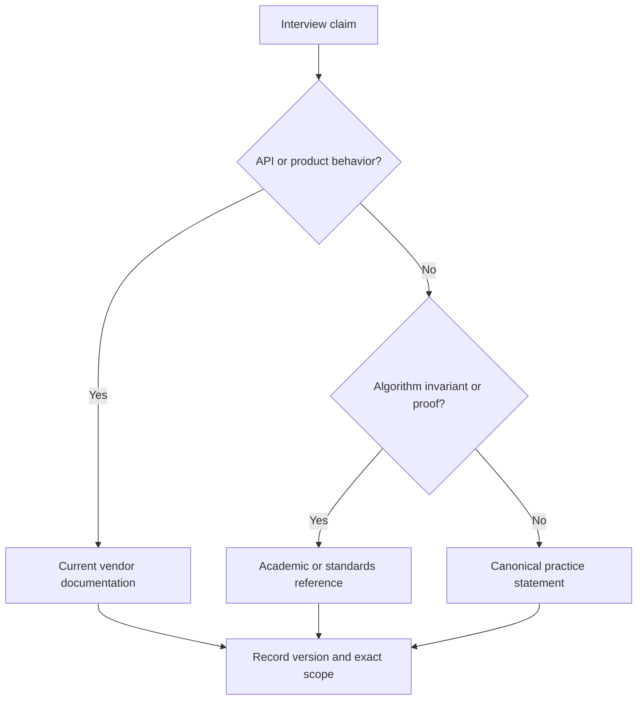
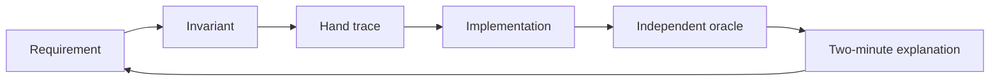
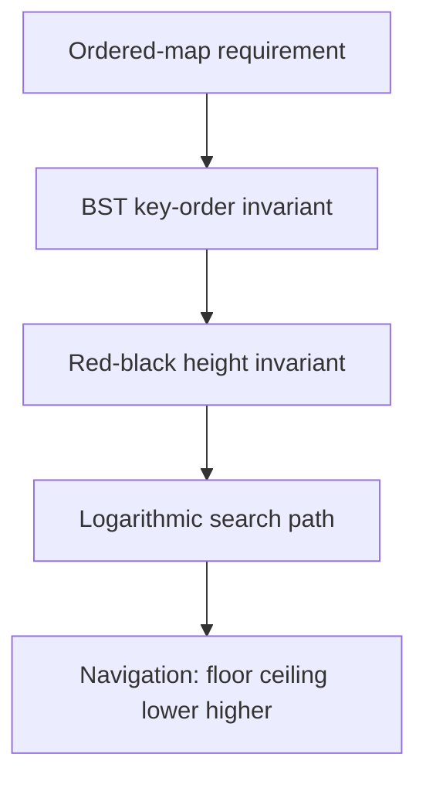
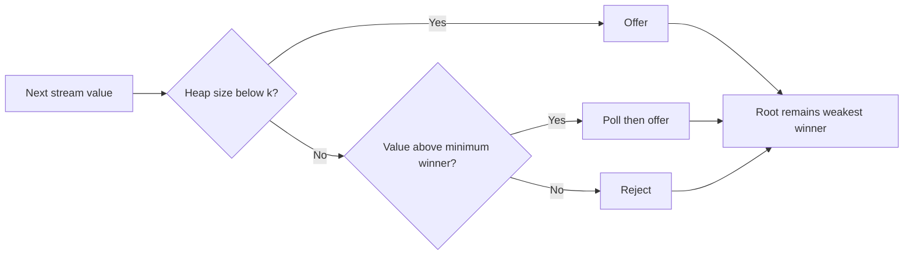
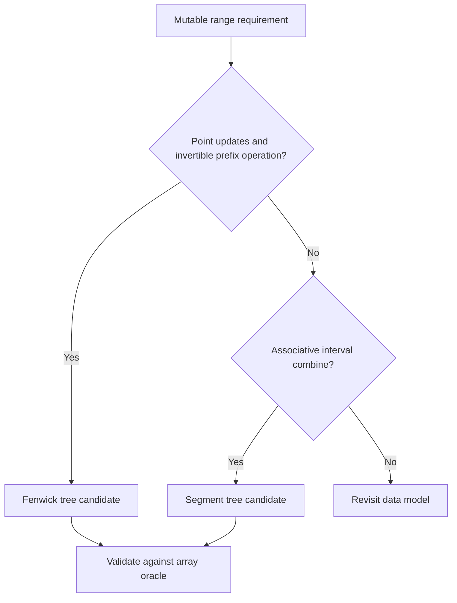
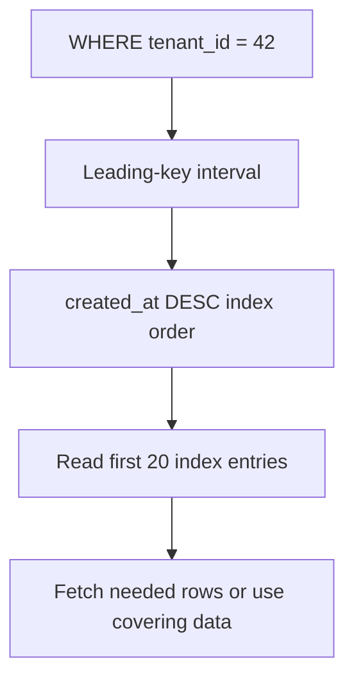
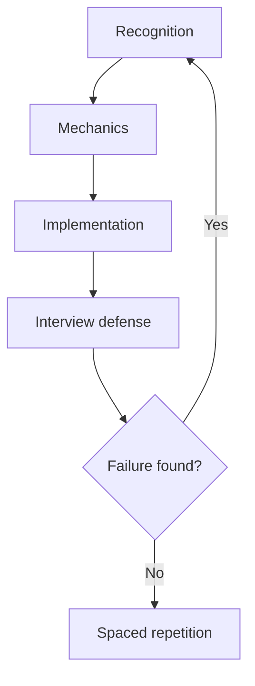

# Advanced Trees — Verified References and Practice Roadmap

> **Source boundary:** Advanced Trees Section 15, selected Markdown display lines 1398–1449 (the final line has no trailing newline) and corroborating DOCX Pandoc lines 1874–1923 through source end. This module turns the source's link list and topic table into an evidence-gated practice system; it does not duplicate the completed structure guides.

## Contents

- [Reference contract](#reference-contract)
- [Practice gate](#practice-gate)
- [Example 1 — ordered-map invariant before red-black mechanics](#example-1--ordered-map-invariant-before-red-black-mechanics)
- [Example 2 — top-K proves what a heap does not guarantee](#example-2--top-k-proves-what-a-heap-does-not-guarantee)
- [Example 3 — mutable range sums force an operation-algebra choice](#example-3--mutable-range-sums-force-an-operation-algebra-choice)
- [Example 4 — an index exercise must include query shape](#example-4--an-index-exercise-must-include-query-shape)
- [Four-stage deliberate-practice loop](#four-stage-deliberate-practice-loop)
- [Executable practice contracts](#executable-practice-contracts)
- [Verified references and provenance](#verified-references-and-provenance)

## Reference contract

A reference is useful only when the claim, version and retrieval purpose are explicit. Before attaching a link to an interview answer, record:

| Field | Required question | Failure prevented |
|---|---|---|
| claim owner | specification, implementation documentation, academic exposition or practice platform? | treating a tutorial as a language/API contract |
| version | which Java/PostgreSQL edition or problem statement was checked? | silently applying future or obsolete behavior |
| exact claim | invariant, asymptotic guarantee, API ordering, query-planner behavior or exercise input/output? | citing a page that is merely about the same topic |
| scope | abstract data structure or one production implementation? | claiming every B-tree behaves like PostgreSQL |
| retrieval date | when was the live page rechecked? | hiding link/version drift |
| exercise role | learn, implement, falsify, optimize or explain? | collecting links without a practice objective |



The source's NIST DADS and Princeton links remain useful for terminology and algorithmic exposition. Current product claims in this module use Oracle Java SE 26 and PostgreSQL 19 documentation. Practice problems are linked only as problem statements; their editorial code is neither copied nor treated as normative.

## Practice gate

Every practice item must pass six gates before it counts as learned:

1. **Requirement:** state the operations, mutation pattern, ordering and acceptable latency.
2. **Invariant:** draw what remains true after each operation.
3. **Trace:** execute at least one adversarial example by hand.
4. **Implementation:** write the core operation without library shortcuts when the exercise requires it.
5. **Oracle:** compare against a simpler trusted model on many generated cases.
6. **Explanation:** give complexity in terms of height, elements, alphabet or query range—not by memorized slogan.



The loop is intentionally cyclic. A failing oracle sends you back to the invariant or requirement; it is not repaired by memorizing another solution.

## Example 1 — ordered-map invariant before red-black mechanics

**Requirement.** Maintain `(key, value)` mappings with ordered lookup, updates, deletion, predecessor/successor navigation and logarithmic worst-case core operations.

**Trigger.** This is an ordered-map requirement, not merely “use a tree.” Java's current `TreeMap` documentation identifies its implementation as a red-black-tree-based `NavigableMap` and guarantees logarithmic `containsKey`, `get`, `put` and `remove`.

Trace the operations `put(40,A)`, `put(20,B)`, `put(60,C)`, `put(10,D)`, `put(30,E)`, `put(20,F)`, then `higherKey(30)`:

| Step | Ordered keys | Size | Observation |
|---|---|---:|---|
| `put(40,A)` | `[40]` | 1 | first root-level mapping |
| `put(20,B)` | `[20,40]` | 2 | key order, not insertion order |
| `put(60,C)` | `[20,40,60]` | 3 | both sides represented |
| `put(10,D)` | `[10,20,40,60]` | 4 | implementation may recolor/rotate |
| `put(30,E)` | `[10,20,30,40,60]` | 5 | order invariant remains |
| `put(20,F)` | `[10,20,30,40,60]` | 5 | equal key replaces value; no duplicate node |
| `higherKey(30)` | answer `40` | 5 | least key strictly greater than 30 |



**What to implement.** First write a plain BST map and make replacement semantics explicit. Then implement or explain red-black repair. Do not infer a particular internal shape from `TreeMap`; the API guarantees ordering and complexity, not a stable node layout.

**Oracle.** Compare your map's sorted keys, size, values, `floor` and `ceiling` with a `TreeMap` after every randomized update. The oracle checks observable behavior while separate invariant validation checks your internal tree.

## Example 2 — top-K proves what a heap does not guarantee

**Requirement.** Return the three largest values from stream `[8, 1, 7, 3, 9, 2, 9]` using `O(k)` retained memory.

Maintain a min-heap of accepted candidates. The root is the weakest current winner:

| Value | Heap content as a set/multiset | Decision |
|---:|---|---|
| 8 | `[8]` | accept; fewer than 3 |
| 1 | `[1,8]` | accept |
| 7 | `[1,7,8]` | accept |
| 3 | `[3,7,8]` | replace root 1 |
| 9 | `[7,8,9]` | replace root 3 |
| 2 | `[7,8,9]` | reject; not above root 7 |
| 9 | `[8,9,9]` | replace root 7 |

Final winners are `{8,9,9}`. If sorted output is required, drain or sort the final `k` elements.



Oracle Java SE 26 documents `offer` and `poll` as logarithmic and `peek` as constant time. It also warns that iterator traversal is not ordered. Therefore this is invalid:

```java
for (int value : heap) {
    // Wrong: iterator order is not sorted order.
}
```

The full stream costs `O(n log k)` time and `O(k)` auxiliary space. Arbitrary-key search is still linear; the heap guarantees only parent priority and fast access to its head.

**Oracle.** Sort a copy of each generated input and compare the largest `k` multiset with the heap result. Include duplicates, negative values, `k = 0`, `k = 1` and `k > n`.

## Example 3 — mutable range sums force an operation-algebra choice

**Requirement.** Start with `[2,1,5,3,4]`; support point assignment and inclusive range-sum queries. Perform `sum(1,3)`, `set(2,8)`, `sum(1,3)`.

Expected trace:

| Operation | Array state | Result or delta |
|---|---|---|
| start | `[2,1,5,3,4]` | — |
| `sum(1,3)` | unchanged | `1+5+3 = 9` |
| `set(2,8)` | `[2,1,8,3,4]` | Fenwick delta `+3` |
| `sum(1,3)` | unchanged | `1+8+3 = 12` |

A Fenwick tree stores invertible prefix aggregates compactly. Assignment is translated to a delta using the old value. A segment tree stores interval aggregates directly and generalizes more naturally to non-invertible combinations, range updates and richer node state.



The practice goal is not “solve LeetCode 307.” It is to defend the choice:

- point assignment becomes `delta = newValue - oldValue`,
- inclusive sum is `prefix(right) - prefix(left - 1)`,
- each Fenwick update/query visits `O(log n)` indices, and
- a plain prefix array has `O(1)` queries but `O(n)` point updates.

**Oracle.** Maintain the literal array and compute every queried range with a loop. Generate point assignments and valid `[left,right]` pairs; compare after every operation. This catches one-based-index conversion and stale-old-value errors.

## Example 4 — an index exercise must include query shape

**Requirement.** Support recent orders for one tenant:

```sql
SELECT order_id, created_at
FROM orders
WHERE tenant_id = 42
ORDER BY created_at DESC
LIMIT 20;
```

A plausible PostgreSQL index is:

```sql
CREATE INDEX orders_tenant_recent
ON orders (tenant_id, created_at DESC);
```

Trace the reasoning rather than chanting “databases use B+ trees”:

1. Equality on leading `tenant_id` identifies one contiguous key group.
2. Within that group, `created_at DESC` matches the required ordering.
3. A matching B-tree scan can return the first 20 entries without sorting the entire tenant history.
4. The planner still chooses among index scan, table scan and explicit sort using statistics and estimated cost.



PostgreSQL 19 documents that B-tree is the supported index type that can directly produce sorted output. Its multicolumn guidance says leading equalities plus the first inequality constrain the scanned portion most directly, while later columns may filter without necessarily shrinking the scan; current PostgreSQL can also consider skip scan in suitable low-distinctness cases.

**Boundary.** This exercise practices logical access-path reasoning, not PostgreSQL page concurrency. Production B-tree behavior also involves operator classes, MVCC-visible table tuples, page splits, deletion, recovery, latching and planner economics.

**Oracle.** Populate tenants with repeated timestamps, run `EXPLAIN (ANALYZE, BUFFERS)` in a disposable PostgreSQL instance, and compare returned rows with an explicit full sort. The repository does not claim this integration was executed here.

## Four-stage deliberate-practice loop

Use each completed advanced-tree module in four passes:

| Stage | Time box | Deliverable | Exit gate |
|---|---:|---|---|
| recognition | 10 minutes | requirement → candidate structure table | can reject two plausible wrong structures |
| mechanics | 20 minutes | hand trace with invariant after every mutation | no unexplained rotation, split, sift or index jump |
| implementation | 35 minutes | core code plus invariant validator | deterministic and randomized oracle pass |
| interview defense | 5 minutes | definition, problem, mechanics, complexity, tradeoff, use case | answers one follow-up without changing the invariant |



Recommended order:

1. BST ordering and ancestor bounds.
2. AVL and red-black repair classification.
3. Heap candidate ownership.
4. Trie prefix states.
5. Fenwick and segment-tree operation algebra.
6. B-tree/B+ tree page and range-scan reasoning.

## Executable practice contracts

[`TreePracticeContracts.java`](java/TreePracticeContracts.java) makes the four example gates executable. It checks ordered-map replacement/navigation, duplicate-safe top-K ownership, Fenwick assignment/range behavior and requirement-to-structure selection.

```java
static Structure choose(Requirement r) {
    if (r.orderedMap() && r.predecessorSuccessor()) return Structure.RED_BLACK_TREE;
    if (r.topK() && !r.arbitrarySearch()) return Structure.BINARY_HEAP;
    if (r.pointUpdates() && r.prefixInvertible()) return Structure.FENWICK_TREE;
    if (r.rangeUpdates() || r.richIntervalState()) return Structure.SEGMENT_TREE;
    if (r.diskPages() && r.rangeScan()) return Structure.B_PLUS_TREE;
    throw new IllegalArgumentException("insufficient requirement packet");
}
```

Twenty deterministic groups cover the four traces and rejection boundaries. Then 20,000 seeded trials execute 80,000 independent checks: `TreeMap` navigation, sort-oracle top-K, array-oracle mutable sums and unambiguous structure selection.

```bash
java -ea study-guides/local-project-notes/advanced-trees/java/TreePracticeContracts.java
```

Expected result:

```text
PASS groups=20 trials=20000 checks=80000
```

## Verified references and provenance

Current primary/product references, rechecked November 25, 2026:

- [Oracle Java SE 26 `TreeMap`](https://docs.oracle.com/en/java/javase/26/docs/api/java.base/java/util/TreeMap.html) — red-black implementation and guaranteed logarithmic core operations.
- [Oracle Java SE 26 `PriorityQueue`](https://docs.oracle.com/en/java/javase/26/docs/api/java.base/java/util/PriorityQueue.html) — heap semantics, operation costs and unordered iterator boundary.
- [PostgreSQL 19: Indexes and `ORDER BY`](https://www.postgresql.org/docs/19/indexes-ordering.html) — sorted-output behavior and `ORDER BY ... LIMIT` reasoning.
- [PostgreSQL 19: Multicolumn Indexes](https://www.postgresql.org/docs/current/indexes-multicolumn.html) — leading-column constraints and skip-scan boundary.
- [PostgreSQL 19: B-Tree Indexes](https://www.postgresql.org/docs/current/btree.html) — implementation scope and operator-family semantics.

Established algorithm references retained from the source:

- [NIST Dictionary of Algorithms and Data Structures: Tree](https://xlinux.nist.gov/dads/HTML/tree.html), [AVL tree](https://xlinux.nist.gov/dads/HTML/avltree.html), [red-black tree](https://xlinux.nist.gov/dads/HTML/redblack.html), [B-tree](https://xlinux.nist.gov/dads/HTML/btree.html), [B+ tree](https://xlinux.nist.gov/dads/HTML/bplustree.html), [binary heap](https://xlinux.nist.gov/dads/HTML/binaryheap.html) and [trie](https://xlinux.nist.gov/dads/HTML/trie.html).
- [Princeton Algorithms: Balanced Search Trees](https://algs4.cs.princeton.edu/33balanced/) and [Priority Queues](https://algs4.cs.princeton.edu/24pq/) — academic exposition, proofs and exercises.
- [CP-Algorithms: Segment Tree](https://cp-algorithms.com/data_structures/segment_tree.html) and [Fenwick Tree](https://cp-algorithms.com/data_structures/fenwick.html) — established competitive-programming exposition.
- [LeetCode 307, Range Sum Query — Mutable](https://leetcode.com/problems/range-sum-query-mutable/) and [LeetCode 208, Implement Trie](https://leetcode.com/problems/implement-trie-prefix-tree/) — canonical problem statements only.

Source comparison:

- Selected `Advanced_Trees_FAANG_Mermaid_Study_Guide.md`, Library file `libfile_7346abf23a3c81918843c9a9f5b5d80f`, SHA-256 `86cb65f3d6d0f327e5d22c03b5d587144eb11cc9ff27a5b523b298b09ad7f5b1`. Section 15 begins at display line 1398 and runs through final display line 1449; `wc -l` reports 1448 because the final line lacks a trailing newline.
- Corroborating `Tree_Advanced_FAANG_Study_Guide.docx`, Library file `libfile_b71f27c80d4c81918c672303add6bfb5`, SHA-256 `fb1dc6f7d9990c04691a69e2345dac5e6a08f3d36448e0e9c3a67b96b55ee58f`. Fresh Pandoc 3.1.11.1 GFM conversion places Section 15 at lines 1874–1923 through DOCX content end.

The source supplies the reference list, six-stage progression and final interview check. The reference contract, practice gate, four requirement/trace/oracle examples, diagrams, deliberate-practice loop and executable contracts are repository-authored teaching material. This exhausts the confirmed Advanced Trees source pair only; it does not complete the wider intake or the live DSA placeholder backlog.
