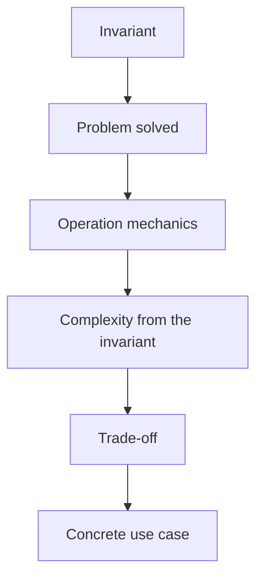
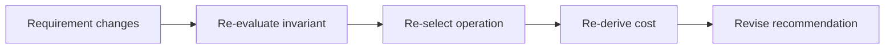
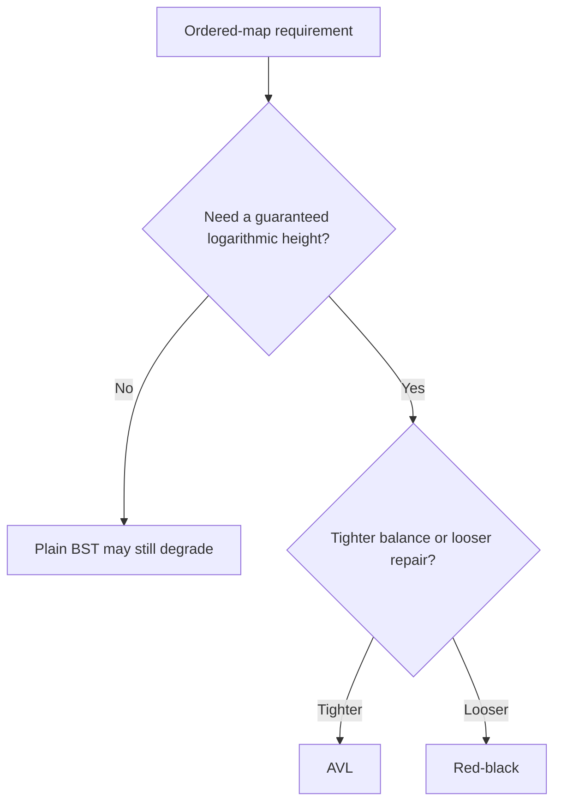
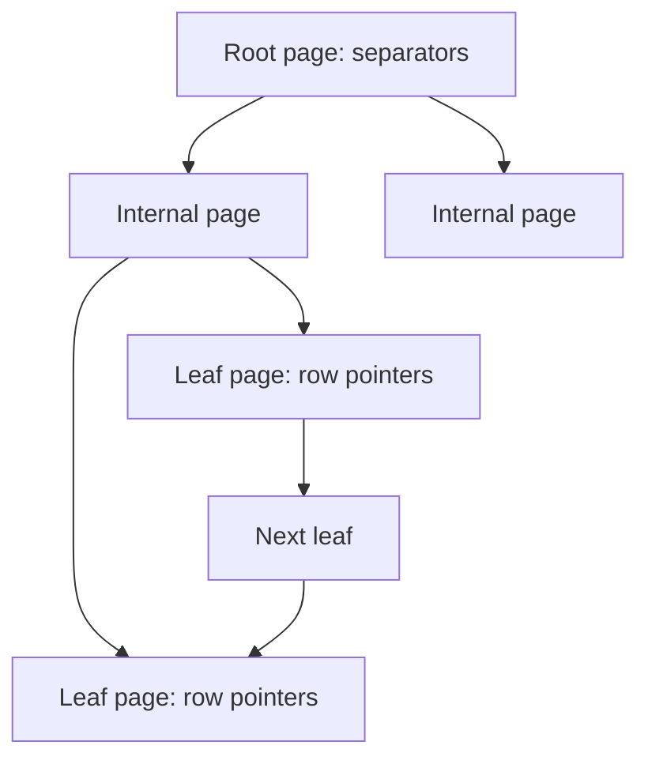
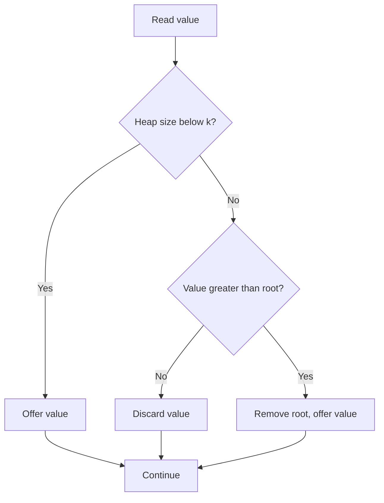
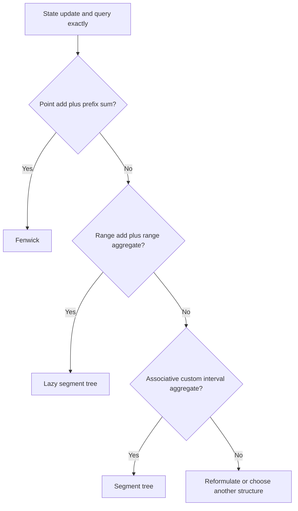

# Advanced Trees — Revision Sheet and Interview Speaking Guide

> Incremental status: this guide promotes source Section 14, “Revision Sheet & Interview Speaking Guide,” at selected Markdown lines 1336–1395 and fresh corroborating DOCX Pandoc lines 1809–1873. Section 15 remains queued.

## Contents

- [Requirement contract](#requirement-contract)
- [The six-slot answer packet](#the-six-slot-answer-packet)
- [Example 1 — AVL versus red-black without case-list dumping](#example-1--avl-versus-red-black-without-case-list-dumping)
- [Example 2 — derive complexity from height and storage geometry](#example-2--derive-complexity-from-height-and-storage-geometry)
- [Example 3 — explain a heap by its public operation](#example-3--explain-a-heap-by-its-public-operation)
- [Example 4 — choose a range structure from the operation algebra](#example-4--choose-a-range-structure-from-the-operation-algebra)
- [Executable speaking contracts](#executable-speaking-contracts)
- [References and provenance](#references-and-provenance)

## Requirement contract

A revision answer is not a list of remembered nouns. It is a short proof that a structure satisfies a workload. Before speaking, bind the answer to six fields:

| Slot | Required question | Failure prevented |
|---|---|---|
| invariant | what must remain true after every public operation? | describing only the current drawing |
| problem | which failure or workload makes the structure useful? | recommending a structure without a requirement |
| mechanics | what state changes during the key operation? | dumping case names without causality |
| complexity | which operation, bound and parameter are being measured? | saying “`O(log n)`” without a height guarantee |
| trade-off | what cost buys the guarantee? | claiming one structure is universally best |
| use case | what concrete system or interview problem matches the contract? | giving an abstract answer with no decision value |



The source's “30-second” answer becomes reliable only when every claim is tied to one of these slots. If the interviewer changes the workload—such as asking for ordered iteration instead of the next minimum—the answer must change too.

## The six-slot answer packet

Use this speaking order:

1. **Definition plus invariant.** Name the global promise, not merely the node fields.
2. **Problem.** State the failure it prevents or query it accelerates.
3. **Mechanics.** Trace one decisive mutation or query step.
4. **Complexity.** Derive it from height, fan-out, output size or maintained state.
5. **Trade-off.** Name extra metadata, rotations, memory, write cost or narrower operations.
6. **Use case.** Match the structure to one real requirement.



A defensible answer can be interrupted after any slot and expanded. A memorized paragraph often cannot: removing one sentence destroys its order because the speaker has not separated the proof obligations.

## Example 1 — AVL versus red-black without case-list dumping

**Prompt:** “Compare AVL and red-black trees for an in-memory ordered map.”

Start from the shared contract: both are binary-search trees, so comparator order defines lookup direction. Their balancing invariants prevent the height from degenerating to `n`.

| Slot | AVL answer | Red-black answer |
|---|---|---|
| invariant | every node has balance factor `-1`, `0` or `1` | root black; no red-red edge; equal black height on root-to-null paths |
| problem | prevents a skewed BST and keeps a tighter height bound | prevents skew while permitting looser local shape |
| mechanics | update heights; single or double rotation at an unbalanced ancestor | recolor and rotate to repair red-red or black-height violations |
| complexity | search/insert/delete `O(log n)` because height is logarithmic | search/insert/delete `O(log n)` because height is logarithmic |
| trade-off | stricter balance can mean more repair work | potentially taller searches, often less rigid update repair |
| use case | ordered reads where a tighter height is valuable | general ordered maps with mixed reads and writes |



Dry-run the explanation on insertion into an AVL tree:

```text
insert 30, 20, 10

before repair:      after right rotation:
      30                    20
     /                     /  \
    20                    10  30
   /
  10
```

| Step | Local evidence | Spoken conclusion |
|---:|---|---|
| insert `10` | node `30` has left height two greater than right | logarithmic-height invariant is broken |
| classify | heavy child `20` is left-heavy | one right rotation is sufficient |
| repair | `20` becomes local root | BST order remains `10 < 20 < 30` |
| recompute | moved-down `30` first, then `20` | cached heights again describe the post-state |

Do not say every BST operation is logarithmic. An unbalanced plain BST can have height `n`. Also do not claim Java's `TreeMap` is AVL: current Java SE 26 documentation identifies it as a red-black-tree implementation and guarantees logarithmic `containsKey`, `get`, `put` and `remove`.

## Example 2 — derive complexity from height and storage geometry

**Prompt:** “Why use a B+ tree for a database index instead of an in-memory binary tree?”

A B+ tree is a balanced, high-fan-out search index. Internal entries route to child pages; leaf entries point to rows and leaves support ordered scanning. The point is not that `B+` is a fashionable label—the point is that one page read chooses among many children.



Idealized height trace for one million leaf entries:

| Effective fan-out | Capacity after level 1 | Level 2 | Level 3 | First level reaching `1,000,000` |
|---:|---:|---:|---:|---:|
| `2` | `2` | `4` | `8` | about `20` |
| `100` | `100` | `10,000` | `1,000,000` | `3` |

This is a teaching estimate, not a storage-capacity promise: real height depends on page size, tuple width, fill factor, splits, deduplication and implementation details. The sound complexity statement is:

- point lookup descends `O(h)` index levels, where `h` is logarithmic in entry count for bounded fan-out;
- a range scan pays the descent to the first qualifying leaf plus work proportional to the qualifying leaf entries/pages;
- writes pay page maintenance and may split pages, cascading upward.

Current PostgreSQL 19 documentation describes the same ownership boundary: leaf tuples point to table rows, internal tuples point to the next level, and a page split may propagate a new downlink toward the root. It also documents that B-tree indexes can provide sorted output, sometimes avoiding a separate sort for a matching `ORDER BY`.

The two-minute answer is therefore: invariant and page roles, page-read problem, descent/split/leaf-scan mechanics, height-plus-output cost, write/space trade-off, then database point/range query use case.

## Example 3 — explain a heap by its public operation

**Prompt:** “Use a heap to keep the three largest values from `5, 1, 9, 3, 9, 7`.”

Maintain a min-heap of at most three candidates. Its root is the smallest value currently admitted, so the root is exactly the candidate to evict when a larger value arrives.

| Read | Heap contents as a set | Decision |
|---:|---|---|
| `5` | `{5}` | fill capacity |
| `1` | `{1,5}` | fill capacity |
| `9` | `{1,5,9}` | fill capacity |
| `3` | `{3,5,9}` | replace root `1` |
| `9` | `{5,9,9}` | replace root `3` |
| `7` | `{7,9,9}` | replace root `5` |



```java
static int[] topKLargest(int[] values, int k) {
    PriorityQueue<Integer> candidates = new PriorityQueue<>();
    for (int value : values) {
        if (candidates.size() < k) candidates.add(value);
        else if (k > 0 && value > candidates.element()) {
            candidates.remove();
            candidates.add(value);
        }
    }
    int[] result = new int[k];
    for (int i = k - 1; i >= 0; i--) result[i] = candidates.remove();
    return result;
}
```

For `n` inputs and retained size `k`, this uses `O(k)` auxiliary space and `O(n log k)` time. The heap does **not** promise sorted iteration; repeated removal (or an explicit final sort) is a separate output step. Java SE 26 documents `offer`/`poll` as `O(log n)`, `peek` as constant time, and iterator order as unspecified.

This answer stays honest because it names the public observation: “next eviction candidate at the root,” not “the backing array is sorted.”

## Example 4 — choose a range structure from the operation algebra

**Prompt:** “Should I use a Fenwick tree or a segment tree?”

Ask for the update, query and algebra before naming a structure:

| Workload | Compact choice | Sufficient state | Typical cost |
|---|---|---|---|
| point addition + prefix/range sum | Fenwick tree | lowbit prefix buckets | `O(log n)` update/query, `O(n)` memory |
| point assignment + range minimum | segment tree | minimum per interval | `O(log n)` update/query, larger constant memory |
| range addition + range sum | lazy segment tree | interval sum plus deferred delta | `O(log n)` update/query when tags are maintained correctly |



Fenwick trace for `add(index=5, delta=4)` in a one-based tree of size eight:

| Current index | `lowbit(i)` | Bucket updated | Next index |
|---:|---:|---|---:|
| `5` (`0101₂`) | `1` | tree bucket ending at `5` | `6` |
| `6` (`0110₂`) | `2` | tree bucket ending at `6` | `8` |
| `8` (`1000₂`) | `8` | tree bucket ending at `8` | `16` stop |

Lazy segment-tree trace for adding `+3` to a fully covered interval of length four:

| State | Sum | Pending tag | Meaning |
|---|---:|---:|---|
| before | `10` | `0` | descendants materialized |
| absorb full cover | `22` | `3` | aggregate changes by `3 × 4` |
| later push | parent tag `0` | children each add `3` | deferred ownership moves once |

The interview contrast is not “Fenwick is faster.” Fenwick is compact for a narrower algebra. A segment tree stores more explicit interval state and supports broader aggregates and lazy transformations. State the operation contract first, then derive the recommendation.

## Executable speaking contracts

[`TreeInterviewAnswerContracts.java`](java/TreeInterviewAnswerContracts.java) encodes the six-slot packet, rejects unsupported claims such as sorted heap iteration or unconditional logarithmic search in a plain BST, selects a range structure from the declared workload, and implements ownership-safe top-`k` selection.

Twenty deterministic groups cover completeness, structure/claim boundaries, all three range workloads, the exact top-`k` trace and failure cases. Then 20,000 seeded trials perform 80,000 checks against an independent sorted top-`k` oracle, input-ownership snapshots, range-selection cases and generated six-slot packets.

```bash
java -ea study-guides/local-project-notes/advanced-trees/java/TreeInterviewAnswerContracts.java
```

Expected result:

```text
PASS groups=20 trials=20000 checks=80000
```

## References and provenance

- Oracle, [Java SE 26 `TreeMap`](https://docs.oracle.com/en/java/javase/26/docs/api/java.base/java/util/TreeMap.html) — red-black implementation and guaranteed logarithmic `containsKey`, `get`, `put` and `remove`.
- Oracle, [Java SE 26 `PriorityQueue`](https://docs.oracle.com/en/java/javase/26/docs/api/java.base/java/util/PriorityQueue.html) — heap head semantics, operation costs and unspecified iterator order.
- PostgreSQL 19, [B-Tree Indexes](https://www.postgresql.org/docs/current/btree.html) — internal/leaf page roles and page-split propagation.
- PostgreSQL 19, [Indexes and `ORDER BY`](https://www.postgresql.org/docs/19/indexes-ordering.html) — B-tree ordered output and forward/backward scan behavior.
- G. M. Adel'son-Vel'skii and E. M. Landis, [“An algorithm for organization of information”](https://www.mathnet.ru/php/archive.phtml?jrnid=dan&option_lang=eng&paperid=26964&wshow=paper), 1962 — original height-balanced search-tree work.
- Leo J. Guibas and Robert Sedgewick, [“A Dichromatic Framework for Balanced Trees”](https://doi.org/10.1109/SFCS.1978.3), 1978 — color invariants and logarithmic balanced-tree framework.
- Rudolf Bayer and Edward McCreight, [“Organization and Maintenance of Large Ordered Indexes”](https://doi.org/10.1007/BF00288683), 1972 — original page-oriented B-tree organization.
- Peter M. Fenwick, [“A New Data Structure for Cumulative Frequency Tables”](https://doi.org/10.1002/SPE.4380240306), 1994 — lowbit-based cumulative-frequency decomposition.

Source intake:

- Selected `Advanced_Trees_FAANG_Mermaid_Study_Guide.md`, Library file `libfile_7346abf23a3c81918843c9a9f5b5d80f`, 68,775 bytes, SHA-256 `86cb65f3d6d0f327e5d22c03b5d587144eb11cc9ff27a5b523b298b09ad7f5b1`. This pass promotes only Section 14 at lines 1336–1395, bounded before the Section 15 anchor.
- Compared `Tree_Advanced_FAANG_Study_Guide.docx`, Library file `libfile_b71f27c80d4c81918c672303add6bfb5`, 227,748 bytes, SHA-256 `fb1dc6f7d9990c04691a69e2345dac5e6a08f3d36448e0e9c3a67b96b55ee58f`. A fresh Pandoc 3.1.11.1 GFM conversion places the matching Section 14 at lines 1809–1873, bounded before Section 15. This supersedes the stale checkpoint range `1946–2023`.
- The earlier broad `advanced_trees_interview_guide.md` and focused Sections 3–13 remain comparison/canonical material. This guide deepens the distinct revision/speaking section without duplicating their full implementations.

The requirement contract, four worked speaking traces, six diagrams, executable contract and randomized oracles are newly authored teaching material. Source Section 15 and the wider 170-placeholder backlog remain incomplete.
