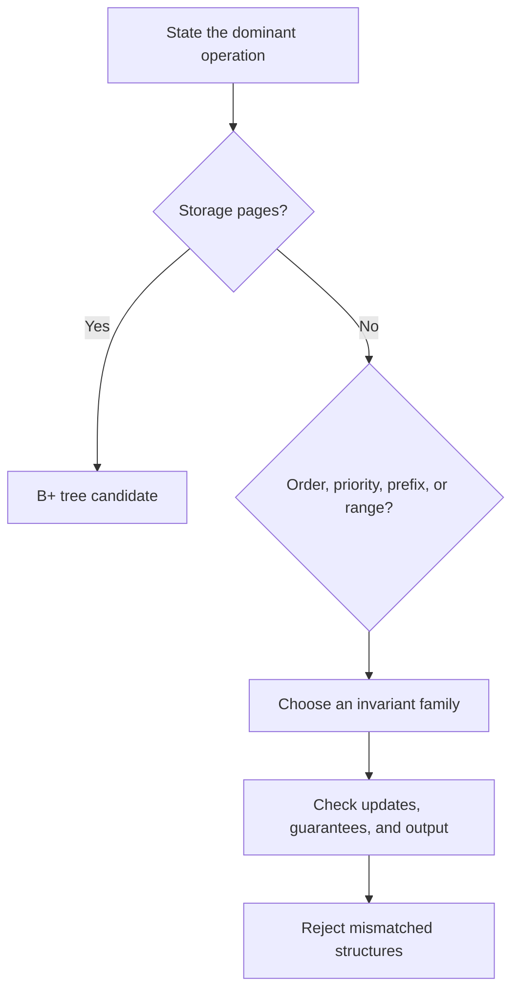
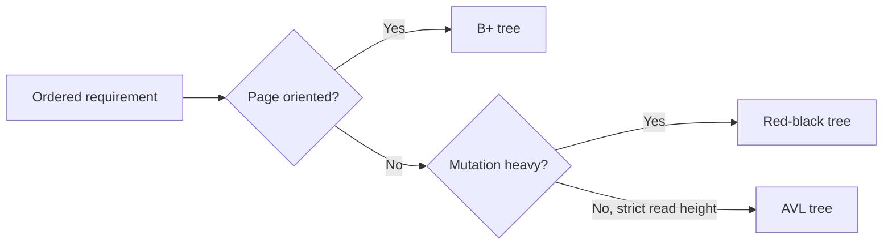
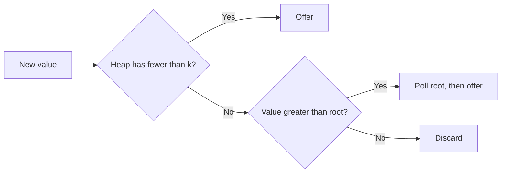
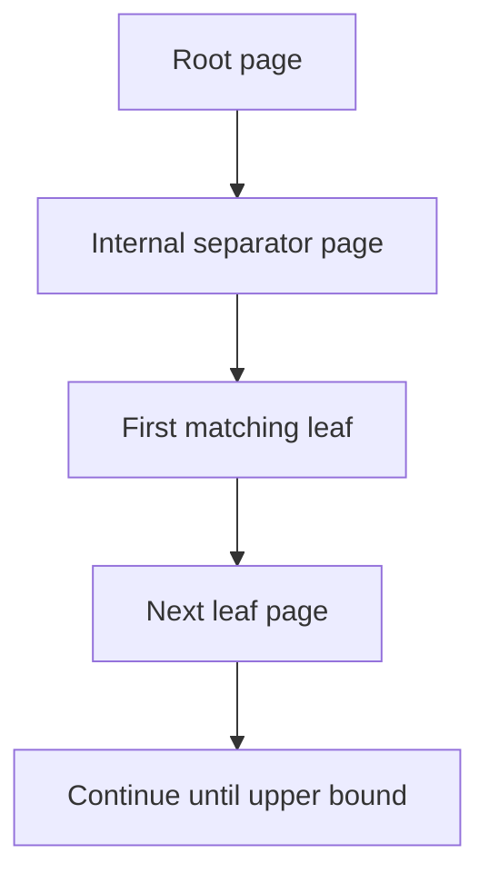
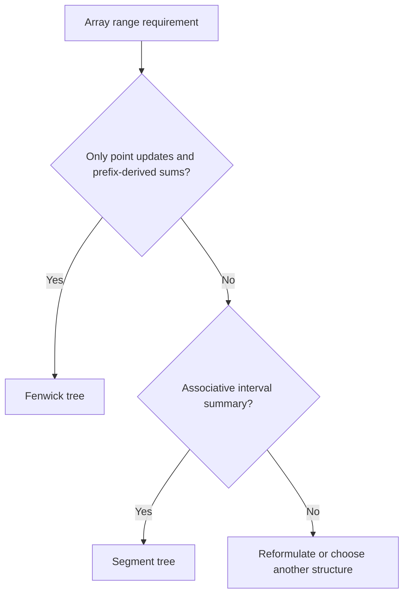
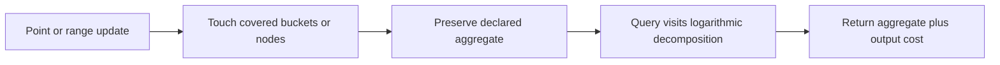

# Advanced Trees — Requirement-First Selection Matrix

> Incremental status: this guide promotes source Section 11, “Decision Matrix — Which Tree Should Trigger?”, at selected Markdown lines 1167–1187. Sections 12–15 remain queued.

## Contents

- [Start with the requirement contract](#start-with-the-requirement-contract)
- [The decision matrix](#the-decision-matrix)
- [Example 1 — ordered neighbours with frequent mutation](#example-1--ordered-neighbours-with-frequent-mutation)
- [Example 2 — streaming top K](#example-2--streaming-top-k)
- [Example 3 — page-oriented range scans](#example-3--page-oriented-range-scans)
- [Example 4 — Fenwick or segment tree](#example-4--fenwick-or-segment-tree)
- [Executable selection contracts](#executable-selection-contracts)
- [References and provenance](#references-and-provenance)

## Start with the requirement contract

A tree name is not a requirement. Before selecting a structure, state:

| Field | Required question | Common category error |
|---|---|---|
| dominant operation | ordered neighbour, repeated extreme, prefix lookup, page range scan, or array-range aggregate? | choosing a familiar tree before naming the query |
| update shape | none, point update, range update, insert/delete, or append-only? | quoting query cost while ignoring repair cost |
| ordering needed | only the next extreme, or full predecessor/successor order? | using a heap when arbitrary ordered navigation is required |
| storage model | in-memory nodes or fixed-size storage pages? | using pointer depth as the only database-index cost |
| aggregate algebra | invertible prefix sum, associative merge, or custom state? | forcing a Fenwick tree onto non-invertible/custom queries |
| worst-case requirement | expected, amortized, or guaranteed bound? | saying “balanced” without naming the guarantee |
| output obligation | one item, top `k`, all sorted items, or a range? | forgetting that output size may dominate traversal cost |



The word **candidate** matters. A data structure becomes the answer only after its invariant supports every required operation and boundary.

## The decision matrix

| Requirement | First candidate | Invariant that pays for it | Important disqualifier |
|---|---|---|---|
| predecessor, successor, ordered iteration | balanced BST | global key order plus logarithmic height | a heap exposes only one extreme |
| strict search-height preference, read-heavy in-memory set | AVL tree | balance factor keeps height tighter | more rebalancing work on updates |
| ordered map/set with frequent mutations | red-black tree | colour/black-height rules bound height with restrained repair | no page-layout or prefix-sharing advantage |
| repeatedly remove the smallest/largest, or retain top `k` | binary heap | parent priority and complete shape | arbitrary search and sorted traversal are not heap operations |
| prefix dictionary or autocomplete | trie | path encodes the prefix | memory can scale with represented edges/alphabet strategy |
| page-oriented equality/range index | B+ tree family | high fan-out; ordered leaf level | an in-memory node model ignores page I/O and concurrency policy |
| point updates plus prefix/range sums | Fenwick tree | low-bit buckets partition prefixes | general min/max or arbitrary range updates need different algebra |
| general associative range aggregate; richer updates | segment tree | each node summarizes an interval | larger memory and implementation surface than a Fenwick tree |



“AVL for reads, red-black for writes” is a heuristic, not a proof. Real choice also depends on constants, memory layout, concurrency, library availability, and the exact operation mix. In Java, `TreeMap` is a red-black-tree-based `NavigableMap`; use it when its contract fits instead of hand-writing a balancing tree.

## Example 1 — ordered neighbours with frequent mutation

**Requirement.** Maintain active price levels. Insert and remove levels throughout the day; answer `floorKey`, `ceilingKey`, first, last, and ordered iteration.

**Cases.**

1. Insert `101, 99, 105`; predecessor of `103` is `101`.
2. Remove `101`; successor of `100` is now `105`.
3. Duplicate price levels need a count/value list, not duplicate structural keys.
4. Empty book returns “no neighbour”; it must not invent a sentinel price.

| Candidate | Verdict | Reason |
|---|---|---|
| hash table | reject | exact lookup is cheap, but predecessor/successor is not maintained |
| binary heap | reject | exposes one extreme, not arbitrary neighbours or sorted iteration |
| unbalanced BST | reject for guaranteed latency | adversarial insertion order can create height `n` |
| balanced ordered map | accept | the required navigation operations share the maintained order |

Trace using a navigable map:

| Step | Ordered keys | Query | Result |
|---:|---|---|---|
| 1 | `{99, 101, 105}` | `floorKey(103)` | `101` |
| 2 | `{99, 105}` | `ceilingKey(100)` | `105` |
| 3 | `{99, 105}` | iterate range `[99,105]` | `99, 105` |

Complexity follows height: search/update/navigation are `O(log n)` for the balanced map; returning `r` range results adds `O(r)` output work.

## Example 2 — streaming top K

**Requirement.** Keep the three largest latencies seen so far; arbitrary predecessor queries and full sorted iteration are not required.

Input stream: `7, 2, 11, 4, 9, 1`.

Use a min-heap capped at `k = 3`. Its root is the weakest retained candidate.



| Value | Heap contents as a set | Action |
|---:|---|---|
| 7 | `{7}` | fill |
| 2 | `{2,7}` | fill |
| 11 | `{2,7,11}` | fill |
| 4 | `{4,7,11}` | replace root `2` |
| 9 | `{7,9,11}` | replace root `4` |
| 1 | `{7,9,11}` | discard |

Final descending output: `[11, 9, 7]`.

Sorting every prefix is a brute-force fallback: after `n` arrivals it repeats work and can cost `O(n² log n)` across the stream. A size-`k` heap uses `O(k)` space and `O(log k)` per accepted candidate; producing sorted output costs `O(k log k)`.

The Java `PriorityQueue` iterator is not sorted. Copy and sort when presentation order is required.

## Example 3 — page-oriented range scans

**Requirement.** Index millions of rows stored outside the process. Support equality, ordered range predicates, and sequential range delivery.



Four checks:

1. `id = 42` needs a search path to one matching key/range.
2. `id BETWEEN 42 AND 49` needs ordered continuation after the first hit.
3. `id >= 42 ORDER BY id LIMIT 5` can stop after five visible entries.
4. A leading-wildcard string predicate does not automatically become a useful ordered-prefix scan.

The key cost is not merely comparison count. High fan-out reduces page visits; the leaf-level ordering supports continued range access. Production database indexes also own concurrency, recovery, visibility, collation, and query-planner decisions, so an interview B+ tree sketch is not a replacement for an engine index.

PostgreSQL 18 documents B-tree indexes for equality and ordered range operators such as `<`, `<=`, `=`, `>=`, `>`, and `BETWEEN`. That is a query-contract claim—not permission to assume every predicate or data distribution will use the index.

## Example 4 — Fenwick or segment tree

Two requirements that both say “range query” can need different structures.



### 4A. Fenwick fit

Start `a = [2, 1, 3, 4]`.

- `prefixSum(2) = 6`.
- `rangeSum(1,3) = prefixSum(3) - prefixSum(0) = 10 - 2 = 8`.
- After `add(2, +5)`, `prefixSum(2) = 11`.
- Empty prefix is `0`; invalid indices are rejected by the public contract.

The sum operation supports prefix decomposition and subtraction, and the updates are points. Fenwick is compact and sufficient.

### 4B. Segment-tree fit

Now require range minimum with point assignments, or range addition with range sum.

| Operation | Why Fenwick is not the default | Segment-tree state |
|---|---|---|
| minimum on `[l,r]` | `min(prefix(r)) - min(prefix(l-1))` is meaningless | merge child minima |
| assign one value, query min | no inverse-prefix subtraction | repair ancestors |
| add to a range, query range sum | possible only with a more specialized multi-BIT derivation | lazy tag plus interval sum |
| store `(max, countOfMax)` | custom pair merge | node holds the pair |



Selection rule: choose the simplest structure whose algebra and update model prove every required operation. “Fenwick is shorter” and “segment tree is more powerful” are consequences, not requirements.

## Executable selection contracts

[`TreeDecisionContracts.java`](java/TreeDecisionContracts.java) encodes the dominant-operation gate and a bounded top-`k` heap. It rejects contradictory page-storage flags, distinguishes ordered navigation from repeated-extreme access, and separates prefix-sum algebra from general interval aggregation.

```bash
java -ea study-guides/local-project-notes/advanced-trees/java/TreeDecisionContracts.java
```

Expected result:

```text
PASS groups=20 trials=20000 checks=80000
```

The deterministic groups cover every matrix row and invalid-contract boundaries. The seeded trials compare the selector to an independent rule table and the heap result to a sorted-copy oracle.

## References and provenance

- [Java SE 25 `TreeMap`](https://docs.oracle.com/en/java/javase/25/docs/api/java.base/java/util/TreeMap.html) — official red-black `NavigableMap` contract and logarithmic key operations.
- [Java SE 25 `PriorityQueue`](https://docs.oracle.com/en/java/javase/25/docs/api/java.base/java/util/PriorityQueue.html) — official priority-heap semantics, operation costs, tie and iterator-order caveats.
- [PostgreSQL 18 index types](https://www.postgresql.org/docs/current/indexes-types.html) — official current B-tree equality/range/operator and ordering scope.
- Peter M. Fenwick, [“A new data structure for cumulative frequency tables”](https://doi.org/10.1002/spe.4380240306), 1994 — original binary indexed tree paper and logarithmic cumulative-frequency operations.

Source intake:

- Selected `Advanced_Trees_FAANG_Mermaid_Study_Guide.md`, Library file `libfile_7346abf23a3c81918843c9a9f5b5d80f`, 68,775 bytes, SHA-256 `86cb65f3d6d0f327e5d22c03b5d587144eb11cc9ff27a5b523b298b09ad7f5b1`. This pass promotes only Section 11 at lines 1167–1187.
- Compared `Tree_Advanced_FAANG_Study_Guide.docx`, Library file `libfile_b71f27c80d4c81918c672303add6bfb5`, SHA-256 `fb1dc6f7d9990c04691a69e2345dac5e6a08f3d36448e0e9c3a67b96b55ee58f`. Its Pandoc GFM lines 1559–1586 carry the same matrix and one-sentence rule, so no parallel edition was created.
- Compared `advanced_trees_interview_guide.md`, Library file `libfile_051d3307bbb48191aad1ce21744b78cb`. Its section numbering and broad implementation focus differ; no inferior content was copied into this focused matrix.

The requirement contract, four worked traces, diagrams, disqualifiers, executable selector and current-reference reconciliation are newly authored teaching material. Source Sections 12–15 and the wider 170-placeholder backlog remain incomplete.
