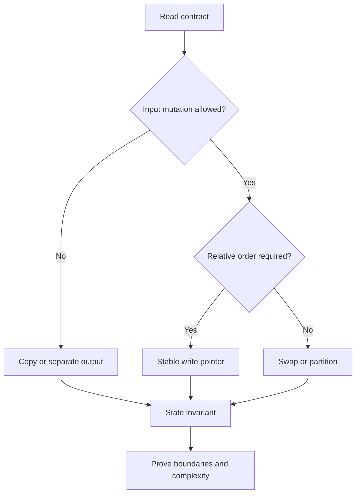
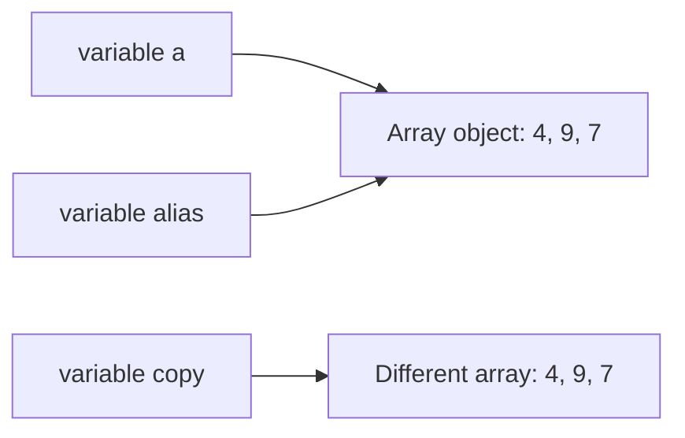
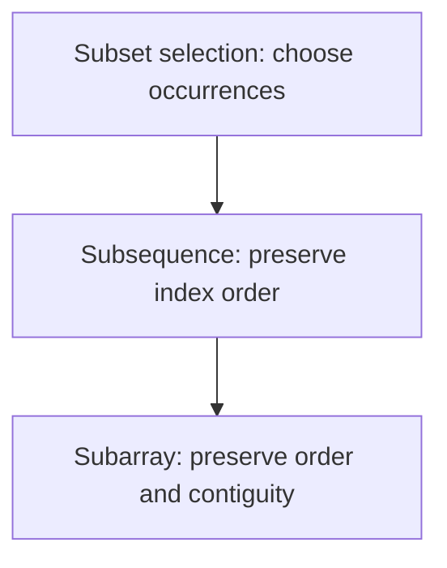
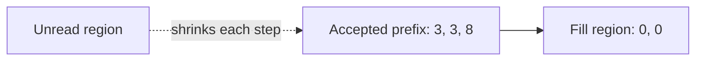
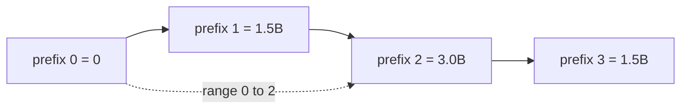

# Arrays — FAANG Deep Study Guide

> **Incremental status:** Section 1 is processed. The canonical Markdown workbook is the structural source; its expanded Word companion was compared and corroborates the same section. Later source sections remain queued.

## Study index

- [1. Array mental model and invariants](#1-array-mental-model-and-invariants)
  - [Requirement contract](#requirement-contract)
  - [Example 1 — reference identity is not value equality](#example-1--reference-identity-is-not-value-equality)
  - [Example 2 — subarray, subsequence, and subset](#example-2--subarray-subsequence-and-subset)
  - [Example 3 — stable in-place compaction](#example-3--stable-in-place-compaction)
  - [Example 4 — prefix sums without overflow](#example-4--prefix-sums-without-overflow)
  - [Interview checklist](#interview-checklist)
  - [References and provenance](#references-and-provenance)

## 1. Array mental model and invariants

An array problem is usually not testing whether you can write a loop. It is testing whether you can state what each index means, which region is already correct, and which mutations are allowed. In Java, an array is an object with a fixed length and mutable component variables. An array variable stores a reference, so assignment copies the reference rather than the components.

### Requirement contract

Before choosing a pattern, make these decisions explicit:

| Question | Precise contract | Why it matters |
|---|---|---|
| What is fixed? | The Java array object's `length`; not necessarily its component values | Prevents treating an array like a growable list |
| What is mutable? | Components unless the problem forbids input mutation | Separates in-place solutions from copy-producing solutions |
| What is the output? | Values, indices, a count, or the same mutated object | Prevents returning the right values in the wrong form |
| What does “contiguous” mean? | Every index from `left` through `right` is included | Distinguishes a subarray from a subsequence |
| What order is required? | Stable order, arbitrary order, sorted order, or none | Determines whether swaps are legal |
| What space is allowed? | Count auxiliary storage separately from input/output storage | Avoids calling an `O(n)` copy “in place” |
| Can arithmetic overflow? | Promote before addition when the mathematical range can exceed `int` | Keeps a correct algorithm from producing incorrect Java values |

The core invariant template is:

> At the start of each iteration, name the processed region, state exactly what is true there, and identify the unread region. The iteration must preserve the statement while shrinking the unread region.



### Example 1 — reference identity is not value equality

Given `int[] a = {4, 1, 7}`, execute `int[] alias = a; alias[1] = 9;`.

**Result:** both variables refer to the same array object, so `a` is now `[4, 9, 7]`. By contrast, `Arrays.copyOf(a, a.length)` creates a distinct array with initially equal component values.



Trace:

| Step | `a == alias` | `a == copy` | `a[1]` | Meaning |
|---:|---:|---:|---:|---|
| After assignment | true | — | 1 | `alias` received the reference |
| After `alias[1] = 9` | true | — | 9 | Mutation is visible through either alias |
| After `copyOf` | true | false | 9 | The new object has equal values but different identity |
| After `copy[1] = 5` | true | false | 9 | Copy mutation does not affect `a` |

Interview consequence: clarify whether “do not modify the input” forbids component mutation. Rebinding a local parameter does not mutate the caller's array, but changing a component does.

```java
int[] original = {4, 1, 7};
int[] alias = original;
alias[1] = 9;
int[] copy = java.util.Arrays.copyOf(original, original.length);
copy[1] = 5;
// original is [4, 9, 7]; copy is [4, 5, 7]
```

### Example 2 — subarray, subsequence, and subset

For `a = [3, -1, 4, 2]`, these terms impose different constraints:

| Candidate | Classification | Reason |
|---|---|---|
| `[-1, 4]` | Subarray, subsequence, and subset selection | Uses the contiguous interval `[1, 2]` |
| `[3, 4, 2]` | Subsequence and subset selection, not subarray | Preserves order but skips index 1 |
| `[4, 3]` | Subset selection only | Selected values exist, but original order is reversed |
| `[3, 3]` | None for this input | A value occurrence cannot be reused unless the input contains it twice |



For length `n`:

- non-empty subarrays: `n(n + 1) / 2`;
- subsequences: `2^n` including the empty subsequence;
- value subsets need multiplicity rules when duplicates exist, so “set” language can lose index identity.

Memory trick: **array = interval, sequence = ordered picks, subset = picks without an order promise**.

### Example 3 — stable in-place compaction

Move zeros to the end of `[0, 3, 0, 3, 8]` while preserving the relative order of nonzero values.

Use `read` to scan every component and `write` to identify the next accepted position.

Invariant before processing index `read`:

1. `a[0..write)` contains exactly the nonzero values from original `a[0..read)`, in original order.
2. `write <= read`.
3. `a[read..n)` has not been inspected.

Trace:

| `read` | value | action | `write` after | array after action |
|---:|---:|---|---:|---|
| 0 | 0 | skip | 0 | `[0, 3, 0, 3, 8]` |
| 1 | 3 | write at 0 | 1 | `[3, 3, 0, 3, 8]` |
| 2 | 0 | skip | 1 | `[3, 3, 0, 3, 8]` |
| 3 | 3 | write at 1 | 2 | `[3, 3, 0, 3, 8]` |
| 4 | 8 | write at 2 | 3 | `[3, 3, 8, 3, 8]` |
| fill | — | zero `[3..5)` | 3 | `[3, 3, 8, 0, 0]` |



```java
static void stableMoveZeroes(int[] a) {
    int write = 0;
    for (int value : a) {
        if (value != 0) a[write++] = value;
    }
    while (write < a.length) a[write++] = 0;
}
```

**Correctness:** every accepted value is appended once and in scan order, so the prefix is stable. When scanning ends, it contains all nonzero values. Filling the remaining suffix with zeros preserves the required length and yields the target partition.

**Complexity:** `O(n)` time, `O(1)` auxiliary space. This minimizes conceptual complexity; an optional guarded assignment can reduce redundant writes but should not weaken the invariant.

### Example 4 — prefix sums without overflow

For `a = [1_500_000_000, 1_500_000_000, -1_500_000_000]`, the mathematical prefix sums are `[0, 1_500_000_000, 3_000_000_000, 1_500_000_000]`. The second running total exceeds `Integer.MAX_VALUE`, so an `int` prefix silently wraps.

Contract for half-open ranges: `rangeSum(left, right)` returns the sum of `a[left..right)`.



Trace:

| Index consumed | Value | `long` prefix | Meaning |
|---:|---:|---:|---|
| 0 | — | 0 | Empty prefix |
| 1 | 1,500,000,000 | 1,500,000,000 | `a[0..1)` |
| 2 | 1,500,000,000 | 3,000,000,000 | `a[0..2)` |
| 3 | -1,500,000,000 | 1,500,000,000 | `a[0..3)` |

```java
static long[] prefixSums(int[] a) {
    long[] prefix = new long[a.length + 1];
    for (int i = 0; i < a.length; i++) {
        prefix[i + 1] = prefix[i] + a[i]; // long + int -> long
    }
    return prefix;
}

static long rangeSum(long[] prefix, int left, int right) {
    if (left < 0 || left > right || right >= prefix.length) {
        throw new IndexOutOfBoundsException("invalid half-open range");
    }
    return prefix[right] - prefix[left];
}
```

Invariant after consuming `i` components: `prefix[i]` equals the mathematical sum of original `a[0..i)`. Therefore subtracting two prefixes cancels the shared left portion. Build time and space are `O(n)`; each validated range query is `O(1)`.

### Interview checklist

1. Restate mutation, output, ordering, and range conventions.
2. Name indices by role (`read`, `write`, `left`, `right`) rather than letters without meaning.
3. State the invariant before coding.
4. Trace empty, singleton, all-accepted, none-accepted, duplicate, and extreme-value cases.
5. Promote arithmetic before it can overflow.
6. Distinguish auxiliary space from returned output space.
7. State whether a range is closed `[l, r]` or half-open `[l, r)`.
8. Test aliasing expectations when the input is mutable.

### References and provenance

- [Java Language Specification, Java SE 17, Chapter 10: Arrays](https://docs.oracle.com/javase/specs/jls/se17/html/jls-10.html) — arrays as objects, fixed component count, zero-based indices, and component types.
- [Java Language Specification, Java SE 17, Chapter 4: Types, Values, and Variables](https://docs.oracle.com/javase/specs/jls/se17/html/jls-4.html) — primitive values versus reference values and array reference semantics.
- [Java SE 17 `java.util.Arrays`](https://docs.oracle.com/en/java/javase/17/docs/api/java.base/java/util/Arrays.html) — copying, filling, comparison, sorting, and searching utilities.

Source intake:

- `DSA_Arrays_FAANG_Mermaid_Question_Workbook.md`, SHA-256 `735a1d5f921e48a1bca3465951ee37ebbf3a5946272e23079f105f3305fafcda`, Section 1 lines 141–182. Selected as the editable structural source.
- `DSA_Arrays_FAANG_Question_Workbook_Expanded.docx`, SHA-256 `2402f45d17423b689b34ff03e55eaa6b52c8720fe6c7c4e162cb962ef5d8d38e`, equivalent Section 1 extracted lines 65–108. Compared as a corroborating companion; its 116-page rendering was visually inspected rather than copied as a duplicate guide.

The source section supplied the topic boundary and seed concepts. The requirement contract, worked examples, traces, executable Java, proofs, diagrams, and validation structure here are newly authored study-guide material. Section 2, “Pattern-Recognition Decision Tree,” is the next Arrays source boundary, not part of this promotion.
