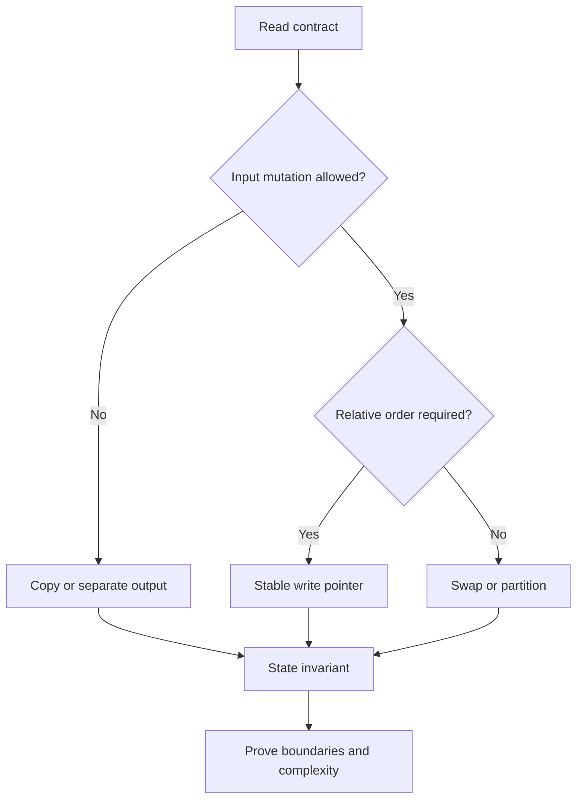
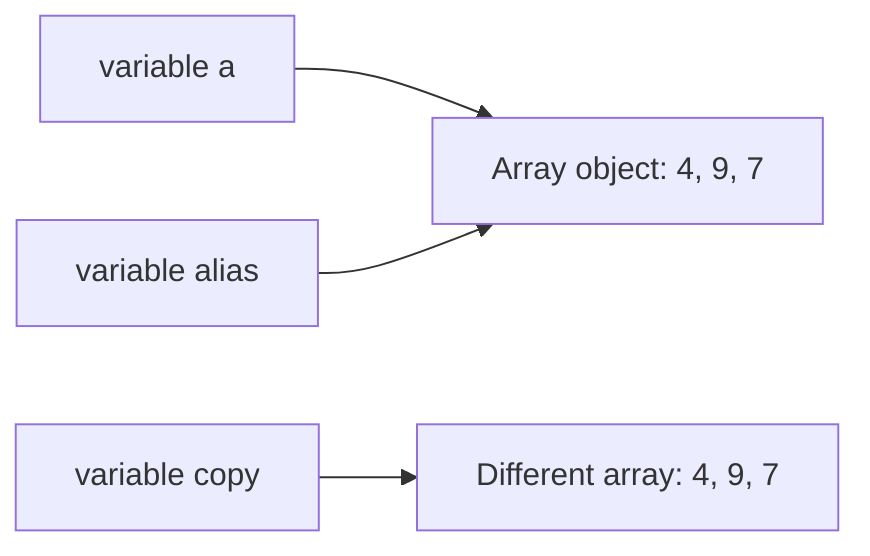
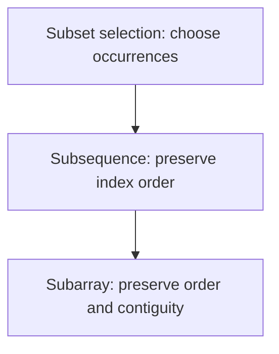
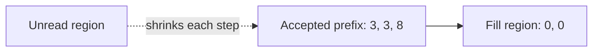
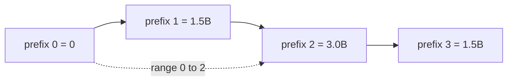
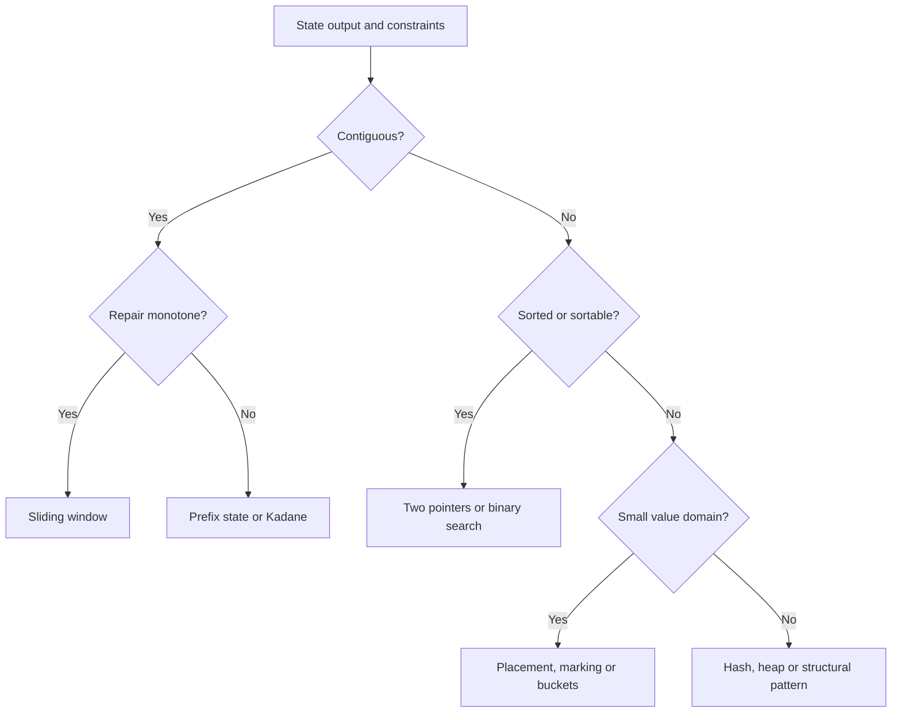
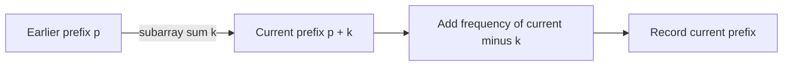
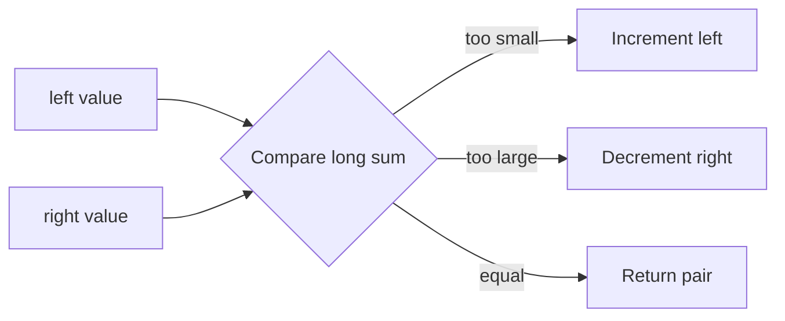
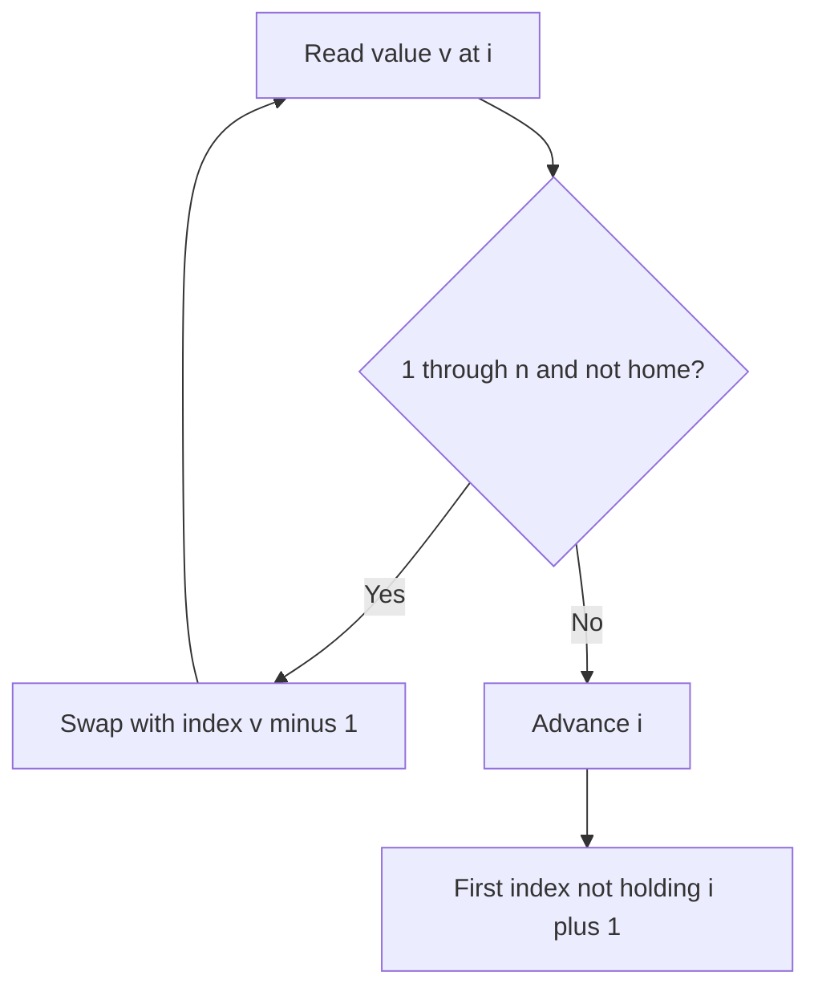

# Arrays — FAANG Deep Study Guide

> **Incremental status:** Sections 1–2 are processed. The canonical Markdown workbook is the structural source; its expanded Word companion was compared and corroborates both sections. Later source sections remain queued.

## Study index

- [1. Array mental model and invariants](#1-array-mental-model-and-invariants)
  - [Requirement contract](#requirement-contract)
  - [Example 1 — reference identity is not value equality](#example-1--reference-identity-is-not-value-equality)
  - [Example 2 — subarray, subsequence, and subset](#example-2--subarray-subsequence-and-subset)
  - [Example 3 — stable in-place compaction](#example-3--stable-in-place-compaction)
  - [Example 4 — prefix sums without overflow](#example-4--prefix-sums-without-overflow)
  - [Interview checklist](#interview-checklist)
- [2. Pattern-recognition decision tree](#2-pattern-recognition-decision-tree)
  - [Decision contract](#decision-contract)
  - [Decision example 1 — exact-sum subarrays with signed values](#decision-example-1--exact-sum-subarrays-with-signed-values)
  - [Decision example 2 — pair sum in sorted input](#decision-example-2--pair-sum-in-sorted-input)
  - [Decision example 3 — minimum qualifying window with nonnegative values](#decision-example-3--minimum-qualifying-window-with-nonnegative-values)
  - [Decision example 4 — first missing positive in place](#decision-example-4--first-missing-positive-in-place)
  - [Pattern trigger sheet](#pattern-trigger-sheet)
  - [Decision checklist](#decision-checklist)
- [References and provenance](#references-and-provenance)

## 1. Array mental model and invariants

An array problem is usually not testing whether you can write a loop. It is testing whether you can state what each index means, which region is already correct, and which mutations are allowed. In Java, an array is an object with a fixed length and mutable component variables. An array variable stores a reference, so assignment copies the reference rather than the components.

### Requirement contract

Before choosing a pattern, make these decisions explicit:

| Question | Precise contract | Why it matters |
|---|---|---|
| What is fixed? | The Java array object's `length`; not necessarily its component values | Prevents treating an array like a growable list |
| What is mutable? | Components unless the problem forbids input mutation | Separates in-place solutions from copy-producing solutions |
| What is the output? | Values, indices, a count, or the same mutated object | Prevents returning the right values in the wrong form |
| What does “contiguous” mean? | Every index from `left` through `right` is included | Distinguishes a subarray from a subsequence |
| What order is required? | Stable order, arbitrary order, sorted order, or none | Determines whether swaps are legal |
| What space is allowed? | Count auxiliary storage separately from input/output storage | Avoids calling an `O(n)` copy “in place” |
| Can arithmetic overflow? | Promote before addition when the mathematical range can exceed `int` | Keeps a correct algorithm from producing incorrect Java values |

The core invariant template is:

> At the start of each iteration, name the processed region, state exactly what is true there, and identify the unread region. The iteration must preserve the statement while shrinking the unread region.



### Example 1 — reference identity is not value equality

Given `int[] a = {4, 1, 7}`, execute `int[] alias = a; alias[1] = 9;`.

**Result:** both variables refer to the same array object, so `a` is now `[4, 9, 7]`. By contrast, `Arrays.copyOf(a, a.length)` creates a distinct array with initially equal component values.



Trace:

| Step | `a == alias` | `a == copy` | `a[1]` | Meaning |
|---:|---:|---:|---:|---|
| After assignment | true | — | 1 | `alias` received the reference |
| After `alias[1] = 9` | true | — | 9 | Mutation is visible through either alias |
| After `copyOf` | true | false | 9 | The new object has equal values but different identity |
| After `copy[1] = 5` | true | false | 9 | Copy mutation does not affect `a` |

Interview consequence: clarify whether “do not modify the input” forbids component mutation. Rebinding a local parameter does not mutate the caller's array, but changing a component does.

```java
int[] original = {4, 1, 7};
int[] alias = original;
alias[1] = 9;
int[] copy = java.util.Arrays.copyOf(original, original.length);
copy[1] = 5;
// original is [4, 9, 7]; copy is [4, 5, 7]
```

### Example 2 — subarray, subsequence, and subset

For `a = [3, -1, 4, 2]`, these terms impose different constraints:

| Candidate | Classification | Reason |
|---|---|---|
| `[-1, 4]` | Subarray, subsequence, and subset selection | Uses the contiguous interval `[1, 2]` |
| `[3, 4, 2]` | Subsequence and subset selection, not subarray | Preserves order but skips index 1 |
| `[4, 3]` | Subset selection only | Selected values exist, but original order is reversed |
| `[3, 3]` | None for this input | A value occurrence cannot be reused unless the input contains it twice |



For length `n`:

- non-empty subarrays: `n(n + 1) / 2`;
- subsequences: `2^n` including the empty subsequence;
- value subsets need multiplicity rules when duplicates exist, so “set” language can lose index identity.

Memory trick: **array = interval, sequence = ordered picks, subset = picks without an order promise**.

### Example 3 — stable in-place compaction

Move zeros to the end of `[0, 3, 0, 3, 8]` while preserving the relative order of nonzero values.

Use `read` to scan every component and `write` to identify the next accepted position.

Invariant before processing index `read`:

1. `a[0..write)` contains exactly the nonzero values from original `a[0..read)`, in original order.
2. `write <= read`.
3. `a[read..n)` has not been inspected.

Trace:

| `read` | value | action | `write` after | array after action |
|---:|---:|---|---:|---|
| 0 | 0 | skip | 0 | `[0, 3, 0, 3, 8]` |
| 1 | 3 | write at 0 | 1 | `[3, 3, 0, 3, 8]` |
| 2 | 0 | skip | 1 | `[3, 3, 0, 3, 8]` |
| 3 | 3 | write at 1 | 2 | `[3, 3, 0, 3, 8]` |
| 4 | 8 | write at 2 | 3 | `[3, 3, 8, 3, 8]` |
| fill | — | zero `[3..5)` | 3 | `[3, 3, 8, 0, 0]` |



```java
static void stableMoveZeroes(int[] a) {
    int write = 0;
    for (int value : a) {
        if (value != 0) a[write++] = value;
    }
    while (write < a.length) a[write++] = 0;
}
```

**Correctness:** every accepted value is appended once and in scan order, so the prefix is stable. When scanning ends, it contains all nonzero values. Filling the remaining suffix with zeros preserves the required length and yields the target partition.

**Complexity:** `O(n)` time, `O(1)` auxiliary space. This minimizes conceptual complexity; an optional guarded assignment can reduce redundant writes but should not weaken the invariant.

### Example 4 — prefix sums without overflow

For `a = [1_500_000_000, 1_500_000_000, -1_500_000_000]`, the mathematical prefix sums are `[0, 1_500_000_000, 3_000_000_000, 1_500_000_000]`. The second running total exceeds `Integer.MAX_VALUE`, so an `int` prefix silently wraps.

Contract for half-open ranges: `rangeSum(left, right)` returns the sum of `a[left..right)`.



Trace:

| Index consumed | Value | `long` prefix | Meaning |
|---:|---:|---:|---|
| 0 | — | 0 | Empty prefix |
| 1 | 1,500,000,000 | 1,500,000,000 | `a[0..1)` |
| 2 | 1,500,000,000 | 3,000,000,000 | `a[0..2)` |
| 3 | -1,500,000,000 | 1,500,000,000 | `a[0..3)` |

```java
static long[] prefixSums(int[] a) {
    long[] prefix = new long[a.length + 1];
    for (int i = 0; i < a.length; i++) {
        prefix[i + 1] = prefix[i] + a[i]; // long + int -> long
    }
    return prefix;
}

static long rangeSum(long[] prefix, int left, int right) {
    if (left < 0 || left > right || right >= prefix.length) {
        throw new IndexOutOfBoundsException("invalid half-open range");
    }
    return prefix[right] - prefix[left];
}
```

Invariant after consuming `i` components: `prefix[i]` equals the mathematical sum of original `a[0..i)`. Therefore subtracting two prefixes cancels the shared left portion. Build time and space are `O(n)`; each validated range query is `O(1)`.

### Interview checklist

1. Restate mutation, output, ordering, and range conventions.
2. Name indices by role (`read`, `write`, `left`, `right`) rather than letters without meaning.
3. State the invariant before coding.
4. Trace empty, singleton, all-accepted, none-accepted, duplicate, and extreme-value cases.
5. Promote arithmetic before it can overflow.
6. Distinguish auxiliary space from returned output space.
7. State whether a range is closed `[l, r]` or half-open `[l, r)`.
8. Test aliasing expectations when the input is mutable.

## 2. Pattern-recognition decision tree

A trigger word is a hypothesis, not a proof. “Contiguous” narrows the family, but the value domain and required aggregate decide whether a window, prefix state, or Kadane-style recurrence is valid. Run the following checks before naming an algorithm.

### Decision contract

| Question | Consequence | Gate that must be proved |
|---|---|---|
| Is the output a contiguous interval or a count of intervals? | Consider window, prefix state, or Kadane | Windows need a monotone way to repair the constraint |
| Is the input sorted, or may it be sorted without destroying required indices/order? | Consider two pointers, binary search, or merge | Pointer elimination relies on sorted order |
| Is the predicate “seen before,” “how many before,” or “exact sum”? | Consider a set or frequency map | Define precisely what the key and stored value mean |
| Are there many immutable range queries? | Precompute prefix/suffix state | Confirm the aggregate has a valid combine/cancel rule |
| Are there updates between range queries? | Consider Fenwick or segment tree | A static prefix array becomes stale after updates |
| Is the request next greater/smaller or every-window extremum? | Consider monotonic stack/deque | State which dominated candidates may be discarded |
| Are values constrained to `1..n` or `0..n` and mutation is allowed? | Consider cyclic placement or marking | Every value must map to a legal home or be ignored safely |
| Is there a monotone `feasible(mid)` predicate? | Binary-search the answer | Prove the false/true boundary; do not search an arbitrary objective |



The critical habit is to write the precondition beside the pattern. For example, “minimum length with sum at least `k`” permits a shrinking sum window only when removing from the left cannot increase the sum—typically when values are nonnegative.

### Decision example 1 — exact-sum subarrays with signed values

**Requirement:** count contiguous subarrays whose mathematical sum equals `7` in `[3, 4, -7, 1, 3, 3, 1, -4]`. Values may be negative, so a grow/shrink window has no safe direction.

Choose **prefix sum + frequency map**. Before consuming `a[i]`, `frequency[p]` is the number of earlier prefix boundaries with sum `p`. A subarray ending at `i` sums to `k` exactly when an earlier prefix equals `prefix - k`.



Trace (`frequency` starts with `{0: 1}`):

| `i` | value | prefix | needed `prefix - 7` | matches added | running count |
|---:|---:|---:|---:|---:|---:|
| 0 | 3 | 3 | -4 | 0 | 0 |
| 1 | 4 | 7 | 0 | 1 | 1 |
| 2 | -7 | 0 | -7 | 0 | 1 |
| 3 | 1 | 1 | -6 | 0 | 1 |
| 4 | 3 | 4 | -3 | 0 | 1 |
| 5 | 3 | 7 | 0 | 2 | 3 |
| 6 | 1 | 8 | 1 | 1 | 4 |
| 7 | -4 | 4 | -3 | 0 | 4 |

```java
static long countSubarraysWithSum(int[] a, long target) {
    Map<Long, Integer> frequency = new HashMap<>();
    frequency.put(0L, 1);
    long prefix = 0L;
    long answer = 0L;
    for (int value : a) {
        prefix += value;
        answer += frequency.getOrDefault(prefix - target, 0);
        frequency.merge(prefix, 1, Integer::sum);
    }
    return answer;
}
```

**Correctness:** every earlier boundary with prefix `prefix - target` determines one distinct subarray ending at the current index, and every qualifying subarray has exactly that pair of boundaries. Recording the current prefix after counting excludes empty/reversed intervals. Time is expected `O(n)` and auxiliary space is `O(n)`; `long` protects prefix arithmetic and the result count.

### Decision example 2 — pair sum in sorted input

**Requirement:** return indices of any two distinct values summing to `10` in sorted `[-3, 1, 4, 6, 8, 13]`.

Choose **opposite-end two pointers**. If the current sum is too small, pairing the left value with any index left of `right` cannot do better, so eliminate `left`. If it is too large, eliminate `right` symmetrically.

| Step | `left` value | `right` value | sum | Decision |
|---:|---:|---:|---:|---|
| 1 | -3 | 13 | 10 | return indices `[0, 5]` |

For a non-immediate trace with target `9`, the sums are `10` (decrement right), `5` (increment left), then `9` at values `1 + 8`.



```java
static int[] sortedPairIndices(int[] sorted, long target) {
    requireNondecreasing(sorted);
    int left = 0;
    int right = sorted.length - 1;
    while (left < right) {
        long sum = (long) sorted[left] + sorted[right];
        if (sum == target) return new int[]{left, right};
        if (sum < target) left++;
        else right--;
    }
    return new int[0];
}
```

**Correctness:** each move discards only pairs that are provably too small or too large under sorted order. At least one index leaves the candidate interval per iteration, so time is `O(n)` and auxiliary space is `O(1)`. If original indices must survive sorting, sort value/index pairs or use hashing instead.

### Decision example 3 — minimum qualifying window with nonnegative values

**Requirement:** find the minimum length of a contiguous subarray with sum at least `7` in `[2, 3, 1, 2, 4, 3]`; return `0` if none exists. All values are nonnegative and `target > 0`.

Choose a **sliding window**. Expand `right`; while the sum qualifies, record the length and shrink `left`. Nonnegativity proves that expansion cannot decrease the sum and left-shrinking cannot increase it.

| `right` | value added | sum before shrinking | qualifying windows removed | best |
|---:|---:|---:|---|---:|
| 0 | 2 | 2 | — | — |
| 1 | 3 | 5 | — | — |
| 2 | 1 | 6 | — | — |
| 3 | 2 | 8 | `[0..3]`, then sum 6 | 4 |
| 4 | 4 | 10 | `[1..4]`, `[2..4]`, then sum 6 | 3 |
| 5 | 3 | 9 | `[3..5]`, `[4..5]`, then sum 3 | 2 |

```java
static int minLengthAtLeast(int[] nonnegative, long target) {
    if (target <= 0) throw new IllegalArgumentException("target must be positive");
    for (int value : nonnegative) {
        if (value < 0) throw new IllegalArgumentException("negative value");
    }
    int best = nonnegative.length + 1;
    int left = 0;
    long sum = 0L;
    for (int right = 0; right < nonnegative.length; right++) {
        sum += nonnegative[right];
        while (sum >= target) {
            best = Math.min(best, right - left + 1);
            sum -= nonnegative[left++];
        }
    }
    return best == nonnegative.length + 1 ? 0 : best;
}
```

**Why the gate matters:** with signed values, removing a negative left value increases the sum, so the same pointer rule may skip the optimum. A signed minimum-length problem needs a different structure, commonly increasing prefix sums in a monotonic deque. Under this method's contract, each endpoint advances at most `n` times: `O(n)` time and `O(1)` auxiliary space.

### Decision example 4 — first missing positive in place

**Requirement:** return the smallest missing positive from `[3, 4, -1, 1]` in `O(n)` time and `O(1)` auxiliary space; input mutation is allowed.

Because an answer for length `n` lies in `1..n+1`, use **cyclic placement**: while value `v` is in `1..n`, place it at index `v - 1`. The duplicate guard prevents infinite swapping.

| State | active index | action |
|---|---:|---|
| `[3, 4, -1, 1]` | 0 | swap `3` toward index 2 → `[-1, 4, 3, 1]` |
| `[-1, 4, 3, 1]` | 1 | swap `4` toward index 3 → `[-1, 1, 3, 4]` |
| `[-1, 1, 3, 4]` | 1 | swap `1` toward index 0 → `[1, -1, 3, 4]` |
| `[1, -1, 3, 4]` | scan | index 1 does not contain `2`; return `2` |



```java
static int firstMissingPositive(int[] a) {
    int i = 0;
    while (i < a.length) {
        int value = a[i];
        if (value >= 1 && value <= a.length && a[value - 1] != value) {
            int tmp = a[value - 1];
            a[value - 1] = value;
            a[i] = tmp;
        } else {
            i++;
        }
    }
    for (i = 0; i < a.length; i++) {
        if (a[i] != i + 1) return i + 1;
    }
    return a.length + 1;
}
```

**Correctness and cost:** every successful swap permanently places at least one in-range value at its home; at most `n` homes can be filled. The final scan returns the first absent home, or `n + 1` when all are filled. Time is `O(n)`, auxiliary space is `O(1)`, and mutation is explicit in the contract.

### Pattern trigger sheet

| Trigger | Candidate | Required proof | Common wrong turn |
|---|---|---|---|
| best-so-far in one pass | linear scan | retained state summarizes the processed prefix | storing every prior state |
| sorted pair/opposite ends | two pointers | a pointer move eliminates only impossible pairs | applying it to unsorted input |
| contiguous + monotone repair | sliding window | expand/shrink direction cannot reverse unexpectedly | using a sum window with negative values |
| count exact-sum subarrays | prefix + frequency map | current-minus-target identifies all earlier boundaries | storing only whether a prefix was seen |
| maximum contiguous sum | Kadane | best ending here is enough for the next state | confusing it with arbitrary subsequence |
| categories or pivot | partition | regions have precise category invariants | assuming stability without providing it |
| values in `1..n` | cyclic placement | legal values map to unique home indices | omitting the duplicate guard |
| sorted or monotone predicate | binary search | rejected/accepted region remains ordered | binary-searching a nonmonotone objective |
| overlap or scheduled ranges | sort then merge | only the last accepted interval can overlap next | merging before sorting |
| every-window maximum/minimum | monotonic deque | discarded candidates can never win later | storing values when indices expire |
| next greater/smaller | monotonic stack | stack order describes unresolved candidates | popping without resolving ownership |
| `k`th/top-`k` | heap or Quickselect | rank—not total order—is the requirement | fully sorting by habit |

### Decision checklist

1. Write the output shape: value, indices, interval, count, mutation, or decision.
2. Record whether values may be negative, duplicated, extreme, or confined to a small range.
3. Record whether the input is sorted and whether sorting may destroy required order or indices.
4. For a window, prove why moving one boundary repairs the violated condition.
5. For a map, define the key, stored value, and the moment each entry becomes visible.
6. For binary search, write `feasible(x)` and prove its monotonic direction.
7. For in-place placement, prove every swap progresses and duplicates terminate.
8. Promote arithmetic before sums, differences, and midpoint calculations can overflow.
9. Trace an empty case, a no-answer case, duplicates, and the smallest legal input.

## References and provenance

- [Java Language Specification, Java SE 17, Chapter 10: Arrays](https://docs.oracle.com/javase/specs/jls/se17/html/jls-10.html) — arrays as objects, fixed component count, zero-based indices, and component types.
- [Java Language Specification, Java SE 17, Chapter 4: Types, Values, and Variables](https://docs.oracle.com/javase/specs/jls/se17/html/jls-4.html) — primitive values versus reference values and array reference semantics.
- [Java SE 17 `java.util.Arrays`](https://docs.oracle.com/en/java/javase/17/docs/api/java.base/java/util/Arrays.html) — copying, filling, comparison, sorting, and searching utilities.
- [Java SE 17 `java.util.HashMap`](https://docs.oracle.com/en/java/javase/17/docs/api/java.base/java/util/HashMap.html) — key/value map behavior and the `getOrDefault`/merge operations used by prefix-frequency counting.
- [Java Language Specification, Java SE 17, §15.18.1](https://docs.oracle.com/javase/specs/jls/se17/html/jls-15.html#jls-15.18.1) — integer addition and overflow semantics; the examples promote sums to `long` before addition.

Source intake:

- `DSA_Arrays_FAANG_Mermaid_Question_Workbook.md`, SHA-256 `735a1d5f921e48a1bca3465951ee37ebbf3a5946272e23079f105f3305fafcda`, Sections 1–2 lines 141–229. Selected as the editable structural source.
- `DSA_Arrays_FAANG_Question_Workbook_Expanded.docx`, SHA-256 `2402f45d17423b689b34ff03e55eaa6b52c8720fe6c7c4e162cb962ef5d8d38e`, equivalent Sections 1–2 extracted lines 65–135. Compared as a corroborating companion; its 116-page rendering was visually inspected rather than copied as a duplicate guide.

The source sections supplied the topic boundaries and seed concepts. The requirement contracts, decision gates, worked examples, traces, executable Java, proofs, diagrams, and validation structure here are newly authored study-guide material. Section 3, “Java Array Interview Toolkit,” begins at Markdown line 230 / DOCX extracted line 136 and is the next Arrays source boundary.
