# Arrays — FAANG Deep Study Guide

> **Incremental status:** Sections 1–3 and Section 4 problems 1–10 are processed. The canonical Markdown workbook is the structural source; its expanded Word companion was compared and corroborates these ranges. Section 4 problems 11–47 and later source material remain queued.

## Study index

- [1. Array mental model and invariants](#1-array-mental-model-and-invariants)
  - [Requirement contract](#requirement-contract)
  - [Example 1 — reference identity is not value equality](#example-1--reference-identity-is-not-value-equality)
  - [Example 2 — subarray, subsequence, and subset](#example-2--subarray-subsequence-and-subset)
  - [Example 3 — stable in-place compaction](#example-3--stable-in-place-compaction)
  - [Example 4 — prefix sums without overflow](#example-4--prefix-sums-without-overflow)
  - [Interview checklist](#interview-checklist)
- [2. Pattern-recognition decision tree](#2-pattern-recognition-decision-tree)
  - [Decision contract](#decision-contract)
  - [Decision example 1 — exact-sum subarrays with signed values](#decision-example-1--exact-sum-subarrays-with-signed-values)
  - [Decision example 2 — pair sum in sorted input](#decision-example-2--pair-sum-in-sorted-input)
  - [Decision example 3 — minimum qualifying window with nonnegative values](#decision-example-3--minimum-qualifying-window-with-nonnegative-values)
  - [Decision example 4 — first missing positive in place](#decision-example-4--first-missing-positive-in-place)
  - [Pattern trigger sheet](#pattern-trigger-sheet)
  - [Decision checklist](#decision-checklist)
- [3. Java array interview toolkit](#3-java-array-interview-toolkit)
  - [Toolkit contract](#toolkit-contract)
  - [Toolkit example 1 — sort a copy and preserve original indices](#toolkit-example-1--sort-a-copy-and-preserve-original-indices)
  - [Toolkit example 2 — frequencies and boxed equality](#toolkit-example-2--frequencies-and-boxed-equality)
  - [Toolkit example 3 — store deque indices, not values](#toolkit-example-3--store-deque-indices-not-values)
  - [Toolkit example 4 — safe midpoint, arithmetic, and swap](#toolkit-example-4--safe-midpoint-arithmetic-and-swap)
  - [Toolkit checklist](#toolkit-checklist)
- [4. Core pattern lab — first ten solved problems](#4-core-pattern-lab--first-ten-solved-problems)
  - [Pattern-lab contract](#pattern-lab-contract)
  - [Example 1 — Two Sum: index the legal prefix](#example-1--two-sum-index-the-legal-prefix)
  - [Example 2 — one stock trade: retain the cheapest legal buy](#example-2--one-stock-trade-retain-the-cheapest-legal-buy)
  - [Example 3 — maximum subarray: compress the best ending state](#example-3--maximum-subarray-compress-the-best-ending-state)
  - [Example 4 — majority element: cancel, then verify](#example-4--majority-element-cancel-then-verify)
  - [Core-pattern checklist](#core-pattern-checklist)
  - [Example 5 — Move Zeroes: stable compaction, then clear](#example-5--move-zeroes-stable-compaction-then-clear)
  - [Example 6 — Remove Duplicates: finalize a unique prefix](#example-6--remove-duplicates-finalize-a-unique-prefix)
  - [Example 7 — Sorted Squares: consume the largest magnitude](#example-7--sorted-squares-consume-the-largest-magnitude)
  - [Example 8 — 3Sum: anchor once, eliminate pairs monotonically](#example-8--3sum-anchor-once-eliminate-pairs-monotonically)
  - [Example 9 — Container With Most Water: discard the dominated endpoint](#example-9--container-with-most-water-discard-the-dominated-endpoint)
  - [Example 10 — Trapping Rain Water: finalize the smaller boundary](#example-10--trapping-rain-water-finalize-the-smaller-boundary)
- [References and provenance](#references-and-provenance)

## 1. Array mental model and invariants

An array problem is usually not testing whether you can write a loop. It is testing whether you can state what each index means, which region is already correct, and which mutations are allowed. In Java, an array is an object with a fixed length and mutable component variables. An array variable stores a reference, so assignment copies the reference rather than the components.

### Requirement contract

Before choosing a pattern, make these decisions explicit:

| Question | Precise contract | Why it matters |
|---|---|---|
| What is fixed? | The Java array object's `length`; not necessarily its component values | Prevents treating an array like a growable list |
| What is mutable? | Components unless the problem forbids input mutation | Separates in-place solutions from copy-producing solutions |
| What is the output? | Values, indices, a count, or the same mutated object | Prevents returning the right values in the wrong form |
| What does “contiguous” mean? | Every index from `left` through `right` is included | Distinguishes a subarray from a subsequence |
| What order is required? | Stable order, arbitrary order, sorted order, or none | Determines whether swaps are legal |
| What space is allowed? | Count auxiliary storage separately from input/output storage | Avoids calling an `O(n)` copy “in place” |
| Can arithmetic overflow? | Promote before addition when the mathematical range can exceed `int` | Keeps a correct algorithm from producing incorrect Java values |

The core invariant template is:

> At the start of each iteration, name the processed region, state exactly what is true there, and identify the unread region. The iteration must preserve the statement while shrinking the unread region.

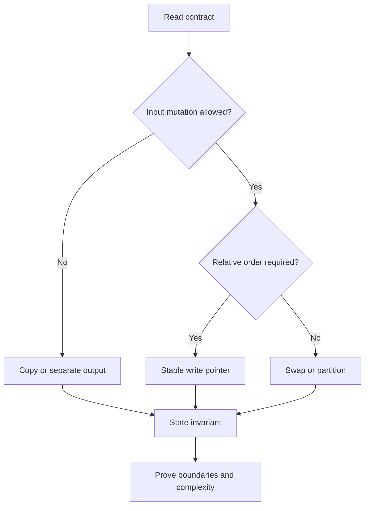

### Example 1 — reference identity is not value equality

Given `int[] a = {4, 1, 7}`, execute `int[] alias = a; alias[1] = 9;`.

**Result:** both variables refer to the same array object, so `a` is now `[4, 9, 7]`. By contrast, `Arrays.copyOf(a, a.length)` creates a distinct array with initially equal component values.

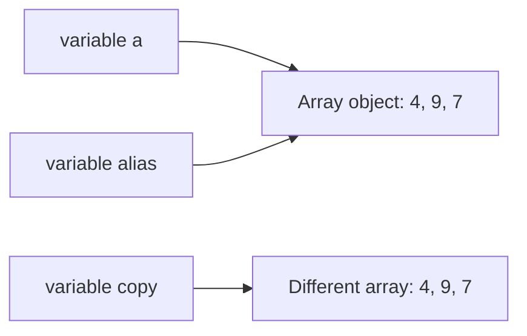

Trace:

| Step | `a == alias` | `a == copy` | `a[1]` | Meaning |
|---:|---:|---:|---:|---|
| After assignment | true | — | 1 | `alias` received the reference |
| After `alias[1] = 9` | true | — | 9 | Mutation is visible through either alias |
| After `copyOf` | true | false | 9 | The new object has equal values but different identity |
| After `copy[1] = 5` | true | false | 9 | Copy mutation does not affect `a` |

Interview consequence: clarify whether “do not modify the input” forbids component mutation. Rebinding a local parameter does not mutate the caller's array, but changing a component does.

```java
int[] original = {4, 1, 7};
int[] alias = original;
alias[1] = 9;
int[] copy = java.util.Arrays.copyOf(original, original.length);
copy[1] = 5;
// original is [4, 9, 7]; copy is [4, 5, 7]
```

### Example 2 — subarray, subsequence, and subset

For `a = [3, -1, 4, 2]`, these terms impose different constraints:

| Candidate | Classification | Reason |
|---|---|---|
| `[-1, 4]` | Subarray, subsequence, and subset selection | Uses the contiguous interval `[1, 2]` |
| `[3, 4, 2]` | Subsequence and subset selection, not subarray | Preserves order but skips index 1 |
| `[4, 3]` | Subset selection only | Selected values exist, but original order is reversed |
| `[3, 3]` | None for this input | A value occurrence cannot be reused unless the input contains it twice |

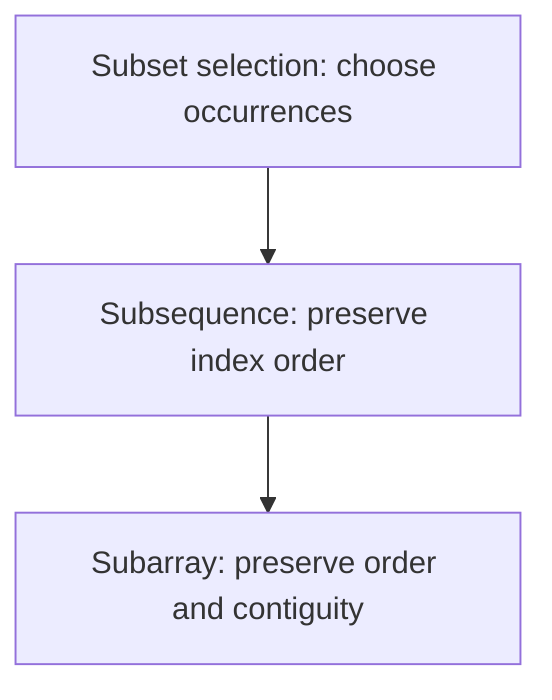

For length `n`:

- non-empty subarrays: `n(n + 1) / 2`;
- subsequences: `2^n` including the empty subsequence;
- value subsets need multiplicity rules when duplicates exist, so “set” language can lose index identity.

Memory trick: **array = interval, sequence = ordered picks, subset = picks without an order promise**.

### Example 3 — stable in-place compaction

Move zeros to the end of `[0, 3, 0, 3, 8]` while preserving the relative order of nonzero values.

Use `read` to scan every component and `write` to identify the next accepted position.

Invariant before processing index `read`:

1. `a[0..write)` contains exactly the nonzero values from original `a[0..read)`, in original order.
2. `write <= read`.
3. `a[read..n)` has not been inspected.

Trace:

| `read` | value | action | `write` after | array after action |
|---:|---:|---|---:|---|
| 0 | 0 | skip | 0 | `[0, 3, 0, 3, 8]` |
| 1 | 3 | write at 0 | 1 | `[3, 3, 0, 3, 8]` |
| 2 | 0 | skip | 1 | `[3, 3, 0, 3, 8]` |
| 3 | 3 | write at 1 | 2 | `[3, 3, 0, 3, 8]` |
| 4 | 8 | write at 2 | 3 | `[3, 3, 8, 3, 8]` |
| fill | — | zero `[3..5)` | 3 | `[3, 3, 8, 0, 0]` |

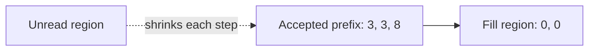

```java
static void stableMoveZeroes(int[] a) {
    int write = 0;
    for (int value : a) {
        if (value != 0) a[write++] = value;
    }
    while (write < a.length) a[write++] = 0;
}
```

**Correctness:** every accepted value is appended once and in scan order, so the prefix is stable. When scanning ends, it contains all nonzero values. Filling the remaining suffix with zeros preserves the required length and yields the target partition.

**Complexity:** `O(n)` time, `O(1)` auxiliary space. This minimizes conceptual complexity; an optional guarded assignment can reduce redundant writes but should not weaken the invariant.

### Example 4 — prefix sums without overflow

For `a = [1_500_000_000, 1_500_000_000, -1_500_000_000]`, the mathematical prefix sums are `[0, 1_500_000_000, 3_000_000_000, 1_500_000_000]`. The second running total exceeds `Integer.MAX_VALUE`, so an `int` prefix silently wraps.

Contract for half-open ranges: `rangeSum(left, right)` returns the sum of `a[left..right)`.

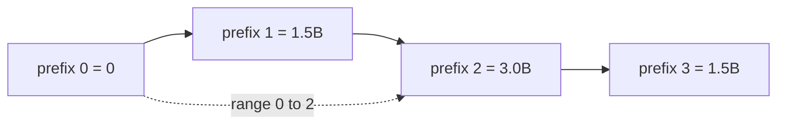

Trace:

| Index consumed | Value | `long` prefix | Meaning |
|---:|---:|---:|---|
| 0 | — | 0 | Empty prefix |
| 1 | 1,500,000,000 | 1,500,000,000 | `a[0..1)` |
| 2 | 1,500,000,000 | 3,000,000,000 | `a[0..2)` |
| 3 | -1,500,000,000 | 1,500,000,000 | `a[0..3)` |

```java
static long[] prefixSums(int[] a) {
    long[] prefix = new long[a.length + 1];
    for (int i = 0; i < a.length; i++) {
        prefix[i + 1] = prefix[i] + a[i]; // long + int -> long
    }
    return prefix;
}

static long rangeSum(long[] prefix, int left, int right) {
    if (left < 0 || left > right || right >= prefix.length) {
        throw new IndexOutOfBoundsException("invalid half-open range");
    }
    return prefix[right] - prefix[left];
}
```

Invariant after consuming `i` components: `prefix[i]` equals the mathematical sum of original `a[0..i)`. Therefore subtracting two prefixes cancels the shared left portion. Build time and space are `O(n)`; each validated range query is `O(1)`.

### Interview checklist

1. Restate mutation, output, ordering, and range conventions.
2. Name indices by role (`read`, `write`, `left`, `right`) rather than letters without meaning.
3. State the invariant before coding.
4. Trace empty, singleton, all-accepted, none-accepted, duplicate, and extreme-value cases.
5. Promote arithmetic before it can overflow.
6. Distinguish auxiliary space from returned output space.
7. State whether a range is closed `[l, r]` or half-open `[l, r)`.
8. Test aliasing expectations when the input is mutable.

## 2. Pattern-recognition decision tree

A trigger word is a hypothesis, not a proof. “Contiguous” narrows the family, but the value domain and required aggregate decide whether a window, prefix state, or Kadane-style recurrence is valid. Run the following checks before naming an algorithm.

### Decision contract

| Question | Consequence | Gate that must be proved |
|---|---|---|
| Is the output a contiguous interval or a count of intervals? | Consider window, prefix state, or Kadane | Windows need a monotone way to repair the constraint |
| Is the input sorted, or may it be sorted without destroying required indices/order? | Consider two pointers, binary search, or merge | Pointer elimination relies on sorted order |
| Is the predicate “seen before,” “how many before,” or “exact sum”? | Consider a set or frequency map | Define precisely what the key and stored value mean |
| Are there many immutable range queries? | Precompute prefix/suffix state | Confirm the aggregate has a valid combine/cancel rule |
| Are there updates between range queries? | Consider Fenwick or segment tree | A static prefix array becomes stale after updates |
| Is the request next greater/smaller or every-window extremum? | Consider monotonic stack/deque | State which dominated candidates may be discarded |
| Are values constrained to `1..n` or `0..n` and mutation is allowed? | Consider cyclic placement or marking | Every value must map to a legal home or be ignored safely |
| Is there a monotone `feasible(mid)` predicate? | Binary-search the answer | Prove the false/true boundary; do not search an arbitrary objective |

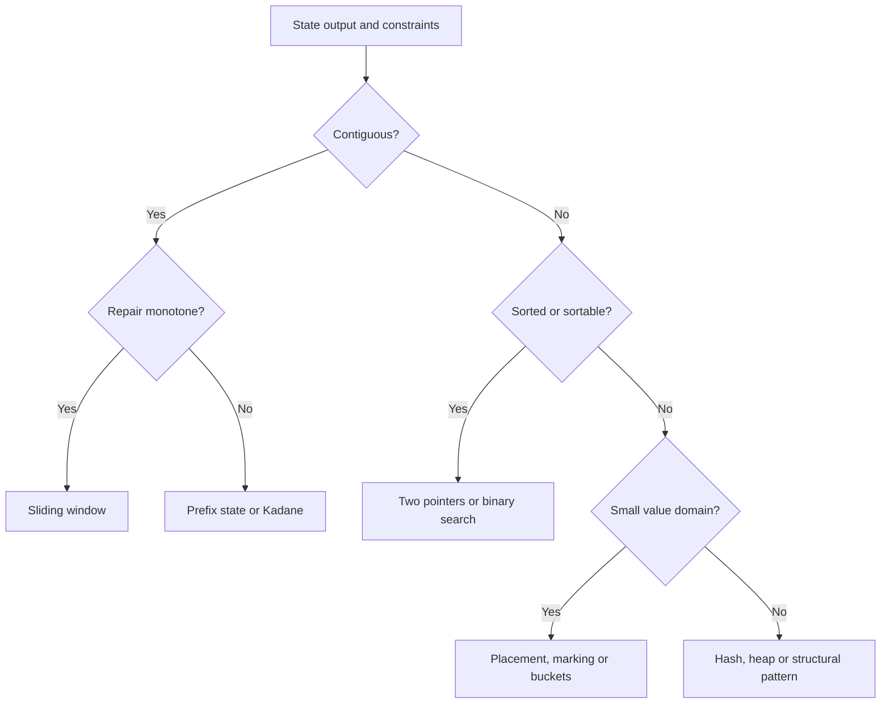

The critical habit is to write the precondition beside the pattern. For example, “minimum length with sum at least `k`” permits a shrinking sum window only when removing from the left cannot increase the sum—typically when values are nonnegative.

### Decision example 1 — exact-sum subarrays with signed values

**Requirement:** count contiguous subarrays whose mathematical sum equals `7` in `[3, 4, -7, 1, 3, 3, 1, -4]`. Values may be negative, so a grow/shrink window has no safe direction.

Choose **prefix sum + frequency map**. Before consuming `a[i]`, `frequency[p]` is the number of earlier prefix boundaries with sum `p`. A subarray ending at `i` sums to `k` exactly when an earlier prefix equals `prefix - k`.

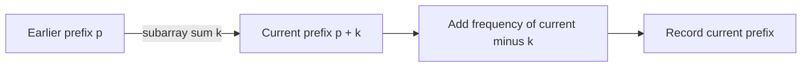

Trace (`frequency` starts with `{0: 1}`):

| `i` | value | prefix | needed `prefix - 7` | matches added | running count |
|---:|---:|---:|---:|---:|---:|
| 0 | 3 | 3 | -4 | 0 | 0 |
| 1 | 4 | 7 | 0 | 1 | 1 |
| 2 | -7 | 0 | -7 | 0 | 1 |
| 3 | 1 | 1 | -6 | 0 | 1 |
| 4 | 3 | 4 | -3 | 0 | 1 |
| 5 | 3 | 7 | 0 | 2 | 3 |
| 6 | 1 | 8 | 1 | 1 | 4 |
| 7 | -4 | 4 | -3 | 0 | 4 |

```java
static long countSubarraysWithSum(int[] a, long target) {
    Map<Long, Integer> frequency = new HashMap<>();
    frequency.put(0L, 1);
    long prefix = 0L;
    long answer = 0L;
    for (int value : a) {
        prefix += value;
        answer += frequency.getOrDefault(prefix - target, 0);
        frequency.merge(prefix, 1, Integer::sum);
    }
    return answer;
}
```

**Correctness:** every earlier boundary with prefix `prefix - target` determines one distinct subarray ending at the current index, and every qualifying subarray has exactly that pair of boundaries. Recording the current prefix after counting excludes empty/reversed intervals. Time is expected `O(n)` and auxiliary space is `O(n)`; `long` protects prefix arithmetic and the result count.

### Decision example 2 — pair sum in sorted input

**Requirement:** return indices of any two distinct values summing to `10` in sorted `[-3, 1, 4, 6, 8, 13]`.

Choose **opposite-end two pointers**. If the current sum is too small, pairing the left value with any index left of `right` cannot do better, so eliminate `left`. If it is too large, eliminate `right` symmetrically.

| Step | `left` value | `right` value | sum | Decision |
|---:|---:|---:|---:|---|
| 1 | -3 | 13 | 10 | return indices `[0, 5]` |

For a non-immediate trace with target `9`, the sums are `10` (decrement right), `5` (increment left), then `9` at values `1 + 8`.

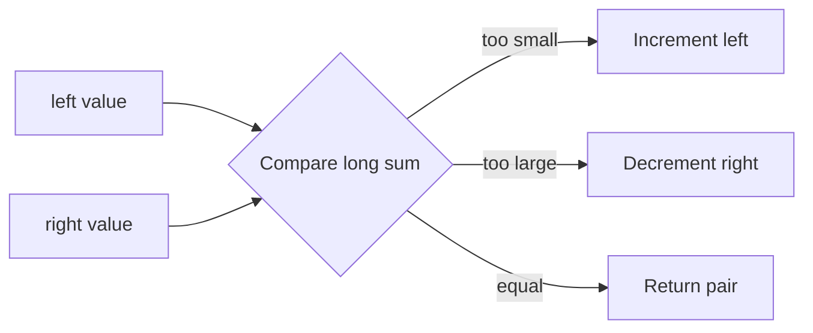

```java
static int[] sortedPairIndices(int[] sorted, long target) {
    requireNondecreasing(sorted);
    int left = 0;
    int right = sorted.length - 1;
    while (left < right) {
        long sum = (long) sorted[left] + sorted[right];
        if (sum == target) return new int[]{left, right};
        if (sum < target) left++;
        else right--;
    }
    return new int[0];
}
```

**Correctness:** each move discards only pairs that are provably too small or too large under sorted order. At least one index leaves the candidate interval per iteration, so time is `O(n)` and auxiliary space is `O(1)`. If original indices must survive sorting, sort value/index pairs or use hashing instead.

### Decision example 3 — minimum qualifying window with nonnegative values

**Requirement:** find the minimum length of a contiguous subarray with sum at least `7` in `[2, 3, 1, 2, 4, 3]`; return `0` if none exists. All values are nonnegative and `target > 0`.

Choose a **sliding window**. Expand `right`; while the sum qualifies, record the length and shrink `left`. Nonnegativity proves that expansion cannot decrease the sum and left-shrinking cannot increase it.

| `right` | value added | sum before shrinking | qualifying windows removed | best |
|---:|---:|---:|---|---:|
| 0 | 2 | 2 | — | — |
| 1 | 3 | 5 | — | — |
| 2 | 1 | 6 | — | — |
| 3 | 2 | 8 | `[0..3]`, then sum 6 | 4 |
| 4 | 4 | 10 | `[1..4]`, `[2..4]`, then sum 6 | 3 |
| 5 | 3 | 9 | `[3..5]`, `[4..5]`, then sum 3 | 2 |

```java
static int minLengthAtLeast(int[] nonnegative, long target) {
    if (target <= 0) throw new IllegalArgumentException("target must be positive");
    for (int value : nonnegative) {
        if (value < 0) throw new IllegalArgumentException("negative value");
    }
    int best = nonnegative.length + 1;
    int left = 0;
    long sum = 0L;
    for (int right = 0; right < nonnegative.length; right++) {
        sum += nonnegative[right];
        while (sum >= target) {
            best = Math.min(best, right - left + 1);
            sum -= nonnegative[left++];
        }
    }
    return best == nonnegative.length + 1 ? 0 : best;
}
```

**Why the gate matters:** with signed values, removing a negative left value increases the sum, so the same pointer rule may skip the optimum. A signed minimum-length problem needs a different structure, commonly increasing prefix sums in a monotonic deque. Under this method's contract, each endpoint advances at most `n` times: `O(n)` time and `O(1)` auxiliary space.

### Decision example 4 — first missing positive in place

**Requirement:** return the smallest missing positive from `[3, 4, -1, 1]` in `O(n)` time and `O(1)` auxiliary space; input mutation is allowed.

Because an answer for length `n` lies in `1..n+1`, use **cyclic placement**: while value `v` is in `1..n`, place it at index `v - 1`. The duplicate guard prevents infinite swapping.

| State | active index | action |
|---|---:|---|
| `[3, 4, -1, 1]` | 0 | swap `3` toward index 2 → `[-1, 4, 3, 1]` |
| `[-1, 4, 3, 1]` | 1 | swap `4` toward index 3 → `[-1, 1, 3, 4]` |
| `[-1, 1, 3, 4]` | 1 | swap `1` toward index 0 → `[1, -1, 3, 4]` |
| `[1, -1, 3, 4]` | scan | index 1 does not contain `2`; return `2` |

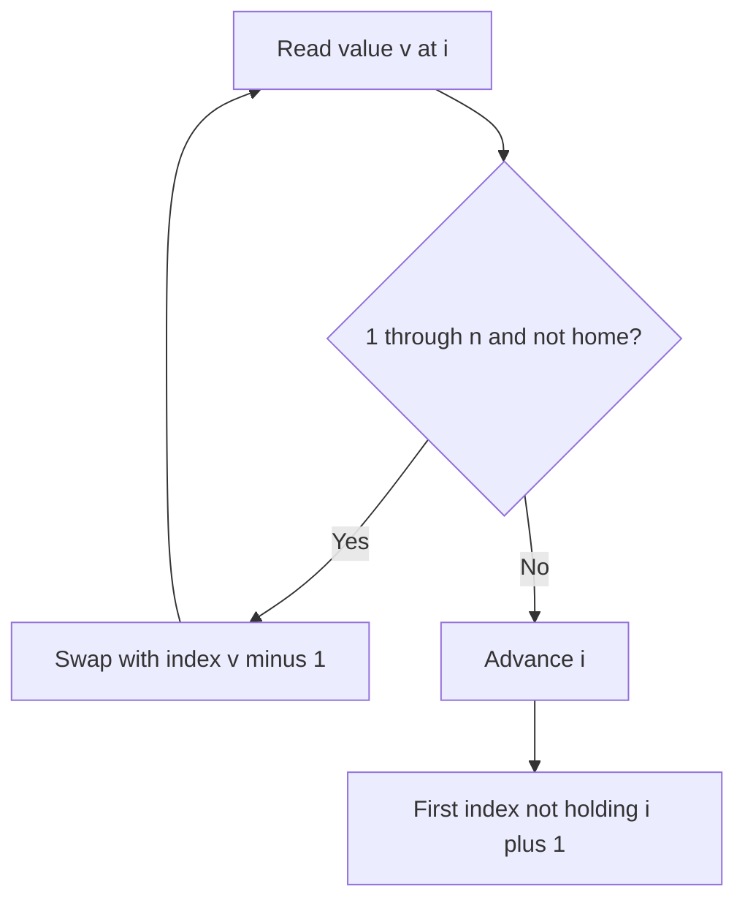

```java
static int firstMissingPositive(int[] a) {
    int i = 0;
    while (i < a.length) {
        int value = a[i];
        if (value >= 1 && value <= a.length && a[value - 1] != value) {
            int tmp = a[value - 1];
            a[value - 1] = value;
            a[i] = tmp;
        } else {
            i++;
        }
    }
    for (i = 0; i < a.length; i++) {
        if (a[i] != i + 1) return i + 1;
    }
    return a.length + 1;
}
```

**Correctness and cost:** every successful swap permanently places at least one in-range value at its home; at most `n` homes can be filled. The final scan returns the first absent home, or `n + 1` when all are filled. Time is `O(n)`, auxiliary space is `O(1)`, and mutation is explicit in the contract.

### Pattern trigger sheet

| Trigger | Candidate | Required proof | Common wrong turn |
|---|---|---|---|
| best-so-far in one pass | linear scan | retained state summarizes the processed prefix | storing every prior state |
| sorted pair/opposite ends | two pointers | a pointer move eliminates only impossible pairs | applying it to unsorted input |
| contiguous + monotone repair | sliding window | expand/shrink direction cannot reverse unexpectedly | using a sum window with negative values |
| count exact-sum subarrays | prefix + frequency map | current-minus-target identifies all earlier boundaries | storing only whether a prefix was seen |
| maximum contiguous sum | Kadane | best ending here is enough for the next state | confusing it with arbitrary subsequence |
| categories or pivot | partition | regions have precise category invariants | assuming stability without providing it |
| values in `1..n` | cyclic placement | legal values map to unique home indices | omitting the duplicate guard |
| sorted or monotone predicate | binary search | rejected/accepted region remains ordered | binary-searching a nonmonotone objective |
| overlap or scheduled ranges | sort then merge | only the last accepted interval can overlap next | merging before sorting |
| every-window maximum/minimum | monotonic deque | discarded candidates can never win later | storing values when indices expire |
| next greater/smaller | monotonic stack | stack order describes unresolved candidates | popping without resolving ownership |
| `k`th/top-`k` | heap or Quickselect | rank—not total order—is the requirement | fully sorting by habit |

### Decision checklist

1. Write the output shape: value, indices, interval, count, mutation, or decision.
2. Record whether values may be negative, duplicated, extreme, or confined to a small range.
3. Record whether the input is sorted and whether sorting may destroy required order or indices.
4. For a window, prove why moving one boundary repairs the violated condition.
5. For a map, define the key, stored value, and the moment each entry becomes visible.
6. For binary search, write `feasible(x)` and prove its monotonic direction.
7. For in-place placement, prove every swap progresses and duplicates terminate.
8. Promote arithmetic before sums, differences, and midpoint calculations can overflow.
9. Trace an empty case, a no-answer case, duplicates, and the smallest legal input.

## 3. Java array interview toolkit

The toolkit is not a bag of memorized calls. Each operation carries a contract about mutation, identity, ordering, lifetime, or numeric range. State that contract before choosing the API.

### Toolkit contract

| Need | Preferred Java tool | Contract to say aloud | Failure to avoid |
|---|---|---|---|
| Independent primitive-array values | `Arrays.copyOf(a, a.length)` | New array object; primitive components are copied by value | `int[] copy = a` creates an alias |
| Destructive ordering | `Arrays.sort(a)` | Sorts the supplied array in place | Losing original positions or caller-visible order |
| Uniform initialization | `Arrays.fill(a, value)` | Overwrites every selected component | Assuming it allocates a new array |
| Counts or membership | `HashMap` / `HashSet` | Define the key and when it becomes visible | Comparing boxed objects with `==` |
| Expiring ordered candidates | `ArrayDeque<Integer>` | Store indices when age and value both matter | Storing only values, which cannot prove expiration |
| Midpoint and arithmetic | `left + (right-left)/2`; cast before arithmetic | Preconditions bound the difference; arithmetic executes in `long` | Casting after an overflowing `int` operation |
| Exchange two components | three-assignment swap | Both indices must be valid; `i == j` is harmless | XOR swap, which is opaque and breaks on the same index |

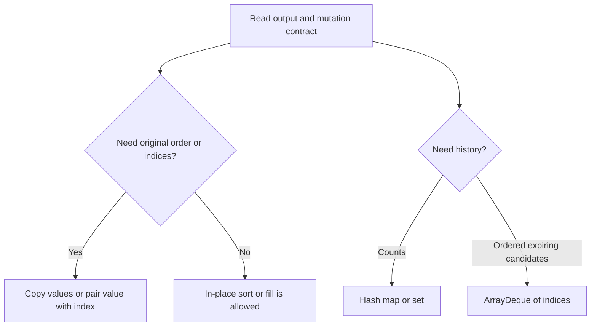

### Toolkit example 1 — sort a copy and preserve original indices

**Requirement:** for `[40, 10, 40, -2]`, produce sorted values without mutating the input and return original indices in value order. Equal values must retain increasing original index. Expected values: `[-2, 10, 40, 40]`; indices: `[3, 1, 0, 2]`.

`Arrays.copyOf` is enough when only sorted values are needed. Once original positions are output, sort explicit `(value, index)` pairs. The index tie-break makes the duplicate rule visible instead of relying on an incidental sort property.

```java
record IndexedValue(int value, int index) {}

static int[] sortedCopy(int[] input) {
    int[] copy = Arrays.copyOf(input, input.length);
    Arrays.sort(copy);                 // mutates only copy
    return copy;
}

static int[] stableOriginalIndicesByValue(int[] input) {
    IndexedValue[] pairs = new IndexedValue[input.length];
    for (int i = 0; i < input.length; i++) pairs[i] = new IndexedValue(input[i], i);
    Arrays.sort(pairs, (a, b) -> {
        int byValue = Integer.compare(a.value(), b.value());
        return byValue != 0 ? byValue : Integer.compare(a.index(), b.index());
    });
    int[] indices = new int[pairs.length];
    for (int i = 0; i < pairs.length; i++) indices[i] = pairs[i].index();
    return indices;
}
```

| Sorted position | pair chosen | output index | input remains |
|---:|---|---:|---|
| 0 | `(-2, 3)` | 3 | `[40, 10, 40, -2]` |
| 1 | `(10, 1)` | 1 | unchanged |
| 2 | `(40, 0)` | 0 | unchanged |
| 3 | `(40, 2)` | 2 | unchanged |

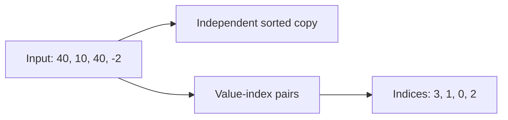

Sorting primitive values is `O(n log n)` time and the returned copy is `O(n)` space. Pair sorting also uses `O(n)` explicit storage. If the API promises `O(1)` auxiliary space, it cannot simultaneously return a full independent copy.

### Toolkit example 2 — frequencies and boxed equality

**Requirement:** decide whether `[1000, 1000, -2]` and `[1000, -2, 1000]` contain the same values with the same multiplicities. Expected result: `true`; `[1, 1, 2]` versus `[1, 2, 2]` is `false`.

The map invariant is: after processing a prefix of the right array, `balance[v]` is the number of unmatched occurrences of `v` from the left array. A missing key is immediate failure; remove a key when its last unmatched occurrence is consumed.

```java
static Map<Integer, Integer> frequencies(int[] input) {
    Map<Integer, Integer> result = new HashMap<>();
    for (int value : input) result.merge(value, 1, Integer::sum);
    return result;
}

static boolean sameMultiset(int[] left, int[] right) {
    if (left.length != right.length) return false;
    Map<Integer, Integer> balance = frequencies(left);
    for (int value : right) {
        Integer count = balance.get(value);
        if (count == null) return false;
        if (count == 1) balance.remove(value);
        else balance.put(value, count - 1);
    }
    return balance.isEmpty();
}
```

| Right value consumed | balance afterward |
|---:|---|
| start | `{1000=2, -2=1}` |
| `1000` | `{1000=1, -2=1}` |
| `-2` | `{1000=1}` |
| `1000` | `{}` → equal |

Two separately boxed `Integer.valueOf(1000)` values need not be the same reference, so `a == b` is not a value-equality contract. Use `a.equals(b)` (or `Objects.equals(a, b)` when null is possible). Hash-based collections use equality/hash semantics, not the caller's reference identity. Expected time is `O(n)` and auxiliary space is `O(u)` for `u` distinct values.

### Toolkit example 3 — store deque indices, not values

**Requirement:** return each width-3 maximum for `[1, 3, -1, -3, 5, 3, 6, 7]`. Expected output: `[3, 3, 5, 5, 6, 7]`.

Keep indices in increasing order from front to back and their values in strictly decreasing order. The front is therefore the largest live candidate. Indices make both expiration (`index <= right - width`) and value lookup possible; values alone cannot distinguish an expired duplicate from a live one.

```java
static int[] windowMaximum(int[] input, int width) {
    if (width <= 0 || width > input.length) throw new IllegalArgumentException("invalid width");
    int[] result = new int[input.length - width + 1];
    Deque<Integer> candidates = new ArrayDeque<>();
    for (int right = 0; right < input.length; right++) {
        while (!candidates.isEmpty() && candidates.peekFirst() <= right - width) {
            candidates.pollFirst();
        }
        while (!candidates.isEmpty()
                && input[candidates.peekLast()] <= input[right]) {
            candidates.pollLast();
        }
        candidates.offerLast(right);
        if (right >= width - 1) {
            result[right - width + 1] = input[candidates.peekFirst()];
        }
    }
    return result;
}
```

| `right` | value | deque indices after updates | represented values | emitted max |
|---:|---:|---|---|---:|
| 0 | 1 | `[0]` | `[1]` | — |
| 1 | 3 | `[1]` | `[3]` | — |
| 2 | -1 | `[1, 2]` | `[3, -1]` | 3 |
| 3 | -3 | `[1, 2, 3]` | `[3, -1, -3]` | 3 |
| 4 | 5 | `[4]` | `[5]` | 5 |
| 5 | 3 | `[4, 5]` | `[5, 3]` | 5 |
| 6 | 6 | `[6]` | `[6]` | 6 |
| 7 | 7 | `[7]` | `[7]` | 7 |

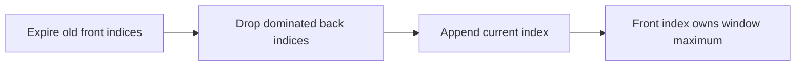

Each index is appended once and removed at most once from each end, so total time is `O(n)` and deque space is `O(width)`. `ArrayDeque` supplies amortized constant-time end operations and rejects nulls, which is useful here because null has no candidate meaning.

### Toolkit example 4 — safe midpoint, arithmetic, and swap

**Requirement:** find the first position whose value is at least `3` in `[1, 3, 3, 7]`; return `1`. Also compute `Integer.MAX_VALUE + 1` and `50_000 × 50_000` mathematically, and permit swapping an element with itself.

Use a half-open search interval `[left, right)`. Before each iteration, every index before `left` is known to be `< target`; every index at or after `right` is known to be `>= target`. The subtraction-based midpoint avoids `left + right` overflow under `0 <= left <= right`.

```java
static int lowerBound(int[] sorted, int target) {
    int left = 0, right = sorted.length;
    while (left < right) {
        int mid = left + (right - left) / 2;
        if (sorted[mid] < target) left = mid + 1;
        else right = mid;
    }
    return left;
}

static long safeSum(int a, int b)     { return (long) a + b; }
static long safeProduct(int a, int b) { return (long) a * b; }

static void swap(int[] a, int i, int j) {
    int tmp = a[i];
    a[i] = a[j];
    a[j] = tmp;
}
```

| Step | interval `[left, right)` | `mid` | value | next interval |
|---:|---|---:|---:|---|
| 1 | `[0, 4)` | 2 | 3 | `[0, 2)` |
| 2 | `[0, 2)` | 1 | 3 | `[0, 1)` |
| 3 | `[0, 1)` | 0 | 1 | `[1, 1)` → return 1 |

The cast must occur before the operator: `(long) a * b` multiplies as `long`, while `(long) (a * b)` first allows `int` overflow and only then widens the wrong value. The expected results are `2_147_483_648L` and `2_500_000_000L`. For swap, `i == j` simply writes the same value back.

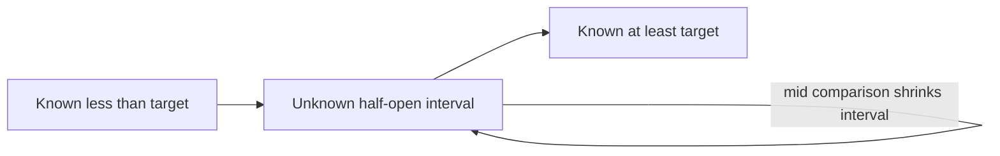

Binary search is `O(log n)` time and `O(1)` space. Arithmetic helpers and swap are `O(1)`.

### Toolkit checklist

1. Say whether the operation mutates the supplied array or returns a new one.
2. Preserve `(value, originalIndex)` pairs when output depends on original positions.
3. Define a map's key, value, and update visibility before coding.
4. Use `.equals` for boxed/object values; use `==` only when reference identity is the requirement.
5. Store deque indices when candidates expire by position.
6. Cast an operand before overflow-sensitive addition, subtraction, or multiplication.
7. Write binary-search interval semantics and midpoint preconditions.
8. Prefer a readable temporary-variable swap and validate both indices.
9. Test empty and singleton inputs, duplicates, extreme integers, invalid window widths, and no-answer searches.

Executable evidence is in `ArrayToolkitContracts.java`. Its deterministic suite checks all four contracts plus 10,000 randomized arrays against brute-force window-maximum and lower-bound oracles.

## 4. Core pattern lab — first ten solved problems

The source collection groups 47 solved problems under one large “Core Array Patterns” boundary. This incremental lab promotes the first ten: Two Sum, one-transaction stock profit, maximum subarray, majority element, Move Zeroes, Remove Duplicates from Sorted Array, Squares of a Sorted Array, 3Sum, Container With Most Water, and Trapping Rain Water. The first four compress decision state; problems 5–6 finalize a prefix; problem 7 consumes the only two places that can still hold the largest magnitude; problems 8–10 use sorted or boundary monotonicity to discard state safely. Problems 11–47 remain explicit backlog; this guide does not imply they were reviewed merely because they share the source heading.

### Pattern-lab contract

Before selecting code, pin down the result and the guarantee that makes discarded history irrelevant:

| Problem | Required result | Minimal retained state | Proof obligation | This guide's edge contract |
|---|---|---|---|---|
| Two Sum | two distinct indices, or no answer | value → earliest earlier index | only the complement can complete the current value | target arithmetic is `long`; input is not mutated |
| One stock trade | maximum nonnegative profit | minimum price in the legal prefix | every sale is best paired with the cheapest earlier buy | fewer than two prices returns `0`; result is `long` |
| Maximum subarray | largest sum of a non-empty contiguous range | best sum ending exactly here | every optimum ending here either restarts or extends | empty input is rejected; sum is `long` |
| Majority element | value occurring more than `n / 2`, if present | cancellation candidate and balance | cancellation yields only a candidate without a promise | a second pass verifies; no majority returns empty |
| Move Zeroes | mutate the same array: stable nonzeros, then zero suffix | next output slot `write` | before `read`, the compact prefix is final and `write <= read` | null is rejected; empty and already-valid arrays are no-ops |
| Remove Duplicates | return the length of the stable unique prefix | last accepted value and `write` | sorted runs are contiguous, so one representative completes each run | validate sortedness before mutation at reusable boundaries; suffix is unspecified |
| Sorted Squares | a new nondecreasing array of mathematical squares | unconsumed interval `[left, right]` and backward `write` | the largest remaining magnitude is at an interval endpoint | input is validated and not mutated; `long` preserves every squared `int` |
| 3Sum | unique value triplets from distinct indices whose mathematical sum is zero | sorted suffix plus anchor and two pointers | comparison eliminates one monotone side; duplicate runs emit once | sort a copy, widen sums, and return deterministic lexicographic triplets |
| Container With Most Water | maximum area from one pair of boundaries | current endpoint pair and best area | every pair retaining the shorter endpoint is dominated | reject negative heights, do not mutate, and widen before multiplication |
| Trapping Rain Water | total per-index retained water | unresolved interval plus left/right maxima | the side with the smaller running boundary has an exact final cap | reject negative heights, do not mutate, and accumulate in checked `long` |

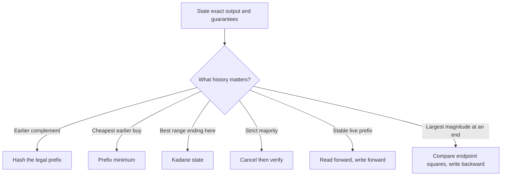

All four implementations are side-effect free. Their arithmetic contracts deliberately differ from many short interview snippets: indices stay `int`, but sums, targets, differences, and returned numeric aggregates use `long` wherever two legal `int` values can exceed the `int` range.

### Example 1 — Two Sum: index the legal prefix

**Requirement:** for `input = [2, 7, 11, 15]` and `target = 9`, return two distinct indices whose values sum mathematically to the target. Return an empty array when no pair exists. Do not mutate the input.

Invariant before reading index `right`: the map stores the earliest index of each value in `input[0..right)`. Therefore any retrieved index is automatically different from `right`.

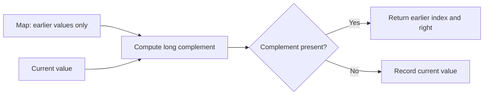

Trace:

| `right` | value | `need = target - value` | map before | decision |
|---:|---:|---:|---|---|
| 0 | 2 | 7 | `{}` | record `2 → 0` |
| 1 | 7 | 2 | `{2=0}` | return `[0, 1]` |

```java
static int[] twoSumIndices(int[] input, long target) {
    Map<Long, Integer> firstIndex = new HashMap<>();
    for (int right = 0; right < input.length; right++) {
        long need = target - input[right];
        Integer left = firstIndex.get(need);
        if (left != null) return new int[]{left, right};
        firstIndex.putIfAbsent((long) input[right], right);
    }
    return new int[0];
}
```

**Why the order matters:** checking before insertion prevents reusing the current index. `putIfAbsent` retains the earliest duplicate, which makes behavior deterministic without changing correctness. `long need` handles pairs such as two `Integer.MAX_VALUE` values with target `4_294_967_294L`.

Expected time is `O(n)` under the map's usual hash-distribution assumption, with `O(n)` auxiliary space. A nested-loop baseline is `O(n²)` time and `O(1)` space; a sorted two-pointer solution is appropriate only when sorting is allowed and original-index identity is preserved separately.

### Example 2 — one stock trade: retain the cheapest legal buy

**Requirement:** for prices `[7, 1, 5, 3, 6, 4]`, choose at most one buy and one later sell and return the maximum profit. Return `0` when no profitable legal trade exists.

Before evaluating day `sell`, `minimum` is the lowest price in `[0, sell)`, and `best` is the largest profit among sales before `sell`. The only state a new selling day needs is the cheapest legal earlier buy.

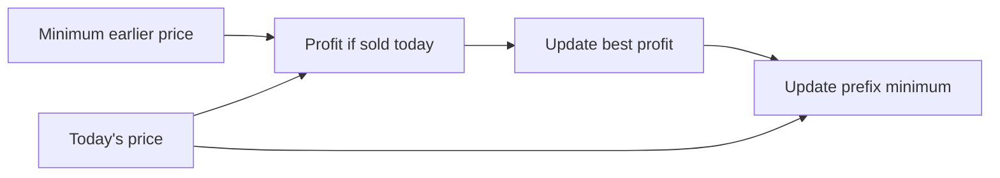

| sell day | price | minimum before | profit today | best after |
|---:|---:|---:|---:|---:|
| 1 | 1 | 7 | -6 | 0 |
| 2 | 5 | 1 | 4 | 4 |
| 3 | 3 | 1 | 2 | 4 |
| 4 | 6 | 1 | 5 | 5 |
| 5 | 4 | 1 | 3 | 5 |

```java
static long maxSingleTradeProfit(int[] prices) {
    if (prices.length < 2) return 0L;
    int minimum = prices[0];
    long best = 0L;
    for (int sell = 1; sell < prices.length; sell++) {
        best = Math.max(best, (long) prices[sell] - minimum);
        minimum = Math.min(minimum, prices[sell]);
    }
    return best;
}
```

The cast occurs before subtraction, so the method remains correct even across the full `int` domain. Selling is evaluated before incorporating today's price into the prefix minimum; buying and selling on one day would produce zero anyway, but keeping the legal-prefix meaning explicit makes the proof portable to variants with fees or a mandatory positive holding period. Time is `O(n)` and auxiliary space is `O(1)`.

### Example 3 — maximum subarray: compress the best ending state

**Requirement:** return the largest mathematical sum of a non-empty contiguous subarray. For `[-2, 1, -3, 4, -1, 2, 1, -5, 4]`, return `6` for `[4, -1, 2, 1]`.

After processing index `i`, `endingHere` is the maximum sum among all non-empty subarrays ending exactly at `i`; `best` is the maximum over every ending position processed so far.

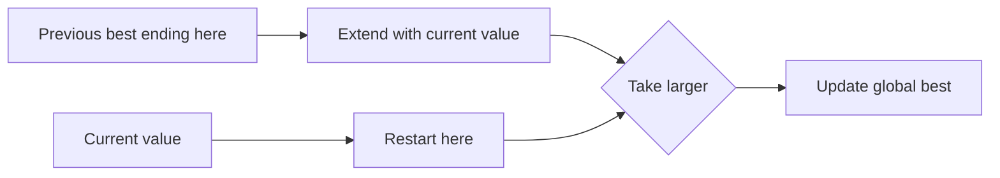

| `i` | value | extend | restart | `endingHere` | `best` |
|---:|---:|---:|---:|---:|---:|
| 0 | -2 | — | -2 | -2 | -2 |
| 1 | 1 | -1 | 1 | 1 | 1 |
| 2 | -3 | -2 | -3 | -2 | 1 |
| 3 | 4 | 2 | 4 | 4 | 4 |
| 4 | -1 | 3 | -1 | 3 | 4 |
| 5 | 2 | 5 | 2 | 5 | 5 |
| 6 | 1 | 6 | 1 | 6 | 6 |

```java
static long maxSubarraySum(int[] input) {
    if (input.length == 0) throw new IllegalArgumentException("non-empty input required");
    long endingHere = input[0], best = input[0];
    for (int i = 1; i < input.length; i++) {
        endingHere = Math.max((long) input[i], endingHere + input[i]);
        best = Math.max(best, endingHere);
    }
    return best;
}
```

Every non-empty subarray ending at `i` either contains no earlier element or extends a subarray ending at `i - 1`; no third case exists. Retaining the best earlier ending dominates every worse extension. Initialization from the first element is essential: initializing to zero would incorrectly allow an empty range for all-negative input. Time is `O(n)`, auxiliary space is `O(1)`, and `long` keeps repeated `int` additions mathematical.

### Example 4 — majority element: cancel, then verify

**Requirement:** return a value only when it occurs strictly more than `floor(n / 2)` times. The usual interview statement may guarantee a majority; this reusable contract does not trust that promise.

The candidate pass pairs occurrences of the current candidate with different values. If a strict majority exists, it survives every possible cancellation. Cancellation does **not** prove that a majority exists, so verification is a separate gate.

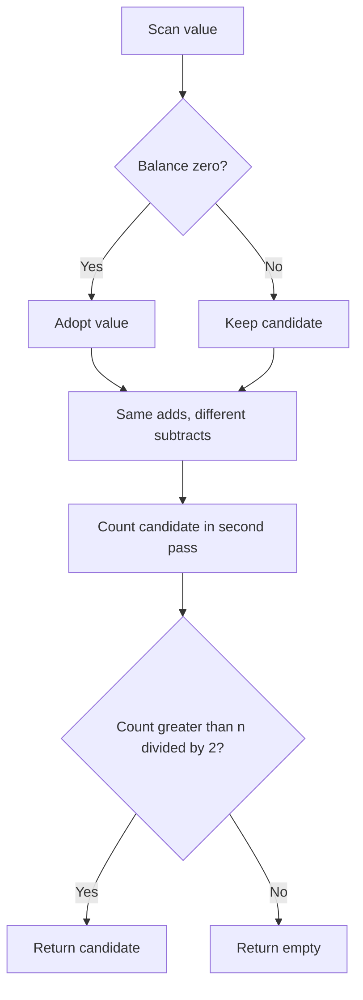

Trace for `[2, 2, 1, 1, 1, 2, 2]`:

| value | candidate before | balance before | candidate/balance after |
|---:|---:|---:|---|
| 2 | — | 0 | `2 / 1` |
| 2 | 2 | 1 | `2 / 2` |
| 1 | 2 | 2 | `2 / 1` |
| 1 | 2 | 1 | `2 / 0` |
| 1 | 2 | 0 | `1 / 1` |
| 2 | 1 | 1 | `1 / 0` |
| 2 | 1 | 0 | `2 / 1` |

The second pass counts four occurrences of `2`; `4 > 7 / 2`, so the result is present.

```java
static OptionalInt majorityElement(int[] input) {
    if (input.length == 0) return OptionalInt.empty();
    int candidate = 0, balance = 0;
    for (int value : input) {
        if (balance == 0) candidate = value;
        balance += value == candidate ? 1 : -1;
    }
    int occurrences = 0;
    for (int value : input) if (value == candidate) occurrences++;
    return occurrences > input.length / 2
            ? OptionalInt.of(candidate)
            : OptionalInt.empty();
}
```

The candidate pass is `O(n)`, verification is another `O(n)`, and auxiliary space is `O(1)`. Under a contractual guarantee, verification may be omitted; without it, `[1, 2, 3]` demonstrates why returning the final candidate is unsound. Majority means strictly more than half, not merely the mode.

### Core-pattern checklist

1. State whether the output is indices, a numeric aggregate, a mutated array, or an optional value.
2. Preserve legality in the state: Two Sum stores only earlier indices; stock state stores only earlier buys.
3. Name exactly what a compressed variable means after each iteration.
4. Distinguish a candidate-producing pass from a proof-producing verification pass.
5. Check before inserting when the current element must not match itself.
6. Initialize non-empty extrema from real input, not a convenient zero.
7. Promote before subtraction or addition when legal `int` values can overflow.
8. Test duplicates, no answer, all-negative input, decreasing prices, absent majority, and integer extremes.

Executable evidence is in `ArrayCorePatterns.java`. It checks 28 explicit scenario groups and runs 40,000 seeded comparisons against brute-force pair-existence, profit, maximum-subarray, and majority oracles.

### Example 5 — Move Zeroes: stable compaction, then clear

**Requirement:** mutate the supplied array so every nonzero value keeps its original relative order at the front and every zero occupies the suffix. For `[0, 1, 0, 3, 12]`, the required final array is `[1, 3, 12, 0, 0]`. Return data is optional; the observable contract is the same array object after mutation.

The `read` pointer discovers values; `write` names the first unfilled slot in the compact prefix. Before each read:

1. `values[0..write)` equals the nonzero subsequence of `values[0..read)` in encounter order.
2. `write <= read`, so copying `values[read]` left cannot destroy an unread value.
3. Nothing at or after `write` is final until the scan ends.

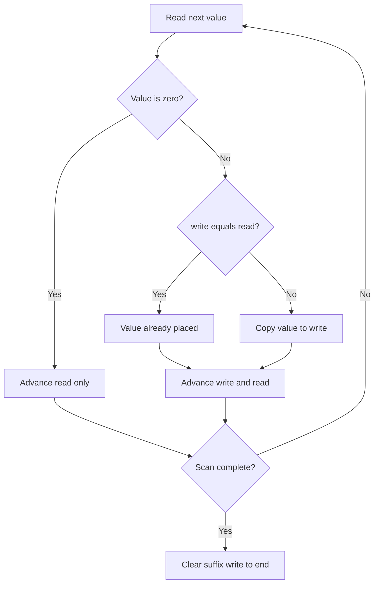

Canonical trace:

| `read` | value | `write` before | action | array after action | `write` after |
|---:|---:|---:|---|---|---:|
| 0 | 0 | 0 | skip | `[0, 1, 0, 3, 12]` | 0 |
| 1 | 1 | 0 | copy to index 0 | `[1, 1, 0, 3, 12]` | 1 |
| 2 | 0 | 1 | skip | `[1, 1, 0, 3, 12]` | 1 |
| 3 | 3 | 1 | copy to index 1 | `[1, 3, 0, 3, 12]` | 2 |
| 4 | 12 | 2 | copy to index 2 | `[1, 3, 12, 3, 12]` | 3 |
| clear | — | 3 | zero indices 3 and 4 | `[1, 3, 12, 0, 0]` | 3 |

```java
static void moveZeroes(int[] values) {
    int write = 0;
    for (int read = 0; read < values.length; read++) {
        if (values[read] == 0) continue;
        if (write != read) values[write] = values[read];
        write++;
    }
    while (write < values.length) values[write++] = 0;
}
```

Four cases pin down different parts of the contract:

| Input | Expected mutation | What it proves |
|---|---|---|
| `[0, 1, 0, 3, 12]` | `[1, 3, 12, 0, 0]` | zeros can be interleaved; nonzeros stay ordered |
| `[4, -1, 7]` | `[4, -1, 7]` | no zero means no movement; conditional copy avoids self-writes |
| `[0, 0, 0]` | `[0, 0, 0]` | empty live prefix and full zero suffix are valid |
| `[0, -1, -1, 0, 2]` | `[-1, -1, 2, 0, 0]` | negatives and duplicates are values, not special cases; stability is observable |

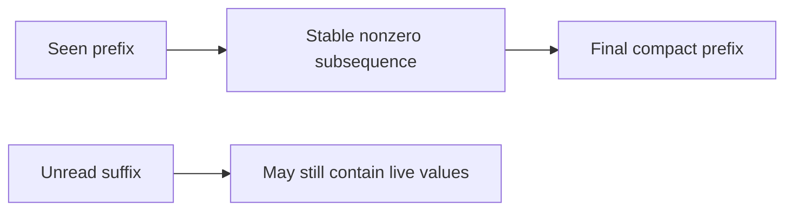

**Correctness.** Initially both prefixes are empty. A zero adds nothing to the required nonzero subsequence, so skipping preserves the invariant. A nonzero is appended at `write`; because reads move left-to-right, append order is source order, and because `write <= read`, the copy cannot overwrite future input. At termination the prefix is exactly every original nonzero in order. Clearing the remaining `n - write` cells creates the required zero suffix without touching that prefix.

**Why not swap with the far end?** A bidirectional partition can violate stability: swapping the first zero in `[0, 1, 2, 0, 3]` with the final `3` produces a prefix beginning `[3, 1, 2]`. The source's same-direction swap is stable and correct, but it can perform two writes for every displaced nonzero. Copy-then-clear makes the two phases explicit; the executable version skips assignments that would leave a cell unchanged and records at most `n` changed-cell writes.

Time is `O(n)`: the scan reads each element once and the clear phase touches at most the suffix. Auxiliary space is `O(1)`. The extra-array baseline is also `O(n)` time but uses `O(n)` space. Repeatedly shifting after each zero is stable but can degrade to `O(n²)` on alternating input.

Interview variations change the predicate, not the proof shape: move all values failing `keep(value)` to the end, return the compacted length, or preserve only the first `k` copies. If the discarded suffix need not be normalized, stop after compaction and return `write`; if stability is not required, a bidirectional partition becomes legal.

Executable evidence is in `MoveZeroesContracts.java`. It checks the four cases above plus empty input, alternating values, null rejection, and 20,000 seeded arrays against an independent extra-array oracle. It also checks the reported nonzero count and the at-most-`n` changed-cell assignment bound.

### Example 6 — Remove Duplicates: finalize a unique prefix

**Requirement:** the input is sorted in nondecreasing order. Mutate the same array so its first `k` cells contain every distinct input value exactly once in original order, then return `k`. The suffix beginning at `k` is explicitly unspecified and must not be tested or cleared. For `[0,0,1,1,1,2,2,3,3,4]`, return `5` with prefix `[0,1,2,3,4]`.

This is stable compaction with a different keep rule from Move Zeroes. Because the input is sorted, all copies of a value form one run. `write` is the length of the finalized unique prefix; `values[write - 1]` is the last accepted value. Before processing `read`:

1. `values[0..write)` contains exactly one representative of every run that starts in `values[0..read)`.
2. That prefix is strictly increasing and matches the original encounter order.
3. `1 <= write <= read` for nonempty input, so a leftward write cannot overwrite unread input.

```mermaid
flowchart LR
    U["Final unique prefix: 0 to write-1"] --> L["Last accepted value"]
    R["Current run value at read"] --> C{"Same as last accepted?"}
    L --> C
    C -->|yes| S["Skip duplicate"]
    C -->|no| W["Write at index write; advance write"]
```

The interview form assumes the sorted-input precondition:

```java
static int removeDuplicates(int[] values) {
    if (values.length == 0) return 0;
    int write = 1;
    for (int read = 1; read < values.length; read++) {
        if (values[read] != values[write - 1]) {
            if (write != read) values[write] = values[read];
            write++;
        }
    }
    return write;
}
```

The `write != read` guard is not needed for correctness. It avoids assignments when an already-unique prefix is already in its final location, which makes mutation accounting and caller-visible write traffic easier to reason about.

#### Worked case 1 — interleaved duplicate runs

Trace `[0,0,1,1,1,2,2,3,3,4]`:

| `read` | value | last accepted | action | finalized prefix | `write` after |
|---:|---:|---:|---|---|---:|
| 1 | 0 | 0 | skip same run | `[0]` | 1 |
| 2 | 1 | 0 | write index 1 | `[0,1]` | 2 |
| 3 | 1 | 1 | skip | `[0,1]` | 2 |
| 4 | 1 | 1 | skip | `[0,1]` | 2 |
| 5 | 2 | 1 | write index 2 | `[0,1,2]` | 3 |
| 6 | 2 | 2 | skip | `[0,1,2]` | 3 |
| 7 | 3 | 2 | write index 3 | `[0,1,2,3]` | 4 |
| 8 | 3 | 3 | skip | `[0,1,2,3]` | 4 |
| 9 | 4 | 3 | write index 4 | `[0,1,2,3,4]` | 5 |

The array may end as `[0,1,2,3,4,2,2,3,3,4]`. That is correct: only indices `0..4` belong to the result. Clearing or validating the suffix adds work and invents a requirement.

```mermaid
stateDiagram-v2
    [*] --> AcceptedFirst
    AcceptedFirst --> Reading
    Reading --> Reading: duplicate, write unchanged
    Reading --> Extended: new run, append once
    Extended --> Reading: advance read
    Reading --> Done: read reaches length
    Extended --> Done: read reaches length
```

#### Worked case 2 — one long run

For `[-7,-7,-7]`, return `k = 1`; the meaningful prefix is `[-7]`. No assignment is needed because the first representative was already accepted. This case proves that `k` counts runs, not occurrences, and that `write` must start at one only after ruling out empty input.

#### Worked case 3 — every value is already unique

For `[Integer.MIN_VALUE,-1,0,Integer.MAX_VALUE]`, return `k = 4` with the entire array unchanged. Equality comparisons are sufficient—there is no subtraction that could overflow at integer extremes. The conditional self-write guard records zero changed assignments.

#### Worked case 4 — precondition failure versus promised input

`[1,0,1]` is outside the problem contract. On an interview platform, state the sorted precondition and omit an extra pass. At a reusable service/library boundary, validate nondecreasing order **before** mutation and reject atomically; detecting disorder only after compaction may leave the caller's array partially changed.

```mermaid
flowchart TD
    A["Reusable API receives array"] --> V{"Sorted nondecreasingly?"}
    V -->|no| X["Reject before any write"]
    V -->|yes, empty| Z["Return k = 0"]
    V -->|yes, nonempty| I["write = 1; scan runs"]
    I --> K["Return k; ignore suffix"]
```

**Correctness.** For a nonempty array, the invariant holds initially because the prefix containing only `values[0]` represents the first run. When `values[read]` equals the last accepted value, sortedness means it belongs to the same run, so skipping it preserves the exact unique prefix. When it differs, it begins a new run; appending it at `write` adds exactly the next distinct value and preserves order. Because `write <= read`, the assignment cannot destroy unread input. At termination every run has contributed once, so `write` is both the prefix length and the number of distinct values.

Time is `O(n)` and auxiliary space is `O(1)`. A `LinkedHashSet` baseline preserves encounter order but costs `O(n)` space; a plain `HashSet` does not specify encounter order. The optimized method performs at most `k - 1` changed-cell assignments and none for an already unique array.

**Follow-up — allow at most `m` copies.** Keep the first `m` cells automatically; afterward accept `values[read]` exactly when it differs from `values[write - m]`. This compares with the oldest retained copy in the allowed window. Reject `m < 1`, and retain the same suffix-is-unspecified rule.

Executable evidence is in `RemoveDuplicatesContracts.java`. It checks the four worked contracts, empty/singleton and signed-boundary cases, null rejection, atomic rejection of unsorted input, assignment bounds, and 20,000 seeded sorted arrays against an independent `LinkedHashSet` oracle.

### Example 7 — Sorted Squares: consume the largest magnitude

**Requirement:** accept an `int[]` sorted in nondecreasing signed order and return a **new** array containing every mathematical square in nondecreasing order. Do not mutate the input. This reusable version returns `long[]`, because Java's full `int` domain includes values whose square does not fit in `int`. Empty input returns an empty result; null or unsorted input is rejected before the output scan.

The subtlety is that signed order is not magnitude order. Squaring folds the negative half around zero: `-9 < -2`, but `81 > 4`. For any remaining sorted interval `[left, right]`, every interior value lies between the endpoints. Its magnitude therefore cannot exceed both endpoint magnitudes. The next largest square must come from `values[left]` or `values[right]`.

```mermaid
flowchart LR
    L["left endpoint"] --> LS["square as long"]
    R["right endpoint"] --> RS["square as long"]
    LS --> C{"which square is larger?"}
    RS --> C
    C -->|left| WL["write at end; left++"]
    C -->|right or tie| WR["write at end; right--"]
    WL --> N["write--"]
    WR --> N
```

The interview core is short once the contracts are settled:

```java
static long[] sortedSquares(int[] values) {
    Objects.requireNonNull(values, "values");
    for (int i = 1; i < values.length; i++) {
        if (values[i - 1] > values[i]) {
            throw new IllegalArgumentException("input must be sorted");
        }
    }

    long[] output = new long[values.length];
    int left = 0, right = values.length - 1;
    for (int write = output.length - 1; write >= 0; write--) {
        long leftSquare = (long) values[left] * values[left];
        long rightSquare = (long) values[right] * values[right];
        if (leftSquare > rightSquare) {
            output[write] = leftSquare;
            left++;
        } else {
            output[write] = rightSquare;
            right--;
        }
    }
    return output;
}
```

Two details are deliberate:

1. Compare widened squares, not `Math.abs(int)`. `Math.abs(Integer.MIN_VALUE)` is still negative because `2^31` is not representable as an `int`.
2. Cast **before** multiplication. `(long) value * value` computes a `long` product; `(long) (value * value)` widens an already-overflowed `int`.

#### Worked case 1 — mixed signs, exact pointer trace

For `[-4,-1,0,3,10]`, fill from right to left:

| step | `left:value` | `right:value` | endpoint squares | chosen endpoint | `write` | output after write |
|---:|---|---|---|---|---:|---|
| 1 | `0:-4` | `4:10` | `16` vs `100` | right | 4 | `[_,_,_,_,100]` |
| 2 | `0:-4` | `3:3` | `16` vs `9` | left | 3 | `[_,_,_,16,100]` |
| 3 | `1:-1` | `3:3` | `1` vs `9` | right | 2 | `[_,_,9,16,100]` |
| 4 | `1:-1` | `2:0` | `1` vs `0` | left | 1 | `[_,1,9,16,100]` |
| 5 | `2:0` | `2:0` | `0` vs `0` | right tie | 0 | `[0,1,9,16,100]` |

```mermaid
sequenceDiagram
    participant I as Remaining interval
    participant C as Endpoint comparison
    participant O as Output from right
    I->>C: [-4,-1,0,3,10]
    C->>O: 10² -> index 4
    I->>C: [-4,-1,0,3]
    C->>O: (-4)² -> index 3
    C->>O: 3², (-1)², 0²
```

#### Worked case 2 — all negative

`[-7,-3,-1]` returns `[1,9,49]`. The left endpoint wins until only `-1` remains. This case rejects the mistaken idea that “sorted input means square left-to-right.” The scan is still linear; one pointer simply moves more often.

#### Worked case 3 — duplicates and equal magnitudes

`[-3,-2,2,3]` returns `[4,4,9,9]`. Equal endpoint squares may consume either side because the returned values, not source indices, define the result. The implementation consumes the right endpoint on ties, giving one deterministic rule without needing deduplication.

#### Worked case 4 — full-width integer boundaries

`[Integer.MIN_VALUE,0,Integer.MAX_VALUE]` requires full-width arithmetic. Use the actual products, not a memorized decimal:

| source value | mathematical square |
|---:|---:|
| `0` | `0L` |
| `Integer.MAX_VALUE = 2^31 - 1` | `4_611_686_014_132_420_609L` |
| `Integer.MIN_VALUE = -2^31` | `4_611_686_018_427_387_904L` |

Thus the exact output is `[0L, 4_611_686_014_132_420_609L, 4_611_686_018_427_387_904L]`. An `int[]` result is safe only under a tighter input bound such as the original problem's `|value| <= 10_000`; a reusable Java method should encode or validate that assumption rather than silently wrap.

```mermaid
flowchart TD
    A["Need squared values"] --> B{"Can every square fit in int?"}
    B -->|documented bound| C["int[] is legal"]
    B -->|full int domain or unknown| D["return long[]"]
    D --> E["cast operand before multiplication"]
    C --> F["still validate sorted input if boundary is reusable"]
```

**Correctness invariant.** Before an iteration with output index `write`, cells `output[write + 1..n)` contain exactly the largest `n - 1 - write` squares in nondecreasing order, and `values[left..right]` are precisely the unconsumed inputs. The largest absolute value in a sorted interval is at an endpoint, so the algorithm writes the largest remaining square at `write`. Removing only that endpoint preserves both claims. When `write < 0`, no input remains and the entire output is sorted.

Time is `O(n)`: validation and construction are each one pass. The returned array costs `O(n)`, while pointer state costs `O(1)`. The square-then-sort baseline is `O(n log n)` time and `O(n)` output. A split-at-zero merge is also linear but needs more boundary logic; endpoint selection is the smaller proof.

Executable evidence is in `SortedSquaresContracts.java`. It checks the four cases above, empty/singleton/zero inputs, null and unsorted rejection, input immutability, and 20,000 seeded sorted arrays against an independent square-then-sort oracle.

### Example 8 — 3Sum: anchor once, eliminate pairs monotonically

**Requirement:** given an `int[]`, return every distinct value triplet `(a, b, c)` with `a <= b <= c` and mathematical sum zero. The three values must come from three distinct input indices. Duplicate index choices that produce the same values do not create another result. This reusable contract rejects null, preserves the caller's array, returns triplets in deterministic lexicographic order, and returns an empty list when fewer than three values or no solution exists.

Sorting turns the three-variable search into a sequence of sorted Two Sum searches. Fix one distinct anchor at `i`, then search only `i + 1..n - 1`. For that anchor:

- if the widened sum is negative, every pair using the current `left` and any index no farther right is also too small, so advance `left`;
- if the sum is positive, every pair using the current `right` and any index no farther left is also too large, so decrement `right`;
- if the sum is zero, emit the value triplet once, then skip the complete equal-value runs at both pointers.

```mermaid
flowchart TD
    S["Sort a copy"] --> A["Choose next distinct anchor i"]
    A --> P["left = i + 1; right = n - 1"]
    P --> C{"long sum sign"}
    C -->|negative| L["left++"]
    C -->|positive| R["right--"]
    C -->|zero| E["emit; skip equal left and right runs"]
    L --> C
    R --> C
    E --> C
```

The reusable implementation uses a record so sortedness and uniqueness are part of the result type rather than conventions hidden inside nested lists:

```java
record Triplet(int first, int second, int third) {}

static List<Triplet> threeSum(int[] input) {
    Objects.requireNonNull(input, "input");
    int[] values = input.clone();              // preserve the caller's order
    Arrays.sort(values);
    List<Triplet> result = new ArrayList<>();

    for (int i = 0; i + 2 < values.length; i++) {
        if (i > 0 && values[i] == values[i - 1]) continue;
        if (values[i] > 0) break;

        long smallest = (long) values[i] + values[i + 1] + values[i + 2];
        if (smallest > 0) break;
        long largest = (long) values[i]
                + values[values.length - 2] + values[values.length - 1];
        if (largest < 0) continue;

        int left = i + 1, right = values.length - 1;
        while (left < right) {
            long sum = (long) values[i] + values[left] + values[right];
            if (sum < 0) {
                left++;
            } else if (sum > 0) {
                right--;
            } else {
                result.add(new Triplet(values[i], values[left], values[right]));
                int leftValue = values[left], rightValue = values[right];
                while (left < right && values[left] == leftValue) left++;
                while (left < right && values[right] == rightValue) right--;
            }
        }
    }
    return List.copyOf(result);
}
```

The cast is before the first addition. Without it, Java performs `int` addition first and can wrap before a later conversion. The two bound checks are optional optimizations, but their proof is the same sorted monotonicity as pointer movement: the next two values form the smallest possible suffix pair, while the final two form the largest.

#### Worked case 1 — canonical duplicates and the full pointer trace

Input `[-1,0,1,2,-1,-4]` sorts to `[-4,-1,-1,0,1,2]`.

| anchor `i:value` | `left:value` | `right:value` | widened sum | decision |
|---|---|---|---:|---|
| `0:-4` | `1:-1` | `5:2` | -3 | advance left |
| `0:-4` | `2:-1` | `5:2` | -3 | advance left |
| `0:-4` | `3:0` | `5:2` | -2 | advance left |
| `0:-4` | `4:1` | `5:2` | -1 | anchor exhausted |
| `1:-1` | `2:-1` | `5:2` | 0 | emit `(-1,-1,2)`; skip runs |
| `1:-1` | `3:0` | `4:1` | 0 | emit `(-1,0,1)`; skip runs |
| `2:-1` | — | — | — | duplicate anchor; skip |

Result: `[(-1,-1,2), (-1,0,1)]`. Original index choices may differ, but the value combinations are unique.

```mermaid
flowchart LR
    A["anchor -1"] --> P1["pair -1 and 2"]
    A --> P2["pair 0 and 1"]
    P1 --> T1["(-1,-1,2)"]
    P2 --> T2["(-1,0,1)"]
    D["next anchor -1"] -. duplicate .-> X["skip"]
```

#### Worked case 2 — one value combination, many index combinations

`[0,0,0,0]` has four choose three index triples, but all produce the same value triplet. Emit `(0,0,0)` once, then skipping the left and right zero runs ends the search. Returning four copies would confuse **index multiplicity** with the requested **value-set uniqueness**.

```mermaid
flowchart TD
    I["four zero occurrences"] --> C["many distinct index triples"]
    C --> V["one normalized value triplet (0,0,0)"]
    V --> O["emit once; skip equal runs"]
```

#### Worked case 3 — duplicate runs on both sides

`[-2,0,0,2,2]` returns only `(-2,0,2)`. After emission, advancing past both zeroes and both twos is necessary. Skipping only the anchor prevents repeated anchor values, but it does not prevent repeated pairs for the same anchor.

| State | remaining left run | remaining right run | action |
|---|---|---|---|
| before match | `0,0` | `2,2` | sum is zero |
| after emit | `0,0` | `2,2` | remember boundary values |
| after run skips | empty | empty | pointer search ends |

#### Worked case 4 — overflow must not invent a solution

`[Integer.MIN_VALUE, Integer.MIN_VALUE, 0]` has mathematical sum `-4_294_967_296`, so the result is empty. In 32-bit `int` arithmetic, however, `Integer.MIN_VALUE + Integer.MIN_VALUE` wraps to zero; an `int sum` would falsely emit a triplet. Conversely, `[Integer.MIN_VALUE, 1, Integer.MAX_VALUE]` is a real zero-sum triplet. Widening before addition distinguishes both cases.

**Invariant for one anchor.** Before each pointer comparison, every candidate pair outside `[left, right]` has either been emitted or proved impossible for the fixed anchor, and every not-yet-classified candidate uses two distinct indices inside that interval. A negative sum rules out the current left value with every remaining right value at or before `right`; a positive sum symmetrically rules out the current right value. A zero sum is emitted, and equal-value runs may be removed because they can only reproduce that same normalized triplet.

**Global correctness.** Every triplet has a smallest sorted index, so it belongs to exactly one anchor iteration. Distinct-anchor skipping chooses one representative of each equal anchor run. The fixed-anchor invariant finds every feasible suffix pair and no infeasible pair. Post-match run skipping suppresses repeated pair values. Therefore the output is complete and contains each value triplet exactly once.

**Complexity and trade-offs.** Sorting costs `O(n log n)`; at most `n` anchors each perform one linear inward scan, so total time is `O(n²)`. The reusable copy costs `O(n)` auxiliary storage, excluding output and the primitive-sort implementation stack. If mutation is explicitly allowed, sorting the input removes that copy and the two-pointer state is `O(1)`. A cubic triple enumeration is easier to derive but costs `O(n³)`; a per-anchor hash set remains `O(n²)` expected time but uses `O(n)` extra storage and still needs careful normalization and deduplication.

Interview variations:

- **target 3Sum:** replace zero with a `long target` and compare the widened sum to it;
- **3Sum Closest:** retain the best widened distance instead of emitting exact matches;
- **4Sum / k-Sum:** recursively fix distinct anchors until the two-pointer base case, while preserving bound and duplicate rules;
- **return original indices:** sorting values loses direct identity, so sort `(value,index)` pairs or use a different ownership contract.

Executable evidence is in `ThreeSumContracts.java`. It checks the four worked behaviors, short/no-answer/null contracts, deterministic ordering, input immutability, and 20,000 seeded arrays against an independent cubic `TreeSet` oracle that widens before addition.

### Example 9 — Container With Most Water: discard the dominated endpoint

**Requirement:** given a non-null array of at least two nonnegative heights, choose distinct indices `left < right` and maximize

`(right - left) * min(height[left], height[right])`.

The width is the index distance, the shorter boundary limits the water level, and intermediate lines neither block nor subtract water. The reusable method below preserves the input and returns `long`. The original problem bounds make an `int` result safe, but widening before multiplication keeps the contract correct for the full nonnegative `int` height domain.

```mermaid
flowchart TD
    H["height = min(left, right)"] --> A["area = width × height"]
    W["width = right - left"] --> A
    M["middle lines do not change this container"] --> A
```

A quadratic baseline evaluates every pair. The linear scan begins with maximum width. After evaluating the current pair, move only a shortest boundary inward:

```java
static long maxArea(int[] height) {
    Objects.requireNonNull(height, "height");
    if (height.length < 2) throw new IllegalArgumentException("need two heights");
    for (int value : height) {
        if (value < 0) throw new IllegalArgumentException("negative height");
    }

    int left = 0, right = height.length - 1;
    long best = 0;
    while (left < right) {
        long area = (long) (right - left) * Math.min(height[left], height[right]);
        best = Math.max(best, area);
        if (height[left] <= height[right]) {
            left++;
        } else {
            right--;
        }
    }
    return best;
}
```

The equality rule is deterministic but not special: when both boundaries are equally short, either one may be discarded. Moving the left pointer on equality keeps the implementation and trace reproducible.

```mermaid
flowchart TD
    E["Evaluate (left, right) with long area"] --> C{"left height ≤ right height?"}
    C -->|yes| L["discard left; left++"]
    C -->|no| R["discard right; right--"]
    L --> N{"left < right?"}
    R --> N
    N -->|yes| E
    N -->|no| O["return best"]
```

#### Worked case 1 — canonical full trace

For `[1,8,6,2,5,4,8,3,7]`, the scan is:

| step | `left:value` | `right:value` | width | area | best | discarded boundary |
|---:|---|---|---:|---:|---:|---|
| 1 | `0:1` | `8:7` | 8 | 8 | 8 | left |
| 2 | `1:8` | `8:7` | 7 | 49 | 49 | right |
| 3 | `1:8` | `7:3` | 6 | 18 | 49 | right |
| 4 | `1:8` | `6:8` | 5 | 40 | 49 | left on equality |
| 5 | `2:6` | `6:8` | 4 | 24 | 49 | left |
| 6 | `3:2` | `6:8` | 3 | 6 | 49 | left |
| 7 | `4:5` | `6:8` | 2 | 10 | 49 | left |
| 8 | `5:4` | `6:8` | 1 | 4 | 49 | left |

The maximum is `49`, formed by indices 1 and 8: width 7 times limiting height 7.

#### Worked case 2 — the widest pair can be optimal

`[4,3,2,1,4]` returns `16`. The endpoint pair has width 4 and limiting height 4. Every inward move reduces width, so nothing can beat it. This example is useful because “move the shorter line” does not mean “always improve immediately”; it means “discard only an endpoint that cannot participate in a better unseen pair.”

#### Worked case 3 — middle lines do not leak or obstruct

`[5,0,0,5]` returns `15`, using the two fives at distance 3. The zero-height lines in the middle are irrelevant to this pair. This is not Trapping Rain Water: the objective selects one pair of boundaries and computes one rectangle, rather than summing water above every index.

```mermaid
flowchart LR
    C["Container With Most Water"] --> P["choose one pair"]
    P --> R["one rectangle: distance × shorter boundary"]
    T["Trapping Rain Water"] --> S["sum contributions across positions"]
```

#### Worked case 4 — zero area and reusable-domain overflow

`[0,0]` returns `0`. At the other numeric extreme, `[Integer.MAX_VALUE,0,Integer.MAX_VALUE]` returns `4_294_967_294L`: width 2 times `2_147_483_647`. An `int` multiplication would wrap before assignment to `long`; the cast must affect an operand before `*`. Under the original constraints `n <= 100_000` and `height[i] <= 10_000`, the maximum is below one billion, but the wider reusable contract does not depend on those limits.

**Why discarding the shorter endpoint is complete.** Suppose `height[left] <= height[right]`. For every `k` with `left < k < right`,

`area(left, k) <= (k - left) * height[left] <= (right - left) * height[left] = area(left, right)`.

So no unseen container that keeps `left` can beat the pair just evaluated; discarding `left` loses no better answer. The argument is symmetric when the right boundary is shorter. On equal heights, both arguments apply, so the deterministic equality rule is safe.

**Loop invariant.** Before each iteration, `best` is the maximum area among evaluated pairs, and every pair excluded by an earlier pointer move is bounded by an evaluated pair and therefore cannot exceed `best`. The dominance argument preserves the invariant after either move. When the pointers meet, every pair is evaluated or dominated, so `best` is the global maximum.

Time is `O(n)`: input validation and the pointer scan are each linear. Auxiliary space is `O(1)`, and the input is unchanged. The all-pairs oracle is `O(n²)` time and is valuable in tests because its control structure is independent of the optimized proof.

Executable evidence is in `ContainerWaterContracts.java`. It checks the four worked behaviors, monotone and equal-height arrays, null/short/negative rejection, nonmutation, full-width arithmetic, and 20,000 seeded arrays against an independent all-pairs oracle.

### Example 10 — Trapping Rain Water: finalize the smaller boundary

**Requirement:** given an elevation map of unit-width, non-negative bars, return the total water retained after rain. This reusable Java contract rejects `null` and negative heights, does not mutate the array, returns `0` for fewer than three bars, and returns `long` so a legal Java `int[]` is not forced into an `int` aggregate.

This is not the previous container problem. A container chooses one pair and maximizes one rectangle. Trapping Rain Water sums a separate vertical contribution above every index:

`waterAt(i) = min(max(height[0..i]), max(height[i..n-1])) - height[i]`.

The maxima include `i`, so the contribution is never negative.

```mermaid
flowchart LR
    H["height[i]"] --> C["cap = min(leftMax, rightMax)"]
    L["max on 0..i"] --> C
    R["max on i..n-1"] --> C
    C --> W["waterAt = cap - height[i]"]
```

#### Choose the implementation from the constraint

| Approach | Retained state | Time | Extra space | Best use |
|---|---|---:|---:|---|
| Scan both sides for every index | none | `O(n²)` | `O(1)` | independent test oracle |
| Prefix and suffix maxima | two length-`n` arrays | `O(n)` | `O(n)` | clearest direct formula and per-index explanation |
| Monotonic decreasing stack | unresolved indices | `O(n)` | `O(n)` | when the interviewer asks for the bounded-region/stack view |
| Two running maxima | two pointers and two maxima | `O(n)` | `O(1)` | optimal aggregate when only the total is required |

```mermaid
flowchart TD
    Q{"What evidence is needed?"}
    Q -->|"simple oracle"| B["scan left and right"]
    Q -->|"per-index caps"| P["prefix + suffix maxima"]
    Q -->|"bounded regions"| S["monotonic stack"]
    Q -->|"total with O(1) space"| T["two running maxima"]
```

The optimized method compares the running boundaries, not adjacent bars. When `leftMax <= rightMax`, the current left position is final:

- if `height[left] <= leftMax`, an actual right boundary of at least `rightMax` exists, so the limiting cap is exactly `leftMax`;
- if `height[left] > leftMax`, this bar becomes the new `leftMax` and contributes zero.

The argument is symmetric when `rightMax < leftMax`. Each step finalizes exactly one index, so no contribution is guessed and no index is revisited.

```java
static long trap(int[] height) {
    if (height == null) throw new IllegalArgumentException("height must not be null");
    for (int value : height) {
        if (value < 0) throw new IllegalArgumentException("heights must be non-negative");
    }

    int left = 0, right = height.length - 1;
    int leftMax = 0, rightMax = 0;
    long water = 0L;

    while (left <= right) {
        if (leftMax <= rightMax) {
            leftMax = Math.max(leftMax, height[left]);
            water = Math.addExact(water, (long) leftMax - height[left]);
            left++;
        } else {
            rightMax = Math.max(rightMax, height[right]);
            water = Math.addExact(water, (long) rightMax - height[right]);
            right--;
        }
    }
    return water;
}
```

```mermaid
flowchart TD
    A["left=0, right=n-1, maxima=0, water=0"] --> C{"leftMax <= rightMax?"}
    C -->|yes| L["raise leftMax; add leftMax-height[left]; left++"]
    C -->|no| R["raise rightMax; add rightMax-height[right]; right--"]
    L --> D{"left <= right?"}
    R --> D
    D -->|yes| C
    D -->|no| O["return water"]
```

#### Worked case 1 — canonical full trace

For `[0,1,0,2,1,0,1,3,2,1,2,1]`, the exact scan is:

| step | `left:right` | `h[left]:h[right]` | maxima after update | side finalized | added | total |
|---:|---|---|---|---|---:|---:|
| 1 | `0:11` | `0:1` | `0:0` | left | 0 | 0 |
| 2 | `1:11` | `1:1` | `1:0` | left | 0 | 0 |
| 3 | `2:11` | `0:1` | `1:1` | right | 0 | 0 |
| 4 | `2:10` | `0:2` | `1:1` | left | 1 | 1 |
| 5 | `3:10` | `2:2` | `2:1` | left | 0 | 1 |
| 6 | `4:10` | `1:2` | `2:2` | right | 0 | 1 |
| 7 | `4:9` | `1:1` | `2:2` | left | 1 | 2 |
| 8 | `5:9` | `0:1` | `2:2` | left | 2 | 4 |
| 9 | `6:9` | `1:1` | `2:2` | left | 1 | 5 |
| 10 | `7:9` | `3:1` | `3:2` | left | 0 | 5 |
| 11 | `8:9` | `2:1` | `3:2` | right | 1 | 6 |
| 12 | `8:8` | `2:2` | `3:2` | right | 0 | 6 |

The result is `6`. The table records the maxima *after* the selected side is updated; that convention makes new boundaries visibly contribute zero.

```mermaid
flowchart TD
    A["steps 1-3: establish leftMax=1, rightMax=1"] --> B["steps 4-6: collect 1, establish maxima 2:2"]
    B --> C["steps 7-9: collect 1+2+1"]
    C --> D["steps 10-12: establish leftMax=3, collect final 1"]
    D --> E["total = 6"]
```

#### Worked case 2 — both basins share boundaries

`[4,2,0,3,2,5]` returns `9`. The per-index contributions are `[0,2,4,1,2,0]`. This case catches “nearest taller bar” solutions: the correct cap comes from the tallest boundary on each side, not necessarily the nearest one.

#### Worked case 3 — no basin means zero

`[]`, `[7]`, `[7,7]`, `[1,2,3,4,5]`, `[5,4,3,2,1]`, and `[3,3,3,3]` all return `0`. Plateaus update or preserve a boundary; they never create negative water. Fewer than three bars cannot have a position with boundaries on both sides.

#### Worked case 4 — aggregate width can overflow `int`

`[Integer.MAX_VALUE,0,0,Integer.MAX_VALUE]` returns `4_294_967_294L`. Each interior index contributes `2_147_483_647`, so an `int water` silently wraps even though each height is a valid `int`. The implementation widens each contribution before accumulation and uses `Math.addExact` to make an unexpected `long` overflow explicit.

**Correctness argument.** Maintain four facts before each iteration: indices outside `[left,right]` are finalized exactly once; `leftMax` is the maximum encountered from the original left; `rightMax` is the maximum encountered from the original right; and `water` is the exact sum for finalized indices. If `leftMax <= rightMax`, an unprocessed left value below `leftMax` is capped by `leftMax`, while a value above it becomes a zero-contribution boundary. Finalizing it therefore preserves all facts. The right branch is symmetric. The interval shrinks every iteration and eventually becomes empty, at which point every index has its exact formula contribution in `water`.

**Complexity.** Validation and the pointer scan are each `O(n)`, every index is finalized once, and auxiliary space is `O(1)`. The input is unchanged. The independent oracle is deliberately `O(n²)` and structurally different, which makes it useful for randomized differential testing.

**Common interview errors:** computing only adjacent valleys; confusing this sum with one container area; moving both pointers on equality and skipping a position; adding before updating the selected maximum; using `int` for the reusable aggregate; or accepting negative heights without defining what they mean. If the width or rainfall model changes, restate the contribution formula before reusing the proof.

Executable evidence is in `TrappingRainWaterContracts.java`. It checks 18 scenario groups, including all four worked behaviors, monotone/flat inputs, validation, nonmutation and full-width accumulation, then compares 20,000 seeded arrays with an independent per-index left/right scan.

## References and provenance

- [Java Language Specification, Java SE 17, Chapter 10: Arrays](https://docs.oracle.com/javase/specs/jls/se17/html/jls-10.html) — arrays as objects, fixed component count, zero-based indices, and component types.
- [Java Language Specification, Java SE 17, Chapter 4: Types, Values, and Variables](https://docs.oracle.com/javase/specs/jls/se17/html/jls-4.html) — primitive values versus reference values and array reference semantics.
- [Java SE 17 `java.util.Arrays`](https://docs.oracle.com/en/java/javase/17/docs/api/java.base/java/util/Arrays.html) — copying, filling, comparison, sorting, and searching utilities.
- [Java SE 17 `java.util.HashMap`](https://docs.oracle.com/en/java/javase/17/docs/api/java.base/java/util/HashMap.html) — key/value map behavior and the `getOrDefault`/merge operations used by prefix-frequency counting.
- [Java SE 17 `java.util.Map`](https://docs.oracle.com/en/java/javase/17/docs/api/java.base/java/util/Map.html) — map equality semantics and the `merge`/`getOrDefault` contracts used by the toolkit.
- [Java SE 17 `java.util.ArrayDeque`](https://docs.oracle.com/en/java/javase/17/docs/api/java.base/java/util/ArrayDeque.html) — resizable deque behavior, null prohibition, and amortized constant-time end operations.
- [Java Language Specification, Java SE 17, Chapter 5](https://docs.oracle.com/javase/specs/jls/se17/html/jls-5.html) — boxing/unboxing and numeric-promotion rules behind object equality and cast-before-arithmetic guidance.
- [Java Language Specification, Java SE 17, §15.18.1](https://docs.oracle.com/javase/specs/jls/se17/html/jls-15.html#jls-15.18.1) — integer addition and overflow semantics; the examples promote sums to `long` before addition.
- [Java SE 17 `java.lang.Math`](https://docs.oracle.com/en/java/javase/17/docs/api/java.base/java/lang/Math.html) — `max`/`min` contracts and exact-arithmetic alternatives when overflow must raise instead of being prevented by widening.
- [Java SE 25 `java.util.Arrays`](https://docs.oracle.com/en/java/javase/25/docs/api/java.base/java/util/Arrays.html) — the range-`fill` contract corresponding to the suffix-clear phase; the guide uses an explicit loop so assignment evidence is observable.
- [LeetCode, “Move Zeroes”](https://leetcode.com/problems/move-zeroes/) — primary problem statement for stable in-place zero movement.
- [LeetCode, “Remove Duplicates from Sorted Array”](https://leetcode.com/problems/remove-duplicates-from-sorted-array/) — sorted-input, stable in-place unique-prefix, returned-count and ignored-suffix contract.
- [LeetCode, “Squares of a Sorted Array”](https://leetcode.com/problems/squares-of-a-sorted-array/) — sorted-input and nondecreasing squared-output contract, original numeric bounds, and the linear-time follow-up.
- [LeetCode, “3Sum”](https://leetcode.com/problems/3sum/) — distinct-index, zero-sum and duplicate-free value-triplet contract.
- [LeetCode, “Container With Most Water”](https://leetcode.com/problems/container-with-most-water/) — primary pair-selection contract, examples and original input bounds.
- [LeetCode, “Trapping Rain Water”](https://leetcode.com/problems/trapping-rain-water/) — primary unit-width, non-negative elevation-map and total trapped-water contract.
- [Java Language Specification, Java SE 17, §15.17](https://docs.oracle.com/javase/specs/jls/se17/html/jls-15.html#jls-15.17) — multiplicative operators and binary numeric promotion; the implementation widens an operand before multiplication.
- [Java Language Specification, Java SE 17, Chapter 4](https://docs.oracle.com/javase/specs/jls/se17/html/jls-4.html) — integer operators use 32- or 64-bit precision according to promotion and do not signal ordinary overflow.
- [Java SE 17 `java.lang.Math`](https://docs.oracle.com/en/java/javase/17/docs/api/java.base/java/lang/Math.html) — `addExact(long,long)` reports an overflow instead of silently wrapping.
- [Boyer and Moore, “A Linear Time Majority Vote Algorithm”](https://www.cs.utexas.edu/~moore/best-ideas/mjrty/) — primary description and history of the cancellation algorithm used to produce the majority candidate.

Source intake:

- `DSA_Arrays_FAANG_Mermaid_Question_Workbook.md`, SHA-256 `735a1d5f921e48a1bca3465951ee37ebbf3a5946272e23079f105f3305fafcda`, Sections 1–3 lines 141–251 plus Section 4 through problem 10 at lines 253–1204 (problem 10 is lines 1093–1204). Selected as the editable structural source.
- `DSA_Arrays_FAANG_Question_Workbook_Expanded.docx`, SHA-256 `2402f45d17423b689b34ff03e55eaa6b52c8720fe6c7c4e162cb962ef5d8d38e`, equivalent Sections 1–3 plus Section 4 through problem 10 (direct Library parsed-text lines 730–815 for problem 10, followed by page metadata before problem 11 at line 819). Compared as a corroborating companion; its 116-page rendering was previously visually inspected rather than copied as a duplicate guide.

The source sections supplied the topic boundaries and seed concepts. The requirement contracts, decision gates, worked examples, traces, executable Java, proofs, diagrams, and validation structure here are newly authored study-guide material. Section 4 remains in progress: problem 10, “Trapping Rain Water,” is promoted from Markdown lines 1093–1204 and the corresponding DOCX parsed-text lines 730–815; problem 11, “Minimum Size Subarray Sum,” begins at Markdown line 1207 / DOCX parsed-text line 819.


