# Arrays — FAANG Deep Study Guide

> **Incremental status:** Sections 1–3, all 47 Section 4 problems, all five Section 15 techniques, Section 16, Section 17 Pattern Drill, Section 18 Common Array Interview Mistakes, and Section 19 Revision Sheet are processed. The canonical Markdown workbook is the structural source; its expanded Word companion was compared and corroborates these ranges. Section 20 remains queued.

## Study index

- [1. Array mental model and invariants](#1-array-mental-model-and-invariants)
  - [Requirement contract](#requirement-contract)
  - [Example 1 — reference identity is not value equality](#example-1--reference-identity-is-not-value-equality)
  - [Example 2 — subarray, subsequence, and subset](#example-2--subarray-subsequence-and-subset)
  - [Example 3 — stable in-place compaction](#example-3--stable-in-place-compaction)
  - [Example 4 — prefix sums without overflow](#example-4--prefix-sums-without-overflow)
  - [Interview checklist](#interview-checklist)
- [2. Pattern-recognition decision tree](#2-pattern-recognition-decision-tree)
  - [Decision contract](#decision-contract)
  - [Decision example 1 — exact-sum subarrays with signed values](#decision-example-1--exact-sum-subarrays-with-signed-values)
  - [Decision example 2 — pair sum in sorted input](#decision-example-2--pair-sum-in-sorted-input)
  - [Decision example 3 — minimum qualifying window with nonnegative values](#decision-example-3--minimum-qualifying-window-with-nonnegative-values)
  - [Decision example 4 — first missing positive in place](#decision-example-4--first-missing-positive-in-place)
  - [Pattern trigger sheet](#pattern-trigger-sheet)
  - [Decision checklist](#decision-checklist)
- [3. Java array interview toolkit](#3-java-array-interview-toolkit)
  - [Toolkit contract](#toolkit-contract)
  - [Toolkit example 1 — sort a copy and preserve original indices](#toolkit-example-1--sort-a-copy-and-preserve-original-indices)
  - [Toolkit example 2 — frequencies and boxed equality](#toolkit-example-2--frequencies-and-boxed-equality)
  - [Toolkit example 3 — store deque indices, not values](#toolkit-example-3--store-deque-indices-not-values)
  - [Toolkit example 4 — safe midpoint, arithmetic, and swap](#toolkit-example-4--safe-midpoint-arithmetic-and-swap)
  - [Toolkit checklist](#toolkit-checklist)
- [4. Core pattern lab — all forty-seven solved problems](#4-core-pattern-lab--all-forty-seven-solved-problems)
  - [Pattern-lab contract](#pattern-lab-contract)
  - [Example 1 — Two Sum: index the legal prefix](#example-1--two-sum-index-the-legal-prefix)
  - [Example 2 — one stock trade: retain the cheapest legal buy](#example-2--one-stock-trade-retain-the-cheapest-legal-buy)
  - [Example 3 — maximum subarray: compress the best ending state](#example-3--maximum-subarray-compress-the-best-ending-state)
  - [Example 4 — majority element: cancel, then verify](#example-4--majority-element-cancel-then-verify)
  - [Core-pattern checklist](#core-pattern-checklist)
  - [Example 5 — Move Zeroes: stable compaction, then clear](#example-5--move-zeroes-stable-compaction-then-clear)
  - [Example 6 — Remove Duplicates: finalize a unique prefix](#example-6--remove-duplicates-finalize-a-unique-prefix)
  - [Example 7 — Sorted Squares: consume the largest magnitude](#example-7--sorted-squares-consume-the-largest-magnitude)
  - [Example 8 — 3Sum: anchor once, eliminate pairs monotonically](#example-8--3sum-anchor-once-eliminate-pairs-monotonically)
  - [Example 9 — Container With Most Water: discard the dominated endpoint](#example-9--container-with-most-water-discard-the-dominated-endpoint)
  - [Example 10 — Trapping Rain Water: finalize the smaller boundary](#example-10--trapping-rain-water-finalize-the-smaller-boundary)
  - [Example 11 — Minimum Size Subarray Sum: shrink only after reaching the target](#example-11--minimum-size-subarray-sum-shrink-only-after-reaching-the-target)
  - [Example 12 — Fruit Into Baskets: keep at most two types](#example-12--fruit-into-baskets-keep-at-most-two-types)
  - [Example 13 — Sliding Window Maximum: retain only undominated candidates](#example-13--sliding-window-maximum-retain-only-undominated-candidates)
  - [Example 14 — Range Sum Query — Immutable: subtract two prefix boundaries](#example-14--range-sum-query--immutable-subtract-two-prefix-boundaries)
  - [Example 15 — Product of Array Except Self: preserve both exclusive sides](#example-15--product-of-array-except-self-preserve-both-exclusive-sides)
  - [Example 16 — Subarray Sum Equals K: count prior prefix boundaries](#example-16--subarray-sum-equals-k-count-prior-prefix-boundaries)
  - [Example 17 — Subarrays Divisible by K: pair equal normalized remainders](#example-17--subarrays-divisible-by-k-pair-equal-normalized-remainders)
  - [Example 18 — Longest Consecutive Sequence: expand once from each unique start](#example-18--longest-consecutive-sequence-expand-once-from-each-unique-start)
  - [Example 19 — Sort Colors: shrink one unknown region](#example-19--sort-colors-shrink-one-unknown-region)
  - [Example 20 — Rotate Array: reverse the two logical chunks](#example-20--rotate-array-reverse-the-two-logical-chunks)
  - [Example 21 — Next Permutation: make the smallest possible increase](#example-21--next-permutation-make-the-smallest-possible-increase)
  - [Example 22 — Find the Duplicate Number: find a cycle entrance without mutation](#example-22--find-the-duplicate-number-find-a-cycle-entrance-without-mutation)
  - [Example 23 — First Missing Positive: place only useful values into home indices](#example-23--first-missing-positive-place-only-useful-values-into-home-indices)
  - [Example 24 — Search in Rotated Sorted Array: prove one half is ordered, then discard the other](#example-24--search-in-rotated-sorted-array-prove-one-half-is-ordered-then-discard-the-other)
  - [Example 25 — Find First and Last Position: search for two monotonic boundaries](#example-25--find-first-and-last-position-search-for-two-monotonic-boundaries)
  - [Example 26 — Koko Eating Bananas: binary-search the first feasible rate](#example-26--koko-eating-bananas-binary-search-the-first-feasible-rate)
  - [Example 27 — Split Array Largest Sum: minimize a contiguous capacity](#example-27--split-array-largest-sum-minimize-a-contiguous-capacity)
  - [Example 28 — Merge Intervals: sort once, close one component at a time](#example-28--merge-intervals-sort-once-close-one-component-at-a-time)
  - [Example 29 — Insert Interval: preserve the three ordered regions](#example-29--insert-interval-preserve-the-three-ordered-regions)
  - [Example 30 — Set Matrix Zeroes: store discovery metadata in the borders](#example-30--set-matrix-zeroes-store-discovery-metadata-in-the-borders)
  - [Example 31 — Spiral Matrix: peel one valid boundary at a time](#example-31--spiral-matrix-peel-one-valid-boundary-at-a-time)
  - [Example 32 — Median of Two Sorted Arrays: binary-search a valid partition](#example-32--median-of-two-sorted-arrays-binary-search-a-valid-partition)
  - [Example 33 — Count Inversions: count an entire cross block during merge](#example-33--count-inversions-count-an-entire-cross-block-during-merge)
  - [Example 34 — Maximum Product Subarray: retain both ending extremes](#example-34--maximum-product-subarray-retain-both-ending-extremes)
  - [Example 35 — Maximum Sum Circular Subarray: exclude one minimum middle](#example-35--maximum-sum-circular-subarray-exclude-one-minimum-middle)
  - [Example 36 — Largest Rectangle in Histogram: finalize a height at its right boundary](#example-36--largest-rectangle-in-histogram-finalize-a-height-at-its-right-boundary)
  - [Example 37 — Shortest Subarray with Sum at Least K: keep only useful prefix boundaries](#example-37--shortest-subarray-with-sum-at-least-k-keep-only-useful-prefix-boundaries)
  - [Example 38 — Jump Game II: compress BFS layers into two frontiers](#example-38--jump-game-ii-compress-bfs-layers-into-two-frontiers)
  - [Example 39 — Candy: satisfy both directional lower bounds](#example-39--candy-satisfy-both-directional-lower-bounds)
  - [Example 40 — Missing Number: cancel expected and observed values](#example-40--missing-number-cancel-expected-and-observed-values)
  - [Example 41 — Single Number: cancel exact duplicate pairs](#example-41--single-number-cancel-exact-duplicate-pairs)
  - [Example 42 — Two Sum II: discard one impossible endpoint](#example-42--two-sum-ii-discard-one-impossible-endpoint)
  - [Example 43 — Maximum Average Subarray I: reuse the overlapping window sum](#example-43--maximum-average-subarray-i-reuse-the-overlapping-window-sum)
  - [Example 44 — Pivot Index: derive the unseen suffix from one total](#example-44--pivot-index-derive-the-unseen-suffix-from-one-total)
  - [Example 45 — Maximum Consecutive Ones III: repair an at-most-K budget window](#example-45--maximum-consecutive-ones-iii-repair-an-at-most-k-budget-window)
  - [Example 46 — Find Minimum in Rotated Sorted Array: keep the possible pivot](#example-46--find-minimum-in-rotated-sorted-array-keep-the-possible-pivot)
  - [Example 47 — Search a 2D Matrix: binary-search virtual row-major order](#example-47--search-a-2d-matrix-binary-search-virtual-row-major-order)
- [15. Additional array techniques](#15-additional-array-techniques)
  - [Difference Array — encode range boundaries, materialize once](#difference-array--encode-range-boundaries-materialize-once)
  - [Quickselect — partition only toward the requested rank](#quickselect--partition-only-toward-the-requested-rank)
  - [In-place sign marking — reuse value-index slots as visited bits](#in-place-sign-marking--reuse-value-index-slots-as-visited-bits)
  - [Prefix XOR — cancel equal prefix boundaries](#prefix-xor--cancel-equal-prefix-boundaries)
  - [Coordinate Compression — preserve order in a dense rank space](#coordinate-compression--preserve-order-in-a-dense-rank-space)
- [16. Question bank by pattern](#16-question-bank-by-pattern)
  - [Linear scan / state tracking — compress the processed prefix](#linear-scan--state-tracking--compress-the-processed-prefix)
  - [Two pointers — move only after proving what the move discards](#two-pointers--move-only-after-proving-what-the-move-discards)
  - [Fixed / variable sliding window — reuse one contiguous range](#fixed--variable-sliding-window--reuse-one-contiguous-range)
  - [Prefix / suffix / hash — transform boundary relationships](#prefix--suffix--hash--transform-boundary-relationships)
  - [Kadane / contiguous DP — retain only the sufficient ending state](#kadane--contiguous-dp--retain-only-the-sufficient-ending-state)
  - [Index placement / marking — let each value name its evidence slot](#index-placement--marking--let-each-value-name-its-evidence-slot)
  - [Binary search / rotated — discard only a proven impossible half](#binary-search--rotated--discard-only-a-proven-impossible-half)
  - [Binary search on answer — search the smallest or largest feasible value](#binary-search-on-answer--search-the-smallest-or-largest-feasible-value)
  - [Intervals — decide endpoint semantics before sorting](#intervals--decide-endpoint-semantics-before-sorting)
  - [Matrix / 2D array — make coordinate meaning explicit](#matrix--2d-array--make-coordinate-meaning-explicit)
  - [Monotonic stack / deque — discard only dominated candidates](#monotonic-stack--deque--discard-only-dominated-candidates)
  - [Sorting / selection / divide-conquer — order only the evidence the answer needs](#sorting--selection--divide-conquer--order-only-the-evidence-the-answer-needs)
  - [Greedy on arrays — prove the local choice before coding](#greedy-on-arrays--prove-the-local-choice-before-coding)
  - [Hard mixed — expose the hidden state before optimizing](#hard-mixed--expose-the-hidden-state-before-optimizing)
  - [Pattern Drill — identify before solving](#pattern-drill--identify-before-solving)
- [18. Common Array Interview Mistakes](#18-common-array-interview-mistakes)
  - [The ten-check pre-code gate](#the-ten-check-pre-code-gate)
  - [Worked example 1 — negatives invalidate the ordinary sum window](#worked-example-1--negatives-invalidate-the-ordinary-sum-window)
  - [Worked example 2 — use one boundary convention from API to loop](#worked-example-2--use-one-boundary-convention-from-api-to-loop)
  - [Worked example 3 — a swap can import unknown state](#worked-example-3--a-swap-can-import-unknown-state)
  - [Worked example 4 — identity controls expiration and output uniqueness](#worked-example-4--identity-controls-expiration-and-output-uniqueness)
  - [Executable guardrail toolkit](#executable-guardrail-toolkit)
  - [Proof and review checklist](#proof-and-review-checklist)
- [19. Revision Sheet — 10 Minutes Before the Interview](#19-revision-sheet--10-minutes-before-the-interview)
  - [The ten-minute review order](#the-ten-minute-review-order)
  - [Twenty invariant lines with proof hooks](#twenty-invariant-lines-with-proof-hooks)
  - [Worked example 1 — derive exact signed sums from boundaries](#worked-example-1--derive-exact-signed-sums-from-boundaries)
  - [Worked example 2 — search the first feasible capacity](#worked-example-2--search-the-first-feasible-capacity)
  - [Worked example 3 — retain only live undominated maxima](#worked-example-3--retain-only-live-undominated-maxima)
  - [Worked example 4 — finalize a histogram height at its right boundary](#worked-example-4--finalize-a-histogram-height-at-its-right-boundary)
  - [Thirty-second speaking answer](#thirty-second-speaking-answer)
  - [Difficulty ladder for deliberate practice](#difficulty-ladder-for-deliberate-practice)
  - [Executable revision relay](#executable-revision-relay)
- [References and provenance](#references-and-provenance)

## 1. Array mental model and invariants

An array problem is usually not testing whether you can write a loop. It is testing whether you can state what each index means, which region is already correct, and which mutations are allowed. In Java, an array is an object with a fixed length and mutable component variables. An array variable stores a reference, so assignment copies the reference rather than the components.

### Requirement contract

Before choosing a pattern, make these decisions explicit:

| Question | Precise contract | Why it matters |
|---|---|---|
| What is fixed? | The Java array object's `length`; not necessarily its component values | Prevents treating an array like a growable list |
| What is mutable? | Components unless the problem forbids input mutation | Separates in-place solutions from copy-producing solutions |
| What is the output? | Values, indices, a count, or the same mutated object | Prevents returning the right values in the wrong form |
| What does “contiguous” mean? | Every index from `left` through `right` is included | Distinguishes a subarray from a subsequence |
| What order is required? | Stable order, arbitrary order, sorted order, or none | Determines whether swaps are legal |
| What space is allowed? | Count auxiliary storage separately from input/output storage | Avoids calling an `O(n)` copy “in place” |
| Can arithmetic overflow? | Promote before addition when the mathematical range can exceed `int` | Keeps a correct algorithm from producing incorrect Java values |

The core invariant template is:

> At the start of each iteration, name the processed region, state exactly what is true there, and identify the unread region. The iteration must preserve the statement while shrinking the unread region.

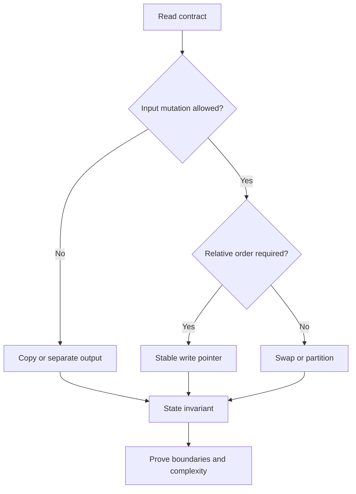

### Example 1 — reference identity is not value equality

Given `int[] a = {4, 1, 7}`, execute `int[] alias = a; alias[1] = 9;`.

**Result:** both variables refer to the same array object, so `a` is now `[4, 9, 7]`. By contrast, `Arrays.copyOf(a, a.length)` creates a distinct array with initially equal component values.

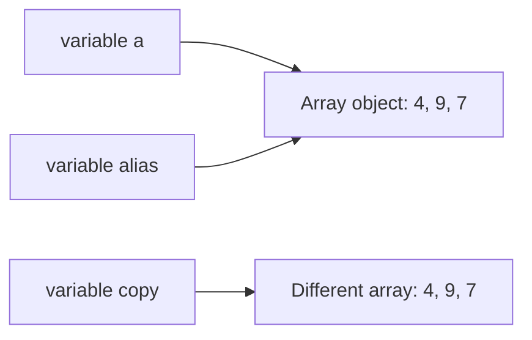

Trace:

| Step | `a == alias` | `a == copy` | `a[1]` | Meaning |
|---:|---:|---:|---:|---|
| After assignment | true | — | 1 | `alias` received the reference |
| After `alias[1] = 9` | true | — | 9 | Mutation is visible through either alias |
| After `copyOf` | true | false | 9 | The new object has equal values but different identity |
| After `copy[1] = 5` | true | false | 9 | Copy mutation does not affect `a` |

Interview consequence: clarify whether “do not modify the input” forbids component mutation. Rebinding a local parameter does not mutate the caller's array, but changing a component does.

```java
int[] original = {4, 1, 7};
int[] alias = original;
alias[1] = 9;
int[] copy = java.util.Arrays.copyOf(original, original.length);
copy[1] = 5;
// original is [4, 9, 7]; copy is [4, 5, 7]
```

### Example 2 — subarray, subsequence, and subset

For `a = [3, -1, 4, 2]`, these terms impose different constraints:

| Candidate | Classification | Reason |
|---|---|---|
| `[-1, 4]` | Subarray, subsequence, and subset selection | Uses the contiguous interval `[1, 2]` |
| `[3, 4, 2]` | Subsequence and subset selection, not subarray | Preserves order but skips index 1 |
| `[4, 3]` | Subset selection only | Selected values exist, but original order is reversed |
| `[3, 3]` | None for this input | A value occurrence cannot be reused unless the input contains it twice |

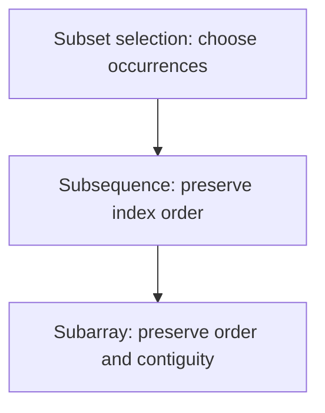

For length `n`:

- non-empty subarrays: `n(n + 1) / 2`;
- subsequences: `2^n` including the empty subsequence;
- value subsets need multiplicity rules when duplicates exist, so “set” language can lose index identity.

Memory trick: **array = interval, sequence = ordered picks, subset = picks without an order promise**.

### Example 3 — stable in-place compaction

Move zeros to the end of `[0, 3, 0, 3, 8]` while preserving the relative order of nonzero values.

Use `read` to scan every component and `write` to identify the next accepted position.

Invariant before processing index `read`:

1. `a[0..write)` contains exactly the nonzero values from original `a[0..read)`, in original order.
2. `write <= read`.
3. `a[read..n)` has not been inspected.

Trace:

| `read` | value | action | `write` after | array after action |
|---:|---:|---|---:|---|
| 0 | 0 | skip | 0 | `[0, 3, 0, 3, 8]` |
| 1 | 3 | write at 0 | 1 | `[3, 3, 0, 3, 8]` |
| 2 | 0 | skip | 1 | `[3, 3, 0, 3, 8]` |
| 3 | 3 | write at 1 | 2 | `[3, 3, 0, 3, 8]` |
| 4 | 8 | write at 2 | 3 | `[3, 3, 8, 3, 8]` |
| fill | — | zero `[3..5)` | 3 | `[3, 3, 8, 0, 0]` |

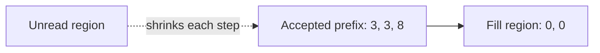

```java
static void stableMoveZeroes(int[] a) {
    int write = 0;
    for (int value : a) {
        if (value != 0) a[write++] = value;
    }
    while (write < a.length) a[write++] = 0;
}
```

**Correctness:** every accepted value is appended once and in scan order, so the prefix is stable. When scanning ends, it contains all nonzero values. Filling the remaining suffix with zeros preserves the required length and yields the target partition.

**Complexity:** `O(n)` time, `O(1)` auxiliary space. This minimizes conceptual complexity; an optional guarded assignment can reduce redundant writes but should not weaken the invariant.

### Example 4 — prefix sums without overflow

For `a = [1_500_000_000, 1_500_000_000, -1_500_000_000]`, the mathematical prefix sums are `[0, 1_500_000_000, 3_000_000_000, 1_500_000_000]`. The second running total exceeds `Integer.MAX_VALUE`, so an `int` prefix silently wraps.

Contract for half-open ranges: `rangeSum(left, right)` returns the sum of `a[left..right)`.

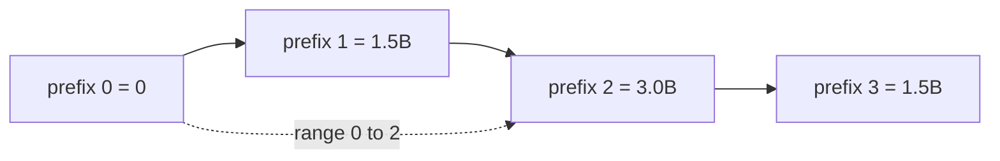

Trace:

| Index consumed | Value | `long` prefix | Meaning |
|---:|---:|---:|---|
| 0 | — | 0 | Empty prefix |
| 1 | 1,500,000,000 | 1,500,000,000 | `a[0..1)` |
| 2 | 1,500,000,000 | 3,000,000,000 | `a[0..2)` |
| 3 | -1,500,000,000 | 1,500,000,000 | `a[0..3)` |

```java
static long[] prefixSums(int[] a) {
    long[] prefix = new long[a.length + 1];
    for (int i = 0; i < a.length; i++) {
        prefix[i + 1] = prefix[i] + a[i]; // long + int -> long
    }
    return prefix;
}

static long rangeSum(long[] prefix, int left, int right) {
    if (left < 0 || left > right || right >= prefix.length) {
        throw new IndexOutOfBoundsException("invalid half-open range");
    }
    return prefix[right] - prefix[left];
}
```

Invariant after consuming `i` components: `prefix[i]` equals the mathematical sum of original `a[0..i)`. Therefore subtracting two prefixes cancels the shared left portion. Build time and space are `O(n)`; each validated range query is `O(1)`.

### Interview checklist

1. Restate mutation, output, ordering, and range conventions.
2. Name indices by role (`read`, `write`, `left`, `right`) rather than letters without meaning.
3. State the invariant before coding.
4. Trace empty, singleton, all-accepted, none-accepted, duplicate, and extreme-value cases.
5. Promote arithmetic before it can overflow.
6. Distinguish auxiliary space from returned output space.
7. State whether a range is closed `[l, r]` or half-open `[l, r)`.
8. Test aliasing expectations when the input is mutable.

## 2. Pattern-recognition decision tree

A trigger word is a hypothesis, not a proof. “Contiguous” narrows the family, but the value domain and required aggregate decide whether a window, prefix state, or Kadane-style recurrence is valid. Run the following checks before naming an algorithm.

### Decision contract

| Question | Consequence | Gate that must be proved |
|---|---|---|
| Is the output a contiguous interval or a count of intervals? | Consider window, prefix state, or Kadane | Windows need a monotone way to repair the constraint |
| Is the input sorted, or may it be sorted without destroying required indices/order? | Consider two pointers, binary search, or merge | Pointer elimination relies on sorted order |
| Is the predicate “seen before,” “how many before,” or “exact sum”? | Consider a set or frequency map | Define precisely what the key and stored value mean |
| Are there many immutable range queries? | Precompute prefix/suffix state | Confirm the aggregate has a valid combine/cancel rule |
| Are there updates between range queries? | Consider Fenwick or segment tree | A static prefix array becomes stale after updates |
| Is the request next greater/smaller or every-window extremum? | Consider monotonic stack/deque | State which dominated candidates may be discarded |
| Are values constrained to `1..n` or `0..n` and mutation is allowed? | Consider cyclic placement or marking | Every value must map to a legal home or be ignored safely |
| Is there a monotone `feasible(mid)` predicate? | Binary-search the answer | Prove the false/true boundary; do not search an arbitrary objective |

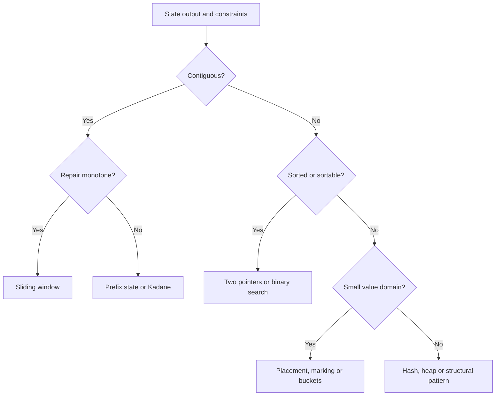

The critical habit is to write the precondition beside the pattern. For example, “minimum length with sum at least `k`” permits a shrinking sum window only when removing from the left cannot increase the sum—typically when values are nonnegative.

### Decision example 1 — exact-sum subarrays with signed values

**Requirement:** count contiguous subarrays whose mathematical sum equals `7` in `[3, 4, -7, 1, 3, 3, 1, -4]`. Values may be negative, so a grow/shrink window has no safe direction.

Choose **prefix sum + frequency map**. Before consuming `a[i]`, `frequency[p]` is the number of earlier prefix boundaries with sum `p`. A subarray ending at `i` sums to `k` exactly when an earlier prefix equals `prefix - k`.

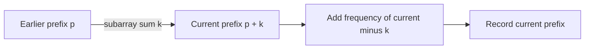

Trace (`frequency` starts with `{0: 1}`):

| `i` | value | prefix | needed `prefix - 7` | matches added | running count |
|---:|---:|---:|---:|---:|---:|
| 0 | 3 | 3 | -4 | 0 | 0 |
| 1 | 4 | 7 | 0 | 1 | 1 |
| 2 | -7 | 0 | -7 | 0 | 1 |
| 3 | 1 | 1 | -6 | 0 | 1 |
| 4 | 3 | 4 | -3 | 0 | 1 |
| 5 | 3 | 7 | 0 | 2 | 3 |
| 6 | 1 | 8 | 1 | 1 | 4 |
| 7 | -4 | 4 | -3 | 0 | 4 |

```java
static long countSubarraysWithSum(int[] a, long target) {
    Map<Long, Integer> frequency = new HashMap<>();
    frequency.put(0L, 1);
    long prefix = 0L;
    long answer = 0L;
    for (int value : a) {
        prefix += value;
        answer += frequency.getOrDefault(prefix - target, 0);
        frequency.merge(prefix, 1, Integer::sum);
    }
    return answer;
}
```

**Correctness:** every earlier boundary with prefix `prefix - target` determines one distinct subarray ending at the current index, and every qualifying subarray has exactly that pair of boundaries. Recording the current prefix after counting excludes empty/reversed intervals. Time is expected `O(n)` and auxiliary space is `O(n)`; `long` protects prefix arithmetic and the result count.

### Decision example 2 — pair sum in sorted input

**Requirement:** return indices of any two distinct values summing to `10` in sorted `[-3, 1, 4, 6, 8, 13]`.

Choose **opposite-end two pointers**. If the current sum is too small, pairing the left value with any index left of `right` cannot do better, so eliminate `left`. If it is too large, eliminate `right` symmetrically.

| Step | `left` value | `right` value | sum | Decision |
|---:|---:|---:|---:|---|
| 1 | -3 | 13 | 10 | return indices `[0, 5]` |

For a non-immediate trace with target `9`, the sums are `10` (decrement right), `5` (increment left), then `9` at values `1 + 8`.

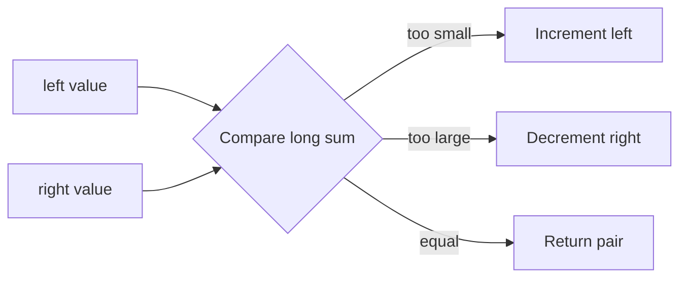

```java
static int[] sortedPairIndices(int[] sorted, long target) {
    requireNondecreasing(sorted);
    int left = 0;
    int right = sorted.length - 1;
    while (left < right) {
        long sum = (long) sorted[left] + sorted[right];
        if (sum == target) return new int[]{left, right};
        if (sum < target) left++;
        else right--;
    }
    return new int[0];
}
```

**Correctness:** each move discards only pairs that are provably too small or too large under sorted order. At least one index leaves the candidate interval per iteration, so time is `O(n)` and auxiliary space is `O(1)`. If original indices must survive sorting, sort value/index pairs or use hashing instead.

### Decision example 3 — minimum qualifying window with nonnegative values

**Requirement:** find the minimum length of a contiguous subarray with sum at least `7` in `[2, 3, 1, 2, 4, 3]`; return `0` if none exists. All values are nonnegative and `target > 0`.

Choose a **sliding window**. Expand `right`; while the sum qualifies, record the length and shrink `left`. Nonnegativity proves that expansion cannot decrease the sum and left-shrinking cannot increase it.

| `right` | value added | sum before shrinking | qualifying windows removed | best |
|---:|---:|---:|---|---:|
| 0 | 2 | 2 | — | — |
| 1 | 3 | 5 | — | — |
| 2 | 1 | 6 | — | — |
| 3 | 2 | 8 | `[0..3]`, then sum 6 | 4 |
| 4 | 4 | 10 | `[1..4]`, `[2..4]`, then sum 6 | 3 |
| 5 | 3 | 9 | `[3..5]`, `[4..5]`, then sum 3 | 2 |

```java
static int minLengthAtLeast(int[] nonnegative, long target) {
    if (target <= 0) throw new IllegalArgumentException("target must be positive");
    for (int value : nonnegative) {
        if (value < 0) throw new IllegalArgumentException("negative value");
    }
    int best = nonnegative.length + 1;
    int left = 0;
    long sum = 0L;
    for (int right = 0; right < nonnegative.length; right++) {
        sum += nonnegative[right];
        while (sum >= target) {
            best = Math.min(best, right - left + 1);
            sum -= nonnegative[left++];
        }
    }
    return best == nonnegative.length + 1 ? 0 : best;
}
```

**Why the gate matters:** with signed values, removing a negative left value increases the sum, so the same pointer rule may skip the optimum. A signed minimum-length problem needs a different structure, commonly increasing prefix sums in a monotonic deque. Under this method's contract, each endpoint advances at most `n` times: `O(n)` time and `O(1)` auxiliary space.

### Decision example 4 — first missing positive in place

**Requirement:** return the smallest missing positive from `[3, 4, -1, 1]` in `O(n)` time and `O(1)` auxiliary space; input mutation is allowed.

Because an answer for length `n` lies in `1..n+1`, use **cyclic placement**: while value `v` is in `1..n`, place it at index `v - 1`. The duplicate guard prevents infinite swapping.

| State | active index | action |
|---|---:|---|
| `[3, 4, -1, 1]` | 0 | swap `3` toward index 2 → `[-1, 4, 3, 1]` |
| `[-1, 4, 3, 1]` | 1 | swap `4` toward index 3 → `[-1, 1, 3, 4]` |
| `[-1, 1, 3, 4]` | 1 | swap `1` toward index 0 → `[1, -1, 3, 4]` |
| `[1, -1, 3, 4]` | scan | index 1 does not contain `2`; return `2` |

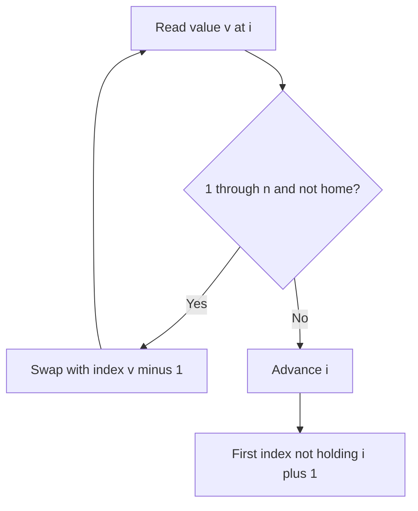

```java
static int firstMissingPositive(int[] a) {
    int i = 0;
    while (i < a.length) {
        int value = a[i];
        if (value >= 1 && value <= a.length && a[value - 1] != value) {
            int tmp = a[value - 1];
            a[value - 1] = value;
            a[i] = tmp;
        } else {
            i++;
        }
    }
    for (i = 0; i < a.length; i++) {
        if (a[i] != i + 1) return i + 1;
    }
    return a.length + 1;
}
```

**Correctness and cost:** every successful swap permanently places at least one in-range value at its home; at most `n` homes can be filled. The final scan returns the first absent home, or `n + 1` when all are filled. Time is `O(n)`, auxiliary space is `O(1)`, and mutation is explicit in the contract.

### Pattern trigger sheet

| Trigger | Candidate | Required proof | Common wrong turn |
|---|---|---|---|
| best-so-far in one pass | linear scan | retained state summarizes the processed prefix | storing every prior state |
| sorted pair/opposite ends | two pointers | a pointer move eliminates only impossible pairs | applying it to unsorted input |
| contiguous + monotone repair | sliding window | expand/shrink direction cannot reverse unexpectedly | using a sum window with negative values |
| count exact-sum subarrays | prefix + frequency map | current-minus-target identifies all earlier boundaries | storing only whether a prefix was seen |
| maximum contiguous sum | Kadane | best ending here is enough for the next state | confusing it with arbitrary subsequence |
| categories or pivot | partition | regions have precise category invariants | assuming stability without providing it |
| values in `1..n` | cyclic placement | legal values map to unique home indices | omitting the duplicate guard |
| sorted or monotone predicate | binary search | rejected/accepted region remains ordered | binary-searching a nonmonotone objective |
| overlap or scheduled ranges | sort then merge | only the last accepted interval can overlap next | merging before sorting |
| every-window maximum/minimum | monotonic deque | discarded candidates can never win later | storing values when indices expire |
| next greater/smaller | monotonic stack | stack order describes unresolved candidates | popping without resolving ownership |
| `k`th/top-`k` | heap or Quickselect | rank—not total order—is the requirement | fully sorting by habit |

### Decision checklist

1. Write the output shape: value, indices, interval, count, mutation, or decision.
2. Record whether values may be negative, duplicated, extreme, or confined to a small range.
3. Record whether the input is sorted and whether sorting may destroy required order or indices.
4. For a window, prove why moving one boundary repairs the violated condition.
5. For a map, define the key, stored value, and the moment each entry becomes visible.
6. For binary search, write `feasible(x)` and prove its monotonic direction.
7. For in-place placement, prove every swap progresses and duplicates terminate.
8. Promote arithmetic before sums, differences, and midpoint calculations can overflow.
9. Trace an empty case, a no-answer case, duplicates, and the smallest legal input.

## 3. Java array interview toolkit

The toolkit is not a bag of memorized calls. Each operation carries a contract about mutation, identity, ordering, lifetime, or numeric range. State that contract before choosing the API.

### Toolkit contract

| Need | Preferred Java tool | Contract to say aloud | Failure to avoid |
|---|---|---|---|
| Independent primitive-array values | `Arrays.copyOf(a, a.length)` | New array object; primitive components are copied by value | `int[] copy = a` creates an alias |
| Destructive ordering | `Arrays.sort(a)` | Sorts the supplied array in place | Losing original positions or caller-visible order |
| Uniform initialization | `Arrays.fill(a, value)` | Overwrites every selected component | Assuming it allocates a new array |
| Counts or membership | `HashMap` / `HashSet` | Define the key and when it becomes visible | Comparing boxed objects with `==` |
| Expiring ordered candidates | `ArrayDeque<Integer>` | Store indices when age and value both matter | Storing only values, which cannot prove expiration |
| Midpoint and arithmetic | `left + (right-left)/2`; cast before arithmetic | Preconditions bound the difference; arithmetic executes in `long` | Casting after an overflowing `int` operation |
| Exchange two components | three-assignment swap | Both indices must be valid; `i == j` is harmless | XOR swap, which is opaque and breaks on the same index |

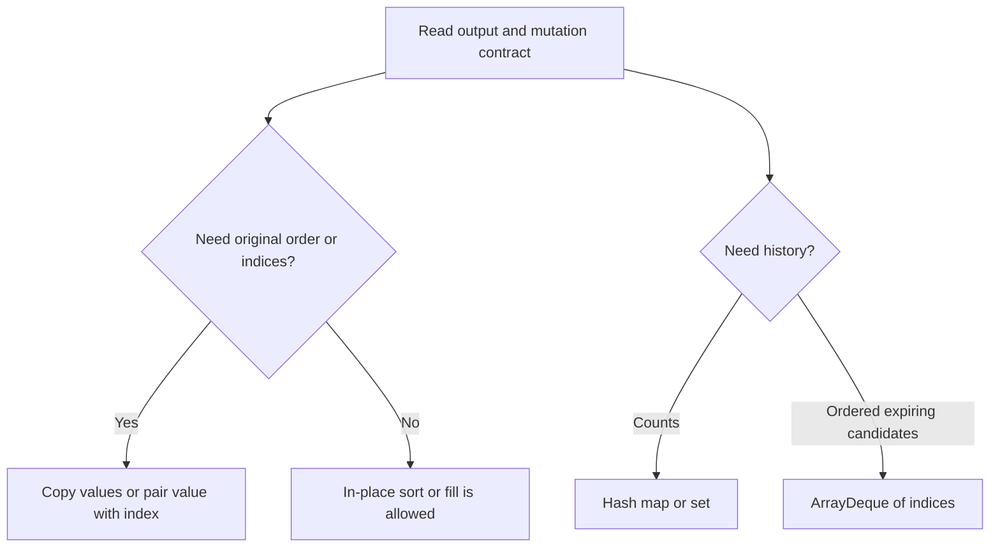

### Toolkit example 1 — sort a copy and preserve original indices

**Requirement:** for `[40, 10, 40, -2]`, produce sorted values without mutating the input and return original indices in value order. Equal values must retain increasing original index. Expected values: `[-2, 10, 40, 40]`; indices: `[3, 1, 0, 2]`.

`Arrays.copyOf` is enough when only sorted values are needed. Once original positions are output, sort explicit `(value, index)` pairs. The index tie-break makes the duplicate rule visible instead of relying on an incidental sort property.

```java
record IndexedValue(int value, int index) {}

static int[] sortedCopy(int[] input) {
    int[] copy = Arrays.copyOf(input, input.length);
    Arrays.sort(copy);                 // mutates only copy
    return copy;
}

static int[] stableOriginalIndicesByValue(int[] input) {
    IndexedValue[] pairs = new IndexedValue[input.length];
    for (int i = 0; i < input.length; i++) pairs[i] = new IndexedValue(input[i], i);
    Arrays.sort(pairs, (a, b) -> {
        int byValue = Integer.compare(a.value(), b.value());
        return byValue != 0 ? byValue : Integer.compare(a.index(), b.index());
    });
    int[] indices = new int[pairs.length];
    for (int i = 0; i < pairs.length; i++) indices[i] = pairs[i].index();
    return indices;
}
```

| Sorted position | pair chosen | output index | input remains |
|---:|---|---:|---|
| 0 | `(-2, 3)` | 3 | `[40, 10, 40, -2]` |
| 1 | `(10, 1)` | 1 | unchanged |
| 2 | `(40, 0)` | 0 | unchanged |
| 3 | `(40, 2)` | 2 | unchanged |

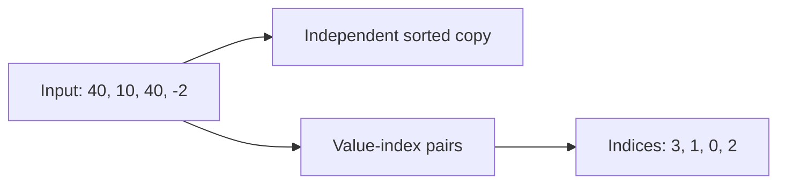

Sorting primitive values is `O(n log n)` time and the returned copy is `O(n)` space. Pair sorting also uses `O(n)` explicit storage. If the API promises `O(1)` auxiliary space, it cannot simultaneously return a full independent copy.

### Toolkit example 2 — frequencies and boxed equality

**Requirement:** decide whether `[1000, 1000, -2]` and `[1000, -2, 1000]` contain the same values with the same multiplicities. Expected result: `true`; `[1, 1, 2]` versus `[1, 2, 2]` is `false`.

The map invariant is: after processing a prefix of the right array, `balance[v]` is the number of unmatched occurrences of `v` from the left array. A missing key is immediate failure; remove a key when its last unmatched occurrence is consumed.

```java
static Map<Integer, Integer> frequencies(int[] input) {
    Map<Integer, Integer> result = new HashMap<>();
    for (int value : input) result.merge(value, 1, Integer::sum);
    return result;
}

static boolean sameMultiset(int[] left, int[] right) {
    if (left.length != right.length) return false;
    Map<Integer, Integer> balance = frequencies(left);
    for (int value : right) {
        Integer count = balance.get(value);
        if (count == null) return false;
        if (count == 1) balance.remove(value);
        else balance.put(value, count - 1);
    }
    return balance.isEmpty();
}
```

| Right value consumed | balance afterward |
|---:|---|
| start | `{1000=2, -2=1}` |
| `1000` | `{1000=1, -2=1}` |
| `-2` | `{1000=1}` |
| `1000` | `{}` → equal |

Two separately boxed `Integer.valueOf(1000)` values need not be the same reference, so `a == b` is not a value-equality contract. Use `a.equals(b)` (or `Objects.equals(a, b)` when null is possible). Hash-based collections use equality/hash semantics, not the caller's reference identity. Expected time is `O(n)` and auxiliary space is `O(u)` for `u` distinct values.

### Toolkit example 3 — store deque indices, not values

**Requirement:** return each width-3 maximum for `[1, 3, -1, -3, 5, 3, 6, 7]`. Expected output: `[3, 3, 5, 5, 6, 7]`.

Keep indices in increasing order from front to back and their values in strictly decreasing order. The front is therefore the largest live candidate. Indices make both expiration (`index <= right - width`) and value lookup possible; values alone cannot distinguish an expired duplicate from a live one.

```java
static int[] windowMaximum(int[] input, int width) {
    if (width <= 0 || width > input.length) throw new IllegalArgumentException("invalid width");
    int[] result = new int[input.length - width + 1];
    Deque<Integer> candidates = new ArrayDeque<>();
    for (int right = 0; right < input.length; right++) {
        while (!candidates.isEmpty() && candidates.peekFirst() <= right - width) {
            candidates.pollFirst();
        }
        while (!candidates.isEmpty()
                && input[candidates.peekLast()] <= input[right]) {
            candidates.pollLast();
        }
        candidates.offerLast(right);
        if (right >= width - 1) {
            result[right - width + 1] = input[candidates.peekFirst()];
        }
    }
    return result;
}
```

| `right` | value | deque indices after updates | represented values | emitted max |
|---:|---:|---|---|---:|
| 0 | 1 | `[0]` | `[1]` | — |
| 1 | 3 | `[1]` | `[3]` | — |
| 2 | -1 | `[1, 2]` | `[3, -1]` | 3 |
| 3 | -3 | `[1, 2, 3]` | `[3, -1, -3]` | 3 |
| 4 | 5 | `[4]` | `[5]` | 5 |
| 5 | 3 | `[4, 5]` | `[5, 3]` | 5 |
| 6 | 6 | `[6]` | `[6]` | 6 |
| 7 | 7 | `[7]` | `[7]` | 7 |

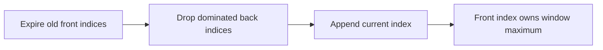

Each index is appended once and removed at most once from each end, so total time is `O(n)` and deque space is `O(width)`. `ArrayDeque` supplies amortized constant-time end operations and rejects nulls, which is useful here because null has no candidate meaning.

### Toolkit example 4 — safe midpoint, arithmetic, and swap

**Requirement:** find the first position whose value is at least `3` in `[1, 3, 3, 7]`; return `1`. Also compute `Integer.MAX_VALUE + 1` and `50_000 × 50_000` mathematically, and permit swapping an element with itself.

Use a half-open search interval `[left, right)`. Before each iteration, every index before `left` is known to be `< target`; every index at or after `right` is known to be `>= target`. The subtraction-based midpoint avoids `left + right` overflow under `0 <= left <= right`.

```java
static int lowerBound(int[] sorted, int target) {
    int left = 0, right = sorted.length;
    while (left < right) {
        int mid = left + (right - left) / 2;
        if (sorted[mid] < target) left = mid + 1;
        else right = mid;
    }
    return left;
}

static long safeSum(int a, int b)     { return (long) a + b; }
static long safeProduct(int a, int b) { return (long) a * b; }

static void swap(int[] a, int i, int j) {
    int tmp = a[i];
    a[i] = a[j];
    a[j] = tmp;
}
```

| Step | interval `[left, right)` | `mid` | value | next interval |
|---:|---|---:|---:|---|
| 1 | `[0, 4)` | 2 | 3 | `[0, 2)` |
| 2 | `[0, 2)` | 1 | 3 | `[0, 1)` |
| 3 | `[0, 1)` | 0 | 1 | `[1, 1)` → return 1 |

The cast must occur before the operator: `(long) a * b` multiplies as `long`, while `(long) (a * b)` first allows `int` overflow and only then widens the wrong value. The expected results are `2_147_483_648L` and `2_500_000_000L`. For swap, `i == j` simply writes the same value back.

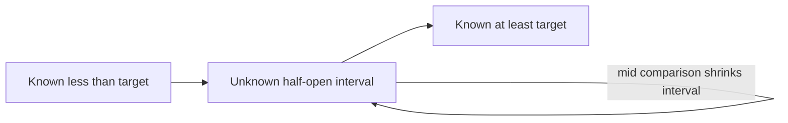

Binary search is `O(log n)` time and `O(1)` space. Arithmetic helpers and swap are `O(1)`.

### Toolkit checklist

1. Say whether the operation mutates the supplied array or returns a new one.
2. Preserve `(value, originalIndex)` pairs when output depends on original positions.
3. Define a map's key, value, and update visibility before coding.
4. Use `.equals` for boxed/object values; use `==` only when reference identity is the requirement.
5. Store deque indices when candidates expire by position.
6. Cast an operand before overflow-sensitive addition, subtraction, or multiplication.
7. Write binary-search interval semantics and midpoint preconditions.
8. Prefer a readable temporary-variable swap and validate both indices.
9. Test empty and singleton inputs, duplicates, extreme integers, invalid window widths, and no-answer searches.

Executable evidence is in `ArrayToolkitContracts.java`. Its deterministic suite checks all four contracts plus 10,000 randomized arrays against brute-force window-maximum and lower-bound oracles.

## 4. Core pattern lab — all forty-seven solved problems

The source collection groups 47 solved problems under one large “Core Array Patterns” boundary. This lab now promotes all 47. Problems 1–4 compress decision state; 5–7 finalize or fill an output region; 8–10 discard dominated endpoints; 11–19 use window, prefix, deque, frequency, and partition invariants; 20–23 use reversible mappings, lexicographic structure, functional graphs, and home indices; 24–27 shrink ordered answer spaces; 28–29 normalize or preserve interval components; 30 reuses matrix borders as discovery metadata; 31 peels a matrix through four shrinking boundaries; 32 binary-searches a partition of two sorted arrays; 33 counts whole cross-inversion blocks while merge-sorting; 34–37 use extremal dynamic state, circular complements, monotonic stacks and prefix deques; 38–39 apply layer and directional greedy invariants; 40–41 use two distinct XOR cancellation contracts; 42 returns to sorted opposite-end elimination with an exact one-based-index contract; 43 reuses the exact sum of one fixed-length window; 44 derives each unseen suffix from one total and a maintained prefix; 45 maintains a variable window whose zero count consumes an at-most-`k` budget; 46 binary-searches the unique rotation pivot while retaining `middle` whenever it may already be the answer; and 47 maps one globally ordered matrix into virtual row-major indices. Later source sections remain explicit backlog; completing this problem group does not imply the wider Arrays source or collection is exhausted.

### Pattern-lab contract

Before selecting code, pin down the result and the guarantee that makes discarded history irrelevant:

| Problem | Required result | Minimal retained state | Proof obligation | This guide's edge contract |
|---|---|---|---|---|
| Two Sum | two distinct indices, or no answer | value → earliest earlier index | only the complement can complete the current value | target arithmetic is `long`; input is not mutated |
| One stock trade | maximum nonnegative profit | minimum price in the legal prefix | every sale is best paired with the cheapest earlier buy | fewer than two prices returns `0`; result is `long` |
| Maximum subarray | largest sum of a non-empty contiguous range | best sum ending exactly here | every optimum ending here either restarts or extends | empty input is rejected; sum is `long` |
| Majority element | value occurring more than `n / 2`, if present | cancellation candidate and balance | cancellation yields only a candidate without a promise | a second pass verifies; no majority returns empty |
| Move Zeroes | mutate the same array: stable nonzeros, then zero suffix | next output slot `write` | before `read`, the compact prefix is final and `write <= read` | null is rejected; empty and already-valid arrays are no-ops |
| Remove Duplicates | return the length of the stable unique prefix | last accepted value and `write` | sorted runs are contiguous, so one representative completes each run | validate sortedness before mutation at reusable boundaries; suffix is unspecified |
| Sorted Squares | a new nondecreasing array of mathematical squares | unconsumed interval `[left, right]` and backward `write` | the largest remaining magnitude is at an interval endpoint | input is validated and not mutated; `long` preserves every squared `int` |
| 3Sum | unique value triplets from distinct indices whose mathematical sum is zero | sorted suffix plus anchor and two pointers | comparison eliminates one monotone side; duplicate runs emit once | sort a copy, widen sums, and return deterministic lexicographic triplets |
| Container With Most Water | maximum area from one pair of boundaries | current endpoint pair and best area | every pair retaining the shorter endpoint is dominated | reject negative heights, do not mutate, and widen before multiplication |
| Trapping Rain Water | total per-index retained water | unresolved interval plus left/right maxima | the side with the smaller running boundary has an exact final cap | reject negative heights, do not mutate, and accumulate in checked `long` |

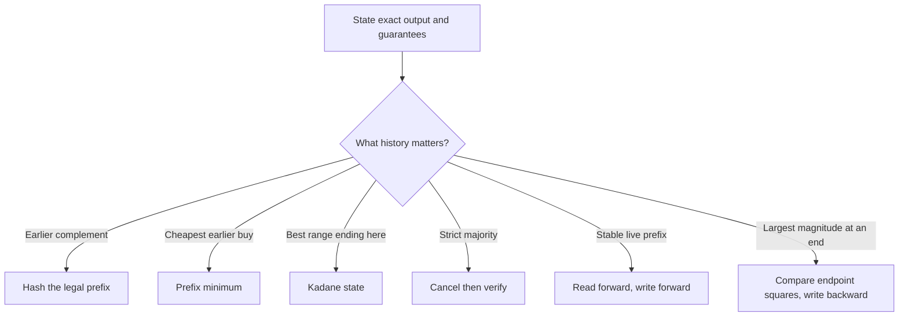

All four implementations are side-effect free. Their arithmetic contracts deliberately differ from many short interview snippets: indices stay `int`, but sums, targets, differences, and returned numeric aggregates use `long` wherever two legal `int` values can exceed the `int` range.

### Example 1 — Two Sum: index the legal prefix

**Requirement:** for `input = [2, 7, 11, 15]` and `target = 9`, return two distinct indices whose values sum mathematically to the target. Return an empty array when no pair exists. Do not mutate the input.

Invariant before reading index `right`: the map stores the earliest index of each value in `input[0..right)`. Therefore any retrieved index is automatically different from `right`.

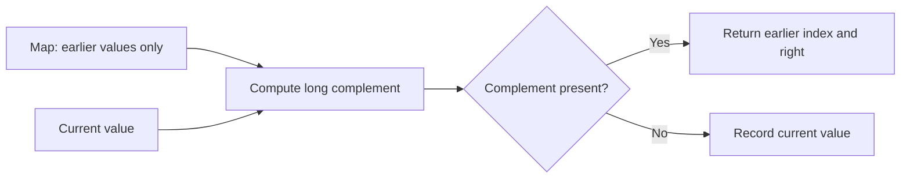

Trace:

| `right` | value | `need = target - value` | map before | decision |
|---:|---:|---:|---|---|
| 0 | 2 | 7 | `{}` | record `2 → 0` |
| 1 | 7 | 2 | `{2=0}` | return `[0, 1]` |

```java
static int[] twoSumIndices(int[] input, long target) {
    Map<Long, Integer> firstIndex = new HashMap<>();
    for (int right = 0; right < input.length; right++) {
        long need = target - input[right];
        Integer left = firstIndex.get(need);
        if (left != null) return new int[]{left, right};
        firstIndex.putIfAbsent((long) input[right], right);
    }
    return new int[0];
}
```

**Why the order matters:** checking before insertion prevents reusing the current index. `putIfAbsent` retains the earliest duplicate, which makes behavior deterministic without changing correctness. `long need` handles pairs such as two `Integer.MAX_VALUE` values with target `4_294_967_294L`.

Expected time is `O(n)` under the map's usual hash-distribution assumption, with `O(n)` auxiliary space. A nested-loop baseline is `O(n²)` time and `O(1)` space; a sorted two-pointer solution is appropriate only when sorting is allowed and original-index identity is preserved separately.

### Example 2 — one stock trade: retain the cheapest legal buy

**Requirement:** for prices `[7, 1, 5, 3, 6, 4]`, choose at most one buy and one later sell and return the maximum profit. Return `0` when no profitable legal trade exists.

Before evaluating day `sell`, `minimum` is the lowest price in `[0, sell)`, and `best` is the largest profit among sales before `sell`. The only state a new selling day needs is the cheapest legal earlier buy.

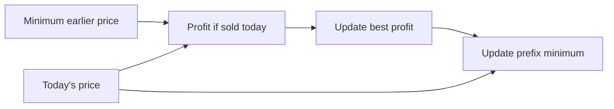

| sell day | price | minimum before | profit today | best after |
|---:|---:|---:|---:|---:|
| 1 | 1 | 7 | -6 | 0 |
| 2 | 5 | 1 | 4 | 4 |
| 3 | 3 | 1 | 2 | 4 |
| 4 | 6 | 1 | 5 | 5 |
| 5 | 4 | 1 | 3 | 5 |

```java
static long maxSingleTradeProfit(int[] prices) {
    if (prices.length < 2) return 0L;
    int minimum = prices[0];
    long best = 0L;
    for (int sell = 1; sell < prices.length; sell++) {
        best = Math.max(best, (long) prices[sell] - minimum);
        minimum = Math.min(minimum, prices[sell]);
    }
    return best;
}
```

The cast occurs before subtraction, so the method remains correct even across the full `int` domain. Selling is evaluated before incorporating today's price into the prefix minimum; buying and selling on one day would produce zero anyway, but keeping the legal-prefix meaning explicit makes the proof portable to variants with fees or a mandatory positive holding period. Time is `O(n)` and auxiliary space is `O(1)`.

### Example 3 — maximum subarray: compress the best ending state

**Requirement:** return the largest mathematical sum of a non-empty contiguous subarray. For `[-2, 1, -3, 4, -1, 2, 1, -5, 4]`, return `6` for `[4, -1, 2, 1]`.

After processing index `i`, `endingHere` is the maximum sum among all non-empty subarrays ending exactly at `i`; `best` is the maximum over every ending position processed so far.

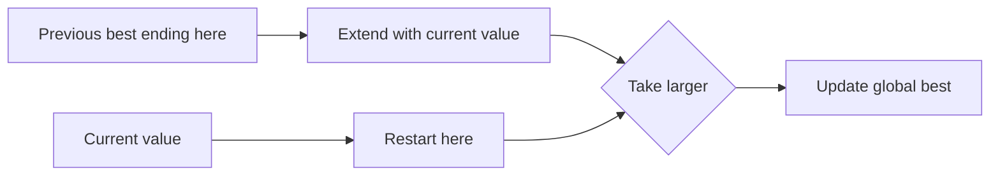

| `i` | value | extend | restart | `endingHere` | `best` |
|---:|---:|---:|---:|---:|---:|
| 0 | -2 | — | -2 | -2 | -2 |
| 1 | 1 | -1 | 1 | 1 | 1 |
| 2 | -3 | -2 | -3 | -2 | 1 |
| 3 | 4 | 2 | 4 | 4 | 4 |
| 4 | -1 | 3 | -1 | 3 | 4 |
| 5 | 2 | 5 | 2 | 5 | 5 |
| 6 | 1 | 6 | 1 | 6 | 6 |

```java
static long maxSubarraySum(int[] input) {
    if (input.length == 0) throw new IllegalArgumentException("non-empty input required");
    long endingHere = input[0], best = input[0];
    for (int i = 1; i < input.length; i++) {
        endingHere = Math.max((long) input[i], endingHere + input[i]);
        best = Math.max(best, endingHere);
    }
    return best;
}
```

Every non-empty subarray ending at `i` either contains no earlier element or extends a subarray ending at `i - 1`; no third case exists. Retaining the best earlier ending dominates every worse extension. Initialization from the first element is essential: initializing to zero would incorrectly allow an empty range for all-negative input. Time is `O(n)`, auxiliary space is `O(1)`, and `long` keeps repeated `int` additions mathematical.

### Example 4 — majority element: cancel, then verify

**Requirement:** return a value only when it occurs strictly more than `floor(n / 2)` times. The usual interview statement may guarantee a majority; this reusable contract does not trust that promise.

The candidate pass pairs occurrences of the current candidate with different values. If a strict majority exists, it survives every possible cancellation. Cancellation does **not** prove that a majority exists, so verification is a separate gate.

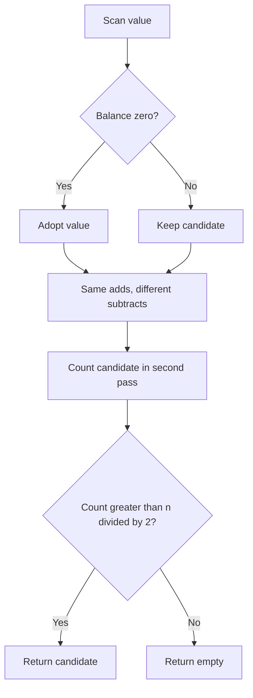

Trace for `[2, 2, 1, 1, 1, 2, 2]`:

| value | candidate before | balance before | candidate/balance after |
|---:|---:|---:|---|
| 2 | — | 0 | `2 / 1` |
| 2 | 2 | 1 | `2 / 2` |
| 1 | 2 | 2 | `2 / 1` |
| 1 | 2 | 1 | `2 / 0` |
| 1 | 2 | 0 | `1 / 1` |
| 2 | 1 | 1 | `1 / 0` |
| 2 | 1 | 0 | `2 / 1` |

The second pass counts four occurrences of `2`; `4 > 7 / 2`, so the result is present.

```java
static OptionalInt majorityElement(int[] input) {
    if (input.length == 0) return OptionalInt.empty();
    int candidate = 0, balance = 0;
    for (int value : input) {
        if (balance == 0) candidate = value;
        balance += value == candidate ? 1 : -1;
    }
    int occurrences = 0;
    for (int value : input) if (value == candidate) occurrences++;
    return occurrences > input.length / 2
            ? OptionalInt.of(candidate)
            : OptionalInt.empty();
}
```

The candidate pass is `O(n)`, verification is another `O(n)`, and auxiliary space is `O(1)`. Under a contractual guarantee, verification may be omitted; without it, `[1, 2, 3]` demonstrates why returning the final candidate is unsound. Majority means strictly more than half, not merely the mode.

### Core-pattern checklist

1. State whether the output is indices, a numeric aggregate, a mutated array, or an optional value.
2. Preserve legality in the state: Two Sum stores only earlier indices; stock state stores only earlier buys.
3. Name exactly what a compressed variable means after each iteration.
4. Distinguish a candidate-producing pass from a proof-producing verification pass.
5. Check before inserting when the current element must not match itself.
6. Initialize non-empty extrema from real input, not a convenient zero.
7. Promote before subtraction or addition when legal `int` values can overflow.
8. Test duplicates, no answer, all-negative input, decreasing prices, absent majority, and integer extremes.

Executable evidence is in `ArrayCorePatterns.java`. It checks 28 explicit scenario groups and runs 40,000 seeded comparisons against brute-force pair-existence, profit, maximum-subarray, and majority oracles.

### Example 5 — Move Zeroes: stable compaction, then clear

**Requirement:** mutate the supplied array so every nonzero value keeps its original relative order at the front and every zero occupies the suffix. For `[0, 1, 0, 3, 12]`, the required final array is `[1, 3, 12, 0, 0]`. Return data is optional; the observable contract is the same array object after mutation.

The `read` pointer discovers values; `write` names the first unfilled slot in the compact prefix. Before each read:

1. `values[0..write)` equals the nonzero subsequence of `values[0..read)` in encounter order.
2. `write <= read`, so copying `values[read]` left cannot destroy an unread value.
3. Nothing at or after `write` is final until the scan ends.

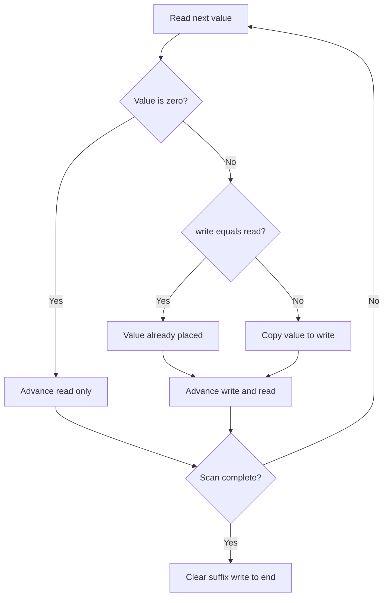

Canonical trace:

| `read` | value | `write` before | action | array after action | `write` after |
|---:|---:|---:|---|---|---:|
| 0 | 0 | 0 | skip | `[0, 1, 0, 3, 12]` | 0 |
| 1 | 1 | 0 | copy to index 0 | `[1, 1, 0, 3, 12]` | 1 |
| 2 | 0 | 1 | skip | `[1, 1, 0, 3, 12]` | 1 |
| 3 | 3 | 1 | copy to index 1 | `[1, 3, 0, 3, 12]` | 2 |
| 4 | 12 | 2 | copy to index 2 | `[1, 3, 12, 3, 12]` | 3 |
| clear | — | 3 | zero indices 3 and 4 | `[1, 3, 12, 0, 0]` | 3 |

```java
static void moveZeroes(int[] values) {
    int write = 0;
    for (int read = 0; read < values.length; read++) {
        if (values[read] == 0) continue;
        if (write != read) values[write] = values[read];
        write++;
    }
    while (write < values.length) values[write++] = 0;
}
```

Four cases pin down different parts of the contract:

| Input | Expected mutation | What it proves |
|---|---|---|
| `[0, 1, 0, 3, 12]` | `[1, 3, 12, 0, 0]` | zeros can be interleaved; nonzeros stay ordered |
| `[4, -1, 7]` | `[4, -1, 7]` | no zero means no movement; conditional copy avoids self-writes |
| `[0, 0, 0]` | `[0, 0, 0]` | empty live prefix and full zero suffix are valid |
| `[0, -1, -1, 0, 2]` | `[-1, -1, 2, 0, 0]` | negatives and duplicates are values, not special cases; stability is observable |

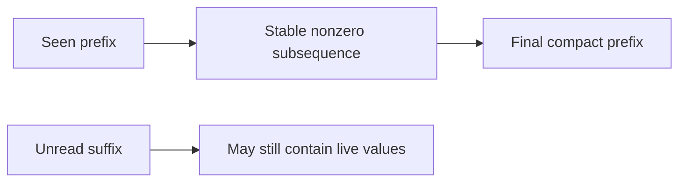

**Correctness.** Initially both prefixes are empty. A zero adds nothing to the required nonzero subsequence, so skipping preserves the invariant. A nonzero is appended at `write`; because reads move left-to-right, append order is source order, and because `write <= read`, the copy cannot overwrite future input. At termination the prefix is exactly every original nonzero in order. Clearing the remaining `n - write` cells creates the required zero suffix without touching that prefix.

**Why not swap with the far end?** A bidirectional partition can violate stability: swapping the first zero in `[0, 1, 2, 0, 3]` with the final `3` produces a prefix beginning `[3, 1, 2]`. The source's same-direction swap is stable and correct, but it can perform two writes for every displaced nonzero. Copy-then-clear makes the two phases explicit; the executable version skips assignments that would leave a cell unchanged and records at most `n` changed-cell writes.

Time is `O(n)`: the scan reads each element once and the clear phase touches at most the suffix. Auxiliary space is `O(1)`. The extra-array baseline is also `O(n)` time but uses `O(n)` space. Repeatedly shifting after each zero is stable but can degrade to `O(n²)` on alternating input.

Interview variations change the predicate, not the proof shape: move all values failing `keep(value)` to the end, return the compacted length, or preserve only the first `k` copies. If the discarded suffix need not be normalized, stop after compaction and return `write`; if stability is not required, a bidirectional partition becomes legal.

Executable evidence is in `MoveZeroesContracts.java`. It checks the four cases above plus empty input, alternating values, null rejection, and 20,000 seeded arrays against an independent extra-array oracle. It also checks the reported nonzero count and the at-most-`n` changed-cell assignment bound.

### Example 6 — Remove Duplicates: finalize a unique prefix

**Requirement:** the input is sorted in nondecreasing order. Mutate the same array so its first `k` cells contain every distinct input value exactly once in original order, then return `k`. The suffix beginning at `k` is explicitly unspecified and must not be tested or cleared. For `[0,0,1,1,1,2,2,3,3,4]`, return `5` with prefix `[0,1,2,3,4]`.

This is stable compaction with a different keep rule from Move Zeroes. Because the input is sorted, all copies of a value form one run. `write` is the length of the finalized unique prefix; `values[write - 1]` is the last accepted value. Before processing `read`:

1. `values[0..write)` contains exactly one representative of every run that starts in `values[0..read)`.
2. That prefix is strictly increasing and matches the original encounter order.
3. `1 <= write <= read` for nonempty input, so a leftward write cannot overwrite unread input.

```mermaid
flowchart LR
    U["Final unique prefix: 0 to write-1"] --> L["Last accepted value"]
    R["Current run value at read"] --> C{"Same as last accepted?"}
    L --> C
    C -->|yes| S["Skip duplicate"]
    C -->|no| W["Write at index write; advance write"]
```

The interview form assumes the sorted-input precondition:

```java
static int removeDuplicates(int[] values) {
    if (values.length == 0) return 0;
    int write = 1;
    for (int read = 1; read < values.length; read++) {
        if (values[read] != values[write - 1]) {
            if (write != read) values[write] = values[read];
            write++;
        }
    }
    return write;
}
```

The `write != read` guard is not needed for correctness. It avoids assignments when an already-unique prefix is already in its final location, which makes mutation accounting and caller-visible write traffic easier to reason about.

#### Worked case 1 — interleaved duplicate runs

Trace `[0,0,1,1,1,2,2,3,3,4]`:

| `read` | value | last accepted | action | finalized prefix | `write` after |
|---:|---:|---:|---|---|---:|
| 1 | 0 | 0 | skip same run | `[0]` | 1 |
| 2 | 1 | 0 | write index 1 | `[0,1]` | 2 |
| 3 | 1 | 1 | skip | `[0,1]` | 2 |
| 4 | 1 | 1 | skip | `[0,1]` | 2 |
| 5 | 2 | 1 | write index 2 | `[0,1,2]` | 3 |
| 6 | 2 | 2 | skip | `[0,1,2]` | 3 |
| 7 | 3 | 2 | write index 3 | `[0,1,2,3]` | 4 |
| 8 | 3 | 3 | skip | `[0,1,2,3]` | 4 |
| 9 | 4 | 3 | write index 4 | `[0,1,2,3,4]` | 5 |

The array may end as `[0,1,2,3,4,2,2,3,3,4]`. That is correct: only indices `0..4` belong to the result. Clearing or validating the suffix adds work and invents a requirement.

```mermaid
stateDiagram-v2
    [*] --> AcceptedFirst
    AcceptedFirst --> Reading
    Reading --> Reading: duplicate, write unchanged
    Reading --> Extended: new run, append once
    Extended --> Reading: advance read
    Reading --> Done: read reaches length
    Extended --> Done: read reaches length
```

#### Worked case 2 — one long run

For `[-7,-7,-7]`, return `k = 1`; the meaningful prefix is `[-7]`. No assignment is needed because the first representative was already accepted. This case proves that `k` counts runs, not occurrences, and that `write` must start at one only after ruling out empty input.

#### Worked case 3 — every value is already unique

For `[Integer.MIN_VALUE,-1,0,Integer.MAX_VALUE]`, return `k = 4` with the entire array unchanged. Equality comparisons are sufficient—there is no subtraction that could overflow at integer extremes. The conditional self-write guard records zero changed assignments.

#### Worked case 4 — precondition failure versus promised input

`[1,0,1]` is outside the problem contract. On an interview platform, state the sorted precondition and omit an extra pass. At a reusable service/library boundary, validate nondecreasing order **before** mutation and reject atomically; detecting disorder only after compaction may leave the caller's array partially changed.

```mermaid
flowchart TD
    A["Reusable API receives array"] --> V{"Sorted nondecreasingly?"}
    V -->|no| X["Reject before any write"]
    V -->|yes, empty| Z["Return k = 0"]
    V -->|yes, nonempty| I["write = 1; scan runs"]
    I --> K["Return k; ignore suffix"]
```

**Correctness.** For a nonempty array, the invariant holds initially because the prefix containing only `values[0]` represents the first run. When `values[read]` equals the last accepted value, sortedness means it belongs to the same run, so skipping it preserves the exact unique prefix. When it differs, it begins a new run; appending it at `write` adds exactly the next distinct value and preserves order. Because `write <= read`, the assignment cannot destroy unread input. At termination every run has contributed once, so `write` is both the prefix length and the number of distinct values.

Time is `O(n)` and auxiliary space is `O(1)`. A `LinkedHashSet` baseline preserves encounter order but costs `O(n)` space; a plain `HashSet` does not specify encounter order. The optimized method performs at most `k - 1` changed-cell assignments and none for an already unique array.

**Follow-up — allow at most `m` copies.** Keep the first `m` cells automatically; afterward accept `values[read]` exactly when it differs from `values[write - m]`. This compares with the oldest retained copy in the allowed window. Reject `m < 1`, and retain the same suffix-is-unspecified rule.

Executable evidence is in `RemoveDuplicatesContracts.java`. It checks the four worked contracts, empty/singleton and signed-boundary cases, null rejection, atomic rejection of unsorted input, assignment bounds, and 20,000 seeded sorted arrays against an independent `LinkedHashSet` oracle.

### Example 7 — Sorted Squares: consume the largest magnitude

**Requirement:** accept an `int[]` sorted in nondecreasing signed order and return a **new** array containing every mathematical square in nondecreasing order. Do not mutate the input. This reusable version returns `long[]`, because Java's full `int` domain includes values whose square does not fit in `int`. Empty input returns an empty result; null or unsorted input is rejected before the output scan.

The subtlety is that signed order is not magnitude order. Squaring folds the negative half around zero: `-9 < -2`, but `81 > 4`. For any remaining sorted interval `[left, right]`, every interior value lies between the endpoints. Its magnitude therefore cannot exceed both endpoint magnitudes. The next largest square must come from `values[left]` or `values[right]`.

```mermaid
flowchart LR
    L["left endpoint"] --> LS["square as long"]
    R["right endpoint"] --> RS["square as long"]
    LS --> C{"which square is larger?"}
    RS --> C
    C -->|left| WL["write at end; left++"]
    C -->|right or tie| WR["write at end; right--"]
    WL --> N["write--"]
    WR --> N
```

The interview core is short once the contracts are settled:

```java
static long[] sortedSquares(int[] values) {
    Objects.requireNonNull(values, "values");
    for (int i = 1; i < values.length; i++) {
        if (values[i - 1] > values[i]) {
            throw new IllegalArgumentException("input must be sorted");
        }
    }

    long[] output = new long[values.length];
    int left = 0, right = values.length - 1;
    for (int write = output.length - 1; write >= 0; write--) {
        long leftSquare = (long) values[left] * values[left];
        long rightSquare = (long) values[right] * values[right];
        if (leftSquare > rightSquare) {
            output[write] = leftSquare;
            left++;
        } else {
            output[write] = rightSquare;
            right--;
        }
    }
    return output;
}
```

Two details are deliberate:

1. Compare widened squares, not `Math.abs(int)`. `Math.abs(Integer.MIN_VALUE)` is still negative because `2^31` is not representable as an `int`.
2. Cast **before** multiplication. `(long) value * value` computes a `long` product; `(long) (value * value)` widens an already-overflowed `int`.

#### Worked case 1 — mixed signs, exact pointer trace

For `[-4,-1,0,3,10]`, fill from right to left:

| step | `left:value` | `right:value` | endpoint squares | chosen endpoint | `write` | output after write |
|---:|---|---|---|---|---:|---|
| 1 | `0:-4` | `4:10` | `16` vs `100` | right | 4 | `[_,_,_,_,100]` |
| 2 | `0:-4` | `3:3` | `16` vs `9` | left | 3 | `[_,_,_,16,100]` |
| 3 | `1:-1` | `3:3` | `1` vs `9` | right | 2 | `[_,_,9,16,100]` |
| 4 | `1:-1` | `2:0` | `1` vs `0` | left | 1 | `[_,1,9,16,100]` |
| 5 | `2:0` | `2:0` | `0` vs `0` | right tie | 0 | `[0,1,9,16,100]` |

```mermaid
sequenceDiagram
    participant I as Remaining interval
    participant C as Endpoint comparison
    participant O as Output from right
    I->>C: [-4,-1,0,3,10]
    C->>O: 10² -> index 4
    I->>C: [-4,-1,0,3]
    C->>O: (-4)² -> index 3
    C->>O: 3², (-1)², 0²
```

#### Worked case 2 — all negative

`[-7,-3,-1]` returns `[1,9,49]`. The left endpoint wins until only `-1` remains. This case rejects the mistaken idea that “sorted input means square left-to-right.” The scan is still linear; one pointer simply moves more often.

#### Worked case 3 — duplicates and equal magnitudes

`[-3,-2,2,3]` returns `[4,4,9,9]`. Equal endpoint squares may consume either side because the returned values, not source indices, define the result. The implementation consumes the right endpoint on ties, giving one deterministic rule without needing deduplication.

#### Worked case 4 — full-width integer boundaries

`[Integer.MIN_VALUE,0,Integer.MAX_VALUE]` requires full-width arithmetic. Use the actual products, not a memorized decimal:

| source value | mathematical square |
|---:|---:|
| `0` | `0L` |
| `Integer.MAX_VALUE = 2^31 - 1` | `4_611_686_014_132_420_609L` |
| `Integer.MIN_VALUE = -2^31` | `4_611_686_018_427_387_904L` |

Thus the exact output is `[0L, 4_611_686_014_132_420_609L, 4_611_686_018_427_387_904L]`. An `int[]` result is safe only under a tighter input bound such as the original problem's `|value| <= 10_000`; a reusable Java method should encode or validate that assumption rather than silently wrap.

```mermaid
flowchart TD
    A["Need squared values"] --> B{"Can every square fit in int?"}
    B -->|documented bound| C["int[] is legal"]
    B -->|full int domain or unknown| D["return long[]"]
    D --> E["cast operand before multiplication"]
    C --> F["still validate sorted input if boundary is reusable"]
```

**Correctness invariant.** Before an iteration with output index `write`, cells `output[write + 1..n)` contain exactly the largest `n - 1 - write` squares in nondecreasing order, and `values[left..right]` are precisely the unconsumed inputs. The largest absolute value in a sorted interval is at an endpoint, so the algorithm writes the largest remaining square at `write`. Removing only that endpoint preserves both claims. When `write < 0`, no input remains and the entire output is sorted.

Time is `O(n)`: validation and construction are each one pass. The returned array costs `O(n)`, while pointer state costs `O(1)`. The square-then-sort baseline is `O(n log n)` time and `O(n)` output. A split-at-zero merge is also linear but needs more boundary logic; endpoint selection is the smaller proof.

Executable evidence is in `SortedSquaresContracts.java`. It checks the four cases above, empty/singleton/zero inputs, null and unsorted rejection, input immutability, and 20,000 seeded sorted arrays against an independent square-then-sort oracle.

### Example 8 — 3Sum: anchor once, eliminate pairs monotonically

**Requirement:** given an `int[]`, return every distinct value triplet `(a, b, c)` with `a <= b <= c` and mathematical sum zero. The three values must come from three distinct input indices. Duplicate index choices that produce the same values do not create another result. This reusable contract rejects null, preserves the caller's array, returns triplets in deterministic lexicographic order, and returns an empty list when fewer than three values or no solution exists.

Sorting turns the three-variable search into a sequence of sorted Two Sum searches. Fix one distinct anchor at `i`, then search only `i + 1..n - 1`. For that anchor:

- if the widened sum is negative, every pair using the current `left` and any index no farther right is also too small, so advance `left`;
- if the sum is positive, every pair using the current `right` and any index no farther left is also too large, so decrement `right`;
- if the sum is zero, emit the value triplet once, then skip the complete equal-value runs at both pointers.

```mermaid
flowchart TD
    S["Sort a copy"] --> A["Choose next distinct anchor i"]
    A --> P["left = i + 1; right = n - 1"]
    P --> C{"long sum sign"}
    C -->|negative| L["left++"]
    C -->|positive| R["right--"]
    C -->|zero| E["emit; skip equal left and right runs"]
    L --> C
    R --> C
    E --> C
```

The reusable implementation uses a record so sortedness and uniqueness are part of the result type rather than conventions hidden inside nested lists:

```java
record Triplet(int first, int second, int third) {}

static List<Triplet> threeSum(int[] input) {
    Objects.requireNonNull(input, "input");
    int[] values = input.clone();              // preserve the caller's order
    Arrays.sort(values);
    List<Triplet> result = new ArrayList<>();

    for (int i = 0; i + 2 < values.length; i++) {
        if (i > 0 && values[i] == values[i - 1]) continue;
        if (values[i] > 0) break;

        long smallest = (long) values[i] + values[i + 1] + values[i + 2];
        if (smallest > 0) break;
        long largest = (long) values[i]
                + values[values.length - 2] + values[values.length - 1];
        if (largest < 0) continue;

        int left = i + 1, right = values.length - 1;
        while (left < right) {
            long sum = (long) values[i] + values[left] + values[right];
            if (sum < 0) {
                left++;
            } else if (sum > 0) {
                right--;
            } else {
                result.add(new Triplet(values[i], values[left], values[right]));
                int leftValue = values[left], rightValue = values[right];
                while (left < right && values[left] == leftValue) left++;
                while (left < right && values[right] == rightValue) right--;
            }
        }
    }
    return List.copyOf(result);
}
```

The cast is before the first addition. Without it, Java performs `int` addition first and can wrap before a later conversion. The two bound checks are optional optimizations, but their proof is the same sorted monotonicity as pointer movement: the next two values form the smallest possible suffix pair, while the final two form the largest.

#### Worked case 1 — canonical duplicates and the full pointer trace

Input `[-1,0,1,2,-1,-4]` sorts to `[-4,-1,-1,0,1,2]`.

| anchor `i:value` | `left:value` | `right:value` | widened sum | decision |
|---|---|---|---:|---|
| `0:-4` | `1:-1` | `5:2` | -3 | advance left |
| `0:-4` | `2:-1` | `5:2` | -3 | advance left |
| `0:-4` | `3:0` | `5:2` | -2 | advance left |
| `0:-4` | `4:1` | `5:2` | -1 | anchor exhausted |
| `1:-1` | `2:-1` | `5:2` | 0 | emit `(-1,-1,2)`; skip runs |
| `1:-1` | `3:0` | `4:1` | 0 | emit `(-1,0,1)`; skip runs |
| `2:-1` | — | — | — | duplicate anchor; skip |

Result: `[(-1,-1,2), (-1,0,1)]`. Original index choices may differ, but the value combinations are unique.

```mermaid
flowchart LR
    A["anchor -1"] --> P1["pair -1 and 2"]
    A --> P2["pair 0 and 1"]
    P1 --> T1["(-1,-1,2)"]
    P2 --> T2["(-1,0,1)"]
    D["next anchor -1"] -. duplicate .-> X["skip"]
```

#### Worked case 2 — one value combination, many index combinations

`[0,0,0,0]` has four choose three index triples, but all produce the same value triplet. Emit `(0,0,0)` once, then skipping the left and right zero runs ends the search. Returning four copies would confuse **index multiplicity** with the requested **value-set uniqueness**.

```mermaid
flowchart TD
    I["four zero occurrences"] --> C["many distinct index triples"]
    C --> V["one normalized value triplet (0,0,0)"]
    V --> O["emit once; skip equal runs"]
```

#### Worked case 3 — duplicate runs on both sides

`[-2,0,0,2,2]` returns only `(-2,0,2)`. After emission, advancing past both zeroes and both twos is necessary. Skipping only the anchor prevents repeated anchor values, but it does not prevent repeated pairs for the same anchor.

| State | remaining left run | remaining right run | action |
|---|---|---|---|
| before match | `0,0` | `2,2` | sum is zero |
| after emit | `0,0` | `2,2` | remember boundary values |
| after run skips | empty | empty | pointer search ends |

#### Worked case 4 — overflow must not invent a solution

`[Integer.MIN_VALUE, Integer.MIN_VALUE, 0]` has mathematical sum `-4_294_967_296`, so the result is empty. In 32-bit `int` arithmetic, however, `Integer.MIN_VALUE + Integer.MIN_VALUE` wraps to zero; an `int sum` would falsely emit a triplet. Conversely, `[Integer.MIN_VALUE, 1, Integer.MAX_VALUE]` is a real zero-sum triplet. Widening before addition distinguishes both cases.

**Invariant for one anchor.** Before each pointer comparison, every candidate pair outside `[left, right]` has either been emitted or proved impossible for the fixed anchor, and every not-yet-classified candidate uses two distinct indices inside that interval. A negative sum rules out the current left value with every remaining right value at or before `right`; a positive sum symmetrically rules out the current right value. A zero sum is emitted, and equal-value runs may be removed because they can only reproduce that same normalized triplet.

**Global correctness.** Every triplet has a smallest sorted index, so it belongs to exactly one anchor iteration. Distinct-anchor skipping chooses one representative of each equal anchor run. The fixed-anchor invariant finds every feasible suffix pair and no infeasible pair. Post-match run skipping suppresses repeated pair values. Therefore the output is complete and contains each value triplet exactly once.

**Complexity and trade-offs.** Sorting costs `O(n log n)`; at most `n` anchors each perform one linear inward scan, so total time is `O(n²)`. The reusable copy costs `O(n)` auxiliary storage, excluding output and the primitive-sort implementation stack. If mutation is explicitly allowed, sorting the input removes that copy and the two-pointer state is `O(1)`. A cubic triple enumeration is easier to derive but costs `O(n³)`; a per-anchor hash set remains `O(n²)` expected time but uses `O(n)` extra storage and still needs careful normalization and deduplication.

Interview variations:

- **target 3Sum:** replace zero with a `long target` and compare the widened sum to it;
- **3Sum Closest:** retain the best widened distance instead of emitting exact matches;
- **4Sum / k-Sum:** recursively fix distinct anchors until the two-pointer base case, while preserving bound and duplicate rules;
- **return original indices:** sorting values loses direct identity, so sort `(value,index)` pairs or use a different ownership contract.

Executable evidence is in `ThreeSumContracts.java`. It checks the four worked behaviors, short/no-answer/null contracts, deterministic ordering, input immutability, and 20,000 seeded arrays against an independent cubic `TreeSet` oracle that widens before addition.

### Example 9 — Container With Most Water: discard the dominated endpoint

**Requirement:** given a non-null array of at least two nonnegative heights, choose distinct indices `left < right` and maximize

`(right - left) * min(height[left], height[right])`.

The width is the index distance, the shorter boundary limits the water level, and intermediate lines neither block nor subtract water. The reusable method below preserves the input and returns `long`. The original problem bounds make an `int` result safe, but widening before multiplication keeps the contract correct for the full nonnegative `int` height domain.

```mermaid
flowchart TD
    H["height = min(left, right)"] --> A["area = width × height"]
    W["width = right - left"] --> A
    M["middle lines do not change this container"] --> A
```

A quadratic baseline evaluates every pair. The linear scan begins with maximum width. After evaluating the current pair, move only a shortest boundary inward:

```java
static long maxArea(int[] height) {
    Objects.requireNonNull(height, "height");
    if (height.length < 2) throw new IllegalArgumentException("need two heights");
    for (int value : height) {
        if (value < 0) throw new IllegalArgumentException("negative height");
    }

    int left = 0, right = height.length - 1;
    long best = 0;
    while (left < right) {
        long area = (long) (right - left) * Math.min(height[left], height[right]);
        best = Math.max(best, area);
        if (height[left] <= height[right]) {
            left++;
        } else {
            right--;
        }
    }
    return best;
}
```

The equality rule is deterministic but not special: when both boundaries are equally short, either one may be discarded. Moving the left pointer on equality keeps the implementation and trace reproducible.

```mermaid
flowchart TD
    E["Evaluate (left, right) with long area"] --> C{"left height ≤ right height?"}
    C -->|yes| L["discard left; left++"]
    C -->|no| R["discard right; right--"]
    L --> N{"left < right?"}
    R --> N
    N -->|yes| E
    N -->|no| O["return best"]
```

#### Worked case 1 — canonical full trace

For `[1,8,6,2,5,4,8,3,7]`, the scan is:

| step | `left:value` | `right:value` | width | area | best | discarded boundary |
|---:|---|---|---:|---:|---:|---|
| 1 | `0:1` | `8:7` | 8 | 8 | 8 | left |
| 2 | `1:8` | `8:7` | 7 | 49 | 49 | right |
| 3 | `1:8` | `7:3` | 6 | 18 | 49 | right |
| 4 | `1:8` | `6:8` | 5 | 40 | 49 | left on equality |
| 5 | `2:6` | `6:8` | 4 | 24 | 49 | left |
| 6 | `3:2` | `6:8` | 3 | 6 | 49 | left |
| 7 | `4:5` | `6:8` | 2 | 10 | 49 | left |
| 8 | `5:4` | `6:8` | 1 | 4 | 49 | left |

The maximum is `49`, formed by indices 1 and 8: width 7 times limiting height 7.

#### Worked case 2 — the widest pair can be optimal

`[4,3,2,1,4]` returns `16`. The endpoint pair has width 4 and limiting height 4. Every inward move reduces width, so nothing can beat it. This example is useful because “move the shorter line” does not mean “always improve immediately”; it means “discard only an endpoint that cannot participate in a better unseen pair.”

#### Worked case 3 — middle lines do not leak or obstruct

`[5,0,0,5]` returns `15`, using the two fives at distance 3. The zero-height lines in the middle are irrelevant to this pair. This is not Trapping Rain Water: the objective selects one pair of boundaries and computes one rectangle, rather than summing water above every index.

```mermaid
flowchart LR
    C["Container With Most Water"] --> P["choose one pair"]
    P --> R["one rectangle: distance × shorter boundary"]
    T["Trapping Rain Water"] --> S["sum contributions across positions"]
```

#### Worked case 4 — zero area and reusable-domain overflow

`[0,0]` returns `0`. At the other numeric extreme, `[Integer.MAX_VALUE,0,Integer.MAX_VALUE]` returns `4_294_967_294L`: width 2 times `2_147_483_647`. An `int` multiplication would wrap before assignment to `long`; the cast must affect an operand before `*`. Under the original constraints `n <= 100_000` and `height[i] <= 10_000`, the maximum is below one billion, but the wider reusable contract does not depend on those limits.

**Why discarding the shorter endpoint is complete.** Suppose `height[left] <= height[right]`. For every `k` with `left < k < right`,

`area(left, k) <= (k - left) * height[left] <= (right - left) * height[left] = area(left, right)`.

So no unseen container that keeps `left` can beat the pair just evaluated; discarding `left` loses no better answer. The argument is symmetric when the right boundary is shorter. On equal heights, both arguments apply, so the deterministic equality rule is safe.

**Loop invariant.** Before each iteration, `best` is the maximum area among evaluated pairs, and every pair excluded by an earlier pointer move is bounded by an evaluated pair and therefore cannot exceed `best`. The dominance argument preserves the invariant after either move. When the pointers meet, every pair is evaluated or dominated, so `best` is the global maximum.

Time is `O(n)`: input validation and the pointer scan are each linear. Auxiliary space is `O(1)`, and the input is unchanged. The all-pairs oracle is `O(n²)` time and is valuable in tests because its control structure is independent of the optimized proof.

Executable evidence is in `ContainerWaterContracts.java`. It checks the four worked behaviors, monotone and equal-height arrays, null/short/negative rejection, nonmutation, full-width arithmetic, and 20,000 seeded arrays against an independent all-pairs oracle.

### Example 10 — Trapping Rain Water: finalize the smaller boundary

**Requirement:** given an elevation map of unit-width, non-negative bars, return the total water retained after rain. This reusable Java contract rejects `null` and negative heights, does not mutate the array, returns `0` for fewer than three bars, and returns `long` so a legal Java `int[]` is not forced into an `int` aggregate.

This is not the previous container problem. A container chooses one pair and maximizes one rectangle. Trapping Rain Water sums a separate vertical contribution above every index:

`waterAt(i) = min(max(height[0..i]), max(height[i..n-1])) - height[i]`.

The maxima include `i`, so the contribution is never negative.

```mermaid
flowchart LR
    H["height[i]"] --> C["cap = min(leftMax, rightMax)"]
    L["max on 0..i"] --> C
    R["max on i..n-1"] --> C
    C --> W["waterAt = cap - height[i]"]
```

#### Choose the implementation from the constraint

| Approach | Retained state | Time | Extra space | Best use |
|---|---|---:|---:|---|
| Scan both sides for every index | none | `O(n²)` | `O(1)` | independent test oracle |
| Prefix and suffix maxima | two length-`n` arrays | `O(n)` | `O(n)` | clearest direct formula and per-index explanation |
| Monotonic decreasing stack | unresolved indices | `O(n)` | `O(n)` | when the interviewer asks for the bounded-region/stack view |
| Two running maxima | two pointers and two maxima | `O(n)` | `O(1)` | optimal aggregate when only the total is required |

```mermaid
flowchart TD
    Q{"What evidence is needed?"}
    Q -->|"simple oracle"| B["scan left and right"]
    Q -->|"per-index caps"| P["prefix + suffix maxima"]
    Q -->|"bounded regions"| S["monotonic stack"]
    Q -->|"total with O(1) space"| T["two running maxima"]
```

The optimized method compares the running boundaries, not adjacent bars. When `leftMax <= rightMax`, the current left position is final:

- if `height[left] <= leftMax`, an actual right boundary of at least `rightMax` exists, so the limiting cap is exactly `leftMax`;
- if `height[left] > leftMax`, this bar becomes the new `leftMax` and contributes zero.

The argument is symmetric when `rightMax < leftMax`. Each step finalizes exactly one index, so no contribution is guessed and no index is revisited.

```java
static long trap(int[] height) {
    if (height == null) throw new IllegalArgumentException("height must not be null");
    for (int value : height) {
        if (value < 0) throw new IllegalArgumentException("heights must be non-negative");
    }

    int left = 0, right = height.length - 1;
    int leftMax = 0, rightMax = 0;
    long water = 0L;

    while (left <= right) {
        if (leftMax <= rightMax) {
            leftMax = Math.max(leftMax, height[left]);
            water = Math.addExact(water, (long) leftMax - height[left]);
            left++;
        } else {
            rightMax = Math.max(rightMax, height[right]);
            water = Math.addExact(water, (long) rightMax - height[right]);
            right--;
        }
    }
    return water;
}
```

```mermaid
flowchart TD
    A["left=0, right=n-1, maxima=0, water=0"] --> C{"leftMax <= rightMax?"}
    C -->|yes| L["raise leftMax; add leftMax-height[left]; left++"]
    C -->|no| R["raise rightMax; add rightMax-height[right]; right--"]
    L --> D{"left <= right?"}
    R --> D
    D -->|yes| C
    D -->|no| O["return water"]
```

#### Worked case 1 — canonical full trace

For `[0,1,0,2,1,0,1,3,2,1,2,1]`, the exact scan is:

| step | `left:right` | `h[left]:h[right]` | maxima after update | side finalized | added | total |
|---:|---|---|---|---|---:|---:|
| 1 | `0:11` | `0:1` | `0:0` | left | 0 | 0 |
| 2 | `1:11` | `1:1` | `1:0` | left | 0 | 0 |
| 3 | `2:11` | `0:1` | `1:1` | right | 0 | 0 |
| 4 | `2:10` | `0:2` | `1:1` | left | 1 | 1 |
| 5 | `3:10` | `2:2` | `2:1` | left | 0 | 1 |
| 6 | `4:10` | `1:2` | `2:2` | right | 0 | 1 |
| 7 | `4:9` | `1:1` | `2:2` | left | 1 | 2 |
| 8 | `5:9` | `0:1` | `2:2` | left | 2 | 4 |
| 9 | `6:9` | `1:1` | `2:2` | left | 1 | 5 |
| 10 | `7:9` | `3:1` | `3:2` | left | 0 | 5 |
| 11 | `8:9` | `2:1` | `3:2` | right | 1 | 6 |
| 12 | `8:8` | `2:2` | `3:2` | right | 0 | 6 |

The result is `6`. The table records the maxima *after* the selected side is updated; that convention makes new boundaries visibly contribute zero.

```mermaid
flowchart TD
    A["steps 1-3: establish leftMax=1, rightMax=1"] --> B["steps 4-6: collect 1, establish maxima 2:2"]
    B --> C["steps 7-9: collect 1+2+1"]
    C --> D["steps 10-12: establish leftMax=3, collect final 1"]
    D --> E["total = 6"]
```

#### Worked case 2 — both basins share boundaries

`[4,2,0,3,2,5]` returns `9`. The per-index contributions are `[0,2,4,1,2,0]`. This case catches “nearest taller bar” solutions: the correct cap comes from the tallest boundary on each side, not necessarily the nearest one.

#### Worked case 3 — no basin means zero

`[]`, `[7]`, `[7,7]`, `[1,2,3,4,5]`, `[5,4,3,2,1]`, and `[3,3,3,3]` all return `0`. Plateaus update or preserve a boundary; they never create negative water. Fewer than three bars cannot have a position with boundaries on both sides.

#### Worked case 4 — aggregate width can overflow `int`

`[Integer.MAX_VALUE,0,0,Integer.MAX_VALUE]` returns `4_294_967_294L`. Each interior index contributes `2_147_483_647`, so an `int water` silently wraps even though each height is a valid `int`. The implementation widens each contribution before accumulation and uses `Math.addExact` to make an unexpected `long` overflow explicit.

**Correctness argument.** Maintain four facts before each iteration: indices outside `[left,right]` are finalized exactly once; `leftMax` is the maximum encountered from the original left; `rightMax` is the maximum encountered from the original right; and `water` is the exact sum for finalized indices. If `leftMax <= rightMax`, an unprocessed left value below `leftMax` is capped by `leftMax`, while a value above it becomes a zero-contribution boundary. Finalizing it therefore preserves all facts. The right branch is symmetric. The interval shrinks every iteration and eventually becomes empty, at which point every index has its exact formula contribution in `water`.

**Complexity.** Validation and the pointer scan are each `O(n)`, every index is finalized once, and auxiliary space is `O(1)`. The input is unchanged. The independent oracle is deliberately `O(n²)` and structurally different, which makes it useful for randomized differential testing.

**Common interview errors:** computing only adjacent valleys; confusing this sum with one container area; moving both pointers on equality and skipping a position; adding before updating the selected maximum; using `int` for the reusable aggregate; or accepting negative heights without defining what they mean. If the width or rainfall model changes, restate the contribution formula before reusing the proof.

Executable evidence is in `TrappingRainWaterContracts.java`. It checks 18 scenario groups, including all four worked behaviors, monotone/flat inputs, validation, nonmutation and full-width accumulation, then compares 20,000 seeded arrays with an independent per-index left/right scan.

### Example 11 — Minimum Size Subarray Sum: shrink only after reaching the target

**Requirement:** given a positive `target` and an array of positive integers, return the minimum length of a contiguous subarray whose sum is at least `target`; return `0` when no such subarray exists. The reusable method rejects `null`, non-positive targets, and non-positive elements, preserves the input, and accumulates into `long` so its arithmetic remains correct for the full positive `int` domain.

The positivity precondition is the reason a variable-size sliding window works. Extending `right` strictly increases the sum, while advancing `left` strictly decreases it. That monotonic motion lets one window represent all useful candidates without backtracking.

```mermaid
flowchart TD
    A["add nums[right] to the window"] --> C{"sum ≥ target?"}
    C -->|no| R["advance right"]
    C -->|yes| B["record the current length"]
    B --> S["subtract nums[left]; left++"]
    S --> C
    R --> D{"right exhausted?"}
    D -->|no| A
    D -->|yes| O["return best, or 0 if absent"]
```

```java
static int minSubArrayLen(int target, int[] nums) {
    if (target <= 0) throw new IllegalArgumentException("target must be positive");
    if (nums == null) throw new IllegalArgumentException("nums must not be null");
    for (int value : nums) {
        if (value <= 0) throw new IllegalArgumentException("values must be positive");
    }

    int left = 0;
    int best = nums.length + 1;
    long sum = 0L;
    for (int right = 0; right < nums.length; right++) {
        sum += nums[right];
        while (sum >= target) {
            best = Math.min(best, right - left + 1);
            sum -= nums[left++];
        }
    }
    return best == nums.length + 1 ? 0 : best;
}
```

The sentinel `nums.length + 1` cannot be a valid subarray length. It separates “no answer recorded” from every legal answer without special-casing the first match.

#### Worked case 1 — canonical full trace

For `target = 7` and `[2,3,1,2,4,3]`, the state changes are:

| action | window after action | sum | best |
|---|---|---:|---:|
| add index 0 (`2`) | `[0..0] = [2]` | 2 | — |
| add index 1 (`3`) | `[0..1] = [2,3]` | 5 | — |
| add index 2 (`1`) | `[0..2] = [2,3,1]` | 6 | — |
| add index 3 (`2`) | `[0..3] = [2,3,1,2]` | 8 | 4 |
| remove index 0 (`2`) | `[1..3] = [3,1,2]` | 6 | 4 |
| add index 4 (`4`) | `[1..4] = [3,1,2,4]` | 10 | 4 |
| remove index 1 (`3`) | `[2..4] = [1,2,4]` | 7 | 3 |
| remove index 2 (`1`) | `[3..4] = [2,4]` | 6 | 3 |
| add index 5 (`3`) | `[3..5] = [2,4,3]` | 9 | 3 |
| remove index 3 (`2`) | `[4..5] = [4,3]` | 7 | 2 |
| remove index 4 (`4`) | `[5..5] = [3]` | 3 | 2 |

The answer is `2`, produced by `[4,3]`. Recording before each removal is essential: a valid window can remain valid through several left moves, and every one may improve the minimum.

```mermaid
flowchart LR
    A["[2,3,1,2] sum 8; best 4"] --> B["[3,1,2,4] sum 10"]
    B --> C["[1,2,4] sum 7; best 3"]
    C --> D["[2,4,3] sum 9"]
    D --> E["[4,3] sum 7; best 2"]
```

#### Worked case 2 — one element can be optimal

`target = 7`, `nums = [7]` returns `1`. After adding the only element, the loop records length 1 and removes it. Because no nonempty subarray can be shorter, an implementation may return early at `best == 1`, but the simple version above keeps one uniform control flow.

#### Worked case 3 — no valid window

`target = 10`, `nums = [1,1,1,1]` returns `0`. The sum never reaches the threshold, the shrink loop never executes, and the sentinel remains unchanged. An empty array also returns `0`; it contains no nonempty candidate and needs no special branch.

#### Worked case 4 — the reusable domain needs a wide sum

`target = 2_000_000_000`, `nums = [1_500_000_000,1_500_000_000]` returns `2`. The mathematical window sum is three billion. An `int sum` wraps negative and can incorrectly report no solution; `long sum` preserves the comparison. The original problem bounds happen to keep the maximum sum within `int`, but a reusable `int[]` method should not silently depend on those narrower bounds.

```mermaid
flowchart TD
    P{"Are all elements positive?"}
    P -->|yes| W["variable window: O(n) time, O(1) space"]
    P -->|zeros allowed| Z["same window works; state the relaxed contract"]
    P -->|negative values possible| N["do not use this proof; choose a prefix-sum method"]
```

**Why each recorded window is the shortest one ending at `right`.** Fix a right endpoint after it is added. While the sum is at least the target, every left move makes the window shorter, so the algorithm records every still-valid suffix of that window. The first removal that makes the sum too small proves no even shorter window ending at this `right` can qualify: all remaining elements are positive, so removing more only lowers the sum. Thus the last length recorded for each `right` is its shortest valid window.

**Global correctness.** Every valid subarray has some right endpoint. The previous argument shows that the algorithm records a candidate no longer than any valid subarray with that endpoint. Taking the minimum across all right endpoints therefore returns the global minimum. If no window ever reaches the target, there is no valid subarray and the untouched sentinel maps to `0`.

```mermaid
flowchart TD
    I["Before adding right: window is below target"] --> E["extend once; sum only increases"]
    E --> V["record and shrink while valid"]
    V --> F["finish with sum below target"]
    F --> I
```

**Complexity.** `right` advances exactly `n` times and `left` at most `n` times, so the scan is `O(n)` rather than `O(n²)`. Validation is another `O(n)` pass, auxiliary space is `O(1)`, and the input is unchanged. A binary-search-on-prefix-sums solution is `O(n log n)` and useful as a follow-up, but positivity makes the linear window strictly simpler.

**Common interview errors:** shrinking only once with `if` instead of exhaustively with `while`; updating the minimum after removing the left value; returning the sentinel instead of `0`; applying the proof to signed inputs; using a non-contiguous subsequence; or storing the reusable sum in `int`. If zeros are intentionally admitted, the same algorithm remains correct, but that is a different contract from the strict positive-input problem.

Executable evidence is in `MinimumSizeSubarrayContracts.java`. It checks 15 scenario groups, including all four worked behaviors, empty input, validation and nonmutation, then compares 20,000 seeded positive arrays with an independent quadratic oracle.

### Example 12 — Fruit Into Baskets: keep at most two types

**Requirement:** given a row of fruit types, choose one contiguous segment containing at most two distinct values and return its maximum length. The story's two unlimited baskets are exactly the two allowed types: after choosing a start, one fruit is taken from every tree until a third type would be required. The original problem has `1 <= fruits.length <= 100_000` and `0 <= fruits[i] < fruits.length`; the reusable Java method below also accepts an empty array and arbitrary `int` type identifiers, rejects `null`, and never mutates the input.

This is a longest-window problem, not a request to pick the two globally most frequent types. A valid answer must be contiguous. The window therefore retains the frequency of every type currently between `left` and `right`. Expanding may introduce a third type; shrinking removes the shortest necessary prefix until the window is legal again.

```mermaid
flowchart TD
    A["add fruits[right] to its frequency"] --> C{"more than two keys?"}
    C -->|yes| S["decrement fruits[left]; remove zero; left++"]
    S --> C
    C -->|no| B["best = max(best, right-left+1)"]
    B --> R["advance right"]
```

```java
static int totalFruit(int[] fruits) {
    if (fruits == null) throw new IllegalArgumentException("fruits must not be null");

    Map<Integer, Integer> frequencies = new HashMap<>();
    int left = 0;
    int best = 0;

    for (int right = 0; right < fruits.length; right++) {
        frequencies.merge(fruits[right], 1, Integer::sum);

        while (frequencies.size() > 2) {
            int departing = fruits[left++];
            int remaining = frequencies.get(departing) - 1;
            if (remaining == 0) {
                frequencies.remove(departing);
            } else {
                frequencies.put(departing, remaining);
            }
        }
        best = Math.max(best, right - left + 1);
    }
    return best;
}
```

Removing a zero-count key is part of the algorithm, not cleanup for style. `frequencies.size()` must equal the number of distinct values in the *current* window; leaving a zero entry behind would keep the window falsely invalid and over-shrink it.

#### Worked case 1 — all trees fit

`[1,2,1]` returns `3`. The window never holds more than the two keys `{1,2}`, so it grows across the full row.

#### Worked case 2 — discard only the invalid prefix

`[0,1,2,2]` returns `3`, from `[1,2,2]`. When type `2` enters at index 2, the leftmost `0` is the only value that must leave before the three-key window becomes valid again.

#### Worked case 3 — a later run extends the best window

`[1,2,3,2,2]` returns `4`, from `[2,3,2,2]`. The arrival of `3` removes type `1`, but the later `2` values extend the legal `{2,3}` window.

#### Worked case 4 — reusable boundary behavior

`[]` returns `0`, `[7]` returns `1`, and `[-1,-2,-1,-1]` returns `4`. Fruit values are opaque type identifiers, so sign and magnitude do not affect the window logic. `null` is rejected because it is different from an existing row with zero trees.

#### Complete trace

For `[1,2,3,2,2]`, every row below records the state after adding `fruits[right]`, completing any required shrink, and updating `best`:

| `right` | added | invalid intermediate state | shrink action | legal window | frequencies | `best` |
|---:|---:|---|---|---|---|---:|
| 0 | 1 | — | none | `[0..0] = [1]` | `{1=1}` | 1 |
| 1 | 2 | — | none | `[0..1] = [1,2]` | `{1=1, 2=1}` | 2 |
| 2 | 3 | `{1=1, 2=1, 3=1}` | remove index 0 (`1`) and its zero-count key | `[1..2] = [2,3]` | `{2=1, 3=1}` | 2 |
| 3 | 2 | — | none | `[1..3] = [2,3,2]` | `{2=2, 3=1}` | 3 |
| 4 | 2 | — | none | `[1..4] = [2,3,2,2]` | `{2=3, 3=1}` | 4 |

```mermaid
flowchart LR
    A["[1,2] valid; best 2"] --> B["add 3: three types"]
    B --> C["drop 1: [2,3] valid"]
    C --> D["extend: [2,3,2]"]
    D --> E["extend: [2,3,2,2]; best 4"]
```

**Window invariant.** After the shrink loop for each `right`:

1. `frequencies` contains exactly the positive counts in `fruits[left..right]`;
2. the window contains at most two distinct values;
3. no earlier left endpoint can form a valid window ending at this `right`.

The first fact holds because expansion increments the entering value, shrinking decrements each departing value, and zero-count mappings are removed. Shrinking stops at the first legal state, which proves the second fact. Immediately before that final removal the window had more than two types, so every strictly earlier left endpoint would still include that invalid prefix; this proves the third fact.

```mermaid
flowchart TD
    E["expand right once"] --> F["map equals exact window frequencies"]
    F --> G["shrink while distinct count exceeds 2"]
    G --> H["leftmost valid window ending at right"]
    H --> I["therefore longest valid window ending at right"]
```

**Global correctness.** Every candidate segment has some right endpoint. By the invariant, after processing that endpoint the algorithm holds the longest valid segment ending there, so updating `best` considers a candidate at least as long as every valid segment with that endpoint. Taking the maximum over all right endpoints returns the global optimum. If the array is empty, there are no candidates and the initialized result `0` is correct.

Each element enters once and leaves at most once. Expected time is `O(n)` with `HashMap`, auxiliary space is `O(1)` under the fixed two-type rule because the repaired map has at most two entries (briefly three immediately after expansion), and the input is unchanged. More generally, “at most `K` distinct” uses the same proof with the threshold changed to `K` and `O(K)` auxiliary space.

```mermaid
flowchart TD
    Q{"What is being optimized?"}
    Q -->|"longest segment, at most K types"| L["one variable window"]
    Q -->|"number of segments, exactly K types"| C["countAtMost(K) - countAtMost(K-1)"]
    Q -->|"two globally frequent types"| N["different, non-contiguous problem"]
```

**Common interview errors:** choosing two global modes and ignoring contiguity; using `if` instead of `while` to repair a window; failing to remove zero-count keys; updating `best` before the window is legal; resetting the whole window when a third type arrives; or assuming fruit IDs are small enough to use as array indices in a reusable API. A two-last-seen-types implementation can also achieve `O(n)` time and constant space, but the frequency-window form generalizes directly to arbitrary `K`.

Executable evidence is in `FruitIntoBasketsContracts.java`. It checks 18 scenario groups covering the four worked behaviors, arbitrary identifiers, boundaries, rejection and nonmutation, then compares 20,000 seeded arrays with an independent quadratic start-and-extend oracle.

### Example 13 — Sliding Window Maximum: retain only undominated candidates

**Requirement:** given a non-null, non-empty `int[] nums` and an integer `k` with `1 <= k <= nums.length`, return the maximum of every contiguous length-`k` window from left to right. There are exactly `nums.length - k + 1` answers. The method rejects invalid `k`, does not mutate `nums`, and supports the full Java `int` range because it compares values without arithmetic. The original problem bounds are narrower, but they are not required by the algorithm.

The obvious `O(nk)` scan repeats most comparisons in overlapping windows. A max heap can retain candidates, but stale entries need indices and lazy removal, giving `O(n log n)` time. A monotonic deque keeps only indices that can still win: indices increase from front to back, while their values strictly decrease. Its front is therefore the current maximum.

```mermaid
flowchart TD
    A["process index right"] --> E["remove expired front indices"]
    E --> D["remove tail values <= nums[right]"]
    D --> P["append right"]
    P --> F{"first full window reached?"}
    F -->|yes| O["emit value at deque front"]
    F -->|no| N["advance right"]
    O --> N
```

```java
static int[] maxSlidingWindow(int[] nums, int k) {
    if (nums == null) throw new IllegalArgumentException("nums must not be null");
    if (k < 1 || k > nums.length) {
        throw new IllegalArgumentException("k must be in [1, nums.length]");
    }

    int[] maxima = new int[nums.length - k + 1];
    Deque<Integer> candidates = new ArrayDeque<>();
    int output = 0;

    for (int right = 0; right < nums.length; right++) {
        while (!candidates.isEmpty() && candidates.peekFirst() <= right - k) {
            candidates.removeFirst();
        }
        while (!candidates.isEmpty()
                && nums[candidates.peekLast()] <= nums[right]) {
            candidates.removeLast();
        }
        candidates.addLast(right);

        if (right >= k - 1) {
            maxima[output++] = nums[candidates.peekFirst()];
        }
    }
    return maxima;
}
```

Store **indices**, not only values. Expiration depends on position. Removing equal tail values with `<=` intentionally keeps the newer equal index: it produces the same maximum and expires later, so the older duplicate can never become useful again.

#### Worked case 1 — mixed values and changing maxima

For `nums = [1,3,-1,-3,5,3,6,7]` and `k = 3`, the result is `[3,3,5,5,6,7]`. The maximum `3` survives the first two windows; when `5` arrives, every remaining candidate is smaller and is dominated.

#### Worked case 2 — decreasing input retains several candidates

For `[9,8,7,6,5]` with `k = 3`, the result is `[9,8,7]`. No entering value dominates a tail, so the deque temporarily contains all three window indices. Each old maximum leaves only when it expires from the front.

#### Worked case 3 — equal maxima prefer the newer index

For `[4,1,4,1,4]` with `k = 3`, the result is `[4,4,4]`. When a new `4` arrives, `<=` removes the older `4`; the newer equal value represents the same answer for every shared window and remains eligible one step longer.

#### Worked case 4 — boundaries and full-width values

With `k = 1`, `[3,1,2]` returns `[3,1,2]`; with `k = n`, `[9,8,7]` returns `[9]`. `nums = [Integer.MIN_VALUE,Integer.MAX_VALUE,Integer.MAX_VALUE]`, `k = 2`, returns two `Integer.MAX_VALUE` values without overflow. `null`, an empty array, `k = 0`, and `k > nums.length` are rejected under this reusable contract.

#### Complete trace

Each row records the deque after expiration, domination removal, and insertion. Entries are `index:value`.

| `right:value` | expired front | dominated tails | deque after insert | emitted maximum |
|---|---|---|---|---:|
| `0:1` | — | — | `[0:1]` | — |
| `1:3` | — | `0:1` | `[1:3]` | — |
| `2:-1` | — | — | `[1:3, 2:-1]` | 3 |
| `3:-3` | — | — | `[1:3, 2:-1, 3:-3]` | 3 |
| `4:5` | `1:3` | `3:-3`, `2:-1` | `[4:5]` | 5 |
| `5:3` | — | — | `[4:5, 5:3]` | 5 |
| `6:6` | — | `5:3`, `4:5` | `[6:6]` | 6 |
| `7:7` | — | `6:6` | `[7:7]` | 7 |

```mermaid
flowchart LR
    A["[1:3, 2:-1, 3:-3]"] -->|"right=4; expire 1:3"| B["[2:-1, 3:-3]"]
    B -->|"5 dominates both tails"| C["[]"]
    C -->|"append 4:5"| D["[4:5] => emit 5"]
```

**Invariant after processing `right`:** every deque index lies in the current window; indices strictly increase; represented values strictly decrease; and every discarded index is dominated by a newer index with an equal or larger value. The first property follows from front expiration. Appending at the right preserves index order. Tail removal followed by append establishes strict value order.

```mermaid
flowchart TD
    C{"Why may tail j be removed?"}
    C --> V["nums[right] >= nums[j]"]
    C --> T["right is newer than j"]
    V --> W["right is at least as large in shared windows"]
    T --> L["right remains eligible at least as long"]
    W --> X["j can never win again"]
    L --> X
```

**Correctness.** An expired index cannot belong to the current or any later window. A tail removed as dominated cannot be a future maximum: the current index is at least as large and lies to its right, so it remains present for every future window that could still contain the removed index. Thus every discarded candidate is impossible. The decreasing value order makes the front at least as large as every retained candidate; since an actual maximum is never discarded without a dominating replacement, the front equals the window maximum when emitted. Processing all right endpoints therefore emits exactly every required maximum in order.

**Complexity.** Every index is appended once and removed at most once from each end; the total deque work is `O(n)`, not `O(nk)`. The deque holds at most `k` indices, so auxiliary space is `O(k)` plus the required `O(n-k+1)` output. The input remains unchanged.

```mermaid
flowchart TD
    Q{"Required query pattern?"}
    Q -->|"one pass, fixed k, max/min"| D["monotonic deque: O(n)"]
    Q -->|"online inserts plus arbitrary deletes"| H["balanced tree or indexed heap"]
    Q -->|"many immutable range queries"| R["sparse table or segment tree"]
```

**Common interview errors:** storing values and losing expiration evidence; emitting before the first full window; expiring with `< right-k` instead of `<= right-k`; removing from the wrong deque end; using an increasing deque for maxima; treating the deque as if it must contain all `k` indices; or accepting invalid `k` and failing during output allocation. Keeping older equal values with `<` is still correct if expiration is implemented carefully, but `<=` yields the smaller, simpler candidate set.

Executable evidence is in `SlidingWindowMaximumContracts.java`. It checks 16 scenario groups covering the four worked behaviors, monotonic and duplicate-heavy inputs, full-width values, rejection and nonmutation, then compares 20,000 seeded arrays with an independent `O(nk)` oracle.

### Example 14 — Range Sum Query — Immutable: subtract two prefix boundaries

**Requirement:** construct a reusable range-sum object from a non-null `int[]`, then answer repeated inclusive queries `[left, right]` where `0 <= left <= right < n`. Construction takes a defensive snapshot: later mutation of the caller's array cannot change earlier query results. An empty array is legal to construct but has no legal query. Invalid ranges raise `IndexOutOfBoundsException`, and the reusable contract returns `long` so valid full-width `int` inputs do not silently overflow.

This intentionally strengthens the original problem's narrower bounds and `int` return type. The immutable-query promise is most useful when it means **snapshot immutability**, not merely “this class has no update method.”

| Approach | Build | One query | Extra space | When it is the right choice |
|---|---:|---:|---:|---|
| Scan `nums[left..right]` | `O(1)` | `O(right-left+1)` | `O(1)` | One or very few queries |
| Prefix sums | `O(n)` | `O(1)` | `O(n)` | Many queries against one immutable snapshot |
| Fenwick / segment tree | `O(n)` | `O(log n)` | `O(n)` | Updates are required; unnecessary here |

```mermaid
flowchart TD
    Q{"Workload contract?"}
    Q -->|"one isolated query"| S["scan the requested range"]
    Q -->|"many queries; no updates"| P["prefix sums"]
    Q -->|"queries plus updates"| T["Fenwick or segment tree"]
```

Define `prefix[k]` as the sum of the first `k` values: `nums[0]` through `nums[k-1]`. The array has length `n + 1`, and `prefix[0] = 0`. That leading zero makes a query beginning at index 0 use the same formula as every other query.

```mermaid
flowchart LR
    N0["nums index 0"] --> P1["prefix index 1"]
    N1["nums index 1"] --> P2["prefix index 2"]
    N2["nums index 2"] --> P3["prefix index 3"]
    Z["prefix[0] = 0"] --> P1
```

```java
static final class ImmutableRangeSum {
    private final long[] prefix;

    ImmutableRangeSum(int[] nums) {
        if (nums == null) throw new IllegalArgumentException("nums must not be null");
        int[] snapshot = Arrays.copyOf(nums, nums.length);
        prefix = new long[snapshot.length + 1];
        for (int i = 0; i < snapshot.length; i++) {
            prefix[i + 1] = prefix[i] + snapshot[i];
        }
    }

    int size() {
        return prefix.length - 1;
    }

    long sumRange(int left, int right) {
        if (left < 0 || right < left || right >= size()) {
            throw new IndexOutOfBoundsException(
                    "required: 0 <= left <= right < " + size());
        }
        return prefix[right + 1] - prefix[left];
    }
}
```

#### Worked case 1 — the canonical three queries

For `[-2,0,3,-5,2,-1]`, the prefix array is `[0,-2,-2,1,-4,-2,-3]`. Therefore `[0,2]` is `prefix[3] - prefix[0] = 1`, `[2,5]` is `prefix[6] - prefix[2] = -1`, and `[0,5]` is `prefix[6] - prefix[0] = -3`.

#### Worked case 2 — single element and left boundary zero

For `[7]`, query `[0,0]` returns `prefix[1] - prefix[0] = 7`. For `[0,0,0]`, `[0,2]` returns `0`. Neither case needs a special `left == 0` branch.

#### Worked case 3 — snapshot semantics survive caller mutation

Construct from `[4,5,6]`, then let the caller change its original array to `[1000000,5,-1000000]`. The constructed object still returns `15` for `[0,2]` and `11` for `[1,2]`, because construction copied the values before building the private prefix array.

```mermaid
sequenceDiagram
    participant C as Caller
    participant R as RangeSum
    C->>R: construct with [4,5,6]
    R->>R: copy, then build [0,4,9,15]
    C->>C: mutate original array
    C->>R: sumRange(0,2)
    R-->>C: 15
```

#### Worked case 4 — widened accumulation

For `[Integer.MAX_VALUE,Integer.MAX_VALUE,Integer.MIN_VALUE]`, `[0,1]` returns `4294967294`, `[0,2]` returns `2147483646`, and `[2,2]` returns `-2147483648`. A prefix `int[]` would overflow while building the second boundary; storing and returning `long` preserves the mathematical sum of any range of `int` components up to the maximum Java array length.

#### Complete trace

Build the prefix array for `[-2,0,3,-5,2,-1]`:

| `i` | `nums[i]` | `prefix[i]` before | assignment | `prefix[i+1]` |
|---:|---:|---:|---|---:|
| 0 | -2 | 0 | `0 + (-2)` | -2 |
| 1 | 0 | -2 | `-2 + 0` | -2 |
| 2 | 3 | -2 | `-2 + 3` | 1 |
| 3 | -5 | 1 | `1 + (-5)` | -4 |
| 4 | 2 | -4 | `-4 + 2` | -2 |
| 5 | -1 | -2 | `-2 + (-1)` | -3 |

Then query `[2,5]`:

| Boundary | Meaning | Value |
|---|---|---:|
| `prefix[right+1] = prefix[6]` | sum of indices `0..5` | -3 |
| `prefix[left] = prefix[2]` | sum of indices `0..1` | -2 |
| subtraction | `(-3) - (-2)` leaves indices `2..5` | -1 |

```mermaid
flowchart LR
    A["prefix[6]: indices 0..5 = -3"] --> C["subtract prefix[2] = -2"]
    B["removed: indices 0..1"] --> C
    C --> D["kept: indices 2..5 = -1"]
```

**Invariant.** After processing source index `i`, `prefix[i+1]` equals the mathematical sum of `nums[0..i]`; all earlier prefix entries remain correct. The base `prefix[0] = 0` is the sum of zero values. If the invariant holds through `i-1`, assigning `prefix[i+1] = prefix[i] + nums[i]` appends exactly the next value, so induction establishes every boundary.

**Query proof.** `prefix[right+1]` contains the sum of indices `0..right`. `prefix[left]` contains exactly the unwanted indices `0..left-1`. Their difference cancels that shared prefix and leaves precisely `nums[left..right]`. Validation guarantees both boundaries exist and the interval is nonempty.

**Complexity and ownership.** Construction is `O(n)` time and `O(n)` space. Each query is `O(1)` time and allocates nothing. The temporary snapshot is eligible for collection after construction; it exists to make ownership explicit, although building directly into a private prefix array also prevents later caller mutation from affecting results because no caller-owned reference is retained.

**Common interview errors:** allocating `prefix` with length `n` and requiring a special branch for `left == 0`; using `prefix[right] - prefix[left]` and losing the right endpoint; accumulating into `int`; promising immutability while retaining a mutable caller-owned array; silently accepting `left > right`; rebuilding the prefix for every query; or reaching for a segment tree even though updates are forbidden. If the API must preserve the original problem's `int` signature, first prove its stated constraints keep every answer in range; a reusable Java API should otherwise expose `long`.

Executable evidence is in `RangeSumQueryContracts.java`. It checks 18 scenario groups covering the four worked behaviors, empty construction, invalid ranges, defensive snapshot isolation and full-width arithmetic, then compares 20,000 seeded queries with an independent linear scan oracle while mutating every caller array after construction.

### Example 15 — Product of Array Except Self: preserve both exclusive sides

**Requirement:** given a non-null `int[] nums` of length at least 2, return a new array `answer` of the same length where

`answer[i] = nums[0] × ... × nums[i-1] × nums[i+1] × ... × nums[n-1]`.

The input must remain unchanged. The interview contract requires `O(n)` time, forbids division, and asks for `O(1)` auxiliary space when the required output array is excluded. The original problem guarantees that every needed product fits a signed 32-bit integer. This reusable implementation additionally uses `Math.multiplyExact` so inputs outside that numeric contract fail visibly instead of silently wrapping.

The empty product is the identity value `1`: before index 0 there are no factors, so its exclusive prefix is 1; after index `n-1` there are no factors, so its exclusive suffix is also 1.

| Approach | Time | Auxiliary space | Why accept or reject it |
|---|---:|---:|---|
| Recompute all other factors for every index | `O(n²)` | `O(1)` | Correct baseline; repeats almost all multiplication |
| Divide the total product by `nums[i]` | `O(n)` | `O(1)` | Violates the no-division contract and needs separate zero-count logic |
| Separate prefix and suffix arrays | `O(n)` | `O(n)` | Clear stepping stone, but stores both sides unnecessarily |
| Output-as-prefix plus scalar suffix | `O(n)` | `O(1)` excluding output | Meets every required bound and handles zeros without branches |

```mermaid
flowchart TD
    Q{"Need every product except i?"}
    Q --> D{"Division allowed and zeros handled?"}
    D -->|"no"| P["exclusive prefix products"]
    P --> S["multiply exclusive suffix in reverse"]
    D -->|"yes"| T["total-product variant"]
    T --> R["still weaker for this contract"]
```

For each index `i`, split the wanted factors into two disjoint regions:

```mermaid
flowchart LR
    L["indices < i: prefix"] --> A["answer[i]"]
    R["indices > i: suffix"] --> A
    X["index i"] -. "excluded" .-> A
```

The first left-to-right pass writes the product strictly before each index into `answer[i]`. The second right-to-left pass carries one scalar `suffix`, multiplies it into the stored prefix, and only then includes `nums[i]` for the next position to the left.

```java
static int[] productExceptSelf(int[] nums) {
    if (nums == null) {
        throw new IllegalArgumentException("nums must not be null");
    }
    if (nums.length < 2) {
        throw new IllegalArgumentException("nums must contain at least two values");
    }

    int[] answer = new int[nums.length];
    int prefix = 1;
    for (int i = 0; i < nums.length; i++) {
        answer[i] = prefix;                         // product of nums[0..i)
        prefix = Math.multiplyExact(prefix, nums[i]);
    }

    int suffix = 1;
    for (int i = nums.length - 1; i >= 0; i--) {
        answer[i] = Math.multiplyExact(answer[i], suffix);
        suffix = Math.multiplyExact(suffix, nums[i]);
    }
    return answer;
}
```

```mermaid
flowchart TD
    I["prefix = 1"] --> F["store prefix before nums[i]"]
    F --> U["prefix *= nums[i]"]
    U --> B["suffix = 1"]
    B --> M["answer[i] *= suffix"]
    M --> V["suffix *= nums[i]"]
```

#### Worked case 1 — ordinary positive values

For `[1,2,3,4]`, return `[24,12,8,6]`. The complete two-pass trace shows why assignment must happen before the current factor is incorporated.

| Pass | `i` | current value | state before | `answer[i]` after | state after |
|---|---:|---:|---:|---:|---:|
| prefix | 0 | 1 | `prefix=1` | 1 | `prefix=1` |
| prefix | 1 | 2 | `prefix=1` | 1 | `prefix=2` |
| prefix | 2 | 3 | `prefix=2` | 2 | `prefix=6` |
| prefix | 3 | 4 | `prefix=6` | 6 | `prefix=24` |
| suffix | 3 | 4 | `suffix=1` | `6×1=6` | `suffix=4` |
| suffix | 2 | 3 | `suffix=4` | `2×4=8` | `suffix=12` |
| suffix | 1 | 2 | `suffix=12` | `1×12=12` | `suffix=24` |
| suffix | 0 | 1 | `suffix=24` | `1×24=24` | `suffix=24` |

The first pass temporarily leaves `[1,1,2,6]`; the reverse pass transforms it into `[24,12,8,6]`.

#### Worked case 2 — exactly one zero

For `[-1,1,0,-3,3]`, return `[0,0,9,0,0]`. Every position other than the zero includes that zero in either its prefix or suffix, so its answer becomes zero. At the zero's own index, neither exclusive side contains the zero: `(-1 × 1) × (-3 × 3) = 9`.

```mermaid
flowchart TD
    Z{"How many zero factors?"}
    Z -->|"none"| N["ordinary signed products"]
    Z -->|"one"| O["only zero index may be nonzero"]
    Z -->|"two or more"| A["every answer includes a zero"]
```

No zero counter or branch appears in the optimized code. Zero behavior follows from ordinary multiplication and the exclusive boundaries.

#### Worked case 3 — two zeros

For `[0,4,0]`, return `[0,0,0]`. Excluding any one position still leaves at least one zero among the remaining factors. A division-based solution cannot form a usable total quotient here; the prefix/suffix invariant remains unchanged.

#### Worked case 4 — signs and the minimum boundary

For `[-2,-3,4,5]`, return `[-60,-40,30,24]`. Each output has the sign determined by the parity of negative factors after excluding its own value. For the smallest legal length, `[5,7]` returns `[7,5]`: each exclusive product contains exactly the other element.

**Prefix invariant.** Immediately before prefix iteration `i`, `prefix` equals the product of `nums[0..i)`. Therefore storing it in `answer[i]` records exactly the factors left of `i`. Multiplying by `nums[i]` establishes the invariant for `i+1`. The base value 1 is the product of the empty range before index 0.

**Suffix invariant.** Immediately before reverse iteration `i`, `suffix` equals the product of `nums(i..n)`, meaning indices `i+1` through `n-1`. The first pass already placed the product of indices left of `i` in `answer[i]`; multiplying the two states includes every index except `i` exactly once. Updating `suffix` with `nums[i]` establishes the invariant for `i-1`. The base value 1 is the empty range after the last index.

**Correctness.** The two disjoint ranges `nums[0..i)` and `nums(i..n)` partition all legal indices except `i`. By the two invariants, the final `answer[i]` is the product of precisely those ranges. This reasoning does not depend on whether factors are positive, negative, or zero, so every required output position is correct.

**Complexity and ownership.** Two full passes take `2n` iterations, hence `O(n)` time. Apart from the required output, only `prefix`, `suffix`, and loop indices are stored, so auxiliary space is `O(1)`. The method never assigns into `nums`, and each output element is finalized in the reverse pass.

**Numeric contract.** Java's ordinary `int` multiplication silently keeps the low-order 32 bits on overflow. The original problem promises safe intermediate prefix/suffix products and safe answers; reusable code should either preserve that precondition explicitly, return a wider/exact type, or detect violations. `Math.multiplyExact` does the latter and throws `ArithmeticException`. Merely switching to `long` extends but does not remove the bound.

**Common interview errors:** including `nums[i]` before storing the exclusive prefix; starting either running product at 0 instead of multiplicative identity 1; overwriting prefix values before the reverse pass consumes them; mutating the input to save space even though the output already supplies reusable storage; counting the required output as auxiliary space when the problem explicitly excludes it; adding brittle zero-specific branches; using division despite the stated constraint; or claiming `int` is safe without citing the problem's numeric guarantee.

**Follow-ups:** if division is allowed, discuss a zero-count variant rather than blindly dividing; if answers may exceed fixed-width types, choose `BigInteger` or a documented modular product; if the operation is over a generic associative monoid without inverses, separate prefix and suffix accumulations generalize the pattern; and if many point updates must be supported, the static two-pass output is no longer sufficient.

Executable evidence is in `ProductExceptSelfContracts.java`. It checks 17 scenario groups covering the four worked behaviors, legal extremes, rejection, overflow detection and nonmutation, then compares 20,000 seeded arrays with an independent quadratic oracle.

### Example 16 — Subarray Sum Equals K: count prior prefix boundaries

**Requirement:** given a non-null `int[] nums` and an `int target`, count every non-empty contiguous subarray whose elements sum exactly to `target`. Values and the target may be negative, zero, or positive; matching ranges may overlap; and the input must remain unchanged. This reusable contract accepts an empty array and returns 0. It returns `long` because an array of `n` zeros contains `n(n+1)/2` matching ranges, which can exceed `int` even when every individual value is small.

| Approach | Time | Space | Why accept or reject it |
|---|---:|---:|---|
| Enumerate every range and rescan it | `O(n³)` | `O(1)` | Correct definition, but repeats each interior sum |
| Fix `left`, extend `right`, reuse a running sum | `O(n²)` | `O(1)` | Useful independent oracle; still examines every pair |
| Sliding window | not generally correct | `O(1)` | Negative values destroy the monotone “shrink lowers sum” rule |
| Prefix sum → frequency of prior boundaries | expected `O(n)` | `O(n)` | Counts all valid starts ending at each position in one scan |

Define `P[j]` as the sum of the first `j` values, so `P[0]=0`. The inclusive range `nums[i..j-1]` sums to `target` exactly when:

`P[j] - P[i] = target`, equivalently `P[i] = P[j] - target`.

At boundary `j`, the answer therefore grows by the number of **earlier** boundaries whose prefix is `P[j]-target`.

```mermaid
flowchart LR
    A["P[i]: earlier boundary"] --> D["range sum = P[j] - P[i]"]
    B["P[j]: current boundary"] --> D
    D --> Q{"equals target?"}
    Q -->|yes| C["count this start i"]
```

The map stores frequencies rather than mere presence. Repeated prefix values represent different legal start boundaries and must all be counted.

```java
static long countSubarrays(int[] nums, int target) {
    if (nums == null) {
        throw new IllegalArgumentException("nums must not be null");
    }

    Map<Long, Long> prefixFrequency = new HashMap<>();
    prefixFrequency.put(0L, 1L);       // empty prefix before index 0
    long prefix = 0L;
    long count = 0L;

    for (int value : nums) {
        prefix += value;
        count += prefixFrequency.getOrDefault(prefix - target, 0L);
        prefixFrequency.merge(prefix, 1L, Long::sum);
    }
    return count;
}
```

The lookup must happen before the current prefix is inserted. This preserves “earlier boundary” semantics and prevents a zero-length range from being counted when `target == 0`.

```mermaid
flowchart TD
    S["seed frequency[0] = 1"] --> U["prefix += value"]
    U --> L["count += frequency[prefix - target]"]
    L --> I["increment frequency[prefix]"]
    I --> N{"more values?"}
    N -->|yes| U
    N -->|no| R["return count"]
```

#### Worked case 1 — two overlapping ranges

For `nums=[1,1,1]` and `target=2`, return 2. The matches are indices `[0..1]` and `[1..2]`. At prefix boundaries 2 and 3, the scan finds prior prefixes 0 and 1 respectively.

#### Worked case 2 — negative values and repeated prefixes

For `nums=[1,-1,0]` and `target=0`, return 3: ranges `[0..1]`, `[0..2]`, and `[2..2]`. Its boundaries are `P=[0,1,0,0]`; prefix 0 appears three times.

```mermaid
flowchart LR
    P0["P[0]=0"] --> P1["P[1]=1"]
    P1 --> P2["P[2]=0"]
    P2 --> P3["P[3]=0"]
    P0 -. "[0..1]" .-> P2
    P0 -. "[0..2]" .-> P3
    P2 -. "[2..2]" .-> P3
```

When the final boundary is processed, prefix 0 already has frequency 2, so one lookup counts both valid starts. A `Set<Long>` would add only 1 and undercount.

#### Worked case 3 — complete signed trace

For `nums=[3,4,7,2,-3,1,4,2]` and `target=7`, return 4. Each row shows state immediately after adding the current value but before inserting the current prefix.

| `j` | value | `P[j+1]` | needed `P[j+1]-7` | prior frequency | count after lookup | frequency update |
|---:|---:|---:|---:|---:|---:|---|
| seed | — | 0 | — | — | 0 | `{0:1}` |
| 0 | 3 | 3 | -4 | 0 | 0 | `3:1` |
| 1 | 4 | 7 | 0 | 1 | 1 | `7:1` |
| 2 | 7 | 14 | 7 | 1 | 2 | `14:1` |
| 3 | 2 | 16 | 9 | 0 | 2 | `16:1` |
| 4 | -3 | 13 | 6 | 0 | 2 | `13:1` |
| 5 | 1 | 14 | 7 | 1 | 3 | `14:2` |
| 6 | 4 | 18 | 11 | 0 | 3 | `18:1` |
| 7 | 2 | 20 | 13 | 1 | 4 | `20:1` |

The four ranges are `[0..1]`, `[2..2]`, `[2..5]`, and `[5..7]`. Notice that prefix 14 occurs twice; both boundaries remain available for later endings.

#### Worked case 4 — empty, all-zero, and full-width arithmetic

- `[]`, target 0 → 0 because no non-empty range exists.
- `[0,0,0]`, target 0 → 6: three singletons, two length-2 ranges, and one length-3 range.
- `[Integer.MAX_VALUE,1,-1]`, target `Integer.MAX_VALUE` → 2: `[0..0]` and `[0..2]`.

The last case is why `prefix` is `long`: after the first two values the mathematical prefix is `2,147,483,648`, one above `Integer.MAX_VALUE`. Casting after an `int` addition would be too late because overflow would already have occurred.

**Loop invariant.** Immediately before processing array index `j`, `prefix` equals `P[j]`; `prefixFrequency[s]` equals the number of boundaries `i` in `[0,j]` with `P[i]=s`; and `count` equals the number of matching non-empty ranges ending before `j`. After adding `nums[j]`, the current boundary is `P[j+1]`. Every matching range ending at `j` begins at an earlier boundary with prefix `P[j+1]-target`, and the map frequency counts each such boundary exactly once. Adding that frequency completes all ranges ending at `j`; inserting `P[j+1]` then establishes the map invariant for the next iteration.

**Correctness.** Every counted prior boundary `i` satisfies `P[j+1]-P[i]=target`, so it identifies one legal non-empty contiguous range `[i..j]`. Conversely, every legal matching range `[i..j]` has exactly that prefix equation; boundary `i` is already in the map when boundary `j+1` is processed, so the algorithm counts it. Thus there are neither false positives nor omissions.

**Why a general sliding window fails.** For positive-only inputs, advancing the left boundary always lowers the sum. Signed inputs have no such monotonicity: in `[1,-1,1]`, target 1, the full array and both singleton `1` values all match, while shrinking across `1` then `-1` changes the sum in opposite directions. A rule based only on “sum too large” or “sum too small” cannot safely discard a boundary.

```mermaid
flowchart TD
    W["signed window sum"] --> R{"move left?"}
    R -->|remove positive| L["sum decreases"]
    R -->|remove negative| H["sum increases"]
    L --> X["no monotone discard rule"]
    H --> X
```

**Complexity and numeric contract.** The scan performs one expected-constant-time lookup and update per value, so expected time is `O(n)` and worst-case stored prefix keys are `O(n)`. Oracle's Java 17 `HashMap` contract describes constant-time basic operations when hashes disperse properly, not an unconditional worst-case guarantee. A Java array cannot be long enough for the sum of all its `int` elements or its `n(n+1)/2` range count to exceed `long`, so widened prefix, frequency, and answer state are sufficient for this signature.

**Common interview errors:** using a set instead of a frequency map; omitting the seeded empty prefix; inserting the current prefix before lookup and counting an empty range for target 0; resetting the map after a match and losing overlaps; applying a positive-only sliding window to signed values; counting non-contiguous subsets; using `int` for prefixes or the result; checking `prefix == target` separately and then also seeding 0, which double-counts ranges beginning at index 0; or claiming deterministic `O(1)` hash operations without stating the expected-time assumption.

**Follow-ups:** return one matching range by storing one prior index instead of a frequency; list all ranges by storing every prior boundary per prefix (output may be quadratic); answer repeated static range-sum queries with a prefix array rather than this frequency scan; count sums divisible by `m` using normalized prefix remainders; and for nonnegative values only, revisit whether a monotone window can satisfy a different objective such as minimum length.

Executable evidence is in `SubarraySumEqualsKContracts.java`. It checks 18 scenario groups covering the four worked behaviors, overlap, negatives, empty/singleton inputs, extreme integers, rejection and nonmutation, then compares 20,000 seeded arrays with an independent quadratic oracle.

### Example 17 — Subarrays Divisible by K: pair equal normalized remainders

**Requirement:** given a non-null `int[] nums` and a positive `int modulus`, count every non-empty contiguous subarray whose mathematical sum is divisible by `modulus`. Values may be negative, zero, or positive; matching ranges may overlap; and the input must remain unchanged. This reusable contract accepts an empty array and returns 0, rejects a non-positive modulus, and returns `long` because up to `n(n+1)/2` ranges can match.

The original interview problem uses `2 <= modulus <= 10,000`, so an array of remainder frequencies is reasonable there. A reusable method can accept every positive `int` modulus without attempting to allocate an array of length `Integer.MAX_VALUE`; the implementation below stores only remainders actually reached.

| Approach | Time | Space | Why accept or reject it |
|---|---:|---:|---|
| Enumerate every range and rescan it | `O(n³)` | `O(1)` | Direct definition, but recomputes interior sums |
| Fix `left`, extend `right`, reuse a running sum | `O(n²)` | `O(1)` | Good independent oracle; still checks every boundary pair |
| Prefix remainder → frequency of prior boundaries | expected `O(n)` | `O(min(n, modulus))` | Counts every valid start ending at the current boundary |
| Remainder-frequency array | `O(n + modulus)` initialization | `O(modulus)` | Fast under the original small-modulus bound; unsafe as a general full-`int` allocation policy |

Let `P[j]` be the sum of the first `j` values and let `R[j] = floorMod(P[j], modulus)`. A range between prefix boundaries `i` and `j` is divisible exactly when:

`P[j] - P[i] ≡ 0 (mod modulus)`, equivalently `R[j] = R[i]`.

```mermaid
flowchart LR
    A["earlier boundary i: R[i]"] --> D["range sum = P[j] - P[i]"]
    B["current boundary j: R[j]"] --> D
    D --> Q{"same normalized remainder?"}
    Q -->|yes| C["count range i..j-1"]
```

At each boundary, add the number of earlier occurrences of its normalized remainder, then record the current boundary. Seed remainder 0 once for the empty prefix so a divisible prefix beginning at index 0 is counted without a special branch.

```java
static long countDivisibleSubarrays(int[] nums, int modulus) {
    if (nums == null) {
        throw new IllegalArgumentException("nums must not be null");
    }
    if (modulus <= 0) {
        throw new IllegalArgumentException("modulus must be positive");
    }

    Map<Integer, Long> remainderFrequency = new HashMap<>();
    remainderFrequency.put(0, 1L);       // empty prefix boundary
    int remainder = 0;
    long count = 0L;

    for (int value : nums) {
        remainder = Math.floorMod((long) remainder + value, modulus);
        count += remainderFrequency.getOrDefault(remainder, 0L);
        remainderFrequency.merge(remainder, 1L, Long::sum);
    }
    return count;
}
```

The cast occurs **before** addition. Even though `remainder` is non-negative, `remainder + value` can overflow `int`; the `long` overload of `Math.floorMod` preserves the mathematical sum and returns the canonical remainder in `[0, modulus)` for a positive modulus.

```mermaid
flowchart TD
    S["seed frequency[0] = 1"] --> U["remainder = floorMod(remainder + value, modulus)"]
    U --> L["count += frequency[remainder]"]
    L --> I["increment frequency[remainder]"]
    I --> N{"more values?"}
    N -->|yes| U
    N -->|no| R["return count"]
```

#### Worked case 1 — canonical mixed-sign trace

For `nums=[4,5,0,-2,-3,1]` and `modulus=5`, return 7. Each row shows state after incorporating the value but before inserting the current boundary.

| index | value | normalized remainder | prior frequency | count after lookup | frequency update |
|---:|---:|---:|---:|---:|---|
| seed | — | 0 | — | 0 | `{0:1}` |
| 0 | 4 | 4 | 0 | 0 | `4:1` |
| 1 | 5 | 4 | 1 | 1 | `4:2` |
| 2 | 0 | 4 | 2 | 3 | `4:3` |
| 3 | -2 | 2 | 0 | 3 | `2:1` |
| 4 | -3 | 4 | 3 | 6 | `4:4` |
| 5 | 1 | 0 | 1 | 7 | `0:2` |

The seven ranges are `[0..5]`, `[1..1]`, `[1..2]`, `[1..4]`, `[2..2]`, `[2..4]`, and `[3..4]`.

```mermaid
flowchart LR
    P0["R[0]=0"] --> P1["R[1]=4"] --> P2["R[2]=4"] --> P3["R[3]=4"]
    P3 --> P4["R[4]=2"] --> P5["R[5]=4"] --> P6["R[6]=0"]
    P0 -. "whole range" .-> P6
    P1 -. "three later 4s" .-> P5
```

#### Worked case 2 — a negative prefix must normalize

For `nums=[-1,2,9]` and `modulus=2`, return 2: ranges `[1..1]=2` and `[0..2]=10`. Java's raw `-1 % 2` is `-1`, while `floorMod(-1,2)` is 1. The boundary remainders are `[0,1,1,0]`, so equal normalized classes reveal both ranges.

```mermaid
flowchart TD
    X["raw Java remainder: -1 % 2 = -1"] --> F["floorMod(-1,2) = 1"]
    F --> E["compare one canonical class: 0 or 1"]
    E --> C["equal classes imply divisible difference"]
```

#### Worked case 3 — repeated remainder frequency, not presence

For `nums=[0,0,0]` and `modulus=7`, return 6. Every boundary has remainder 0. The successive additions are 1, 2, and 3, producing `1+2+3=6`. A set would report only that remainder 0 exists and would undercount overlapping ranges.

#### Worked case 4 — empty input and full-width arithmetic

- `[]`, modulus 7 → 0 because no non-empty range exists.
- `[5]`, modulus 9 → 0; `[5]`, modulus 5 → 1.
- `[Integer.MAX_VALUE,1,-1]`, modulus `Integer.MAX_VALUE` → 3: `[0..0]`, `[0..2]`, and `[1..2]`.

The last case also rejects two tempting shortcuts. Allocating `new long[modulus]` is not a sound reusable policy for such a modulus, and adding an `int` remainder to an `int` value can overflow before `%` runs. Sparse frequencies plus cast-before-add handle both boundaries.

**Loop invariant.** Immediately before processing array index `j`, `remainder` equals `R[j]`; `remainderFrequency[r]` equals the number of boundaries `i` in `[0,j]` with `R[i]=r`; and `count` equals the number of divisible non-empty ranges ending before `j`. Updating the remainder yields `R[j+1]`. Every divisible range ending at `j` begins at one earlier boundary with that same remainder, so adding its frequency counts all and only those new ranges. Inserting the current remainder then re-establishes the boundary-frequency invariant.

**Correctness.** If the algorithm counts boundary `i` against current boundary `j+1`, their normalized remainders are equal, so `P[j+1]-P[i]` is a multiple of `modulus` and range `[i..j]` is valid. Conversely, every valid range `[i..j]` has a prefix difference divisible by the modulus, hence equal normalized boundary remainders; boundary `i` is already stored when `j+1` is processed, so that range is counted exactly once. Lookup-before-insert keeps `i < j+1`, excluding the empty range.

**Complexity and numeric contract.** The method performs one expected-constant-time map lookup and update per value, so expected time is `O(n)` and stored keys are `O(min(n, modulus))`. This is an expected-time statement: the Java 17 `HashMap` API conditions constant-time basic operations on proper hash dispersion. Frequencies and the answer use `long`; remainder arithmetic widens before addition and immediately reduces modulo a positive `int`, so no accumulated prefix sum is required.

**Common interview errors:** comparing raw Java `%` results when negative values are allowed; normalizing the element instead of the running prefix class; omitting the seeded empty prefix; using presence instead of frequency; inserting before lookup and counting an empty range; using a positive-only sliding window; allocating `O(modulus)` storage without retaining the original small-modulus constraint; adding two `int` values before casting; accepting modulus 0; using `Math.abs(modulus)`, which still cannot make `Integer.MIN_VALUE` positive; mutating the input; returning `int` without proving the maximum count; or claiming worst-case linear time from a hash table.

**Follow-ups:** under the original `modulus <= 10,000` bound, replace the map with `long[] frequency`; to return one range, store one earlier boundary per remainder; to list all ranges, store every earlier boundary and account for potentially quadratic output; for “sum congruent to `c`,” look up the normalized class `floorMod(current-c, modulus)`; and for a streaming input, the same state works online while its frequency map grows with observed classes.

Executable evidence is in `SubarraysDivisibleByKContracts.java`. It checks 18 scenario groups covering all four worked behaviors, overlap, negative normalization, invalid moduli, extreme integers, sparse large moduli and nonmutation, then compares 20,000 seeded arrays with an independent quadratic oracle.

### Example 18 — Longest Consecutive Sequence: expand once from each unique start

**Requirement:** given a non-null, unsorted `int[] nums`, return the length of the longest set of distinct values that form a numeric run `v, v+1, ...`. Original positions do not need to be adjacent, duplicates do not extend a run, the input must remain unchanged, and an empty array returns 0. The original interview problem asks for `O(n)` time; this reusable contract also handles the full Java `int` domain safely.

| Approach | Time | Space | Why accept or reject it |
|---|---:|---:|---|
| For every value, search outward again | `O(n²)` worst case | `O(n)` | Repeats the same long run from many interior values |
| Sort a defensive copy, skip duplicates, scan adjacent values | `O(n log n)` | `O(n)` for the copy | Simple independent oracle; copying preserves the caller's array |
| HashSet + unique-start expansion | expected `O(n)` | `O(n)` | Each distinct value belongs to one expansion, conditional on expected hash-set operations |

After deduplication, `x` is the unique start of its run exactly when its mathematical predecessor is absent. The boundary `Integer.MIN_VALUE` has no representable predecessor, so it is always eligible to start a run. Similarly, expansion must stop at `Integer.MAX_VALUE` before evaluating `current + 1`.

```mermaid
flowchart LR
    A["100: predecessor absent"] --> A1["start length 1"]
    B["4: predecessor 3 present"] -. skip .-> X["not a start"]
    C["1: predecessor 0 absent"] --> C1["walk 1, 2, 3, 4"]
```

```java
static int longestConsecutive(int[] nums) {
    if (nums == null) {
        throw new IllegalArgumentException("nums must not be null");
    }

    Set<Integer> values = new HashSet<>();
    for (int value : nums) {
        values.add(value);
    }

    int best = 0;
    for (int value : values) {
        boolean isStart = value == Integer.MIN_VALUE
                || !values.contains(value - 1);
        if (!isStart) {
            continue;
        }

        int current = value;
        int length = 1;
        while (current != Integer.MAX_VALUE
                && values.contains(current + 1)) {
            current++;
            length++;
        }
        best = Math.max(best, length);
    }
    return best;
}
```

```mermaid
flowchart TD
    S["insert distinct values into set"] --> V["take a set value x"]
    V --> P{"x is MIN or x-1 absent?"}
    P -->|no| N["skip interior value"]
    P -->|yes| W{"current is not MAX and current+1 exists?"}
    W -->|yes| I["advance current; increment length"]
    I --> W
    W -->|no| B["update best"]
```

#### Worked case 1 — canonical unsorted islands

For `[100,4,200,1,3,2]`, return 4. Deduplication yields three islands: `{1,2,3,4}`, `{100}`, and `{200}`. Values 2, 3, and 4 are skipped as interior points; only 1 walks the four-value run.

```mermaid
flowchart LR
    A["1"] --> B["2"] --> C["3"] --> D["4"]
    E["100"]
    F["200"]
```

| value considered | predecessor present? | action | completed length |
|---:|---|---|---:|
| 100 | no | expand `{100}` | 1 |
| 4 | yes: 3 | skip | — |
| 200 | no | expand `{200}` | 1 |
| 1 | no | expand `1 → 2 → 3 → 4` | 4 |

Set iteration order is unspecified, so a real run may visit these starts in a different order. The result does not depend on that order.

#### Worked case 2 — duplicates are collapsed before expansion

For `[0,3,7,2,5,8,4,6,0,1]`, return 9 for `0..8`. The repeated 0 occupies one set entry; it neither splits the run nor increases its length. Only 0 lacks a predecessor, so the nine distinct values are expanded once.

#### Worked case 3 — signed values cross zero normally

For `[-2,-1,0,1,2,50]`, return 5 for `-2..2`. Numeric adjacency is independent of sign and original position. The isolated value 50 forms a second run of length 1.

#### Worked case 4 — both integer boundaries stay separate

For `[Integer.MIN_VALUE, Integer.MIN_VALUE + 1, Integer.MAX_VALUE - 1, Integer.MAX_VALUE]`, return 2. These are two separate runs; Java wraparound must not connect `MAX_VALUE` to `MIN_VALUE`.

```mermaid
flowchart LR
    MN["MIN"] --> MN1["MIN + 1"]
    MX1["MAX - 1"] --> MX["MAX"]
    MX -. "MAX + 1 would wrap" .-> MN
    MN -. "MIN - 1 would wrap" .-> MX
```

Without the predecessor guard, `Integer.MIN_VALUE - 1` evaluates to `Integer.MAX_VALUE`, so a set containing both extremes can falsely suppress `MIN_VALUE` as a start. Without the successor guard, `Integer.MAX_VALUE + 1` wraps to `Integer.MIN_VALUE`, which can falsely join boundary runs or make expansion cycle. Java integer overflow does not raise an exception, so the comparisons must prevent those expressions from being evaluated at the boundaries.

**Invariant.** During an expansion from start `s`, immediately before each loop test, the set contains every value in the representable interval `[s,current]`, `length` equals that interval's cardinality, and no predecessor of `s` exists in the Java `int` domain. Advancing only when the representable successor is present preserves the interval and length facts.

**Correctness.** Every expansion is sound because it advances only to a present numeric successor. Every maximal run has exactly one representable first value: either `Integer.MIN_VALUE`, or a value whose predecessor is absent. Therefore the outer loop eventually selects that start and the inner loop reaches every value of the run. No interior value expands because its predecessor is present, so each run is measured exactly once. Taking the maximum returns the longest run.

**Complexity.** Building and scanning the set costs expected `O(n)` time and `O(n)` space. Across all starts, each distinct value is advanced through at most once, so the total inner-loop work is linear. The qualifier matters: the Java 17 `HashSet` API describes constant-time basic operations only under proper hash dispersion, and iteration cost depends on set size plus backing-map capacity.

**Common interview errors:** sorting the caller's array despite a nonmutation contract; counting equal duplicates as consecutive steps; expanding from every value or in both directions; checking original index adjacency; omitting the empty-input rule; writing only `!set.contains(x-1)` or an unguarded `current+1`; relying on iteration order; or claiming deterministic worst-case linear time from a hash set.

**Follow-ups:** return the run by recording its winning start and length; return original indices by mapping each value to one or all positions; use the sorted-copy baseline when deterministic worst-case `O(n log n)` behavior is preferred; and for an online stream, maintain interval-boundary lengths or a union-find structure rather than rescanning the full set after every arrival.

Executable evidence is in `LongestConsecutiveContracts.java`. It checks 20 scenario groups including all four worked behaviors, duplicates, signed runs, empty and singleton input, both integer boundaries, rejection and nonmutation, then compares 20,000 seeded arrays with an independent sorted-copy oracle that performs adjacency arithmetic in `long`.

### Example 19 — Sort Colors: shrink one unknown region

**Requirement:** given a non-null `int[] nums` whose elements are guaranteed to be only 0, 1, or 2, rearrange that same array in place so every 0 precedes every 1 and every 1 precedes every 2. Do not call a library sort. The interview follow-up requires one classification pass and `O(1)` auxiliary space; stability is not required. The original problem has at least one element, while this reusable implementation also accepts an empty array as already sorted.

The one-pass core relies on the stated three-value precondition. A defensive public wrapper can validate all values before mutation, but that validation is an additional pass; keeping the wrapper and core separate makes the trade-off explicit instead of quietly claiming a validated end-to-end one-pass API.

| Approach | Time | Extra space | Passes | Contract judgment |
|---|---:|---:|---:|---|
| General comparison sort | `O(n log n)` | implementation-dependent | multiple | Violates the no-library-sort request and ignores the three-value domain |
| Count 0s, 1s, and 2s, then overwrite | `O(n)` | `O(1)` | two | Correct baseline; simple when the one-pass follow-up is absent |
| Dutch National Flag partition | `O(n)` | `O(1)` | one classification pass | Meets every follow-up bound |

Maintain four adjacent regions:

```mermaid
flowchart LR
    Z["[0, low): all 0"] --> O["[low, scan): all 1"]
    O --> U["[scan, high]: unknown"]
    U --> T["(high, n): all 2"]
```

Only `nums[scan]` is inspected. Each branch permanently classifies one element and shortens the unknown region by exactly one.

```java
static void sortColors(int[] nums) {
    if (nums == null) {
        throw new IllegalArgumentException("nums must not be null");
    }
    for (int value : nums) {
        if (value < 0 || value > 2) {
            throw new IllegalArgumentException("every value must be 0, 1, or 2");
        }
    }
    sortColorsCore(nums);
}

// Interview core: caller guarantees every element is 0, 1, or 2.
static void sortColorsCore(int[] nums) {
    int low = 0;
    int scan = 0;
    int high = nums.length - 1;

    while (scan <= high) {
        if (nums[scan] == 0) {
            swap(nums, low, scan);
            low++;
            scan++;
        } else if (nums[scan] == 1) {
            scan++;
        } else {
            swap(nums, scan, high);
            high--;
            // Do not advance scan: the value arriving from high was unknown.
        }
    }
}

private static void swap(int[] nums, int left, int right) {
    int temporary = nums[left];
    nums[left] = nums[right];
    nums[right] = temporary;
}
```

```mermaid
flowchart TD
    I["inspect nums[scan]"] --> Q{"value?"}
    Q -->|0| L["swap with low; low++; scan++"]
    Q -->|1| M["scan++"]
    Q -->|2| H["swap with high; high--; reinspect scan"]
```

#### Worked case 1 — complete canonical trace

For `[2,0,2,1,1,0]`, the result is `[0,0,1,1,2,2]`. The source workbook's compact trace obscures the first swap; the exact state is shown here. Each row is the state **after** the action.

| step | `low` before | `scan` before | `high` before | inspected | action | array after | next `(low,scan,high)` |
|---:|---:|---:|---:|---:|---|---|---|
| 1 | 0 | 0 | 5 | 2 | swap indices 0 and 5 | `[0,0,2,1,1,2]` | `(0,0,4)` |
| 2 | 0 | 0 | 4 | 0 | swap indices 0 and 0 | `[0,0,2,1,1,2]` | `(1,1,4)` |
| 3 | 1 | 1 | 4 | 0 | swap indices 1 and 1 | `[0,0,2,1,1,2]` | `(2,2,4)` |
| 4 | 2 | 2 | 4 | 2 | swap indices 2 and 4 | `[0,0,1,1,2,2]` | `(2,2,3)` |
| 5 | 2 | 2 | 3 | 1 | advance `scan` | `[0,0,1,1,2,2]` | `(2,3,3)` |
| 6 | 2 | 3 | 3 | 1 | advance `scan` | `[0,0,1,1,2,2]` | `(2,4,3)` |

The loop stops because `scan > high`; the unknown region is empty. Exactly six unknown elements were classified.

#### Worked case 2 — why a 2 swap must be reinspected

For `[1,2,0]`, begin at `(low,scan,high)=(0,0,2)`. The 1 advances `scan` to 1. The 2 at index 1 swaps with index 2, producing `[1,0,2]` and reducing `high` to 1. The incoming 0 is still unclassified, so `scan` must remain 1; reinspecting it moves that 0 left and yields `[0,1,2]`.

```mermaid
flowchart LR
    A["[1,2,0]; scan=1"] -->|"swap 2 with high"| B["[1,0,2]; scan=1"]
    B -->|"reinspect incoming 0"| C["[0,1,2]"]
```

Incrementing `scan` immediately after the 2 swap would stop with `[1,0,2]`, which is not sorted.

#### Worked case 3 — already sorted and one-color inputs

`[0,0,1,1,2,2]` remains unchanged. `[2,2,2]` also remains value-equivalent even though the core performs right-side swaps, including self-swaps. `[1,1,1]` only advances `scan`. These cases demonstrate why the invariant is about classified **regions**, not about requiring every iteration to change the array.

#### Worked case 4 — empty input and defensive validation

`[]` is accepted and returns immediately because `(scan,high)=(0,-1)`. `null` is rejected. The public wrapper rejects `[2,0,3,1]` before any mutation, preserving the caller's array on failure. The interview core does not repeat this validation because the original problem guarantees the value domain; call the wrapper when data is not trusted.

**Loop invariant.** At the start of every iteration:

1. every index in `[0,low)` stores 0;
2. every index in `[low,scan)` stores 1;
3. `[scan,high]` is the only unclassified region; and
4. every index in `(high,n)` stores 2.

Initially all classified regions are empty, so the invariant holds. If the inspected value is 0, swapping with `low` places a 0 at the end of the zero region. When `low < scan`, the displaced value is a known 1 and becomes the final element of the enlarged one region; advancing both pointers preserves every clause. A 1 already belongs at the end of the one region, so advancing only `scan` is safe. A 2 swapped with `high` enters the right region; only `high` moves because the value arriving at `scan` came from the unknown region.

```mermaid
flowchart TD
    U["unknown size = high - scan + 1"] --> Z{"inspected class"}
    Z -->|0 or 1| S["scan increases by 1"]
    Z -->|2| H["high decreases by 1"]
    S --> D["unknown size decreases by 1"]
    H --> D
    D --> E["after n classifications, unknown is empty"]
```

**Termination and correctness.** The non-negative variant `high - scan + 1` decreases by exactly one on every iteration, so the core terminates after exactly `n` inspections. At termination `scan = high + 1`; the unknown region is empty. The invariant then partitions the whole array into a zero region, followed by a one region, followed by a two region, which is precisely the required output. Swaps only permute existing components, so multiplicities are preserved.

**Complexity and mutation.** The core performs exactly `n` classifications and at most `n` swaps, so time is `O(n)` and auxiliary space is `O(1)`. It mutates the caller's array and allocates no result array. The validating wrapper adds another `O(n)` scan but retains `O(1)` space. This algorithm is not stable: equal-category objects with additional identity could change relative order, but the integer problem does not require stability.

**Memory line:** `0 → swap left and advance both; 1 → advance scan; 2 → swap right and reinspect.`

**Common interview errors:** advancing `scan` after swapping a 2; using `scan < high` and leaving one element unclassified; initializing `high` to `nums.length`; confusing the half-open left regions with the inclusive unknown region; calling `Arrays.sort`; claiming one pass after adding an undisclosed validation or counting pass; requiring stability; or copying the source's unrelated low-link comment into array code.

**Follow-ups:** for any three ordered categories, replace the numeric comparisons with a classifier; for many small categories, counting sort may be clearer; for arbitrary pivots, the same three-way partition idea groups values less than, equal to, and greater than the pivot; and if stable ordering is required, explain why this swap-based constant-space method no longer meets that stronger contract.

Executable evidence is in `SortColorsContracts.java`. It checks 20 scenario groups covering all four worked behaviors, each singleton/color pattern, invalid-input atomicity, and mutation semantics, then compares 20,000 seeded arrays with an independent `Arrays.sort` oracle while verifying multiplicities and exactly one classification per element.

### Example 20 — Rotate Array: reverse the two logical chunks

**Requirement.** Given a non-null integer array and a non-negative step count `k`, mutate the same array so every value moves `k` positions to the right, wrapping at the end. The source problem guarantees `1 <= nums.length <= 100,000`, `0 <= k <= 100,000`, and asks for an in-place `O(1)`-auxiliary-space follow-up. This guide's reusable wrapper additionally accepts an empty array as a no-op, rejects `null`, and rejects a negative `k` before mutation.

Normalize first: for non-empty input, `shift = k % n`. Rotations that differ by a multiple of `n` are the same permutation. If `shift == 0`, return without touching the array. Do not apply `% n` before the empty-array guard because Java remainder by zero throws.

| Input contract | Result contract | Mutation / space |
|---|---|---|
| `nums != null`, `k >= 0`; values may be any `int` | original index `i` finishes at `(i + shift) % n` | mutate that array; `O(1)` auxiliary space |
| `nums.length == 0` reusable extension | unchanged empty array | no division and no writes |
| invalid `null` or negative `k` | `IllegalArgumentException` | reject before any array mutation |

#### Why three reversals realize the rotation

Split the original sequence into `A | B`, where `B` contains the final `shift` values. A right rotation needs `B | A`. Reversing the whole array produces `reverse(B) | reverse(A)`; reversing each of those two regions restores their internal order.

```mermaid
flowchart TD
    S["start: A | B"] --> W["reverse all: rev(B) | rev(A)"]
    W --> P["reverse first shift: B | rev(A)"]
    P --> R["reverse remainder: B | A"]
```

The baseline extra-array solution writes `out[(i + shift) % n] = nums[i]` for every `i`, then copies back: `O(n)` time and `O(n)` extra space. Repeated one-step shifts are `O(n * k)` and obscure the required constant-space solution. Three reversals perform the same permutation in `O(n)` time and `O(1)` auxiliary space.

```java
static void rotateRight(int[] nums, int k) {
    if (nums == null) {
        throw new IllegalArgumentException("nums must not be null");
    }
    if (k < 0) {
        throw new IllegalArgumentException("k must be non-negative");
    }
    if (nums.length < 2) {
        return; // also avoids k % 0 for the reusable empty-array contract
    }

    int shift = k % nums.length;
    if (shift == 0) {
        return;
    }

    reverse(nums, 0, nums.length - 1);
    reverse(nums, 0, shift - 1);
    reverse(nums, shift, nums.length - 1);
}

private static void reverse(int[] nums, int left, int right) {
    while (left < right) {
        int temporary = nums[left];
        nums[left] = nums[right];
        nums[right] = temporary;
        left++;
        right--;
    }
}
```

```mermaid
flowchart TD
    V{"valid nums and k?"} -->|no| X["reject before mutation"]
    V -->|yes| N{"length < 2?"}
    N -->|yes| D["done"]
    N -->|no| M["shift = k % length"]
    M --> Z{"shift == 0?"}
    Z -->|yes| D
    Z -->|no| T["reverse all, prefix, suffix"]
    T --> D
```

#### Worked case 1 — canonical full trace

For `nums = [1,2,3,4,5,6,7]` and `k = 3`, `shift = 3`, `A = [1,2,3,4]`, and `B = [5,6,7]`.

| phase | inclusive range | array after phase |
|---|---|---|
| start | — | `[1,2,3,4,5,6,7]` |
| reverse whole array | `[0,6]` | `[7,6,5,4,3,2,1]` |
| reverse rotated prefix | `[0,2]` | `[5,6,7,4,3,2,1]` |
| reverse remaining suffix | `[3,6]` | `[5,6,7,1,2,3,4]` |

```mermaid
flowchart LR
    A["1 2 3 4 | 5 6 7"] --> B["7 6 5 | 4 3 2 1"]
    B --> C["5 6 7 | 4 3 2 1"]
    C --> D["5 6 7 | 1 2 3 4"]
```

The result matches the destination rule: original index 0 moves to 3, index 3 moves to 6, and index 6 wraps to 2.

#### Worked case 2 — values are opaque

For `[-1,-100,3,99]` and `k = 2`, `shift = 2`; the result is `[3,99,-1,-100]`. Rotation never compares or performs arithmetic on component values, so negatives, duplicates, `Integer.MIN_VALUE`, and `Integer.MAX_VALUE` behave exactly like any other payload. Only positions matter.

#### Worked case 3 — normalize a large step count

For `[1,2,3,4,5]` and `k = 7`, `shift = 7 % 5 = 2`, so the result is `[4,5,1,2,3]`. For the same input, `k = 0`, `5`, or `10` normalizes to zero and returns without swaps. A one-element array is unchanged for every non-negative `k`, including `Integer.MAX_VALUE`.

```mermaid
flowchart LR
    K["k = 7"] --> N["shift = 2"]
    N --> A["A = 1 2 3"]
    N --> B["B = 4 5"]
    A --> O["B | A = 4 5 1 2 3"]
    B --> O
```

#### Worked case 4 — reusable boundary and failure behavior

`[]` with `k = 9` remains `[]`; the wrapper returns before evaluating `9 % 0`. `null` is rejected. `[1,2,3]` with `k = -1` is rejected before any reversal, and the array remains `[1,2,3]`. The original problem does not permit negative `k`; if a different API defines negative values as left rotation, normalize with `Math.floorMod(k, n)` only after the empty-array guard and document that changed contract.

**Index proof.** Let `n > 1` and `0 < shift < n`.

- If original index `i < n - shift`, its value is in `A`. Whole reversal moves it to `n - 1 - i`, inside the final `n - shift` positions. Reversing that suffix maps it to `shift + i`, which equals `(i + shift) % n` without wrap.
- If `i >= n - shift`, its value is in `B`. Whole reversal moves it to `n - 1 - i`, inside the first `shift` positions. Reversing that prefix maps it to `shift - 1 - (n - 1 - i) = i - (n - shift)`, which equals `(i + shift) % n` after wrap.

Every original index belongs to exactly one case, and each reversal is a bijection, so no value is lost or duplicated. Therefore the final array is exactly the required rotation.

| Original region | Destination after all reversals | Required destination |
|---|---:|---:|
| `A`: `0 <= i < n - shift` | `i + shift` | `(i + shift) % n` |
| `B`: `n - shift <= i < n` | `i - (n - shift)` | `(i + shift) % n` |

**Termination and bounds.** Each `reverse` iteration increments `left` and decrements `right`, shrinking `right - left + 1` by two until `left >= right`. The three ranges are valid because `0 < shift < n`. Across all three reversals, the algorithm performs at most `n` swaps and at most `2n` component writes. Its running time is `O(n)` and auxiliary space is `O(1)`; it does not allocate an output array and preserves the caller's array identity.

**Memory line:** `right rotate = reverse all, reverse first shift, reverse the rest.`

**Common interview errors:** taking `% nums.length` before checking an empty reusable input; forgetting to normalize `k`; reversing `[0, shift]` instead of `[0, shift - 1]`; mixing inclusive and exclusive endpoints; omitting the `shift == 0` no-op; claiming repeated one-step shifting is linear for arbitrary `k`; silently accepting negative `k` with Java's signed remainder; or returning a new array when the contract requires mutation.

**Follow-ups:** compare the reversal method with cycle replacement and the greatest-common-divisor block-swap method; adapt the split for left rotation; support object arrays without changing the positional proof; or return a rotated copy when mutation is forbidden.

Executable evidence is in `RotateArrayContracts.java`. It checks 20 deterministic scenario groups covering the four worked behaviors, large `k`, no-op rotations, singleton/empty extensions, full-width values, caller mutation and failure atomicity, then compares 20,000 seeded cases against an independent destination-index oracle. It also verifies the normalized shift and the at-most-`n` swap bound.

### Example 21 — Next Permutation: make the smallest possible increase

**Requirement.** Given a non-null integer array, mutate that same array into the lexicographically next greater arrangement of its current multiset. If no greater arrangement exists, wrap to the lexicographically smallest arrangement. The original problem guarantees `1 <= nums.length <= 100` and `0 <= nums[i] <= 100`; this reusable implementation also accepts an empty array as an unchanged boundary case and permits every Java `int` value. It uses constant auxiliary space and does not allocate or return a replacement array.

Lexicographic order compares the first position at which two equal-length arrays differ. To make the immediate successor, preserve the longest possible prefix, increase the next position by the smallest possible amount, then minimize everything to its right.

| Approach | Time | Extra space | Judgment |
|---|---:|---:|---|
| Generate every permutation, sort, find the current one | `O(n! * n)` or worse | `O(n! * n)` | Useful only as a tiny-input oracle |
| Copy, sort, and repeatedly advance permutations | potentially factorial | at least `O(n)` | Violates the in-place/constant-space target |
| Rightmost pivot, rightmost greater successor, reverse suffix | `O(n)` | `O(1)` | Meets the contract |

#### The three structural facts

Scan from right to left while `nums[i] >= nums[i + 1]`. The scanned suffix is non-increasing, so it is already the greatest arrangement of those suffix values.

```mermaid
flowchart LR
    P["unchanged prefix"] --> I["pivot i"]
    I --> S["non-increasing suffix"]
    S --> C["rightmost value greater than pivot"]
```

1. The first index `i` with `nums[i] < nums[i + 1]` is the **rightmost pivot** that can be increased. If none exists, the whole array is the greatest permutation; reversing it performs the required wrap.
2. In the non-increasing suffix, the rightmost value strictly greater than the pivot is the **smallest available greater value**. Swap it with the pivot. Strict `>` matters when duplicates exist.
3. After that swap, the suffix is still non-increasing. Reverse it to make the tail non-decreasing—the smallest possible tail for the newly increased prefix.

```java
static void nextPermutation(int[] nums) {
    if (nums == null) {
        throw new IllegalArgumentException("nums must not be null");
    }

    int pivot = nums.length - 2;
    while (pivot >= 0 && nums[pivot] >= nums[pivot + 1]) {
        pivot--;
    }

    if (pivot >= 0) {
        int successor = nums.length - 1;
        while (nums[successor] <= nums[pivot]) {
            successor--;
        }
        swap(nums, pivot, successor);
    }
    reverse(nums, pivot + 1, nums.length - 1);
}

private static void reverse(int[] nums, int left, int right) {
    while (left < right) {
        swap(nums, left, right);
        left++;
        right--;
    }
}

private static void swap(int[] nums, int left, int right) {
    int temporary = nums[left];
    nums[left] = nums[right];
    nums[right] = temporary;
}
```

```mermaid
flowchart TD
    A["scan from n-2 for nums[i] < nums[i+1]"] --> Q{"pivot exists?"}
    Q -->|no| W["reverse the entire array"]
    Q -->|yes| J["scan from right for nums[j] > nums[i]"]
    J --> X["swap pivot and successor"]
    X --> R["reverse suffix i+1 through n-1"]
    W --> D["done"]
    R --> D
```

#### Worked case 1 — canonical one-step increase

For `[1,2,3]`, the pivot is index 1 because `2 < 3`. The rightmost greater value is 3 at index 2. Swapping gives `[1,3,2]`; the one-element suffix is already minimal. This is the immediate successor, not merely some greater permutation.

| phase | indices / comparison | array after phase |
|---|---|---|
| find pivot | `i=1`, `2 < 3` | `[1,2,3]` |
| find successor | `j=2`, `3 > 2` | `[1,2,3]` |
| swap | indices 1 and 2 | `[1,3,2]` |
| reverse suffix | `[2,2]` | `[1,3,2]` |

#### Worked case 2 — a longer decreasing suffix

For `[1,4,3,2]`, indices 1 through 3 form a non-increasing suffix. The pivot is index 0 with value 1. Scanning from the right selects 2—the smallest suffix value greater than 1—not the larger 4 encountered near the left. Swap to get `[2,4,3,1]`, then reverse the suffix to obtain `[2,1,3,4]`.

```mermaid
flowchart LR
    A["1 | 4 3 2"] -->|"pivot 1; successor 2"| B["2 | 4 3 1"]
    B -->|"reverse suffix"| C["2 | 1 3 4"]
```

| phase | pivot | successor | suffix state | array |
|---|---:|---:|---|---|
| start | — | — | `4,3,2` decreasing | `[1,4,3,2]` |
| select | index 0: 1 | index 3: 2 | greatest ordering for its values | `[1,4,3,2]` |
| swap | value 2 | value 1 | `4,3,1` decreasing | `[2,4,3,1]` |
| minimize tail | — | — | reverse to `1,3,4` | `[2,1,3,4]` |

#### Worked case 3 — duplicates require strict comparisons

For `[1,1,5]`, index 1 is the pivot and 5 is its successor, producing `[1,5,1]`. For `[1,2,2,3]`, the result is `[1,2,3,2]`. The pivot test uses `<`, and the successor must be strictly greater; swapping an equal value would not increase the permutation. The rightmost-greater rule automatically selects the least greater value even when the suffix contains repeated components.

#### Worked case 4 — wrap and reusable boundaries

`[3,2,1]` has no ascent, so it is already the greatest permutation; reversing the whole array yields `[1,2,3]`. `[7,7,7]` also has no pivot and remains value-equivalent after reversal. `[]` and `[42]` are unchanged. `null` is rejected before mutation.

```mermaid
flowchart LR
    G["3 2 1: no pivot"] --> R["reverse indices 0..2"]
    R --> L["1 2 3: smallest permutation"]
    E["empty or singleton"] --> N["reverse range is empty; unchanged"]
```

**Why the result is immediate.** Let `i` be the rightmost pivot. Keeping positions `0..i` unchanged cannot produce a larger permutation because the suffix `i+1..n-1` is already maximal. Changing a position left of `i` would discard permutations obtainable by changing the less-significant position `i`, so the immediate successor must change `i`. Because the suffix is non-increasing, its rightmost component greater than `nums[i]` is the least such component; choosing any larger successor would skip a valid permutation. After the swap, reversing the still non-increasing suffix gives its smallest ordering. Thus no lexicographically greater arrangement lies between the input and the result.

If no pivot exists, every adjacent pair is non-increasing, so the entire array is the greatest arrangement of its multiset. Reversal produces the non-decreasing smallest arrangement and satisfies the wrap rule.

**Termination and complexity.** Each scan moves one index strictly left or right, and each reversal iteration shrinks its range by two. The three phases inspect at most a constant multiple of `n` components, so time is `O(n)`. Only indices and one swap temporary are stored, so auxiliary space is `O(1)`. At most one pivot swap plus `floor((n - i - 1) / 2)` suffix swaps occur; in the wrap case there are `floor(n / 2)` swaps. The caller's array identity and component multiset are preserved.

**Memory line:** `rightmost ascent; swap with rightmost greater; reverse the suffix.`

**Common interview errors:** looking for the leftmost ascent; choosing the largest rather than least-greater successor; accepting an equal successor; sorting the suffix in `O(n log n)` when reversal is sufficient; reversing from `pivot` instead of `pivot + 1`; forgetting the no-pivot wrap; returning a new array; treating duplicates as distinct identities; or claiming that `[1,4,3,2]` jumps to `[2,4,3,1]` without minimizing its suffix.

**Follow-ups:** produce the previous permutation by mirroring every comparison and reversing a non-decreasing suffix; compute the `k`th next permutation with rank/unrank methods when repeated stepping is too slow; generalize to object arrays with a comparator; or enumerate all distinct multiset permutations by starting from sorted order and repeatedly applying this transformation until it wraps.

Executable evidence is in `NextPermutationContracts.java`. It checks 20 deterministic scenario groups covering all four worked behaviors, duplicates, signed and full-width values, empty/singleton extensions, caller identity, wraparound and null rejection. It then compares 20,000 seeded arrays of length at most six with an independent exhaustive-permutation oracle, while verifying multiplicity preservation and the swap bound.

### Example 22 — Find the Duplicate Number: find a cycle entrance without mutation

**Contract.** For an array of length `n + 1`, every component is in `[1,n]` and exactly one distinct value occurs at least twice. Return that repeated value without modifying the array and with `O(1)` auxiliary space. The duplicate may occur more than twice. These promises are structural: without the bounded value range, an element is not necessarily a legal next index; without the single-duplicate promise, the reachable cycle need not identify a unique answer.

The key representation is a total function:

```text
f(i) = nums[i]
```

Indices `0..n` are nodes and every node has one outgoing edge to a node in `1..n`. Starting at `nums[0]` must eventually repeat a node. The repeated array value is exactly the entrance to that reachable cycle, so Floyd's tortoise-and-hare algorithm finds the answer without marking, sorting, copying or hashing.

```mermaid
flowchart LR
    I0["index 0"] -->|"nums[0]=1"| I1["index 1"]
    I1 -->|"nums[1]=3"| I3["index 3"]
    I3 -->|"nums[3]=2"| I2["index 2"]
    I2 -->|"nums[2]=4"| I4["index 4"]
    I4 -->|"nums[4]=2"| I2
```

For `[1,3,4,2,2]`, value 2 has two incoming edges—from indices 3 and 4—and is the cycle entrance. The picture is a functional graph, not a claim that adjacent array cells are linked.

```java
static int findDuplicate(int[] nums) {
    validateShapeAndRange(nums);

    int slow = nums[0];
    int fast = nums[0];
    do {
        slow = nums[slow];
        fast = nums[nums[fast]];
    } while (slow != fast);

    slow = nums[0];
    while (slow != fast) {
        slow = nums[slow];
        fast = nums[fast];
    }
    return slow;
}

private static void validateShapeAndRange(int[] nums) {
    if (nums == null || nums.length < 2) {
        throw new IllegalArgumentException("expected n+1 values");
    }
    int n = nums.length - 1;
    for (int value : nums) {
        if (value < 1 || value > n) {
            throw new IllegalArgumentException("every value must be in [1,n]");
        }
    }
}
```

The validation pass preserves `O(n)` time and `O(1)` space. It proves only shape and range. The online-judge contract promises exactly one distinct repeated value; trying to rediscover every frequency would either consume extra state, mutate the input or change the problem.

```mermaid
flowchart TD
    A["start slow=fast=nums[0]"] --> B["slow moves 1 edge; fast moves 2"]
    B --> C{"slow == fast?"}
    C -->|no| B
    C -->|yes| D["reset slow to nums[0]"]
    D --> E["move both 1 edge"]
    E --> F{"slow == fast?"}
    F -->|no| E
    F -->|yes| G["return cycle entrance"]
```

#### Worked case 1 — canonical trace and a corrected first phase

For `[1,3,4,2,2]`, the source's abbreviated table makes the hare appear at 3 after its first double step. The exact transition is `fast = nums[nums[1]] = nums[3] = 2`.

| phase | move | slow | fast | derivation |
|---|---:|---:|---:|---|
| initialize | 0 | 1 | 1 | both are `nums[0]` |
| intersection | 1 | 3 | 2 | `nums[1]`; `nums[nums[1]]` |
| intersection | 2 | 2 | 2 | meet inside cycle |
| reset | 0 | 1 | 2 | reset only slow |
| entrance | 1 | 3 | 4 | both move one edge |
| entrance | 2 | 2 | 2 | return 2 |

```mermaid
sequenceDiagram
    participant S as slow
    participant F as fast
    Note over S,F: start at 1
    S->>S: 1 → 3
    F->>F: 1 → 3 → 2
    S->>S: 3 → 2
    F->>F: 2 → 4 → 2
    Note over S,F: meet at 2; reset slow to 1
    S->>S: 1 → 3 → 2
    F->>F: 2 → 4 → 2
```

#### Worked case 2 — the duplicate is near the front

`[3,1,3,4,2]` represents `0→3→4→2→3`, so the cycle is `3→4→2→3` and its entrance is 3. Array position 0 is a synthetic starting node: no value points to 0 because all values lie in `[1,n]`. Returning an index seen twice during an ordinary scan is not the contract; the answer is the repeated **value** 3.

| fact | consequence |
|---|---|
| length 5 | `n=4` and legal next nodes are 1 through 4 |
| value 3 occurs at indices 0 and 2 | node 3 has multiple incoming edges |
| Floyd entrance | 3 |
| input after call | still `[3,1,3,4,2]` |

#### Worked case 3 — the duplicate may appear more than twice

For `[3,3,3,3,3]`, `n=4`; every component is a legal next index and 3 is the only distinct repeated value. Starting at 3 immediately reaches the self-loop `3→3`, so both phases terminate with 3. Missing values 1, 2 and 4 do not violate the problem contract.

```mermaid
flowchart LR
    Z0["0"] --> D["3"]
    Z1["1"] --> D
    Z2["2"] --> D
    Z4["4"] --> D
    D --> D
```

This case exposes two common incorrect assumptions: the duplicate need not occur exactly twice, and every other number need not appear.

#### Worked case 4 — smallest legal input and defensive boundary

`[1,1]` has `n=1`; node 1 is a self-loop, so the answer is 1. `[1]` is not a valid instance because length must be `n+1` for some `n≥1`. `[1,3,1]` has length 3, hence `n=2`, and value 3 is not a legal index; the strict wrapper rejects it before pointer traversal. The core algorithm may omit this pass when the caller already enforces the judge's promises.

**Why the entrance is the duplicate.** There are `n+1` positions but only `n` possible values, so at least one value repeats by the pigeonhole principle. In the graph, node 0 has indegree zero because no component is 0. Follow edges from 0: a finite functional graph consists of a stem followed by a cycle. The entrance has one incoming edge from its cycle predecessor and another from the stem (or from node 0 when the stem after the first edge is empty). Thus the entrance has at least two incoming array positions. Because the contract allows only one distinct repeated value, that entrance must be the duplicate.

**Why the two Floyd phases find the entrance.** Let `μ` be the number of edges from `nums[0]` to the entrance and `λ` the cycle length. When slow has moved `t` edges and fast `2t`, their cycle offsets agree when `t ≡ 0 (mod λ)`, so phase 1 meets after at most a linear number of moves. Reset slow to `nums[0]`. The meeting pointer is `t` edges from the start, and `t` is a multiple of `λ`; after both pointers move `μ` more edges, slow reaches the entrance while fast advances an integer number of full cycles plus `μ`, reaching the same entrance.

**Termination and complexity.** The reachable graph has at most `n` value-nodes. Phase 1 meets within a linear number of edge traversals; phase 2 walks at most the stem length. Validation plus both phases therefore take `O(n)` time. Four integer variables use `O(1)` auxiliary space, and no array component is assigned, so the input reference and contents are preserved.

**Memory line:** `values are next indices; meet in the cycle; reset one pointer; meet at the duplicate.`

**Common interview errors:** sorting or sign-marking despite the no-mutation rule; allocating a set despite the constant-space rule; starting from arbitrary out-of-range data; moving the fast pointer only once; resetting both pointers after phase 1; resetting to index 0 instead of the chosen path start `nums[0]` in this formulation; returning the phase-1 intersection without locating the entrance; claiming the duplicate occurs exactly twice; or reproducing the source trace's incorrect first hare position.

**Follow-ups:** use a set when the range promise is absent and extra space is allowed; use a copied/sorted array when preserving input matters but constant space does not; find any duplicate by value-domain binary search in `O(n log n)` time and `O(1)` space; or explain why multiple distinct duplicates destroy the unique cycle-entrance conclusion.

Executable evidence is in `FindDuplicateContracts.java`. It checks 20 deterministic scenario groups covering the four worked behaviors, duplicates at different values, repeated multiplicity, smallest input, no mutation and invalid shape/range rejection. It then generates 20,000 valid arrays and compares Floyd's result with an independent `HashSet` oracle while checking input preservation and linear phase-move bounds.

### Example 23 — First Missing Positive: place only useful values into home indices

**Contract.** Given a non-empty unsorted `int[] nums` of length `n`, return the smallest positive integer absent from the array. Components may span the entire Java `int` range. The required solution is `O(n)` time with `O(1)` auxiliary space, so it may rearrange `nums` in place. The official bounds allow `1 <= n <= 100,000`; the reusable method below additionally returns `1` for an empty array and rejects `null` before mutation.

The answer is always in `[1,n+1]`: if any value in `[1,n]` is absent, the first such value is the answer; otherwise all `n` candidates are present and the answer is `n+1`. Values `<= 0` and `> n` therefore cannot affect the result. This finite candidate window lets the array serve as its own presence table: value `v` belongs at home index `v - 1`.

```mermaid
flowchart LR
    A["all int values"] --> B{"value in 1..n?"}
    B -->|no| I["irrelevant to first answer"]
    B -->|yes| H["home index = value - 1"]
    H --> P["after placement: nums[v-1] = v"]
    P --> S["first mismatched home is missing"]
```

```java
static int firstMissingPositive(int[] nums) {
    if (nums == null) {
        throw new IllegalArgumentException("nums must not be null");
    }
    int n = nums.length;
    for (int i = 0; i < n; i++) {
        while (nums[i] >= 1 && nums[i] <= n) {
            int home = nums[i] - 1;
            if (nums[home] == nums[i]) {
                break;
            }
            int temporary = nums[i];
            nums[i] = nums[home];
            nums[home] = temporary;
        }
    }
    for (int i = 0; i < n; i++) {
        if (nums[i] != i + 1) {
            return i + 1;
        }
    }
    return n + 1;
}
```

The equality guard is essential. With `[1,1]`, the second `1` targets index `0`, where an equal `1` already lives. Swapping equal duplicates would make no progress and would loop forever. Checking `nums[home] == nums[i]` finalizes the current index without confusing duplicate occurrences with distinct candidates.

```mermaid
flowchart TD
    A["inspect nums[i]"] --> B{"1 <= value <= n?"}
    B -->|no| N["advance i"]
    B -->|yes| C["home = value - 1"]
    C --> D{"home already stores value?"}
    D -->|yes| N
    D -->|no| E["swap nums[i] and nums[home]"]
    E --> A
    N --> F{"more indices?"}
    F -->|yes| A
    F -->|no| G["scan homes from index 0"]
```

#### Worked case 1 — the canonical displacement chain

For `[3,4,-1,1]`, re-evaluate the same index after each swap because the displaced component has not yet been classified.

| step | `i` | current value | decision | array after step |
|---:|---:|---:|---|---|
| 0 | 0 | 3 | home `2`; swap indices `0,2` | `[-1,4,3,1]` |
| 1 | 0 | -1 | outside `[1,4]`; advance | `[-1,4,3,1]` |
| 2 | 1 | 4 | home `3`; swap indices `1,3` | `[-1,1,3,4]` |
| 3 | 1 | 1 | home `0`; swap indices `1,0` | `[1,-1,3,4]` |
| 4 | 1 | -1 | irrelevant; advance | `[1,-1,3,4]` |
| 5 | 2 | 3 | already at home | `[1,-1,3,4]` |
| 6 | 3 | 4 | already at home | `[1,-1,3,4]` |
| scan | 1 | expected 2 | first mismatch | return `2` |

```mermaid
sequenceDiagram
    participant A as index 0
    participant B as index 1
    participant C as index 2
    participant D as index 3
    A->>C: place 3 at home 2
    B->>D: place 4 at home 3
    B->>A: place 1 at home 0
    Note over A,D: homes 1, 3, 4 match; home 2 is absent
```

#### Worked case 2 — every candidate is present

`[1,2,0]` needs no swap: 1 and 2 are already home and 0 is irrelevant. The verification scan matches indices 0 and 1, then ignores the stored 0 at index 2 because it expected 3. Wait—this means the first mismatch is at index 2, so the answer is `3`; it is not necessary for irrelevant values to move.

| index | stored | expected | result |
|---:|---:|---:|---|
| 0 | 1 | 1 | match |
| 1 | 2 | 2 | match |
| 2 | 0 | 3 | first mismatch → `3` |

#### Worked case 3 — no useful value exists

For `[7,8,9,11,12]`, `n=5` and every component lies outside `[1,5]`. Placement performs zero swaps. Index 0 does not contain 1, so the answer is immediately `1`. Full-width values are equally harmless: `[Integer.MIN_VALUE, Integer.MAX_VALUE]` returns `1` without arithmetic overflow because subtraction occurs only after the range test proves the value is in `[1,n]`.

#### Worked case 4 — duplicates stop safely

For `[1,1,2,2]`, both 1s initially target home 0; the duplicate guard stops the second one. At index 2, value 2 moves to home 1, displacing the duplicate 1. The resulting arrangement is `[1,2,1,2]`. Homes 1 and 2 are represented, but index 2 does not contain expected value 3, so the result is `3`.

```mermaid
flowchart LR
    S["1, 1, 2, 2"] -->|"duplicate 1 stops"| A["1, 1, 2, 2"]
    A -->|"place 2 at home 1"| B["1, 2, 1, 2"]
    B -->|"scan index 2"| R["3 is missing"]
```

**Invariant and correctness.** A successful swap writes a valid value `v` into its unique home `v-1`. Once a home contains its value, no later successful swap can dislodge it: another `v` sees equality and stops, while every other value targets a different home. Thus each successful swap permanently establishes at least one new home, so there are at most `n` swaps. When placement ends, every distinct value `v` from `[1,n]` that occurs in the input is at index `v-1`; otherwise an occurrence of `v` would still be valid, target a non-equal home, and permit another swap. The verification scan therefore returns the least absent candidate. If no home is missing, all values `1..n` occur and `n+1` is the least absent positive.

```mermaid
flowchart TD
    I["placement complete"] --> P{"nums[0] == 1?"}
    P -->|no| R1["return 1"]
    P -->|yes| Q["advance through matching homes"]
    Q --> M{"first index i with nums[i] != i+1?"}
    M -->|yes| R2["return i+1"]
    M -->|no mismatch| R3["return n+1"]
```

**Complexity and mutation.** The outer traversal and final scan are linear. The permanent-home argument bounds successful swaps by `n`, even though the same `i` may be inspected repeatedly, so total time is `O(n)`. The implementation stores only indices and one temporary component: `O(1)` auxiliary space. It preserves array identity and the component multiset but deliberately changes component order. Use the `HashSet` baseline when input mutation is forbidden; its expected `O(n)` time costs `O(n)` extra space.

**Common errors:** sorting and violating the linear-time requirement; allocating a presence array or set while claiming constant space; treating `0` as a candidate; computing `value - 1` before checking the range; advancing `i` immediately after a swap and leaving a displaced value unclassified; omitting the duplicate guard; returning an index rather than `index + 1`; assuming the answer cannot be `n+1`; claiming each component swaps once instead of proving that each successful swap finalizes a distinct home; or promising nonmutation despite cyclic placement.

**Follow-ups:** preserve input by using a set or a copy; return every missing value in `[1,n]`; adapt placement to values `0..n`; prove the swap bound with a potential function equal to the number of correct homes; or compare cyclic placement with sign marking, including why sign marking needs a separate representation for candidate `n` or a normalization pass.

Executable evidence is in `FirstMissingPositiveContracts.java`. It covers 20 deterministic groups, including the four traces, duplicate-heavy inputs, already-complete ranges, empty and singleton extensions, full-width values, array identity, multiset preservation, the permanent-home postcondition and null rejection. It then checks 20,000 seeded arrays against an independent `HashSet` oracle while enforcing the linear swap bound.

### Example 24 — Search in Rotated Sorted Array: prove one half is ordered, then discard the other

**Official contract.** `nums` is a non-empty array of distinct integers that was strictly increasing before a possible rotation. Return the zero-based index of `target`, or `-1` when it is absent, in `O(log n)` time. The method must not mutate the input. The reusable wrapper below additionally returns `-1` for an empty array and rejects `null`; it deliberately does not spend `O(n)` time validating the distinct/rotated-sorted precondition because that would violate the requested logarithmic bound.

An ordinary binary search cannot call `Arrays.binarySearch(nums, target)` directly: that API requires the searched range to be globally sorted. A rotated array instead contains two increasing runs separated by one drop. At any midpoint of a distinct-value instance, **at least one closed half is sorted**. Identify that half first; its endpoint values then prove whether the target can lie inside it.

```mermaid
flowchart LR
    A["strictly increasing source"] --> B["rotate once"]
    B --> L["upper increasing run"]
    B --> R["lower increasing run"]
    L --> P["single drop / pivot"]
    R --> P
```

```java
static int searchRotatedDistinct(int[] nums, int target) {
    if (nums == null) {
        throw new IllegalArgumentException("nums must not be null");
    }
    int left = 0;
    int right = nums.length - 1;
    while (left <= right) {
        int mid = left + ((right - left) >>> 1);
        if (nums[mid] == target) {
            return mid;
        }

        if (nums[left] <= nums[mid]) {              // left half is sorted
            if (nums[left] <= target && target < nums[mid]) {
                right = mid - 1;
            } else {
                left = mid + 1;
            }
        } else {                                    // right half is sorted
            if (nums[mid] < target && target <= nums[right]) {
                left = mid + 1;
            } else {
                right = mid - 1;
            }
        }
    }
    return -1;
}
```

The range tests intentionally use one inclusive and one strict endpoint. `nums[mid]` was already checked for equality, so the left sorted interval uses `nums[left] <= target && target < nums[mid]`; the right interval uses `nums[mid] < target && target <= nums[right]`. This keeps `mid` out of the next range and guarantees progress.

```mermaid
flowchart TD
    A["closed candidate interval [left,right]"] --> B["mid = left + ((right-left) >>> 1)"]
    B --> C{"nums[mid] == target?"}
    C -->|yes| F["return mid"]
    C -->|no| D{"nums[left] <= nums[mid]?"}
    D -->|yes| E{"target in [nums[left], nums[mid])?"}
    D -->|no| G{"target in (nums[mid], nums[right]]?"}
    E -->|yes| H["right = mid - 1"]
    E -->|no| I["left = mid + 1"]
    G -->|yes| I
    G -->|no| H
```

#### Worked case 1 — canonical target across the pivot

For `nums = [4,5,6,7,0,1,2]` and `target = 0`, each decision preserves the invariant: if the target exists, its index remains inside the closed candidate interval.

| step | `left,mid,right` | endpoint values | proven sorted half | target-range test | next interval |
|---:|---|---|---|---|---|
| 1 | `0,3,6` | `4,7,2` | left `[4,5,6,7]` | `0` is not in `[4,7)` | `[4,6]` |
| 2 | `4,5,6` | `0,1,2` | left `[0,1]` | `0` is in `[0,1)` | `[4,4]` |
| 3 | `4,4,4` | `0,0,0` | equality checked first | found | return `4` |

```mermaid
sequenceDiagram
    participant I as candidate interval
    participant T as target 0
    I->>I: [0,6], mid 3 has 7
    T-->>I: not in sorted values [4,7)
    I->>I: keep [4,6], mid 5 has 1
    T-->>I: inside sorted values [0,1)
    I->>I: keep [4,4], return index 4
```

#### Worked case 2 — absent target empties the interval

For the same array and `target = 3`, step 1 discards the sorted left run because 3 is below 4. In `[4,6]`, the left half `[0,1]` is sorted but cannot contain 3, so keep index 6. At index 6 the value is 2; the one-element left half is sorted, 3 is outside it, and `left` becomes 7. Now `left > right`, proving absence and returning `-1`.

| candidate sizes | `7 → 3 → 1 → 0` |
|---|---|
| inspected values | `7, 1, 2` |
| result | `-1` |

#### Worked case 3 — no rotation is ordinary binary search

For `[-10,-2,3,9,14]` and target `9`, the left half is sorted at every decision. Midpoint value 3 proves the target is to the right; the next midpoint is 9, so return index 3. “Possibly rotated” includes rotation by zero—the method must not require a visible pivot.

```mermaid
flowchart LR
    A["[-10,-2,3,9,14]"] -->|"mid 2: 3 < 9"| B["[9,14]"]
    B -->|"mid 3: 9"| C["return 3"]
```

#### Worked case 4 — smallest and two-element boundaries

`[1]` with target 1 returns 0; `[1]` with target 0 performs one comparison and returns `-1`. For the valid rotation `[3,-4]` of `[-4,3]`, target `-4` returns index 1: at `mid=0`, the one-element left half counts as sorted, `-4` is outside `[3,3)`, and the search advances right. These cases are why the classification is `nums[left] <= nums[mid]`, not a strict comparison.

**Invariant.** Before every loop, if `target` occurs, its unique index lies in `[left,right]`. If the left half is sorted, an endpoint range test decides exactly whether that half can contain the target; otherwise the target can only be in the right half. If the left half is not sorted, distinctness plus the one-rotation promise makes the right half sorted, so the symmetric test is exact. Equality with `mid` is handled first, and the chosen next interval excludes `mid`; therefore the invariant is preserved and the interval strictly shrinks.

**Termination and complexity.** Every unsuccessful iteration replaces the interval by at most one half that excludes `mid`. A candidate interval of size `n` therefore reaches size zero after at most `floor(log2 n) + 1` inspections. Time is `O(log n)`, the method stores three indices and uses `O(1)` auxiliary space, and no component is assigned, so array identity and contents are preserved. The midpoint expression subtracts before halving and is safe for every legal Java array length.

```mermaid
flowchart TD
    I["target index, if present, is in [left,right]"] --> S["one half is sorted"]
    S --> R["endpoint test selects the only possible half"]
    R --> P["mid excluded; interval strictly shrinks"]
    P --> I
```

**Common interview errors:** searching for the pivot first and accidentally turning a simple one-pass binary search into two bug-prone searches; using a global binary-search library on the rotated array; testing the target range before checking `nums[mid]`; using `nums[left] < nums[mid]` and mishandling a one-element half; mixing closed and half-open interval rules; using `target <= nums[mid]` after midpoint equality was already rejected; discarding the sorted half without testing its endpoint range; claiming the same logic supports duplicates; validating rotation in linear time while still claiming an `O(log n)` API; or returning the value instead of its index.

**Duplicate variant.** If duplicates are allowed, `nums[left] == nums[mid] == nums[right]` does not reveal which half contains the pivot. A correct variant may shrink both equal endpoints, but adversarial all-equal inputs degrade to `O(n)`. That is a different contract from this distinct-values problem.

**Follow-ups:** find the minimum/pivot; search a duplicate-allowed rotation; return an insertion location in the unrotated order; prove the two-search alternative (find pivot, then ordinary binary search); or generalize the invariant to a monotonic predicate on a circularly shifted domain.

Executable evidence is in `SearchRotatedContracts.java`. It covers 20 deterministic groups, including the four worked behaviors, every rotation of a fixed sorted array, pivot-adjacent targets, full-width values, input preservation, the empty extension and null rejection. It then generates 20,000 strictly increasing arrays, rotates them, chooses present and guaranteed-absent targets, compares the result with an independent linear scan and checks the logarithmic inspection bound.

### Example 25 — Find First and Last Position: search for two monotonic boundaries

**Official contract.** Given a nondecreasing `int[] nums`, return the first and last zero-based indices whose value equals `target`. Return `[-1,-1]` when no occurrence exists. The required time is `O(log n)`; the input is not mutated. The reusable core below rejects `null` and treats an empty array as absent. It assumes the sorted-input precondition because checking sortedness costs `O(n)`; `validatedSearchRange` in the executable evidence provides that defensive linear-time wrapper when trust is more important than the interview bound.

Finding *an* equal element is not enough. Java's `Arrays.binarySearch` requires sorted input but, when equal elements repeat, does not guarantee which matching index it returns. Scanning outward from that arbitrary match can inspect every element. Instead, search the two monotonic predicates directly:

- `lowerBound(target)` is the first index whose value is **at least** `target`.
- `upperBound(target)` is the first index whose value is **greater than** `target`.
- If the lower-bound position actually contains `target`, the answer is `[lower, upper - 1]`.

```mermaid
flowchart TD
    A["sorted values"] --> L["first value >= target"]
    A --> U["first value > target"]
    L --> V{"lower contains target?"}
    V -->|no| N["return [-1,-1]"]
    V -->|yes| R["return [lower, upper-1]"]
```

```java
static int[] searchRange(int[] values, int target) {
    if (values == null) {
        throw new IllegalArgumentException("values must not be null");
    }
    int first = lowerBound(values, target);
    if (first == values.length || values[first] != target) {
        return new int[] {-1, -1};
    }
    return new int[] {first, upperBound(values, target) - 1};
}

static int lowerBound(int[] values, int target) {
    int low = 0, high = values.length;          // candidate boundary in [low, high]
    while (low < high) {
        int mid = low + ((high - low) >>> 1);
        if (values[mid] >= target) high = mid;  // mid may be the first true index
        else low = mid + 1;                     // mid is definitely too small
    }
    return low;
}

static int upperBound(int[] values, int target) {
    int low = 0, high = values.length;
    while (low < high) {
        int mid = low + ((high - low) >>> 1);
        if (values[mid] > target) high = mid;
        else low = mid + 1;
    }
    return low;
}
```

Both searches use the half-open data interval `[low,high)`, while allowing the returned boundary itself to be `n`. The midpoint is always a valid array index because the loop requires `low < high`. The update `high = mid` retains a possible boundary; `low = mid + 1` discards a proven-false index. Implementing upper bound as `lowerBound(target + 1)` is incorrect for `target == Integer.MAX_VALUE`, because Java integer addition wraps rather than widening automatically.

```mermaid
flowchart TD
    I["candidate boundary in [low,high]"] --> C{"low < high?"}
    C -->|no| R["low is first true index"]
    C -->|yes| M["mid inside [low,high)"]
    M --> P{"boundary predicate true at mid?"}
    P -->|yes| H["high = mid"]
    P -->|no| L["low = mid + 1"]
    H --> I
    L --> I
```

#### Worked case 1 — canonical duplicate run

For `nums = [5,7,7,8,8,10]` and `target = 8`, the original source's prose answer `[3,4]` is correct, but its older dry-run labels were not. These two traces use one consistent zero-based, half-open convention.

| search | before `[low,high)` | `mid` | value | decision | after |
|---|---|---:|---:|---|---|
| lower (`>= 8`) | `[0,6)` | 3 | 8 | true → keep `mid` | `[0,3)` |
| lower | `[0,3)` | 1 | 7 | false → discard through `mid` | `[2,3)` |
| lower | `[2,3)` | 2 | 7 | false | `[3,3)` → `3` |
| upper (`> 8`) | `[0,6)` | 3 | 8 | false | `[4,6)` |
| upper | `[4,6)` | 5 | 10 | true | `[4,5)` |
| upper | `[4,5)` | 4 | 8 | false | `[5,5)` → `5` |

Thus `first = 3` and `last = 5 - 1 = 4`.

```mermaid
flowchart LR
    A["5  7  7"] --> B["8  8"]
    B --> C["10"]
    A -. "lower = 3" .-> B
    B -. "upper = 5" .-> C
```

#### Worked case 2 — insertion position is not proof of presence

For the same array and target `6`, lower bound is index 1 because 7 is the first value at least 6. Since `nums[1] != 6`, return `[-1,-1]` immediately. A boundary is always defined—even for an absent key—so the equality check is part of the result contract, not an optional optimization.

#### Worked case 3 — the run occupies the whole array

For `[2,2,2,2]` and target 2, the lower predicate is true everywhere, so its first true index is 0. The upper predicate is false everywhere, so its first true position is the sentinel `n = 4`. The result is `[0,3]`; no outward scan is required.

| predicate across indices `0..3` | boundary |
|---|---:|
| `value >= 2`: `T T T T` | 0 |
| `value > 2`: `F F F F` | 4 |

#### Worked case 4 — full-width target without overflow

For `[0, Integer.MAX_VALUE, Integer.MAX_VALUE]`, target `Integer.MAX_VALUE` has lower bound 1 and upper bound 3, so return `[1,2]`. A `target + 1` shortcut would wrap to `Integer.MIN_VALUE` and incorrectly search from the start. Directly testing `values[mid] > target` makes the full `int` domain safe. Empty input and singleton absence both return `[-1,-1]` through the same lower-bound validation.

```mermaid
flowchart LR
    F["indices before lower: value < target"] --> M["target run [lower,upper)"]
    M --> G["indices from upper: value > target"]
```

**Lower-bound invariant.** Every index below `low` is known to contain a value `< target`; every index at or above `high` is known to contain a value `>= target`. Sortedness extends the midpoint comparison to the discarded region, so each update preserves the invariant. At termination `low == high`; all earlier indices are false and that position is the first true position, or `n` when none exists.

**Upper-bound invariant.** Replace the partition with values `<= target` below `low` and values `> target` at or above `high`. The identical argument proves that the returned position is the first index after the target run. If lower bound contains target, sortedness makes every index from lower through `upper - 1` equal target, and no earlier or later equal value can exist. Therefore the reported endpoints are exact.

**Termination and complexity.** Each iteration excludes `mid` from the next half-open data interval: either `high` decreases to `mid`, or `low` increases to `mid + 1`. Each boundary search performs at most `floor(log2 n) + 1` inspections for nonempty input. Two such searches are still `O(log n)` time; the method uses `O(1)` auxiliary state besides the two-cell result and never assigns an input component.

**Common interview errors:** returning the first equality found by a generic binary search; scanning left and right and claiming logarithmic time; mixing closed `[low,high]` and half-open `[low,high)` updates; using `high = mid - 1` in this boundary template; forgetting the equality check after lower bound; returning `upper` rather than `upper - 1`; computing `target + 1`; evaluating `values[first]` before checking `first == n`; validating sortedness inside the supposedly logarithmic core; or claiming a duplicate match from `Arrays.binarySearch` must be first or last.

**Follow-ups:** return only lower bound as an insertion position; count occurrences as `upper - lower`; answer many target queries against one immutable array; adapt the predicate to the first value meeting a threshold; search a virtual monotonic domain; or expose the defensive `O(n)` sortedness validator separately from the `O(log n)` core.

Executable evidence is in `SearchRangeContracts.java`. It covers 20 deterministic groups, including all four worked behaviors, endpoint duplicate runs, empty and singleton inputs, the full Java integer range, boundary sentinels, input preservation, defensive sortedness validation and null rejection. It then checks 20,000 seeded sorted arrays against an independent linear oracle while enforcing the logarithmic inspection bound for each boundary search.

### Example 26 — Koko Eating Bananas: binary-search the first feasible rate

**Official contract.** `piles` contains positive pile sizes, and `h` is at least the number of piles. At integer speed `k`, Koko chooses one pile each hour, removes up to `k` bananas from it, and does not switch piles during that hour. Return the smallest positive `k` that finishes every pile within `h` hours. The method must not mutate `piles`. The reusable implementation rejects null, empty, non-positive-pile and `h < piles.length` inputs rather than inventing a result outside the official feasible domain.

This is not a search over array indices—the array is unsorted. It is a search over possible answers. For a fixed positive speed,

`requiredHours(k) = Σ ceil(pile / k)`.

If speed `k` is feasible, every larger speed is feasible because no pile can require more hours when its per-hour capacity increases. The predicate therefore has one false-to-true boundary in `[1,maxPile]`, and the answer is its first true position.

```mermaid
flowchart LR
    S["candidate speeds 1..maxPile"] --> F["too slow: hours > h"]
    F --> B["first feasible speed"]
    B --> T["all larger speeds feasible"]
```

```java
static int minEatingSpeed(int[] piles, int h) {
    if (piles == null || piles.length == 0) {
        throw new IllegalArgumentException("piles must be non-null and non-empty");
    }
    int low = 1, high = 0;
    for (int pile : piles) {
        if (pile <= 0) throw new IllegalArgumentException("piles must be positive");
        high = Math.max(high, pile);
    }
    if (h < piles.length) {
        throw new IllegalArgumentException("h must be at least the pile count");
    }

    while (low < high) {
        int mid = low + ((high - low) >>> 1);
        if (finishesWithin(piles, h, mid)) high = mid;
        else low = mid + 1;
    }
    return low;
}

static boolean finishesWithin(int[] piles, int h, int speed) {
    long required = 0;
    for (int pile : piles) {
        required += 1L + (pile - 1L) / speed;
        if (required > h) return false;
    }
    return true;
}
```

For a positive pile, `1 + (pile - 1) / speed` is exact ceiling division under Java's truncating integer division. It avoids floating-point conversion and also avoids the overflow-prone numerator `pile + speed - 1`. Accumulating in `long` and returning early once `required > h` prevents an `int` total from wrapping and avoids needless work on clearly infeasible candidates.

```mermaid
flowchart TD
    A["candidate interval [low,high]"] --> M["midpoint speed"]
    M --> H["sum overflow-safe ceiling hours"]
    H --> Q{"required <= h?"}
    Q -->|yes| L["high = mid; keep feasible boundary"]
    Q -->|no| R["low = mid + 1; discard slow speeds"]
    L --> A
    R --> A
```

#### Worked case 1 — canonical first-feasible trace

For `piles = [3,6,7,11]` and `h = 8`, search speeds `[1,11]`.

| before `[low,high]` | `mid` | per-pile hours | total | feasible? | next interval |
|---|---:|---|---:|---|---|
| `[1,11]` | 6 | `1,1,2,2` | 6 | yes | `[1,6]` |
| `[1,6]` | 3 | `1,2,3,4` | 10 | no | `[4,6]` |
| `[4,6]` | 5 | `1,2,2,3` | 8 | yes | `[4,5]` |
| `[4,5]` | 4 | `1,2,2,3` | 8 | yes | `[4,4]` |

The interval converges to 4. Speed 3 is proven infeasible and speed 4 feasible, so 4 is minimal—not merely a working speed.

#### Worked case 2 — exactly one hour per pile

For `[30,11,23,4,20]` and `h = 5`, every positive pile consumes at least one whole hour, so each must finish in its single allotted hour. The answer is therefore the largest pile, 30. This is also why `[1,maxPile]` has a guaranteed feasible upper bound when `h >= n`.

```mermaid
flowchart LR
    P1["30"] --> H1["one hour needs speed >= 30"]
    P2["11,23,4,20"] --> H2["each also consumes one hour"]
    H1 --> R["minimum speed 30"]
    H2 --> R
```

#### Worked case 3 — one spare hour changes the boundary

For the same piles with `h = 6`, speed 22 needs `2+1+2+1+1 = 7` hours, while speed 23 needs `2+1+1+1+1 = 6`. Thus the first feasible speed is 23. A lower bound such as average bananas per hour is not sufficient by itself because pile boundaries force separate rounded-up hour counts.

#### Worked case 4 — full-width piles and safe ceiling division

For `[Integer.MAX_VALUE, Integer.MAX_VALUE]` and `h = 3`, speed `Integer.MAX_VALUE - 1` needs `2+2 = 4` hours, while speed `Integer.MAX_VALUE` needs `1+1 = 2`; the answer is `Integer.MAX_VALUE`. The expression `pile + speed - 1` would overflow even a signed `int` long before division. `1L + (pile - 1L) / speed` remains exact across the complete positive-`int` pile domain.

```mermaid
flowchart LR
    A["pile > 0"] --> Q["q = (pile - 1) / speed"]
    Q --> C["ceil = 1 + q"]
    C --> S["add to long total"]
    S --> E{"total > h?"}
    E -->|yes| X["stop: infeasible"]
    E -->|no| N["inspect next pile"]
```

**Search invariant.** At the start of every iteration, the first feasible speed lies in `[low,high]`; every speed below `low` is known infeasible, and `high` is feasible. When `mid` is feasible, monotonicity permits discarding only speeds above it while retaining `mid` as a possible first feasible answer. When `mid` is infeasible, every speed at or below it is infeasible, so `low = mid + 1` is safe.

**Termination and correctness.** Each unsuccessful iteration strictly reduces `high - low`: `high` becomes `mid < high`, or `low` becomes `mid + 1 > low`. At termination `low == high`. The invariant says this speed is feasible and no smaller speed can be feasible, so it is exactly the required minimum.

**Complexity.** Let `n` be the pile count and `M` the maximum pile. Each feasibility test scans at most `n` piles, and the answer interval needs at most `ceil(log2 M)` tests. Time is `O(n log M)`, auxiliary space is `O(1)`, and no input component is assigned. Early exit improves work for slow candidates without changing the bound.

**Common interview errors:** binary-searching array indices instead of the answer range; returning any feasible speed; using a non-monotonic predicate; using `Math.ceil((double) pile / speed)` unnecessarily; computing `(pile + speed - 1) / speed` in `int`; accumulating hours in `int`; using `high = mid - 1` while also retaining a half-open-style first-true invariant; forgetting that one pile cannot share an hour with another; accepting `h < piles.length` as feasible; mutating or sorting the piles; or claiming `O(log M)` without the `n`-pile feasibility factor.

**Follow-ups:** tighten the initial lower bound using a widened total; find the minimum machine capacity for deadline-constrained jobs; compare this first-true template with last-true searches; handle a model that allows switching piles within an hour; return the feasibility trace; or generalize to other monotonic capacity predicates such as shipping packages within days.

Executable evidence is in `KokoEatingContracts.java`. It covers 20 deterministic groups, including all four worked behaviors, exact-deadline and slack cases, singleton/all-one/equal piles, the full positive Java `int` range, monotonic feasibility, input preservation and invalid-input rejection. It then checks 20,000 seeded valid instances against an independent brute-force speed oracle while proving feasibility, minimality, nonmutation and the logarithmic search bound.

### Example 27 — Split Array Largest Sum: minimize a contiguous capacity

**Official contract.** Given a non-negative integer array `nums` and `k` with `1 <= k <= nums.length`, split the array into exactly `k` non-empty contiguous subarrays. Return the smallest possible value of the largest subarray sum. Order is fixed, elements cannot be skipped or reordered, and the implementation does not mutate `nums`. The official constraints make the answer fit in `int`; the reusable implementation below returns `long` so the same reasoning remains correct for full-width `int` components.

For a candidate limit `L`, greedily append each value to the current group until the next value would make its sum exceed `L`; then start a new group. This greedy scan uses the **fewest possible groups** under `L`. Therefore

`feasible(L) = greedyGroups(nums, L) <= k`

is monotonic: raising the limit can never require more groups. Binary-search the first feasible limit in `[max(nums), sum(nums)]`. Although the scan tests “at most `k`,” the result satisfies “exactly `k`”: any solution with fewer groups can be split at internal boundaries until it has `k` non-empty groups, and non-negative values ensure splitting cannot increase a group sum.

```mermaid
flowchart LR
    A["candidate limits max..sum"] --> F["too small: groups > k"]
    F --> B["first feasible limit"]
    B --> T["all larger limits feasible"]
```

```java
static long splitArray(int[] nums, int k) {
    if (nums == null || nums.length == 0 || k <= 0 || k > nums.length) {
        throw new IllegalArgumentException("require non-empty nums and 1 <= k <= n");
    }
    long low = 0, high = 0;
    for (int value : nums) {
        if (value < 0) throw new IllegalArgumentException("values must be non-negative");
        low = Math.max(low, value);
        high += value;                       // widened accumulator
    }

    while (low < high) {
        long mid = low + ((high - low) >>> 1);
        if (fitsInAtMost(nums, k, mid)) high = mid;
        else low = mid + 1;
    }
    return low;
}

static boolean fitsInAtMost(int[] nums, int k, long limit) {
    int groups = 1;
    long current = 0;
    for (int value : nums) {
        if (value > limit) return false;
        if (current > limit - value) {       // equivalent to current + value > limit
            if (++groups > k) return false;
            current = value;
        } else {
            current += value;
        }
    }
    return true;
}
```

The subtraction-form comparison avoids forming a potentially overflowing sum in a reusable implementation. Here `limit >= 0` and `value >= 0`, so `current > limit - value` is equivalent to `current + value > limit`. Bounds and accumulators are `long`; Java integer operators otherwise use their promoted fixed-width type and do not report ordinary overflow.

```mermaid
flowchart TD
    S["scan next non-negative value"] --> Q{"fits current group?"}
    Q -->|yes| A["append to current sum"]
    Q -->|no| N["start new group"]
    N --> K{"groups > k?"}
    K -->|yes| X["candidate infeasible"]
    K -->|no| S
    A --> S
```

#### Worked case 1 — canonical first-feasible trace

For `nums = [7,2,5,10,8]` and `k = 2`, the search starts at `[10,32]`.

| before `[low,high]` | `mid` | greedy groups | count | feasible? | next interval |
|---|---:|---|---:|---|---|
| `[10,32]` | 21 | `[7,2,5] \| [10,8]` | 2 | yes | `[10,21]` |
| `[10,21]` | 15 | `[7,2,5] \| [10] \| [8]` | 3 | no | `[16,21]` |
| `[16,21]` | 18 | `[7,2,5] \| [10,8]` | 2 | yes | `[16,18]` |
| `[16,18]` | 17 | `[7,2,5] \| [10] \| [8]` | 3 | no | `[18,18]` |

The interval converges to 18. The feasibility transition between 17 and 18 proves minimality; `[7,2,5] | [10,8]` witnesses the exact two-part answer.

```mermaid
flowchart LR
    A["7 + 2 + 5 = 14"] --> B["cut before 10"]
    B --> C["10 + 8 = 18"]
    C --> R["largest group = 18"]
```

#### Worked case 2 — official increasing sequence

For `[1,2,3,4,5]`, `k = 2`, limit 8 produces `[1,2,3] | [4] | [5]`, so it is infeasible. Limit 9 produces `[1,2,3] | [4,5]`, so the answer is 9. A balanced number of elements is not required; group sums, not lengths, define the objective.

#### Worked case 3 — the endpoint contracts

For `[1,2,3,4,5]`, `k = 1`, no cut is allowed and the result is the total, 15. For `[1,4,4]`, `k = 3`, every element must stand alone and the result is the maximum element, 4. These cases explain the safe search bounds: `max(nums)` is unavoidable, while `sum(nums)` is always feasible.

#### Worked case 4 — zeros and widened totals

For `[0,0,0,0]`, `k = 3`, the answer is 0. Greedy may initially use only one group at limit 0, but two additional cuts create exactly three non-empty zero-sum groups without increasing the maximum. For `[Integer.MAX_VALUE, Integer.MAX_VALUE]`, `k = 1`, the reusable result is `4_294_967_294L`; an `int` accumulator would wrap negative. With `k = 2`, the answer is `Integer.MAX_VALUE`.

```mermaid
flowchart LR
    G["greedy uses g <= k groups"] --> C["choose internal cut in a group"]
    C --> M["both new sums <= old sum"]
    M --> E{"now k groups?"}
    E -->|no| C
    E -->|yes| R["exact-k witness"]
```

**Why greedy minimizes the group count.** Consider the first greedy cut. Greedy places it after the farthest prefix whose sum is at most `L`. No valid partition under `L` can place its first cut later, because that would contain the same non-negative prefix plus at least one more value and exceed `L`. Removing the first group leaves the identical problem on a suffix; induction proves every greedy cut is at least as far right as the corresponding cut of any valid partition. Greedy therefore uses no more groups than any alternative.

**Search invariant and correctness.** At every iteration the first feasible limit lies in `[low,high]`, every value below `low` is known infeasible, and `high` is feasible. If `mid` is feasible, retain it with `high = mid`; monotonicity discards only larger non-minimal candidates. If it is infeasible, all limits at or below it are infeasible, so `low = mid + 1` is safe. Each update strictly shrinks the interval. At `low == high`, the invariant gives a feasible limit with no smaller feasible predecessor—exactly the optimum. The exact-`k` splitting argument converts its at-most-`k` greedy witness into the required partition count.

**Complexity.** Let `n` be the array length and `S = sum(nums) - max(nums)`. Each feasibility check scans at most `n` values, and the inclusive answer interval needs `O(log(S + 1))` checks. Total time is `O(n log(S + 1))`; auxiliary space is `O(1)`. Early rejection after group `k + 1` reduces work for small candidates without changing the bound.

**Common interview errors:** sorting the input and destroying contiguity; minimizing group length instead of group sum; searching from zero rather than `max(nums)`; using ordinary greedy once without binary search; treating “at most `k`” as incompatible with “exactly `k`”; forgetting that the exact-`k` conversion depends on non-negative values; using `int` for a reusable total; returning the first feasible midpoint encountered; using `high = mid - 1` with this first-true template; making empty groups; reconstructing cuts without reserving enough elements for the remaining groups; or quoting `O(log S)` while omitting the `n`-element scan.

**Follow-ups:** return the cut positions by reconstructing from the right while reserving one element per remaining group; compare the answer search with `O(k n^2)` prefix-partition DP; minimize the largest daily shipping load; allocate ordered books to students; support a fixed upper capacity and return the minimum group count; or explain why signed values break greedy monotonic feasibility and require a different dynamic program.

Executable evidence is in `SplitArrayLargestSumContracts.java`. It covers 20 deterministic groups, including all four worked behaviors, zero values, exact endpoint contracts, repeated values, full-width totals, monotonic feasibility, nonmutation and invalid-input rejection. It then checks 20,000 seeded arrays against an independent exact partition-DP oracle while proving feasibility, predecessor infeasibility and the logarithmic search bound.

### Example 28 — Merge Intervals: sort once, close one component at a time

**Official contract.** Each input row is a closed interval `[start,end]` with `start <= end`. Return non-overlapping closed intervals whose union equals the input union. The result is ordered by start, and endpoint contact counts as overlap: `[1,4]` and `[4,5]` merge to `[1,5]`. The official problem supplies at least one interval with non-negative endpoints; the reusable implementation also accepts empty input and the full Java `int` endpoint range, rejects malformed rows, and preserves every caller-owned row.

Before sorting, an overlap chain can appear anywhere. Sorting by start creates a **frontier**: the current interval can interact only with the last merged component. If `current.start <= last.end`, the closed intervals overlap and `last.end` extends to `max(last.end,current.end)`. Otherwise, `current.start > last.end`; because all later starts are at least `current.start`, the last component is final forever.

```mermaid
flowchart LR
    U["unsorted intervals"] --> S["sort by start, then end"]
    S --> C["one active merged component"]
    C --> O["overlap or touch: extend end"]
    C --> D["strict gap: close component"]
```

```java
static int[][] mergeIntervals(int[][] intervals) {
    if (intervals == null) {
        throw new IllegalArgumentException("intervals must not be null");
    }
    int[][] sorted = new int[intervals.length][2];
    for (int i = 0; i < intervals.length; i++) {
        int[] row = intervals[i];
        if (row == null || row.length != 2 || row[0] > row[1]) {
            throw new IllegalArgumentException("each row must be [start,end]");
        }
        sorted[i][0] = row[0];
        sorted[i][1] = row[1];
    }

    Arrays.sort(sorted, Comparator
            .comparingInt((int[] row) -> row[0])
            .thenComparingInt(row -> row[1]));

    int[][] merged = new int[sorted.length][2];
    int size = 0;
    for (int[] current : sorted) {
        if (size == 0 || current[0] > merged[size - 1][1]) {
            merged[size][0] = current[0];
            merged[size][1] = current[1];
            size++;
        } else {
            merged[size - 1][1] = Math.max(merged[size - 1][1], current[1]);
        }
    }
    return Arrays.copyOf(merged, size);
}
```

The deep copy occurs before sorting, so neither row order nor endpoints in the caller's matrix change. `Comparator.comparingInt` supplies a total ordering without the overflow bug in `a[0] - b[0]`. Ties are ordered by end only to make traces deterministic; correctness needs only nondecreasing starts.

```mermaid
flowchart TD
    I["next interval in start order"] --> Q{"start <= active end?"}
    Q -->|yes| E["active end = max ends"]
    Q -->|no| F["active interval is final"]
    F --> N["append next active interval"]
    E --> I
    N --> I
```

#### Worked case 1 — canonical merge trace

For `[[1,3],[2,6],[8,10],[15,18]]`, sorting changes nothing.

| current | active before | decision | output prefix after |
|---|---|---|---|
| `[1,3]` | none | seed | `[[1,3]]` |
| `[2,6]` | `[1,3]` | `2 <= 3`, extend end to 6 | `[[1,6]]` |
| `[8,10]` | `[1,6]` | `8 > 6`, append | `[[1,6],[8,10]]` |
| `[15,18]` | `[8,10]` | `15 > 10`, append | `[[1,6],[8,10],[15,18]]` |

The output components are disjoint, sorted, and cover exactly the four original intervals.

```mermaid
flowchart LR
    A["[1,3]"] --> B["[2,6]"]
    B --> M["merged [1,6]"]
    M --> G["gap before [8,10]"]
    G --> H["gap before [15,18]"]
```

#### Worked case 2 — closed endpoints touch

For `[[1,4],[4,5]]`, `4 <= 4`, so the result is `[[1,5]]`. Using `<` instead of `<=` would implement half-open interval semantics and contradict this closed-interval contract. State interval semantics before coding; the inequality follows from that choice.

#### Worked case 3 — nesting and transitive overlap

Sort `[[4,7],[1,4],[2,3],[6,8]]` into `[[1,4],[2,3],[4,7],[6,8]]`. The nested `[2,3]` must not shrink the active end 4. Then `[4,7]` touches the component and extends it to 7; `[6,8]` extends it to 8. The result is `[[1,8]]`. Pairwise overlap is not required between the first and last inputs—the connected chain is what matters.

```mermaid
flowchart LR
    A["[1,4]"] --> B["contains [2,3]"]
    B --> C["touches [4,7]"]
    C --> D["overlaps [6,8]"]
    D --> U["one component [1,8]"]
```

#### Worked case 4 — full-width endpoints and ownership

For `[[Integer.MAX_VALUE,Integer.MAX_VALUE],[Integer.MIN_VALUE,-1],[-1,0]]`, safe start ordering yields `[[Integer.MIN_VALUE,-1],[-1,0],[Integer.MAX_VALUE,Integer.MAX_VALUE]]`; the first two touch and merge, producing `[[Integer.MIN_VALUE,0],[Integer.MAX_VALUE,Integer.MAX_VALUE]]`. Comparator subtraction would overflow for the extreme starts and could violate the sort contract. Mutating either returned row does not alter an input row because the implementation owns fresh output storage.

**Sweep invariant.** Before processing the next sorted interval, the output prefix is sorted, pairwise disjoint, and covers exactly the processed inputs. Every component except the last is final; the last is the union of the final connected overlap component among processed intervals. On overlap, extending only the last end preserves its start and union while `max` prevents nested intervals from shrinking it. On a strict gap, no future interval can reach the last end because future starts are no smaller than the current start, so appending starts the only possible new component.

**Correctness and termination.** The invariant holds after seeding. Each iteration handles exactly one sorted input and preserves exact coverage without inventing points outside overlapping closed intervals. When the loop ends, all inputs are processed and the active component is also final; therefore the output is precisely the sorted connected components of the input union. The loop index advances once per interval, so termination is immediate.

**Complexity.** Deep copying and sweeping take `O(n)` time. Sorting dominates at `O(n log n)` time. The preserved-input implementation uses `O(n)` working/output storage plus the object-array sort's implementation-dependent working storage; if mutation is explicitly allowed, rows may be sorted in place and the write prefix reused. Output itself can contain `n` intervals.

**Common interview errors:** omitting the sort; sorting by end rather than start without changing the proof; using subtraction in the comparator; using `<` for closed endpoints; checking against every output interval instead of only the active one; replacing rather than maximizing the active end; failing on nested intervals; returning aliases to caller rows; claiming input preservation after `Arrays.sort(intervals, ...)`; accepting reversed endpoints silently; forgetting the empty reusable case; or claiming linear total time while ignoring sorting.

**Follow-ups:** switch deliberately to half-open intervals; insert one interval into an already sorted disjoint list in `O(n)`; return the total covered length with overflow-safe arithmetic; find the minimum removals needed for non-overlap; compute intersections of two sorted interval lists; merge streaming input already ordered by start; or preserve provenance by returning each merged component with the source interval IDs it absorbed.

Executable evidence is in `MergeIntervalsContracts.java`. It covers 20 deterministic groups, including all four worked behaviors, duplicates, empty/singleton/disjoint inputs, nested and transitive chains, full-width endpoints, canonical ordering, deep ownership, input preservation and malformed-row rejection. It then checks 20,000 seeded interval sets against an independent repeated-pair union oracle while verifying exact point coverage, canonical output and nonmutation.

### Example 29 — Insert Interval: preserve the three ordered regions

**Official contract.** `intervals` is already sorted by start and pairwise non-overlapping, and every row plus `newInterval` is a closed interval `[start,end]`. Insert the new interval, merge every component that shares at least one point with it, and return a sorted, non-overlapping result. The official problem permits a new output and supplies non-negative endpoints. The reusable implementation below also accepts empty input and the full Java `int` endpoint range, validates the sorted/disjoint precondition, preserves both caller inputs, and returns fresh rows.

Re-sorting would solve a more general problem than the contract requires. Existing intervals fall into exactly three consecutive regions relative to the growing inserted component:

1. **before:** `interval.end < mergedStart` — copy it unchanged;
2. **overlap:** `interval.start <= mergedEnd` — absorb it and widen both boundaries;
3. **after:** every remaining interval starts after `mergedEnd` — append the merged component once, then copy the suffix.

```mermaid
flowchart LR
    B["before: end < new start"] --> O["overlap: start <= new end"]
    O --> N["append merged new interval"]
    N --> A["after: copy remaining suffix"]
```

```java
static int[][] insertInterval(int[][] intervals, int[] newInterval) {
    validateNormalized(intervals);
    if (newInterval == null || newInterval.length != 2
            || newInterval[0] > newInterval[1]) {
        throw new IllegalArgumentException("newInterval must be [start,end]");
    }

    int[][] result = new int[intervals.length + 1][2];
    int read = 0, write = 0;
    int mergedStart = newInterval[0];
    int mergedEnd = newInterval[1];

    while (read < intervals.length && intervals[read][1] < mergedStart) {
        result[write++] = intervals[read++].clone();
    }
    while (read < intervals.length && intervals[read][0] <= mergedEnd) {
        mergedStart = Math.min(mergedStart, intervals[read][0]);
        mergedEnd = Math.max(mergedEnd, intervals[read][1]);
        read++;
    }
    result[write++] = new int[] {mergedStart, mergedEnd};
    while (read < intervals.length) {
        result[write++] = intervals[read++].clone();
    }
    return Arrays.copyOf(result, write);
}
```

Validation requires `previous.end < current.start`, not merely `previous.end <= current.start`, because the closed intervals `[1,4]` and `[4,5]` share point 4 and therefore are not a normalized non-overlapping input pair. The strict-before test uses the same semantics: equality belongs to the overlap phase.

```mermaid
flowchart TD
    I["next normalized interval"] --> P{"end < merged start?"}
    P -->|yes| C["copy before interval"]
    P -->|no| Q{"start <= merged end?"}
    Q -->|yes| M["widen merged boundaries"]
    Q -->|no| F["merged component is final"]
```

#### Worked case 1 — insert across one component

For `intervals = [[1,3],[6,9]]` and `newInterval = [2,5]`, `[1,3]` is not strictly before because `3 < 2` is false; it overlaps because `1 <= 5`, widening the active component to `[1,5]`. `[6,9]` begins after 5, so the result is `[[1,5],[6,9]]`.

#### Worked case 2 — bridge several components

For `[[1,2],[3,5],[6,7],[8,10],[12,16]]` and `[4,8]`:

| phase | current interval | merged interval before | decision | output prefix after |
|---|---|---|---|---|
| before | `[1,2]` | `[4,8]` | `2 < 4`, copy | `[[1,2]]` |
| overlap | `[3,5]` | `[4,8]` | `3 <= 8`, widen start | `[[1,2]]` |
| overlap | `[6,7]` | `[3,8]` | `6 <= 8`, contained | `[[1,2]]` |
| overlap | `[8,10]` | `[3,8]` | endpoint 8 touches, widen end | `[[1,2]]` |
| boundary | `[12,16]` | `[3,10]` | `12 > 10`, append merged | `[[1,2],[3,10]]` |
| after | `[12,16]` | already final | copy suffix | `[[1,2],[3,10],[12,16]]` |

```mermaid
flowchart LR
    A["[3,5]"] --> B["new [4,8]"]
    B --> C["[6,7]"]
    C --> D["[8,10]"]
    D --> U["one component [3,10]"]
```

#### Worked case 3 — before all, after all, and empty input

- Insert `[1,2]` into `[[5,7],[9,11]]` to get `[[1,2],[5,7],[9,11]]`.
- Insert `[12,14]` into the same input to get `[[5,7],[9,11],[12,14]]`.
- Insert `[-3,-3]` into `[]` to get `[[-3,-3]]`.

These are not separate algorithms. In the first case the overlap phase is empty; in the second the before phase consumes the entire input; in the third both input-copy phases are empty.

#### Worked case 4 — full-width bridge and ownership

For `[[Integer.MIN_VALUE,-10],[10,Integer.MAX_VALUE]]` and `[-10,10]`, closed-endpoint contact absorbs both existing intervals and returns `[[Integer.MIN_VALUE,Integer.MAX_VALUE]]`. No subtraction or endpoint increment is used, so the extreme values are safe. Mutating the result cannot change either input matrix or `newInterval`, because every returned row is newly allocated.

```mermaid
flowchart LR
    L["caller intervals"] -->|"clone copied rows"| R["result rows"]
    N["caller newInterval"] -->|"copy two endpoints"| M["fresh merged row"]
    R -. "no aliases" .- L
    M -. "no alias" .- N
```

**Three-phase invariant.** Before each comparison, the output prefix contains exactly the original intervals proven strictly before the growing merged interval; `mergedStart..mergedEnd` is the union of `newInterval` and every consumed overlapping interval; and all unread intervals remain sorted, normalized, and no earlier than the consumed prefix. A before interval cannot overlap the active component by the strict inequality. Absorbing an overlap preserves the union, and normalization ensures no skipped interval lies between consumed ones.

When the first after interval is reached, its start is greater than `mergedEnd`. Every later start is at least as large, so the merged component can never grow again and is safe to append. Copying the untouched suffix preserves its internal gaps and its strict gap from the merged component. At termination the output is therefore sorted, pairwise non-overlapping, and covers exactly the old intervals plus `newInterval`.

**Complexity.** Each existing interval is examined once, so time is `O(n)`. The result holds at most `n + 1` rows, hence output space is `O(n)`; aside from returned storage, the scan uses `O(1)` state. Validation is another `O(n)` pass and does not change the asymptotic bound. Appending, sorting, and merging would cost `O(n log n)` and discard the strongest input guarantee.

**Common interview errors:** sorting normalized input unnecessarily; using `<=` in the before phase for closed intervals; forgetting that endpoint contact overlaps; mutating `newInterval` while claiming preservation; returning original row aliases; validating only row shapes but not sorted/disjoint order; widening only the end and missing a new interval that begins inside an existing interval; appending the merged interval more than once; losing the suffix after a bridge; using endpoint `+ 1` or subtraction near integer limits; or claiming constant total space while returning a new matrix.

**Follow-ups:** mutate the input when spare capacity is available; insert into half-open intervals by changing the equality rules deliberately; accept unsorted/overlapping input by falling back to sort-and-merge; insert many intervals online with a balanced interval map; return provenance IDs for every absorbed component; delete a closed interval and split components; or compute the newly covered length with overflow-safe arithmetic.

Executable evidence is in `InsertIntervalContracts.java`. It covers 20 deterministic groups, including both official examples, all three empty-phase shapes, touching endpoints, complete containment, full-width endpoints, input and inserted-interval preservation, fresh ownership and malformed/non-normalized rejection. It then compares 20,000 seeded normalized inputs with an independent append-sort-merge oracle while checking canonical output and exact small-domain point coverage.

### Example 30 — Set Matrix Zeroes: store discovery metadata in the borders

**Official contract.** Given a non-empty rectangular `m x n` integer matrix, mutate the same matrix so that every row and column containing an **original** zero becomes all zero. The official bounds are `1 <= m,n <= 200`, every component may use the full signed 32-bit range, and the follow-up asks for constant auxiliary space. The output is the mutation itself: do not allocate a replacement matrix, do not replace row arrays, and do not let zeros written during materialization create new markers.

A boolean `zeroRow[m]` plus `zeroColumn[n]` solution is direct but costs `O(m+n)` space. The constant-space version stores those bits in `matrix[row][0]` and `matrix[0][column]`. Because `matrix[0][0]` cannot independently represent both border facts, preserve `firstRowZero` and `firstColumnZero` before reusing the borders.

```mermaid
flowchart TD
    V["validate non-empty rectangle"] --> B["snapshot first-row and first-column zero facts"]
    B --> M["mark interior zeros in row 0 / column 0"]
    M --> I["materialize interior from markers"]
    I --> R["zero first row if originally required"]
    R --> C["zero first column if originally required"]
```

The order is the algorithm. Discovery must finish before interior materialization, and both marker borders must remain readable until every interior cell has been decided.

```java
static void setZeroes(int[][] matrix) {
    validateRectangular(matrix);
    int rows = matrix.length;
    int columns = matrix[0].length;

    boolean firstRowZero = false;
    for (int column = 0; column < columns; column++) {
        if (matrix[0][column] == 0) {
            firstRowZero = true;
            break;
        }
    }

    boolean firstColumnZero = false;
    for (int row = 0; row < rows; row++) {
        if (matrix[row][0] == 0) {
            firstColumnZero = true;
            break;
        }
    }

    for (int row = 1; row < rows; row++) {
        for (int column = 1; column < columns; column++) {
            if (matrix[row][column] == 0) {
                matrix[row][0] = 0;          // row marker
                matrix[0][column] = 0;       // column marker
            }
        }
    }

    for (int row = 1; row < rows; row++) {
        for (int column = 1; column < columns; column++) {
            if (matrix[row][0] == 0 || matrix[0][column] == 0) {
                matrix[row][column] = 0;
            }
        }
    }

    if (firstRowZero) Arrays.fill(matrix[0], 0);
    if (firstColumnZero) {
        for (int row = 0; row < rows; row++) matrix[row][0] = 0;
    }
}

static void validateRectangular(int[][] matrix) {
    if (matrix == null || matrix.length == 0 || matrix[0] == null
            || matrix[0].length == 0) {
        throw new IllegalArgumentException("matrix must be non-empty and rectangular");
    }
    int columns = matrix[0].length;
    for (int row = 1; row < matrix.length; row++) {
        if (matrix[row] == null || matrix[row].length != columns) {
            throw new IllegalArgumentException("matrix must be non-empty and rectangular");
        }
    }
}
```

Validation is outside the LeetCode core because its input already satisfies the rectangular bounds. It matters in reusable Java: an `int[][]` is an array of row references, so rows can be null or have different lengths. The complete validation pass occurs before the first assignment, making rejection atomic.

```mermaid
flowchart LR
    X["original interior zero at (r,c)"] --> RM["matrix[r][0] = 0"]
    X --> CM["matrix[0][c] = 0"]
    RM --> ZR["zero interior of row r"]
    CM --> ZC["zero interior of column c"]
```

#### Worked case 1 — center zero with exact phase trace

For `[[1,1,1],[1,0,1],[1,1,1]]`, neither border originally contains zero. The interior zero at `(1,1)` writes the row marker at `(1,0)` and the column marker at `(0,1)`.

| phase | first-row flag | first-column flag | matrix state | meaning |
|---|---:|---:|---|---|
| start | — | — | `[[1,1,1],[1,0,1],[1,1,1]]` | no mutation yet |
| preserve borders | false | false | unchanged | border intent is safe in scalars |
| mark interior | false | false | `[[1,0,1],[0,0,1],[1,1,1]]` | row 1 and column 1 are metadata-marked |
| materialize interior | false | false | `[[1,0,1],[0,0,0],[1,0,1]]` | every non-border cell consults metadata |
| restore borders | false | false | unchanged | marker zeros already are required output |

Result: `[[1,0,1],[0,0,0],[1,0,1]]`.

```mermaid
flowchart LR
    O["original zero (1,1)"] --> A["markers (1,0) and (0,1)"]
    A --> B["row 1 zero"]
    A --> C["column 1 zero"]
    B --> F["final cross"]
    C --> F
```

#### Worked case 2 — both border facts are independent

For `[[0,1,2,0],[3,4,5,2],[1,3,1,5]]`, the first row originally contains zeros, so `firstRowZero=true`; the first column also contains a zero at `(0,0)`, so `firstColumnZero=true`. Interior marking finds no additional zero. Materialization uses the existing column-3 marker at `matrix[0][3]`, then the final border phases clear row 0 and column 0:

`[[0,0,0,0],[0,4,5,0],[0,3,1,0]]`.

One bit stored in `matrix[0][0]` cannot say whether only row 0, only column 0, or both must be cleared. Two scalar flags make those decisions explicit.

#### Worked case 3 — degenerate dimensions use the same algorithm

- `[[5,0,7]]` becomes `[[0,0,0]]`: the interior row loops are empty, and the preserved first-row fact performs the work.
- `[[5],[0],[7]]` becomes `[[0],[0],[0]]`: there are no interior columns, and the preserved first-column fact performs the work.
- `[[7]]` remains `[[7]]`, while `[[0]]` remains `[[0]]`.

No special-case return is required after validation; empty loop ranges plus the two border phases cover all one-dimensional shapes.

#### Worked case 4 — written zeros do not cascade, and identity is preserved

For `[[1,0,3],[4,5,6],[7,8,9]]`, only original row 0 and column 1 should be cleared. The final matrix is `[[0,0,0],[4,0,6],[7,0,9]]`. Although `matrix[1][1]` becomes zero, it is written during materialization, after discovery; it must not cause row 1 to be cleared. Values 4, 6, 7 and 9 prove that no false cascade occurred.

The method assigns only components. The outer matrix reference and every row reference remain identical, including with `Integer.MIN_VALUE` and `Integer.MAX_VALUE`; ordinary nonzero values need no sentinel encoding.

```mermaid
flowchart LR
    O["caller int[][] object"] --> R0["same row 0 object"]
    O --> R1["same row 1 object"]
    O --> R2["same row 2 object"]
    R0 -->|"component assignments only"| F["same shape and identities"]
    R1 --> F
    R2 --> F
```

**Marker invariant.** After the marking pass, for every interior row `r > 0`, `matrix[r][0] == 0` exactly when that row contained an original interior zero or column 0 originally forced the row through the preserved flag; similarly, for every interior column `c > 0`, `matrix[0][c] == 0` exactly when that column contained an original interior zero or row 0 originally held that zero itself. The two scalar flags retain the original border facts without depending on overwritten metadata.

During interior materialization, a cell `(r,c)` is cleared iff its row marker or column marker is zero. Those markers were produced only from original zeros, so every required cell is cleared and no unrequired interior cell is changed. Materialization never reads newly written interior cells as metadata. Finally, clearing row 0 and column 0 from their saved flags completes exactly the border obligations. Therefore the final matrix matches the original-zero specification.

**Complexity.** Validation, border discovery, marking and materialization each inspect at most `mn` components, so total time is `O(mn)`. The two booleans and loop indices are `O(1)` auxiliary space. The input matrix supplies marker storage, and the algorithm allocates neither a replacement matrix nor row/column marker arrays.

**Common interview errors:** zeroing a row immediately when its zero is discovered; using a magic nonzero sentinel that can collide with the full `int` domain; forgetting that `matrix[0][0]` represents two dimensions; clearing the first row before interior cells consume its column markers; starting the interior passes at index 0; replacing rows with new arrays while claiming identity preservation; assuming every Java `int[][]` is rectangular; mutating before complete validation; returning a new matrix instead of modifying the input; or calling the output matrix “extra space” even though this problem returns no output allocation.

**Follow-ups:** implement the simpler `O(m+n)` marker-array baseline; use only one explicit boolean and let `matrix[0][0]` encode the first-row fact; stream a matrix that cannot be revisited; adapt the method to an immutable matrix API; report which original zeros caused each cleared cell; make validation optional for a trusted hot path; or generalize the metadata-reuse idea to Game of Life state encoding.

Executable evidence is in `SetMatrixZeroesContracts.java`. It covers 20 deterministic groups, including both official examples, no/all-zero matrices, singleton/one-row/one-column shapes, first-row, first-column and top-left zeros, multiple zeros, full-width values, non-cascading writes, object/row identity and atomic rejection of invalid Java shapes. It then checks 20,000 seeded rectangular matrices against an independent `O(m+n)` marker-array oracle while separately verifying exact original-zero semantics, shape preservation and reference identity.

### Example 31 — Spiral Matrix: peel one valid boundary at a time

**Official contract.** Given a non-empty rectangular `m x n` integer matrix, return its values in clockwise spiral order, beginning at `(0,0)`. The official bounds are `1 <= m,n <= 10` and `-100 <= matrix[r][c] <= 100`. A reusable Java boundary should additionally reject null, empty and ragged shapes before reading components. This implementation does not mutate the matrix or replace any row; the returned `List<Integer>` is independent output storage containing exactly `m*n` values.

Track the inclusive unvisited rectangle with `top`, `bottom`, `left`, and `right`. In each layer, traverse its top edge left-to-right and its right edge top-to-bottom. After those edges shrink the rectangle, traverse the bottom edge only when `top <= bottom`, and the left edge only when `left <= right`. Those post-shrink guards are correctness conditions.

```mermaid
flowchart TD
    V["validate rectangle"] --> T["top edge: left → right"]
    T --> R["right edge: top → bottom"]
    R --> B{"a bottom row remains?"}
    B -->|yes| D["bottom edge: right → left"]
    B -->|no| W["next layer or stop"]
    D --> L{"a left column remains?"}
    L -->|yes| U["left edge: bottom → top"]
    L -->|no| W
    U --> W
```

```java
static List<Integer> spiralOrder(int[][] matrix) {
    validateRectangular(matrix);
    int rows = matrix.length;
    int columns = matrix[0].length;
    long cellCount = (long) rows * columns;
    if (cellCount > Integer.MAX_VALUE) {
        throw new IllegalArgumentException("matrix has too many cells for a Java List");
    }

    List<Integer> order = new ArrayList<>((int) cellCount);
    int top = 0, bottom = rows - 1;
    int left = 0, right = columns - 1;

    while (top <= bottom && left <= right) {
        for (int column = left; column <= right; column++) {
            order.add(matrix[top][column]);
        }
        top++;

        for (int row = top; row <= bottom; row++) {
            order.add(matrix[row][right]);
        }
        right--;

        if (top <= bottom) {
            for (int column = right; column >= left; column--) {
                order.add(matrix[bottom][column]);
            }
            bottom--;
        }

        if (left <= right) {
            for (int row = bottom; row >= top; row--) {
                order.add(matrix[row][left]);
            }
            left++;
        }
    }
    return order;
}

static void validateRectangular(int[][] matrix) {
    if (matrix == null || matrix.length == 0 || matrix[0] == null
            || matrix[0].length == 0) {
        throw new IllegalArgumentException("matrix must be non-empty and rectangular");
    }
    int columns = matrix[0].length;
    for (int row = 1; row < matrix.length; row++) {
        if (matrix[row] == null || matrix[row].length != columns) {
            throw new IllegalArgumentException("matrix must be non-empty and rectangular");
        }
    }
}
```

#### Worked case 1 — square matrix with an exact boundary trace

For `[[1,2,3],[4,5,6],[7,8,9]]`, begin with `[top..bottom] = [0..2]` and `[left..right] = [0..2]`.

| operation | emitted values | bounds after the operation |
|---|---|---|
| top edge | `1,2,3` | `top=1, bottom=2, left=0, right=2` |
| right edge | `6,9` | `top=1, bottom=2, left=0, right=1` |
| guarded bottom edge | `8,7` | `top=1, bottom=1, left=0, right=1` |
| guarded left edge | `4` | `top=1, bottom=1, left=1, right=1` |
| inner top edge | `5` | `top=2, bottom=1, left=1, right=1` → stop |

Result: `[1,2,3,6,9,8,7,4,5]`.

```mermaid
flowchart LR
    A["outer top: 1,2,3"] --> B["outer right: 6,9"]
    B --> C["outer bottom: 8,7"]
    C --> D["outer left: 4"]
    D --> E["inner cell: 5"]
```

#### Worked case 2 — rectangular matrix preserves the same four phases

For `[[1,2,3,4],[5,6,7,8],[9,10,11,12]]`, the outer layer emits `1,2,3,4`, then `8,12`, then `11,10,9`, then `5`. The remaining rectangle is the single row `6,7`, so the next top pass consumes it and the bottom guard prevents a duplicate reverse pass. Result: `[1,2,3,4,8,12,11,10,9,5,6,7]`.

```mermaid
flowchart TD
    O["outer layer: 10 cells"] --> I["remaining rectangle: row 1, columns 1..2"]
    I --> P["top pass emits 6,7"]
    P --> G["top > bottom; skip bottom and stop"]
```

#### Worked case 3 — thin shapes explain both guards

- `[[1,2,3,4]]` emits the only top row. After `top++`, `top > bottom`, so no bottom edge can replay `3,2,1`.
- `[[1],[2],[3],[4]]` emits `1` on the top edge and `2,3,4` on the right edge. After `right--`, `left > right`, so no left edge can replay `3,2`.
- `[[1,2],[3,4]]` emits `[1,2,4,3]`; both guarded phases are still valid.

```mermaid
flowchart LR
    S["single remaining row"] --> SR["bottom guard blocks replay"]
    C["single remaining column"] --> CR["left guard blocks replay"]
```

#### Worked case 4 — values are payload, not visit markers

For `[[0,-1],[-2,-3]]`, the result is `[0,-1,-3,-2]`. For `[[7,7,7],[7,7,7]]`, all six equal values are retained; equality cannot identify whether a coordinate was visited. `Integer.MIN_VALUE` and `Integer.MAX_VALUE` are ordinary payloads in the reusable method. The algorithm reads only, so the outer array identity, every row identity and every component remain unchanged; changing the returned list cannot alter the matrix.

**Boundary invariant.** At the start of every loop, the rectangle `[top..bottom] x [left..right]` is exactly the set of unvisited coordinates, and `order` is the clockwise traversal of every layer already removed. The top and right passes visit distinct edges and shrink them. If a row remains, the bottom pass visits its still-unvisited coordinates; if a column remains, the left pass does the same. Thus every pass preserves the invariant while strictly reducing the rectangle.

The loop ends only when no coordinate remains. No coordinate can appear twice because an edge is removed immediately after traversal and the two guards reject collapsed edges. No coordinate can be omitted because each non-empty rectangle loses every coordinate on its clockwise boundary, after which the invariant applies to the smaller rectangle. Therefore the output visits every matrix coordinate exactly once in clockwise spiral order.

**Complexity.** Every component is appended exactly once, so time is `O(mn)`. The four bounds and loop indices use `O(1)` auxiliary space. The required output list uses `O(mn)` space and is not counted as auxiliary working storage. Validation is another `O(m)` row-reference pass and does not change the bound.

**Common interview errors:** using only `while (top <= bottom)` and ignoring columns; omitting the bottom or left post-shrink guard; decrementing a boundary before traversing its edge; mixing inclusive and exclusive bounds; using a visited grid while claiming constant auxiliary space; treating duplicate values as visited markers; mutating the input unnecessarily; assuming every Java `int[][]` is rectangular; multiplying dimensions as `int` when sizing output; or claiming `O(1)` total space despite returning `mn` boxed values.

**Follow-ups:** traverse counter-clockwise; start at another corner; return coordinates instead of values; stream values through a consumer; generate an `n x n` spiral; traverse ragged rows under an explicitly defined adjacency rule; compare a visited-direction simulation's space trade-off; or expose the traversal as an iterator.

Executable evidence is in `SpiralMatrixContracts.java`. It covers 20 deterministic groups, including both official examples, singleton and thin shapes, two-row/two-column boundaries, multiple layers, duplicates, negative/full-width values, nonmutation, outer/row identity, output independence and atomic rejection of invalid Java shapes. It then compares 20,000 seeded rectangular matrices with an independent visited-grid direction-simulation oracle while checking cardinality and preservation on every trial.

### Example 32 — Median of Two Sorted Arrays: binary-search a valid partition

**Official contract.** Given two arrays sorted in nondecreasing order, with at least one value in total, return the median of their conceptual merged order in `O(log(m+n))` time. The official bounds allow either individual array to be empty, lengths through 1,000, a combined length from 1 through 2,000, and values from `-10^6` through `10^6`. The reusable core below accepts the full Java `int` domain, rejects null references and the both-empty case, does not mutate either array, and assumes the documented sortedness precondition. A defensive wrapper may verify sortedness, but that scan costs `O(m+n)` and therefore is deliberately separate from the logarithmic core.

Do not merge. Instead, choose cuts `cutA` and `cutB` so the left partition contains `ceil((m+n)/2)` values. Binary-search `cutA` only in the shorter array; `cutB = leftSize - cutA` is then forced. Four boundary values decide whether the partition is valid:

```mermaid
flowchart TD
    S["search shorter array A"] --> C["choose cutA; derive cutB"]
    C --> P["left side has ceil(total / 2) values"]
    P --> V{"leftA ≤ rightB and leftB ≤ rightA?"}
    V -->|yes| M["median from the two boundary pairs"]
    V -->|no| D["discard half of A's cut positions"]
```

```java
static double findMedianSortedArrays(int[] first, int[] second) {
    if (first == null || second == null) {
        throw new IllegalArgumentException("arrays must be non-null");
    }
    if (first.length == 0 && second.length == 0) {
        throw new IllegalArgumentException("at least one value is required");
    }

    int[] a = first, b = second;
    if (a.length > b.length) {
        a = second;
        b = first;
    }
    int m = a.length, n = b.length;
    long total = (long) m + n;
    int leftSize = (int) ((total + 1L) / 2L);
    int low = 0, high = m;

    while (low <= high) {
        int cutA = low + (high - low) / 2;
        int cutB = leftSize - cutA;

        int leftA = cutA == 0 ? Integer.MIN_VALUE : a[cutA - 1];
        int rightA = cutA == m ? Integer.MAX_VALUE : a[cutA];
        int leftB = cutB == 0 ? Integer.MIN_VALUE : b[cutB - 1];
        int rightB = cutB == n ? Integer.MAX_VALUE : b[cutB];

        if (leftA <= rightB && leftB <= rightA) {
            int leftMax = Math.max(leftA, leftB);
            if ((total & 1L) == 1L) return leftMax;
            int rightMin = Math.min(rightA, rightB);
            return ((long) leftMax + rightMin) / 2.0;
        }
        if (leftA > rightB) high = cutA - 1;
        else low = cutA + 1;
    }
    throw new IllegalArgumentException("no valid partition; inputs must be sorted");
}
```

The `Integer.MIN_VALUE` and `Integer.MAX_VALUE` sentinels represent missing boundary values, not data markers. Equality keeps real extreme values correct. Widening before the even-length addition is essential: `(Integer.MIN_VALUE + Integer.MAX_VALUE) / 2.0` would first overflow as `int`, while `((long) leftMax + rightMin) / 2.0` correctly yields `-0.5`.

#### Worked case 1 — official odd example and exact cut trace

For `first=[1,3]`, `second=[2]`, the method swaps only local references so `A=[2]`, `B=[1,3]`, `leftSize=2`, `low=0`, and `high=1`.

| iteration | `cutA`,`cutB` | `leftA`,`rightA` | `leftB`,`rightB` | decision |
|---|---|---|---|---|
| 1 | `0,2` | `-∞,2` | `3,+∞` | `leftB > rightA`; move `low` right |
| 2 | `1,1` | `2,+∞` | `1,3` | both cross-order tests hold |

The total is odd, so the median is the largest left boundary: `max(2,1)=2.0`. Swapping local references neither reorders nor replaces the caller's arrays.

```mermaid
flowchart LR
    I1["cutA=0: leftB 3 > rightA 2"] --> R["search cuts to the right"]
    R --> I2["cutA=1: 2 ≤ 3 and 1 ≤ +∞"]
    I2 --> O["odd median = max(2,1) = 2"]
```

#### Worked case 2 — official even example

For `A=[1,2]`, `B=[3,4]`, `leftSize=2`. The first cuts `1,1` produce `leftB=3 > rightA=2`, so the search moves right. Cuts `2,0` produce boundaries `leftA=2`, `rightA=+∞`, `leftB=-∞`, `rightB=3`; both cross-order tests hold. The middle pair is therefore `2,3`, and the answer is `(2+3)/2.0 = 2.5`.

```mermaid
flowchart TD
    O{"total length odd?"} -->|yes| L["max(leftA,leftB)"]
    O -->|no| E["leftMax=max(leftA,leftB)"]
    E --> R["rightMin=min(rightA,rightB)"]
    R --> A["widen, add, divide by 2.0"]
```

#### Worked case 3 — empty, unequal and duplicate-heavy inputs

- `[]` and `[1]` use sentinels around the empty array and return `1.0`.
- `[1,2]` and `[3,4,5]` return `3.0`; unequal lengths change only the legal cut range.
- `[1,2,2]` and `[2,2,3]` return `2.0`. Non-strict `<=` comparisons are required because equal values may legitimately touch across a partition.
- `[-5,-3]` and `[-4,-2,-1]` return `-3.0`; signs do not affect partition monotonicity.

#### Worked case 4 — the full `int` domain and contract layering

`[Integer.MIN_VALUE]` with `[Integer.MAX_VALUE]` returns `-0.5`; two maximum values return `2147483647.0`; two minimum values return `-2147483648.0`. Those cases prove why the sum must be widened. For a trusted interview input, the core preserves the required logarithmic bound. At an untrusted API boundary, `findMedianSortedArraysValidated` first checks every adjacent pair and then calls the core; malformed sortedness is rejected before binary search, at the disclosed linear cost.

```mermaid
flowchart LR
    T["trusted sorted inputs"] --> C["partition core: O(log min(m,n))"]
    U["untrusted inputs"] --> S["sortedness scan: O(m+n)"]
    S --> C
    C --> N["no mutation; O(1) auxiliary space"]
```

**Partition invariant.** Every retained `cutA` is a possible count of values contributed by the shorter array to a left partition of fixed size `leftSize`; `cutB` supplies the remainder. If `leftA > rightB`, `cutA` is too far right, and every larger cut is also impossible because `leftA` cannot decrease while `rightB` cannot increase. If `leftB > rightA`, `cutA` is too far left, and every smaller cut is impossible by the symmetric monotonic argument. Thus each rejection safely discards half the remaining cut positions.

At a valid partition, every left-side value is no greater than every right-side value: within-array order is given, and the two cross-order tests establish the missing comparisons. The left side has exactly the required cardinality. For odd total length its maximum is the median; for even length the median is the average of the left maximum and right minimum. Because some valid partition exists in the merged sorted order, binary search must find one.

**Complexity.** Searching `m+1` cut positions in the shorter array takes `O(log(min(m,n)+1))` time and `O(1)` auxiliary space. No merged array is allocated and neither input is modified. The optional defensive sortedness wrapper costs `O(m+n)` time; describing that wrapper as logarithmic would be incorrect.

**Common interview errors:** binary-searching the longer array and allowing `cutB` outside its legal range; using floor rather than ceiling for the left partition; testing only one cross-order condition; reversing the search directions; indexing before handling a boundary cut; using strict `<` with duplicates; merging and still claiming logarithmic time; averaging as `int`; summing two `int` boundaries before widening; treating sentinels as forbidden payloads; silently accepting both arrays empty; performing a sortedness scan while claiming the core bound; or mutating inputs during a method that needs only reads.

**Follow-ups:** return the two central values instead of their average; find the `k`th element by changing the required left size; support `long[]` with explicit infinities rather than value sentinels; compare the partition proof with a discard-`k/2` selection method; expose a validated production boundary; or generalize selection to more than two sorted sources.

Executable evidence is in `MedianTwoSortedArraysContracts.java`. It covers 20 deterministic groups, including both official examples, either array empty, unequal and singleton lengths, duplicates, negatives, zeros, interleaving, disjoint ranges, full-width overflow cases, symmetry, nonmutation and validation failures. It then performs 20,000 seeded comparisons against an independent `O(m+n)` merge-selection oracle while separately checking both input snapshots, swap symmetry and validated-wrapper parity on every trial.

### Example 33 — Count Inversions: count an entire cross block during merge

**Contract.** An inversion is an index pair `(i,j)` with `i < j` and `values[i] > values[j]`. Return the number of such pairs, not the pairs themselves. Equal values are not inversions. The HackerRank formulation asks for a long integer and interprets the count as the number of adjacent swaps required to sort the array. This reusable Java boundary rejects a null reference, accepts an empty array, returns `long`, and preserves the caller's array by merge-sorting a clone.

The quadratic definition checks every pair. Merge sort removes that repeated work: after the left and right halves are individually sorted, one comparison can classify an entire block of cross pairs. If `right[j] < left[i]`, then that right value is also smaller than every remaining value `left[i..middle)`, so add `middle-i` at once.

```mermaid
flowchart TD
    A["range [low,high)"] --> L["count and sort left half"]
    A --> R["count and sort right half"]
    L --> M["merge sorted halves"]
    R --> M
    M --> C["left count + right count + cross count"]
```

```java
static long countInversions(int[] values) {
    if (values == null) {
        throw new IllegalArgumentException("values must be non-null");
    }
    int[] working = values.clone();
    return countAndSort(working, new int[working.length], 0, working.length);
}

static long countAndSort(int[] values, int[] buffer, int low, int high) {
    if (high - low <= 1) return 0L;

    int middle = low + (high - low) / 2;
    long count = countAndSort(values, buffer, low, middle)
            + countAndSort(values, buffer, middle, high);

    int left = low, right = middle, output = low;
    while (left < middle && right < high) {
        if (values[left] <= values[right]) {
            buffer[output++] = values[left++];
        } else {
            buffer[output++] = values[right++];
            count += middle - left;
        }
    }
    while (left < middle) buffer[output++] = values[left++];
    while (right < high) buffer[output++] = values[right++];
    System.arraycopy(buffer, low, values, low, high - low);
    return count;
}
```

Half-open ranges make the size, split, base case and copy length consistent. The public clone is an intentional `O(n)` preservation cost; an interviewer who allows mutation can call the same recursion on the input directly and retain the same asymptotic bounds.

#### Worked case 1 — canonical cross-merge trace

For `[2,4,1,3,5]`, recursive work sorts the halves into `left=[2,4]` and `right=[1,3,5]`; neither half contains an internal inversion. The final merge counts all three inversions:

| left value | right value | action | added | merged prefix |
|---:|---:|---|---:|---|
| `2` | `1` | take `1`; it is below both remaining left values | `2` | `[1]` |
| `2` | `3` | take `2`; equality/order branch never counts | `0` | `[1,2]` |
| `4` | `3` | take `3`; it is below the one remaining left value | `1` | `[1,2,3]` |
| `4` | `5` | take `4`, then append `5` | `0` | `[1,2,3,4,5]` |

Result: `3`, representing `(2,1)`, `(4,1)` and `(4,3)`.

```mermaid
flowchart LR
    C1["2 > 1"] --> B1["add 2: (2,1),(4,1)"]
    B1 --> C2["2 ≤ 3: add 0"]
    C2 --> C3["4 > 3"]
    C3 --> B2["add 1: (4,3)"]
```

#### Worked case 2 — recursive counts and cross counts are disjoint

For `[2,1,3,1,2]`, the answer is `4`: `(0,1)`, `(0,3)`, `(2,3)` and `(2,4)`. A pair whose endpoints remain in the same recursive half is counted below the root. A pair spanning the two root halves is counted only during the root merge. Therefore recursive counts plus the cross count cover every legal pair once, without overlap.

```mermaid
flowchart TD
    P["all index pairs"] --> LL["both endpoints in left half"]
    P --> RR["both endpoints in right half"]
    P --> X["one endpoint in each half"]
    LL --> RC["left recursive count"]
    RR --> RC2["right recursive count"]
    X --> MC["current merge count"]
```

#### Worked case 3 — equality, negatives and full-width values

- `[1,1,1,2,2]` has `0` inversions. The `<=` branch consumes a left equal value without counting it.
- `[3,3,1]` has `2`, not `3`: each `3` forms an inversion with `1`, but the equal pair does not.
- `[-1,-3,-2]` has `2`: `-1` is greater than both later values.
- `[Integer.MAX_VALUE,0,Integer.MIN_VALUE]` has `3`. Comparisons are safe across the full `int` domain because the implementation never subtracts values.

#### Worked case 4 — reverse order proves the return type

A reverse-sorted array of length `n` has the maximum `n(n-1)/2` inversions. For `n=5`, `[5,4,3,2,1]` returns `10`. For `n=100,000`, the result is `4,999,950,000`, already larger than `Integer.MAX_VALUE`; `long` is required. The arithmetic `(long)n * (n-1) / 2` must widen before multiplication when computing the bound.

```mermaid
flowchart LR
    I["caller int[]"] --> CL["clone once"]
    CL --> MS["merge-count with one reusable buffer"]
    MS --> N["long inversion count"]
    I --> P["caller array remains unchanged"]
```

**Merge invariant.** Before every merge comparison, `buffer[low..output)` contains the smallest already-consumed values in sorted order; `values[left..middle)` and `values[right..high)` are the unconsumed sorted suffixes. If the left value is no greater, copying it creates no cross inversion with any unconsumed right value. If the right value is smaller, every remaining left value is at least `values[left]` and therefore strictly greater than it, so exactly `middle-left` new cross inversions become final.

Every inversion is either wholly inside the left half, wholly inside the right half, or crosses the split. The recursive calls count the first two disjoint classes. The invariant proves that the merge counts the cross class exactly once. Induction on range length therefore proves both the returned count and the sorted postcondition used by the parent merge.

**Complexity.** The recurrence is `T(n)=2T(n/2)+O(n)`, giving `O(n log n)` time. The clone, reusable buffer and recursion stack use `O(n)` auxiliary space overall. The definition oracle is `O(n^2)` time and `O(1)` auxiliary space. Preserving rather than mutating the input changes ownership semantics, not the asymptotic space bound already required by merge sort.

**Common interview errors:** counting equal values by using `<` instead of `<=` on the non-counting branch; adding one instead of the whole remaining-left length; using `high-middle` or another wrong block size; counting after incrementing `left`; forgetting internal inversions from recursive calls; allocating new left/right arrays at every merge while claiming one buffer; returning `int`; multiplying `n*(n-1)` as `int`; subtracting values in a comparator and overflowing; mixing inclusive and half-open boundaries; forgetting to copy the merged range back; silently mutating an input promised to be preserved; or treating a null reference as an empty array.

**Follow-ups:** return the sorted array with the count; expose an in-place fast path; count reverse pairs under `values[i] > 2*values[j]`; count smaller elements to the right while preserving per-index answers; coordinate-compress values for a Fenwick tree solution; process a stream with a bounded value domain; or explain why adjacent-swap distance equals the inversion count.

Executable evidence is in `CountInversionsContracts.java`. It covers 20 deterministic groups, including the canonical and HackerRank examples, empty/singleton/sorted/reverse/equal arrays, negatives, full-width values, nonmutation, null rejection, reverse-complement accounting and a 100,000-element overflow case. It then performs 20,000 seeded comparisons against the direct quadratic definition while separately checking preservation, legal count bounds, sorted-input zero and repeatability.

### Example 34 — Maximum Product Subarray: retain both ending extremes

**Contract.** Given a non-empty `int[]`, return the largest product of any non-empty contiguous subarray. A one-element subarray is legal, indices do not need to be returned, and the caller's array is preserved. The primary LeetCode contract limits length to `1..20,000`, values to `-10..10`, and guarantees that every subarray product fits in a signed 32-bit integer. That final guarantee is an arithmetic precondition: Java `int` multiplication wraps rather than reporting overflow if a caller extends the API beyond it.

The quadratic definition fixes every left boundary, multiplies toward every right boundary, and records the best product. The repeated work is the product of a run ending at the preceding index. Unlike maximum-sum Kadane, retaining only the largest ending product is insufficient: multiplying by a negative reverses order, so yesterday's smallest product may become today's largest.

For current value `x`, every non-empty subarray ending here belongs to exactly one of three classes: `[x]`, a previous maximum-ending subarray extended by `x`, or a previous minimum-ending subarray extended by `x`. Therefore compute both extremes from the same saved prior state:

```text
newMax = max(x, previousMax * x, previousMin * x)
newMin = min(x, previousMax * x, previousMin * x)
best   = max(best, newMax)
```

```mermaid
flowchart TD
    X["current value x"] --> S["start new: x"]
    P["previous max ending"] --> A["extend: previousMax × x"]
    N["previous min ending"] --> B["extend: previousMin × x"]
    S --> H["new max and new min"]
    A --> H
    B --> H
```

The implementation below uses the symmetric three-candidate recurrence instead of an in-place swap. Saving both prior values first prevents the `newMin` calculation from accidentally reading an already-updated `newMax`.

```java
static int maxProduct(int[] values) {
    if (values == null || values.length == 0) {
        throw new IllegalArgumentException("values must be non-null and non-empty");
    }

    int maxEnding = values[0];
    int minEnding = values[0];
    int best = values[0];
    for (int index = 1; index < values.length; index++) {
        int value = values[index];
        int previousMax = maxEnding;
        int previousMin = minEnding;
        maxEnding = Math.max(value,
                Math.max(previousMax * value, previousMin * value));
        minEnding = Math.min(value,
                Math.min(previousMax * value, previousMin * value));
        best = Math.max(best, maxEnding);
    }
    return best;
}
```

#### Worked case 1 — official positive run and exact state trace

For `[2,3,-2,4]`, the optimal subarray is `[2,3]` with product `6`. Each table row uses the two saved states from the preceding row.

| index, `x` | candidates for new extremes | `maxEnding` | `minEnding` | `best` |
|---|---|---:|---:|---:|
| `0, 2` | initialization | `2` | `2` | `2` |
| `1, 3` | `3, 2×3, 2×3` | `6` | `3` | `6` |
| `2, -2` | `-2, 6×-2, 3×-2` | `-2` | `-12` | `6` |
| `3, 4` | `4, -2×4, -12×4` | `4` | `-48` | `6` |

The last state says only that the best product **ending at index 3** is `4`; the global `best` correctly preserves the earlier answer `6`.

```mermaid
flowchart LR
    I0["2: max=2 min=2 best=2"] --> I1["3: max=6 min=3 best=6"]
    I1 --> I2["-2: max=-2 min=-12 best=6"]
    I2 --> I3["4: max=4 min=-48 best=6"]
```

#### Worked case 2 — zero is a selectable reset, not special control flow

For `[-2,0,-1]`, processing zero yields candidates `0,0,0`, so both ending states become zero and `best` becomes zero. Processing `-1` then yields `-1,0,0`, retaining a zero-product subarray ending at that position. The answer is `0`; multiplying the two negative values would give `2`, but `[-2,-1]` is not contiguous because zero lies between them.

| `x` | old `(max,min)` | new `(max,min)` | `best` |
|---:|---:|---:|---:|
| `-2` | — | `(-2,-2)` | `-2` |
| `0` | `(-2,-2)` | `(0,0)` | `0` |
| `-1` | `(0,0)` | `(0,-1)` | `0` |

```mermaid
flowchart TD
    L["segment product -2"] --> Z["x=0 makes both ending states 0"]
    Z --> R["next subarray may start at -1"]
    L -. "cannot skip zero" .-> R
```

#### Worked case 3 — the previous minimum becomes the new maximum

For `[-2,3,-4]`, the state after `3` is `maxEnding=3`, `minEnding=-6`. At `-4`, the three candidates are `-4`, `3×-4=-12`, and `-6×-4=24`. The previous minimum represents `[-2,3]`; extending it produces `[-2,3,-4]`, so the answer is `24`.

```mermaid
flowchart LR
    MN["previous min = -6"] -->|"× -4"| POS["new max = 24"]
    MX["previous max = 3"] -->|"× -4"| NEG["candidate = -12"]
    X["start at -4"] --> NEG2["candidate = -4"]
```

This is the decisive counterexample to tracking only the maximum ending product. The equivalent swap formulation swaps `maxEnding` and `minEnding` before multiplying by a negative; the explicit three-candidate recurrence makes the dependency on the old pair easier to audit.

#### Worked case 4 — singleton, signs and the numeric precondition

- `[-7]` returns `-7`, not zero: the result must be a non-empty subarray, so initialize from the first value rather than from multiplicative identity `1` or a fabricated empty answer.
- `[-2,-3,-4]` returns `12` from `[-3,-4]`; using the entire odd-negative run would give `-24`.
- `[-2,0,-3,-4,0,5]` returns `12`; zero-delimited segments cannot be joined, but zero remains a legal candidate.
- Nine `10` values return `1,000,000,000`, still within the stated contract. The source problem guarantees every subarray product fits `int`; without that precondition, ordinary `*` may wrap. A production API with broader values must choose a larger numeric model or use `Math.multiplyExact` and disclose that overflow raises `ArithmeticException`—merely changing the return type after an `int` multiplication is too late.

```mermaid
flowchart TD
    C{"all subarray products fit int?"} -->|"yes: primary contract"| I["use int DP"]
    C -->|"unknown"| E["choose wider/exact arithmetic policy"]
    E --> X["detect overflow or use arbitrary precision"]
    I --> O["O(n) time, O(1) auxiliary space"]
```

**Ending-extremes invariant.** After processing index `i`, `maxEnding` and `minEnding` are respectively the maximum and minimum products among all non-empty contiguous subarrays whose right endpoint is exactly `i`; `best` is the maximum product among all non-empty subarrays contained in indices `0..i`.

The invariant holds at index zero because the only ending subarray is the singleton. For the induction step, every subarray ending at `i` either starts at `i`, or extends a subarray ending at `i-1`. Multiplication by a positive value preserves product order, multiplication by a negative reverses it, and multiplication by zero collapses every extension to zero. Consequently the extrema of all extensions come from one of the two prior extrema; adding singleton `[x]` gives exactly the three candidates in the recurrence. Taking their maximum and minimum re-establishes the ending states, and updating `best` covers both subarrays ending now and all earlier subarrays. Induction proves the returned result.

**Complexity.** One pass performs constant work per value: `O(n)` time and `O(1)` auxiliary space. The algorithm reads but never writes the input. The independent definition oracle is `O(n²)` and exists only for tests. The primary input must be non-empty; a reusable boundary rejects null and empty inputs rather than indexing blindly.

**Common interview errors:** applying maximum-sum Kadane and tracking only one ending state; initializing `best` to zero and thereby allowing an illegal empty subarray; combining values across a zero; updating `maxEnding` before saving the old value needed by `minEnding`; swapping only one state when using the negative-swap variant; returning the final ending maximum instead of the global maximum; multiplying in `int` and widening only afterward; claiming arbitrary-`int` safety when relying on the source's every-subarray-product guarantee; allocating a DP array while claiming constant auxiliary space; or mutating the caller's array despite needing only reads.

**Follow-ups:** return one maximizing `[left,right]` interval with deterministic tie-breaking; use `BigInteger` when exact unbounded products are required; compare the ending-extremes DP with a two-direction prefix/suffix scan; explain why maximum product of a non-contiguous subsequence is a different problem; count all subarrays attaining the maximum; or adapt the recurrence to floating-point inputs while defining behavior for negative zero, infinities and `NaN`.

Executable evidence is in `MaximumProductSubarrayContracts.java`. It covers 20 deterministic groups: both official examples, negative sign reversal, singleton signs, zeros, even/odd negative counts, duplicate and segmented cases, non-contiguity, preservation, invalid inputs, a large legal product and definition-oracle parity. It then performs 20,000 seeded comparisons against an independent quadratic oracle while separately checking input preservation, repeatability, reversal invariance and the effect of appending a zero.

### Example 35 — Maximum Sum Circular Subarray: exclude one minimum middle

**Contract.** Given a non-empty circular `int[]`, return the maximum sum of a non-empty contiguous circular subarray. After the last index, traversal may continue at index zero, but no physical array element may be selected more than once. The result is a sum, not indices; the implementation does not mutate the input. LeetCode's primary contract allows `1..30,000` elements with each value in `[-30,000,30,000]`, so the official result fits `int`. This reusable core accumulates in `long` and exposes an `int` wrapper with `Math.toIntExact` so an extended caller cannot silently wrap.

A circular answer has exactly two shapes:

1. It does not cross the array boundary, so ordinary maximum-subarray Kadane finds it.
2. It uses a suffix plus a prefix. Its unselected elements form one non-empty, ordinary contiguous middle segment. Maximizing the selected sum is therefore equivalent to subtracting the minimum ordinary subarray from the total.

```mermaid
flowchart TD
    C["circular candidate"] --> N["does not cross boundary"]
    C --> W["suffix + prefix"]
    N --> K["maximum Kadane"]
    W --> E["total − minimum middle"]
    K --> B["take larger legal result"]
    E --> B
```

The only invalid complement occurs when the minimum subarray is the entire array: subtraction would select nothing. That happens when every element is negative, which ordinary Kadane detects because `maxSubarray < 0`. A zero makes a legal non-empty zero-sum answer, so the guard is strictly negative rather than non-positive.

```java
static long maxCircularSubarraySum(int[] values) {
    if (values == null || values.length == 0) {
        throw new IllegalArgumentException("values must be non-null and non-empty");
    }

    long total = values[0];
    long maxEnding = values[0], minEnding = values[0];
    long maxSubarray = values[0], minSubarray = values[0];

    for (int index = 1; index < values.length; index++) {
        long value = values[index];
        maxEnding = Math.max(value, maxEnding + value);
        minEnding = Math.min(value, minEnding + value);
        maxSubarray = Math.max(maxSubarray, maxEnding);
        minSubarray = Math.min(minSubarray, minEnding);
        total += value;
    }

    if (maxSubarray < 0L) return maxSubarray;
    return Math.max(maxSubarray, total - minSubarray);
}

static int maxSubarraySumCircular(int[] values) {
    return Math.toIntExact(maxCircularSubarraySum(values));
}
```

#### Worked case 1 — ordinary Kadane wins

For `[1,-2,3,-2]`, the official answer is singleton `[3]`, sum `3`. The wrapping candidate excludes the minimum ordinary subarray `[-2]` at index 1, giving `total 0 - (-2) = 2`; it loses to the non-wrapping result.

| index, `x` | `total` | `maxEnding` | `maxSubarray` | `minEnding` | `minSubarray` |
|---|---:|---:|---:|---:|---:|
| `0, 1` | `1` | `1` | `1` | `1` | `1` |
| `1, -2` | `-1` | `-1` | `1` | `-2` | `-2` |
| `2, 3` | `2` | `3` | `3` | `1` | `-2` |
| `3, -2` | `0` | `1` | `3` | `-2` | `-2` |

```mermaid
flowchart LR
    A["ordinary max = 3"] --> M{"larger?"}
    W["wrap = total 0 − min -2 = 2"] --> M
    M --> R["answer = 3"]
```

#### Worked case 2 — exclude the minimum middle to wrap

For `[5,-3,5]`, the ordinary maximum is `7` from the whole linear array. The minimum subarray is the middle singleton `[-3]`, and the total is `7`, so `total - minSubarray = 10`. The chosen circular sequence is suffix index `2` followed by prefix index `0`: `[5,5]`.

| candidate | selected indices | sum | legal? |
|---|---|---:|---|
| ordinary whole array | `0,1,2` | `7` | yes |
| wrapping complement | `2,0` | `10` | yes; each index once |
| imagined repeated endpoints | `0,2,0` | `15` | no; index `0` repeats |

```mermaid
flowchart LR
    P["prefix: index 0 = 5"] --> J["circular join"]
    S["suffix: index 2 = 5"] --> J
    X["excluded middle: index 1 = -3"] --> T["total 7 − (-3) = 10"]
    J --> T
```

The complement proof depends on the fixed-buffer rule. Allowing repeated laps would make positive cycles unbounded, so “each element at most once” is a semantic requirement, not an implementation detail.

#### Worked case 3 — all-negative guard prevents an empty answer

For `[-3,-2,-3]`, maximum Kadane is `-2`, minimum Kadane is the whole array at `-8`, and `total - minSubarray = 0`. That zero represents excluding every element and selecting the empty complement, which the contract forbids. Because `maxSubarray < 0`, return `-2`.

```mermaid
flowchart TD
    K["maxSubarray = -2"] --> G{"maxSubarray < 0?"}
    G -->|yes| R["return -2"]
    E["total − min = -8 − (-8) = 0"] --> Q["empty complement: illegal"]
    Q -. "discard" .-> R
```

This is why initializing Kadane states to zero is wrong: it would fabricate an empty zero-sum candidate and beat every legal negative singleton. Initialize all five states from the first real element.

#### Worked case 4 — zeros, singletons and extended arithmetic

- `[0]` returns `0`; the singleton is a legal non-empty answer even though the complement arithmetic also yields zero.
- `[-2,0,-3]` returns `0`, so the strict-negative guard correctly permits a real zero.
- `[1,2,3,4]` returns `10`; all elements may be selected exactly once, and wrapping cannot improve on the whole array.
- `[Integer.MAX_VALUE,-1,Integer.MAX_VALUE]` returns `4,294,967,294` from the two endpoints in the reusable `long` API. The LeetCode-compatible `int` wrapper deliberately throws `ArithmeticException` for this out-of-contract extension rather than narrowing silently.

```mermaid
flowchart TD
    I["int[] input"] --> L["long Kadane states + total"]
    L --> R["reusable long result"]
    R --> W["Math.toIntExact wrapper"]
    W -->|"official range"| O["int result"]
    W -->|"extended overflow"| X["ArithmeticException"]
```

**Dual-Kadane invariant.** After index `i`, `maxEnding` and `minEnding` are the maximum and minimum sums of non-empty ordinary subarrays ending exactly at `i`; `maxSubarray` and `minSubarray` are the corresponding extrema anywhere in `0..i`; `total` is the sum of `0..i`. Each ending subarray either starts at `i` or extends an ending subarray from `i-1`, so the max/min recurrences preserve these claims by induction.

Every legal circular subarray either avoids the boundary or crosses it. Kadane covers the first class. For a crossing choice, the omitted indices lie strictly between its prefix and suffix and form one ordinary contiguous segment; conversely, the complement of any non-empty ordinary middle segment is one crossing selection with no repeated index. Thus the best crossing sum is `total - minSubarray`, except when the minimum is the entire array and its complement is empty. The negative guard handles exactly that case; taking the larger legal class proves the result.

**Complexity.** One scan performs constant work per value: `O(n)` time and `O(1)` auxiliary space. The input is read-only. The independent test oracle explores every start and lengths `1..n`, so it is `O(n²)` and never used by the optimized method.

**Common interview errors:** considering only wrapping candidates; duplicating the array and accidentally allowing more than `n` selected elements; forgetting the all-negative empty-complement case; using `<= 0` and mishandling a real zero; initializing ending or global states to zero; subtracting the maximum rather than minimum ordinary segment; returning `total-minSubarray` without comparing ordinary Kadane; updating global extrema before ending states; accumulating in `int` while advertising a full-width reusable API; narrowing a `long` result with a cast instead of an explicit policy; mutating the array despite needing only reads; or claiming the quadratic modular-index baseline is linear.

**Follow-ups:** return a deterministic circular `[start,end]` representation; distinguish a wrapped interval from an ordinary interval; count all maximizing circular ranges; solve with prefix/suffix maxima instead of min-Kadane; handle a required maximum length smaller than `n` with a monotonic deque over prefix sums; support a stream whose total length is not known in advance; or define saturation/exception/`BigInteger` policy for sums beyond `long`.

Executable evidence is in `MaximumSumCircularSubarrayContracts.java`. It covers 20 deterministic groups, including all three official examples, singletons, zeros, all-positive/all-negative inputs, ordinary-versus-wrapping selection, fixed-buffer non-reuse, input preservation, invalid boundaries, widened sums and wrapper overflow. It then performs 20,000 seeded comparisons against an independent quadratic circular oracle while separately checking preservation, repeatability, reversal invariance and rotation invariance.

### Example 36 — Largest Rectangle in Histogram: finalize a height at its right boundary

**Contract.** Each non-negative array element is the height of a unit-width histogram bar. Choose one non-empty consecutive range and use its minimum height across the entire range; return the greatest `minimumHeight × barCount`. LeetCode's primary contract supplies `1..100,000` bars with heights in `0..10,000`, so its answer fits `int`. The reusable boundary below additionally accepts an empty array with result zero, rejects null or negative heights, never mutates the input, computes area in `long`, and exposes a checked `int` wrapper.

For a bar of height `h`, the useful question is not “which rectangles start here?” It is “how far can height `h` extend before a lower bar blocks it?” A monotonic stack delays that answer until the right boundary arrives. Each stack entry stores `(earliestStart,height)`: `earliestStart` is the farthest left index through which that height has remained supportable.

```mermaid
flowchart TD
    B["read current bar"] --> Q{"stack height >= current?"}
    Q -->|yes| P["pop and score [start,currentIndex)"]
    P --> L["inherit popped earliest start"]
    L --> Q
    Q -->|no| S["push current with earliest start"]
    S --> B
```

The stack is strictly increasing by height from bottom to top. Popping `>=` gives one deliberate equal-height policy: a newer equal bar replaces the older entry but inherits its left reach. A final sentinel height `-1` is lower than every validated bar and flushes the stack without adding a fake bar.

```java
record Entry(int start, int height) {}

static long largestRectangleAreaLong(int[] heights) {
    if (heights == null) {
        throw new IllegalArgumentException("heights must be non-null");
    }
    for (int height : heights) {
        if (height < 0) throw new IllegalArgumentException("negative height");
    }

    Deque<Entry> increasing = new ArrayDeque<>();
    long best = 0L;
    for (int index = 0; index <= heights.length; index++) {
        int current = index == heights.length ? -1 : heights[index];
        int earliestStart = index;
        while (!increasing.isEmpty()
                && increasing.peek().height() >= current) {
            Entry resolved = increasing.pop();
            long area = (long) resolved.height()
                    * (index - resolved.start());
            best = Math.max(best, area);
            earliestStart = resolved.start();
        }
        if (index < heights.length) {
            increasing.push(new Entry(earliestStart, current));
        }
    }
    return best;
}

static int largestRectangleArea(int[] heights) {
    return Math.toIntExact(largestRectangleAreaLong(heights));
}
```

Widen before multiplying: `(long) height * width`. Assigning an already-overflowed `int` product to `long` does not repair it. Under the official bounds the maximum possible area is `100,000 × 10,000 = 1,000,000,000`; the wider core makes its extension policy explicit rather than relying on those bounds silently.

#### Worked case 1 — canonical six-bar trace

For `[2,1,5,6,2,3]`, show entries bottom-to-top. At index 4, height 2 is the first lower bar to the right of both 6 and 5. Their inherited starts distinguish widths one and two.

| index / current | stack before | resolved areas | pushed entry / stack after | best |
|---|---|---|---|---:|
| `0 / 2` | `[]` | — | `(0,2)` | `0` |
| `1 / 1` | `[(0,2)]` | `2×(1-0)=2` | `(0,1)` | `2` |
| `2 / 5` | `[(0,1)]` | — | `(2,5)` | `2` |
| `3 / 6` | `[(0,1),(2,5)]` | — | `(3,6)` | `2` |
| `4 / 2` | `[(0,1),(2,5),(3,6)]` | `6×1=6`, then `5×2=10` | `(2,2)` | `10` |
| `5 / 3` | `[(0,1),(2,2)]` | — | `(5,3)` | `10` |
| `6 / -1` | `[(0,1),(2,2),(5,3)]` | `3×1=3`, `2×4=8`, `1×6=6` | sentinel not pushed | `10` |

The winning range is indices `[2,4)`, bars `[5,6]`, whose minimum is 5 and width is 2.

```mermaid
flowchart LR
    A["index 2: height 5"] --> R["range [2,4)"]
    B["index 3: height 6"] --> R
    C["index 4: height 2"] --> X["right boundary"]
    R --> Z["minimum 5 × width 2 = 10"]
```

#### Worked case 2 — increasing input needs the sentinel

For `[1,2,3,4]`, no real bar closes a candidate. The sentinel resolves `4×1=4`, `3×2=6`, `2×3=6`, and `1×4=4`, so the result is 6. Without a final lower height, an increasing suffix remains unresolved and the implementation can return zero or an earlier partial answer.

The official second example `[2,4]` similarly resolves both bars only at the sentinel: `4×1=4` and `2×2=4`.

```mermaid
flowchart LR
    I["1 < 2 < 3 < 4"] --> D["no real pop"]
    D --> S["sentinel -1"]
    S --> F["flush widths 1,2,3,4"]
    F --> A["answer 6"]
```

#### Worked case 3 — equal bars transfer their left reach

For `[2,2,2]`, index 1 pops `(0,2)`, scores area 2, then pushes `(0,2)` rather than `(1,2)`. Index 2 repeats the transfer after scoring area 4. The sentinel finally scores `2×3=6`. This makes the stack strictly increasing while preserving the full plateau.

| event | popped | inherited start | replacement | best |
|---|---|---:|---|---:|
| read index 0 | — | `0` | `(0,2)` | `0` |
| read index 1 | `(0,2)`, area `2` | `0` | `(0,2)` | `2` |
| read index 2 | `(0,2)`, area `4` | `0` | `(0,2)` | `4` |
| sentinel | `(0,2)`, area `6` | — | — | `6` |

```mermaid
flowchart LR
    E0["(0,2)"] -->|"equal at 1"| E1["replace with (0,2)"]
    E1 -->|"equal at 2"| E2["replace with (0,2)"]
    E2 -->|"sentinel"| A["2 × 3 = 6"]
```

Using only `>` is also correct with a non-decreasing index stack, but then duplicate ownership and the left-boundary proof differ. Mixing one tie policy's code with the other's invariant is a common source of off-by-one explanations.

#### Worked case 4 — zeros, reusable emptiness and numeric policy

- `[2,0,2]` returns 2. Height zero closes the left candidate; a rectangle cannot jump across the zero while retaining positive height.
- `[0,0,0]` returns 0. Zero-height ranges are legal but cannot improve the initial best.
- `[]` returns 0 in the reusable API; the official problem itself guarantees at least one bar.
- `[Integer.MAX_VALUE,Integer.MAX_VALUE]` returns `4,294,967,294` from the `long` core. This is outside the official height domain, and the compatible `int` wrapper raises `ArithmeticException` through `Math.toIntExact` rather than narrowing silently.
- `[2,-1,2]` is rejected before scanning because negative histogram heights violate both the geometric model and the `-1` sentinel assumption.

```mermaid
flowchart TD
    V{"all heights non-negative?"} -->|no| X["reject before scan"]
    V -->|yes| L["long height × width"]
    L --> R["reusable long result"]
    R --> W["checked int wrapper"]
    W -->|"official bounds"| I["int result"]
    W -->|"extended overflow"| E["ArithmeticException"]
```

**Stack invariant.** Before reading index `i`, stack heights are strictly increasing from bottom to top. Each entry `(start,h)` represents an unresolved height `h` that is supported by every processed bar in `[start,i)`; `start` is the earliest such boundary retained for that candidate. Every rectangle whose limiting height was removed earlier has already been scored or is dominated by an equal-height replacement with at least as much left reach.

When `current` is lower than a popped height, index `i` is the first blocking right boundary, so `[start,i)` is that candidate's widest possible range. When it is equal, the popped area is safe to score but may extend farther; inheriting `start` into the equal replacement preserves exactly that future possibility. After all heights at least `current` are removed, pushing `(earliestStart,current)` restores strict height order and records the farthest legal left boundary. The `-1` sentinel eventually resolves every remaining non-negative height. Thus every potentially maximal limiting height is evaluated across its widest supported range, proving the maximum returned area.

**Complexity.** Each real bar is pushed once and popped once, so the total stack work is `O(n)` time rather than `O(n²)` despite the nested `while`. The stack can hold `n` entries, so auxiliary space is `O(n)`. Validation is another linear read-only pass. The independent test oracle enumerates every `[left,right]` range while maintaining its minimum, using `O(n²)` time and `O(1)` auxiliary space.

**Common interview errors:** using width `right-left` for inclusive endpoints or `index-start-1` for this half-open pair representation; storing heights without enough boundary information; calculating the left boundary before rather than after all required pops; forgetting to flush an increasing suffix; using sentinel zero while also forgetting how real zero bars are handled; changing `>=` to `>` without changing the duplicate invariant; failing to transfer an equal bar's earliest start; multiplying in `int` and widening afterward; accepting negative heights despite using `-1` as a guaranteed-lower sentinel; mutating the input unnecessarily; or claiming nested loops make the optimized method quadratic.

**Follow-ups:** return one maximizing half-open range with deterministic tie-breaking; compute previous/next smaller arrays explicitly and compare the extra storage; reduce Maximal Rectangle in a binary matrix to one histogram per row; explain why Trapping Rain Water uses boundary maxima rather than range minima; support variable bar widths with prefix positions; process an online histogram when a final flush event is supplied; or choose exception, saturation, `long`, or `BigInteger` policy for broader numeric domains.

Executable evidence is in `LargestRectangleHistogramContracts.java`. It covers 20 deterministic groups, including both official examples, empty and singleton boundaries, increasing/decreasing inputs, equal plateaus, zero separators, preservation, invalid heights, widened area and wrapper overflow. It then performs 20,000 seeded comparisons against an independent quadratic range-minimum oracle while separately checking preservation, repeatability, reversal invariance, height scaling and zero-append separation.

### Example 37 — Shortest Subarray with Sum at Least K: keep only useful prefix boundaries

**Contract.** Given a non-empty `int[] nums` and positive target `k`, return the length of the shortest non-empty contiguous subarray whose sum is at least `k`; return `-1` when none exists. Values may be negative, the result is a length rather than the range itself, and the input remains unchanged. LeetCode's primary contract allows `1..100,000` values in `[-100,000,100,000]` with `k` in `[1,10^9]`. A legal prefix sum may therefore reach magnitude `10^10`, so accumulate and subtract in `long` even though the input and returned length are `int`.

Let `prefix[0]=0` and `prefix[i+1]=prefix[i]+nums[i]`. A half-open range `[left,right)` qualifies exactly when:

`prefix[right] - prefix[left] >= k`.

The question becomes: for every right boundary, retain only left boundaries that could still produce the shortest future range. Their indices and prefix values must both be ordered.

```mermaid
flowchart LR
    L["prefix[left]"] --> D["difference >= k"]
    R["prefix[right]"] --> D
    D --> S["candidate length = right - left"]
    S --> B["minimize over non-empty ranges"]
```

An ordinary positive-only sliding window is invalid here. Removing the leftmost value can increase or decrease a signed window sum, so “shrink until infeasible” is no longer a monotonic decision. The prefix formulation restores monotonicity in a deque of candidate boundary indices:

1. **Front = answer finalization.** While the current prefix minus the front prefix reaches `k`, score that range and remove the front. For this same left boundary, every future right index would only make the range longer.
2. **Back = dominance removal.** While the back prefix is at least the current prefix, remove it. The current boundary is newer and no larger, so it produces an equal-or-larger future sum with a strictly shorter range.
3. Append the current prefix index. The deque now has increasing indices and strictly increasing prefix values.

```mermaid
flowchart TD
    C["current prefix index right"] --> F{"front qualifies?"}
    F -->|yes| A["score length; remove front"]
    A --> F
    F -->|no| D{"back prefix >= current?"}
    D -->|yes| X["remove dominated back"]
    X --> D
    D -->|no| P["append right"]
```

```java
static int shortestSubarray(int[] nums, long k) {
    if (nums == null || nums.length == 0) {
        throw new IllegalArgumentException("nums must be non-null and non-empty");
    }
    if (k <= 0L) {
        throw new IllegalArgumentException("k must be positive");
    }

    long[] prefix = new long[nums.length + 1];
    for (int index = 0; index < nums.length; index++) {
        prefix[index + 1] = prefix[index] + nums[index];
    }

    Deque<Integer> increasing = new ArrayDeque<>();
    int best = nums.length + 1;
    for (int right = 0; right <= nums.length; right++) {
        while (!increasing.isEmpty()
                && prefix[right] - prefix[increasing.peekFirst()] >= k) {
            best = Math.min(best, right - increasing.removeFirst());
        }
        while (!increasing.isEmpty()
                && prefix[increasing.peekLast()] >= prefix[right]) {
            increasing.removeLast();
        }
        increasing.addLast(right);
    }
    return best <= nums.length ? best : -1;
}
```

#### Worked case 1 — one element can be the whole answer

For official input `nums=[1], k=1`, the prefixes are `[0,1]`. At `right=1`, `1-0>=1`, so remove prefix index 0 and record length 1. The answer is `1`, demonstrating that “non-empty” still permits a singleton.

```mermaid
flowchart LR
    P0["P[0]=0"] -->|"P[1]-P[0]=1"| P1["P[1]=1"]
    P1 --> A["length 1"]
```

#### Worked case 2 — absence returns `-1`

For official input `nums=[1,2], k=4`, prefixes are `[0,1,3]`. No difference from a later prefix to an earlier one reaches 4, so no front removal occurs and the answer remains absent. Return `-1`, not zero: zero would be a plausible length but would also describe an illegal empty subarray.

| right | current prefix | deque after processing | best |
|---:|---:|---|---|
| `0` | `0` | `[0]` | absent |
| `1` | `1` | `[0,1]` | absent |
| `2` | `3` | `[0,1,2]` | absent |

#### Worked case 3 — negative values invalidate the positive-window proof

For official input `nums=[2,-1,2], k=3`, prefixes are `[0,2,1,3]`. At prefix index 2, value 1 dominates prefix index 1, value 2, so index 1 is removed from the back. At index 3, `3-0=3`, producing the only qualifying range `[0,3)` and answer `3`.

The sharper counterexample is `nums=[1,-1,5], k=5`: the answer is singleton `[5]`, length 1. A positive-only window that reaches sum 5, removes `1`, observes sum 4 and stops shrinking can incorrectly retain length 3 because removing the next value `-1` would increase the sum again. The deque does remove the dominated prefix boundary and finds length 1.

```mermaid
flowchart TD
    W["signed window reaches target"] --> R["remove left value"]
    R --> Q{"sum decreased?"}
    Q -->|"not proof of minimality"| N["a following negative may still be removable"]
    N --> M["use ordered prefix boundaries"]
```

#### Worked case 4 — exact front and back trace

For `nums=[84,-37,32,40,95], k=167`, prefixes are `[0,84,47,79,119,214]`. Show deque indices front-to-back; their prefix values are strictly increasing.

| `right / prefix` | front removals | back removals | deque after append | best |
|---|---|---|---|---:|
| `0 / 0` | — | — | `[0]` | absent |
| `1 / 84` | — | — | `[0,1]` | absent |
| `2 / 47` | — | remove `1` because `84>=47` | `[0,2]` | absent |
| `3 / 79` | — | — | `[0,2,3]` | absent |
| `4 / 119` | — | — | `[0,2,3,4]` | absent |
| `5 / 214` | remove `0`: sum `214`, length `5`; remove `2`: sum `167`, length `3` | — | `[3,4,5]` | `3` |

The winning range is `[2,5)`, values `[32,40,95]`, sum 167. Prefix index 0 is safe to discard after scoring because any future endpoint yields a length greater than 5; prefix index 2 is also safe after scoring because any future endpoint yields a length greater than 3.

```mermaid
flowchart LR
    P2["P[2]=47"] -->|"range [2,5)"| P5["P[5]=214"]
    P5 --> D["214-47=167"]
    D --> A["length 3"]
```

**Deque invariant.** Before processing prefix index `right`, the deque contains increasing indices drawn from `0..right-1`, and their prefix values are strictly increasing. Every removed index is final: it either already formed its shortest possible qualifying range at a front removal, or a newer prefix boundary with a no-greater prefix value dominates it.

The front rule is correct because once `[left,right)` qualifies, any later endpoint paired with the same `left` has greater length and cannot improve that left boundary's contribution. Repeating the front removal is necessary because several candidate left boundaries may qualify at the same endpoint, and later fronts produce shorter ranges. The back rule is correct because if `old<right` and `prefix[old]>=prefix[right]`, then for every future `end`, `prefix[end]-prefix[right]` is at least `prefix[end]-prefix[old]`, while `end-right` is smaller than `end-old`. Thus `old` can never beat `right`. After both loops, appending `right` restores both orders. Every prefix index is eventually retained or removed for one of these proved reasons, so the minimum scored length is exactly the optimum.

**Complexity.** Prefix construction is `O(n)`. Every prefix index enters the deque once and leaves at most once from one end, so total deque work is `O(n)` despite two nested `while` loops. Prefix storage and the deque use `O(n)` auxiliary space. The input is never modified. The independent test oracle enumerates all ranges in `O(n²)` time and is not part of the optimized path.

**Common interview errors:** using the positive-number sliding-window proof with negative values; storing array indices instead of the `n+1` prefix-boundary indices; omitting prefix zero and losing ranges that begin at index 0; reversing the subtraction; using `int` prefix sums; checking only one qualifying front; confusing the front finalization proof with the back dominance proof; using `>` instead of `>=` for back domination and retaining equal-prefix dead weight; returning zero for absence; permitting an empty range; mutating the input unnecessarily; or claiming the nested loops are quadratic without amortized accounting.

**Follow-ups:** return one shortest `[left,right)` interval with deterministic tie-breaking; count all shortest qualifying ranges; process prefix sums online without storing the full prefix array; contrast this deque with the positive-only minimum-window algorithm; impose an upper bound on range length by expiring old prefix indices; handle many target queries over one immutable array; or define a broader numeric contract when total sums might exceed `long`.

Executable evidence is in `ShortestSubarrayAtLeastKContracts.java`. It covers 20 deterministic groups: the three official examples, the exact mixed-sign trace, singleton and absent results, equal prefixes, negative dominance, zeros, wide prefix arithmetic, preservation and invalid boundaries. It then performs 20,000 seeded comparisons against an independent quadratic definition oracle while separately checking preservation, repeatability, reversal invariance and positive scaling.

### Example 38 — Jump Game II: compress BFS layers into two frontiers

**Contract.** Given a non-empty array of non-negative maximum jump lengths, begin at index `0` and return the minimum number of forward jumps needed to reach index `n-1`. From index `i`, a jump may land at any in-bounds index from `i` through `i+nums[i]`. The official problem guarantees that the destination is reachable; its current bounds are `1 <= n <= 10,000` and `0 <= nums[i] <= 1,000`. The reusable implementation below additionally returns `-1` for an unreachable array, rejects negative jump lengths, and leaves the input unchanged. A singleton needs zero jumps because start and destination are already the same index.

The array is an implicit directed unweighted graph: index `i` has edges to every later index it can reach. Ordinary BFS would find the minimum edge count, but materializing all edges can be quadratic. The reachable indices after a fixed number of jumps form one contiguous interval, so two frontiers are enough:

- `currentEnd` is the last index in the current BFS layer.
- `farthest` is the farthest index reachable by one edge from any index scanned in that layer.
- Crossing `currentEnd` finishes exactly one complete layer, so commit one jump and promote `farthest` to the next boundary.

```mermaid
flowchart LR
    L0["0 jumps: [0,0]"] -->|"scan layer"| L1["1 jump: [1,currentEnd]"]
    L1 -->|"union outgoing reaches"| L2["2 jumps: next interval"]
    L2 --> D{"contains n-1?"}
    D -->|yes| A["minimum layer count"]
    D -->|no| L3["scan next layer"]
```

This is not “choose the locally best landing index.” The scan keeps the union of every legal landing in a layer; no path with the same jump count is discarded.

```java
static int minimumJumps(int[] nums) {
    if (nums == null || nums.length == 0) {
        throw new IllegalArgumentException("nums must be non-null and non-empty");
    }
    for (int value : nums) {
        if (value < 0) throw new IllegalArgumentException("jump lengths must be non-negative");
    }
    if (nums.length == 1) return 0;

    int jumps = 0;
    int currentEnd = 0;
    int farthest = 0;
    for (int index = 0; index < nums.length - 1; index++) {
        long rawReach = (long) index + nums[index];
        int reach = (int) Math.min(nums.length - 1L, rawReach);
        farthest = Math.max(farthest, reach);

        if (index == currentEnd) {
            if (farthest == currentEnd) return -1;
            jumps++;
            currentEnd = farthest;
            if (currentEnd == nums.length - 1) return jumps;
        }
    }
    return -1;
}
```

The widened `rawReach` avoids wrapping in the reusable API before the result is clamped to the last valid index. Under the official bounds, ordinary `int` addition is already safe, but stating the broader arithmetic policy prevents a correct greedy invariant from being undermined by a different caller contract.

#### Worked case 1 — exact layer trace

For official input `[2,3,1,1,4]`, index `0` reaches through index `2`, so the first committed jump creates layer `[1,2]`. Scanning both positions in that layer finds a union reaching through index `4`; only after index `2` closes the layer do we commit jump two.

| scanned index | `index + nums[index]` | `farthest` | boundary before commit | event | jumps |
|---:|---:|---:|---:|---|---:|
| `0` | `2` | `2` | `0` | close layer; `currentEnd=2` | `1` |
| `1` | `4` | `4` | `2` | keep scanning same layer | `1` |
| `2` | `3` | `4` | `2` | close layer; destination covered | `2` |

One minimum route is `0 -> 1 -> 4`, so the answer is `2`. The algorithm does not need to store that route to prove the count.

```mermaid
flowchart LR
    Z["index 0"] -->|"jump 1 covers 1..2"| O["layer {1,2}"]
    O -->|"index 1 reaches 4"| F["farthest = 4"]
    O -->|"index 2 reaches 3"| F
    F -->|"jump 2"| T["destination 4"]
```

#### Worked case 2 — a zero inside a layer is harmless

Official input `[2,3,0,1,4]` also returns `2`. Index `2` has no outgoing progress, but index `1` belongs to the same one-jump layer and reaches the destination. A zero is fatal only when the whole current layer fails to advance.

| layer | indices scanned | outgoing union | result |
|---:|---|---|---|
| `0` | `{0}` | through `2` | jump count becomes `1` |
| `1` | `{1,2}` | index `1` reaches `4`; index `2` reaches only `2` | jump count becomes `2` |

#### Worked case 3 — farthest immediate landing is not the greedy rule

For `[2,2,0,1]`, jumping immediately from index `0` to the farthest landing, index `2`, gets stuck. The optimum is `0 -> 1 -> 3`, which uses two jumps. Frontier compression succeeds because it scans both members of the first layer before committing the next boundary.

```mermaid
flowchart TD
    S["index 0; max jump 2"] --> A["index 1; can reach 3"]
    S --> B["index 2; reach stalls at 2"]
    A --> T["destination 3 in 2 jumps"]
    B --> X["dead local landing"]
```

#### Worked case 4 — reusable unreachable extension

For `[3,2,1,0,4]`, the first layer reaches through index `3`. Scanning indices `1..3` never extends `farthest` beyond `3`. At that boundary, `farthest == currentEnd`, so another jump would reproduce the same reachable set; return `-1`. This case is outside the official reachable-input promise but makes the reusable method total and prevents an infinite or misleading count.

```mermaid
flowchart LR
    L["reachable layer 1..3"] --> S["scan 1,2,3"]
    S --> E["farthest remains 3"]
    E --> Q{"farthest == currentEnd"}
    Q -->|yes| U["return -1"]
```

**Layer invariant and proof.** At the start of a layer, every index through `currentEnd` is reachable in at most `jumps` moves, and every not-yet-scanned index after the previous boundary but through `currentEnd` is reachable in exactly `jumps` moves. While scanning that interval, `farthest` is the maximum endpoint of every outgoing edge seen so far. Because each source connects to a contiguous forward range, their union reaches every index up to `farthest`; no path using `jumps+1` moves can go beyond it. When the scan reaches `currentEnd`, the entire layer is exhausted, so promoting `farthest` creates exactly the next BFS layer and incrementing once is necessary. The first promoted layer containing `n-1` therefore has the minimum possible jump count. If a completed layer cannot extend, no unseen reachable source exists, proving the extended `-1` result.

**Complexity.** Validation and the frontier scan each read the array once, so time is `O(n)`. The state is three counters, so auxiliary space is `O(1)`. The independent evidence oracle uses dynamic programming over every legal edge in `O(n²)` worst-case time and `O(n)` space; it is intentionally structurally different from the greedy implementation.

**Common interview errors:** incrementing at every index instead of at a completed layer; choosing one landing before scanning the full layer; looping through the destination and charging an extra jump; returning `1` for a singleton; treating any zero as immediate failure; omitting the stall check in an API that permits unreachable inputs; checking for a stall before the complete layer is scanned; claiming the implicit graph requires an explicit queue or adjacency list; mutating the input; adding `index+nums[index]` in an unbounded `int` API; or saying the nested set of possible edges makes the optimized scan quadratic.

**Follow-ups:** return one minimum route with parent storage; count minimum routes; contrast this problem with Jump Game reachability; support backward edges, where the interval-layer compression no longer applies; process weighted jumps with Dijkstra rather than BFS; prove why increasing any jump length cannot worsen a reachable optimum; or keep the official reachable-only signature and explain why the stall branch is then defensive rather than required.

Executable evidence is in `JumpGameIIContracts.java`. It covers 20 deterministic groups: both official examples, singleton and one-jump boundaries, unit chains, the dead local landing, zeros, unreachable extensions, preservation, invalid inputs, clamped wide reach and independent deterministic parity. It then performs 20,000 seeded comparisons against an `O(n²)` dynamic-programming oracle while separately checking preservation, repeatability, reach-clamping equivalence and monotonicity under a strengthened jump.

### Example 39 — Candy: satisfy both directional lower bounds

**Contract.** Given a non-empty line of children represented by `ratings`, give every child at least one candy. If a child's rating is strictly higher than an adjacent child's rating, that child must receive strictly more candy than that neighbor. Equal ratings impose no ordering requirement. Return the minimum total number of candies. The official problem currently permits `1 <= ratings.length <= 50,000` and `0 <= ratings[i] <= 50,000`. The reusable method below accepts any `int` ratings, rejects null or empty input, preserves the array, accumulates into `long`, and exposes a checked `int` wrapper for the official contract.

Each adjacent comparison contributes a one-sided lower bound. A left-to-right pass computes the minimum candies needed to satisfy only the left-neighbor inequalities. A right-to-left scan computes the minimum needed to satisfy only the right-neighbor inequalities. At each index, the larger requirement is both necessary and sufficient.

```mermaid
flowchart TD
    R["ratings"] --> L["left pass: satisfy higher-than-left"]
    R --> Q["right scan: satisfy higher-than-right"]
    L --> M["candies[i] = max(left[i], right[i])"]
    Q --> M
    M --> T["sum the pointwise minimum feasible assignment"]
```

```java
static long minimumCandies(int[] ratings) {
    if (ratings == null || ratings.length == 0) {
        throw new IllegalArgumentException("ratings must be non-null and non-empty");
    }

    int[] left = new int[ratings.length];
    Arrays.fill(left, 1);
    for (int index = 1; index < ratings.length; index++) {
        if (ratings[index] > ratings[index - 1]) {
            left[index] = left[index - 1] + 1;
        }
    }

    long total = 0L;
    int right = 1;
    for (int index = ratings.length - 1; index >= 0; index--) {
        if (index < ratings.length - 1 && ratings[index] > ratings[index + 1]) {
            right++;
        } else {
            right = 1;
        }
        total += Math.max(left[index], right);
    }
    return total;
}

static int candy(int[] ratings) {
    return Math.toIntExact(minimumCandies(ratings));
}
```

The `right` scalar is exactly the current index's right-neighbor requirement; no right array is needed. Resetting it to `1` on equality is essential because equal ratings do not continue a slope.

#### Worked case 1 — official valley and exact trace

For `ratings = [1,0,2]`, the left pass yields `[1,1,2]`. The right scan yields requirements `[2,1,1]`. Their pointwise maxima are `[2,1,2]`, so the minimum total is `5`.

| right-scan index | rating | left requirement | right requirement after update | chosen maximum | running total |
|---:|---:|---:|---:|---:|---:|
| `2` | `2` | `2` | `1` | `2` | `2` |
| `1` | `0` | `1` | `1` | `1` | `3` |
| `0` | `1` | `1` | `2` | `2` | `5` |

```mermaid
flowchart LR
    A["rating 1; candy 2"] -->|"higher than"| B["rating 0; candy 1"]
    C["rating 2; candy 2"] -->|"higher than"| B
```

#### Worked case 2 — equality breaks the constraint chain

For official input `[1,2,2]`, left requirements are `[1,2,1]` and right requirements are `[1,1,1]`. The final assignment `[1,2,1]` totals `4`. The two children rated `2` may receive different amounts because neither is strictly higher than the other; only the first `2` must exceed the neighboring `1`.

```mermaid
flowchart LR
    A["rating 1; candy 1"] --> B["rating 2; candy 2"]
    B -. "equal rating: no order" .- C["rating 2; candy 1"]
```

#### Worked case 3 — one peak needs both slopes

For `[1,2,3,2,1]`, the left requirements are `[1,2,3,1,1]`; the right requirements are `[1,1,3,2,1]`. The maximum at every index is `[1,2,3,2,1]`, totaling `9`. A single directional pass would under-assign one side of the peak.

| index | rating | left | right | final |
|---:|---:|---:|---:|---:|
| `0` | `1` | `1` | `1` | `1` |
| `1` | `2` | `2` | `1` | `2` |
| `2` | `3` | `3` | `3` | `3` |
| `3` | `2` | `1` | `2` | `2` |
| `4` | `1` | `1` | `1` | `1` |

```mermaid
flowchart TB
    P["peak index 2"] --> L["left lower bound = 3"]
    P --> R["right lower bound = 3"]
    L --> M["max = 3 candies"]
    R --> M
```

#### Worked case 4 — a valley starts two independent rises

For `[3,2,1,2,3]`, left requirements are `[1,1,1,2,3]` and right requirements are `[3,2,1,1,1]`. Their maxima are `[3,2,1,2,3]`, totaling `11`. The valley keeps one candy; each outward rise is counted only as far as its adjacent inequalities require.

```mermaid
flowchart LR
    A["3 candies"] --> B["2 candies"] --> V["1 candy"]
    V --> C["2 candies"] --> D["3 candies"]
```

**Directional invariant and proof.** After processing index `i` in the forward pass, `left[0..i]` is the componentwise-smallest positive assignment satisfying every higher-than-left inequality in that prefix: a rise forces exactly one more than the previous requirement, while a non-rise permits the lower bound `1`. The reverse argument makes `right[i]` the smallest positive assignment satisfying every higher-than-right inequality in the suffix. Any globally feasible assignment must therefore be at least both values at index `i`, hence at least their maximum. The pointwise maximum satisfies every left and right inequality because it never falls below either directional witness. It is thus feasible and componentwise no larger than any feasible assignment, so its sum is minimum.

**Complexity.** The validation, forward pass and reverse scan are each linear, so time is `O(n)`. The left requirements use `O(n)` auxiliary space, while the right side uses one scalar. The slope-counting follow-up can reduce auxiliary space to `O(1)`, but its peak accounting is easier to get wrong and harder to prove under interview pressure. The independent evidence oracle repeatedly relaxes violated adjacent inequalities to a fixed point in `O(n²)` worst-case time and `O(n)` space.

**Common interview errors:** giving equal neighbors equal candies as an invented rule; continuing a slope across an equality; using only one direction; summing left and right instead of taking their maximum; overwriting the left requirement during the reverse scan before it is used; double-counting a peak; returning zero for a singleton; mutating the ratings; using `int` for an unconstrained reusable total; or claiming the pointwise maximum is minimal without proving both the lower bound and feasibility.

**Follow-ups:** derive the `O(1)`-space slope method; return the actual allocation; add a per-child minimum other than one; support circular adjacency, where the endpoints become coupled; handle weighted gaps such as “one extra candy per rating difference”; explain why adding a constant or applying any strictly increasing transform to every rating leaves the answer unchanged; or compare fixed-point relaxation with the two-pass DAG-style longest-path view.

Executable evidence is in `CandyContracts.java`. It covers 20 deterministic groups: both official examples, singleton, equal, monotonic, mountain, valley, repeated-valley and integer-extreme shapes, preservation, invalid inputs, reversal and independent deterministic parity. It then performs 20,000 seeded comparisons against an `O(n²)` fixed-point relaxation oracle while separately checking preservation, repeatability, reversal symmetry and invariance under a strictly increasing affine rating transform.

### Example 40 — Missing Number: cancel expected and observed values

**Official contract.** Given an array of length `n` containing `n` distinct values drawn from the inclusive range `[0,n]`, return the one value in that range that is absent. The official constraints use `1 <= n <= 10,000`; values are unique and within range. The reusable core below also accepts `[]` and returns `0`, rejects a null reference, preserves the caller's array, and assumes the documented distinct/range precondition. The optional validated boundary checks that precondition, but deliberately spends `O(n)` auxiliary space; keeping it separate preserves the core's `O(1)`-space guarantee.

There are `n+1` expected values but only `n` observed values. XOR is associative and commutative, and `x ^ x = 0`, so seed the accumulator with the one expected endpoint not supplied by array indices, `n`. At index `i`, XOR both expected value `i` and observed value `nums[i]`. Every present value then occurs exactly twice and cancels; only the missing value occurs once.

```mermaid
flowchart TD
    E["expected: 0 through n"] --> X["XOR all expected values"]
    O["observed: nums[0..n-1]"] --> X
    X --> C["present values occur twice and cancel"]
    C --> M["missing value remains"]
```

```java
static int missingNumber(int[] nums) {
    if (nums == null) {
        throw new IllegalArgumentException("nums must be non-null");
    }
    int missing = nums.length;
    for (int index = 0; index < nums.length; index++) {
        missing ^= index ^ nums[index];
    }
    return missing;
}

static int missingNumberValidated(int[] nums) {
    if (nums == null) {
        throw new IllegalArgumentException("nums must be non-null");
    }
    boolean[] seen = new boolean[nums.length + 1];
    for (int value : nums) {
        if (value < 0 || value > nums.length || seen[value]) {
            throw new IllegalArgumentException(
                    "values must be distinct and within [0,n]");
        }
        seen[value] = true;
    }
    return missingNumber(nums);
}
```

The core performs no write through `nums`; reordering the input cannot change the result because XOR order does not matter. A hash set or boolean table also solves the problem in linear time but uses linear storage. Sorting costs `O(n log n)` and either mutates the input or requires a copy. The arithmetic formula `n(n+1)/2 - sum(nums)` is linear and constant-space, but its intermediate calculations must be widened before multiplication and addition. XOR is exact for the entire Java `int` bit pattern and needs no overflow policy.

#### Worked case 1 — official interior gap, exact accumulator trace

For `nums=[3,0,1]`, `n=3`, so begin with `missing=3`. Each row applies `missing ^= index ^ nums[index]`.

| index | observed value | accumulator before | operation | accumulator after |
|---:|---:|---:|---|---:|
| `0` | `3` | `3` | `3 ^ 0 ^ 3` | `0` |
| `1` | `0` | `0` | `0 ^ 1 ^ 0` | `1` |
| `2` | `1` | `1` | `1 ^ 2 ^ 1` | `2` |

The paired threes, zeros and ones cancel; `2` remains.

```mermaid
flowchart LR
    S["seed 3"] --> A["^ 0 ^ 3 = 0"]
    A --> B["^ 1 ^ 0 = 1"]
    B --> C["^ 2 ^ 1 = 2"]
    C --> R["return 2"]
```

#### Worked case 2 — the absent value can be the upper endpoint

For official input `[0,1]`, indices contribute expected values `0` and `1`, while the seed contributes `n=2`. The observed zero and one cancel their expected copies, leaving `2`. Starting from zero and XORing only indices would omit this endpoint and return the wrong answer whenever `n` is missing.

```mermaid
flowchart LR
    E["expected 0,1 plus seed 2"] --> P["observed 0,1"]
    P --> C["0^0 = 0; 1^1 = 0"]
    C --> N["seed 2 survives"]
```

#### Worked case 3 — the absent value can be zero

For `[1,2,3]`, the expected multiset is `{0,1,2,3}` and the observed multiset is `{1,2,3}`. The present positive values cancel, leaving zero. Returning zero is therefore a real answer, not an absence sentinel. On the reusable empty extension, `n=0`, there are no loop iterations and the same core correctly returns `0`.

| input | expected range | missing | reason |
|---|---|---:|---|
| `[1,2,3]` | `[0,3]` | `0` | every positive expected value is observed |
| `[]` | `[0,0]` | `0` | the only expected value is absent |

#### Worked case 4 — order is irrelevant, validation is a separate policy

For `[9,6,4,2,3,5,7,0,1]`, the range is `[0,9]`; all values except `8` cancel and the result is `8`, regardless of permutation. By contrast, `[0,1,1]` violates distinctness and `[0,4]` for `n=2` violates the range. The constant-space core assumes such inputs cannot occur under the official contract. A boundary that receives untrusted data can call `missingNumberValidated`, which rejects before solving but allocates `n+1` booleans.

```mermaid
flowchart TD
    I["caller input"] --> T{"trusted official precondition?"}
    T -->|yes| C["XOR core: O(n) time, O(1) space"]
    T -->|no| V["validate range and uniqueness"]
    V -->|valid| C
    V -->|invalid| R["reject"]
    V -. "O(n) boolean storage" .-> S["boundary cost"]
```

**Cancellation invariant and proof.** After processing indices `0..i-1`, the accumulator equals `n` XOR every expected value in `[0,i-1]` XOR every observed value in `nums[0..i-1]`. The initialization establishes the claim for an empty processed prefix, and each loop iteration appends exactly the next expected/observed pair, so induction preserves it. At termination, the index contributions plus the seed are exactly all expected values `0..n`. Under the range-and-distinctness precondition, the observed array contains every one of those values except the unique missing value. Associativity and commutativity permit equal expected/observed copies to be paired; each pair cancels to zero, and zero is the XOR identity. Therefore the accumulator is exactly the missing value.

**Complexity.** The core reads each of `n` values once, so time is `O(n)` and auxiliary space is `O(1)`; the input is unchanged. The optional validator is also `O(n)` time but uses `O(n)` auxiliary space. The independent evidence oracle uses widened arithmetic, not XOR, so test agreement is not circular.

**Common interview errors:** forgetting to include `n`; initializing to zero while looping only over array indices; using an index range `1..n` without matching the observed range; treating result zero as “not found”; using addition in `int` and overflowing before widening; sorting while claiming linear time or nonmutation; allocating a set while claiming constant space; attempting to detect duplicates inside the constant-space XOR core; silently accepting null; or advertising the validated wrapper as `O(1)` space.

**Follow-ups:** derive the widened arithmetic alternative; return both missing values when two numbers are absent by partitioning on a distinguishing bit; solve “one duplicate and one missing” with clearly stated arithmetic or XOR partitions; handle a stream when `n` is known; contrast this parity cancellation with Single Number; or explain why the proof fails when values are out of range or repeated.

Executable evidence is in `MissingNumberContracts.java`. It covers 20 deterministic scenario groups: all three official examples, empty and singleton extensions, both endpoints, unsorted interiors, the official maximum length, input preservation, order independence, validation failures and independent deterministic parity. It then performs 20,000 seeded valid-array trials against a widened arithmetic oracle while separately checking preservation, reversal, validated-core parity and shuffle invariance.

### Example 41 — Single Number: cancel exact duplicate pairs

**Official contract.** Given a non-empty integer array, every value appears exactly twice except one value that appears once. Return that single value in linear time using constant extra space. The current official bounds are `1 <= nums.length <= 30,000` and `-30,000 <= nums[i] <= 30,000`. The reusable core below accepts the full Java `int` domain, rejects null and empty inputs, preserves the array, and assumes the exact multiplicity promise. An optional validated boundary checks that promise with a frequency map, deliberately spending `O(n)` auxiliary space so the core's `O(1)`-space claim remains honest.

The key is parity, not magnitude or ordering. Integer XOR is associative and commutative; `x ^ x = 0`, and `0 ^ y = y`. Therefore the array can be regrouped into duplicate pairs plus the single value. Every pair becomes zero and the unique value remains. Unlike Missing Number, this problem has no expected range to generate: only the observed multiplicities are canceled.

```mermaid
flowchart TD
    A["all observed values"] --> G["regroup equal pairs"]
    G --> P["x ^ x = 0 for every pair"]
    P --> Z["0 ^ 0 ^ ... ^ unique"]
    Z --> U["unique value remains"]
```

```java
static int singleNumber(int[] nums) {
    if (nums == null || nums.length == 0) {
        throw new IllegalArgumentException("nums must be non-null and non-empty");
    }
    int unique = 0;
    for (int value : nums) unique ^= value;
    return unique;
}

static int singleNumberValidated(int[] nums) {
    if (nums == null || nums.length == 0) {
        throw new IllegalArgumentException("nums must be non-null and non-empty");
    }
    Map<Integer, Integer> frequencies = new HashMap<>();
    for (int value : nums) frequencies.merge(value, 1, Integer::sum);

    int singles = 0;
    for (int frequency : frequencies.values()) {
        if (frequency == 1) singles++;
        else if (frequency != 2) {
            throw new IllegalArgumentException(
                    "every non-single value must appear exactly twice");
        }
    }
    if (singles != 1) {
        throw new IllegalArgumentException("exactly one value must appear once");
    }
    return singleNumber(nums);
}
```

A frequency map is the clearest baseline: count each value, then find count one in `O(n)` expected time and `O(n)` space. Sorting a copy uses `O(n log n)` time and `O(n)` copy space, after which adjacent pairs expose the single value; sorting the input directly violates the stated nonmutation contract. A mathematical set toggled on duplicate encounters can be linear expected time but still uses linear space. XOR is the only one of these approaches that simultaneously meets the official linear-time and constant-extra-space requirements.

#### Worked case 1 — official three-value trace

For `nums=[2,2,1]`, begin with zero and XOR values in encounter order.

| value | accumulator before | operation | accumulator after |
|---:|---:|---|---:|
| `2` | `0` | `0 ^ 2` | `2` |
| `2` | `2` | `2 ^ 2` | `0` |
| `1` | `0` | `0 ^ 1` | `1` |

```mermaid
flowchart LR
    S["seed 0"] --> A["^ 2 = 2"]
    A --> B["^ 2 = 0"]
    B --> C["^ 1 = 1"]
    C --> R["return 1"]
```

The accumulator becoming zero in the middle is ordinary cancellation, not “no answer.”

#### Worked case 2 — interleaved pairs still cancel

For official input `[4,1,2,1,2]`, the exact accumulator states are `4,5,7,6,4`, so the answer is `4`. The equal ones and twos are not adjacent, but associativity and commutativity permit the conceptual regrouping `(1^1) ^ (2^2) ^ 4` without reordering or mutating the array.

| observed order | conceptual cancellation |
|---|---|
| `4 ^ 1 ^ 2 ^ 1 ^ 2` | `4 ^ (1 ^ 1) ^ (2 ^ 2)` |
| final state `4` | `4 ^ 0 ^ 0 = 4` |

```mermaid
flowchart LR
    O["4 ^ 1 ^ 2 ^ 1 ^ 2"] --> R["4 ^ (1 ^ 1) ^ (2 ^ 2)"]
    R --> C["4 ^ 0 ^ 0"]
    C --> A["answer 4"]
```

#### Worked case 3 — singleton and negative bit patterns

Official input `[1]` returns `1`: the loop performs one XOR, and there are no pairs to remove. For the reusable full-`int` input `[-7,4,4]`, the two fours cancel bit-for-bit and the answer is `-7`. Java applies `^` to the two's-complement representation; the sign of a value does not change the cancellation identities.

```mermaid
flowchart LR
    N["-7 ^ 4 ^ 4"] --> P["-7 ^ (4 ^ 4)"]
    P --> Z["-7 ^ 0"]
    Z --> A["answer -7"]
```

The same reasoning covers `Integer.MIN_VALUE` and `Integer.MAX_VALUE`; XOR never performs magnitude arithmetic and therefore has no addition or multiplication overflow policy to manage.

#### Worked case 4 — zero is an answer; invalid multiplicities need a boundary

For `[5,0,5]`, the fives cancel and the answer is zero. Zero is a valid payload, not an absence sentinel. Inputs `[1,1]`, `[1,2,3,3]`, or `[1,1,1,2]` violate the promise: respectively they have no single, two singles, or a triplicate. The constant-space core cannot certify arbitrary multiplicities while retaining its stated bound; untrusted callers should use the validated wrapper and accept its map storage.

```mermaid
flowchart TD
    I["caller input"] --> T{"multiplicity promise trusted?"}
    T -->|yes| X["XOR core: O(n) time, O(1) space"]
    T -->|no| F["count every frequency"]
    F --> V{"one count 1; all others count 2?"}
    V -->|yes| X
    V -->|no| R["reject before claiming an answer"]
```

**Prefix-XOR invariant and proof.** After processing the first `i` elements, `unique` equals the XOR of exactly `nums[0..i)`. The zero initialization is the XOR identity for the empty prefix, and each iteration appends precisely the next value, so induction establishes the invariant. At termination it is the XOR of the whole array. Under the official multiplicity promise, associativity and commutativity regroup every twice-occurring value into `x^x=0`; XORing any number of zero pairs has no effect, leaving the one value that occurs once. This proves both result correctness and order independence.

**Complexity.** The core reads `n` values once, so time is `O(n)` and auxiliary space is `O(1)`; it performs no input writes. The optional frequency validator is `O(n)` expected time and `O(n)` space. The independent evidence oracle sorts a clone and checks adjacent pairs, using `O(n log n)` time; it shares neither the XOR operation nor the input storage with the optimized core.

**Common interview errors:** using a set or map while claiming constant space; returning the first unpaired value before reading the full array; sorting the caller's array despite promising preservation; confusing zero with no answer; assuming negative integers need a special XOR case; using this proof when duplicates occur three times; accepting two singles under the one-single contract; trying to make the constant-space core also validate arbitrary multiplicities; or importing Missing Number's index/endpoint XOR even though this problem has no expected `[0,n]` range.

**Follow-ups:** solve Single Number II when every other value occurs three times using bit counts or a two-register state machine; solve Single Number III when exactly two values occur once by partitioning on one differing bit; generalize to “all others occur `k` times” with per-bit residues; return the unique value from a stream; explain why a frequency validator changes the space claim; or compare pair cancellation with Boyer–Moore cancellation, which yields only a majority candidate and needs a different proof.

Executable evidence is in `SingleNumberContracts.java`. It covers 20 deterministic scenario groups: all three official examples, negative and zero singles, negative/zero pairs, full-width Java integers, preservation, order independence, validation failures and deterministic sorted-oracle parity. It then performs 20,000 seeded valid-array trials against an independent sorted-copy oracle while separately checking preservation, reversal, validated-core parity and shuffle invariance.

### Example 42 — Two Sum II: discard one impossible endpoint

**Official contract.** Given a 1-indexed integer array `numbers` sorted in nondecreasing order, return `[index1,index2]` for the unique pair whose values sum to `target`, with `1 <= index1 < index2 <= numbers.length`. The same element cannot be used twice, the tests guarantee exactly one solution, and the algorithm must use constant extra space. Current official bounds are `2 <= numbers.length <= 30,000`, `-1,000 <= numbers[i] <= 1,000`, and `-1,000 <= target <= 1,000`. The reusable Java core below preserves the array and safely accepts the full `int` component domain by widening before addition.

Sorted order makes each comparison an elimination certificate. With candidates restricted to `[left,right]`, if `numbers[left] + numbers[right]` is below the target, then the left value paired with **any** remaining index is also too small; discard `left`. If the sum is above the target, then the right value paired with any remaining index is also too large; discard `right`. Equality returns the required one-based indices.

```mermaid
flowchart TD
    C["candidate interval [left,right]"] --> S["compute widened endpoint sum"]
    S --> Q{"compare with target"}
    Q -->|smaller| L["discard left endpoint"]
    Q -->|larger| R["discard right endpoint"]
    Q -->|equal| A["return [left+1,right+1]"]
    L --> C
    R --> C
```

```java
static int[] twoSumSorted(int[] numbers, int target) {
    if (numbers == null || numbers.length < 2) {
        throw new IllegalArgumentException("numbers must contain at least two values");
    }
    int left = 0;
    int right = numbers.length - 1;
    while (left < right) {
        long sum = (long) numbers[left] + numbers[right];
        if (sum == target) return new int[] {left + 1, right + 1};
        if (sum < target) left++;
        else right--;
    }
    throw new IllegalArgumentException("no distinct-index pair sums to target");
}
```

The trusted core assumes the official sortedness and unique-solution promises. `TwoSumSortedContracts.java` also contains `twoSumSortedValidated`: it verifies nondecreasing order, counts matching **index pairs** up to two using duplicate-run sizes, rejects zero or multiple solutions, and then calls the core. That boundary remains `O(n)` time and `O(1)` auxiliary space, but makes two passes. It is useful when input does not come from the judge's trusted contract.

A direct double loop is the definition oracle: enumerate every `i < j` pair in `O(n^2)` time and constant space. Binary-searching each suffix for the complement reduces time to `O(n log n)` and preserves constant space. A hash map can be `O(n)` expected time but costs `O(n)` space and ignores the useful sorted-order guarantee. Opposite-end pointers are the only standard option here that simultaneously achieves `O(n)` time and `O(1)` auxiliary space.

#### Worked case 1 — exact official trace

For `numbers=[2,7,11,15]` and `target=9`, the initial endpoints are too large together. Each right move is justified because the current right value cannot pair with any remaining left-side value to reach a smaller target.

| step | `left/right` | values | widened sum | proof-backed action |
|---:|---|---|---:|---|
| 1 | `0/3` | `2/15` | `17` | too large; discard index 3 |
| 2 | `0/2` | `2/11` | `13` | too large; discard index 2 |
| 3 | `0/1` | `2/7` | `9` | return one-based `[1,2]` |

```mermaid
flowchart LR
    A["2 + 15 = 17"] -->|"right--"| B["2 + 11 = 13"]
    B -->|"right--"| C["2 + 7 = 9"]
    C --> D["return [1,2]"]
```

The output indices are one-based even though the implementation's pointers are zero-based.

#### Worked case 2 — duplicates are values, not reused positions

For `numbers=[1,1,3,4]` and `target=2`, the two equal ones occupy distinct indices, so `[1,2]` is legal. The algorithm first sees `1+4=5`, then `1+3=4`, then `1+1=2`. The `left < right` condition prevents an element from pairing with itself; equality of values does not imply equality of positions.

```mermaid
flowchart LR
    I["indices 1 and 4: 1+4"] --> J["indices 1 and 3: 1+3"]
    J --> K["indices 1 and 2: 1+1"]
    K --> O["distinct positions; answer [1,2]"]
```

If the array were `[1,1,1]` with target `2`, three index pairs would exist. The official unique-solution promise excludes that input; the defensive wrapper rejects it rather than silently choosing one.

#### Worked case 3 — negative endpoints obey the same monotonic rule

For official input `numbers=[-1,0]` and `target=-1`, the first and only comparison matches, returning `[1,2]`. A longer reusable case `[-10,-3,0,4,9]`, target `1`, shows both directions: `-10+9=-1` is too small, so `left` advances; `-3+9=6` is too large, so `right` retreats; `-3+4=1` returns `[2,4]`.

| candidate endpoints | sum | action |
|---|---:|---|
| `-10, 9` | `-1` | discard `-10` |
| `-3, 9` | `6` | discard `9` |
| `-3, 4` | `1` | return their indices |

```mermaid
flowchart TD
    S["sorted signed values"] --> A{"endpoint sum < target?"}
    A -->|yes| L["every pair using current left is too small"]
    A -->|no| B{"endpoint sum > target?"}
    B -->|yes| R["every pair using current right is too large"]
    B -->|no| F["pair found"]
```

No special sign case is needed: only the nondecreasing order and mathematical sum comparisons matter.

#### Worked case 4 — widen before addition, not afterward

For reusable input `[1,2,Integer.MAX_VALUE-1,Integer.MAX_VALUE]` and target `3`, the correct answer is `[1,2]`. The mathematical initial sum `1 + Integer.MAX_VALUE` is `2,147,483,648`, so the correct action is to decrement `right`. If Java computes the addition in `int`, it wraps to `Integer.MIN_VALUE`, appears smaller than `3`, and incorrectly increments `left`, potentially discarding the solution. Casting one operand **before** addition performs the comparison in `long`.

```mermaid
flowchart TD
    E["1 + 2,147,483,647"] --> W["widen first: 2,147,483,648"]
    W --> G["> target 3; move right"]
    E --> X["int first: wraps to -2,147,483,648"]
    X --> B["wrong direction; solution may be discarded"]
```

**Candidate-interval invariant and proof.** At the start of every iteration, if the promised unique solution has not been returned, both of its zero-based indices lie within `[left,right]`. Initially this is the whole array. If the endpoint sum is below target, then for every `j` with `left < j <= right`, sortedness gives `numbers[left] + numbers[j] <= numbers[left] + numbers[right] < target`; `left` cannot participate in a solution, so incrementing it preserves the invariant. If the sum is above target, then for every `i` with `left <= i < right`, `numbers[i] + numbers[right] >= numbers[left] + numbers[right] > target`; `right` cannot participate, so decrementing it is safe. Equality returns a valid distinct-index pair. Each non-returning iteration removes one endpoint, so the interval must shrink to the guaranteed solution before `left == right`.

**Complexity.** Each pointer moves inward at most `n-1` times, so the trusted core is `O(n)` time and `O(1)` auxiliary space. It performs no input writes and allocates only the required two-index result. The validated boundary adds at most two linear scans and still uses constant auxiliary space. The independent evidence oracle is deliberately quadratic and shares neither the pointer rule nor its elimination proof.

**Common interview errors:** returning zero-based indices; returning values instead of indices; using `left <= right` and allowing one element twice; moving the wrong pointer after a small or large sum; widening only after an overflowing `int` addition; sorting and losing original index meaning even though input is already sorted; using a map while claiming constant space; treating duplicates as automatically invalid; returning an empty array even though the official contract guarantees a pair; or claiming the pointer proof for unsorted input.

**Follow-ups:** return zero-based indices under an alternate API; return every unique value pair when multiple answers are allowed; count all index pairs with duplicate runs; solve unsorted Two Sum while preserving original indices; use per-index binary search and compare its proof; support a `long` target and `long[]`; find three values in sorted input by fixing one index and applying the same two-pointer invariant; or explain why the same endpoint rule does not solve an arbitrary signed contiguous-subarray problem.

Executable evidence is in `TwoSumSortedContracts.java`. It covers 20 deterministic scenario groups: all three official examples, duplicate values at distinct indices, signed values, zeroes, full-width integer boundaries, preservation, exact wrapper/core parity, malformed order, absent/multiple solutions and an independent direct-definition check. It then performs 20,000 seeded sorted-array trials with exactly one solution against a quadratic all-pairs oracle while checking one-based index validity, preservation, validated-core parity and an order-preserving affine transformation.

### Example 43 — Maximum Average Subarray I: reuse the overlapping window sum

**Official contract.** Given an integer array `nums` and an integer `k`, return the maximum average among all contiguous subarrays of exactly `k` elements. An absolute calculation error below `10^-5` is accepted. Current official bounds are `n == nums.length`, `1 <= k <= n <= 100,000`, and `-10,000 <= nums[i] <= 10,000`. The implementation below rejects null, empty and invalid-window inputs, preserves the array, and widens all accumulation so the reusable core also handles full-width Java `int` components safely.

Because every candidate contains the same positive number `k` of elements, division cannot change their ordering:

`sum(A) > sum(B)` if and only if `sum(A)/k > sum(B)/k`.

Therefore compare exact integer window sums, remember the largest sum, and divide only once at the end. Adjacent length-`k` windows overlap in `k-1` positions, so moving the right boundary one step requires only adding the incoming value and subtracting the outgoing value.

```mermaid
flowchart TD
    Q["maximum average of exactly k consecutive values"] --> E{"all candidates have equal positive length?"}
    E -->|yes| S["maximize exact window sum"]
    S --> F["sum first k values once"]
    F --> R["slide: add incoming; subtract outgoing"]
    R --> D["divide best sum by double k once"]
```

```java
static long maximumWindowSum(int[] nums, int k) {
    if (nums == null || nums.length == 0) {
        throw new IllegalArgumentException("nums must be non-null and non-empty");
    }
    if (k < 1 || k > nums.length) {
        throw new IllegalArgumentException("k must satisfy 1 <= k <= nums.length");
    }

    long window = 0;
    for (int i = 0; i < k; i++) window += nums[i];
    long best = window;

    for (int right = k; right < nums.length; right++) {
        window += (long) nums[right] - nums[right - k];
        best = Math.max(best, window);
    }
    return best;
}

static double findMaxAverage(int[] nums, int k) {
    return maximumWindowSum(nums, k) / (double) k;
}
```

The direct baseline re-sums each of the `n-k+1` windows and costs `O((n-k+1)k)`, commonly written `O(nk)`, with constant auxiliary space. A prefix-sum array answers each window in constant time after linear preprocessing but spends `O(n)` extra space. The rolling window retains only one sum, so it achieves `O(n)` time and `O(1)` auxiliary space without mutating input.

```mermaid
flowchart LR
    A["old window: indices left..right-1"] --> O["remove nums[left]"]
    O --> I["add nums[right]"]
    I --> N["new window: indices left+1..right"]
```

#### Worked case 1 — exact official trace

For `nums=[1,12,-5,-6,50,3]` and `k=4`, the first window sum is `2`. Each row then applies exactly one incoming/outgoing delta.

| window indices | values | update | rolling sum | best sum |
|---|---|---:|---:|---:|
| `[0,3]` | `[1,12,-5,-6]` | initial | `2` | `2` |
| `[1,4]` | `[12,-5,-6,50]` | `+50-1` | `51` | `51` |
| `[2,5]` | `[-5,-6,50,3]` | `+3-12` | `42` | `51` |

The final conversion is `51 / 4.0 = 12.75`.

```mermaid
flowchart LR
    W0["[1,12,-5,-6] sum 2"] -->|"+50 -1"| W1["[12,-5,-6,50] sum 51"]
    W1 -->|"+3 -12"| W2["[-5,-6,50,3] sum 42"]
    W2 --> B["best 51; average 12.75"]
```

This trace also shows why recalculating four additions for every candidate is repeated work: three of the four values survive each slide.

#### Worked case 2 — all-negative input must not use a zero seed

For `nums=[-8,-3,-4,-9]` and `k=2`, the window sums are `-11`, `-7`, and `-13`; the maximum average is `-7/2.0 = -3.5`. Initializing `best` to zero would invent an empty candidate that the exact-length contract forbids. Initialize it from the first legal window instead.

| candidate | sum | average | best so far |
|---|---:|---:|---:|
| `[-8,-3]` | `-11` | `-5.5` | `-11` |
| `[-3,-4]` | `-7` | `-3.5` | `-7` |
| `[-4,-9]` | `-13` | `-6.5` | `-7` |

```mermaid
flowchart TD
    Z["wrong seed: best = 0"] --> X["empty window can incorrectly beat every legal negative window"]
    L["correct seed: first legal sum = -11"] --> M["compare -7, then -13"]
    M --> A["answer -3.5"]
```

#### Worked case 3 — the two window-size extremes

For official singleton input `nums=[5], k=1`, the one window is `[5]`, so the result is `5.0`. For `nums=[1,2,3,4], k=4`, there is also exactly one candidate—the whole array—and the result is `10/4.0 = 2.5`. The loop naturally performs zero slides in both cases.

```mermaid
flowchart LR
    K1["k = 1"] --> E1["each element is a candidate window"]
    KN["k = n"] --> EN["the whole array is the only candidate"]
    E1 --> C["same initialization and return path"]
    EN --> C
```

No separate algorithm is required; validation plus first-window initialization already handles both boundaries.

#### Worked case 4 — widen the delta before arithmetic

For reusable input `[Integer.MAX_VALUE,Integer.MAX_VALUE,-1]` and `k=2`, the best mathematical sum is `4,294,967,294`, so the maximum average is `2,147,483,647.0`. An `int` accumulator would wrap that first sum to `-2`. Likewise, `nums[right] - nums[right-k]` can overflow in `int` before a compound assignment widens it. The expression `(long) nums[right] - nums[right-k]` promotes the subtraction before it occurs.

```mermaid
flowchart TD
    I["2,147,483,647 + 2,147,483,647"] --> W["long sum 4,294,967,294"]
    W --> C["exact comparison of window sums"]
    C --> D["divide once as double"]
    I --> X["int sum wraps to -2"]
    X --> B["wrong best-window decision"]
```

**Rolling-window invariant and proof.** After initialization, `window` equals the sum of exactly `nums[0..k)`, and `best` is the maximum sum among the one window processed so far. Before an iteration with boundary `right`, `window` equals `nums[right-k..right)`, the previous length-`k` window, while `best` is the maximum over every window ending before `right`. Adding `nums[right]` and subtracting `nums[right-k]` removes precisely the old left endpoint and includes precisely the new right endpoint, so `window` becomes the sum of `nums[right-k+1..right+1)`. Updating `best` extends the maximum to include that candidate. Induction proves that after the final iteration, `best` is the maximum sum over all and only length-`k` windows. Division by the same positive `k` preserves the maximizing candidate, so the returned average is correct.

**Complexity.** Initialization reads `k` elements and the slide reads the remaining `n-k`, for `O(n)` total time and `O(1)` auxiliary space. The input is never written. The final conversion performs floating-point division because one operand is explicitly `double`; without that cast, Java integer division would truncate before conversion.

**Common interview errors:** maximizing arbitrary-length subarrays instead of exactly `k`; re-summing every window; dividing each candidate and introducing unnecessary floating-point work; seeding `best` with zero on all-negative input; off-by-one expiration using `right-k+1` instead of `right-k`; subtracting before the incoming index exists; computing the first sum or the delta in `int`; casting only after integer division; accepting `k=0` or `k>n`; returning a sum instead of an average; or mutating input while claiming preservation.

**Follow-ups:** return the start/end indices of the earliest best window; return every tied best window; find the minimum fixed-window average; support a stream with a size-`k` ring buffer; handle many fixed-`k` queries with prefix sums; compare this fixed window with a variable window whose length changes; find the maximum average for any subarray of length at least `k` using answer-space search; or define an exact rational result as `(bestSum,k)` instead of `double`.

Executable evidence is in `MaximumAverageSubarrayContracts.java`. It covers 20 deterministic scenario groups: both official examples, all-negative values, both `k` extremes, ties, zero, first/final best windows, official magnitude bounds, full-width widened accumulation, preservation, validation failures and independent direct-window checks. It then performs 20,000 seeded trials against an `O(nk)` oracle that re-sums every candidate while checking exact best-sum agreement, preservation, average conversion, reversal invariance and the fixed-window translation relation.

### Example 44 — Pivot Index: derive the unseen suffix from one total

**Official contract.** Given a non-empty integer array `nums`, return the leftmost index `i` for which the sum of `nums[0..i)` equals the sum of `nums[i+1..n)`. The value at `i` belongs to neither side. An empty side has sum zero; if no pivot exists, return `-1`. Current official bounds are `1 <= nums.length <= 10,000` and `-1,000 <= nums[i] <= 1,000`. The reusable implementation below rejects null, extends empty input to `-1`, preserves the array, and accumulates in `long` so full-width `int` components remain exact.

The direct definition re-sums both sides for every candidate and costs `O(n^2)`. Prefix and suffix arrays reduce the scan to `O(n)` time but spend `O(n)` auxiliary space. One total makes the suffix redundant: when `left` is the sum strictly before `i`, the sum strictly after `i` is

`right = total - left - nums[i]`.

Compare before adding the current value to `left`; that ordering is what excludes the pivot value from both sides.

```mermaid
flowchart TD
    Q["left sum equals right sum"] --> T["compute total in long"]
    T --> L["start left = 0"]
    L --> C{"left == total - left - current?"}
    C -->|yes| R["return this index; it is leftmost"]
    C -->|no| A["add current to left and continue"]
```

```java
static int pivotIndex(int[] nums) {
    if (nums == null) {
        throw new IllegalArgumentException("nums must be non-null");
    }

    long total = 0;
    for (int value : nums) total += value;

    long left = 0;
    for (int i = 0; i < nums.length; i++) {
        long right = total - left - nums[i];
        if (left == right) return i;
        left += nums[i];
    }
    return -1;
}
```

#### Worked case 1 — exact official interior trace

For `nums=[1,7,3,6,5,6]`, `total=28`. The scan tests candidates from left to right, so the first equality is automatically the required leftmost answer.

| `i` | `left` before test | `nums[i]` | `right = total-left-nums[i]` | equal? |
|---:|---:|---:|---:|:---:|
| `0` | `0` | `1` | `27` | no |
| `1` | `1` | `7` | `20` | no |
| `2` | `8` | `3` | `17` | no |
| `3` | `11` | `6` | `11` | yes |

The method returns index `3`; it never needs to examine later candidates.

```mermaid
flowchart LR
    P0["i=0: 0 vs 27"] --> P1["i=1: 1 vs 20"]
    P1 --> P2["i=2: 8 vs 17"]
    P2 --> P3["i=3: 11 vs 11"]
    P3 --> R["return 3"]
```

#### Worked case 2 — either array edge can be the pivot

For `nums=[2,1,-1]`, index `0` is valid because its empty left side sums to zero and `1+(-1)=0` on the right. For `nums=[1,-1,0]`, index `2` is valid because `1+(-1)=0` on the left and its empty right side sums to zero. The same formula handles both edges; no special branch is needed.

```mermaid
flowchart TD
    E["empty side has sum 0"] --> F["[2,1,-1]: pivot 0"]
    E --> B["[1,-1,0]: pivot 2"]
    F --> S["same total/left formula"]
    B --> S
```

A singleton such as `[42]` also returns `0`, because both strict sides are empty. The reusable empty-array extension returns `-1`; the official problem never supplies that input.

#### Worked case 3 — multiple pivots require the first one

In `[0,0,0]`, every index balances, but the required result is `0`. In `[-1,0,0,-1]`, both indices `1` and `2` balance because both strict sides sum to `-1`; the method returns `1`. Recording a pivot and continuing would risk returning the rightmost one instead.

```mermaid
flowchart TD
    A["scan indices in increasing order"] --> B{"candidate balances?"}
    B -->|yes| C["return immediately"]
    B -->|no| D["move current value into left"]
    D --> B
```

Negative totals do not change the equality test. There is no monotonicity assumption and no need for non-negative inputs.

#### Worked case 4 — widen before accumulating

For reusable input `[Integer.MAX_VALUE,0,Integer.MAX_VALUE]`, the mathematical total is `4,294,967,294`, and index `1` balances two sides of `2,147,483,647`. An `int total` wraps to `-2`; that can manufacture or destroy equality on other inputs. Because `total` and `left` are `long`, Java promotes the subtraction in `total - left - nums[i]` before it occurs.

```mermaid
flowchart TD
    V["2,147,483,647 + 0 + 2,147,483,647"] --> W["long total = 4,294,967,294"]
    W --> E["i=1: left = right = 2,147,483,647"]
    V --> X["int total wraps to -2"]
    X --> U["unreliable balance tests"]
```

The official bounds fit comfortably in `int`, but widening costs no extra asymptotic space and makes the method reusable across all Java `int` components.

**Invariant and proof.** Before testing index `i`, `total` equals the sum of the entire array and `left` equals exactly the sum of indices `[0,i)`. Therefore subtracting `left` and `nums[i]` from `total` leaves exactly the sum of indices `(i,n)`, so the equality test is true exactly when `i` is a pivot. If it is false, adding `nums[i]` makes `left` equal the sum of `[0,i+1)`, preserving the invariant for the next iteration. The loop tests indices in increasing order and returns immediately, so any returned pivot is the leftmost one. If the loop finishes, every index has failed the defining equality, so `-1` is correct.

**Complexity.** The total pass and candidate pass each read the array once, for `O(n)` time and `O(1)` auxiliary space. The method performs no writes to `nums`. For a Java array of `int` components, a `long` is sufficient for every possible full-array sum because even the maximum practical array length times an `int` magnitude remains within the `long` range.

**Common interview errors:** including the pivot value on one side; updating `left` before the equality test; returning any pivot instead of the leftmost; special-casing edges and introducing off-by-one bugs; rebuilding the suffix sum at every index; allocating two arrays when one total is enough; assuming values are non-negative; computing `2*left + nums[i]` in `int`; using an `int total` in a reusable API; mutating input while claiming preservation; or returning `0` instead of `-1` when no pivot exists.

**Follow-ups:** return every pivot; return the rightmost pivot; expose both side sums with the index; answer pivot queries after point updates with a Fenwick tree or segment tree; find a split boundary where the sum before the boundary equals the sum after it; generalize to weighted values; or compare the leftmost result with LeetCode 1991, which has the same balance definition under a different title.

Executable evidence is in `PivotIndexContracts.java`. It covers 20 deterministic scenario groups: all three official examples, both edges, singleton and reusable-empty inputs, multiple pivots, negative values, no answer, full-width accumulation, maximum official length, preservation, null rejection and independent definition checks. It then performs 20,000 seeded trials against an `O(n^2)` oracle that re-sums both sides while checking exact leftmost agreement, preservation, positive-scaling invariance, negation invariance and the reversal relation between the original rightmost pivot and the reversed leftmost pivot.

### Example 45 — Maximum Consecutive Ones III: repair an at-most-K budget window

**Official contract.** Given a binary array `nums` and an integer `k`, return the maximum number of consecutive ones obtainable by flipping **at most** `k` zeros. Flips affect the chosen contiguous interval conceptually; the method need not and should not mutate `nums`. The current official bounds are `1 <= nums.length <= 100,000`, `nums[i]` is `0` or `1`, and `0 <= k <= nums.length`. The reusable boundary below also accepts an empty array and returns `0`, accepts a budget larger than the array, and rejects null, negative `k`, or a non-binary component.

Flipping a zero inside a candidate interval makes it a one, so the problem is exactly:

> Find the longest contiguous window containing at most `k` zeros.

Brute force starts at every left boundary, extends every right boundary and counts zeros, taking `O(n²)` time. The optimized window retains only its two boundaries and current zero count. Adding one right endpoint may violate the budget; advancing `left` until `zeros <= k` repairs it.

```mermaid
flowchart TD
    A["extend right by one"] --> B["add one if value is zero"]
    B --> C{"zeros > k?"}
    C -->|yes| D["expire nums[left]; advance left"]
    D --> C
    C -->|no| E["record right-left+1"]
```

```java
static int longestOnes(int[] nums, int k) {
    if (nums == null) throw new IllegalArgumentException("nums must be non-null");
    if (k < 0) throw new IllegalArgumentException("k must be non-negative");
    for (int value : nums) {
        if (value != 0 && value != 1) {
            throw new IllegalArgumentException("nums must contain only 0 and 1");
        }
    }

    int left = 0;
    int zeros = 0;
    int best = 0;
    for (int right = 0; right < nums.length; right++) {
        if (nums[right] == 0) zeros++;
        while (zeros > k) {
            if (nums[left] == 0) zeros--;
            left++;
        }
        best = Math.max(best, right - left + 1);
    }
    return best;
}
```

Validation is deliberately complete before the core scan. That makes the reusable contract explicit without changing the interview algorithm: under the official binary-input promise, call the core directly for one linear pass. No actual bit is flipped because only the number of zeros in the current interval matters.

#### Worked case 1 — official example and exact repair trace

For `nums=[1,1,1,0,0,0,1,1,1,1,0]` and `k=2`, the first five values form a valid window. Reading the zero at index `5` raises `zeros` to three. Expiring indices `0`, `1`, and `2` does not restore the budget because they are ones; expiring index `3` removes the oldest zero and restores validity. Later, indices `4..9` form a length-six window with two zeros, so the answer is `6`.

| `right`, value | `zeros` after add | repair of `left` | valid window after repair | `best` |
|---:|---:|---|---|---:|
| `0`, `1` | `0` | none | `[0,0]` | `1` |
| `1`, `1` | `0` | none | `[0,1]` | `2` |
| `2`, `1` | `0` | none | `[0,2]` | `3` |
| `3`, `0` | `1` | none | `[0,3]` | `4` |
| `4`, `0` | `2` | none | `[0,4]` | `5` |
| `5`, `0` | `3` | expire indices `0..3`; zero at `3` leaves | `[4,5]` | `5` |
| `6`, `1` | `2` | none | `[4,6]` | `5` |
| `7`, `1` | `2` | none | `[4,7]` | `5` |
| `8`, `1` | `2` | none | `[4,8]` | `5` |
| `9`, `1` | `2` | none | `[4,9]` | `6` |
| `10`, `0` | `3` | expire index `4` | `[5,10]` | `6` |

```mermaid
flowchart LR
    V["[0..4]: five values, two zeros"] --> X["add index 5: three zeros"]
    X --> S["advance left through 0,1,2,3"]
    S --> R["[4..5]: two zeros again"]
    R --> B["later [4..9] has length 6"]
```

The repair may cross several ones before the oldest zero leaves. That is why the general variable-window template uses `while`, not one unconditional step.

#### Worked case 2 — the second official example

For `nums=[0,0,1,1,0,0,1,1,1,0,1,1,0,0,0,1,1,1,1]` and `k=3`, indices `2..11` contain exactly three zeros and seven ones. Flipping those zeros gives a consecutive run of length `10`. Extending through index `12` would include a fourth zero, so the left boundary must move past the zero at index `4`; no longer interval is legal.

```mermaid
flowchart TD
    W["candidate [2..11]"] --> Z["zeros at 4,5,9"]
    Z --> F["three conceptual flips"]
    F --> T["ten consecutive ones"]
    T --> N["index 12 adds a fourth zero; repair required"]
```

This example also distinguishes **at most** `k` from exactly `k`: the maximizing window may use fewer flips on another input, and unused budget never invalidates a result.

#### Worked case 3 — zero budget and all-zero input

With `k=0`, every zero makes the window invalid and must be expired. Thus `[0,1,1,1,0,1]` returns `3`, the longest run already present. For `[0,0,0,0]` with `k=2`, every legal window has length at most two and the answer is `2`; with `k=0`, the answer is `0` because no non-empty interval contains zero zeros.

| input | `k` | longest legal interval | answer |
|---|---:|---|---:|
| `[0,1,1,1,0,1]` | `0` | `[1,1,1]` | `3` |
| `[0,0,0,0]` | `2` | any two adjacent zeros | `2` |
| `[0,0,0,0]` | `0` | empty only | `0` |

```mermaid
flowchart LR
    K["k = 0"] --> O["only existing ones may remain"]
    A["all zeros; k = 2"] --> M["legal length = min(k,n) = 2"]
```

#### Worked case 4 — the entire array fits, including reusable boundaries

If `k` is at least the total number of zeros, the whole array is legal. `[1,0,0,1,0]` with `k=3` returns `5`; `[1,0,1,1]` with `k=99` returns `4`. No clamping branch is required: `zeros > k` simply never becomes true. A singleton one returns `1`; a singleton zero returns `1` when `k>=1` and `0` when `k=0`. The reusable empty extension returns `0` without entering the loop.

```mermaid
flowchart TD
    C{"k >= total zeros?"} -->|yes| A["entire array is legal"]
    C -->|no| W["maintain and repair a variable window"]
    A --> N["answer = nums.length"]
```

**Window invariant and proof.** After repair for a right endpoint `right`, `zeros` equals exactly the number of zero components in `nums[left..right]`, and that window contains at most `k` zeros. If repair moved `left`, the immediately preceding boundary `left-1` was the oldest zero whose inclusion made the window exceed the budget; if repair did not move it, `left=0` or the existing boundary was already earliest. Therefore `nums[left..right]` is the longest legal window ending at `right`. Every globally optimal interval has some right endpoint, and the algorithm records the longest legal interval at that endpoint, so taking the maximum over all endpoints returns the global optimum.

The invariant is preserved because adding `nums[right]` changes the count by exactly one only when that component is zero. Each repair step removes exactly the outgoing component and decrements only when that component is zero. The loop stops exactly when feasibility is restored. Neither pointer ever moves left, so no candidate endpoint is revisited.

**Complexity.** `right` advances `n` times and `left` advances at most `n` times, so the core is `O(n)` time despite the nested `while`; it uses `O(1)` auxiliary space and performs no writes to `nums`. The reusable validation scan is another `O(n)` pass and constant space. The independent evidence oracle is deliberately `O(n²)` and is used only for testing.

**Common interview errors:** counting ones instead of the budget-consuming zeros; solving “exactly `k` flips”; physically mutating zeros and losing the original contract; shrinking only when a zero is at `left`; shrinking once when multiple expirations are needed; forgetting to decrement when a zero leaves; updating `best` before restoring validity; using `right-left` instead of `right-left+1`; returning the number of ones rather than the interval length; treating all-zero input as answer zero even when flips are allowed; assuming `k` must be consumed; rejecting `k` larger than the zero count unnecessarily; accepting negative `k`; or claiming the nested loops are `O(n²)` without pointer accounting.

**Follow-ups:** return the earliest maximizing interval and the zero indices to flip; solve exactly `k` zeros by subtracting at-most counts when counting subarrays; replace at most `k` arbitrary “bad” values in a predicate stream; process a live stream while retaining only the last `k+1` zero positions; compare the monotonic window with Longest Repeating Character Replacement; support range queries with offline preprocessing; or explain why negative costs would destroy this one-counter monotonic repair rule.

Executable evidence is in `MaximumConsecutiveOnesIIIContracts.java`. It covers 20 deterministic scenario groups: both official examples, zero and oversized budgets, all-zero/all-one/singleton/empty shapes, alternating and suffix optima, preservation, wrapper/core parity, oracle parity and invalid-input rejection. It then performs 20,000 seeded binary-array trials against an independent quadratic oracle while checking exact agreement, preservation, reversal invariance, monotonicity under a larger budget and equivalence after clamping `k` to the array's zero count.

### Example 46 — Find Minimum in Rotated Sorted Array: keep the possible pivot

**Official contract.** Given `nums`, a non-empty array of unique integers that was strictly increasing before a rotation, return its minimum value in `O(log n)` time. Rotating by the full length is allowed, so an already increasing array is valid. Current official bounds are `1 <= nums.length <= 5,000` and `-5,000 <= nums[i] <= 5,000`. The algorithm does not mutate `nums`.

The linear baseline scans every component and retains the smallest value in `O(n)` time. To reach the required logarithmic bound, retain a closed candidate interval `[left,right]` that always contains the unique minimum. Compare `nums[middle]` with the **current right boundary**, not with a stale original endpoint:

- If `nums[middle] > nums[right]`, the rotation drop must be strictly to the right of `middle`, so discard `[left,middle]` with `left=middle+1`.
- Otherwise, `middle` is the minimum or lies in the increasing run that begins at the minimum, so retain `middle` with `right=middle`.

```mermaid
flowchart TD
    A["candidate interval [left,right]"] --> B["middle = left + (right-left)/2"]
    B --> C{"nums[middle] > nums[right]?"}
    C -->|yes| D["minimum is in [middle+1,right]"]
    C -->|no| E["minimum is in [left,middle]"]
    D --> F{"left == right?"}
    E --> F
    F -->|no| B
    F -->|yes| G["return nums[left]"]
```

```java
static int findMinCore(int[] nums) {
    int left = 0;
    int right = nums.length - 1;
    while (left < right) {
        int middle = left + (right - left) / 2;
        if (nums[middle] > nums[right]) left = middle + 1;
        else right = middle;
    }
    return nums[left];
}
```

The official contract supplies non-null, non-empty, unique, rotated-increasing input, so this core is `O(log n)` time and `O(1)` auxiliary space. A reusable API may validate the shape first, but that validation is necessarily a separate `O(n)` pass. `FindMinimumRotatedContracts.java` demonstrates both layers: it rejects null, empty, duplicates, multiple descents and a false wrap boundary before calling the unchanged logarithmic core.

#### Worked case 1 — first official example and exact trace

For `nums=[3,4,5,1,2]`, the minimum is the rotation pivot value `1`.

| step | `left` | `middle` | `right` | compared values | retained interval |
|---:|---:|---:|---:|---|---|
| 1 | `0` | `2` | `4` | `5 > 2` | `[3,4]` |
| 2 | `3` | `3` | `4` | `1 <= 2` | `[3,3]` |

The second branch uses `right=middle`, not `middle-1`: index `3` may itself be the answer and must remain.

```mermaid
flowchart LR
    A["[3,4,5,1,2]"] --> B["middle 5 > right 2"]
    B --> C["keep indices 3..4"]
    C --> D["middle 1 <= right 2"]
    D --> E["converge at index 3: value 1"]
```

#### Worked case 2 — pivot after a longer high run

For `nums=[4,5,6,7,0,1,2]`, first compare `7` with `2`; the minimum is strictly right of index `3`. In `[0,1,2]`, comparing `1` with `2` keeps the left half, and comparing `0` with `1` keeps the pivot. The result is `0`.

```mermaid
flowchart TD
    A["[4,5,6,7,0,1,2]"] --> B["7 > 2: discard through 7"]
    B --> C["[0,1,2]"]
    C --> D["1 <= 2: keep [0,1]"]
    D --> E["0 <= 1: keep 0"]
```

The comparison works because a distinct rotated array consists of at most two strictly increasing runs. If the midpoint value is greater than the rightmost candidate value, both lie on opposite runs and the pivot is between them. Otherwise the midpoint lies on the low run (or the interval is already one increasing run), so the pivot cannot be to its right.

#### Worked case 3 — already increasing and singleton inputs

`[11,13,15,17]` is valid because rotating by `n` positions restores the original array. Every midpoint is at most the current right value, so `right` repeatedly moves left and returns `11`. A singleton such as `[-7]` skips the loop and returns `-7`.

| input | first comparison | result |
|---|---|---:|
| `[11,13,15,17]` | `13 <= 17`, keep `[0,1]` | `11` |
| `[1,9]` | `1 <= 9`, keep index `0` | `1` |
| `[9,1]` | `9 > 1`, keep index `1` | `1` |
| `[-7]` | none | `-7` |

```mermaid
flowchart LR
    U["unrotated increasing input"] --> L["each middle <= current right"]
    L --> F["right moves to middle"]
    F --> M["first value is minimum"]
    S["singleton"] --> M2["left equals right immediately"]
```

#### Worked case 4 — negative values, full-width integers and validation boundaries

The core compares values but never adds them, so full-width integers are safe: `[0,2147483647,-2147483648,-1]` returns `-2147483648`. Negative values do not alter the ordering argument; `[-4,-2,-10,-8]` returns `-10`.

The reusable validator recognizes a strict rotation by allowing at most one adjacent descent. If there is one descent, the final value must be smaller than the first; this rejects `[3,5,1,4]`, whose two increasing runs cannot be joined into one strictly increasing circular order. It also rejects empty input and duplicates. Those checks document an extended API contract, but they are not part of the official `O(log n)` challenge.

```mermaid
flowchart TD
    A["reusable boundary"] --> B{"non-null and non-empty?"}
    B -->|no| X["reject"]
    B -->|yes| C["scan adjacent pairs"]
    C --> D{"unique; at most one descent; valid wrap?"}
    D -->|no| X
    D -->|yes| E["call O(log n) trusted core"]
```

**Candidate-interval invariant and proof.** Initially `[0,n-1]` contains the unique minimum. Assume `[left,right]` contains it and `left<right`. If `nums[middle] > nums[right]`, `middle` cannot be the minimum and the unique rotation drop lies after it, so `[middle+1,right]` still contains the minimum. Otherwise `nums[middle] <= nums[right]`; uniqueness makes equality possible only when `middle==right`, which cannot occur while `left<right`. Thus `middle` and `right` lie in one increasing low run, or the whole candidate interval is increasing, and the minimum lies in `[left,middle]`. Both updates preserve the invariant and strictly shorten the interval. Termination at one index therefore identifies the minimum.

Each iteration removes at least half of the remaining candidate positions up to rounding, so the core performs at most `ceil(log2 n)` midpoint inspections, takes `O(log n)` time, uses `O(1)` auxiliary space and performs no writes. The optional validator is `O(n)` time and `O(1)` space. The independent evidence oracle is also linear and exists only to test the logarithmic core.

**Common interview errors:** scanning despite the logarithmic requirement; comparing with `nums[0]` without a matching invariant; using `right=middle-1` and discarding a possible minimum; using `left=middle` and failing to shrink a two-element interval; looping on `left<=right` without a compatible return rule; calculating `(left+right)/2` in overflow-prone generic code; returning the pivot index instead of its value; assuming the array must be visibly rotated; treating duplicates as if the comparison remained decisive; claiming the validation wrapper is logarithmic; sorting or mutating the input; or forgetting that empty input has no minimum.

**Duplicate follow-up.** For the separate variant that permits duplicates, `nums[middle] == nums[right]` does not reveal which side contains the pivot. Decrementing `right` preserves correctness, but an all-equal array may discard only one position per iteration, so the worst case becomes `O(n)`. That behavior is not silently mixed into this unique-values contract.

**Further follow-ups:** return the pivot index; search for a target after finding the pivot; find the maximum or rotation count; explain how the same boundary rule behaves under two elements; expose midpoint-inspection telemetry; validate a streamed input with one-descent state; compare this rule with problem 24's target search; or prove why the minimum partitions the circular order into two increasing runs.

Executable evidence is in `FindMinimumRotatedContracts.java`. It covers 20 deterministic scenario groups: all three official examples, singleton and two-element shapes, pivots at both edges, negative and full-width values, preservation, core/wrapper/oracle parity, the inspection bound and invalid-input rejection. It then generates 20,000 seeded strictly increasing arrays, rotates each at a random pivot and checks the result against an independent linear minimum oracle while also checking preservation, wrapper/core parity, instrumented-core parity and the `ceil(log2 n)` inspection bound.

### Example 47 — Search a 2D Matrix: binary-search virtual row-major order

**Official contract.** Given a non-empty rectangular `m x n` integer matrix, return whether `target` occurs. Every row is sorted in non-decreasing order, and the first value of each row is **strictly greater** than the last value of the preceding row. The current official bounds are `1 <= m,n <= 100` and `-10^4 <= matrix[i][j],target <= 10^4`; the required runtime is `O(log(m*n))`. The method must not need to mutate the matrix.

The cross-row condition is stronger than “each row is sorted.” Concatenating the rows produces one globally non-decreasing sequence. There is no need to allocate that flattened array: virtual index `index` maps to

```text
row    = index / columns
column = index % columns
```

Ordinary binary search can therefore inspect `matrix[row][column]` directly. A linear scan costs `O(m*n)`. Selecting a row and then searching it can reach `O(log m + log n)`, which is asymptotically equivalent to `O(log(m*n))`, but the virtual-index formulation uses one invariant and one loop.

```mermaid
flowchart TD
    A["rectangular globally ordered matrix"] --> B["virtual indices 0 .. rows*columns-1"]
    B --> C["middle = left + (right-left)/2"]
    C --> D["cell = matrix[middle/columns][middle%columns]"]
    D --> E{"cell compared with target"}
    E -->|equal| F["return true"]
    E -->|smaller| G["left = middle+1"]
    E -->|larger| H["right = middle-1"]
    G --> C
    H --> C
```

```java
static boolean searchMatrixCore(int[][] matrix, int target) {
    int columns = matrix[0].length;
    long left = 0;
    long right = (long) matrix.length * columns - 1;
    while (left <= right) {
        long middle = left + (right - left) / 2;
        int value = matrix[(int) (middle / columns)][(int) (middle % columns)];
        if (value == target) return true;
        if (value < target) left = middle + 1;
        else right = middle - 1;
    }
    return false;
}
```

The official dimensions make `m*n` small, but the reusable core multiplies in `long` before subtracting one. That prevents the generic `int` overflow hidden in `rows*columns-1`. The mapped row and column are still valid Java `int` indices. Under the official shape/order promises, the core is logarithmic. `SearchMatrixContracts.java` keeps optional rectangularity and ordering validation in a separate `O(m*n)` wrapper so the required core complexity is not mislabeled.

#### Worked case 1 — first official example and exact hit trace

For

```text
matrix = [[1,3,5,7],
          [10,11,16,20],
          [23,30,34,60]]
target = 3
```

there are 12 virtual positions. Binary search inspects values `11`, `5`, and `1` before reaching `3`.

| step | virtual interval | `middle` | mapped cell | value | decision |
|---:|---|---:|---|---:|---|
| 1 | `[0,11]` | `5` | `[1][1]` | `11` | target is left; `right=4` |
| 2 | `[0,4]` | `2` | `[0][2]` | `5` | target is left; `right=1` |
| 3 | `[0,1]` | `0` | `[0][0]` | `1` | target is right; `left=1` |
| 4 | `[1,1]` | `1` | `[0][1]` | `3` | found |

```mermaid
flowchart LR
    A["virtual 5 → [1][1] = 11"] --> B["virtual 2 → [0][2] = 5"]
    B --> C["virtual 0 → [0][0] = 1"]
    C --> D["virtual 1 → [0][1] = 3"]
    D --> E["true"]
```

The division/remainder mapping is purely a view. No row is copied, joined or rewritten.

#### Worked case 2 — second official example and exact miss trace

Using the same matrix with `target=13`, the source trace begins at virtual index `5`, cell `[1][1]=11`. Because `11<13`, retain `[6,11]`. Index `8` maps to `[2][0]=23`, so retain `[6,7]`. Index `6` maps to `[1][2]=16`, so retain `[6,5]`; the interval is empty and the answer is `false`.

| step | `left,middle,right` | cell | value | next interval |
|---:|---|---|---:|---|
| 1 | `0,5,11` | `[1][1]` | `11` | `[6,11]` |
| 2 | `6,8,11` | `[2][0]` | `23` | `[6,7]` |
| 3 | `6,6,7` | `[1][2]` | `16` | `[6,5]` |

```mermaid
flowchart TD
    A["11 < 13"] --> B["discard virtual 0..5"]
    B --> C["23 > 13"]
    C --> D["discard virtual 8..11"]
    D --> E["16 > 13"]
    E --> F["candidate interval empty: false"]
```

An absent target can fall between adjacent matrix values; binary search still terminates because every comparison strictly shortens the virtual interval.

#### Worked case 3 — duplicates within a row and strict row boundaries

The official wording permits a row to be **non-decreasing**, so duplicates inside one row are legal. `[[1,2,2,4],[7,7,9,12]]` is valid: the second row starts at `7`, strictly above the preceding row's last value `4`. Searching for `2` returns true; searching for `6` returns false.

By contrast, `[[1,5],[5,8]]` violates the cross-row promise because the next first value equals, rather than exceeds, the previous last value. Binary search over its row-major values would still happen to be non-decreasing, but the reusable validator rejects it because its public contract intentionally mirrors the official guarantee exactly.

```mermaid
flowchart LR
    A["row 0: 1,2,2,4"] --> B["4 < 7"]
    B --> C["row 1: 7,7,9,12"]
    D["duplicates inside a row"] --> E["allowed by non-decreasing order"]
    F["next first <= previous last"] --> G["reject official shape"]
```

Duplicates do not harm ordinary binary search: equality still returns immediately, and strict less/greater comparisons still discard only impossible values.

#### Worked case 4 — one-dimensional shapes, full-width values and invalid matrices

One row is already an ordinary sorted array; one column is the same virtual view with `columns=1`. `[[7]]` returns true for `7` and false for `-7`. `[[-8],[-1],[5],[12]]` returns true for `5`. Full-width values require no arithmetic on components: `[[Integer.MIN_VALUE,-1],[0,Integer.MAX_VALUE]]` safely finds either endpoint.

The optional reusable boundary rejects null, zero rows, zero columns, null rows, ragged rows, a descending pair inside one row, or a next row whose first value is not strictly greater than the previous row's last value. It validates everything before searching and never mutates the input.

```mermaid
flowchart TD
    A["reusable matrix boundary"] --> B{"non-null with rows and columns?"}
    B -->|no| X["reject"]
    B -->|yes| C{"every row non-null and same width?"}
    C -->|no| X
    C -->|yes| D{"rows non-decreasing and boundaries strict?"}
    D -->|no| X
    D -->|yes| E["call O(log(m*n)) trusted core"]
```

**Virtual-interval invariant and proof.** At the start of every iteration, if the target exists, at least one matching virtual index lies within `[left,right]`. Row-major mapping is order preserving: increasing a virtual index advances within a non-decreasing row or crosses a boundary whose next value is strictly larger. If the midpoint value is below the target, every earlier virtual value is also below it, so `[left,middle]` can be discarded. If the midpoint value is above the target, every later value is also above it, so `[middle,right]` can be discarded. Equality returns true. If the interval becomes empty, every virtual position has been excluded by a sound comparison, so the target is absent.

The trusted core inspects at most `floor(log2(m*n))+1` cells, takes `O(log(m*n))` time and `O(1)` auxiliary space, and performs no writes. The optional reusable validator and independent test oracle each take `O(m*n)` time; validation uses `O(1)` space beyond loop variables. These linear helpers do not change the core's official complexity, but the wrapper itself must be reported honestly as linear.

**Common interview errors:** scanning every cell; binary-searching each row without explaining the bound; physically flattening into `O(m*n)` extra space; confusing this problem with a matrix that is only row-and-column sorted; mapping with `/rows` instead of `/columns`; swapping quotient and remainder; reading `matrix[0]` before checking shape at a reusable boundary; assuming rows are strictly increasing and rejecting legal in-row duplicates; ignoring the strict cross-row condition; multiplying `rows*columns` in `int`; using `(left+right)/2` in a generic overflow-prone implementation; returning coordinates instead of the required boolean; mutating the matrix; or claiming a validating wrapper remains logarithmic.

**Different problem warning.** In “Search a 2D Matrix II,” rows and columns are independently increasing, but row-major concatenation is not globally sorted: the first value of a later row can be smaller than the last value of an earlier row. That variant uses staircase elimination or per-row searches, not this virtual-array proof.

**Further follow-ups:** return the first matching coordinate when duplicates occur; count all matches; search a disk-backed row-major table; binary-search a monotonic accessor without materializing values; use a two-stage row-then-column search and prove its equivalent asymptotic bound; support descending global order; process a jagged matrix with prefix row offsets; compare cache locality of one virtual search with two-stage search; or state when a staircase search is the only available monotonic elimination.

Executable evidence is in `SearchMatrixContracts.java`. It covers 20 deterministic scenario groups: both official examples, singleton/one-row/one-column shapes, legal duplicates, negatives, full-width endpoints, preservation, core/wrapper/oracle parity, the logarithmic inspection bound and each invalid matrix shape. It then generates 20,000 seeded rectangular matrices with non-decreasing rows and strict row boundaries, checking every result against an independent linear oracle plus preservation, wrapper/core parity, instrumented-core parity and the exact binary-search inspection bound.

## 15. Additional array techniques

Section 15 is a toolbox of techniques that do not belong to the 47-problem sequence. Each technique remains independently bounded and validated. Difference Array, Quickselect, In-place sign marking, Prefix XOR, and Coordinate Compression are promoted; the later techniques remain backlog.

### Difference Array — encode range boundaries, materialize once

**Requirement contract.** Start with a zero-filled array of `length` positions. Each update is `[left,right,delta]`, uses zero-based **inclusive** endpoints, and adds `delta` to every position in that interval. Apply all updates and return the final array without mutating the update records. The reusable implementation accepts positive, zero, or negative `int` deltas, widens all accumulated values to `long`, accepts an empty array only when there are no updates, and rejects malformed or out-of-range intervals before executing the trusted core.

The brute-force plan touches every element in every interval. With `u` updates and `n` positions, its worst case is `O(u*n)`. A difference array records only where an update's effect begins and where it stops:

```text
add delta to [left,right]

diff[left]     += delta
diff[right+1]  -= delta    // only when right+1 exists
```

Prefix accumulation later turns those boundary events into the active total at every position. This is the inverse viewpoint of a prefix-sum query structure: prefix sums precompute many range **reads**; a difference array batches many range **writes** before one final materialization.

```mermaid
flowchart TD
    A["zero-filled output used as diff"] --> B["for each inclusive update"]
    B --> C["add delta at left"]
    C --> D{"right+1 inside array?"}
    D -->|yes| E["subtract delta at right+1"]
    D -->|no| F["no stop marker needed"]
    E --> G["prefix-accumulate once"]
    F --> G
    G --> H["final values"]
```

```java
static long[] applyRangeAddsCore(int length, int[][] updates) {
    long[] result = new long[length];
    for (int[] update : updates) {
        int left = update[0];
        int right = update[1];
        long delta = update[2];
        result[left] += delta;
        if (right + 1 < length) result[right + 1] -= delta;
    }
    for (int i = 1; i < length; i++) result[i] += result[i - 1];
    return result;
}
```

The returned array doubles as the temporary difference array, so there is no second `O(n)` buffer. `DifferenceArrayContracts.java` places atomic validation before this core. It performs every validation before allocating or applying updates, so malformed input cannot produce a partially published result.

#### Worked case 1 — flight bookings and a complete boundary trace

The current Corporate Flight Bookings contract labels flights from 1 through `n`; booking `[first,last,seats]` adds seats to every flight in that inclusive range. Convert its labels to the core's zero-based endpoints by subtracting one from `first` and `last`.

```text
n = 5
bookings = [[1,2,10], [2,3,20], [2,5,25]]
updates  = [[0,1,10], [1,2,20], [1,4,25]]
answer   = [10,55,45,25,25]
```

| update | start marker | stop marker | difference state |
|---|---|---|---|
| `[0,1,+10]` | `diff[0]+=10` | `diff[2]-=10` | `[10,0,-10,0,0]` |
| `[1,2,+20]` | `diff[1]+=20` | `diff[3]-=20` | `[10,20,-10,-20,0]` |
| `[1,4,+25]` | `diff[1]+=25` | none | `[10,45,-10,-20,0]` |

The prefix states are `10`, `55`, `45`, `25`, and `25`, exactly the required final totals.

```mermaid
flowchart LR
    A["diff: 10,45,-10,-20,0"] --> B["run=10"]
    B --> C["run=55"]
    C --> D["run=45"]
    D --> E["run=25"]
    E --> F["run=25"]
```

Each negative marker cancels one earlier positive event **after** that event's inclusive right endpoint. The last update reaches the final position, so it needs no in-bounds stop marker.

#### Worked case 2 — overlaps, a negative update, and the exact active total

For `length=5` and updates `[[0,2,5],[1,4,3],[2,2,-4]]`, the mathematical contributions are:

```text
[5,5,5,0,0]
[0,3,3,3,3]
[0,0,-4,0,0]
----------------
[5,8,4,3,3]
```

The boundary state after all three updates is `[5,3,-4,-1,0]`: `+5` begins at 0 and stops at 3; `+3` begins at 1 and reaches the end; `-4` begins at 2 and its inverse `+4` joins the stop marker at 3. Prefix accumulation reconstructs `[5,8,4,3,3]`.

```mermaid
flowchart TD
    U1["[0,2] += 5"] --> D0["+5 at 0; -5 at 3"]
    U2["[1,4] += 3"] --> D1["+3 at 1"]
    U3["[2,2] -= 4"] --> D2["-4 at 2; +4 at 3"]
    D0 --> S["sum markers by index"]
    D1 --> S
    D2 --> S
    S --> P["prefix → 5,8,4,3,3"]
```

Negative deltas need no special algorithm. The start marker is negative and the stop marker is its additive inverse.

#### Worked case 3 — both edges and single-position ranges

With `length=4` and `[[0,3,-2],[0,0,7],[3,3,5]]`, a full-range update produces `[-2,-2,-2,-2]`; the left singleton changes only index 0; the right singleton changes only index 3. The answer is `[5,-2,-2,3]`.

```mermaid
flowchart LR
    A["all [0,3] -= 2"] --> B["index 0 += 7"]
    B --> C["index 3 += 5"]
    C --> D["5,-2,-2,3"]
```

This case catches two common off-by-one bugs: rejecting `right==length-1`, or subtracting at `right` instead of `right+1` and accidentally excluding the final intended element.

#### Worked case 4 — widened totals, empty work, and invalid boundaries

Two updates of `Integer.MAX_VALUE` over `[0,2]` produce `[4294967294,4294967294,4294967294]`. Storing markers or the running prefix in `int` would silently wrap; the core converts `delta` to `long` before marker arithmetic. An empty update list returns a zero-filled array, and `length=0` with no updates returns an empty result.

The reusable boundary rejects a negative length, null update list, null update, wrong tuple length, `left<0`, `left>right`, or `right>=length`. Validation is linear in the number of update records and does not change the trusted core's `O(1)` work per update.

```mermaid
flowchart TD
    A["batch range updates"] --> B{"need answers between updates?"}
    B -->|no; materialize once| C["difference array"]
    B -->|yes; online prefix/value queries| D["Fenwick or segment tree"]
    C --> E{"totals can exceed int?"}
    E -->|yes or uncertain| F["long markers and prefix"]
    E -->|proven safe| G["declared numeric policy"]
```

**Boundary-event invariant and proof.** After encoding any prefix of the updates, `diff[i]` equals the net change in active delta when a left-to-right scan enters position `i`. An update adds `delta` on entry at `left`; adding `-delta` at `right+1` removes it immediately after the inclusive interval. No other position changes that update's active contribution. Therefore the running prefix at index `i` is exactly the sum of deltas from all and only updates whose ranges contain `i`. Summing all encoded updates preserves this statement because integer addition is commutative and associative at the mathematical level. Thus the final prefix scan produces the same values as applying every update element by element.

For `u` updates and length `n`, boundary encoding costs `O(u)`, materialization costs `O(n)`, and total time is `O(u+n)`. The returned `long[n]` is required output; the algorithm uses `O(1)` auxiliary state beyond that output. A separate output plus separate difference array would instead use another `O(n)` buffer. The independent brute-force test oracle is intentionally `O(u*n)` in the worst case and exists only for validation.

**When the technique does not fit:** point queries must be answered between updates; updates and queries arrive online; the operation has no inverse boundary event (for example arbitrary range assignment without extra state); two-dimensional rectangles are required but only a one-dimensional encoding is implemented; or the task needs the original base array preserved without first incorporating its discrete derivative.

**Common interview errors:** confusing inclusive and half-open endpoints; subtracting at `right` instead of `right+1`; writing past the array when `right` is the final index; allocating `n+1` without considering the API's size/overflow policy; prefix-summing after each update and losing the complexity benefit; using `int` for accumulated totals; mutating or aliasing the update tuples; skipping atomic validation; claiming `O(u)` total time while forgetting final materialization; using the technique when online queries are required; or calling a difference array a prefix sum without explaining their inverse relationship.

**Further follow-ups:** initialize from a nonzero base array by encoding its adjacent differences; support 1-based external ranges with an explicit boundary conversion; use two-dimensional corner events for rectangle additions; convert circular ranges into at most two linear updates; count maximum overlap without storing every interval; coordinate-compress sparse endpoints; compare offline difference events with a Fenwick tree's online point/range duals; or use checked arithmetic when even `long` overflow must fail explicitly.

Executable evidence is in `DifferenceArrayContracts.java`. It covers 20 deterministic scenario groups: the flight-bookings example, overlapping and negative updates, both edges, full ranges, point ranges, empty work, widened totals, preservation, update-order independence, interval splitting, inverse cancellation and malformed-input rejection. It then runs 20,000 seeded batches against an independent element-by-element oracle while also checking update preservation, permutation invariance, split-update equivalence and inverse cancellation—100,000 randomized checks in total.

### Quickselect — partition only toward the requested rank

The current Kth Largest Element contract asks for the value at sorted descending rank `k`, counting duplicate occurrences rather than distinct values, with `1 <= k <= n`. Full sorting solves the problem in `O(n log n)` time; Quickselect instead establishes one pivot's final rank band and continues only in the side that can still contain `k`.

| Contract decision | Reusable guide API |
|---|---|
| Rank meaning | `k=1` is the maximum; equal occurrences occupy separate sorted positions |
| Result | Return the value, not an index and not the top-`k` collection |
| Input domain | Non-null, non-empty `int[]`; every `int` value is legal |
| Mutation | `kthLargest` clones and preserves the caller's array; `kthLargestInPlace` may permute it |
| Randomness | Inject a non-null `RandomGenerator`; a seed makes tests reproducible |
| Duplicate policy | Three-way partition into `> pivot`, `== pivot`, and `< pivot` regions |
| Space | `O(1)` auxiliary state for the in-place core; the preserving wrapper uses an `O(n)` clone |

```mermaid
flowchart TD
    A["need one unsorted rank"] --> B{"must preserve input?"}
    B -->|yes| C["clone, then Quickselect"]
    B -->|no| D["in-place Quickselect"]
    A --> E{"need all values ordered?"}
    E -->|yes| F["sort"]
    A --> G{"streaming or repeated top-k?"}
    G -->|yes| H["size-k heap"]
```

The implementation targets descending zero-based index `k-1`. During a partition, the active window is rearranged into three contiguous regions:

```mermaid
flowchart LR
    A["left … greaterEnd-1<br/>values > pivot"] --> B["greaterEnd … lessStart<br/>values = pivot"]
    B --> C["lessStart+1 … right<br/>values < pivot"]
```

If the target lies in the equal band, the pivot value is the answer. If it lies before the band, only the greater side remains possible; if it lies after the band, only the smaller side remains possible. Elements outside the chosen side can never regain the target rank, so no recursive work is needed there.

```java
static int kthLargest(int[] values, int k, long seed) {
    if (values == null) throw new IllegalArgumentException("values must be non-null");
    if (k < 1 || k > values.length) throw new IllegalArgumentException("k must be in [1,n]");
    return kthLargestInPlace(values.clone(), k, new java.util.Random(seed));
}

static int kthLargestInPlace(
        int[] values, int k, java.util.random.RandomGenerator random) {
    if (values == null) throw new IllegalArgumentException("values must be non-null");
    if (k < 1 || k > values.length) throw new IllegalArgumentException("k must be in [1,n]");
    if (random == null) throw new IllegalArgumentException("random must be non-null");

    int target = k - 1;
    int left = 0, right = values.length - 1;
    while (left <= right) {
        int pivot = values[random.nextInt(left, right + 1)];
        int greaterEnd = left, scan = left, lessStart = right;
        while (scan <= lessStart) {
            if (values[scan] > pivot) swap(values, greaterEnd++, scan++);
            else if (values[scan] < pivot) swap(values, scan, lessStart--);
            else scan++;
        }
        if (target < greaterEnd) right = greaterEnd - 1;
        else if (target > lessStart) left = lessStart + 1;
        else return pivot;
    }
    throw new AssertionError("validated target must be selected");
}
```

The random API's upper bound is exclusive, so `nextInt(left, right + 1)` samples every active index from `left` through `right`. The algorithm compares values directly rather than subtracting them, avoiding comparator-style overflow at `Integer.MIN_VALUE` and `Integer.MAX_VALUE`.

#### Worked case 1 — official example with a complete narrowing trace

For `values=[3,2,1,5,6,4]` and `k=2`, descending target index is `1`. One valid randomized execution first chooses pivot `3`, then pivot `5`:

| partition | active window | result after partition | equal band | target decision |
|---:|---|---|---|---|
| 1 | indices `0..5`, pivot `3` | `[4,6,5,3,1,2]` | `3..3` | `1 < 3`, retain `0..2` |
| 2 | indices `0..2`, pivot `5` | `[6,5,4,3,1,2]` | `1..1` | target is in the band; return `5` |

```mermaid
flowchart LR
    A["target=1<br/>3,2,1,5,6,4"] --> B["pivot 3<br/>greater band 0..2"]
    B --> C["retain 4,6,5"]
    C --> D["pivot 5<br/>equal band 1..1"]
    D --> E["answer 5"]
```

The array order after a partition is deliberately unspecified inside each region. Only the region predicates and boundaries are part of the proof.

#### Worked case 2 — duplicates count as sorted positions

For `values=[3,2,3,1,2,4,5,5,6]` and `k=4`, descending order would be `[6,5,5,4,3,3,2,2,1]`; the answer is `4`. It is not the fourth distinct value. If a partition chooses pivot `5`, its equal band covers ranks 1 and 2, so target rank 3 lies strictly to the smaller side. A later pivot `4` places target rank 3 in the equal band.

```mermaid
flowchart TD
    A["pivot 5"] --> B[">5: rank 0"]
    A --> C["=5: ranks 1..2"]
    A --> D["<5: ranks 3..8"]
    D --> E["target rank 3"]
    E --> F["pivot 4 → answer"]
```

Three-way partitioning is more than a cosmetic duplicate optimization: if thousands of values equal the pivot, the complete equal band is finalized in one pass rather than repeatedly shrinking by one equal occurrence.

#### Worked case 3 — negative duplicates and the rank predicate

For `values=[-7,-7,-3,-10]` and `k=3`, descending order is `[-3,-7,-7,-10]`, so the answer is `-7`. A returned value `x` has the correct kth-largest rank exactly when:

```text
count(value > x) < k <= count(value >= x)
```

Here one value is greater than `-7` and three values are greater than or equal to it: `1 < 3 <= 3`. This predicate validates duplicates without depending on the array's post-partition order.

```mermaid
flowchart LR
    A["-3 > -7"] --> B["one strictly greater"]
    C["-3,-7,-7 ≥ -7"] --> D["three greater-or-equal"]
    B --> E["1 < k=3 ≤ 3"]
    D --> E
```

#### Worked case 4 — rank extremes, singleton, and full-width values

- `[9,1,4]`, `k=1` returns `9`; `k=3` returns `1`.
- `[7]`, `k=1` returns `7` after one equal-band partition.
- `[Integer.MIN_VALUE,0,Integer.MAX_VALUE]`, `k=2` returns `0`; direct relational comparisons remain correct across the full `int` domain.
- Null or empty input, `k<1`, `k>n`, or a null random generator is rejected before partitioning.

```mermaid
flowchart TD
    A["validated values and k"] --> B["preserving wrapper clones"]
    B --> C["in-place randomized core"]
    C --> D["three-way partition"]
    D --> E{"target relative to equal band"}
    E -->|before| F["keep greater side"]
    E -->|inside| G["return pivot"]
    E -->|after| H["keep smaller side"]
```

**Partition invariant.** At every inner-loop boundary, `[left,greaterEnd)` contains only values greater than the pivot; `[greaterEnd,scan)` contains only values equal to it; `[scan,lessStart]` is unclassified; and `(lessStart,right]` contains only values smaller than it. Moving a greater value to `greaterEnd` grows the first region, moving a smaller value to `lessStart` grows the last region without advancing `scan`, and accepting an equal value grows the middle region. Each action shrinks the unclassified region, so the partition terminates with three complete regions.

**Selection proof.** On partition completion, every value before the equal band is greater than the pivot and every value after it is smaller. Therefore every descending sorted position occupied by the pivot is exactly within that band. If the target is before the band, neither the pivot nor any smaller-side value can occupy it; symmetrically, if the target is after the band, neither the pivot nor any greater-side value can occupy it. Retaining only the indicated side preserves the target. Landing inside the band proves the pivot is the kth largest. Since each outer iteration either returns or removes at least the nonempty equal band from consideration, the validated search terminates.

One partition of a window of size `m` costs `Theta(m)`. With uniformly randomized pivots, the expected total over the one retained branch is `O(n)`; unlucky pivot sequences can still retain sizes `n-1,n-2,…`, giving worst-case `O(n²)`. Randomization makes the pivot sequence independent of the original input order but does **not** provide a deterministic worst-case bound. The in-place core uses `O(1)` auxiliary state and an iterative outer loop; the preserving wrapper's clone costs `O(n)` space. Sorting is deterministic `O(n log n)` and useful when later queries need order; a size-`k` heap gives `O(n log k)` without rearranging all input; median-of-medians is the specialist option when deterministic linear worst-case selection is required.

**Common interview errors:** returning the kth distinct value; using target `n-k` while partitioning in descending order; failing to define whether the method mutates input; recursing into both sides and recreating Quicksort; not re-examining the item swapped in from the right; mishandling equal values with a two-way partition; choosing `nextInt(left,right)` and never sampling the right endpoint; claiming worst-case linear time; subtracting full-width values to compare them; using a fixed first/last pivot on adversarial order; allocating recursive slices and losing constant auxiliary space; or testing only the official examples without an independent rank oracle.

**Further follow-ups:** kth smallest by changing target/rank direction; return the unsorted top-`k` prefix after selection; sort only that prefix when ordered top-`k` output is required; compare Lomuto, Hoare and Dutch-national-flag partitions; make pivot generation cryptographically unpredictable only when security, rather than algorithmic balance, requires it; handle immutable inputs with a clone; select by a record key while preserving object payloads; support multiple ranks by reusing partition boundaries; or replace randomized selection with median-of-medians for deterministic `O(n)` worst-case behavior.

Executable evidence is in `QuickselectContracts.java`. It covers 20 deterministic groups: both official examples, singleton and rank extremes, ascending/descending order, all-equal and duplicate-heavy data, negative and full-width values, preserving and in-place contracts, rank validation, permutation behavior and malformed-input rejection. It then runs 20,000 seeded arrays against an independent sorted-copy oracle while checking wrapper preservation, reversal invariance, the duplicate-aware rank predicate and preservation of the in-place array's value multiset—100,000 randomized checks in total.

### In-place sign marking — reuse value-index slots as visited bits

The duplicate-finding contract is unusually friendly to an in-place bitmap: an input of length `n` contains only values in `[1,n]`, and each value appears once or twice. Therefore every legal value `v` owns the safe zero-based marker slot `v-1`. The sign of that slot records whether `v` has already been encountered; its magnitude continues to preserve the slot's original value for later scans.

| Contract decision | Reusable guide API |
|---|---|
| Input domain | Non-null `int[]`; every value is in `[1,n]`; every value occurs at most twice |
| Result | Every value that occurs twice, emitted once when its second occurrence is scanned |
| Output order | Second-occurrence traversal order; callers must not assume sorted order |
| Core mutation | `findDuplicatesInPlaceCore` may leave marker slots negative |
| Preserving wrapper | Validate first, run the core, and restore every sign in `finally` |
| Core complexity | `O(n)` time, `O(1)` auxiliary state excluding the result list |
| Defensive validation | The reusable wrapper uses `O(n)` frequency storage; the official constant-space claim assumes the stated preconditions |

```mermaid
flowchart LR
    A["value v in 1..n"] --> B["marker index v-1"]
    B --> C{"slot sign"}
    C -->|positive| D["first visit: negate slot"]
    C -->|negative| E["second visit: emit v"]
```

This is a value-to-address encoding, not ordinary indexing by the current position. `Math.abs(values[i])` recovers the current logical value even if an earlier visit used position `i` as somebody else's marker.

```java
static List<Integer> findDuplicatesRestoring(int[] values) {
    validate(values); // atomic rejection before mutation
    try {
        return findDuplicatesInPlaceCore(values);
    } finally {
        for (int i = 0; i < values.length; i++) {
            values[i] = Math.abs(values[i]);
        }
    }
}

static List<Integer> findDuplicatesInPlaceCore(int[] values) {
    List<Integer> duplicates = new ArrayList<>();
    for (int i = 0; i < values.length; i++) {
        int value = Math.abs(values[i]);
        int markerIndex = value - 1;
        if (values[markerIndex] < 0) duplicates.add(value);
        else values[markerIndex] = -values[markerIndex];
    }
    return duplicates;
}
```

The core deliberately omits range and multiplicity checks: inspecting `value-1` is safe only after those preconditions are known. The reusable wrapper validates before mutation, so malformed input is rejected atomically. Its frequency array is an explicit engineering tradeoff, not part of the official `O(1)`-auxiliary core.

#### Worked case 1 — complete official trace

For `[4,3,2,7,8,2,3,1]`, each row uses the current magnitude as the logical value and then observes the sign at its marker slot:

| scan `i` | logical value | marker | sign before | action | array after action |
|---:|---:|---:|---|---|---|
| 0 | 4 | 3 | `+7` | mark 4 | `[4,3,2,-7,8,2,3,1]` |
| 1 | 3 | 2 | `+2` | mark 3 | `[4,3,-2,-7,8,2,3,1]` |
| 2 | 2 | 1 | `+3` | mark 2 | `[4,-3,-2,-7,8,2,3,1]` |
| 3 | 7 | 6 | `+3` | mark 7 | `[4,-3,-2,-7,8,2,-3,1]` |
| 4 | 8 | 7 | `+1` | mark 8 | `[4,-3,-2,-7,8,2,-3,-1]` |
| 5 | 2 | 1 | `-3` | emit 2 | unchanged |
| 6 | 3 | 2 | `-2` | emit 3 | unchanged |
| 7 | 1 | 0 | `+4` | mark 1 | `[-4,-3,-2,-7,8,2,-3,-1]` |

The result is `[2,3]`. The wrapper's `finally` pass restores `[4,3,2,7,8,2,3,1]` for the caller.

```mermaid
flowchart TD
    A["4 maps to slot 3"] --> B["negate 7"]
    B --> C["3 maps to slot 2"]
    C --> D["negate 2"]
    D --> E["later 2 sees slot 1 negative"]
    E --> F["emit 2"]
    F --> G["later 3 sees slot 2 negative → emit 3"]
```

#### Worked case 2 — lower boundary

For `[1,1,2]`, value `1` maps to index `0`, the lowest valid marker. The first `1` changes slot 0 from `1` to `-1`; the second `1` observes that negative marker and emits `1`; value `2` maps to slot 1 and marks it. The answer is `[1]`, and restoration returns the original array.

```mermaid
flowchart LR
    A["1 → slot 0 positive"] --> B["slot 0 becomes negative"]
    B --> C["1 → slot 0 negative"]
    C --> D["emit 1"]
```

#### Worked case 3 — singleton and no duplicate

`[1]` maps its only value to its only marker. The marker is positive, so it becomes negative and nothing is emitted. The answer is `[]`; after restoration the input is `[1]`. More generally, an all-unique permutation such as `[3,1,4,2]` negates each marker exactly once and returns an empty list.

#### Worked case 4 — output follows second occurrences

For `[2,2,1,3,3]`, the second `2` is encountered before the second `3`, so the answer is `[2,3]`. Reordering to `[3,1,3,2,2]` produces `[3,2]`. Both contain the same duplicate set, but the API does not promise sorted output.

```mermaid
flowchart TD
    A["scan from left to right"] --> B{"marker already negative?"}
    B -->|no| C["record first visit"]
    B -->|yes| D["append now"]
    C --> A
    D --> A
```

**Marker invariant.** Immediately before processing position `i`, marker slot `v-1` is negative exactly when value `v` has appeared among original positions `0..i-1`. Initially no positions have been processed and all legal inputs are positive, so the invariant holds. On the first encounter with `v`, its positive marker is negated, establishing the invariant for the next position. On the second encounter, the negative marker proves a prior occurrence, so emitting `v` is correct and leaving the marker negative preserves the invariant. Because the validated multiplicity is at most two, no value can be emitted more than once.

```mermaid
flowchart TD
    A["validate full domain and multiplicity"] --> B["enter try"]
    B --> C["mutating sign-marking core"]
    C --> D["return duplicate list"]
    C -->|exception| E["finally"]
    D --> E
    E --> F["restore every magnitude"]
```

**Correctness and termination.** The invariant proves both directions: a negative marker is sufficient evidence of an earlier occurrence, and a second occurrence must find the marker negative because its first occurrence established it. The loop advances `i` once per iteration and processes exactly `n` positions, so it terminates. Restoration changes signs only, so it reconstructs every validated positive input value without changing order.

The core performs one scan and one constant-time marker operation per element, hence `O(n)` time. Its non-output state is a handful of integers, hence `O(1)` auxiliary space. The restoring pass is another `O(n)` scan. Defensive validation is also `O(n)` time but uses `O(n)` frequency storage; omitting it is legitimate only when the caller or problem statement already guarantees `[1,n]` values and multiplicity at most two.

```mermaid
flowchart TD
    A{"values map bijectively to safe marker slots?"} -->|no| B["use a set or frequency map"]
    A -->|yes| C{"may mutate temporarily?"}
    C -->|no| D["copy first or use auxiliary storage"]
    C -->|yes| E{"need occurrence counts above two?"}
    E -->|yes| B
    E -->|no| F["sign marking fits"]
```

**When the technique does not fit:** values include zero, negatives, or values above `n`; the array may contain a value three or more times but output must remain unique; mutation is forbidden and copying is too costly; the original signs carry information; counts rather than seen/unseen state are required; or values do not map densely into safe indices.

**Common interview errors:** indexing by `value` instead of `value-1`; reading `values[i]` without `abs` after earlier sign changes; calling `Math.abs` before validating and overlooking `Integer.MIN_VALUE`, whose `int` absolute value remains negative; mutating before all reusable-API validation succeeds; forgetting to restore the input; claiming the defensive wrapper is constant-space despite its frequency array; emitting a value repeatedly when multiplicity exceeds two; assuming output is sorted; negating zero, which stays zero; or applying the trick when negative input values are legal data.

**Further follow-ups:** find disappeared numbers by reporting positive marker slots after the scan; combine placement and sign state for First Missing Positive; compare with cyclic sort; return counts with a frequency array; preserve immutable input by cloning; generalize dense values `[L,L+n-1]` with an explicit offset; encode more than one bit per slot only when arithmetic overflow and restoration are proved safe; or use a `BitSet` when mutation is forbidden but dense indexing remains useful.

Executable evidence is in `InPlaceSignMarkingContracts.java`. It covers 20 deterministic scenario groups spanning all official examples, both value boundaries, all-unique and multiple-duplicate inputs, second-occurrence order, preserving/core mutation contracts and atomic rejection of null, out-of-range and over-multiplicity inputs. It then runs 20,000 seeded valid arrays against an independent frequency oracle while checking restoration, unique output, reversal-set invariance and preservation of both original and reversed inputs—100,000 randomized checks.

### Prefix XOR — cancel equal prefix boundaries

Prefix XOR is the cancellation analogue of prefix sums. Define `prefix[0]=0` and `prefix[i+1]=values[0] ^ ... ^ values[i]`. Because `x ^ x = 0` and `x ^ 0 = x`, an inclusive range is:

```text
xor(left..right) = prefix[right+1] ^ prefix[left]
```

The same boundary identity counts subarrays with XOR equal to a target `k`. At the current right boundary with prefix `P`, a prior boundary `Q` starts a qualifying subarray exactly when `Q ^ P = k`, equivalently `Q = P ^ k`. A frequency map of **prior** prefix values supplies the number of valid left boundaries in expected constant time.

| Contract decision | Reusable guide API |
|---|---|
| Values | Any Java `int`, including zero, negatives, `MIN_VALUE`, and `MAX_VALUE` |
| Range queries | Zero-based, inclusive `[left,right]`; each row must satisfy `0 <= left <= right < n` |
| Empty input | Legal only with zero range queries; target-count result is zero |
| Range result | One `int` XOR per query, in query order |
| Count result | Number of non-empty contiguous subarrays whose XOR equals any `int target`, returned as `long` |
| Mutation | Neither API mutates values or query rows |
| Complexity | Build/query batch `O(n+q)` time and `O(n)` prefix space; target count expected `O(n)` time and `O(n)` map space |

```mermaid
flowchart LR
    A["prefix[left]"] --> B["values left..right"]
    B --> C["prefix[right+1]"]
    A --> D["XOR both boundaries"]
    C --> D
    D --> E["shared prefix cancels"]
```

#### Why two boundaries recover one range

Let `A` be the XOR before `left` and `B` the XOR of `left..right`. Then `prefix[left]=A` and `prefix[right+1]=A ^ B`. XORing the boundaries gives `(A ^ B) ^ A = B` by associativity, commutativity, self-cancellation, and the zero identity. Unlike subtraction, XOR has no borrow, sign, or numeric-overflow concern: it combines the fixed-width bit patterns of Java integers.

```mermaid
flowchart TD
    A["prefix[right+1] = A XOR B"] --> C["XOR prefix[left] = A"]
    C --> D["A XOR B XOR A"]
    D --> E["A XOR A XOR B"]
    E --> F["0 XOR B = B"]
```

```java
static int[] xorQueries(int[] values, int[][] queries) {
    validateQueries(values, queries);
    int[] prefix = new int[values.length + 1];
    for (int i = 0; i < values.length; i++) {
        prefix[i + 1] = prefix[i] ^ values[i];
    }
    int[] answers = new int[queries.length];
    for (int q = 0; q < queries.length; q++) {
        int left = queries[q][0], right = queries[q][1];
        answers[q] = prefix[right + 1] ^ prefix[left];
    }
    return answers;
}

static long countSubarraysWithXor(int[] values, int target) {
    if (values == null) throw new IllegalArgumentException("values must be non-null");
    Map<Integer,Integer> frequency = new HashMap<>();
    frequency.put(0, 1); // empty boundary before index 0
    int prefix = 0;
    long count = 0;
    for (int value : values) {
        prefix ^= value;
        count += frequency.getOrDefault(prefix ^ target, 0);
        frequency.merge(prefix, 1, Integer::sum);
    }
    return count;
}
```

The query API validates every row before producing results. The counting API seeds prefix `0` once so a qualifying subarray beginning at index `0` is counted. It performs the lookup before inserting the current prefix, which keeps every counted subarray non-empty.

#### Worked case 1 — official range-query trace

For `values=[1,3,4,8]`, build `prefix=[0,1,2,6,14]`:

| query | boundary expression | answer |
|---|---|---:|
| `[0,1]` | `prefix[2] ^ prefix[0] = 2 ^ 0` | 2 |
| `[1,2]` | `prefix[3] ^ prefix[1] = 6 ^ 1` | 7 |
| `[0,3]` | `prefix[4] ^ prefix[0] = 14 ^ 0` | 14 |
| `[3,3]` | `prefix[4] ^ prefix[3] = 14 ^ 6` | 8 |

```mermaid
flowchart LR
    A["boundary 0: 0"] --> B["boundary 1: 1"]
    B --> C["boundary 2: 2"]
    C --> D["boundary 3: 6"]
    D --> E["boundary 4: 14"]
```

The answer is `[2,7,14,8]`. One `O(n)` build replaces rescanning every query range.

#### Worked case 2 — count subarrays with XOR 6

For `values=[4,2,2,6,4]` and `target=6`, start with frequency `{0:1}`:

| right | value | current prefix `P` | needed `P ^ 6` | prior matches | running count |
|---:|---:|---:|---:|---:|---:|
| 0 | 4 | 4 | 2 | 0 | 0 |
| 1 | 2 | 6 | 0 | 1 | 1 |
| 2 | 2 | 4 | 2 | 0 | 1 |
| 3 | 6 | 2 | 4 | 2 | 3 |
| 4 | 4 | 6 | 0 | 1 | 4 |

The four ranges are `[0,1]`, `[1,3]`, `[2,3]`, and `[0,4]`. The two matches at right boundary 3 are not duplicate work: two different earlier boundaries currently have prefix `4`.

```mermaid
flowchart TD
    A["current prefix P"] --> B["needed = P XOR target"]
    B --> C["add frequency[needed]"]
    C --> D["then increment frequency[P]"]
    D --> E["advance right boundary"]
```

#### Worked case 3 — repeated prefixes and target zero

For `[5,5,5]` and target `0`, prefix boundaries are `[0,5,0,5]`. Equal boundary values enclose XOR-zero ranges. The second `0` pairs with the initial `0` to count `[0,1]`; the second `5` pairs with the earlier `5` to count `[1,2]`. Result: `2`.

This explains why a set is insufficient: the algorithm needs the **number** of prior equal boundaries, not only whether one exists. For four zeros, all ten non-empty subarrays qualify, so the count API returns `long` rather than risking an `int` result limit for large arrays.

```mermaid
flowchart LR
    A["0 at boundary 0"] --> C["0 at boundary 2"]
    B["5 at boundary 1"] --> D["5 at boundary 3"]
    C --> E["range 0..1 XOR 0"]
    D --> F["range 1..2 XOR 0"]
```

#### Worked case 4 — signed values, empty input, and validation

- `[-1,0,-1]` has prefix boundaries `[0,-1,-1,0]`; range queries `[0,2]` and `[1,1]` both return `0`, and target `0` has two qualifying subarrays.
- `[Integer.MIN_VALUE,Integer.MAX_VALUE]` has full-range XOR `-1`; Java applies `^` to the promoted two's-complement bit patterns.
- Empty input with no queries returns an empty answer, and its target count is zero.
- Null inputs, null/malformed query rows, negative endpoints, `left>right`, or `right>=n` are rejected. Empty input therefore cannot have a valid non-empty range query.

```mermaid
flowchart TD
    A{"task"} -->|many fixed-array range XORs| B["build prefix array"]
    A -->|count ranges equal to target| C["stream prefix frequencies"]
    A -->|updates between queries| D["use an XOR Fenwick/segment tree"]
    B --> E["O(1) per query"]
    C --> F["expected O(n)"]
```

**Range invariant.** After processing values `0..i-1`, `prefix[i]` is their XOR. The base `prefix[0]=0` is the XOR of no values. The recurrence `prefix[i+1]=prefix[i]^values[i]` extends the invariant by one element, so the boundary-cancellation proof makes every validated query exact.

**Counting invariant.** Immediately before processing index `i`, the map stores the frequency of every prefix boundary from `0` through `i`, excluding the boundary after the current value. After computing current prefix `P`, every stored occurrence of `P ^ target` denotes exactly one distinct left boundary whose range ending at `i` has XOR `target`. Adding that frequency counts all and only such ranges; inserting `P` then establishes the invariant for the next index. The scan terminates after `n` steps.

Building a prefix array is `O(n)` time and `O(n)` space; answering `q` queries is `O(q)` total after the build. Directly scanning every query costs up to `O(nq)`. Counting with a hash-frequency map is expected `O(n)` time and `O(n)` space, versus a simple quadratic nested-loop oracle. The answer can reach `n(n+1)/2`, hence `long`; the prefix itself remains `int` because the required result is a 32-bit bit pattern, not an arithmetic magnitude.

**When the technique does not fit:** point updates occur between range queries; the query operation is not cancellative/invertible; the task asks for maximum pair XOR, which needs a bitwise trie or basis; the task needs subset rather than contiguous-range XOR; or adversarial hash behavior requires a different map guarantee. Online XOR updates and queries suggest a Fenwick tree or segment tree whose combine operation is XOR.

**Common interview errors:** storing `prefix[i]` as including the wrong endpoint; using `prefix[right] ^ prefix[left]` instead of `prefix[right+1] ^ prefix[left]`; forgetting the initial zero boundary; inserting the current prefix before lookup and accidentally counting an empty subarray when target is zero; using a set instead of frequencies; looking for `prefix-target` as in prefix sums rather than `prefix ^ target`; returning an `int` count; assuming negative integers are invalid; modifying input while building; accepting malformed ranges; or claiming subtraction/overflow semantics for a bitwise operation.

**Further follow-ups:** count zero-XOR ranges; enumerate ranges when output size permits; answer XOR Queries of a Subarray; derive equal-XOR triplet counts from zero-XOR combined ranges; maintain online XOR with a Fenwick tree; find maximum subarray XOR with a binary trie of prefixes; use a linear basis for subset XOR; generalize the boundary idea to any associative group; or compare prefix XOR with pair-cancellation in Single Number.

Executable evidence is in `PrefixXorContracts.java`. It covers 20 deterministic groups: both official range-query examples, singleton/empty/signed/full-width inputs, target-zero and no-match counts, all-zero combinatorics, preservation and malformed-query rejection. It then runs 20,000 seeded full-`int` arrays against independent direct-range and quadratic count oracles while checking nonmutation, reversal invariance and range-split cancellation—100,000 randomized checks.

### Coordinate Compression — preserve order in a dense rank space

Coordinate compression replaces each distinct value with its position in sorted distinct order. It does **not** shrink the Java integer itself, hash values into arbitrary buckets, or preserve numeric distance. It preserves exactly the relations that many algorithms need:

```text
x == y  iff  rank(x) == rank(y)
x <  y  iff  rank(x) <  rank(y)
```

If the distinct sorted values are `dictionary[0..m-1]`, this guide uses one-based ranks: value `dictionary[i]` receives rank `i+1`. The dense domain `1..m` can index a Fenwick tree, segment tree, frequency array, or bucket state even when the original coordinates are negative, sparse, or near the limits of `int`.

| Contract decision | Reusable guide API |
|---|---|
| Input | Non-null `int[]`; empty input is legal; duplicates and all full-width `int` values are legal |
| Rank | Starts at 1; equal values share a rank; smaller values receive smaller ranks; no unused rank exists |
| Dictionary | Strictly increasing distinct original values; `dictionary[rank-1]` reconstructs a value |
| Output order | One rank per original position; positions are not sorted or rearranged |
| Mutation | Input is preserved; result accessors return defensive copies |
| Complexity | Deterministic `O(n log n)` time and `O(n)` auxiliary space; restoration is `O(n)` |

```mermaid
flowchart TD
    A["clone original values"] --> B["sort the clone"]
    B --> C["compact adjacent duplicates"]
    C --> D["strictly increasing dictionary"]
    D --> E["binary-search every original value"]
    E --> F["emit position + 1"]
```

The clone separates two concerns: sorting discovers the global order, while scanning the untouched input emits ranks in original position order. Deduplication is essential; without it, gaps caused by repeated values would violate the smallest-possible-rank contract.

```java
record Compression(int[] ranks, int[] valuesByRank) {}

static Compression compress(int[] values) {
    if (values == null) throw new IllegalArgumentException("values must be non-null");

    int[] sorted = values.clone();
    Arrays.sort(sorted);
    int uniqueCount = 0;
    for (int value : sorted) {
        if (uniqueCount == 0 || sorted[uniqueCount - 1] != value) {
            sorted[uniqueCount++] = value;
        }
    }

    int[] dictionary = Arrays.copyOf(sorted, uniqueCount);
    int[] ranks = new int[values.length];
    for (int i = 0; i < values.length; i++) {
        int position = Arrays.binarySearch(dictionary, values[i]);
        ranks[i] = position + 1;
    }
    return new Compression(ranks, dictionary);
}
```

`Arrays.binarySearch` is sound here because the dictionary is sorted and every searched value came from the same input used to build it. A negative search result would therefore indicate an implementation defect, not an absent coordinate. A hash map from value to rank can replace the per-value binary searches for expected `O(n)` lookup after sorting, but the version above retains a deterministic worst-case `O(n log n)` bound and a compact proof.

#### Worked case 1 — first official rank-transform example and complete trace

For `values=[40,10,20,30]`:

| phase | state |
|---|---|
| clone | `[40,10,20,30]` |
| sort | `[10,20,30,40]` |
| deduplicate | `[10,20,30,40]` |
| rank dictionary | `10→1, 20→2, 30→3, 40→4` |
| map original order | `[4,1,2,3]` |

```mermaid
flowchart LR
    A["40,10,20,30"] --> B["10,20,30,40"]
    B --> C["ranks 1,2,3,4"]
    C --> D["restore original positions"]
    D --> E["4,1,2,3"]
```

Sorting the output itself would be wrong: the answer must retain one transformed component for every original position.

#### Worked case 2 — duplicates share one gap-free rank

For `values=[100,100,100]`, the sorted clone still has three entries, but deduplication retains dictionary `[100]`. Every component maps to rank `1`, so the answer is `[1,1,1]` rather than `[1,2,3]`.

For the larger official example `[37,12,28,9,100,56,80,5,12]`, the dictionary is `[5,9,12,28,37,56,80,100]`. The repeated `12` occupies rank `3` both times, producing `[5,3,4,2,8,6,7,1,3]`. There are eight distinct values and therefore exactly the ranks `1..8`—no gap is left for the duplicate.

```mermaid
flowchart TD
    A["sorted: 5,9,12,12,28,37,56,80,100"] --> B["scan adjacent values"]
    B --> C["keep first 12"]
    B --> D["skip repeated 12"]
    C --> E["dictionary size 8"]
    D --> E
    E --> F["both 12s map to rank 3"]
```

#### Worked case 3 — sparse signed and full-width coordinates

`values=[1_000_000_000,-1_000_000_000,7,1_000_000_000]` yields dictionary `[-1_000_000_000,7,1_000_000_000]` and ranks `[3,1,2,3]`. The billion-unit gaps disappear, but comparisons do not: `-1_000_000_000 < 7 < 1_000_000_000` becomes `1 < 2 < 3`.

The same code handles `[Integer.MAX_VALUE,0,Integer.MIN_VALUE]` as ranks `[3,2,1]`. It compares and sorts components; it never subtracts one original value from another, so there is no comparison overflow.

```mermaid
flowchart LR
    A["-1,000,000,000"] --> B["rank 1"]
    C["7"] --> D["rank 2"]
    E["1,000,000,000"] --> F["rank 3"]
```

After compression, a frequency array of length `m+1` can count each coordinate, and a Fenwick tree can answer how many previously seen values have rank below the current rank. The rank is an index surrogate; arithmetic such as original distance, `x-y`, still requires the dictionary values.

#### Worked case 4 — empty, singleton, reconstruction, and lifecycle boundaries

- Empty input returns empty ranks and an empty dictionary.
- `[-7]` returns ranks `[1]` and dictionary `[-7]`.
- `[9,-4,9,2]` returns dictionary `[-4,2,9]` and ranks `[3,1,3,2]`; indexing `dictionary[rank-1]` reconstructs `[9,-4,9,2]` exactly.
- Null input is rejected. A stored rank below `1` or above the dictionary length is rejected during restoration.

```mermaid
flowchart TD
    A["rank r"] --> B{"1 <= r <= dictionary length?"}
    B -->|no| X["reject corrupt rank"]
    B -->|yes| C["value = dictionary[r-1]"]
    C --> D["exact original coordinate"]
```

Compression is normally built for a known offline coordinate universe. If a later update introduces an unseen value between existing coordinates, assigning it a rank may shift later ranks and invalidate index-based state. Collect all future coordinates before building, rebuild, or choose a genuinely dynamic ordered structure.

**Dictionary invariant and proof.** After scanning the first `i` components of the sorted clone, `sorted[0..uniqueCount-1]` contains every distinct value from that processed prefix exactly once and in strictly increasing order. The base prefix is empty. For the next sorted value, equality with the last retained value means it is already represented; otherwise sorted order makes it strictly larger, so appending it preserves uniqueness and order. Thus the completed prefix is exactly the sorted set of input values.

**Rank correctness.** Every original value occurs once in the dictionary, so binary search returns its unique zero-based position. Equal original values search for the same dictionary component and get the same rank. If `x<y`, strict dictionary order places `x` earlier than `y`, so `rank(x)<rank(y)`. Conversely, rank order implies dictionary position order and therefore original value order. Because dictionary positions are contiguous, adding one produces the smallest possible one-based ranks `1..m` with no gaps.

```mermaid
flowchart TD
    A{"What must be preserved?"} -->|"equality and order only"| B["coordinate compression fits"]
    A -->|"numeric distance"| C["retain dictionary/original values"]
    A -->|"online unseen coordinates"| D["dynamic ordered structure or rebuild"]
    B --> E["dense array or indexed tree"]
```

Sorting costs `O(n log n)`, deduplication costs `O(n)`, and `n` binary searches over at most `n` dictionary entries cost `O(n log n)`. The total is deterministic `O(n log n)` time. The sorted clone, dictionary, and ranks use `O(n)` auxiliary/output space. Restoration is `O(n)` time and output space. If a value-to-rank map is built from the dictionary, the mapping phase is expected `O(n)` but sorting still dominates the total bound.

**Common interview errors:** ranking by original index; assigning different ranks to duplicates; sorting without deduplicating and leaving rank gaps; zero-based ranks when a Fenwick tree expects positive indices; sorting the original input despite a preservation promise; using rank differences as original numeric distances; losing the dictionary when reconstruction is required; building from only query values but forgetting update coordinates; assuming compression changes the asymptotic number of input elements; subtracting full-width integers in a comparator; using binary search before sorting; accepting a negative search result silently; or claiming online insertion is free after an offline rank map is fixed.

**Further follow-ups:** use zero-based ranks for a segment tree; count smaller elements to the right with a Fenwick tree; process range updates after collecting both endpoints; compress pairs lexicographically; retain stable original indices beside ranks; rebuild in batches for semi-online input; compare binary-search lookup with a hash rank map; use lower-bound positions for values not present in the original universe; reconstruct from the dictionary; or explain why order-preserving compression is different from hashing and quantization.

Executable evidence is in `CoordinateCompressionContracts.java`. It covers 20 deterministic groups: all three official examples, empty/singleton, negative, sparse, duplicate-heavy, ascending/descending and full-width inputs; dictionary order, gap-free ranks, preservation, round-trip restoration, defensive result access and invalid-input rejection. It then runs 20,000 seeded arrays against an independent `TreeSet`/map oracle while checking exact ranks, exact dictionary, nonmutation, round-trip reconstruction and reversal equivariance—100,000 randomized checks.

## 16. Question bank by pattern

### Linear scan / state tracking — compress the processed prefix

Linear scan is not merely “use a `for` loop.” The pattern works when a fixed-size state is a sufficient summary of every processed index for the decisions still ahead. Instead of retaining the entire prefix, define what future elements need to know: the smallest earlier value, whether either comparison direction has appeared, whether the previous slot is occupied, or the best tails of increasing subsequences.

> **State-sufficiency test:** if two processed prefixes produce the same state, every possible unread suffix must lead to the same future decisions and result. If that is false, the state has discarded necessary information.

The source drill map lists ten problems in this family. They do not all use the same variables, and “linear scan” does not promise exactly one pass: Pivot Index needs a total before its decision scan, while Candy needs evidence from both directions. The shared idea is that each pass retains only the information the unread suffix needs.

| Drill problem | Minimal useful state | Boundary that state summarizes |
|---|---|---|
| Best Time to Buy and Sell Stock / Maximum Difference | minimum earlier value and best legal gain | all legal left endpoints before the current index |
| Can Place Flowers | previous simulated occupancy plus next original occupancy | adjacency at the current plot |
| Monotonic Array | whether an increase and a decrease have appeared | all adjacent pairs already inspected |
| Find Pivot Index | total sum and strict-left sum | unseen suffix derived as `total-left-current` |
| Maximum Product Difference | two largest and two smallest values | the four extremes of the processed prefix |
| Third Maximum Number | three distinct maxima | all smaller or duplicate values are dominated |
| Increasing Triplet Subsequence | smallest length-1 and length-2 tails | every increasing subsequence of length at most two |
| Gas Station | total balance, current balance, candidate start | impossible starts discarded after a deficit |
| Candy | left requirement and right requirement | strict rating constraints from both directions |

```mermaid
flowchart TD
    A["process value at index i"] --> B["read prefix summary"]
    B --> C["decide result contribution"]
    C --> D["update fixed-size state"]
    D --> E{"unread input remains?"}
    E -->|yes| A
    E -->|no| F["return result"]
```

The reusable evidence below rejects null arrays and preserves every caller array. It extends the official problems only at explicitly documented boundaries: empty input produces no increasing pair, is monotonic, and can place only zero flowers; maximum difference is widened to `long` so full-width reusable inputs cannot overflow.

```java
static long maximumIncreasingDifference(int[] values) {
    if (values == null) throw new IllegalArgumentException("values must be non-null");
    if (values.length < 2) return -1;
    int minimum = values[0];
    long best = -1;
    for (int i = 1; i < values.length; i++) {
        int value = values[i];
        if (value > minimum) best = Math.max(best, (long) value - minimum);
        else if (value < minimum) minimum = value;
    }
    return best;
}

static boolean canPlaceFlowers(int[] flowerbed, int requested) {
    validateFlowerbed(flowerbed, requested);
    int planted = 0;
    boolean previousOccupied = false;
    for (int i = 0; i < flowerbed.length; i++) {
        boolean currentOccupied = flowerbed[i] == 1;
        boolean nextOccupied = i + 1 < flowerbed.length && flowerbed[i + 1] == 1;
        if (!currentOccupied && !previousOccupied && !nextOccupied) {
            planted++;
            previousOccupied = true; // simulated flower; input remains unchanged
        } else {
            previousOccupied = currentOccupied;
        }
    }
    return planted >= requested;
}

static boolean isMonotonic(int[] values) {
    if (values == null) throw new IllegalArgumentException("values must be non-null");
    boolean sawIncrease = false, sawDecrease = false;
    for (int i = 1; i < values.length; i++) {
        if (values[i] > values[i - 1]) sawIncrease = true;
        if (values[i] < values[i - 1]) sawDecrease = true;
        if (sawIncrease && sawDecrease) return false;
    }
    return true;
}

static boolean hasIncreasingTriplet(int[] values) {
    if (values == null) throw new IllegalArgumentException("values must be non-null");
    int first = Integer.MAX_VALUE, second = Integer.MAX_VALUE;
    for (int value : values) {
        if (value <= first) first = value;
        else if (value <= second) second = value;
        else return true;
    }
    return false;
}

static void validateFlowerbed(int[] flowerbed, int requested) {
    if (flowerbed == null) throw new IllegalArgumentException("flowerbed must be non-null");
    if (requested < 0) throw new IllegalArgumentException("requested must be non-negative");
    for (int i = 0; i < flowerbed.length; i++) {
        if (flowerbed[i] != 0 && flowerbed[i] != 1) {
            throw new IllegalArgumentException("flowerbed must contain only 0 and 1");
        }
        if (i > 0 && flowerbed[i - 1] == 1 && flowerbed[i] == 1) {
            throw new IllegalArgumentException("existing flowers must not be adjacent");
        }
    }
}
```

Flowerbed validation is strict: the requested count must be non-negative, every component must be `0` or `1`, and the original bed must not already contain adjacent flowers. Validation finishes before the capacity answer is returned, so `requested=0` does not silently accept malformed reusable input.

#### Worked case 1 — retain the cheapest legal left endpoint

For Maximum Difference Between Increasing Elements, `values=[7,1,5,4]` returns `4`. At index `j`, only the smallest value from indices `<j` can maximize `values[j]-values[i]`; every larger earlier value is dominated for all future right endpoints.

| `j` | value | minimum before | legal candidate | best after | minimum after |
|---:|---:|---:|---:|---:|---:|
| 1 | 1 | 7 | none | -1 | 1 |
| 2 | 5 | 1 | `5-1=4` | 4 | 1 |
| 3 | 4 | 1 | `4-1=3` | 4 | 1 |

`[9,4,3,2]` returns `-1` because no later component exceeds its prefix minimum. `[1,5,2,10]` returns `9`, not merely the largest adjacent rise. For `[Integer.MIN_VALUE,Integer.MAX_VALUE]`, the reusable method returns `4_294_967_295L`; casting after subtraction would already be too late because the `int` subtraction would overflow.

```mermaid
flowchart LR
    A["7: minimum 7"] --> B["1: minimum 1"]
    B --> C["5: candidate 4"]
    C --> D["4: candidate 3"]
    D --> E["best 4"]
```

**Invariant.** Before processing `j`, `minimum` is the smallest component in `values[0..j)`, and `best` is the maximum legal increasing difference whose right endpoint is before `j`. Comparing the current value with `minimum` evaluates the best pair ending at `j`; updating the minimum then establishes the invariant for the next index. Thus every legal right endpoint is evaluated against its optimal legal left endpoint exactly once.

#### Worked case 2 — simulate the earliest legal flower without mutation

For `flowerbed=[1,0,0,0,1]` and `requested=1`, the answer is `true`. The current plot is plantable only when the previous **simulated** state and the next **original** plot are both empty.

| index | original current | previous simulated occupied? | next original occupied? | action | planted |
|---:|---:|---:|---:|---|---:|
| 0 | 1 | no | no | retain existing flower | 0 |
| 1 | 0 | yes | no | skip | 0 |
| 2 | 0 | no | no | simulate planting | 1 |
| 3 | 0 | yes | yes | skip | 1 |
| 4 | 1 | no | no | retain existing flower | 1 |

The same bed with `requested=2` returns `false`. `[0]` can accept one flower. Empty input can accept zero but not one. The implementation does not modify the caller's bed; `previousOccupied=true` records the simulated choice that the next iteration must respect.

```mermaid
flowchart LR
    A["1 existing"] --> B["0 blocked left"]
    B --> C["0 plant here"]
    C --> D["0 blocked both"]
    D --> E["1 existing"]
```

**Greedy proof.** Existing flowers split the bed into independent zero runs. Within a run, any legal placement needs one empty slot between consecutive flowers. Choosing the earliest currently legal slot consumes the shortest possible prefix of that run. If another maximum placement uses a later first slot, shift that first choice left to the greedy slot; it remains legal against the left boundary and does not reduce the space available after the original later choice. Repeating this exchange yields the greedy placement count, so comparing that maximum count with `requested` is exact.

#### Worked case 3 — two direction bits decide monotonicity

`[1,2,2,3]` is nondecreasing, so it is monotonic. Equality supplies no direction evidence. `[1,3,2]` is not monotonic because it contains both an increasing adjacent pair and a decreasing adjacent pair.

| pair | relation | `sawIncrease` | `sawDecrease` | decision |
|---|---|---:|---:|---|
| `1,3` | increase | true | false | continue |
| `3,2` | decrease | true | true | return false |

`[6,5,4,4]` is nonincreasing and returns `true`; `[7,7,7]` satisfies both nondecreasing and nonincreasing definitions. Empty and singleton arrays are monotonic under the reusable extension because they contain no counterexample pair.

```mermaid
stateDiagram-v2
    [*] --> NoDirection
    NoDirection --> IncreaseOnly: rise
    NoDirection --> DecreaseOnly: fall
    IncreaseOnly --> IncreaseOnly: rise or equal
    DecreaseOnly --> DecreaseOnly: fall or equal
    IncreaseOnly --> Mixed: fall
    DecreaseOnly --> Mixed: rise
    Mixed --> [*]
```

**Proof.** `sawIncrease` is true exactly when the processed adjacent pairs contain a strict rise; `sawDecrease` has the symmetric meaning. A nondecreasing array cannot contain a strict fall, and a nonincreasing array cannot contain a strict rise. Therefore both bits true are a complete counterexample to both possible monotonic directions. If the scan ends without both bits, at least one direction definition holds for every adjacent pair and, by transitivity, for every ordered index pair.

#### Worked case 4 — retain the best tails for an increasing triplet

For `values=[2,1,5,0,4,6]`, keep `first` as the smallest length-one tail and `second` as the smallest tail of any increasing pair seen so far:

| value | action | `first` after | `second` after | result |
|---:|---|---:|---:|---|
| 2 | replace first | 2 | +∞ | continue |
| 1 | replace first | 1 | +∞ | continue |
| 5 | replace second | 1 | 5 | continue |
| 0 | replace first | 0 | 5 | continue |
| 4 | improve second | 0 | 4 | continue |
| 6 | `6>second` | 0 | 4 | true: `0<4<6` |

`[5,4,3,2,1]` returns `false`. `[20,100,10,12,5,13]` returns `true` through `10<12<13`, demonstrating that the triplet is a subsequence, not a contiguous run. Using `<=` for threshold replacement is essential: equal values cannot form a strict step.

```mermaid
flowchart TD
    A["next value x"] --> B{"x <= first?"}
    B -->|yes| C["first = x"]
    B -->|no| D{"x <= second?"}
    D -->|yes| E["second = x"]
    D -->|no| F["first < second < x: found"]
```

**Threshold proof.** After each processed prefix, `first` is the smallest value seen. If `second` is finite, some earlier index pair has a strictly increasing tail value equal to or above the retained `second`; replacing it with a smaller legal second tail cannot make future extension harder. When a value exceeds `second`, the pair that established `second` occurs earlier, so appending the current index forms a legal triplet. Conversely, if no value ever exceeds a legal second tail, no processed value can complete a length-three increasing subsequence. The two thresholds decide existence but do not reconstruct indices; retain predecessor indices if a witness must be returned.

```mermaid
flowchart TD
    A{"What must the suffix know?"} -->|"best earlier endpoint"| B["prefix minimum / maximum"]
    A -->|"local legality"| C["small neighborhood state"]
    A -->|"which directions appeared"| D["finite-state flags"]
    A -->|"whether length k can extend"| E["best subsequence tails"]
    A -->|"unbounded distinct history"| F["map, set, stack, or DP"]
```

All four algorithms run in `O(n)` time and `O(1)` auxiliary space and preserve input. Their independent evidence oracles intentionally use different reasoning: all index pairs for maximum difference, an exploring placement recurrence for flowers, two whole-direction scans for monotonicity, and all index triples for triplet existence. Those oracles are slower but make suitable bounded test references.

**When this pattern does not fit:** future decisions need an unbounded number of distinct prefix values; output must enumerate earlier witnesses; updates invalidate the retained summary; the rule depends on arbitrary-range queries; a monotonic stack/deque is needed to retain multiple undominated candidates; or the task needs the full longest-increasing-subsequence length rather than the existence of length three. “One pass” is not a goal by itself—use a second pass when the contract needs information from both directions.

**Common interview errors:** using the global minimum even when it occurs after the right endpoint; computing a difference in `int` before widening; mutating a flowerbed despite a preservation promise; ignoring a newly simulated flower when checking the next plot; returning early before reusable validation finishes; treating equality as increase/decrease; checking only the first comparison to select a monotonic direction; confusing subsequence with contiguous run; using `<` instead of `<=` when replacing triplet thresholds; claiming the thresholds themselves always reconstruct a witness; forcing Gas Station or Candy into the wrong one-pass state; or retaining state without stating why it is sufficient.

**Further follow-ups:** return the maximizing pair of indices; count maximum flower capacity rather than answer a threshold query; stream monotonicity over chunks by merging boundary evidence; return one increasing-triplet witness; generalize thresholds to increasing subsequence length `k`; retain two largest/two smallest distinct values; derive Gas Station's candidate-reset proof; compare fixed state with a monotonic deque; make the state mergeable for parallel chunks; or prove that a proposed summary fails the state-sufficiency test.

Executable evidence is in `LinearScanStateTrackingContracts.java`. It covers 20 deterministic groups across all official examples for the four representative problems, empty/singleton/equal/descending cases, full-width arithmetic, invalid flowerbeds, noncontiguous triplets and null rejection. It then runs 20,000 seeded small arrays against independent pair, direction, triple and flower-placement oracles while checking preservation of both input arrays—100,000 randomized checks.

### Two pointers — move only after proving what the move discards

“Two pointers” is a motion discipline, not a complete correctness argument. Maintain two indices whose movement is monotonic, give each index a precise role, and justify why every move either finalizes an output position or removes candidates that cannot improve any future answer. If neither claim can be proved, moving a pointer is only a guess.

> **Movement certificate:** before changing `left`, `right`, `read`, or `write`, identify the whole candidate set or output position resolved by that move. Each index must move in only one direction, so the number of moves—not the number of possible pairs—controls the scan cost.

The fourteen source drills use several different certificates. A sorted order can make endpoint sums monotonic; stable compaction can make a prefix final; an extremal endpoint can determine the next output; and a dominated boundary can be discarded. The earlier full cards for Two Sum II, Move Zeroes, Remove Duplicates, Sorted Squares, 3Sum, Container With Most Water, and Trapping Rain Water contain problem-specific proofs. This section connects those cards without creating duplicate guides.

| Drill family | Pointer roles | Certificate for a move |
|---|---|---|
| Two Sum II | smallest and largest remaining value | a too-small sum eliminates the current left value; a too-large sum eliminates the current right value |
| 3Sum / 3Sum Closest / 4Sum | fixed anchors plus an opposite-end pair | sorting turns the residual target comparison into a monotonic endpoint decision |
| Container With Most Water | two possible walls | the shorter wall caps every pair that retains it, so moving it discards only dominated pairs |
| Trapping Rain Water | two boundaries plus side maxima | the side with the smaller certified maximum can finalize its current trapped amount |
| Move Zeroes | read cursor and next nonzero write slot | the prefix before `write` is the exact stable nonzero prefix |
| Remove Duplicates I / II | read cursor and retained-prefix length | sorted duplicates are adjacent; the retained prefix contains the allowed copies |
| Squares of a Sorted Array | two magnitudes and a reverse write slot | the larger endpoint magnitude owns the largest unfilled square |
| Boats to Save People | lightest and heaviest remaining person | if the heaviest can pair, the lightest is safest; otherwise the heaviest cannot pair at all |
| Valid Triangle Number | fixed largest side plus two smaller sides | sorted pair sums change monotonically, allowing an entire block to be counted |
| Backspace String Compare | two backward cursors and skip counts | each cursor lands on the next surviving character without building either reduced string |
| Merge Sorted Array | two source tails and one output tail | the larger tail value owns the largest unfilled output position |

```mermaid
flowchart TD
    A["Choose pointer roles"] --> B{"What proves a move safe?"}
    B -->|"sorted comparison"| C["discard one endpoint"]
    B -->|"stable prefix"| D["advance read; sometimes write"]
    B -->|"largest unfilled output"| E["write from the end"]
    B -->|"dominated boundary"| F["discard the limiting side"]
```

The representative Java below makes mutation boundaries explicit. `threeSum` sorts a clone and preserves its caller input. `moveZeroes` and `removeDuplicates` deliberately mutate the supplied array. `sortedSquares` returns a new `long[]`: the official problem bounds fit `int`, while the reusable extension squares every possible `int` without overflow. Sorted-input validation finishes before mutation or output construction.

```java
static List<List<Integer>> threeSum(int[] values) {
    if (values == null) throw new IllegalArgumentException("values must be non-null");
    int[] sorted = values.clone();
    Arrays.sort(sorted);
    List<List<Integer>> answer = new ArrayList<>();
    for (int anchor = 0; anchor + 2 < sorted.length; anchor++) {
        if (anchor > 0 && sorted[anchor] == sorted[anchor - 1]) continue;
        int left = anchor + 1, right = sorted.length - 1;
        while (left < right) {
            long sum = (long) sorted[anchor] + sorted[left] + sorted[right];
            if (sum < 0) left++;
            else if (sum > 0) right--;
            else {
                answer.add(List.of(sorted[anchor], sorted[left], sorted[right]));
                int leftValue = sorted[left], rightValue = sorted[right];
                while (left < right && sorted[left] == leftValue) left++;
                while (left < right && sorted[right] == rightValue) right--;
            }
        }
    }
    return answer;
}

static void moveZeroes(int[] values) {
    if (values == null) throw new IllegalArgumentException("values must be non-null");
    int write = 0;
    for (int value : values) if (value != 0) values[write++] = value;
    while (write < values.length) values[write++] = 0;
}

static int removeDuplicates(int[] sorted) {
    requireSorted(sorted);
    if (sorted.length == 0) return 0;
    int write = 1;
    for (int read = 1; read < sorted.length; read++) {
        if (sorted[read] != sorted[write - 1]) sorted[write++] = sorted[read];
    }
    return write; // components at indices write..end are outside the result contract
}

static long[] sortedSquares(int[] sorted) {
    requireSorted(sorted);
    long[] answer = new long[sorted.length];
    int left = 0, right = sorted.length - 1;
    for (int write = answer.length - 1; write >= 0; write--) {
        long leftSquare = (long) sorted[left] * sorted[left];
        long rightSquare = (long) sorted[right] * sorted[right];
        if (leftSquare > rightSquare) {
            answer[write] = leftSquare;
            left++;
        } else {
            answer[write] = rightSquare;
            right--;
        }
    }
    return answer;
}

static void requireSorted(int[] values) {
    if (values == null) throw new IllegalArgumentException("values must be non-null");
    for (int i = 1; i < values.length; i++) {
        if (values[i] < values[i - 1]) {
            throw new IllegalArgumentException("values must be sorted nondecreasing");
        }
    }
}
```

#### Worked case 1 — anchor once, then eliminate pair ranges

For 3Sum, `values=[-1,0,1,2,-1,-4]` is cloned and sorted to `[-4,-1,-1,0,1,2]`. Fixing anchor `-1` at index 1 leaves a sorted two-sum target of `1`.

| anchor | left | right | widened sum | certificate and action |
|---:|---:|---:|---:|---|
| -1 | -1 | 2 | 0 | emit `[-1,-1,2]`; skip equal pair endpoints |
| -1 | 0 | 1 | 0 | emit `[-1,0,1]`; move both endpoints |

The next `-1` anchor is skipped, so the result contains no duplicate value triplets. Anchor `-4` produces only negative sums and no result. The final result is `[[-1,-1,2],[-1,0,1]]`; `[0,1,1]` produces none, and `[0,0,0]` produces exactly one `[0,0,0]`.

```mermaid
flowchart LR
    A["anchor -1"] --> B["left -1"]
    B --> C["right 2"]
    C --> D["sum 0: emit"]
    D --> E["skip duplicate endpoints"]
```

**Elimination proof.** With a fixed anchor, if the current sum is negative, pairing the same left value with any smaller right endpoint cannot reach zero, so every pair using that left value is impossible and `left++` is safe. The positive case is symmetric for `right--`. On equality, the current sorted value triplet is valid; skipping all equal endpoint values removes only duplicate value triplets. Skipping equal anchors applies the same uniqueness argument to the first component. Every index triple belongs to exactly one anchor iteration, so no distinct value triplet is missed.

Sorting costs `O(n log n)` and the pair sweep costs `O(n)` for each of `O(n)` anchors, giving `O(n²)` time and `O(n)` clone/output-independent auxiliary space. The sum widens before addition; `(long) (a+b+c)` would cast only after possible `int` overflow.

#### Worked case 2 — stable read/write compaction

For Move Zeroes, `[0,1,0,3,12]` must become `[1,3,12,0,0]` without changing the order of nonzero values. `read` examines each original component; `write` is the first position not yet belonging to the stable nonzero prefix.

| read value | action | write after | guaranteed prefix |
|---:|---|---:|---|
| 0 | skip | 0 | `[]` |
| 1 | write at 0 | 1 | `[1]` |
| 0 | skip | 1 | `[1]` |
| 3 | write at 1 | 2 | `[1,3]` |
| 12 | write at 2 | 3 | `[1,3,12]` |

Only after the read pass is complete is the suffix cleared to zero. Writing a zero immediately for every encountered zero can overwrite an unread value; swapping every nonzero forward is correct but may perform unnecessary writes when the value is already in place.

```mermaid
flowchart LR
    A["read every component"] --> B{"nonzero?"}
    B -->|yes| C["write to stable prefix"]
    B -->|no| D["leave write fixed"]
    C --> E["clear remaining suffix"]
    D --> E
```

**Prefix proof.** Before each read, `values[0..write)` equals the nonzero subsequence of all components already read, in original order. Skipping zero preserves it. Appending a nonzero at `write` extends it by exactly the next required value. When reading ends, the prefix is the complete nonzero subsequence and the remaining `n-write` positions must all be zero. Time is `O(n)`, auxiliary space is `O(1)`, and the mutation is intentional.

#### Worked case 3 — return a prefix contract, not a fictional resized array

For sorted input `[0,0,1,1,1,2,2,3,3,4]`, Remove Duplicates returns `5` and establishes prefix `[0,1,2,3,4]`. The array object still has length 10; positions from index 5 onward are unspecified by the result contract.

| read value | retained last | action | retained prefix |
|---:|---:|---|---|
| 0 | 0 | duplicate: skip | `[0]` |
| 1 | 0 | append | `[0,1]` |
| 1 | 1 | duplicate: skip | `[0,1]` |
| 2 | 1 | append | `[0,1,2]` |
| 3 | 2 | append | `[0,1,2,3]` |
| 4 | 3 | append | `[0,1,2,3,4]` |

```mermaid
flowchart TD
    A["sorted unread value"] --> B{"different from last retained?"}
    B -->|no| C["skip adjacent duplicate"]
    B -->|yes| D["append at write"]
    C --> E["advance read"]
    D --> E
```

**Prefix proof.** Before reading index `r`, `sorted[0..write)` contains every distinct value from the original prefix `0..r)` exactly once and in sorted order. Sortedness makes a value equal to the last retained component precisely when it is another member of the same duplicate run. Otherwise it is strictly larger and appending it preserves the invariant. The returned `write` is therefore the exact number of distinct values. The scan is `O(n)` time and `O(1)` auxiliary space.

Remove Duplicates II changes only the retention predicate: keep a value while `write<2 || value!=values[write-2]`. Generalizing to at most `k` copies uses `write<k || value!=values[write-k]`; it does not require a new motion pattern.

#### Worked case 4 — fill output from the end when endpoint magnitudes dominate

For sorted input `[-4,-1,0,3,10]`, the largest remaining square must come from one endpoint, even though the original values cross zero. Compare endpoint squares and fill the output from right to left.

| left value | right value | larger square | write index | output suffix after |
|---:|---:|---:|---:|---|
| -4 | 10 | 100 | 4 | `[100]` |
| -4 | 3 | 16 | 3 | `[16,100]` |
| -1 | 3 | 9 | 2 | `[9,16,100]` |
| -1 | 0 | 1 | 1 | `[1,9,16,100]` |
| 0 | 0 | 0 | 0 | `[0,1,9,16,100]` |

```mermaid
flowchart RL
    A["largest unfilled index"] --> B{"left² > right²?"}
    B -->|yes| C["write left²; left++"]
    B -->|no| D["write right²; right--"]
```

**Suffix proof.** Before each write, the unconsumed input is a contiguous sorted interval. Absolute value reaches its maximum at one of that interval's endpoints, so the larger endpoint square is the largest remaining output value. Writing it into the largest unfilled output index establishes the sorted suffix invariant. Each iteration consumes one endpoint, so the algorithm is `O(n)` time and `O(n)` output space with `O(1)` auxiliary state. For `[Integer.MIN_VALUE,0,Integer.MAX_VALUE]`, widened output is `[0,4611686014132420609,4611686018427387904]`; promotion must happen before multiplication.

```mermaid
flowchart TD
    A{"Does pointer movement change membership?"} -->|"no; it only searches ordered candidates"| B["two-pointer elimination"]
    A -->|"yes; it maintains a contiguous feasible range"| C["sliding window"]
    B --> D["prove a discarded endpoint cannot help"]
    C --> E["prove expand/shrink restores an invariant"]
```

Two pointers and sliding windows overlap mechanically but not logically. Opposite-end 3Sum searches a sorted candidate space and discards endpoints; Maximum Consecutive Ones III changes a contiguous window's membership to repair a budget. Calling every pair of indices a sliding window hides the actual proof.

**When this pattern does not fit:** the input has no monotonic relation that certifies endpoint elimination; pair identities must be returned from an unsorted array and sorting would destroy required indices; a discarded candidate could become useful after a later value; the active range requires an unbounded frequency map or monotonic deque; or pointer movement can oscillate. Use hashing, binary search, a real sliding-window invariant, a monotonic structure, or dynamic programming instead.

**Common interview errors:** moving both endpoints after a nonmatching sum; using opposite ends on unsorted values; sorting despite an input-preservation or original-index promise; failing to skip duplicate anchors and pair endpoints in 3Sum; skipping duplicates before recording a valid triplet; adding three `int` values before widening; confusing a returned prefix length with physical array resizing; clearing the Move Zeroes suffix before all original values are read; comparing signed endpoint values instead of magnitudes for squares; filling sorted squares from the front; squaring `Integer.MIN_VALUE` in `int`; validating sortedness after mutation; treating output allocation as auxiliary space without stating the convention; or calling any two moving indices a sliding window.

**Further follow-ups:** retain original indices while sorting value/index pairs; generalize 3Sum to `k`-sum with duplicate control; return the closest sum with deterministic tie-breaking; minimize writes in Move Zeroes; permit at most `k` duplicates; merge sorted arrays backward into spare capacity; implement Backspace String Compare with backward skip counters; count all valid triangles in blocks; prove the boat-pairing exchange; derive the shorter-wall elimination proof; compare two-pointer trapping water with prefix maxima and a monotonic stack; or identify the exact monotonic fact required before using opposite ends.

Executable evidence is in `TwoPointerPatternContracts.java`. It supplies 20 deterministic groups across the official examples, duplicate-heavy inputs, empty/singleton extensions, full-width arithmetic, mutation/preservation boundaries, malformed sorted input and null rejection. It then runs 20,000 seeded trials against four independent references: cubic triplet enumeration with set deduplication, stable extra-array zero compaction, a separate unique-prefix builder, and square-then-sort output. The trials perform 100,000 checks, including caller-input preservation for clone/output-producing methods.

### Fixed / variable sliding window — reuse one contiguous range

A sliding window is a contiguous interval `[left,right]` whose state is updated when either boundary moves. The pattern is useful only when the state can be repaired incrementally: adding the new right endpoint, removing expired left endpoints, and—when necessary—shrinking until a feasibility invariant is restored. The proof is not “two pointers move.” It is that the window state exactly describes the current interval and that discarded left endpoints cannot lead to a better answer for the current or any later right endpoint.

> **Window certificate:** name the interval, the state derived from exactly that interval, the condition that makes it valid, and the monotonic fact that makes shrinking safe. If removing an item can make the predicate worse in an unpredictable way, a plain expand/shrink window is not justified.

The eleven source drills fall into four mechanisms. Several already have complete cards earlier in this guide; this section connects them rather than duplicating those solutions.

| Source drill | Mechanism | Maintained state / key condition |
|---|---|---|
| Maximum Average Subarray I | fixed width | sum of exactly `k` values; compare sums before dividing |
| Grumpy Bookstore Owner | fixed width | baseline satisfied customers plus gain in one `minutes` interval |
| Maximum Points You Can Obtain from Cards | fixed-width complement | keep the minimum middle window of length `n-k`, or slide the split between chosen ends |
| Minimum Size Subarray Sum | variable, monotone positive sum | positive values make removing from the left decrease the sum; shrink while `sum >= target` |
| Subarray Product Less Than K | variable, monotone positive product | positive factors and the `k <= 1` boundary make multiply/divide repair valid |
| Max Consecutive Ones III | variable budget | zero count must remain at most `k` |
| Fruit Into Baskets | variable frequency budget | frequency map must contain at most two live keys |
| Subarrays with K Different Integers | counted frequency windows | `exactly(k) = atMost(k) - atMost(k-1)`; add all starts in a valid window |
| Frequency of the Most Frequent Element | sorted cost window | after sorting, cost to raise the window to its rightmost value must fit `k` |
| Longest Continuous Subarray With Absolute Diff <= Limit | two monotonic deques | `windowMax - windowMin <= limit`; expire indices from both deques |
| Sliding Window Maximum | one monotonic deque | deque front is the maximum; remove expired and dominated indices |

```mermaid
flowchart TD
    A[Contiguous candidates] --> B{Width predetermined?}
    B -->|yes| C[Fixed running state]
    B -->|no| D{Feasibility monotone?}
    D -->|sum or budget| E[Expand then repair]
    D -->|needs min or max| F[Indexed monotonic deque]
    D -->|no| G[Use prefix state or another pattern]
```

The representative Java methods preserve every caller array. They deliberately separate requirements: the fixed sum accepts signed values; the minimum-length method requires strictly positive values; the frequency method accepts arbitrary integer labels; and the extrema method stores indices so expiration is unambiguous. Sums widen before arithmetic.

```java
static long maximumFixedWindowSum(int[] values, int k) {
    requireArray(values);
    requireWindow(values.length, k);
    long window = 0;
    for (int i = 0; i < k; i++) window += values[i];
    long best = window;
    for (int right = k; right < values.length; right++) {
        window += (long) values[right] - values[right - k];
        best = Math.max(best, window);
    }
    return best;
}

static int minimumSizeAtLeast(long target, int[] positive) {
    requireArray(positive);
    if (target <= 0) throw new IllegalArgumentException("target must be positive");
    for (int value : positive) {
        if (value <= 0) throw new IllegalArgumentException("values must be positive");
    }
    long sum = 0;
    int left = 0, best = Integer.MAX_VALUE;
    for (int right = 0; right < positive.length; right++) {
        sum += positive[right];
        while (sum >= target) {
            best = Math.min(best, right - left + 1);
            sum -= positive[left++];
        }
    }
    return best == Integer.MAX_VALUE ? 0 : best;
}

static int longestAtMostKDistinct(int[] values, int k) {
    requireArray(values);
    if (k < 0) throw new IllegalArgumentException("k must be nonnegative");
    Map<Integer,Integer> frequencies = new HashMap<>();
    int left = 0, best = 0;
    for (int right = 0; right < values.length; right++) {
        frequencies.merge(values[right], 1, Integer::sum);
        while (frequencies.size() > k) {
            int outgoing = values[left++];
            int remaining = frequencies.get(outgoing) - 1;
            if (remaining == 0) frequencies.remove(outgoing);
            else frequencies.put(outgoing, remaining);
        }
        best = Math.max(best, right - left + 1);
    }
    return best;
}

static int[] maximumEveryWindow(int[] values, int k) {
    requireArray(values);
    requireWindow(values.length, k);
    int[] answer = new int[values.length - k + 1];
    Deque<Integer> deque = new ArrayDeque<>();
    for (int right = 0; right < values.length; right++) {
        while (!deque.isEmpty() && deque.peekFirst() <= right - k) deque.removeFirst();
        while (!deque.isEmpty() && values[deque.peekLast()] <= values[right]) deque.removeLast();
        deque.addLast(right);
        if (right >= k - 1) answer[right - k + 1] = values[deque.peekFirst()];
    }
    return answer;
}
```

#### Worked case 1 — fixed width replaces one endpoint at a time

For `values=[1,12,-5,-6,50,3]` and `k=4`, every candidate has the same denominator, so maximizing the average is identical to maximizing the widened sum.

| window indices | outgoing | incoming | window sum | best sum |
|---|---:|---:|---:|---:|
| `[0,3]` | — | — | `2` | `2` |
| `[1,4]` | `1` | `50` | `51` | `51` |
| `[2,5]` | `12` | `3` | `42` | `51` |

The answer is `51 / 4.0 = 12.75`. Initializing `best` to zero would fail for an all-negative array such as `[-8,-3,-6]`, where the best length-two sum is `-9`. `(long) values[right] - values[right-k]` widens before subtraction, so replacing `Integer.MIN_VALUE` with `Integer.MAX_VALUE` cannot overflow before reaching the `long` accumulator.

```mermaid
flowchart LR
    A[Initial k values] --> B[Record aggregate]
    B --> C[Subtract expired left]
    C --> D[Add new right]
    D --> B
```

**Invariant and proof.** Before comparison, `window` is the exact sum of the `k` components ending at `right`. Subtracting the unique expired component and adding the unique entering component establishes that invariant for the next window. Every length-`k` subarray appears once, so the maximum recorded sum is correct. Time is `O(n)`, auxiliary space is `O(1)`, and input is preserved.

#### Worked case 2 — positive values make minimum-length repair monotone

For `target=7` and `[2,3,1,2,4,3]`, expand right once per element. After each expansion, shrink repeatedly while the sum still meets the target; the last valid window before failure is the shortest one ending at that right endpoint.

| right / value | sum after add | successful removals from left | best length | state after repair |
|---:|---:|---|---:|---|
| 0 / 2 | 2 | none | — | `[0,0]`, sum 2 |
| 1 / 3 | 5 | none | — | `[0,1]`, sum 5 |
| 2 / 1 | 6 | none | — | `[0,2]`, sum 6 |
| 3 / 2 | 8 | remove 2; candidate length 4 | 4 | `[1,3]`, sum 6 |
| 4 / 4 | 10 | remove 3, then 1; lengths 4 and 3 | 3 | `[3,4]`, sum 6 |
| 5 / 3 | 9 | remove 2, then 4; lengths 3 and 2 | 2 | `[5,5]`, sum 3 |

The answer is `2`, from `[4,3]`. An empty input or an unreachable target returns `0`. The positivity requirement is essential: with signed input `[5,-10,10]` and target `10`, discarding the leading `5` after an earlier decision can interact with the later negative value, so the simple monotone repair proof no longer holds. Use prefix sums plus an ordered or monotonic structure for signed variants such as Shortest Subarray with Sum at Least K.

```mermaid
flowchart TD
    A[Add right value] --> B{sum >= target?}
    B -->|no| C[Advance right]
    B -->|yes| D[Record length]
    D --> E[Subtract left; left++]
    E --> B
```

**Invariant and proof.** After repair for a right endpoint, `sum` equals exactly `[left,right]` and is below target; every smaller left index was already recorded as a valid candidate. Because all values are positive, moving left rightward strictly decreases the sum. Therefore, when the loop first becomes invalid, the immediately preceding window was the shortest valid window ending at `right`. Taking the minimum across all right endpoints is globally correct. Each endpoint advances at most `n` times, so time is `O(n)` and space is `O(1)`.

#### Worked case 3 — frequency state must describe only live members

Fruit Into Baskets is the reusable “at most two distinct values” contract. For `[1,2,3,2,2]`, zero-count keys must be removed; a key with count zero is not a live type.

| right / value | map after add | repair | valid window | best |
|---:|---|---|---|---:|
| 0 / 1 | `{1:1}` | none | `[1]` | 1 |
| 1 / 2 | `{1:1,2:1}` | none | `[1,2]` | 2 |
| 2 / 3 | `{1:1,2:1,3:1}` | remove index 0 and delete key 1 | `[2,3]` | 2 |
| 3 / 2 | `{2:2,3:1}` | none | `[2,3,2]` | 3 |
| 4 / 2 | `{2:3,3:1}` | none | `[2,3,2,2]` | 4 |

```mermaid
flowchart LR
    A[Add right label] --> B[Increment frequency]
    B --> C{live keys > k?}
    C -->|yes| D[Decrement left label]
    D --> E{count zero?}
    E -->|yes| F[Remove key]
    E -->|no| C
    F --> C
```

**Invariant and proof.** The map stores exactly the positive frequencies of values in `[left,right]`. Repair removes the oldest members until the map has at most `k` keys. At that point, any interval ending at `right` that starts before `left` is invalid, while every suffix starting at or after `left` is valid. Thus `[left,right]` is the longest valid interval ending at `right`; maximizing its length is correct. Expected time is `O(n)` with a hash map and space is `O(min(n,number of labels))`.

For counting rather than maximizing, a valid at-most-`k` window ending at `right` contributes `right-left+1` valid starts. Exactly `k` distinct is not obtained by keeping exactly `k` in one window: subtract the two counts `atMost(k) - atMost(k-1)`. That difference assigns each subarray to exactly one distinct-count bucket.

#### Worked case 4 — a monotonic deque retains only possible maxima

For `values=[1,3,-1,-3,5,3,6,7]` and `k=3`, the deque stores indices in increasing order while their values decrease from front to back. An incoming value removes smaller or equal tails because it is newer and at least as large; an expired front is removed by index.

| right / value | expiration | dominated tails removed | deque indices (values) | emitted maximum |
|---:|---|---|---|---:|
| 0 / 1 | none | none | `[0] (1)` | — |
| 1 / 3 | none | 0 | `[1] (3)` | — |
| 2 / -1 | none | none | `[1,2] (3,-1)` | 3 |
| 3 / -3 | none | none | `[1,2,3] (3,-1,-3)` | 3 |
| 4 / 5 | expire 1 | 3, 2 | `[4] (5)` | 5 |
| 5 / 3 | none | none | `[4,5] (5,3)` | 5 |
| 6 / 6 | none | 5, 4 | `[6] (6)` | 6 |
| 7 / 7 | none | 6 | `[7] (7)` | 7 |

The output is `[3,3,5,5,6,7]`. Store indices, not only values: the expiration rule is about membership, and duplicate values may leave at different times.

```mermaid
flowchart TD
    A[New right index] --> B[Expire front outside window]
    B --> C[Remove tails no larger than incoming]
    C --> D[Append incoming index]
    D --> E{full window?}
    E -->|yes| F[Emit value at front]
```

**Invariant and proof.** Deque indices are live and increasing; their values are strictly decreasing after equal tails are replaced. Every removed tail is dominated by the incoming value for all future windows containing both: it is older and no larger. Any value absent from the deque is either expired or dominated. Therefore, the live deque front is the current maximum. Each index enters once and leaves at most once from each end, giving `O(n)` time, `O(k)` auxiliary space, and `O(n-k+1)` output.

**When the window pattern does not fit:** the candidate is not contiguous; the predicate cannot be repaired monotonically; signed values invalidate a sum/product monotonicity assumption; future data can make an already-discarded left endpoint preferable; the desired state cannot support both add and remove; or sorting changes the required original order. Exact signed sums usually need prefix frequencies, shortest signed thresholds need prefix sums plus a monotonic deque, and arbitrary order statistics may need a balanced multiset or heaps with deletion bookkeeping.

**Common interview errors:** recomputing every window from scratch; dividing averages before comparing and introducing avoidable floating-point work; seeding an all-negative maximum with zero; accepting `k=0` or `k>n`; shrinking a positive-sum window only once instead of repeatedly; using the same proof when zeros or negatives are allowed; forgetting to delete zero-count frequency keys; confusing “at most” with “exactly”; counting only one subarray per valid right endpoint; using values instead of indices in a deque; expiring after reading the answer; removing larger deque tails rather than smaller ones; adding `int` values before widening; mutating a caller array despite a preservation contract; or calling a two-end search over sorted candidates a sliding window when it does not maintain a contiguous feasibility state.

**Further follow-ups:** derive Maximum Points from Cards as the complement of a minimum fixed window; compute Grumpy Bookstore gain over its baseline; handle product thresholds `k<=1`; implement exactly-`k` distinct by two at-most counters in one pass; track both a decreasing max deque and increasing min deque for an absolute-difference limit; explain why Frequency of the Most Frequent Element sorts before applying its cost formula; return window boundaries with deterministic ties; stream fixed windows when the input cannot be stored; and compare deque maxima with a heap that performs lazy expiration.

Executable evidence is in `SlidingWindowPatternContracts.java`. It supplies 20 deterministic groups across the official examples, negative fixed sums, empty and singleton extensions, duplicate labels, full-width accumulation, invalid contracts and input preservation. It then runs 20,000 seeded trials against four independent quadratic references—fresh fixed-window summation, all positive-sum starts, all distinct-budget starts and scan-each-window maxima. The trials perform 100,000 oracle or preservation checks.

### Prefix / suffix / hash — transform boundary relationships

Prefix and suffix methods replace repeated work with a boundary summary. A prefix array `P` uses half-open meaning—`P[i]` summarizes original indices `[0,i)`—so an inclusive range is `P[right+1]-P[left]`. A suffix pass carries the symmetric summary from the right. A prefix hash does not merely store values: it indexes earlier boundary states that would make the current boundary form a valid subarray. A difference array runs the transformation in reverse by recording where a batch update starts and where its effect stops.

> **Boundary certificate:** state what `state[i]` summarizes, whether index `i` is included, which earlier boundary is queried, and whether the map stores a frequency, earliest index, or latest index. Most errors in this family are meaning errors, not loop errors.

The thirteen source drills reduce to four boundary mechanisms. The complete problem cards for Range Sum Query, Product Except Self, Subarray Sum Equals K, and Subarrays Divisible by K already appear earlier; this synthesis connects them without duplicating those cards.

| Source drill | Boundary mechanism | Stored fact |
|---|---|---|
| Range Sum Query Immutable | additive prefix | `P[i] = sum(values[0..i))` |
| Product Except Self | exclusive prefix and suffix | product strictly left, then strictly right |
| Subarray Sum Equals K | prefix-frequency hash | count of earlier `prefix-target` boundaries |
| Subarrays Divisible by K | normalized remainder frequency | count of earlier equal remainders |
| Continuous Subarray Sum | normalized remainder earliest index | earliest matching boundary far enough away |
| Contiguous Array | balance prefix earliest index | earliest equal zero/one balance |
| Find the Highest Altitude | running prefix extremum | greatest prefix altitude, including boundary zero |
| Corporate Flight Bookings | difference events | add at `left`, subtract after `right` |
| Car Pooling | ordered difference events | passenger delta at pickup/drop-off position |
| Maximum Size Subarray Sum Equals k | prefix earliest index | earliest `prefix-k` boundary maximizes length |
| Count Number of Nice Subarrays | odd-count prefix frequency | earlier `oddCount-k` boundaries |
| Binary Subarrays With Sum | binary prefix frequency | earlier `prefix-goal` boundaries |
| Make Sum Divisible by P | normalized remainder latest index | latest needed remainder minimizes removed length |

```mermaid
flowchart TD
    A[Repeated range relationship] --> B{What is requested?}
    B -->|range value| C[Subtract prefix boundaries]
    B -->|all except self| D[Combine exclusive sides]
    B -->|subarray count or length| E[Hash prior prefix states]
    B -->|many range updates| F[Record difference events]
```

The representative implementation preserves all caller arrays, widens additive state to `long`, and makes product overflow an explicit failure rather than silent wraparound. The range-addition method validates every update before building output. Its update contract is zero-based and inclusive; the source's flight labels can be converted by subtracting one at the API boundary.

```java
static final class PrefixRangeSums {
    private final long[] prefix;

    PrefixRangeSums(int[] values) {
        requireArray(values);
        prefix = new long[values.length + 1];
        for (int i = 0; i < values.length; i++) {
            prefix[i + 1] = Math.addExact(prefix[i], values[i]);
        }
    }

    long rangeSum(int left, int right) {
        if (left < 0 || left > right || right >= prefix.length - 1) {
            throw new IllegalArgumentException("require 0 <= left <= right < length");
        }
        return prefix[right + 1] - prefix[left];
    }
}

static long[] exclusiveProductsExact(int[] values) {
    requireArray(values);
    long[] answer = new long[values.length];
    long leftProduct = 1;
    for (int i = 0; i < values.length; i++) {
        answer[i] = leftProduct;
        leftProduct = Math.multiplyExact(leftProduct, values[i]);
    }
    long rightProduct = 1;
    for (int i = values.length - 1; i >= 0; i--) {
        answer[i] = Math.multiplyExact(answer[i], rightProduct);
        rightProduct = Math.multiplyExact(rightProduct, values[i]);
    }
    return answer;
}

static long countSubarraysEqualTo(int[] values, long target) {
    requireArray(values);
    Map<Long,Long> frequencies = new HashMap<>();
    frequencies.put(0L, 1L);
    long prefix = 0, count = 0;
    for (int value : values) {
        prefix = Math.addExact(prefix, value);
        count = Math.addExact(count, frequencies.getOrDefault(prefix - target, 0L));
        frequencies.merge(prefix, 1L, Math::addExact);
    }
    return count;
}

static long[] applyInclusiveRangeAdds(int length, int[][] updates) {
    requireValidUpdates(length, updates); // validates every [left,right,delta] first
    long[] difference = new long[length + 1];
    for (int[] update : updates) {
        difference[update[0]] = Math.addExact(difference[update[0]], update[2]);
        difference[update[1] + 1] = Math.subtractExact(
                difference[update[1] + 1], update[2]);
    }
    long[] answer = new long[length];
    long running = 0;
    for (int i = 0; i < length; i++) {
        running = Math.addExact(running, difference[i]);
        answer[i] = running;
    }
    return answer;
}
```

#### Worked case 1 — subtract two additive boundaries

For `values=[-2,0,3,-5,2,-1]`, the half-open prefix array is `[0,-2,-2,1,-4,-2,-3]`. The query `[2,5]` is represented by boundaries immediately before index 2 and immediately after index 5.

| query | right boundary | left boundary | result |
|---|---:|---:|---:|
| `[0,2]` | `P[3]=1` | `P[0]=0` | `1` |
| `[2,5]` | `P[6]=-3` | `P[2]=-2` | `-1` |
| `[0,5]` | `P[6]=-3` | `P[0]=0` | `-3` |

```mermaid
flowchart LR
    A[Build P with P(0)=0] --> B[Take P(right+1)]
    B --> C[Subtract P(left)]
    C --> D[Inclusive range sum]
```

**Invariant and proof.** `P[i]` is the sum of exactly `[0,i)`. The right boundary contains the desired range plus `[0,left)`; subtraction cancels that common prefix. Construction is `O(n)` time and `O(n)` space, each query is `O(1)`, and the original array is not retained or mutated. An immutable snapshot is deliberate: if caller-side later changes must be visible, use a Fenwick or segment tree with an update contract.

#### Worked case 2 — preserve both exclusive product sides

For `[1,2,3,4]`, the first pass writes the product strictly to each index's left. The reverse pass multiplies the product strictly to its right.

| index | value | stored after left pass | incoming right product | final |
|---:|---:|---:|---:|---:|
| 3 | 4 | 6 | 1 | 6 |
| 2 | 3 | 2 | 4 | 8 |
| 1 | 2 | 1 | 12 | 12 |
| 0 | 1 | 1 | 24 | 24 |

```mermaid
flowchart LR
    A[Identity 1] --> B[Write exclusive left]
    B --> C[Multiply by current value]
    D[Identity 1 from right] --> E[Multiply answer by exclusive right]
    E --> F[Extend right product]
```

**Invariant and proof.** Before the forward write at `i`, `leftProduct` is the product of `[0,i)`; before the reverse write, `rightProduct` is the product of `(i,n)`. Their product therefore excludes exactly `i`. Each element is read twice, so time is `O(n)` and auxiliary state outside the output is `O(1)`. Zeros need no branch: one zero produces a nonzero result only at its own index; two zeros produce all zeros. The reusable method accepts empty and singleton arrays and uses `Math.multiplyExact`; the official problem's narrower contract instead guarantees products fit its result type.

#### Worked case 3 — query earlier prefix states before publishing the current one

For `values=[1,-1,0]` and `target=0`, seed frequency `{0:1}` for the boundary before index 0. At each current boundary `prefix`, every earlier `prefix-target` occurrence starts one valid non-empty subarray.

| index / value | current prefix | needed | prior matches added | frequencies after insert | total |
|---:|---:|---:|---:|---|---:|
| 0 / 1 | 1 | 1 | 0 | `{0:1,1:1}` | 0 |
| 1 / -1 | 0 | 0 | 1 | `{0:2,1:1}` | 1 |
| 2 / 0 | 0 | 0 | 2 | `{0:3,1:1}` | 3 |

```mermaid
flowchart TD
    A[Advance current prefix] --> B[Compute needed state]
    B --> C[Read prior frequency]
    C --> D[Add to answer]
    D --> E[Publish current prefix]
```

**Invariant and proof.** Before insertion, the map contains every prefix boundary strictly earlier than the current one, with exact multiplicity. `prefix[right+1]-prefix[left]=target` precisely when the earlier boundary equals `prefix-target`; summing its frequency counts each valid non-empty subarray once. Querying after insertion would incorrectly allow an empty range when `target=0`. Expected time is `O(n)`, space is `O(n)`, and signed values are fully supported—unlike a positive-only sliding-window proof.

For length rather than count, the stored value changes. Maximum Size Subarray Sum Equals `k`, Continuous Subarray Sum, and Contiguous Array retain the earliest qualifying boundary because the earliest start maximizes length. Make Sum Divisible by `P` retains the latest qualifying remainder because the latest start minimizes the removed length. Remainders must be normalized, for example with `Math.floorMod(prefix, modulus)`, before they become hash keys.

#### Worked case 4 — record range-update boundaries, materialize once

Convert the one-based flight bookings `[[1,2,10],[2,3,20],[2,5,25]]` to zero-based inclusive updates `[[0,1,10],[1,2,20],[1,4,25]]`. Add at `left` and subtract at `right+1` in a sentinel-backed difference array.

| update | nonzero events contributed |
|---|---|
| `[0,1] += 10` | `D[0]+=10`, `D[2]-=10` |
| `[1,2] += 20` | `D[1]+=20`, `D[3]-=20` |
| `[1,4] += 25` | `D[1]+=25`, `D[5]-=25` |

The combined difference array is `[10,45,-10,-20,0,-25]`; its running prefix over the five real positions is `[10,55,45,25,25]`.

```mermaid
flowchart LR
    A[Inclusive update left..right] --> B[Add delta at left]
    B --> C[Subtract delta at right+1]
    C --> D[After all updates, prefix once]
    D --> E[Materialized values]
```

**Invariant and proof.** The running sum changes by `delta` exactly at the update's left boundary and changes back immediately after its right boundary, so the update contributes to exactly its inclusive range. Event creation is `O(q)`, materialization is `O(n)`, and space is `O(n)`. This wins when updates are known before reads. Interleaved updates and queries need a Fenwick tree, segment tree, or an ordered event sweep appropriate to the API.

**When this family does not fit:** online point/range updates must be visible immediately; the aggregate has no inverse and cannot be combined from complementary sides; the query is not reducible to equality of boundary state; a changing modulus invalidates stored remainder classes; order statistics are needed rather than sums/counts; multiplication can overflow without an agreed policy; or the hash table's expected-time model is unacceptable. Choose an update-aware tree, deque, balanced map, sort-and-scan, or dynamic program according to the missing property.

**Common interview errors:** mixing inclusive prefixes with half-open prefixes; forgetting the leading identity boundary; subtracting `P[right]` instead of reading `P[right+1]`; multiplying before widening; using division for Product Except Self and mishandling zero; inserting the current prefix before querying; storing a set when multiplicity is required; storing an arbitrary index when earliest/latest controls optimality; failing to normalize negative remainders; treating a zero-length subarray as legal; subtracting a difference event at `right` instead of `right+1`; omitting the sentinel slot; applying one-based bookings directly to zero-based storage; mutating caller input; or silently allowing arithmetic wraparound.

**Further follow-ups:** extend prefix sums to matrices; combine sum and count summaries for averages; return deterministic subarray boundaries, not only counts; derive `exactly(k)=atMost(k)-atMost(k-1)` for nonnegative frequency windows; handle circular range updates with two events; use coordinate-compressed ordered events for Car Pooling; compare earliest-index and frequency maps on the same prefix stream; generalize products to a monoid with left/right scans; and state when `O(1)` output-excluded auxiliary space applies.

Executable evidence is in `PrefixSuffixHashPatternContracts.java`. It supplies 20 deterministic groups across official examples, negative and zero-heavy inputs, empty/singleton extensions, widened range sums, invalid boundaries, checked product overflow, input preservation and inclusive update contracts. It then runs 20,000 seeded trials against four independent references—direct range summation, quadratic exclusive products, quadratic subarray enumeration and per-index range updates—plus an additive partition identity. The trials perform 100,000 oracle, identity, or preservation checks.

### Kadane / contiguous DP — retain only the sufficient ending state

Kadane-style dynamic programming compresses all contiguous candidates ending at the current index into the smallest state that can affect a future extension. For maximum sum, that state is one number: the best non-empty sum ending here. At the next value, either start fresh or extend it. Multiplication needs both the maximum and minimum ending products because a negative value swaps their roles. Optional deletion adds a second state recording whether the deletion budget has already been spent.

> **Ending-state certificate:** define what each state means for a subarray that must end at the current index, list every legal transition into that state, and prove that two histories with the same state are interchangeable for every future suffix. If position, length, or a second extreme changes future legality, it belongs in the state.

The seven source drills are related by contiguous state, but not all are ordinary Kadane recurrences.

| Source drill | Smallest useful mechanism | State / decision |
|---|---|---|
| Maximum Subarray | one ending state | restart at `value` or extend `ending+value` |
| Maximum Product Subarray | maximum and minimum ending states | negative multiplication can swap the extremes |
| Maximum Sum Circular Subarray | maximum and minimum Kadane plus total | best non-wrapping, or total minus a minimum middle; guard all-negative input |
| Maximum Absolute Sum of Any Subarray | maximum and minimum sum states | answer is the larger magnitude of the two extremes |
| Largest Sum After K Negations | greedy exception | flip most negative values first, then resolve odd parity with minimum absolute value |
| Maximum Subarray Sum with One Deletion | keep/drop ending states | extend normally, extend after a prior deletion, or delete current value |
| Maximum Sum of Two Non-Overlapping Subarrays | fixed windows plus directional prefix best | evaluate both length orders; combine only across a legal split |

```mermaid
flowchart TD
    A[Contiguous objective] --> B{Future extension depends on?}
    B -->|one additive best| C[One Kadane state]
    B -->|sign can reverse order| D[Track max and min]
    B -->|one optional action| E[Track unused and used states]
    B -->|two fixed ranges| F[Prefix sums plus directional best]
```

The representative methods require non-empty input, preserve caller arrays, and use `long` state. Product multiplication uses `Math.multiplyExact`, making the reusable overflow policy explicit. The two-window extension supports signed values, so every best value starts from a real window rather than zero.

```java
static long maximumSubarraySum(int[] values) {
    requireNonEmpty(values);
    long ending = values[0], best = ending;
    for (int i = 1; i < values.length; i++) {
        ending = Math.max(values[i], Math.addExact(ending, values[i]));
        best = Math.max(best, ending);
    }
    return best;
}

static long maximumProductSubarrayExact(int[] values) {
    requireNonEmpty(values);
    long maximumEnding = values[0], minimumEnding = values[0], best = values[0];
    for (int i = 1; i < values.length; i++) {
        long value = values[i];
        long fromMaximum = Math.multiplyExact(maximumEnding, value);
        long fromMinimum = Math.multiplyExact(minimumEnding, value);
        maximumEnding = Math.max(value, Math.max(fromMaximum, fromMinimum));
        minimumEnding = Math.min(value, Math.min(fromMaximum, fromMinimum));
        best = Math.max(best, maximumEnding);
    }
    return best;
}

static long maximumSubarrayWithAtMostOneDeletion(int[] values) {
    requireNonEmpty(values);
    long keep = values[0], drop = Long.MIN_VALUE, best = keep;
    for (int i = 1; i < values.length; i++) {
        long value = values[i];
        long nextDrop = Math.max(keep,
                drop == Long.MIN_VALUE ? Long.MIN_VALUE : Math.addExact(drop, value));
        long nextKeep = Math.max(value, Math.addExact(keep, value));
        keep = nextKeep;
        drop = nextDrop;
        best = Math.max(best, Math.max(keep, drop));
    }
    return best;
}

static long maximumTwoFixedNonOverlapping(int[] values, int firstLength, int secondLength) {
    requireNonEmpty(values);
    requirePositiveFittingLengths(values.length, firstLength, secondLength);
    long[] prefix = prefixSums(values);
    return Math.max(bestOrdered(prefix, firstLength, secondLength),
                    bestOrdered(prefix, secondLength, firstLength));
}

static long bestOrdered(long[] prefix, int leftLength, int rightLength) {
    int n = prefix.length - 1;
    long bestLeft = range(prefix, 0, leftLength);
    long best = Long.MIN_VALUE;
    for (int rightStart = leftLength; rightStart + rightLength <= n; rightStart++) {
        bestLeft = Math.max(bestLeft, range(prefix, rightStart - leftLength, rightStart));
        best = Math.max(best, Math.addExact(bestLeft,
                range(prefix, rightStart, rightStart + rightLength)));
    }
    return best;
}
```

#### Worked case 1 — restart or extend one maximum-sum state

For `[-2,1,-3,4,-1,2,1,-5,4]`, `ending` means the best non-empty subarray sum whose right endpoint is the current index. `best` is the greatest ending state seen so far.

| index / value | extend previous | restart | ending | best |
|---:|---:|---:|---:|---:|
| 0 / -2 | — | -2 | -2 | -2 |
| 1 / 1 | -1 | 1 | 1 | 1 |
| 2 / -3 | -2 | -3 | -2 | 1 |
| 3 / 4 | 2 | 4 | 4 | 4 |
| 4 / -1 | 3 | -1 | 3 | 4 |
| 5 / 2 | 5 | 2 | 5 | 5 |
| 6 / 1 | 6 | 1 | 6 | 6 |
| 7 / -5 | 1 | -5 | 1 | 6 |
| 8 / 4 | 5 | 4 | 5 | 6 |

The answer is `6`, produced by `[4,-1,2,1]`. Initializing to zero would incorrectly allow an empty subarray on all-negative input; `[-8,-3,-6]` must return `-3`.

```mermaid
flowchart LR
    A[Best ending before i] --> B[Extend with value i]
    C[Start at value i] --> D{Larger sum?}
    B --> D
    D --> E[Best ending at i]
    E --> F[Update global best]
```

**Invariant and proof.** Every non-empty subarray ending at `i` either begins at `i` or extends a subarray ending at `i-1`. Among extensions, retaining only the largest prior sum is safe because adding the same future value preserves order. The recurrence chooses the best of those exhaustive cases, and the global maximum checks every possible right endpoint. Time is `O(n)` and auxiliary space is `O(1)`.

For a circular array, every legal answer is either non-wrapping or consists of a suffix plus a prefix. The latter equals `total - minimumMiddle`. If the ordinary maximum is negative, every value is negative and removing the minimum subarray would select an empty complement; return the ordinary maximum instead. Maximum absolute sum similarly needs both maximum and minimum subarray sums, with answer `max(maximum, -minimum)`; the official variant also permits the empty subarray, which contributes zero.

#### Worked case 2 — multiplication requires both ending extremes

For `[-2,3,-4]`, the most negative ending product at index 1 becomes the most positive after multiplying by `-4`.

| index / value | candidates: value, max×value, min×value | maximum ending | minimum ending | best |
|---:|---|---:|---:|---:|
| 0 / -2 | `-2` | -2 | -2 | -2 |
| 1 / 3 | `3,-6,-6` | 3 | -6 | 3 |
| 2 / -4 | `-4,-12,24` | 24 | -12 | 24 |

```mermaid
flowchart TD
    A[Previous max ending] --> C[Multiply by current]
    B[Previous min ending] --> C
    D[Current alone] --> E[New max and min]
    C --> E
    E --> F[Update global maximum]
```

**Invariant and proof.** The product of any subarray ending at `i` is the current value alone or the current value times a product ending at `i-1`. Multiplication by a nonnegative value preserves order; multiplication by a negative value reverses it. Therefore only both prior extremes can become a new extreme, and no interior product is needed. Time is `O(n)` and space is `O(1)`. Zero naturally restarts both states. The official constraints guarantee a 32-bit answer; this reusable extension reports any intermediate `long` overflow.

#### Worked case 3 — one deletion adds one state, not one outer loop

For `[1,-2,0,3]`, `keep` is the best non-empty sum ending here with no deletion; `drop` is the best non-empty sum ending here after at most one deletion has been used.

| index / value | next keep | extend prior drop | delete current from prior keep | next drop | best |
|---:|---:|---:|---:|---:|---:|
| 0 / 1 | 1 | — | — | unreachable | 1 |
| 1 / -2 | -1 | — | 1 | 1 | 1 |
| 2 / 0 | 0 | 1 | -1 | 1 | 1 |
| 3 / 3 | 3 | 4 | 0 | 4 | 4 |

```mermaid
flowchart LR
    A[keep at i-1] --> B[extend current into keep]
    A --> C[delete current into drop]
    D[drop at i-1] --> E[extend current into drop]
    C --> F[best drop at i]
    E --> F
```

**Invariant and proof.** A kept-current state either starts at the current value or extends the prior no-deletion state. A used-deletion state either deleted the current value—so it inherits prior `keep`—or already deleted an earlier value and extends prior `drop`. These cases are exhaustive and disjoint by the position of the optional deletion. The sentinel prevents an empty result, so a singleton returns itself and all-negative input returns its largest element. Time is `O(n)` and space is `O(1)`.

#### Worked case 4 — two fixed windows need both legal orders

For `[0,6,5,2,2,5,1,9,4]`, lengths `1` and `2`, scan a right window while retaining the best fixed-length left window that ends before it. Then repeat with the lengths swapped.

| order | right start | best legal left window sum | right window sum | combined best |
|---|---:|---:|---:|---:|
| 1 before 2 | 1 | 0 | 11 (`[6,5]`) | 11 |
| 1 before 2 | 2 | 6 | 7 (`[5,2]`) | 13 |
| 1 before 2 | 7 | 6 | 13 (`[9,4]`) | 19 |
| 2 before 1 | 2 | 6 (`[0,6]`) | 5 | 11 |
| 2 before 1 | 7 | 11 (`[6,5]`) | 9 | 20 |

The optimum is `[6,5]` plus `[9]`, totaling `20`. Evaluating only the caller's length order misses cases where the `secondLength` window appears first.

```mermaid
flowchart TD
    A[Build additive prefix] --> B[Scan legal split]
    B --> C[Update best fixed left window]
    C --> D[Combine with right window]
    D --> E[Repeat with lengths swapped]
    E --> F[Take larger order]
```

**Invariant and proof.** At each split, `bestLeft` is the maximum sum of a left-length window wholly before the right window. Combining it with the exact right window cannot overlap. Every pair has one window before the other and is examined in one of the two order scans. Thus the best combination is found in `O(n)` time after `O(n)` prefix construction, with `O(n)` prefix space. A rolling-window variant can reduce auxiliary space, but the prefix version makes signed-value correctness and boundaries explicit.

**Greedy exception — K negations.** Largest Sum After K Negations does not choose a contiguous range and should not be forced into Kadane state. Negating a negative value gives a larger immediate gain than negating any nonnegative value. After all negative values are exhausted, only the parity of remaining operations matters because two flips of one index cancel; an odd remainder flips the smallest absolute value. State the mutation contract or sort a copy.

**When this family does not fit:** the candidate is not contiguous; a fixed-width aggregate is better represented by a window; exact-sum counting needs prefix frequencies; a future transition depends on more history than the retained state; arbitrary updates invalidate a one-pass snapshot; the objective needs reconstruction but no predecessor/tie policy is stored; or multiplication overflow has no agreed behavior. Use a sliding window, prefix hash, interval DP, richer state table, tree, or explicit path reconstruction as required.

**Common interview errors:** allowing an empty maximum by initializing to zero; returning only the final ending state instead of the global best; updating maximum product before preserving the old minimum; ignoring zero as a restart; applying `total-minimum` to all-negative circular input; using `Math.abs(int)` on `Integer.MIN_VALUE`; treating “one deletion” as exactly one even when the contract says at most one; allowing deletion to leave an empty result; overwriting `keep` before deriving `drop`; combining overlapping fixed windows; checking only one window order; initializing a signed-window best to zero; mutating caller input silently; or performing `int` addition/multiplication before widening.

**Further follow-ups:** return boundaries with deterministic shortest/leftmost ties; reconstruct which element was deleted; generalize to at most `k` deletions; compute maximum absolute sum from prefix extrema; derive the circular result from complement geometry; compare one-pass product DP with zero-delimited sign counting; support `m` non-overlapping windows; reduce two-window prefix storage to rolling sums; and explain when divide-and-conquer maximum-subarray summaries are useful for parallel composition or segment trees.

Executable evidence is in `KadaneContiguousDpPatternContracts.java`. It supplies 20 deterministic groups across official examples, all-negative and zero-heavy inputs, singleton/full-width sums, checked product overflow, optional deletion, signed two-window extensions, invalid contracts and input preservation. It then runs 20,000 seeded trials against four independent exhaustive references—quadratic maximum sums, quadratic products, cubic deletion enumeration and all-pairs non-overlapping windows. The trials perform 100,000 oracle or preservation checks.

### Index placement / marking — let each value name its evidence slot

This family applies when the value domain is dense enough that a value can identify an array index. A value `v` in `[1,n]` names slot `v-1`; a value `v` in `[0,n-1]` names slot `v`. The array can then serve as a permutation workspace or a compact visited-bit set. The optimization is not “cyclic sort” by reflex. It is a representation decision with three gates: the domain-to-index mapping is total, mutation is permitted (or a defensive copy is acceptable), and the chosen encoding cannot destroy information still needed.

#### Requirement contract and technique selection

| Question | Required answer before using this family | Consequence |
|---|---|---|
| What is the exact domain? | `[1,n]`, `[0,n]`, or unrestricted integers | Determines `v-1`, `v`, an ignored sentinel, or rejection |
| May input components change? | Yes, no, or “work on a clone” | Selects true in-place marking, a preserving wrapper, or another algorithm |
| Are values unique, once-or-twice, or arbitrary multiplicity? | State it explicitly | Prevents a third occurrence from masquerading as another duplicate event |
| What evidence is required? | Presence, absence, duplicate identity, or final home placement | Selects sign bits, placement, counts, XOR, or a functional graph |
| Can a component be zero or `Integer.MIN_VALUE`? | Establish before `abs` or sign encoding | Zero has no negative sign; `abs(Integer.MIN_VALUE)` remains negative |
| Does output storage count? | Usually returned values do not count, but a defensive clone does | Keeps auxiliary-space claims honest |
| Must failure be atomic? | Validate before the first swap or sign change | A rejected request leaves caller state unchanged |

The simple baseline allocates `boolean[n+1]` or `int[n+1]`, records every value, and scans the domain. It is often the clearest first answer: `O(n)` time and `O(n)` auxiliary space. Placement/marking compresses that evidence into the input's existing slots. A preserving reusable API may clone first; that intentionally spends `O(n)` space while retaining the same core invariant.

| Source drill | Value-to-index representation | Best-fit method | Important boundary |
|---|---|---|---|
| Missing Number | `v -> v`, with `n` having no home | Place all values `< n`; first mismatch is missing | XOR is simpler if mutation is forbidden |
| Find All Numbers Disappeared | `v -> v-1` | Negate the named slot on first observation | Values must start positive in `[1,n]` |
| Find All Duplicates | `v -> v-1` | A previously negative slot proves a second observation | Official contract limits each value to at most twice |
| Set Mismatch | `v -> v-1` | Place values; mismatched slot holds duplicate and names missing value | Exactly one missing and one duplicated value |
| First Missing Positive | Only `1..n` can affect the answer | Place legal values; first mismatch names the answer | Ignore nonpositive and greater-than-`n` values |
| Find the Duplicate Number | Indices and values form a functional graph | Floyd cycle entrance | No mutation plus constant auxiliary space excludes marking |

```mermaid
flowchart TD
  A["Dense value domain?"] -->|No| B["Use set, sort, or arithmetic"]
  A -->|Yes| C["May reuse array slots?"]
  C -->|Yes| D["Need homes or presence bits?"]
  D -->|Homes| E["Cyclic placement"]
  D -->|Presence| F["Sign marking"]
  C -->|No| G["XOR or Floyd graph"]
```

The implementation below uses a validated public boundary and a mutable core. The clone makes the public methods nonmutating. Remove that clone only when the caller explicitly grants ownership and constant auxiliary space is part of the problem contract.

```java
public static int missingNumberByPlacement(int[] nums) {
    requireMissingNumberDomain(nums);       // distinct values in [0,n]
    int[] work = nums.clone();              // preserving wrapper
    int i = 0;
    while (i < work.length) {
        int value = work[i];
        if (value < work.length && work[value] != value) {
            swap(work, i, value);           // installs value in its home
        } else {
            i++;                            // sentinel n or already installed
        }
    }
    for (i = 0; i < work.length; i++) {
        if (work[i] != i) return i;
    }
    return work.length;
}
```

The `work[value] != value` guard is the progress certificate. Every swap permanently installs at least the current value in its home. When the value already occupies that home, another swap would loop on a duplicate; advancing is the only correct move.

```mermaid
flowchart LR
  A["Inspect work[i] = v"] --> B{"v has a legal home?"}
  B -->|No| C["Advance i"]
  B -->|Yes| D{"home already stores v?"}
  D -->|Yes| C
  D -->|No| E["Swap v into home"]
  E --> A
```

#### Worked example 1 — Missing Number by home placement

Input `[3,0,1]` has `n=3`, so values `0,1,2` have array homes and `3` is the legal no-home sentinel.

| Step | `i` | Value | Action | Working array |
|---:|---:|---:|---|---|
| 0 | 0 | 3 | no home; advance | `[3,0,1]` |
| 1 | 1 | 0 | swap with home `0` | `[0,3,1]` |
| 2 | 1 | 3 | no home; advance | `[0,3,1]` |
| 3 | 2 | 1 | swap with home `1` | `[0,1,3]` |
| 4 | 2 | 3 | no home; advance | `[0,1,3]` |
| scan | 2 | 3 | expected `2`; return `2` | unchanged |

If every index `0..n-1` matches, then the only absent value is the no-home sentinel `n`. The baseline seen-array and XOR alternatives are both valid; placement is useful here mainly because it exposes the shared family invariant.

#### Worked example 2 — Disappeared values by sign marking

For `[4,3,2,7,8,2,3,1]`, each observed value `v` negates slot `v-1`. Always decode with `abs` because later traversal may encounter a value whose sign was changed as evidence.

| Read value | Named slot | Evidence after the step |
|---:|---:|---|
| 4 | 3 | `[4,3,2,-7,8,2,3,1]` |
| 3 | 2 | `[4,3,-2,-7,8,2,3,1]` |
| 2 | 1 | `[4,-3,-2,-7,8,2,3,1]` |
| 7 | 6 | `[4,-3,-2,-7,8,2,-3,1]` |
| 8 | 7 | `[4,-3,-2,-7,8,2,-3,-1]` |
| 2, 3 | 1, 2 | both slots were already negative |
| 1 | 0 | `[-4,-3,-2,-7,8,2,-3,-1]` |

Slots `4` and `5` remain positive, so values `5` and `6` were never observed. The same second-hit event reports duplicates `2` and `3` when the contract says each value occurs at most twice.

```java
for (int encoded : work) {
    int value = Math.abs(encoded);           // recover the original magnitude
    int slot = value - 1;
    if (work[slot] < 0) duplicates.add(value);
    else work[slot] = -work[slot];
}
```

```mermaid
flowchart LR
  A["Read magnitude v"] --> B["Map to slot v-1"]
  B --> C{"slot negative?"}
  C -->|No| D["Negate: first sighting"]
  C -->|Yes| E["Report: second sighting"]
```

#### Worked example 3 — Set Mismatch from the final misplaced slot

Start with `[2,2,4,1]`. A duplicate blocks one home, but the duplicate guard still guarantees termination.

| Step | `i` | Value / target | Action | Working array |
|---:|---:|---|---|---|
| 0 | 0 | `2 -> 1` | home already contains `2`; advance | `[2,2,4,1]` |
| 1 | 1 | `2 -> 1` | already home; advance | `[2,2,4,1]` |
| 2 | 2 | `4 -> 3` | swap | `[2,2,1,4]` |
| 3 | 2 | `1 -> 0` | swap | `[1,2,2,4]` |
| 4 | 2 | `2 -> 1` | home already contains `2`; advance | `[1,2,2,4]` |
| scan | 2 | actual `2`, expected `3` | return `[duplicate=2, missing=3]` | unchanged |

Every correctly placed value certifies its own presence. At the single mismatch, the resident value is the duplicate and the slot label plus one is the missing value.

#### Worked example 4 — First Missing Positive ignores irrelevant values

For `[3,4,-1,1]`, only values in `[1,n]` can be the first missing positive. Map `v` to `v-1`; ignore `-1`, zero, and values greater than `n`.

| Step | `i` | Action | Working array |
|---:|---:|---|---|
| 0 | 0 | place `3` at slot `2` | `[-1,4,3,1]` |
| 1 | 0 | `-1` is irrelevant; advance | `[-1,4,3,1]` |
| 2 | 1 | place `4` at slot `3` | `[-1,1,3,4]` |
| 3 | 1 | place `1` at slot `0` | `[1,-1,3,4]` |
| 4 | 1 | `-1` is irrelevant; advance | `[1,-1,3,4]` |
| scan | 1 | expected `2`; return `2` | unchanged |

The answer is at most `n+1`: if every value `1..n` is present, return `n+1`. This bound is why all other integers may be ignored without losing the answer.

```mermaid
flowchart TD
  A["Candidate answer domain 1..n+1"] --> B["Place only values 1..n"]
  B --> C["Scan from slot 0"]
  C --> D{"slot i stores i+1?"}
  D -->|No| E["Return i+1"]
  D -->|All yes| F["Return n+1"]
```

#### Correctness and cost

**Placement invariant.** Before `i` advances, either slot `i` contains its home value, contains an irrelevant/no-home value, or contains a duplicate whose home already holds the same value. A swap installs the inspected value at its unique home. Thus there are at most `n` successful installations and at most `n` advances: `O(n)` time despite the nested-looking loop. After termination, every present placeable value occupies its home, so a mismatch exactly identifies missing evidence.

**Marking invariant.** After processing a traversal prefix, slot `v-1` is negative exactly when value `v` has occurred in that prefix. Because decoding uses absolute magnitude and the initial domain excludes zero and `Integer.MIN_VALUE`, changing a sign does not change which future slot an element names. A positive slot after the pass therefore proves absence; an already-negative slot at the second observation proves duplication.

**Complexities.** Each core is `O(n)` time and `O(1)` auxiliary space, excluding returned output. The demonstrated reusable methods clone first and therefore use `O(n)` auxiliary space to preserve caller input. Prevalidation also uses `O(n)` evidence so rejection is atomic. In a platform solution whose constraints are trusted and mutation is permitted, call the mutable core directly to meet the constant-space follow-up.

```mermaid
flowchart LR
  A["Public input"] --> B["Validate full contract"]
  B --> C["Clone for preservation"]
  C --> D["O(1)-auxiliary mutable core"]
  D --> E["Independent result"]
```

#### Boundaries, errors, and follow-ups

**Find the Duplicate Number is the decisive exception.** Its values and indices do form a functional graph, but the official contract forbids mutation and requires constant auxiliary space. Sign marking and placement violate the first constraint; a defensive clone violates the second. Floyd's cycle-entrance algorithm satisfies both. Missing Number likewise usually favors XOR when input preservation and constant space are required.

**Common interview errors:** using `nums[v]` for a `[1,n]` domain instead of `nums[v-1]`; failing to reserve the sentinel `n` in a `[0,n]` problem; swapping when a duplicate already occupies its home and looping forever; advancing immediately after a swap without inspecting the displaced value; forgetting `abs` after sign marking; applying sign marking when zero is legal; reporting the same value twice when multiplicity can exceed two; mutating before full validation; claiming constant space after cloning; restoring signs when the caller never granted mutation; or using placement for a no-mutation problem merely because the values look dense.

**Further follow-ups:** restore marked signs when the in-place contract requires a reversible observation pass; encode two bounded counters per slot using modular addition; compare XOR with arithmetic-sum Missing Number under overflow; derive Floyd's cycle mapping for the duplicate drill; prove why the First Missing Positive answer is bounded by `n+1`; and explain why arbitrary full-width integers require a map, sort, or partition before any index encoding is safe.

Executable evidence is in `IndexPlacementMarkingPatternContracts.java`. It supplies 20 deterministic groups across official examples, absent/duplicate-free cases, endpoint mismatches, invalid domains, invalid multiplicities and input preservation. It then runs 20,000 seeded trials against independent boolean/counting references for missing, disappeared, duplicate and set-mismatch results. The trials perform exactly 100,000 oracle or preservation checks. Existing `FirstMissingPositiveContracts.java` and `FindDuplicateContracts.java` retain the two specialized contracts that mark the family boundary.

### Binary search / rotated — discard only a proven impossible half

Binary search is not “look at the middle and guess.” It maintains a candidate interval containing every still-possible answer, then removes a region only after a predicate proves that region impossible. Ordinary sorted search gets that proof from value order. Rotated arrays, peaks and paired arrays require a different certificate, but the obligation is unchanged.

#### Contract first: identify the monotone fact

| Source drill | Search object and discard certificate | Required contract | Result |
|---|---|---|---|
| Binary Search | exact target; `nums[mid]` orders both halves | strictly increasing array | index or `-1` |
| Search Insert Position | first index with `nums[i] >= target` | distinct sorted array | insertion index in `[0,n]` |
| First and Last Position | lower bound of `target`, then of values `> target` | nondecreasing array | inclusive range or `[-1,-1]` |
| Find Minimum in Rotated Array | compare `nums[mid]` with right endpoint | rotated sorted, unique values | minimum value |
| Search in Rotated Array | at least one half is ordered | rotated sorted, distinct values | index or `-1` |
| Search in Rotated Array II | ordered-half proof may be hidden by equal endpoints | rotated nondecreasing array | membership boolean |
| Find Peak Element | rising edge proves a peak exists right; falling edge proves one left | adjacent values differ; virtual boundaries are `-infinity` | any peak index |
| Peak Index in Mountain Array | slope changes once from rising to falling | strict mountain | unique peak index |
| Single Element in Sorted Array | pair-start parity flips after the singleton | sorted; one singleton, all others paired | singleton value |
| Search a 2D Matrix | row-major virtual index is globally sorted | rectangular; rows sorted; strict cross-row order | membership boolean |

```mermaid
flowchart TD
  A[State exact input contract] --> B[Define candidate interval]
  B --> C[Choose midpoint safely]
  C --> D[Prove one region impossible]
  D --> E[Shrink with progress]
  E --> F[Interpret terminal state]
```

Use `mid = left + (right-left)/2`, not `(left+right)/2`, when indexes may be large. Pick one interval convention and preserve it. The reusable lower bound below uses `[left,right)`: `left` is a possible answer, `right` may equal `n`, and every index before `left` is already known to contain a value smaller than the target.

```java
public static int lowerBound(int[] nums, int target) {
    requireNondecreasing(nums, true);
    int left = 0;
    int right = nums.length;
    while (left < right) {
        int middle = left + (right - left) / 2;
        if (nums[middle] >= target) right = middle;
        else left = middle + 1;
    }
    return left;
}
```

```mermaid
flowchart LR
  A[values less than target] --> B[left: first unknown]
  B --> C[candidate interval]
  C --> D[right: excluded bound]
```

#### Worked example 1 — Search Insert Position as a boundary search

For `nums=[1,3,5,6]` and `target=2`, search for the first value at least `2`, not for equality.

| Step | Candidate `[left,right)` | `mid` | Value | Proof and update |
|---:|---|---:|---:|---|
| 1 | `[0,4)` | 2 | 5 | index 2 may qualify; first qualifying index is not right of it, so `right=2` |
| 2 | `[0,2)` | 1 | 3 | index 1 may qualify; set `right=1` |
| 3 | `[0,1)` | 0 | 1 | value is too small; index 0 cannot qualify, so `left=1` |
| stop | `[1,1)` | — | — | return insertion index `1` |

The same primitive gives the first occurrence. An upper bound—first value strictly greater than the target—minus one gives the last. Equality is checked only after the boundary is found, so absent targets need no special loop.

#### Worked example 2 — unique rotated search

For `[4,5,6,7,0,1,2]`, target `0`, and `mid=3`, the left half `[4,5,6,7]` is ordered. Since `0` is not in its closed value range, discard it and continue in indexes `4..6`; the next midpoint finds `0` at index `4`.

```mermaid
flowchart TD
  A[Inspect left, mid, right] --> B{left half ordered?}
  B -->|Yes| C{target in its value range?}
  C -->|Yes| D[Keep left half]
  C -->|No| E[Keep right half]
  B -->|No| F[Right half is ordered]
  F --> G{target in its value range?}
  G -->|Yes| E
  G -->|No| D
```

Distinctness matters: it makes `nums[left] <= nums[mid]` decisive. The candidate interval remains closed here because an exact answer must be an existing index. Each update removes `mid` after checking it, so progress is strict.

#### Worked example 3 — duplicates weaken the proof

For `[2,2,2,0,1,2]`, a minimum search begins with `left=0`, `right=5`, `mid=2`. Both `nums[mid]` and `nums[right]` are `2`. Neither half can be certified to contain or exclude the rotation boundary. Dropping only the redundant right endpoint is safe; dropping half is not.

| Step | `[left,right]` | `mid` | Compare with right | Update |
|---:|---|---:|---|---|
| 1 | `[0,5]` | 2 | `2 == 2` | `right=4` |
| 2 | `[0,4]` | 2 | `2 > 1` | minimum is right of `mid`; `left=3` |
| 3 | `[3,4]` | 3 | `0 < 1` | keep `mid`; `right=3` |
| stop | `[3,3]` | — | — | minimum is `0` |

```java
if (nums[middle] < nums[right]) right = middle;
else if (nums[middle] > nums[right]) left = middle + 1;
else right--; // equality proves only that this endpoint is redundant
```

```mermaid
flowchart TD
  A[mid less than right] --> B[Keep left through mid]
  C[mid greater than right] --> D[Keep right after mid]
  E[mid equals right] --> F[Drop one duplicate endpoint]
```

That equality branch explains the complexity boundary: unique rotated search is `O(log n)`, while duplicates can force `O(n)` work, as with an all-equal array. The algorithm does not pretend to have evidence it lacks.

#### Worked example 4 — the paired-prefix parity flip

In `[1,1,2,3,3,4,4,8,8]`, pairs begin at even indexes before singleton `2` and at odd indexes after it. Normalize `mid` to even and compare it with `mid+1`.

| Step | `[left,right]` | Even `mid` | Pair comparison | Update |
|---:|---|---:|---|---|
| 1 | `[0,8]` | 4 | `nums[4]=3 != nums[5]=4` | parity already broke; `right=4` |
| 2 | `[0,4]` | 2 | `nums[2]=2 != nums[3]=3` | break is at or before 2; `right=2` |
| 3 | `[0,2]` | 0 | `nums[0]=1 == nums[1]=1` | pair intact; `left=2` |
| stop | `[2,2]` | — | — | return `2` |

```mermaid
flowchart TD
  A[Normalize mid to even] --> B{nums[mid] equals nums[mid+1]?}
  B -->|Yes| C[Pairs intact through mid+1]
  C --> D[left = mid+2]
  B -->|No| E[Parity break at or before mid]
  E --> F[right = mid]
```

The key is structural, not numeric: values need only be sorted so equal copies are adjacent. Jumping by two preserves an even `left`, which makes every later normalized midpoint a valid candidate pair start.

#### Peaks and virtual matrices

Peak search uses slope rather than global order. If `nums[mid] < nums[mid+1]`, following that rising edge must eventually reach a strict peak on the right under the adjacent-unequal contract; otherwise a peak exists at or left of `mid`. For a guaranteed mountain this returns its unique summit; for a general array it may return any strict local peak.

Search a 2D Matrix is ordinary lower-bound search over a virtual array of length `rows*columns`: logical index `p` maps to `matrix[p / columns][p % columns]`. That proof requires the first element of every row to exceed the previous row's last element. Merely sorting each row and column is a different contract and does not make row-major order monotone.

```mermaid
flowchart LR
  A[virtual index p] --> B[row = p / columns]
  A --> C[column = p % columns]
  B --> D[matrix row column]
  C --> D
```

#### Proof, cost, and failure modes

**Candidate invariant.** Before every iteration, at least one valid answer remains in the maintained interval, or the boundary represented by an empty terminal interval is the correct absent/insertion result. Each branch cites a contract-specific fact—sorted value range, rotated ordered half, endpoint comparison, slope, pair parity, or virtual index order—before excluding indexes. Every update strictly reduces interval length, so termination follows.

**Complexity.** Lower/upper bounds, distinct rotated search/minimum, peaks, mountain peaks, singleton parity, and virtual matrix search take `O(log n)` comparisons and `O(1)` auxiliary space (`O(log(rows*columns))` for the matrix). Duplicate rotated search/minimum retains `O(1)` space but can degrade to `O(n)`. Contract validation in a reusable public wrapper is `O(n)` and can dominate the trusted core; state that distinction instead of claiming end-to-end logarithmic time.

**Common interview errors:** mixing closed and half-open updates; retaining `mid` on the wrong side and stalling; computing an overflow-prone midpoint; checking equality after discarding `mid`; using ordinary binary search directly on a rotated array; assuming the left half is ordered when equal endpoints make the test ambiguous; claiming logarithmic worst case with duplicates; treating a plateau as a strict peak; normalizing paired `mid` to odd; breaking pair parity with one-step updates; flattening a matrix whose rows lack strict cross-row order; or validating in `O(n)` while advertising the whole API as `O(log n)`.

**Further follow-ups:** return lower/upper bounds for full-width targets without `target+1` overflow; search descending arrays with an injected comparator; find a rotation count; adapt peak search to plateaus with an explicit tie policy; compare one-pass rotated search with pivot-then-binary-search; explain why duplicate ambiguity has a linear lower-bound family; and lift virtual indexing to immutable paged storage while accounting for access cost.

Executable evidence is in `BinarySearchRotatedPatternContracts.java`. It supplies 20 deterministic groups across official examples, empty/singleton boundaries, duplicate rotations, boundary peaks, signed singleton data and invalid contracts. It then runs 20,000 seeded trials against four independent linear oracles or predicates for lower bounds, rotated minima, strict peaks and singletons, plus input-preservation checks—exactly 100,000 checks. Existing `SearchRotatedContracts.java`, `SearchRangeContracts.java`, `FindMinimumRotatedContracts.java` and `SearchMatrixContracts.java` retain the specialized source-drill implementations.

### Binary search on answer — search the smallest or largest feasible value

Sometimes the input is not the thing to search. The unknown answer is an integer—capacity, day, rate, distance, allocation or maximum load—and a linear checker can decide whether one proposed value works. Binary search applies only after proving that this Boolean checker is monotone across a bounded answer domain.

#### Contract first: direction, predicate, and exact bounds

| Source drill | Objective and feasibility predicate | Safe inclusive domain | Contract detail that changes the checker |
|---|---|---|---|
| Koko Eating Bananas | minimum rate `r` with `sum(ceil(pile/r)) <= h` | `[1,maxPile]` | each pile is eaten alone; promote the hour sum |
| Capacity To Ship Packages Within D Days | minimum capacity `c` whose greedy ordered packing uses at most `days` | `[maxWeight,sumWeights]` | order is fixed; a package is indivisible |
| Split Array Largest Sum | minimum largest group sum whose greedy scan uses at most `k` groups | `[maxValue,sumValues]` | exactly `k` nonempty contiguous groups; nonnegative values let an at-most-`k` packing be split to exactly `k` |
| Minimum Days to Make `m` Bouquets | minimum day `d` producing at least `m` disjoint runs of `k` bloomed adjacent flowers | `[minBloom,maxBloom]` | adjacency and one-use-only are essential; reject as impossible when `m*k > n` |
| Magnetic Force Between Two Balls | maximum minimum gap `g` for greedily placing at least `m` balls | `[0,maxPosition-minPosition]` | positions are distinct; sort a clone if input must be preserved |
| Minimize Maximum of Array | minimum limit `x` satisfying every prefix `prefixSum <= (i+1)*x` | `[0,maxValue]` | operations move units only left; widened prefix arithmetic is necessary |
| Maximum Candies Allocated to K Children | maximum equal amount `x` with `sum(pile/x) >= k` | `[1,maxPile]`, or answer `0` when total is too small | piles may be split but not combined; each child receives one subpile |
| Painter Partition / Book Allocation | minimum maximum contiguous load with greedy groups at most the worker count | `[maxItem,sumItems]` | Book Allocation requires every student to receive a nonempty block and returns `-1` when students exceed books; Painter Partition commonly permits idle painters |

For a minimization problem, feasibility looks like `false false ... true true`: find the **first true** with a lower midpoint. For a maximization problem, it looks like `true true ... false false`: find the **last true** with an upper midpoint. Never switch templates halfway through.

```mermaid
flowchart TD
  A[Choose candidate answer x] --> B[Run linear checker]
  B --> C{Monotone direction?}
  C -->|false then true| D[Keep first feasible x]
  C -->|true then false| E[Keep last feasible x]
```

```mermaid
flowchart LR
  A[Infeasible prefix] --> B[first true]
  B --> C[Feasible suffix]
```

```mermaid
flowchart LR
  A[Feasible prefix] --> B[last true]
  B --> C[Infeasible suffix]
```

Bounds are part of correctness, not a tuning detail. A minimum ship capacity cannot be smaller than the heaviest package and never needs to exceed the total weight. A maximum magnetic distance cannot exceed `maxPosition-minPosition`. Accumulate totals, prefix sums, coordinate differences, ceiling-division totals and products such as `m*k` in `long`; widening after an overflowing `int` expression is too late. The reusable Java evidence rejects malformed positive-input contracts and returns the problem-defined impossibility sentinel only where the primary contract has one.

#### Worked example 1 — least shipping capacity

For weights `[1,2,3,4,5,6,7,8,9,10]` and `days=5`, the answer domain is `[10,55]`. Greedy packing starts a new day only when the next package would exceed the proposed capacity.

| Candidate | Greedy day loads | Days | Feasible? | Boundary update |
|---:|---|---:|:---:|---|
| 32 | `[1..7]=28`, `[8,9,10]=27` | 2 | yes | first true is at or left of 32 |
| 21 | `[1..6]=21`, `[7,8]=15`, `[9,10]=19` | 3 | yes | move high left |
| 15 | `[1..5]=15`, `[6,7]=13`, `[8]=8`, `[9]=9`, `[10]=10` | 5 | yes | retain 15 |
| 12 | `[1..4]=10`, `[5,6]=11`, `[7]=7`, `[8]=8`, `[9]=9`, `[10]=10` | 6 | no | first true is right of 12 |
| 14 | six days | 6 | no | move low to 15 |

The interval closes at `15`. Greedy is a valid checker because, for a fixed capacity, delaying a cut until the next item no longer fits never uses more groups than an earlier cut.

```mermaid
flowchart TD
  A[Read next package] --> B{Fits current day?}
  B -->|Yes| C[Add to current load]
  B -->|No| D[Open next day]
  C --> A
  D --> A
```

#### Worked example 2 — bouquet adjacency changes feasibility

For `bloomDay=[7,7,7,7,12,7,7]`, `m=2`, `k=3`, day `7` exposes runs of lengths four and two. They make only `floor(4/3)+floor(2/3)=1` bouquet; six bloomed flowers are not enough when the fifth position separates them. On day `12`, the run length is seven and two disjoint bouquets exist, so the minimum day is `12`.

| Day | Ready mask | Consecutive-run accounting | Result |
|---:|---|---|---|
| 7 | `1111011` | one bouquet from the first run; the unbloomed flower resets the counter | infeasible |
| 11 | `1111011` | unchanged | infeasible |
| 12 | `1111111` | consume positions `0..2`, then `3..5` | feasible |

```mermaid
flowchart LR
  A[Ready flower] --> B[Extend run]
  B --> C{run length equals k?}
  C -->|Yes| D[Make bouquet; reset run]
  C -->|No| A
  E[Not ready] --> F[Reset run]
```

#### Worked example 3 — greatest feasible magnetic distance

Sort positions `[1,2,3,4,7]`. For a proposed gap, place the first ball at `1`, then always take the leftmost later basket far enough away. This greedy choice leaves every later basket available to subsequent balls.

| Gap | Greedy placements for three balls | Feasible? |
|---:|---|:---:|
| 2 | `1,3,7` | yes |
| 3 | `1,4,7` | yes |
| 4 | only `1,7` | no |

Feasible gaps form the prefix `[0,3]`; the last true is `3`. The upper-midpoint formula `low+(high-low+1)/2` guarantees progress when only two candidates remain.

```mermaid
flowchart TD
  A[Place first ball leftmost] --> B[Scan next basket]
  B --> C{distance at least gap?}
  C -->|Yes| D[Place ball here]
  C -->|No| B
  D --> E{placed m balls?}
  E -->|No| B
  E -->|Yes| F[Gap is feasible]
```

#### Worked example 4 — maximum candies per child

For piles `[5,8,6]` and three children, pile pieces cannot be combined. A candidate `x` serves `floor(5/x)+floor(8/x)+floor(6/x)` children.

| Per child `x` | Children served | Feasible? |
|---:|---:|:---:|
| 4 | `1+2+1=4` | yes |
| 5 | `1+1+1=3` | yes |
| 6 | `0+1+1=2` | no |

The greatest feasible amount is `5`. If the total candy count is smaller than the child count, even one per child is impossible and the primary contract returns `0` before searching.

#### Reusable Java templates

The first-true shipping implementation keeps both endpoints as possible answers:

```java
public static long minimumShipCapacity(int[] weights, int days) {
    requirePositive(weights, "weights");
    if (days < 1 || days > weights.length) {
        throw new IllegalArgumentException("days must be in [1,weights.length]");
    }
    long low = 0;
    long high = 0;
    for (int weight : weights) {
        low = Math.max(low, weight);
        high += weight;
    }
    while (low < high) {
        long middle = low + (high - low) / 2;
        if (shippingDays(weights, middle, days) <= days) high = middle;
        else low = middle + 1;
    }
    return low;
}
```

The last-true magnetic-distance implementation differs in both midpoint bias and updates:

```java
while (low < high) {
    long middle = low + (high - low + 1) / 2;
    if (canPlaceBalls(sorted, balls, middle)) low = middle;
    else high = middle - 1;
}
return low;
```

For Koko, use `(pile + rate - 1L) / rate` or `1L + (pile - 1L) / rate` for positive ceiling division; stop a checker early once its running total already violates the budget. For Minimize Maximum of Array, the operation direction yields the exact feasibility condition `prefixSum <= (index+1)*limit` for every prefix. Consequently its closed-form answer is the maximum ceiling prefix average, although a monotone checker remains useful for recognizing the family.

#### Baseline, proof, cost, and failure modes

**Baseline.** Trying every integer in the answer domain and invoking the same checker costs `O(R*n)`, where `R=high-low+1`. Binary search removes the repeated candidate work and costs `O(n log R)`. Small exhaustive baselines are still valuable as independent test oracles; the executable contract uses dynamic programming for ordered shipping, non-overlapping bouquet DP, combination enumeration for magnetic placement and a linear candidate scan for candies.

**Boundary proof.** Assume a first-true search and that the true minimum feasible answer lies in `[low,high]`. If `middle` is feasible, monotonicity proves every larger candidate feasible, but `middle` may be the first, so set `high=middle`. If it is infeasible, every smaller candidate is infeasible, so set `low=middle+1`. The interval shrinks and retains the first true until `low==high`. The last-true proof is symmetric: a feasible midpoint remains a candidate and excludes only smaller redundant answers; an infeasible midpoint excludes itself and every larger value.

**Checker proof.** Ordered partition checkers greedily keep adding until the next item would cross the limit; any earlier cut cannot reduce the number of groups still required. Magnetic placement greedily uses the earliest legal basket; moving a selected ball right cannot create more room for the remaining balls. Bouquet scanning counts maximal ready runs and extracts exactly `floor(runLength/k)` disjoint adjacent groups. Candy allocation sums the independent number of equal pieces each pile can produce.

**Complexity.** Shipping, Split Array, Painter/Book, bouquets, Koko, Minimize Maximum and candies use `O(n log R)` time and `O(1)` auxiliary search state. Magnetic Force additionally sorts in `O(n log n)` time and uses `O(n)` space when cloning for preservation; its answer search is `O(n log coordinateRange)`. Public validation or cloning must be counted separately from a trusted core.

**Common interview errors:** binary-searching an objective whose checker is not monotone; searching indexes rather than the answer domain; guessing `0` or an arbitrary constant as a bound; returning the first feasible midpoint encountered; mixing first-true and last-true updates; using a lower midpoint in a `low=mid` loop and stalling; summing into `int`; writing `(a+b-1)/b` before widening; ignoring ordered contiguity in partition problems; treating `at most k` greedy groups as a contradiction of exact `k` when nonnegative groups may be split; merging candy piles when the contract forbids it; ignoring bouquet adjacency; reusing a flower twice; sorting basket positions in place despite a preservation promise; or applying the Book Allocation `-1` rule to a Painter contract that permits idle workers.

**Further follow-ups:** reconstruct the actual ship days or split boundaries; prove when exact-`k` conversion fails with negative values; return bouquet intervals, not only the day; handle real-valued answer spaces with an error tolerance and fixed iteration count; derive the maximum-prefix-average closed form; replace numeric-range search with search over sorted distinct event days; parallelize an expensive monotone checker; or state how overflow-safe bounds change when inputs themselves are `long`.

Executable evidence is in `BinarySearchOnAnswerPatternContracts.java`. It supplies 20 deterministic groups across official examples, adjacency, impossibility, singleton and invalid-contract boundaries. It then runs 20,000 seeded trials against independent dynamic-programming, combination-enumeration or exhaustive candidate oracles for shipping, bouquets, magnetic placement and candy allocation, while verifying input preservation—exactly 100,000 checks. Existing `KokoEatingContracts.java` and `SplitArrayLargestSumContracts.java` retain the two specialized Section 4 implementations.

### Intervals — decide endpoint semantics before sorting

An interval problem is not defined by two numbers alone. Before choosing a sort key or an equality test, state whether endpoints are **closed** (`[start,end]`) or **half-open** (`[start,end)`), whether zero-length rows are legal, whether input is already normalized, what output is required, and whether sorting may mutate the caller. The equality case changes by contract: closed `[1,2]` and `[2,3]` overlap at point 2, while half-open `[1,2)` and `[2,3)` are disjoint and can reuse one resource.

#### Requirement contract and nine-drill map

| Source drill | Model and objective | Equality rule | Primary technique |
|---|---|---|---|
| Merge Intervals | closed intervals; return their union | `next.start <= active.end` merges | sort by start, then sweep |
| Insert Interval | sorted, disjoint closed input; add one interval | touching belongs to the overlap region | copy-before, absorb-overlap, copy-after |
| Non-overlapping Intervals | scheduling intervals; remove the fewest | `next.start >= lastEnd` is compatible | maximize kept intervals by earliest end |
| Minimum Number of Arrows to Burst Balloons | closed horizontal spans; hit every span | a shot at a shared endpoint hits both | shoot at the earliest remaining end |
| Meeting Rooms | half-open meeting times; decide if one room suffices | an end at time `t` frees the room for a start at `t` | sort by start and compare neighbors/end state |
| Meeting Rooms II | half-open meeting times; minimize rooms | process ends before equal starts | sweep starts and ends; retain peak concurrency |
| Interval List Intersections | two sorted, internally disjoint closed lists | `max(starts) <= min(ends)` emits even a point | two pointers; advance the smaller end |
| Remove Covered Intervals | official half-open intervals; count intervals not contained | `[a,b)` covers `[c,d)` iff `a<=c && d<=b` | start ascending, end descending, retain farthest end |
| Employee Free Time | union of employee busy half-open intervals; return common finite gaps | touching busy intervals have no positive gap | flatten/merge busy union, emit gaps between components |

```mermaid
flowchart TD
  A[Read interval contract] --> B{Closed geometry?}
  B -->|Yes| C[Touching overlaps or is hit]
  B -->|No; half-open schedule| D[End before equal start]
  C --> E[Choose union, hit, or intersection objective]
  D --> F[Choose compatibility, rooms, or free-time objective]
```

Sorting is only the preprocessing step. The objective determines the key: union uses start order; maximum compatible scheduling and minimum point stabbing use end order; containment needs start ascending **and end descending** so a possible cover precedes an equal-start covered interval. Use key extractors instead of subtraction comparators, clone before sorting when preservation is promised, and never add one to an endpoint near `Integer.MAX_VALUE`.

#### Union and insertion: close one connected component

For closed intervals sorted by `(start,end)`, retain one active union component. If the next start is at most the active end, widen the end; otherwise publish the active component and start another. Sorting a cloned matrix makes the reusable operation non-mutating, and every output row is fresh.

```java
static int[][] mergeClosed(int[][] intervals) {
    int[][] sorted = validatedCopy(intervals, true, true);
    if (sorted.length == 0) return sorted;
    Arrays.sort(sorted, Comparator.comparingInt((int[] x) -> x[0])
            .thenComparingInt(x -> x[1]));
    List<int[]> answer = new ArrayList<>();
    int start = sorted[0][0], end = sorted[0][1];
    for (int i = 1; i < sorted.length; i++) {
        if (sorted[i][0] <= end) end = Math.max(end, sorted[i][1]);
        else {
            answer.add(new int[] {start, end});
            start = sorted[i][0];
            end = sorted[i][1];
        }
    }
    answer.add(new int[] {start, end});
    return answer.toArray(int[][]::new);
}
```

Insert Interval has a stronger input guarantee and therefore needs no sort: copy rows whose end is strictly before the new start, absorb rows whose start is at most the growing end, append the union once, then copy the untouched suffix. The specialized Section 4 evidence retains that linear three-region implementation.

```mermaid
flowchart LR
  A[Strictly before] --> B[Absorb overlap]
  B --> C[Publish growing union]
  C --> D[Copy after suffix]
```

**Worked example 1 — merge a closed union.** Sort `[[1,3],[2,6],[8,10],[15,18]]` (already sorted). Start with `[1,3]`; `[2,6]` begins before 3, so widen to `[1,6]`. The next start 8 is beyond 6, so publish `[1,6]`; the later gaps similarly produce `[8,10]` and `[15,18]`. Result: `[[1,6],[8,10],[15,18]]`. For `[1,4]` and `[4,5]`, equality means overlap and the result is `[1,5]`.

#### Greedy scheduling and point stabbing

Minimum removals is the complement of a maximum compatible subset. Sort half-open intervals by end, keep the first finishing compatible interval, and thereafter keep `[start,end)` exactly when `start >= lastEnd`. An exchange argument proves safety: among all candidates that could be kept next, the earliest ending one leaves at least as much room for every future interval as any later-ending choice.

Minimum Arrows uses the same order but a different equality rule. A balloon is a closed span, so place a shot at the earliest remaining end and reuse it while `next.start <= shot`. Open a new shot only when `next.start > shot`. This is the one-dimensional minimum hitting-set greedy for intervals: any solution must hit the earliest-ending span, and moving its responsible shot to that end cannot lose a later overlapping balloon.

```mermaid
flowchart TD
  A[Sort by increasing end] --> B{Objective?}
  B -->|Keep compatible schedules| C[Accept when start >= lastEnd]
  B -->|Hit closed balloons| D[New arrow when start > shot]
  C --> E[Earliest finish preserves future room]
  D --> F[Earliest end hits the widest possible suffix]
```

**Worked example 2 — minimum removals.** For `[[1,2],[2,3],[3,4],[1,3]]`, end order is `[1,2]`, `[1,3]`, `[2,3]`, `[3,4]` (tie order is irrelevant to the optimum). Keep `[1,2]`; reject `[1,3]` because `1 < 2`; keep `[2,3]` because touching is compatible; keep `[3,4]`. Three of four remain, so one removal is minimum.

| Candidate | Last kept end before | Decision | Kept count |
|---|---:|---|---:|
| `[1,2)` | none | keep | 1 |
| `[1,3)` | 2 | reject (`1 < 2`) | 1 |
| `[2,3)` | 2 | keep (touching is legal) | 2 |
| `[3,4)` | 3 | keep | 3 |

#### Resource counts: concurrency, not pairwise overlap

Meeting Rooms asks whether concurrency ever exceeds one. Meeting Rooms II asks for the peak number of active half-open meetings, which equals the minimum number of rooms: every active meeting needs a different room, and reusing a room immediately after its end realizes that lower bound.

With independently sorted starts and ends, compare the next events. If `start < end`, open a room and update the maximum. Otherwise process the end first and free a room; the non-strict `else` is what makes `[0,10)` and `[10,20)` compatible. An event-list implementation must use the same tie policy.

```java
static int minimumMeetingRooms(int[][] meetings) {
    int[][] copy = validatedCopy(meetings, false, true);
    int n = copy.length;
    int[] starts = new int[n], ends = new int[n];
    for (int i = 0; i < n; i++) {
        starts[i] = copy[i][0];
        ends[i] = copy[i][1];
    }
    Arrays.sort(starts);
    Arrays.sort(ends);
    int s = 0, e = 0, active = 0, maximum = 0;
    while (s < n) {
        if (starts[s] < ends[e]) {
            maximum = Math.max(maximum, ++active);
            s++;
        } else {
            active--;
            e++;
        }
    }
    return maximum;
}
```

```mermaid
sequenceDiagram
  participant S as Next start
  participant E as Next end
  participant R as Active rooms
  S->>E: compare times
  alt start < end
    S->>R: increment; record maximum
  else end <= start
    E->>R: decrement before reuse
  end
```

**Worked example 3 — two rooms.** For `[[0,30],[5,10],[15,20]]`, starts are `0,5,15` and ends are `10,20,30`. Start 0 opens room 1; start 5 opens room 2; end 10 frees one before start 15, so start 15 reuses it. Peak active count is 2. If the third meeting began at 10 instead, end 10 would still be processed first and the answer would remain 2, not 3.

#### Two-list intersection and common free time

For one interval from each sorted, internally disjoint **closed** list, their intersection is `[max(starts), min(ends)]` when the left endpoint is no greater than the right. Then advance whichever interval ends first: it cannot intersect any later interval from the opposite list beyond its own end. Advance both on equal ends.

```java
static int[][] intersectClosed(int[][] first, int[][] second) {
    validateSortedDisjointClosed(first);
    validateSortedDisjointClosed(second);
    List<int[]> answer = new ArrayList<>();
    int i = 0, j = 0;
    while (i < first.length && j < second.length) {
        int left = Math.max(first[i][0], second[j][0]);
        int right = Math.min(first[i][1], second[j][1]);
        if (left <= right) answer.add(new int[] {left, right});
        if (first[i][1] < second[j][1]) i++;
        else if (second[j][1] < first[i][1]) j++;
        else { i++; j++; }
    }
    return answer.toArray(int[][]::new);
}
```

```mermaid
flowchart TD
  A[Compare one interval from each list] --> B[Compute max starts and min ends]
  B --> C{left <= right?}
  C -->|Yes| D[Emit closed intersection]
  C -->|No| E[Emit nothing]
  D --> F[Advance interval with smaller end]
  E --> F
```

**Worked example 4 — intersections including points.** For
`A=[[0,2],[5,10],[13,23],[24,25]]` and
`B=[[1,5],[8,12],[15,24],[25,26]]`, the scan emits
`[[1,2],[5,5],[8,10],[15,23],[24,24],[25,25]]`.
After `[0,2]` meets `[1,5]`, advance A because 2 ends first. `[5,10]` and `[1,5]` share the single point 5, which is valid for closed intervals; advance B, then emit `[8,10]`. Every later step follows the same smaller-end proof.

Employee Free Time uses the complementary half-open scheduling view. Flatten every employee's busy intervals, sort by start, and merge their global busy union. Whenever the next busy start is **greater** than the active busy end, `[activeEnd,nextStart)` is a finite common free interval. Equality creates no positive-duration gap. Do not invent unbounded free time before the first busy interval or after the last unless the API supplies a finite observation window.

```mermaid
flowchart LR
  A[Flatten busy schedules] --> B[Merge global busy union]
  B --> C{Next start > active end?}
  C -->|Yes| D[Emit finite common-free gap]
  C -->|No| E[Extend or retain active busy end]
  D --> E
```

#### Containment, baselines, and proof obligations

For Remove Covered Intervals, sort by `(start ascending, end descending)`. The descending tie is essential: `[1,5)` must precede `[1,4)`. Sweep a farthest end; a row with `end <= farthestEnd` is covered, while a larger end survives and advances the frontier. With arbitrary equal duplicates, clarify whether identical intervals cover each other under the problem's distinct-input promise before generalizing the count.

Useful independent baselines are deliberately slower:

- union: build an overlap graph and merge each connected component;
- removals: enumerate every subset and retain the largest compatible one;
- arrows: enumerate subsets of all input endpoints as candidate shot positions;
- rooms: count meetings active at each start event under the half-open rule;
- intersections: test every cross-list pair;
- free time: enumerate finite event cells and retain cells with zero active employees.

These oracles test the greedy proof without repeating its implementation. For production bounds, sort-based algorithms are `O(n log n)` time. Merge, removals, arrows, rooms, covered-interval removal, and flattened free time use `O(n)` cloned/output storage when preservation is required; their post-sort scans use `O(1)` state apart from output. Intersection is `O(a+b)` time and output space after validating already normalized lists. Insert is `O(n)` time because its input is already sorted and disjoint.

**Sweep invariants.** In a union scan, published components equal the union of the consumed prefix and end strictly before the active component; the active component equals the remaining connected suffix. In end-greedy scheduling, the kept prefix is compatible and its last end is no later than the last end of some equally large optimal prefix. In the room sweep, `active` equals starts processed minus ends processed, and `maximum` is the largest such value seen. In two-list intersection, every pair involving an interval already advanced has been completely decided.

**Common interview errors:** applying one equality rule to every interval problem; using `start <= end` for half-open room overlap; using `start >= shot` to open a new arrow and wasting a shared-endpoint shot; sorting by start for interval scheduling and choosing a long early interval; sorting equal starts by shorter end in containment; mutating caller rows through a shallow outer clone; subtracting comparator keys and overflowing; returning aliases in a supposedly fresh result; counting pairwise overlaps instead of maximum concurrency; advancing the larger end in an intersection scan; emitting zero-length half-open free intervals; reporting infinite outer free time without a bounded domain; treating unsorted input as normalized; or claiming linear total time after sorting.

**Follow-ups:** preserve provenance IDs through merges; return the actual compatible schedule or removed rows; assign room numbers with a heap of `(end,roomId)`; support online insert/delete with an ordered interval map; compute covered length using widened arithmetic and explicit discrete-versus-continuous semantics; intersect `k` calendars; cap free-time output to a query window; or adapt every equality test to open, closed, and mixed endpoints.

Executable evidence is in `IntervalPatternContracts.java`. It supplies 20 deterministic groups across touching endpoints, containment, official-style examples, singleton/empty boundaries, full-width endpoints, validation, preservation, and fresh ownership. It then runs 20,000 seeded trials against independent graph-component, subset, endpoint-set, event-count, cross-product and event-cell oracles for six operations—exactly 120,000 oracle/preservation checks. `MergeIntervalsContracts.java` and `InsertIntervalContracts.java` retain the specialized Section 4 implementations.

### Matrix / 2D array — make coordinate meaning explicit

A Java `int[][]` is an array of row references, not a guaranteed rectangle. A reusable matrix operation must decide whether empty, null, or ragged rows are legal before reading `matrix[0].length`. After shape validation, name the coordinate mapping, neighborhood, mutation policy, and ordering guarantee. Those choices—not the presence of nested loops—select the algorithm.

#### Requirement contract and ten-drill map

| Source drill | Governing structure | Required output / mutation | Technique |
|---|---|---|---|
| Set Matrix Zeroes | an original zero marks its whole row and column | mutate the same rectangle | reuse first row/column as marker bits |
| Spiral Matrix | four shrinking inclusive boundaries | return clockwise order; preserve input | traverse top, right, bottom, left with post-shrink guards |
| Rotate Image | square-coordinate bijection | rotate the same matrix 90° clockwise | transpose, then reverse every row |
| Diagonal Traverse | cells share constant `row+column` | return alternating diagonal order | enumerate diagonal sums and reverse even diagonals |
| Game of Life | eight-neighbor simultaneous transition | mutate the finite binary board | encode old and new state in separate bits |
| Search a 2D Matrix II | each row and each column is non-decreasing | membership without mutation | staircase elimination from top-right |
| Toeplitz Matrix | cells share constant `row-column` | Boolean | compare each cell with its north-west predecessor |
| Valid Sudoku | three independent uniqueness scopes | validate filled cells, not solvability | row, column, and box bit sets |
| Number of Islands | four-neighbor binary grid graph | connected-component count | BFS/DFS/DSU with explicit mutation policy |
| Pacific Atlantic Water Flow | reverse reachability from two border sets | coordinates reaching both oceans | multi-source reverse BFS/DFS uphill from each ocean |

```mermaid
flowchart TD
  A[Read matrix contract] --> B{What structure drives the answer?}
  B -->|Coordinates| C[Transform or traverse indexes]
  B -->|Local neighbors| D[Snapshot states or flood-fill]
  B -->|Sorted rows and columns| E[Eliminate one row or column]
  B -->|Uniqueness scopes| F[Track row, column, and region evidence]
```

Set Matrix Zeroes and Spiral Matrix already have complete Section 4 cards with four examples, Java, invariants, and executable evidence. Search a 2D Matrix I also already has a virtual row-major binary-search card. Do not transfer its proof to Matrix II: independently sorted rows and columns do **not** make row-major concatenation sorted.

#### Coordinate transformations: write the destination equation first

For an `n x n` clockwise rotation, original `(row,column)` moves to `(column,n-1-row)`. An auxiliary matrix implements that equation directly in `O(n²)` space. The in-place factorization is equivalent: transposition maps `(r,c)` to `(c,r)`, then row reversal maps `(c,r)` to `(c,n-1-r)`. Both passes use only swaps and preserve row-array identities.

```java
static void rotateClockwise(int[][] matrix) {
    int n = validateRectangular(matrix);
    if (matrix.length != n) throw new IllegalArgumentException("matrix must be square");
    for (int row = 0; row < n; row++) {
        for (int column = row + 1; column < n; column++) {
            int temporary = matrix[row][column];
            matrix[row][column] = matrix[column][row];
            matrix[column][row] = temporary;
        }
    }
    for (int[] row : matrix) {
        for (int left = 0, right = n - 1; left < right; left++, right--) {
            int temporary = row[left];
            row[left] = row[right];
            row[right] = temporary;
        }
    }
}
```

```mermaid
flowchart LR
  A[Original cell r,c] --> B[Transpose: c,r]
  B --> C[Reverse row c]
  C --> D[Final cell c,n-1-r]
```

**Worked example 1 — rotate in place.** For
`[[1,2,3],[4,5,6],[7,8,9]]`, transposition produces
`[[1,4,7],[2,5,8],[3,6,9]]`; reversing each row produces
`[[7,4,1],[8,5,2],[9,6,3]]`. Cell `7` moves from `(2,0)` to `(0,0)`, while center `(1,1)` remains fixed. A rectangular `2 x 3` input is rejected before mutation because a 90° in-place rotation would require changing the outer and row lengths.

Diagonal Traverse groups cells by `diagonal=row+column`. There are `rows+columns-1` diagonals. For even sums, begin at the lowest valid row and walk up-right; for odd sums, begin at the rightmost valid column and walk down-left. Each step stays within the rectangle and emits one previously unseen coordinate.

```mermaid
flowchart TD
  A[Choose sum d] --> B{d even?}
  B -->|Yes| C[Start low; walk up-right]
  B -->|No| D[Start right; walk down-left]
  C --> E[Increment d]
  D --> E
```

**Worked example 2 — diagonal sums.** For `[[1,2,3],[4,5,6],[7,8,9]]`:

| sum | coordinates in output direction | values |
|---:|---|---|
| 0 | `(0,0)` | `1` |
| 1 | `(0,1),(1,0)` | `2,4` |
| 2 | `(2,0),(1,1),(0,2)` | `7,5,3` |
| 3 | `(1,2),(2,1)` | `6,8` |
| 4 | `(2,2)` | `9` |

The result is `[1,2,4,7,5,3,6,8,9]`. A one-row or one-column matrix naturally degenerates to its only possible order; no special algorithm is required.

#### Simultaneous local updates: preserve the old generation

Game of Life forbids letting an already-updated cell influence a later neighbor count. A full copied next board is the clear `O(rows*columns)`-space baseline. The in-place version uses bit 0 for the old state and bit 1 for the next state. While discovering, every neighbor read uses `cell & 1`; after every next bit is fixed, one unsigned right shift materializes the new generation.

```java
for (int row = 0; row < rows; row++) {
    for (int column = 0; column < columns; column++) {
        int live = countEightNeighborsFromOldBit(board, row, column);
        int old = board[row][column] & 1;
        if (live == 3 || (old == 1 && live == 2)) board[row][column] |= 2;
    }
}
for (int[] row : board) {
    for (int column = 0; column < columns; column++) row[column] >>>= 1;
}
```

```mermaid
flowchart LR
  A[bit 0: old state] --> B[Count eight old neighbor bits]
  B --> C[Write next state into bit 1]
  C --> D[Shift every cell right once]
```

**Worked example 3 — simultaneous birth and death.** Start with
`[[0,1,0],[0,0,1],[1,1,1],[0,0,0]]`. The dead cell `(1,0)` has exactly three live neighbors and is born; live `(0,1)` has only one and dies; live `(2,1)` has three and survives. All decisions inspect the original low bits even after some high bits are written. The next board is `[[0,0,0],[1,0,1],[0,1,1],[0,1,0]]`.

The finite-board contract treats out-of-bounds neighbors as dead. The official follow-up's infinite board is a different storage problem: retain only live coordinates in a set, count candidate neighbors sparsely, and define how the observation window is returned.

#### Sorted-matrix elimination: discard a whole direction

At the top-right cell of a row-and-column sorted matrix, everything left is no greater and everything below is no smaller. If the current value exceeds the target, the entire current column at and below that row is too large, so move left. If it is smaller, the entire current row at and left of that column is too small, so move down. Each comparison removes one row or column from the remaining staircase.

```java
static boolean searchSortedMatrix(int[][] matrix, int target) {
    int columns = validateRectangular(matrix);
    validateRowColumnSorted(matrix, columns);
    int row = 0, column = columns - 1;
    while (row < matrix.length && column >= 0) {
        int value = matrix[row][column];
        if (value == target) return true;
        if (value > target) column--;
        else row++;
    }
    return false;
}
```

```mermaid
flowchart TD
  A[Inspect top-right candidate] --> B{Compare with target}
  B -->|equal| C[Found]
  B -->|too large| D[Discard current column; move left]
  B -->|too small| E[Discard current row; move down]
  D --> A
  E --> A
```

**Worked example 4 — exact staircase trace.** Search target `5` in
`[[1,4,7,11,15],[2,5,8,12,19],[3,6,9,16,22],[10,13,14,17,24],[18,21,23,26,30]]`.

| coordinate | value | proof and move |
|---|---:|---|
| `(0,4)` | 15 | too large; column 4 cannot contain 5 below, move left |
| `(0,3)` | 11 | discard column 3 |
| `(0,2)` | 7 | discard column 2 |
| `(0,1)` | 4 | too small; row 0 cannot contain 5 to the left, move down |
| `(1,1)` | 5 | found |

The scan takes at most `rows+columns-1` inspections. Binary-searching every row is valid but costs `O(rows log columns)`; virtual-array binary search is invalid because `15` precedes `2` in row-major order.

#### Diagonal evidence, scoped uniqueness, and grid graphs

Toeplitz structure is local: every cell outside the first row and first column must equal its north-west predecessor. This single comparison is equivalent to saying all cells with the same `row-column` share a value, uses `O(1)` auxiliary state, and works for rectangular matrices.

Valid Sudoku is not a solver. For each filled digit, check and then set three evidence bits: row `r`, column `c`, and box `(r/3)*3+c/3`. A board may pass every duplicate check and still have no completion; do not promise solvability. Validate the exact `9 x 9` shape and alphabet before indexing digit or box state.

Number of Islands makes the neighborhood part of the contract: land connects only north, east, south, and west, never diagonally. A BFS/DFS marks every land cell in one component. Mutating visited land to water saves a separate matrix but changes ownership semantics; the reusable evidence keeps a `boolean[][]` and preserves its caller.

Pacific Atlantic reverses the edges. Forward simulation from every cell repeats work. Instead, start one traversal from all Pacific-border cells and one from all Atlantic-border cells, moving from a cell to neighbors of **greater or equal** height—the reverse of downhill water flow. The intersection of the two reached sets is exactly the answer.

```mermaid
flowchart LR
  P[Pacific border sources] --> PR[Reverse uphill reachability]
  A[Atlantic border sources] --> AR[Reverse uphill reachability]
  PR --> I[Intersect reached coordinates]
  AR --> I
```

#### Baselines, proofs, costs, and failure modes

Useful independent oracles deliberately use a different construction: allocate a destination for rotation; collect each diagonal then reverse selected lists; copy the old Life board; linearly scan for a sorted-matrix target; walk each Toeplitz diagonal from its boundary; and use disjoint-set union for island components. They are simple enough to expose an error in the optimized mapping or traversal.

**Coverage proofs.** Rotation is a bijection because `(r,c) -> (c,n-1-r)` has the inverse `(r,c) -> (n-1-c,r)`. Diagonal traversal visits each coordinate on exactly its unique sum. Game of Life reads only old bits, so its high-bit writes cannot change any later transition. Staircase search discards only values proved all too large or all too small. Flood fill marks exactly the four-directional transitive closure of one unseen land seed. Reverse ocean traversal reaches a cell exactly when a non-increasing forward path exists from it to that ocean.

**Complexity.** Rotation, diagonal traversal, Life, Toeplitz, Sudoku, and islands inspect `O(rows*columns)` cells. Rotation and Life use `O(1)` auxiliary state after validation; diagonal traversal uses its required `O(rows*columns)` output; preserving an island grid requires `O(rows*columns)` visited/queue space. Matrix II search is `O(rows+columns)` time and `O(1)` space. Pacific Atlantic is `O(rows*columns)` time and space because each ocean traversal marks a cell once. Existing Set Zeroes and Spiral cards establish their `O(rows*columns)` bounds.

**Common interview errors:** assuming Java rows have equal lengths; accepting a rectangle for in-place 90° rotation; transposing and reversing columns instead of rows; using `row-column` when traversal needs `row+column`; allocating an answer of `rows+columns`; reading new Life states while the generation is incomplete; counting only four Life neighbors; applying Matrix I's row-major binary search to Matrix II; moving down when the top-right value is too large; comparing Toeplitz cells with north-east; treating Sudoku validation as solving; connecting diagonal island cells; mutating input while claiming preservation; starting Pacific Atlantic from every cell; following downhill edges during the reverse ocean traversal; or recursively flooding a large grid without discussing stack depth.

**Follow-ups:** rotate counter-clockwise or by 180°; traverse ragged diagonals with buckets; process sparse infinite Life generations; return the Matrix II staircase path; stream-check Toeplitz rows with one previous row; solve rather than validate Sudoku; return island areas/perimeters; support eight-neighbor islands; or reconstruct one water path to each ocean.

Executable evidence is in `Matrix2DPatternContracts.java`. It supplies 20 deterministic groups across official examples, rectangular and singleton boundaries, full-width values, invalid shapes/contracts, mutation, preservation, and coordinate direction. It then runs 20,000 seeded trials against independent destination-mapping, diagonal-bucketing, copied-generation, linear-membership, boundary-diagonal, and disjoint-set oracles—exactly 120,000 oracle/preservation checks. Existing `SetMatrixZeroesContracts.java`, `SpiralMatrixContracts.java`, and `SearchMatrixContracts.java` retain the specialized Section 4 implementations.

### Monotonic stack / deque — discard only dominated candidates

A monotonic structure is not merely a stack whose values happen to be sorted. It is a compact frontier of candidates that can still answer a future query. An item may be removed only after the current item proves that the removed item can never be useful again. Use a stack when candidates are finalized from one end; use a deque when expired candidates leave the front while dominated candidates leave the back.

#### Requirement contract and eleven-drill map

Before choosing the pop condition, state four details: whether the answer needs a **value, index, distance, count, or Boolean**; whether “greater/smaller” is strict; which equal occurrence owns tied ranges; and whether the domain wraps around. Store indices whenever age, distance, expiration, or duplicate identity matters.

| Source drill | Candidate frontier | Equality / boundary rule | Output |
|---|---|---|---|
| Next Greater Element I | unresolved indices in decreasing value order | equal is not greater; distinct lookup universe | next greater value or `-1` |
| Next Greater Element II | same frontier over a virtual `2n` scan | push each real index once | circular next greater value or `-1` |
| Daily Temperatures | unresolved day indices, decreasing by temperature | strictly warmer only | forward distance or `0` |
| Largest Rectangle in Histogram | increasing height/start pairs | equal heights need one owner | maximum widened area |
| Maximal Rectangle | one histogram per binary row | zero resets a column height | largest all-ones rectangle |
| Sum of Subarray Minimums | previous/next-smaller boundaries | one side strict, the other non-strict | sum of all subarray minima modulo `1_000_000_007` |
| Online Stock Span | indices or compressed `(price,span)` pairs | previous prices `<=` current join the span | consecutive backward span |
| 132 Pattern | decreasing possible “3” values plus best popped “2” | require `one < two < three` | Boolean |
| Remove K Digits | increasing kept-digit stack | pop only a strictly larger preceding digit | smallest normalized remaining number |
| Sliding Window Maximum | decreasing index deque | expire front; remove back values `<=` current | maximum of every exact-width window |
| Shortest Subarray with Sum at Least K | increasing prefix-sum index deque | satisfy from front; dominate from back | shortest nonempty signed subarray or `-1` |

```mermaid
flowchart TD
  A[Name the future query] --> B{Can one new item dominate an older one?}
  B -->|No| C[Use another pattern]
  B -->|Yes| D{Can candidates also expire by age?}
  D -->|No| E[Use a monotonic stack]
  D -->|Yes| F[Use an indexed monotonic deque]
```

The key proof obligation is local: if candidate `x` is removed because of `y`, show that every future answer that could choose `x` can choose `y` at least as well. The global `O(n)` bound then follows because every index is inserted once and removed at most once—even if one iteration performs many pops.

#### Next-event queries: resolve indices exactly once

For next-greater and Daily Temperatures, the stack holds indices whose first qualifying right-side event has not appeared. Values at those indices are non-increasing from front to back. When current value `v` is strictly greater than the back, `v` is the first qualifying value for that index: all intervening values were already scanned and failed.

```java
static int[] nextGreater(int[] values) {
    int[] answer = new int[values.length];
    Arrays.fill(answer, -1);
    Deque<Integer> unresolved = new ArrayDeque<>();
    for (int i = 0; i < values.length; i++) {
        while (!unresolved.isEmpty()
                && values[unresolved.peekLast()] < values[i]) {
            answer[unresolved.removeLast()] = values[i];
        }
        unresolved.addLast(i);
    }
    return answer;
}
```

```mermaid
flowchart LR
  A[Read current index] --> B{Current is strictly greater than back?}
  B -->|Yes| C[Resolve and pop back]
  C --> B
  B -->|No| D[Push current index]
```

**Worked example 1 — next greater values.** For `[2,1,2,4,3]`:

| index/value | unresolved stack after pops | answer fixed now |
|---|---|---|
| `0 / 2` | `[0:2]` | none |
| `1 / 1` | `[0:2,1:1]` | none |
| `2 / 2` | `[0:2,2:2]` | index 1 gets `2`; equality does not resolve index 0 |
| `3 / 4` | `[3:4]` | indices 2 and 0 get `4` |
| `4 / 3` | `[3:4,4:3]` | none |

Unresolved indices 3 and 4 remain `-1`, so the result is `[4,2,4,-1,-1]`. Daily Temperatures stores the same indices but writes `currentDay-earlierDay`. Next Greater Element II scans `step=0..2n-1`, reads `i=step%n`, and pushes only while `step<n`; the second lap resolves wraparound answers without duplicating candidates.

#### Boundary ownership: equality is part of correctness

Contribution problems count how many ranges choose each element as their representative. If equal minima are allowed to own on both sides, the same range is counted twice; if both sides reject equality, some ranges have no owner. Choose complementary boundaries—for example, previous **less or equal** and next **strictly less**—so exactly one equal occurrence owns every range.

For index `i`, let `left[i]` be the number of starts after the previous `<=` value, and `right[i]` the number of ends before the next `<` value. Then `values[i]` contributes
`values[i] * left[i] * right[i]`. Perform multiplication in `long`, reduce after each multiplication, and use the problem's positive-value contract; a reusable signed variant must normalize negative residues explicitly.

```java
for (int i = 0; i < n; i++) {
    while (!stack.isEmpty() && values[stack.peekLast()] > values[i]) stack.removeLast();
    left[i] = stack.isEmpty() ? i + 1 : i - stack.peekLast();
    stack.addLast(i);
}
stack.clear();
for (int i = n - 1; i >= 0; i--) {
    while (!stack.isEmpty() && values[stack.peekLast()] >= values[i]) stack.removeLast();
    right[i] = stack.isEmpty() ? n - i : stack.peekLast() - i;
    stack.addLast(i);
}
```

```mermaid
flowchart TD
  A[Choose owner index i] --> B[Find previous <= boundary]
  A --> C[Find next < boundary]
  B --> D[left choices]
  C --> E[right choices]
  D --> F[value times left times right]
  E --> F
```

**Worked example 2 — duplicate minimum ownership.** For `[3,1,2,1]`, use previous `<=` and next `<`:

| index/value | left choices | right choices | contribution |
|---|---:|---:|---:|
| `0 / 3` | 1 | 1 | 3 |
| `1 / 1` | 2 | 3 | 6 |
| `2 / 2` | 1 | 1 | 2 |
| `3 / 1` | 2 | 1 | 2 |

The total is `13`, matching direct enumeration of all ten subarrays. The earlier `1` owns ranges that extend across the later equal `1`; the later `1` cannot also own those ranges because its previous `<=` boundary stops it. Reversing which side is strict is also correct, but mixing conventions across the two passes is not.

Largest Rectangle uses the same boundary idea with a different objective. The complete Section 4 card stores `(height,earliestStart)` and finalizes a popped height when the first smaller right boundary appears. Maximal Rectangle updates column heights row by row and calls that histogram routine once per row, producing `O(rows*columns)` time rather than enumerating all rectangles.

#### Greedy deletion: the first descent is the exchange point

Remove K Digits asks for a numerically smallest length-`n-k` subsequence, then strips leading zeros. When a kept digit is larger than the current digit, deleting that earlier larger digit improves the first position where two candidate subsequences differ; no later deletion can compensate for retaining it. If the scan ends with deletions left, remove them from the suffix because the kept digits are non-decreasing.

```java
static String removeKDigits(String number, int k) {
    StringBuilder kept = new StringBuilder(number.length());
    for (int i = 0; i < number.length(); i++) {
        char digit = number.charAt(i);
        while (k > 0 && kept.length() > 0
                && kept.charAt(kept.length() - 1) > digit) {
            kept.setLength(kept.length() - 1);
            k--;
        }
        kept.append(digit);
    }
    kept.setLength(kept.length() - k);
    int first = 0;
    while (first < kept.length() && kept.charAt(first) == '0') first++;
    return first == kept.length() ? "0" : kept.substring(first);
}
```

```mermaid
flowchart LR
  A[Read next digit] --> B{Deletion remains and back is larger?}
  B -->|Yes| C[Delete back digit]
  C --> B
  B -->|No| D[Append current digit]
  D --> E[Trim remaining suffix and leading zeros]
```

**Worked example 3 — remove three digits.** For `number="1432219"`, `k=3`:

| digit | kept after action | `k` | reason |
|---|---|---:|---|
| `1` | `1` | 3 | append |
| `4` | `14` | 3 | append |
| `3` | `13` | 2 | delete `4` before appending |
| `2` | `12` | 1 | delete `3` before appending |
| `2` | `122` | 1 | equality is not an improving deletion |
| `1` | `121` | 0 | delete one preceding `2` |
| `9` | `1219` | 0 | append |

The result is `"1219"`. For `"10200", k=1`, delete the leading `1`, retain `"0200"`, then normalize to `"200"`. For `k==number.length()`, the normalized result is `"0"`.

#### Right-to-left pattern state: distinguish the roles

For a 132 pattern, scan from right to left. The decreasing stack contains possible “3” values. Each value popped by a larger current value becomes a confirmed “2” with a “3” to its left in scan order (to its right in the original array). Keep the largest popped `bestTwo`; any later-scanned value smaller than it supplies the “1”.

```mermaid
flowchart TD
  A[Scan value from right] --> B{value < bestTwo?}
  B -->|Yes| C[132 pattern exists]
  B -->|No| D[Pop smaller possible threes into bestTwo]
  D --> E[Push value as a possible three]
```

**Worked example 4 — 132 pattern.** For `[3,1,4,2]`, scan `2` and push it. At `4`, pop `2`, so `bestTwo=2`, then push `4`. At `1`, `1<bestTwo`, and the already witnessed `4` is the “3”; therefore indices `(1,2,3)` hold values `(1,4,2)`. For `[1,2,3,4]`, nothing is ever popped into a usable “2” before a smaller left value appears, so the result is false.

#### Monotonic deques: one end expires, the other is dominated

The complete Sliding Window Maximum card expires indices from the front when `index <= right-k`, then removes back indices whose values are no larger than the current value. A newer equal value dominates an older equal one because it expires later. The front is therefore the maximum of the current exact-width window.

Shortest Subarray with Sum at Least K uses a different deque invariant over widened prefix sums. From the front, repeatedly publish satisfied lengths while `prefix[i]-prefix[front] >= k`; later front indices only make the same right boundary shorter. From the back, remove any prefix sum `>= prefix[i]`, because the new boundary is no larger and occurs later. Signed inputs make a simple shrinking window invalid, but they do not break these prefix dominance proofs.

```mermaid
flowchart TD
  A[Read current index or prefix] --> B[Expire or satisfy from front]
  B --> C[Remove dominated backs]
  C --> D[Append current index]
  D --> E[Front is the best surviving candidate]
```

Online Stock Span is the backward analogue: pop prior prices `<= current`, then the previous strictly greater index is the left boundary. A streaming implementation can compress each popped run into `(price,span)` so it never stores the full history. Equal prices must be popped because the official span includes prices less than **or equal** to today.

#### Proof, complexity, and validation

**Next-event invariant.** Before processing index `i`, stack indices are increasing and their values are non-increasing; each is unresolved by every scanned index to its right. Popping at `i` assigns the first strict greater event. **Contribution invariant.** Complementary strictness gives every subarray with repeated minima exactly one owner. **Deletion invariant.** After reading a prefix, `kept` is the lexicographically smallest feasible kept prefix after the deletions already spent. **132 invariant.** `bestTwo` is the largest value already paired with some greater “3” to its left in scan order. **Deque invariant.** Candidate indices are chronological from front to back and monotonic by the objective value; every removed index is either outside the domain or dominated by a newer boundary.

Every stack/deque algorithm here is `O(n)` time because each index or digit is appended once and removed at most once. Next-greater, temperatures, spans, 132, and digit removal use `O(n)` auxiliary space in the worst case. Sum of Minimums uses `O(n)` boundary arrays and stack; a one-pass sentinel form can reduce constants but not the asymptotic stack space. Maximal Rectangle is `O(rows*columns)` time and `O(columns)` auxiliary space. Sliding Window Maximum is `O(n)` time and `O(k)` deque space. Shortest Subarray is `O(n)` time and `O(n)` prefix/deque space.

Independent baselines should deliberately avoid the same frontier logic: scan right for each next event; enumerate every subarray minimum; scan backward for each stock span; enumerate every index triple for 132; enumerate all retained digit subsequences for small strings; scan each window maximum; and enumerate every subarray sum. These are slow but structurally independent oracles.

**Common interview errors:** storing values when distance or expiration requires indices; using `<=` for a strict next-greater query; pushing circular indices twice; forgetting that Daily Temperatures wants a distance; using the same strictness on both minimum boundaries; multiplying three `int` operands before widening; calling histogram code on raw matrix rows instead of accumulated heights; popping equal prices incorrectly in Stock Span; overwriting `bestTwo` with a smaller popped value; deleting equal digits in Remove K Digits without a proof; trimming leading zeros before all deletions are decided; reading the deque maximum before expiring old indices; using raw values instead of prefix sums for signed shortest-subarray input; or claiming `O(n)` because the inner loop “usually” runs once rather than using the insert-once/remove-once proof.

**Follow-ups:** return next-event indices rather than values; answer previous smaller/greater queries; support circular distances; compute subarray ranges with paired minimum/maximum contributions; emit histogram rectangle coordinates; stream Stock Span; return one 132 witness triple; produce the most competitive subsequence; maintain window minima and maxima together; or explain why online deletion from the middle needs a different structure.

Executable evidence is in `MonotonicStackDequePatternContracts.java`. It supplies 20 deterministic groups across strict equality, circular wraparound, official examples, duplicate ownership, leading-zero normalization, empty/singleton boundaries, invalid contracts, full-width 132 values, and input preservation. It then runs 20,000 seeded trials against independent right-scan, circular-scan, distance-scan, subarray-enumeration, backward-span, cubic-triple, and retained-subsequence oracles—exactly 140,000 oracle comparisons. Existing `SlidingWindowMaximumContracts.java`, `LargestRectangleHistogramContracts.java`, and `ShortestSubarrayAtLeastKContracts.java` retain their specialized Section 4 implementations.

### Sorting / selection / divide-conquer — order only the evidence the answer needs

Sorting is a transformation, not a default first step. Before paying `O(n log n)` time or mutating caller data, ask what ordered evidence the answer actually needs: a fully ordered sequence, one rank, the largest frequency classes, a guaranteed empty bucket, or cross-half pair counts. Selection and bucket arguments often produce the same evidence with less work; divide-and-conquer can count relationships while performing the merge it already needs.

#### Requirement contract and ten-drill map

| Source drill | Ordered evidence actually needed | Mutation / output contract | Technique |
|---|---|---|---|
| Sort Colors | three value regions | mutate same array | Dutch National Flag partition |
| Merge Sorted Array | next largest unconsumed suffix value | mutate capacity-bearing first array | merge backward from the buffer end |
| Largest Number | best order for every adjacent string pair | return one normalized string; preserve input | sort by `b+a` versus `a+b` |
| Maximum Gap | minimum and maximum per value bucket | return widest sorted-adjacent gap; preserve input | pigeonhole buckets |
| Kth Largest Element | one final rank | preservation policy must be explicit | quickselect or bounded heap |
| Top K Frequent Elements | `k` largest frequency classes | any order; answer guaranteed unique | frequency buckets / heap / quickselect |
| Count Inversions | cross-half `left > right` counts | return widened count; preserve input | merge-sort block counting |
| Reverse Pairs | cross-half `left > 2*right` counts | return count; widen before doubling | count pass, then ordinary merge |
| Count of Smaller Numbers After Self | original index plus smaller-right count | one count per input position | merge original-index records |
| Wiggle Sort II | three classes around the median | mutate to strict `< > < >`; valid answer promised | median selection and virtual-index 3-way partition |

```mermaid
flowchart TD
  A[State the required evidence] --> B{Need every element ordered?}
  B -->|Yes| C[Sort or merge]
  B -->|No| D{Need one rank or top classes?}
  D -->|Rank/classes| E[Select, heap, or frequency buckets]
  D -->|Cross-half relations| F[Count during divide-and-conquer]
  D -->|Largest adjacent gap| G[Use pigeonhole buckets]
```

The already-complete Sort Colors, Quickselect, and Count Inversions sections retain their specialized examples, proofs, and executable contracts. This section connects them to the seven remaining drills without copying those cards.

#### Backward merge: protect unread capacity

Merge Sorted Array gives `first.length == m+n`; only `first[0..m)` contains real values, and all `second[0..n)` values are real. A forward in-place merge would overwrite unread values from `first`. Starting at the last buffer slot makes every write safe: the chosen maximum comes from one of the two unread suffixes, and the destination lies outside both.

```java
static void mergeSortedIntoFirst(int[] first, int m, int[] second, int n) {
    int left = m - 1, right = n - 1, write = m + n - 1;
    while (right >= 0) {
        if (left >= 0 && first[left] > second[right]) {
            first[write--] = first[left--];
        } else {
            first[write--] = second[right--];
        }
    }
}
```

```mermaid
flowchart LR
  A[Compare unread suffix maxima] --> B[Write larger value at buffer end]
  B --> C[Move its source pointer left]
  C --> D{Second array exhausted?}
  D -->|No| A
  D -->|Yes| E[Done; first leftovers already sit correctly]
```

**Worked example 1 — merge without clobbering.** Merge
`first=[1,2,3,0,0,0], m=3` with `second=[2,5,6], n=3`.

| `left` value | `right` value | write index | action / first afterward |
|---:|---:|---:|---|
| 3 | 6 | 5 | write 6 → `[1,2,3,0,0,6]` |
| 3 | 5 | 4 | write 5 → `[1,2,3,0,5,6]` |
| 3 | 2 | 3 | write 3 → `[1,2,3,3,5,6]` |
| 2 | 2 | 2 | take second's 2 → `[1,2,2,3,5,6]` |

`second` is exhausted; the remaining `first` prefix `[1,2]` is already in place. If `m==0`, every second-array value is copied. If `n==0`, the loop performs no writes. Validate both sorted prefixes before a reusable API relies on this proof.

#### Comparator design: compare the concatenations, not the integers

Largest Number is not descending numeric sort: `9` must precede `34`, while `3` must precede `30`. For strings `a` and `b`, put `a` first exactly when `a+b` is lexicographically larger than `b+a`. No integer parsing is needed, so the final result may exceed every primitive type.

```java
static String largestNumber(int[] values) {
    String[] parts = Arrays.stream(values).mapToObj(Integer::toString).toArray(String[]::new);
    Arrays.sort(parts, (a, b) -> (b + a).compareTo(a + b));
    if (parts[0].equals("0")) return "0";
    return String.join("", parts);
}
```

```mermaid
flowchart TD
  A[Take strings a and b] --> B[Compare b+a with a+b]
  B -->|b+a larger| C[Place b before a]
  B -->|a+b larger| D[Place a before b]
  B -->|equal| E[Either adjacent order is equivalent]
```

**Worked example 2 — pairwise concatenation order.** For `[3,30,34,5,9]`, useful comparisons include:

| pair | competing concatenations | required order |
|---|---|---|
| `3`, `30` | `330` vs `303` | `3` before `30` |
| `34`, `3` | `343` vs `334` | `34` before `3` |
| `5`, `34` | `534` vs `345` | `5` before `34` |
| `9`, `5` | `95` vs `59` | `9` before `5` |

The sorted order is `9,5,34,3,30`, producing `"9534330"`. The adjacent-exchange proof is direct: if adjacent `a,b` violate the comparator, swapping them replaces substring `a+b` with the larger `b+a` while the common prefix and suffix remain unchanged. Repeated exchanges reach an optimal order. If the leading part is `"0"`, every part is zero and the normalized result must be `"0"`, not `"000"`.

#### Pigeonhole buckets: the maximum gap crosses a bucket boundary

For `n>=2`, let `range=max-min`. Any sorted sequence has some adjacent gap at least `ceil(range/(n-1))`; call that lower bound `width`. Place each value in a bucket of width `width`, retaining only each bucket's minimum and maximum. Two values in one bucket differ by less than `width`, so a maximum gap cannot require an internal bucket comparison. It is the minimum of the next nonempty bucket minus the maximum of the previous nonempty bucket.

```java
long range = (long) maximum - minimum;
long width = Math.max(1L, (range + n - 2L) / (n - 1L));
int bucketCount = (int) (range / width) + 1;
// Record min/max per used bucket, then scan consecutive nonempty buckets.
```

```mermaid
flowchart LR
  A[Find min, max, and width] --> B[Place each value in one bucket]
  B --> C[Keep only bucket min and max]
  C --> D[Skip empty buckets]
  D --> E[Compare next min minus previous max]
```

**Worked example 3 — maximum gap.** For `[3,6,9,1]`, `min=1`, `max=9`, `n=4`, so `width=ceil(8/3)=3`.

| bucket index / range | contents | retained min/max |
|---|---|---|
| 0 / `[1,4)` | `1,3` | `1 / 3` |
| 1 / `[4,7)` | `6` | `6 / 6` |
| 2 / `[7,10)` | `9` | `9 / 9` |

Cross-bucket gaps are `6-3=3` and `9-6=3`; answer `3`. Widen before `max-min`, because a reusable method accepting full-width `int` values can have range `4_294_967_295`. The official nonnegative bounds fit an `int` result, but the evidence implementation returns `long` so its extended contract remains correct.

Top K Frequent Elements uses a different bucket axis: after a frequency map, bucket index `f` stores values occurring `f` times. Since `f<=n`, scanning buckets from `n` downward returns the first `k` values in `O(n)` expected time and space. The primary problem guarantees the answer set is unique and allows any order; do not impose an order unless the API explicitly documents one.

#### Count first, merge second

Inversion-like problems exploit sorted halves, but the comparison predicate determines the counting pass. Standard inversions can count a whole remaining left block when `leftValue > rightValue`. Reverse Pairs cannot reuse that exact merge condition: it needs `leftValue > 2*rightValue`. For each sorted left value, advance one monotonic right pointer while the strict inequality holds; add the number of qualifying right values. Only after counting should the ordinary value merge run.

```java
int right = middle;
for (int left = from; left < middle; left++) {
    while (right < to && (long) values[left] > 2L * values[right]) right++;
    count += right - middle;
}
mergeSortedHalves(values, buffer, from, middle, to);
```

```mermaid
flowchart TD
  A[Recursively sort and count both halves] --> B[Advance one right pointer for each left]
  B --> C[Add qualifying cross-half prefix length]
  C --> D[Merge halves by ordinary value order]
  D --> E[Return left + right + cross count]
```

**Worked example 4 — reverse pairs.** For `[1,3,2,3,1]`, the top split eventually compares sorted halves `[1,2,3]` and `[1,3]`.

| left value | right pointer movement under `left > 2*right` | new cross pairs |
|---:|---|---:|
| 1 | `1 > 2*1` is false | 0 |
| 2 | `2 > 2*1` is false because strict | 0 |
| 3 | `3 > 2*1` true; next `3 > 2*3` false | 1 |

One reverse pair was already found inside the original right half `(3,1)`, so the total is `2`. Cast before multiplying: `(long)left > 2L*right`; `2*right` in `int` can overflow before comparison. The right pointer never retreats because left values are processed in nondecreasing order, making the cross-count pass linear per merge level.

Count of Smaller Numbers After Self attaches every value's original index before merge sorting. When a right record moves before a larger left record, increment `movedRight`. When a left record is emitted, add `movedRight` to that original index. Equality takes the left record first because the query asks for strictly smaller values. The resulting total is `O(n log n)` time and `O(n)` auxiliary storage.

```mermaid
flowchart LR
  A[Merge indexed records] --> B{Take from right because it is smaller?}
  B -->|Yes| C[Increment movedRight]
  B -->|No| D[Credit movedRight to left original index]
  C --> A
  D --> A
```

Wiggle Sort II selects the median, then performs a three-way partition through virtual index
`mapped(i)=(1+2*i) mod (n|1)`. Virtual order visits odd physical positions first, then even positions. Values greater than the median are therefore placed in peaks, values smaller than the median in valleys, and equal values are separated across the remaining positions. The official input promises a strict wiggle answer exists. Sorting a clone to obtain the median is a clear `O(n log n)` evidence implementation; replace it with quickselect for expected `O(n)` time while keeping the same partition proof.

#### Proofs, complexity, and validation

**Backward-merge invariant.** `first[write+1..end]` is the correct sorted suffix, and both unread prefixes remain intact. **Comparator invariant.** Every adjacent pair is ordered by the larger two-string concatenation; an adjacent exchange cannot improve the result. **Gap invariant.** All possible within-bucket gaps are below the derived lower bound, so the maximum is between consecutive nonempty buckets. **Reverse-pair invariant.** At each merge level, recursively counted pairs cover both halves and the monotonic pointer counts every cross pair exactly once. **Indexed-merge invariant.** `movedRight` equals right-half records already emitted before the current left record. **Wiggle invariant.** the virtual partition places `>median`, `==median`, and `<median` classes into peak-first virtual regions while preserving the multiset.

Complexities: backward merge is `O(m+n)` time and `O(1)` auxiliary space. Largest Number is `O(n log n)` comparisons and `O(n)` string/reference storage; comparison cost depends on digit length. Maximum Gap and frequency buckets use `O(n)` time and space. Quickselect is expected `O(n)` with an `O(n²)` adversarial worst case unless pivot policy is controlled; a size-`k` heap is `O(n log k)`. Merge-based inversion, reverse-pair, and smaller-after-self counts are `O(n log n)` time and `O(n)` space. Wiggle Sort is `O(n log n)` with a sorted-clone median or expected `O(n)` with quickselect, plus an `O(n)` partition; the specialized in-place target uses `O(1)` auxiliary partition state after selection.

Independent baselines are intentionally slower: combine then library-sort for backward merge; enumerate all string permutations; sort then scan adjacent gaps; sort frequency entries; enumerate all index pairs for inversions/reverse pairs; scan every suffix for smaller counts; and backtrack over distinct multiset permutations to confirm a strict wiggle arrangement. They test results without repeating the optimized mechanism.

**Common interview errors:** sorting when mutation is forbidden; treating the zero-capacity suffix in Merge Sorted Array as real data; merging forward into unread values; using descending integers for Largest Number; parsing concatenations into numeric types; returning `"000"`; computing `max-min` or `2*right` in `int`; choosing floor rather than ceiling bucket width without re-proving bucket count; inspecting internal bucket gaps; returning frequency ties despite the unique-answer promise; calling a size-`k` heap linear; using ordinary inversion merge conditions for Reverse Pairs; sorting values without original indices for per-position counts; counting equals as smaller; applying physical rather than virtual order in Wiggle Sort; or claiming worst-case linear quickselect without a pivot guarantee.

**Follow-ups:** merge two arrays while preserving both; make Largest Number comparator allocation-aware; use radix sort for bounded-width nonnegative Maximum Gap; return stable top-frequency ordering; select multiple ranks; count important reverse pairs under a configurable multiplier; replace indexed merge with coordinate compression plus Fenwick tree; produce a Wiggle Sort impossibility certificate; or compare stable, unstable, comparison, counting, radix, and external sorting under memory and data-shape constraints.

Executable evidence is in `SortingSelectionDivideConquerContracts.java`. It supplies 20 deterministic groups across official examples, empty merge sides, normalization, singleton/full-width gaps, frequency results, strict comparisons, duplicate counts, wiggle feasibility, and preservation. It then runs 20,000 seeded trials against independent combine-sort, permutation, sorted-gap, quadratic reverse-pair, quadratic suffix-count, and multiset-backtracking wiggle oracles—exactly 120,000 oracle/preservation checks. Existing `SortColorsContracts.java`, `QuickselectContracts.java`, and `CountInversionsContracts.java` retain the specialized implementations.

### Greedy on arrays — prove the local choice before coding

A greedy implementation is short because its proof has already discarded the alternatives. Before choosing a local action, state the exchange, dominance, or cut argument that makes every rejected choice unnecessary. If that statement is missing, a one-pass loop is only a guess; the right solution may instead be dynamic programming, exhaustive search, or a different ordering.

#### Requirement contract and ten-drill map

| Source drill | Irreversible local choice | Proof certificate | Existing specialized coverage |
|---|---|---|---|
| Jump Game | keep only the farthest reachable boundary | every index inside the boundary is available before the boundary closes | new executable evidence here |
| Jump Game II | finish the current reach layer before taking a jump | one jump reaches every index in the current interval | complete problem 38 card |
| Gas Station | discard every start through the first negative prefix | none of those starts has more fuel at the failure edge | new executable evidence here |
| Candy | satisfy left and right neighbor lower bounds independently | pointwise maximum is feasible and component-wise minimal | complete problem 39 card |
| Partition Labels | close at the farthest last occurrence seen so far | an earlier cut would split a character; a later cut loses a valid part | new executable evidence here |
| Minimum Number of Arrows | shoot at the earliest finishing balloon end | any solution hitting that balloon can move its shot left to this end | complete Intervals section |
| Boats to Save People | always board the heaviest remaining person | the heaviest consumes a boat; pair only with the lightest feasible person | new executable evidence here |
| Task Scheduler | reserve frames around the most frequent tasks | only other tasks can fill mandatory cooling slots | new executable evidence here |
| Can Complete Circuit | same circular-start contract as Gas Station | total surplus plus negative-prefix elimination | same source problem; no duplicate card |
| Minimum Moves to Equal Array Elements | reinterpret one move as decrementing one excluded element | subtracting a common increment does not change equality | new executable evidence here |

```mermaid
flowchart TD
  A[Propose a local choice] --> B{Can rejected choices be exchanged or dominated?}
  B -->|Yes| C[State the invariant and cut]
  B -->|No| D[Use DP, search, or a different order]
  C --> E[Implement the one-pass greedy]
```

The table intentionally links Jump Game II, Candy, and Minimum Number of Arrows to their already-complete cards. “Gas Station” and “Can Complete Circuit” are two names for the same circular-tour contract in this source family, so one proof and one executable implementation cover both without inflating the guide.

#### Reachability frontier: spend no jump until a cut requires it

For Jump Game reachability, `farthest` summarizes every path through the scanned prefix. Index `i` is usable only when `i<=farthest`; after scanning it, every landing position through `i+jumps[i]` joins the reachable frontier. There is no reason to remember which earlier path reached `i`, because future choices depend only on whether the index is reachable and how far it extends the boundary.

```java
static boolean canJump(int[] jumps) {
    long farthest = 0;
    for (int i = 0; i < jumps.length && i <= farthest; i++) {
        farthest = Math.max(farthest, (long) i + jumps[i]);
        if (farthest >= jumps.length - 1L) return true;
    }
    return jumps.length == 1;
}
```

```mermaid
flowchart LR
  A[Scan reachable index i] --> B[Extend farthest]
  B --> C{Last index covered?}
  C -->|Yes| D[Reachable]
  C -->|No| A
```

**Worked example 1 — reachability versus jump count.** For `[2,3,1,1,4]`:

| scanned index | previous `farthest` | candidate `i+jumps[i]` | new `farthest` |
|---:|---:|---:|---:|
| 0 | 0 | 2 | 2 |
| 1 | 2 | 4 | 4 |

The last index is covered, so reachability is true. For `[3,2,1,0,4]`, scanning indices `0..3` never moves the frontier beyond `3`; index `4` is outside the reachable cut, so the answer is false. Jump Game II asks a different question under a reachable-destination promise: `currentEnd` closes one breadth layer and increments the jump count, while `farthest` builds the next layer. Do not return a minimum count from the reachability loop without that layer boundary.

#### Negative-prefix elimination on a circle

For Gas Station, write `delta[i]=gas[i]-cost[i]`. If a candidate start accumulates a negative tank at station `i`, every station between that candidate and `i` also fails by `i`: each later start removes a prefix whose running sum was nonnegative before the first failure, so it cannot have more tank at the same edge. The next possible start is therefore `i+1`. A full circuit exists exactly when total delta is nonnegative.

```java
long total = 0, tank = 0;
int candidate = 0;
for (int i = 0; i < gas.length; i++) {
    long delta = (long) gas[i] - cost[i];
    total += delta;
    tank += delta;
    if (tank < 0) {
        candidate = i + 1;
        tank = 0;
    }
}
return total < 0 ? -1 : candidate % gas.length;
```

```mermaid
flowchart TD
  A[Add station delta] --> B{Candidate tank negative?}
  B -->|Yes| C[Discard starts through this station]
  C --> D[Restart at next station]
  B -->|No| E[Keep candidate]
  D --> A
  E --> A
```

**Worked example 2 — reset only at a proven cut.** For gas `[1,2,3,4,5]` and cost `[3,4,5,1,2]`, deltas are `[-2,-2,-2,+3,+3]`.

| station | tank before reset | action | next candidate |
|---:|---:|---|---:|
| 0 | -2 | reset | 1 |
| 1 | -2 | reset | 2 |
| 2 | -2 | reset | 3 |
| 3 | 3 | retain | 3 |
| 4 | 6 | retain | 3 |

The total is zero, so candidate `3` completes the circle. For gas `[2,3,4]`, cost `[3,4,3]`, total delta is `-1`; no reset strategy can manufacture missing fuel, so return `-1`. Widen both `total` and `tank` in a reusable implementation.

#### Partition closure: the smallest safe cut maximizes part count

Precompute the last position of each lowercase letter. While scanning one part, extend `end` to the farthest last occurrence of any character already included. When `i==end`, every included character ends inside the part, and cutting now is safe. It is also optimal: cutting earlier is invalid, while cutting later merges two feasible parts and reduces the requested count.

```mermaid
flowchart LR
  A[Read character at i] --> B[Extend end to its last occurrence]
  B --> C{i equals end?}
  C -->|Yes| D[Emit smallest safe part]
  C -->|No| A
  D --> A
```

**Worked example 3 — closures can expand transitively.** In `"ababcbacadefegdehijhklij"`, the first `a` initially requires index `8`; the letters encountered before that boundary do not extend it farther, so the first size is `9`. Starting at `d`, occurrences of `e` and `g` extend the next closure through index `15`, producing size `7`. The remaining closure ends at `23`, producing size `8`. Result: `[9,7,8]`. In `"eccbbbbdec"`, the first `e` reaches index `8`, but the `c` inside that span reaches index `9`, so the only valid maximum-count partition has size `[10]`.

#### Ordered extremes: the heaviest person fixes one boat

Sort a clone of the weights. The heaviest remaining person must consume one boat. If that person can pair with the lightest remaining person, doing so is safe: replacing that light partner with anyone heavier cannot create more future capacity. If the lightest does not fit, nobody fits with the heaviest, so the heaviest rides alone.

```mermaid
flowchart TD
  A[Take heaviest remaining] --> B{Heaviest plus lightest fits?}
  B -->|Yes| C[Pair them]
  B -->|No| D[Send heaviest alone]
  C --> E[Consume one boat]
  D --> E
```

For `[3,2,2,1]` with limit `3`, sorted weights are `[1,2,2,3]`: `3` rides alone, `2` pairs with `1`, and the remaining `2` rides alone—three boats. Sorting a clone makes the nonmutation contract explicit. This proof relies on **at most two** people per boat; an arbitrary-capacity boat changes the problem.

#### Frequency frames: idle time is a lower bound, not a simulation rule

Let `maximum` be the largest task frequency and `tied` the number of labels with that frequency. The first `maximum-1` copies of each dominant label open frames of length `cooldown+1`; the last copies occupy the frame tail. This yields lower bound `(maximum-1)*(cooldown+1)+tied`. If enough other tasks fill every slot, ordinary task count dominates instead. The answer is the maximum of those two bounds.

```java
long frame = (long) (maximum - 1) * (cooldown + 1L) + tied;
return Math.toIntExact(Math.max(tasks.length, frame));
```

```mermaid
flowchart LR
  A[Count task frequencies] --> B[Find maximum and ties]
  B --> C[Build mandatory cooling frame]
  C --> D[Answer max of frame and task count]
```

**Worked example 4 — two dominant labels share the frame tail.** For `AAABBB` with cooldown `2`, `maximum=3` and `tied=2`, so the frame lower bound is `(3-1)*(2+1)+2=8`. A schedule is `A,B,idle,A,B,idle,A,B`. For `A,C,A,B,D,B` with cooldown `1`, the same formula gives `6`, equal to the six real tasks; `A,B,C,D,A,B` needs no idle slots. The formula determines the length, not a particular schedule; use a heap plus release queue when the actual sequence must be emitted or when cooldowns differ by task.

#### Equivalent operation: increment all but one means decrement one

In Minimum Moves to Equal Array Elements, incrementing `n-1` positions is equivalent—after subtracting the common `+1` from every position—to decrementing the excluded position by one. Equality is invariant under a common shift. Therefore every value must descend to the original minimum, and the exact move count is
`sum(values) - n*minimum`. Accumulate and multiply in `long` for an extended full-width contract even though the primary problem promises a 32-bit answer.

```mermaid
flowchart TD
  A[Increment all but one] --> B[Subtract one from every position]
  B --> C[Equivalent: decrement excluded value]
  C --> D[Move every value down to original minimum]
```

For `[1,2,3]`, the differences above the minimum are `0+1+2=3`. For `[-2,0,2]`, they are `0+2+4=6`. The method preserves the input; direct simulation is unnecessary and can take billions of steps.

#### Proofs, complexity, and validation

**Frontier invariant.** Every index at most `farthest` is reachable from the start through the scanned prefix. **Circuit cut.** After a negative candidate tank at `i`, no start in the discarded block can cross edge `i`; total nonnegativity makes the surviving candidate complete the wraparound. **Partition closure.** `end` is the farthest last occurrence of every character in the current part, so `i==end` is the earliest safe cut. **Boat exchange.** The heaviest person consumes one boat in every solution, and choosing the lightest feasible partner cannot make the remaining instance harder. **Scheduler lower bound.** Dominant repetitions require fixed separation slots, while `tasks.length` is the unavoidable work bound; either bound can dominate. **Move equivalence.** Removing a common increment maps each move bijectively to one decrement of the excluded position.

Jump Game, Gas Station, partitioning, and minimum moves are `O(n)` time; partitioning uses `O(1)` state for the fixed lowercase alphabet. Gas Station and minimum moves use `O(1)` auxiliary space. Boats is `O(n log n)` time and `O(n)` clone space under a preservation contract. Task Scheduler is `O(n+alphabet)` time and `O(alphabet)` space. The completed Jump Game II, Candy, and arrow cards retain their own complexity and proofs.

Independent validation deliberately avoids each optimized mechanism: quadratic reachability DP; try every circuit start; enumerate every partition mask; recursively pair bitmask subsets into boats; exact cooldown-state search; and repeated maximum decrements on small arrays. These baselines are slow but answer the same contracts without copying the greedy step.

**Common interview errors:** claiming a local choice is “obvious” without an exchange or cut proof; scanning an unreachable Jump Game index; confusing reachability with minimum jumps; resetting Gas Station after any negative delta instead of negative accumulated tank; checking only total gas and returning index `0`; cutting Partition Labels at the first character's last occurrence without extending for nested characters; sorting caller-owned boat weights without permission; pairing the two lightest while leaving an impossible heavy person; forgetting multiple labels tied for maximum scheduler frequency; simulating idle slots when only the length is requested; treating Gas Station and Can Complete Circuit as distinct algorithms; or interpreting Minimum Moves as moves toward the maximum instead of using the equivalent decrement model.

**Follow-ups:** return one reachability path; prove the Jump Game II layer count; report all feasible circuit starts when uniqueness is removed; stream partition closures when future last occurrences are unavailable; allow more than two boat occupants; emit one valid task schedule; support per-label cooldowns; generalize Candy to a graph; return arrow coordinates; or compare greedy certificates with counterexamples where weighted or nonlocal constraints require DP.

Executable evidence is in `GreedyArrayPatternContracts.java`. It supplies 20 deterministic groups across official examples, blocked frontiers, singleton and invalid inputs, circular impossibility, transitive closures, forced solo boats, filled/idle scheduler frames, signed full-width moves, preservation, and normalization. It then runs 20,000 seeded trials against independent reachability-DP, every-start circuit, partition-mask, pairing-bitmask, cooldown-state, and repeated-decrement oracles—exactly 120,000 oracle/preservation checks. Existing `JumpGameIIContracts.java`, `CandyContracts.java`, and `IntervalPatternContracts.java` retain the specialized source drills already promoted elsewhere.

### Hard mixed — expose the hidden state before optimizing

“Hard” is not a reusable pattern. Each drill becomes manageable only after naming the state that a local scan cannot see: an ordered prefix-pair count, the best compatible side windows, an exact frequency budget, a satisfied multiset, a histogram boundary, a fixed last action, or a tie-safe one-dimensional order. Diagnose that state before selecting a data structure.

#### Requirement contract and 15-drill map

| Source drill | Hidden state / reduction | Canonical coverage |
|---|---|---|
| Median of Two Sorted Arrays | partition with equal left-side cardinality | complete problem 32 card |
| Trapping Rain Water | finalized smaller boundary | complete problem 10 card |
| First Missing Positive | value-to-home-index placement | complete problem 23 card |
| Sliding Window Maximum | undominated candidate indices | complete problem 13 card |
| Largest Rectangle in Histogram | nearest strictly lower boundaries | complete problem 36 card |
| Shortest Subarray with Sum at Least K | increasing prefix candidates | complete problem 37 card |
| Split Array Largest Sum | first feasible capacity | complete problem 27 card |
| Reverse Pairs | ordered cross-half pairs | Sorting / Selection / Divide-and-conquer section |
| Count of Range Sum | prefix pairs whose difference lies in an interval | new executable evidence here |
| Maximum Sum of 3 Non-Overlapping Subarrays | best left/right window around each middle | new executable evidence here |
| Subarrays with K Different Integers | `atMost(k) - atMost(k-1)` | new executable evidence here |
| Minimum Window Substring | covered multiset plus smallest valid boundary | new executable evidence here |
| Maximal Rectangle | each row as a histogram base | new executable evidence here |
| Burst Balloons | choose the **last**, not first, action in an interval | new executable evidence here |
| Russian Doll Envelopes | width order with equal-width exclusion, then height LIS | new executable evidence here |

```mermaid
flowchart TD
  A[Name the hidden state] --> B{Counts ordered prefix pairs?}
  B -->|Yes| C[Merge-sort counting]
  B -->|No| D{Contiguous frequency budget?}
  D -->|Yes| E[Two windows or multiset window]
  D -->|No| F[Histogram, interval DP, or sort plus LIS]
```

The first eight rows are links to already-deep cards, not invitations to copy them. The seven remaining rows share a validation file because the learning objective is pattern selection across different mechanisms.

#### Ordered prefix pairs: Count of Range Sum

Let `prefix[x]` be the sum before index `x`. A subarray `[i,j)` is valid when
`lower <= prefix[j]-prefix[i] <= upper`. During merge sort, both prefix halves are ordered. For each left prefix, advance two monotonic right pointers: the first difference not below `lower`, and the first difference above `upper`. Their distance counts all valid cross pairs. Then merge the halves so the parent receives the same invariant.

```java
for (int left = lo; left < mid; left++) {
    while (first < hi && prefix[first] - prefix[left] < lower) first++;
    while (past  < hi && prefix[past]  - prefix[left] <= upper) past++;
    count += past - first;
}
```

```mermaid
flowchart LR
  A[Sorted left prefixes] --> B[Two monotonic right bounds]
  B --> C[Add past minus first]
  C --> D[Merge sorted halves]
```

**Worked example 1 — count pairs, not ranges directly.** For `[-2,5,-1]`, bounds `[-2,2]`, prefixes are `[0,-2,3,2]`. The valid ordered pairs are `(0,-2)` for `[-2]`, `(0,2)` for `[-2,5,-1]`, and `(3,2)` for `[-1]`.

| right prefix | eligible earlier prefix interval `[right-upper, right-lower]` | matches | running count |
|---:|---:|---|---:|
| -2 | `[-4,0]` | `0` | 1 |
| 3 | `[1,5]` | none | 1 |
| 2 | `[0,4]` | `0,3` | 3 |

Prefix values, differences, and the answer are widened to `long`; the input is preserved. Time is `O(n log n)`, auxiliary space is `O(n)`, and the recursion stack is `O(log n)`.

#### Three fixed windows: make compatibility explicit

Build every width-`k` window sum. `left[i]` stores the earliest maximum-sum window ending no later than `i`; `right[i]` stores the earliest maximum-sum window starting no earlier than `i`. For a middle start `m`, the only compatible candidates needed are `left[m-k]` and `right[m+k]`. Strict `>` on the left preserves the earlier tie; `>=` while scanning the right backward replaces a later tie with an earlier index.

```mermaid
flowchart LR
  A[Best left through m-k] --> B[Middle m]
  B --> C[Best right from m+k]
  C --> D[Max sum; lexicographically earliest tie]
```

**Worked example 2 — tie direction is part of correctness.** For `[1,2,1,2,6,7,5,1]`, `k=2`, the window sums are `[3,3,3,8,13,12,6]`.

| middle `m` | best compatible left | best compatible right | total |
|---:|---|---|---:|
| 2 | start 0, sum 3 | start 4, sum 13 | 19 |
| 3 | start 0, sum 3 | start 5, sum 12 | **23** |
| 4 | start 0, sum 3 | start 6, sum 6 | 22 |

The last row shows why compatibility uses `m-k`, not `m-1`: start `3` has the tempting left sum `8` but overlaps middle start `4`, so the compatible left winner remains the earliest sum-3 window at start `0`. The answer is `[0,3,5]`. The algorithm is `O(n)` time and space and preserves the input.

#### Exact distinctness is a difference of monotone budgets

“Exactly `k` distinct” is not monotone under window expansion, but “at most `k`” is. Every right endpoint contributes `right-left+1` valid starts after shrinking to budget. A subarray appears in `atMost(k)` but not `atMost(k-1)` exactly when it contains `k` distinct values.

```java
long exactK = atMost(nums, k) - atMost(nums, k - 1);
```

```mermaid
flowchart LR
  A[Count windows with at most k] --> C[Subtract]
  B[Count windows with at most k-1] --> C
  C --> D[Exactly k distinct]
```

For `[1,2,1,2,3]`, `atMost(2)=12` and `atMost(1)=5`, so exactly two distinct gives `7`. Removing zero-frequency keys is essential because `map.size()` is the budget state. Time is expected `O(n)` with a hash map, space is `O(k)` inside a valid window, and the count is `long`.

#### Minimum cover: track missing occurrences, not merely distinct keys

Initialize `need[c]` with the target multiplicities and `missing=target.length()`. Expanding right satisfies an occurrence only when the pre-decrement need is positive. Once `missing==0`, shrink left until the next removal would make a required count positive. Record only strictly shorter windows so an extended tie policy remains earliest-start.

```mermaid
flowchart TD
  A[Expand right; reduce missing] --> B{All target occurrences covered?}
  B -->|No| A
  B -->|Yes| C[Record and shrink left]
  C --> B
```

**Worked example 3 — validity and minimality are separate phases.** For source `ADOBECODEBANC` and target `ABC`:

| event | window | `missing` | action |
|---|---|---:|---|
| read `C` at 5 | `ADOBEC` | 0 | record length 6; removing `A` breaks cover |
| read `A` at 10 | `DOBECODEBA` | 0 | shrink through surplus/nonrequired characters |
| read `C` at 12 | `CODEBANC` | 0 | shrink to `BANC`, length 4 |
| remove `B` | `ANC` | 1 | stop shrinking |

The answer is `BANC`. The Java contract supports UTF-16 code units with a fixed count table; for Unicode code points, iterate `codePoints()` and preserve code-point-to-offset boundaries. Time is `O(|s|+|t|)` and auxiliary space is fixed for the selected alphabet representation.

#### A binary matrix becomes one histogram per row

At row `r`, `height[c]` is the number of consecutive ones ending at `(r,c)`. Every all-one rectangle has one bottom row, so running the histogram boundary algorithm at each row considers it exactly when its bottom is reached.

```mermaid
flowchart TD
  A[Read binary row] --> B[Extend or reset column heights]
  B --> C[Monotonic-stack histogram area]
  C --> D[Update global maximum]
  D --> A
```

For rows `10100`, `10111`, `11111`, `10010`, the height vectors are `[1,0,1,0,0]`, `[2,0,2,1,1]`, `[3,1,3,2,2]`, and `[4,0,0,3,0]`. On the third row, height `2` spans columns `2..4`, producing area `6`. The implementation validates rectangular binary input, preserves the matrix, and runs in `O(rows*cols)` time with `O(cols)` state.

#### Interval DP: choose the last balloon

Choosing the first balloon exposes changing neighbors and does not create independent subproblems. If balloon `last` is the final one burst inside interval `[left,right]`, every other balloon inside is already gone, so its neighbors are the fixed boundaries `left-1` and `right+1`. The two remaining subintervals are independent:

`dp[left][right] = max(dp[left][last-1] + value[left-1]*value[last]*value[right+1] + dp[last+1][right])`.

```mermaid
flowchart TD
  A[Interval left to right] --> B[Choose its last balloon k]
  B --> C[Solve left interval]
  B --> D[Solve right interval]
  C --> E[Add fixed-boundary product]
  D --> E
```

**Worked example 4 — the final action freezes the boundary.** For `[3,1,5,8]`, add virtual boundary ones.

| interval | chosen last | subproblem value | final product | total |
|---|---:|---:|---:|---:|
| `[1]` between `3,5` | 1 | 0 | `3*1*5=15` | 15 |
| `[1,5]` between `3,8` | 5 | 15 | `3*5*8=120` | 135 |
| `[3,1,5]` between `1,8` | 3 | 135 | `1*3*8=24` | 159 |
| whole interval, last 8 | 8 | 159 | `1*8*1=8` | **167** |

Bottom-up interval width ensures every subproblem is ready. Time is `O(n^3)`, space is `O(n^2)`, products are `long`, and the caller's array is preserved.

#### Two-dimensional nesting: sort to make one dimension disappear

Sort envelopes by width ascending and, critically, height **descending** for equal widths. Then compute a strictly increasing LIS over heights. Descending equal-width heights ensure two envelopes with the same width cannot both enter the height LIS. Use lower bound (first tail `>= height`) so equal heights replace rather than extend.

```mermaid
flowchart LR
  A[Sort width up] --> B[Sort equal widths height down]
  B --> C[Strict height LIS by lower bound]
  C --> D[Maximum nesting count]
```

For `[[5,4],[6,4],[6,7],[2,3]]`, order becomes `[[2,3],[5,4],[6,7],[6,4]]`; heights `[3,4,7,4]` have strict LIS length `3`. Sorting equal widths upward would incorrectly permit both width-6 envelopes. The implementation sorts a deep copy, runs in `O(n log n)` time, and uses `O(n)` space under the preservation contract.

#### Proofs, complexity, and validation

**Range-count invariant.** Before merging, each half is sorted and recursively complete; the two monotonic bounds count every cross pair exactly once. **Three-window invariant.** Each middle start is combined with the optimal compatible left and right windows, and asymmetric tie updates preserve the lexicographically earliest optimum. **Exact-budget identity.** `atMost(k)` partitions all windows by distinct count, so subtraction isolates exactly `k`. **Cover invariant.** `missing` is the number of target occurrences not yet represented; the shrink loop ends at the first indispensable left occurrence. **Matrix reduction.** Every all-one rectangle is a histogram rectangle on its unique bottom row. **Interval recurrence.** Fixing the last balloon makes the two interior sides independent with stable exterior neighbors. **Envelope reduction.** sorted widths make height the only remaining strict dimension, while descending equal-width ties prevent false chains.

Independent baselines deliberately use different mechanisms: quadratic subarray-sum enumeration; cubic compatible-window enumeration; quadratic distinct-set enumeration; substring enumeration with full count comparison; rectangle enumeration; memoized burst-order search; and a dominance-DAG longest path. These oracles also verify that optimized methods do not mutate caller-owned inputs.

**Common interview errors:** using `int` prefix sums; counting unordered rather than earlier/later prefix pairs; allowing side windows to overlap the middle; using the wrong strictness in left/right tie updates; attempting one nonmonotone “exactly `k`” window; counting only distinct target characters instead of duplicate occurrences; forgetting to remove zero-frequency keys; failing to reset a matrix height on zero; using `>=` versus `>` in a histogram stack without a consistent boundary proof; choosing the first Burst Balloons action as DP state; multiplying before widening; sorting equal-width envelopes by height ascending; or sorting caller-owned nested arrays despite a preservation promise.

**Follow-ups:** replace merge counting with coordinate compression plus Fenwick tree; return all lexicographically tied triples; compute exactly `k` under a bounded integer alphabet; stream minimum covers; return maximal-rectangle coordinates; reconstruct one optimal balloon order; reconstruct an envelope chain; or explain which reductions still work when costs become negative, dimensions permit equality, or input arrives online.

Executable evidence is in `HardMixedPatternContracts.java`. It supplies 20 deterministic groups across official examples, tie cases, full-width prefixes, empty extended contracts, multiplicities, matrices, zero balloons, equal envelopes, validation, and preservation. It then runs 20,000 seeded trials against seven independent oracles—exactly 140,000 oracle/preservation checks. The eight earlier drills remain validated by their specialized cards and `SortingSelectionDivideConquerContracts.java` rather than being reimplemented here.

### Pattern Drill — identify before solving

Pattern recognition is a requirements exercise, not keyword matching. “Subarray” does not automatically mean sliding window, “sorted” does not automatically mean binary search, and “maximum” does not automatically mean Kadane. Before coding, translate the prompt into a **shape**, an **operation**, a **constraint**, and a **proof certificate**. If two patterns remain possible, the prompt is underspecified: ask another question instead of guessing.

#### The 15-clue speaking map

| Question clue | Say this pattern | Required certificate | Near miss to reject |
|---|---|---|---|
| sorted array, target pair, `O(1)` space | two pointers | moving one endpoint discards only impossible sums | unsorted input without permission to sort |
| count exact-sum subarrays with negatives | prefix sum + frequency map | current prefix needs an earlier `prefix-target` | positive-only threshold window |
| smallest positive missing, `O(1)` extra | index placement | value `v` has home slot `v-1` | immutable input |
| maximum in every `k`-window | monotonic deque | keep unexpired, undominated indices | only one global maximum |
| minimum rate finishing by a deadline | binary search on answer | feasibility is false…false, true…true | nonmonotone cost surface |
| three categories in-place | Dutch National Flag | four regions with one unknown region shrinking | stable category order required |
| maximum circular contiguous sum | Kadane max + total − Kadane min | optimum is ordinary or wraps around one excluded minimum segment | all-negative wrap treated as empty |
| `n+1` values in `[1,n]`, no modification | Floyd cycle detection | value-as-next-index creates a reachable cycle | arbitrary values or multiple unrelated duplicates |
| overlapping ranges | sort + merge | next interval either joins the current component or starts another | online insert/query workload |
| many offline range increments | difference array | record boundary events, materialize once | interleaved updates and queries |
| next greater element | monotonic stack | unresolved indices wait for their first greater witness | maximum of every fixed window |
| count inversions | merge-sort counting | ordered halves turn cross pairs into a block count | one kth statistic |
| kth largest, average linear time | Quickselect | partition discards the side that cannot contain the rank | worst-case guarantee required without pivot control |
| longest range with at most `k` violations | sliding-window budget | validity is restored by advancing left | negatives make a sum threshold nonmonotone |
| median of two sorted arrays in logarithmic time | binary-search partition | left cardinality fixed; both left maxima ≤ opposite right minima | linear merge allowed |

```mermaid
flowchart TD
  A[Extract shape and output] --> B[State mutation and space limits]
  B --> C[Name monotonicity or ordering]
  C --> D{Exactly one proof certificate?}
  D -->|Yes| E[Choose pattern and invariant]
  D -->|No| F[Ask for missing requirement]
```

The table is a trigger map, not a substitute for the specialized sections. Each selected pattern must still pass its preconditions and explain why its state discards no valid answer.

#### Worked example 1 — exact sum with negatives is not a sliding window

**Prompt.** Count subarrays of `[1,-1,1]` whose sum is `1`. The answer is `3`: indices `[0,0]`, `[0,2]`, and `[2,2]`.

With negative values, extending right can decrease a sum and shrinking left can increase it. Therefore the usual “sum too large → move left” certificate is false. Prefix boundaries restore an exact algebraic test: at current prefix `p`, every earlier prefix `p-target` starts one valid subarray.

| consumed value | current prefix | required earlier prefix | frequency before | new answers |
|---:|---:|---:|---:|---:|
| 1 | 1 | 0 | 1 | 1 |
| -1 | 0 | -1 | 0 | 0 |
| 1 | 1 | 0 | 2 | 2 |

```mermaid
flowchart LR
  A[Signed exact-sum count] --> B{Window sum monotone?}
  B -->|No| C[Prefix frequencies]
  C --> D[Add frequency of prefix minus target]
```

**Speaking answer:** “Because negatives destroy window monotonicity and I need a count, I will store frequencies of earlier prefixes. The invariant is that the map contains exactly the prefix boundaries before the current endpoint.” Time is expected `O(n)`, space is `O(n)`, and prefix/count arithmetic should be widened where constraints require it.

#### Worked example 2 — fixed-window maximum needs candidates, not a rolling aggregate

**Prompt.** Return the maximum of each width-3 window in `[1,3,-1,-3,5,3,6,7]`: `[3,3,5,5,6,7]`.

A rolling sum is invertible (`+incoming-outgoing`), but a maximum is not: when the maximum expires, the second-best value must still be known. A decreasing deque stores only indices that can still become a future maximum. Expire from the front; remove dominated values from the back; read the maximum at the front.

| right | incoming | deque indices after repair | emitted max |
|---:|---:|---|---:|
| 0 | 1 | `[0]` | — |
| 1 | 3 | `[1]` | — |
| 2 | -1 | `[1,2]` | 3 |
| 3 | -3 | `[1,2,3]` | 3 |
| 4 | 5 | `[4]` | 5 |

```mermaid
flowchart TD
  A[Advance right] --> B[Expire front indices]
  B --> C[Remove dominated back indices]
  C --> D[Append current index]
  D --> E[Front is window maximum]
```

**Contrast.** “Next greater” also uses monotonic order, but it resolves each element once with a stack. “Maximum in every overlapping window” needs expiration at one end and domination at the other, so the double-ended structure is the certificate. Each index enters and leaves once: `O(n)` time and `O(k)` space.

#### Worked example 3 — binary-search the answer only after proving monotonicity

**Prompt.** Piles `[3,6,7,11]`, deadline `8` hours; find the minimum integer rate. At rate `r`, required hours are `sum(ceil(pile/r))`.

The answer range `[1,11]` is ordered even though the piles are not. If rate `r` is feasible, every faster rate is feasible; the predicate has the form `FFFFTTTT`. Search for the first true value.

| candidate rate | hours | feasible within 8? | retained interval |
|---:|---:|---|---|
| 6 | 6 | yes | `[1,6]` |
| 3 | 10 | no | `[4,6]` |
| 5 | 8 | yes | `[4,5]` |
| 4 | 8 | yes | answer `4` |

```mermaid
flowchart LR
  A[Answer domain 1 through max] --> B[Monotone feasibility predicate]
  B --> C[First true boundary]
  C --> D[Minimum feasible rate]
```

**Speaking answer:** “I am not searching the input; I am searching an ordered answer domain. I can binary-search because finishing by the deadline is monotone in the rate.” Use overflow-safe ceiling division and stop accumulating once hours exceed the deadline. Complexity is `O(n log maxPile)` time and `O(1)` auxiliary space.

#### Worked example 4 — two sorted arrays plus logarithmic median means a partition

**Prompt.** Median of `[1,3]` and `[2]` in logarithmic time is `2`.

Linear merge would be correct but violates the requested bound. Binary-search the shorter array for cut `i`; the other cut `j` is forced so the combined left side contains half the elements. A cut is valid when `leftA<=rightB` and `leftB<=rightA`.

| cut in shorter `[2]` | forced cut in `[1,3]` | left maxima | right minima | decision |
|---:|---:|---|---|---|
| 0 | 2 | `-∞,3` | `2,+∞` | `leftB>rightA`; move cut right |
| 1 | 1 | `2,1` | `+∞,3` | valid; odd median is `2` |

```mermaid
flowchart TD
  A[Cut shorter array] --> B[Force total left cardinality]
  B --> C{Both cross inequalities hold?}
  C -->|Yes| D[Median from boundary values]
  C -->|No| E[Move cut toward violated side]
  E --> A
```

**Contrast.** Ordinary binary search asks whether a target lies left or right of a midpoint. Partition search asks whether a **cut** is too far left or right based on cross-boundary order. It runs in `O(log min(m,n))` time and `O(1)` space.

#### An executable ambiguity gate

Production prompts often contain several clues. The safe API returns **all** matching patterns; only `requireUnique` authorizes implementation. This prevents a partial clue such as “minimum rate” from silently selecting binary search before monotone feasibility is established.

```java
static Pattern requireUnique(Set<Signal> signals) {
    EnumSet<Pattern> candidates = recommend(signals);
    if (candidates.size() != 1) {
        throw new IllegalArgumentException(
            "Need more requirements; candidates=" + candidates);
    }
    return candidates.iterator().next();
}
```

```mermaid
stateDiagram-v2
  [*] --> Incomplete: zero candidates
  [*] --> Ambiguous: multiple candidates
  [*] --> Ready: exactly one candidate
  Incomplete --> Ready: add missing precondition
  Ambiguous --> Ready: add distinguishing constraint
```

`PatternRecognitionDrillContracts.java` represents the 15 certificates as explicit signals. It tests every canonical clue, incomplete prompts, an ambiguous deque/stack prompt, and input preservation. Then 20,000 seeded signal sets compare the imperative recognizer with an independent declarative rule-table oracle—320,000 rule/preservation checks.

#### Proof obligations, boundaries, and interview delivery

The recognizer is sound relative to its rule set because a pattern is emitted only after every required certificate signal is present. It is intentionally not a natural-language classifier: converting prose into signals remains the interview reasoning step. Returning a set rather than the first matching rule makes overlaps observable and prevents rule order from hiding ambiguity.

**Common errors:** choosing by one noun; ignoring whether sorting or mutation is allowed; confusing value order with answer-space monotonicity; using a window without a one-direction repair proof; storing values when expiration needs indices; selecting Quickselect while promising worst-case linear time; accepting an `O(m+n)` merge under a logarithmic median requirement; forcing a unique answer when the prompt supports several patterns; or reciting complexity without the each-index/half-discard/block-count argument that proves it.

**30-second speaking template:** “The input shape is ___. The output asks for ___. The binding constraint is ___. A direct baseline costs ___. The reusable state is ___. I choose ___ because moving/updating ___ discards only ___. The invariant is ___. I will test ___, ___, and ___.”

**Follow-ups:** add weighted costs that invalidate greedy choices; require stable output after three-way partitioning; turn offline updates into online queries; remove the unique-duplicate promise from Floyd mapping; require deterministic worst-case selection; ask for a streaming median; or supply two compatible certificates and explain what additional requirement separates them.

## 18. Common Array Interview Mistakes

Most array failures are not syntax failures. They are **contract drift**: the implementation silently changes a precondition, boundary convention, ownership promise, arithmetic width, or output identity. The defense is to turn each likely mistake into a question that must have a concrete answer before coding.

```mermaid
flowchart TD
  A[Read requirements] --> B[State preconditions and ownership]
  B --> C[Choose boundary and arithmetic models]
  C --> D[Name processed and unknown regions]
  D --> E[State discard or update proof]
  E --> F[Run adversarial trace and oracle]
```

### The ten-check pre-code gate

| Mistake | Guard question | Safe contract | Failing probe |
|---|---|---|---|
| Window chosen for signed exact sums | Does moving either endpoint change the score in one predictable direction? | Use earlier-prefix frequencies when negatives destroy monotonicity | `[1,-1,1]`, target `1` has three answers |
| Sorting destroys identity | Does the answer require original indices, encounter order, or stable ties? | Sort `(value,index)` records or a copy; otherwise preserve the input | Two Sum must return original positions |
| Prefix off-by-one | Is a stored prefix a value index or a boundary before values? | Store `prefix[0]=0`; inclusive `[l,r]` is `prefix[r+1]-prefix[l]` | Single element `[i,i]` and full range |
| Binary-search rule mixing | Is the live interval closed or half-open? | For lower bound, keep `[left,right)` and return `left` | Empty array, duplicate target, insertion at `n` |
| Arithmetic overflow | What is the mathematical maximum before any Java operation occurs? | Widen an operand **before** addition or multiplication; use exact methods when wrap is forbidden | two `Integer.MAX_VALUE` values |
| Wrong pointer after partition swap | Is the value just received at `mid` already classified? | After swapping with `high`, decrement only `high`; inspect `mid` again | `[2,0,1]` |
| Deque stores only values | How will an expired duplicate be distinguished from a live duplicate? | Store indices; compare values through the array | `[4,4,3]`, width `2` |
| Duplicate combinations emitted | What defines output identity: indices, values, or both? | Canonicalize values and skip equal anchors/endpoints after emission | `[-1,-1,0,1,2]` |
| Complexity asserted but not derived | How often can one index enter, leave, or cause work? | Charge deque/pointer work to an index, binary work to a halving, and merge work to a level | Explain why the inner `while` is amortized, not nested-quadratic |
| Code memorized without invariant | Which region/state is already correct at loop entry? | Say the invariant before the update and show preservation plus termination | Modify one surface detail and re-derive the update |

The gate deliberately separates **algorithm selection** from **implementation mechanics**. A correct pattern with a mixed boundary convention is still an incorrect program.

### Worked example 1 — negatives invalidate the ordinary sum window

**Requirement.** Count non-empty contiguous subarrays of `[1,-1,1]` with exact sum `1`. Valid ranges are `[0,0]`, `[0,2]`, and `[2,2]`, so the result is `3`.

A positive-input window would shrink when its sum becomes too large. Here that move has no discard proof: extending by `-1` decreases the sum, while removing `-1` increases it. Use boundary prefixes instead. Before consuming the next value, the frequency map contains exactly the earlier prefix boundaries.

| consumed | prefix | needed `prefix-target` | earlier frequency | added answers |
|---:|---:|---:|---:|---:|
| — | 0 | — | seed `freq[0]=1` | 0 |
| 1 | 1 | 0 | 1 | 1 |
| -1 | 0 | -1 | 0 | 0 |
| 1 | 1 | 0 | 2 | 2 |

```mermaid
flowchart LR
  A[Earlier prefix q] --> B[Subarray sum is p minus q]
  B --> C{q equals p minus target?}
  C -->|Yes| D[Count its frequency]
  C -->|No| E[Do not count]
```

```java
Map<Long, Long> frequency = new HashMap<>();
frequency.put(0L, 1L);
long prefix = 0L, answer = 0L;
for (int value : nums) {
    prefix += value;
    answer += frequency.getOrDefault(prefix - target, 0L);
    frequency.merge(prefix, 1L, Long::sum);
}
```

The seed represents the boundary before index `0`. Query before insertion prevents the current boundary from pairing with itself when `target==0`. Expected time is `O(n)` and space is `O(n)`; both the prefix and answer are `long` in the reusable contract.

### Worked example 2 — use one boundary convention from API to loop

Two common boundary bugs share one cure: write down what every index denotes.

**Prefix query.** For `[2,-5,4,7]`, build boundary prefixes `[0,2,-3,1,8]`. The inclusive query `[1,3]` is `prefix[4]-prefix[1]=8-2=6`. A length-`n+1` prefix makes the empty prefix explicit and removes the `left==0` special case.

**Lower bound.** In sorted `[1,3,3,8]`, the first position whose value is at least `3` is index `1`. Maintain a half-open live interval `[left,right)`:

| `left` | `right` | `mid` | value | retained interval |
|---:|---:|---:|---:|---|
| 0 | 4 | 2 | 3 | `[0,2)` |
| 0 | 2 | 1 | 3 | `[0,1)` |
| 0 | 1 | 0 | 1 | `[1,1)`; return `1` |

```mermaid
flowchart TD
  A[Candidate range left inclusive, right exclusive] --> B{value at mid below target?}
  B -->|Yes| C[Discard through mid: left=mid+1]
  B -->|No| D[Keep mid: right=mid]
  C --> E{left equals right?}
  D --> E
  E -->|No| A
  E -->|Yes| F[First value at least target]
```

The midpoint `left + (right-left)/2` stays inside the half-open interval without adding two large indices. Empty input starts and ends at `[0,0)`; a target greater than every value returns `n`, which is a valid insertion boundary but not an array element index.

### Worked example 3 — a swap can import unknown state

Sort `[2,0,2,1,1,0]` in one pass with four regions:

- `[0,low)` contains only `0`;
- `[low,mid)` contains only `1`;
- `[mid,high]` is unknown;
- `(high,n)` contains only `2`.

| step | array | `low` | `mid` | `high` | action |
|---:|---|---:|---:|---:|---|
| 0 | `[2,0,2,1,1,0]` | 0 | 0 | 5 | swap `mid,high`; do not advance `mid` |
| 1 | `[0,0,2,1,1,2]` | 0 | 0 | 4 | swap `low,mid`; both advance |
| 2 | `[0,0,2,1,1,2]` | 1 | 1 | 4 | swap `low,mid`; both advance |
| 3 | `[0,0,2,1,1,2]` | 2 | 2 | 4 | swap `mid,high`; inspect imported `1` |
| 4 | `[0,0,1,1,2,2]` | 2 | 2 | 3 | `1`: advance `mid` |
| 5 | `[0,0,1,1,2,2]` | 2 | 3 | 3 | `1`: advance `mid`; done |

```mermaid
flowchart LR
  Z[zeros: 0 to low) --> O[ones: low to mid)
  O --> U[unknown: mid to high]
  U --> T[twos: (high to n)]
```

When `nums[mid]==2`, the swapped-in value came from the unknown region, so advancing `mid` could skip an unclassified `0` or `1`. Each iteration shrinks the unknown region, giving `O(n)` time and `O(1)` auxiliary space. The reusable wrapper validates the `{0,1,2}` domain before mutating so invalid input cannot leave a partially partitioned array.

### Worked example 4 — identity controls expiration and output uniqueness

**Window maximum.** For `[4,4,3]`, width `2`, values alone cannot reveal which `4` expires. Store indices in decreasing-value order. Equal incoming values may remove the older equal index because the newer one lives at least as long.

| right | window | deque indices after repair | emitted maximum |
|---:|---|---|---:|
| 0 | — | `[0]` | — |
| 1 | `[0,1]` | `[1]` | 4 |
| 2 | `[1,2]` | `[1,2]` | 4 |

```mermaid
flowchart TD
  A[Advance right] --> B[Expire indices at front]
  B --> C[Remove dominated indices at back]
  C --> D[Append current index]
  D --> E[Front index owns maximum]
```

Each index is appended once and removed at most once from each end, so the apparently nested loops total `O(n)` operations, not `O(nk)`.

**3Sum output.** For `[-1,-1,0,1,2]`, distinct index triples can describe the same value triple. The required value-set output is `[[-1,-1,2],[-1,0,1]]`. Sort a copy to preserve caller order, skip equal anchors, and after emitting a triple skip equal left and right values. Widen before summing: `(long)a+b+c`. Sorting costs `O(n log n)`, the anchor/two-pointer scan costs `O(n^2)`, and the result contains no duplicate value triples.

### Executable guardrail toolkit

`ArrayMistakeGuardContracts.java` keeps the guardrails reusable rather than hiding them inside prose. It contains:

- signed exact-sum prefix frequencies;
- an immutable `long` prefix-range object;
- a half-open lower bound;
- validated Dutch National Flag partitioning;
- an index-based monotonic deque;
- preservation-safe, duplicate-free 3Sum; and
- a widened two-pointer container-area check.

The non-mutating methods are tested for input preservation. The partition method is intentionally mutating and validates its domain before the first swap. Twenty deterministic groups cover official examples, empty extended contracts, duplicates, invalid arguments, imported partition state, and `int`-overflow probes. Then 20,000 seeded trials compare seven optimized methods with independent scan, sort, cubic, or all-pairs oracles: **140,000 oracle/preservation checks**.

Run the source directly on Java 21:

```bash
java -ea study-guides/striver-dsa/arrays/ArrayMistakeGuardContracts.java
```

Expected result:

```text
PASS groups=20 trials=20000 oracle/preservation checks=140000
```

### Proof and review checklist

Before submitting, answer these aloud:

1. **Precondition:** What monotonicity, sortedness, value domain, or uniqueness promise makes the algorithm legal?
2. **Ownership:** Which inputs may be reordered or mutated, and which outputs must retain original indices or stable order?
3. **Boundary:** Does each index denote an element or a boundary? Is the live interval consistently closed or half-open?
4. **Arithmetic:** What is the largest mathematical intermediate, and was widening performed before the risky operation?
5. **Invariant:** Which region/state is already correct, which region remains unknown, and why does the update preserve that claim?
6. **Discard proof:** Why can the removed pointer, half, candidate, or duplicate never contribute a new answer?
7. **Complexity charge:** Is work charged to an index once, a halving step, a merge level, or an output item?
8. **Adversarial trace:** Did the solution handle empty/one-element extended contracts, all equal values, duplicates, negative values, and full-width arithmetic where applicable?

If any answer is vague, the implementation is not ready. The invariant is the durable knowledge; memorized pointer movements are only its consequence.

## 19. Revision Sheet — 10 Minutes Before the Interview

A useful revision sheet is not a list of incantations. Every line must expand into four things: **precondition, invariant, discard/update proof, and adversarial probe**. Use the final ten minutes to rehearse that expansion, not to memorize another implementation.

### The ten-minute review order

| Time | Task | Required output |
|---:|---|---|
| 0–2 min | Restate the contract | output shape, contiguity, order, mutation, value domain, arithmetic range |
| 2–4 min | Select the pattern | the one property that makes the pattern legal |
| 4–7 min | State the proof | invariant plus why one pointer/candidate/half can be discarded |
| 7–9 min | Trace one hostile case | negatives, duplicates, all equal, empty/singleton extended contract, or overflow |
| 9–10 min | Derive cost | charge each operation to an index, level, state, or halving step |

```mermaid
flowchart TD
  A[Contract] --> B[Pattern precondition]
  B --> C[Invariant]
  C --> D[Discard or update proof]
  D --> E[Adversarial trace]
  E --> F[Derived complexity]
```

If the precondition cannot be said in one sentence, pattern selection is not finished. If the complexity cannot be charged to concrete events, the optimization is not yet explained.

### Twenty invariant lines with proof hooks

| # | Trigger and mechanism | Loop/state invariant | Proof hook and probe |
|---:|---|---|---|
| 1 | Two Sum, unsorted, original indices | map contains exactly the legal earlier prefix indices | lookup complement before insertion; probe duplicate values |
| 2 | Sorted pair/triplet, two pointers | every candidate outside `[left,right]` is already impossible | endpoint order proves one move safe; probe full-width sum |
| 3 | Fixed-width aggregate | state equals the current exact-width window | add incoming, remove outgoing; probe `k=1` and `k=n` |
| 4 | At-most budget window | after repair the window is valid and left-minimal for this right | every invalid prefix must be removed; probe zero budget |
| 5 | Static range sum | `prefix[i]` is the sum before element `i` | `[l,r]=p[r+1]-p[l]`; probe single element |
| 6 | Exact signed subarray count | map stores frequencies of earlier prefix boundaries | pair current `p` with every earlier `p-k`; probe target zero |
| 7 | Divisibility count | equal normalized remainders delimit a divisible difference | normalize negatives; probe negative values |
| 8 | Maximum subarray | `current` is the best nonempty sum ending here | any ending range either starts here or extends; probe all negative |
| 9 | Maximum product | max/min are both ending products | a negative value swaps the useful extreme; probe zero and negatives |
| 10 | Product except self | output holds exclusive prefix; scalar holds exclusive suffix | every answer receives each side exactly once; probe two zeros |
| 11 | Three categories in place | `0-zone | 1-zone | unknown | 2-zone` | unknown shrinks; recheck value imported from high |
| 12 | Values in dense `1..n` domain | legal value `v` names slot `v-1` | every swap fixes a slot or exposes invalid/duplicate evidence |
| 13 | Rotated distinct search | target, if present, remains in the candidate interval | one half is ordered and range membership chooses the safe discard |
| 14 | Boundary binary search | answer is in half-open `[left,right)` | false prefix / true suffix; probe empty and insertion at `n` |
| 15 | Binary search on answer | feasibility is monotone over the answer domain | retain first/last feasible boundary; probe impossible contract |
| 16 | Closed interval union | output plus active component equals union of processed intervals | only the last component can overlap next; probe touching endpoints |
| 17 | Fixed-window maximum | deque indices increase; referenced values decrease | expired or dominated indices can never win; probe duplicate maxima |
| 18 | Histogram rectangle | stack heights increase and carry earliest legal starts | pop at first smaller right boundary; probe equal plateaus |
| 19 | One duplicate, immutable `n+1/[1,n]` | `nums[index]` is a total next-pointer function | Floyd meeting and entrance follow cycle geometry; validate domain first |
| 20 | Shortest signed sum at least `K` | deque contains useful prefixes in increasing value order | pop feasible fronts and dominated backs; probe negative middle value |

The table is a compressed index into the complete cards. It does not replace their requirements. For example, the ordinary at-most window in line 4 and the prefix deque in line 20 solve different problems because signed sums remove one-direction endpoint repair.

### Worked example 1 — derive exact signed sums from boundaries

**Prompt.** Count nonempty contiguous subarrays of `[1,-1,1]` whose sum is `1`. Negatives are allowed and the answer is a count.

**Diagnosis.** Contiguous + exact + signed + count selects prefix frequencies, not an ordinary sliding window. Let `p` be the prefix after the current element. Every earlier boundary with value `p-1` begins one valid range.

| value consumed | prefix `p` | needed boundary `p-1` | earlier frequency | added |
|---:|---:|---:|---:|---:|
| — | 0 | — | seed `freq[0]=1` | 0 |
| 1 | 1 | 0 | 1 | 1 |
| -1 | 0 | -1 | 0 | 0 |
| 1 | 1 | 0 | 2 | 2 |

```mermaid
flowchart LR
  A[Earlier boundary q] --> B[Current boundary p]
  B --> C[Range sum equals p minus q]
  C --> D[q must equal p minus target]
```

The result is `3`. Query before inserting the current prefix so a boundary never pairs with itself. Expected time is `O(n)`, space is `O(n)`, and reusable prefix/count arithmetic is widened to `long`.

### Worked example 2 — search the first feasible capacity

**Prompt.** Split `[7,2,5,10,8]` into exactly two nonempty contiguous groups while minimizing the largest group sum.

**Diagnosis.** Values are nonnegative, so a capacity that works implies every larger capacity works. Greedy left-to-right packing computes the fewest groups needed for a proposed capacity. The predicate is `false...false,true...true`; search its first true value.

| capacity | greedy groups | feasible with at most 2? | retained range |
|---:|---:|---|---|
| 21 | 2 | yes | `[10,21]` |
| 15 | 3 | no | `[16,21]` |
| 18 | 2 | yes | `[16,18]` |
| 17 | 3 | no | answer `18` |

```mermaid
stateDiagram-v2
  [*] --> TooSmall
  TooSmall --> TooSmall: capacity needs more than k groups
  TooSmall --> Feasible: first capacity using at most k groups
  Feasible --> Feasible: every larger capacity
```

The bounds are `max(nums)` and `sum(nums)`, both `long`. Greedy may use fewer than `k` groups at a feasible capacity, but a nonnegative group can be split until exactly `k` nonempty groups exist without increasing the maximum. Time is `O(n log(sum-max+1))`; auxiliary space is `O(1)`.

```java
while (low < high) {
    long capacity = low + (high - low) / 2;
    if (groupsNeeded(nums, capacity) <= groups) high = capacity;
    else low = capacity + 1;
}
```

### Worked example 3 — retain only live undominated maxima

**Prompt.** For `[1,3,-1,-3,5]`, return the maximum of every width-`3` window: `[3,3,5]`.

**Diagnosis.** A maximum is not invertible when it leaves. Store candidate **indices** in a deque: indices increase from front to back, while their values strictly decrease after newer-equal replacement.

| right | expire | dominated from back | deque after append | output |
|---:|---|---|---|---:|
| 0 | — | — | `[0]` | — |
| 1 | — | `0` | `[1]` | — |
| 2 | — | — | `[1,2]` | 3 |
| 3 | — | — | `[1,2,3]` | 3 |
| 4 | `1` | `3,2` | `[4]` | 5 |

```mermaid
flowchart TD
  A[Advance right] --> B[Expire front indices]
  B --> C[Remove dominated back indices]
  C --> D[Append current index]
  D --> E[Front owns current maximum]
```

An expired index is outside every future window. A dominated index is older and no larger than the new value, so it can never beat the new index before expiring. Each index enters once and leaves at most once from each end: `O(n)` time and `O(k)` space.

### Worked example 4 — finalize a histogram height at its right boundary

**Prompt.** Find the largest rectangle in `[2,1,5,6,2,3]`. The answer is `10`, using height `5` across indices `2..3`.

Carry pairs `(earliestStart,height)` in increasing height order. When a smaller height arrives, it is the first forbidden right boundary for every taller popped bar. The popped bar's width is `right-earliestStart`; the current height inherits the earliest popped start.

| right/index | current height | popped `(start,height)` | candidate area | stack after repair |
|---:|---:|---|---:|---|
| 0 | 2 | — | — | `[(0,2)]` |
| 1 | 1 | `(0,2)` | `2*(1-0)=2` | `[(0,1)]` |
| 2 | 5 | — | — | `[(0,1),(2,5)]` |
| 3 | 6 | — | — | `[(0,1),(2,5),(3,6)]` |
| 4 | 2 | `(3,6),(2,5)` | `6,10` | `[(0,1),(2,2)]` |
| 6 sentinel | 0 | remaining entries | at most 8 | empty |

```mermaid
flowchart LR
  A[Increasing height stack] --> B[First smaller height arrives]
  B --> C[Pop finalized height]
  C --> D[Area is height times right minus earliest start]
  D --> E[Pass earliest start to current height]
```

Every bar is pushed once and popped once, so the scan is `O(n)` time and `O(n)` space. Area multiplication widens before multiplying. Equal heights share the earliest start rather than creating duplicate ownership.

### Thirty-second speaking answer

> “I first fix the contract: output shape, contiguity, order, mutation, value domain, and arithmetic range. I name the direct bottleneck, then choose a pattern only after stating its enabling property—sorted order, endpoint monotonicity, a prefix-boundary equation, a monotone feasibility predicate, or candidate domination. Before coding I state the invariant and why each discarded state cannot improve the answer. I trace a duplicate, negative, boundary, or overflow case, then derive complexity by charging each operation to an index, level, state, or halving step.”

```mermaid
flowchart TD
  A{What repeats?} -->|Range aggregate| B[Prefix or difference state]
  A -->|Endpoint search| C[Two pointers or binary search]
  A -->|Candidate extrema| D[Monotonic stack or deque]
  A -->|Feasibility test| E[Binary search on answer]
  A -->|Best ending state| F[Kadane or contiguous DP]
```

When two branches remain possible, ask for the missing requirement. “Subarray” alone does not authorize a sliding window, and “minimum” alone does not prove a monotone answer space.

### Difficulty ladder for deliberate practice

| Stage | Goal | Representative drills | Exit test |
|---|---|---|---|
| 1 — Foundations | bug-free pointer/prefix code | Two Sum, Stock I, Move Zeroes, Pivot Index, Missing Number | trace boundaries without correction |
| 2 — Core patterns | recognize without hints | 3Sum, Min Size Subarray, Product Except Self, Subarray Sum K, Rotated Search | name precondition before pattern |
| 3 — Invariants | prove while coding | Sort Colors, Next Permutation, Merge Intervals, Koko, Maximum Product | preservation and termination stated |
| 4 — Candidate sets | maintain non-obvious frontiers | Window Maximum, Histogram, First Missing Positive, Count Inversions | explain every discard |
| 5 — Hard composition | derive structure under pressure | Median of Two Sorted Arrays, Shortest Subarray ≥ K, Split Array, Trapping Rain Water | combine two invariants without handwaving |

Advance only after the exit test is repeatable. Problem count is not mastery if the proof still depends on remembered code.

### Executable revision relay

`ArrayRevisionSheetContracts.java` turns four high-yield revision lines into runnable contracts: signed exact-sum prefix counting, first-feasible split capacity, indexed monotonic-window maxima, and earliest-start histogram rectangles. It validates inputs before mutation-sensitive work, widens arithmetic, and preserves caller-owned arrays.

Twenty deterministic groups cover official examples, signed values, duplicates, plateaus, one/all groups, invalid inputs, empty extended contracts and full-width overflow probes. Then 20,000 seeded trials compare the four optimized mechanisms with independent quadratic enumeration, exact dynamic programming, direct window scans and rectangle enumeration—**80,000 oracle/preservation checks**.

```bash
java -ea study-guides/striver-dsa/arrays/ArrayRevisionSheetContracts.java
```

Expected result:

```text
PASS groups=20 trials=20000 oracle/preservation checks=80000
```

## References and provenance

- [Java Language Specification, Java SE 17, Chapter 10: Arrays](https://docs.oracle.com/javase/specs/jls/se17/html/jls-10.html) — arrays as objects, fixed component count, zero-based indices, and component types.
- [Java Language Specification, Java SE 17, Chapter 4: Types, Values, and Variables](https://docs.oracle.com/javase/specs/jls/se17/html/jls-4.html) — primitive values versus reference values and array reference semantics.
- [Java SE 17 `java.util.Arrays`](https://docs.oracle.com/en/java/javase/17/docs/api/java.base/java/util/Arrays.html) — copying, filling, comparison, sorting, and searching utilities.
- [Java SE 25 `ArrayDeque`](https://docs.oracle.com/en/java/javase/25/docs/api/java.base/java/util/ArrayDeque.html) — resizable deque semantics and amortized constant-time end operations used by monotonic-window state.
- [LeetCode, “Maximum Average Subarray I”](https://leetcode.com/problems/maximum-average-subarray-i/) — primary exact-width, maximum-average, examples and bounds contract for the fixed-window drill.
- [LeetCode, “Minimum Size Subarray Sum”](https://leetcode.com/problems/minimum-size-subarray-sum/) — primary positive-input, minimum-length threshold contract and linear-time follow-up.
- [LeetCode, “Fruit Into Baskets”](https://leetcode.com/problems/fruit-into-baskets/) — primary contiguous collection and at-most-two-types contract for a frequency-budget window.
- [LeetCode, “Sliding Window Maximum”](https://leetcode.com/problems/sliding-window-maximum/) — primary exact-width per-window maximum contract for indexed monotonic-deque state.
- [LeetCode, “Find First and Last Position of Element in Sorted Array”](https://leetcode.com/problems/find-first-and-last-position-of-element-in-sorted-array/) — primary sorted-input, absent-result, example and logarithmic-time contract for problem 25.
- [LeetCode, “Koko Eating Bananas”](https://leetcode.com/problems/koko-eating-bananas/) — primary pile/hour model, minimum-speed result, examples and feasible input bounds for problem 26.
- [LeetCode, “Split Array Largest Sum”](https://leetcode.com/problems/split-array-largest-sum/) — primary exact-`k`, non-empty contiguous-subarray, minimized-largest-sum contract, examples and non-negative input bounds for problem 27.
- [LeetCode, “Capacity To Ship Packages Within D Days”](https://leetcode.com/problems/capacity-to-ship-packages-within-d-days/) — primary in-order, indivisible-package, minimum-capacity contract, official examples and binary-search hint for the answer-space shipping drill.
- [LeetCode, “Minimum Number of Days to Make m Bouquets”](https://leetcode.com/problems/minimum-number-of-days-to-make-m-bouquets/) — primary adjacency, disjoint-use, impossible-result and minimum-day contract for the event-threshold drill.
- [LeetCode, “Magnetic Force Between Two Balls”](https://leetcode.com/problems/magnetic-force-between-two-balls/) — primary distinct-position, maximum-minimum-distance contract and official examples for the last-true placement drill.
- [LeetCode, “Minimize Maximum of Array”](https://leetcode.com/problems/minimize-maximum-of-array/) — primary leftward unit-transfer operation and minimized-maximum contract underlying the prefix-capacity condition.
- [LeetCode, “Maximum Candies Allocated to K Children”](https://leetcode.com/problems/maximum-candies-allocated-to-k-children/) — primary split-without-combining, equal-one-subpile-per-child and zero-if-impossible contract for the last-true allocation drill.
- [GeeksforGeeks, “Allocate Minimum Pages”](https://www.geeksforgeeks.org/allocate-minimum-number-pages/) — contiguous nonempty student allocations, `-1` impossibility rule and minimized-maximum-page contract for Book Allocation.
- [GeeksforGeeks, “The Painter's Partition Problem”](https://www.geeksforgeeks.org/the-painters-partition-problem-using-binary-search/) — contiguous board assignment, idle-painter allowance and minimized-maximum-work contract for Painter Partition.
- [LeetCode, “Merge Intervals”](https://leetcode.com/problems/merge-intervals/) — primary closed-interval overlap, union-coverage, canonical examples and input bounds for problem 28.
- [LeetCode, “Insert Interval”](https://leetcode.com/problems/insert-interval/) — primary sorted, non-overlapping closed-interval input contract, canonical examples, allowed new output and endpoint bounds for problem 29.
- [LeetCode, “Non-overlapping Intervals”](https://leetcode.com/problems/non-overlapping-intervals/) — primary minimum-removal objective and explicit rule that endpoint-touching intervals are non-overlapping.
- [LeetCode, “Minimum Number of Arrows to Burst Balloons”](https://leetcode.com/problems/minimum-number-of-arrows-to-burst-balloons/) — primary closed balloon-span model, shared-endpoint hit semantics, minimum-arrow objective and official examples.
- [LeetCode, “Meeting Rooms”](https://leetcode.com/problems/meeting-rooms/) — primary meeting-attendance feasibility drill for detecting whether any scheduled intervals conflict.
- [LeetCode, “Meeting Rooms II”](https://leetcode.com/problems/meeting-rooms-ii/) — primary minimum-concurrent-room objective for scheduled intervals.
- [LeetCode, “Interval List Intersections”](https://leetcode.com/problems/interval-list-intersections/) — primary sorted, internally disjoint closed-list contract, point intersections and official examples.
- [LeetCode, “Remove Covered Intervals”](https://leetcode.com/problems/remove-covered-intervals/) — primary half-open interval and containment definition for retaining only uncovered rows.
- [LeetCode, “Employee Free Time”](https://leetcode.com/problems/employee-free-time/) — primary common finite free-time objective over employee schedules.
- [LeetCode, “Set Matrix Zeroes”](https://leetcode.com/problems/set-matrix-zeroes/) — primary in-place original-zero propagation contract, canonical examples, rectangular/full-width input bounds and constant-space follow-up for problem 30.
- [LeetCode, “Spiral Matrix”](https://leetcode.com/problems/spiral-matrix/) — primary non-empty rectangular input, clockwise-order result, canonical examples and value/dimension bounds for problem 31.
- [LeetCode, “Rotate Image”](https://leetcode.com/problems/rotate-image/) — primary square-matrix, 90-degree-clockwise, same-matrix mutation contract and official examples for coordinate transformation.
- [LeetCode, “Diagonal Traverse”](https://leetcode.com/problems/diagonal-traverse/) — primary rectangular alternating-diagonal output contract, official examples and total-cell bounds.
- [LeetCode, “Game of Life”](https://leetcode.com/problems/game-of-life/) — primary eight-neighbor simultaneous-transition rules, in-place follow-up, finite-board boundary and official examples.
- [LeetCode, “Toeplitz Matrix”](https://leetcode.com/problems/toeplitz-matrix/) — primary constant top-left-to-bottom-right diagonal contract for rectangular matrices.
- [LeetCode, “Valid Sudoku”](https://leetcode.com/problems/valid-sudoku/) — primary `9 x 9` row, column and `3 x 3` box uniqueness scopes, filled-cell-only validation and non-solvability caveat.
- [LeetCode, “Number of Islands”](https://leetcode.com/problems/number-of-islands/) — primary four-directional binary-grid connectivity, surrounded-edge model and component-count result.
- [LeetCode, “Pacific Atlantic Water Flow”](https://leetcode.com/problems/pacific-atlantic-water-flow/) — primary four-directional non-increasing flow, ocean-border definitions, coordinate output and official examples.
- [Java SE 21 `ArrayDeque`](https://docs.oracle.com/en/java/javase/21/docs/api/java.base/java/util/ArrayDeque.html) — primary resizable-array deque contract, null prohibition and amortized constant-time stack/deque end operations.
- [LeetCode, “Next Greater Element I”](https://leetcode.com/problems/next-greater-element-i/) — primary first-strictly-greater-to-the-right, subset-query, absent-result and linear-time follow-up contract.
- [LeetCode, “Next Greater Element II”](https://leetcode.com/problems/next-greater-element-ii/) — primary circular next-greater contract and canonical wraparound examples.
- [LeetCode, “Daily Temperatures”](https://leetcode.com/problems/daily-temperatures/) — primary strictly-warmer forward-distance result, zero-if-absent rule, examples and current bounds.
- [LeetCode, “Maximal Rectangle”](https://leetcode.com/problems/maximal-rectangle/) — primary largest all-ones rectangle contract for reducing each binary-matrix row to a histogram.
- [LeetCode, “Sum of Subarray Minimums”](https://leetcode.com/problems/sum-of-subarray-minimums/) — primary all-contiguous-subarray minimum sum, modulo and current positive-input bounds.
- [LeetCode, “Online Stock Span”](https://leetcode.com/problems/online-stock-span/) — primary online consecutive backward-span contract with less-than-or-equal equality semantics.
- [LeetCode, “132 Pattern”](https://leetcode.com/problems/132-pattern/) — primary strict indexed-subsequence inequalities, signed full-width values and Boolean result.
- [LeetCode, “Remove K Digits”](https://leetcode.com/problems/remove-k-digits/) — primary exact-deletion, smallest-number and leading-zero normalization contract.
- [Java SE 21 `java.util.Arrays`](https://docs.oracle.com/en/java/javase/21/docs/api/java.base/java/util/Arrays.html) — primary copy, stable object-sort, primitive-sort and comparison utility contracts used by the preservation baselines and comparator implementation.
- [LeetCode, “Merge Sorted Array”](https://leetcode.com/problems/merge-sorted-array/) — primary capacity-bearing first-array, sorted-prefix, in-place mutation and linear-time follow-up contract.
- [LeetCode, “Largest Number”](https://leetcode.com/problems/largest-number/) — primary nonnegative arrangement, string-result, canonical examples and current bounds for concatenation ordering.
- [LeetCode, “Maximum Gap”](https://leetcode.com/problems/maximum-gap/) — primary sorted-adjacent-gap objective and required linear-time/linear-space bound for the pigeonhole bucket drill.
- [LeetCode, “Top K Frequent Elements”](https://leetcode.com/problems/top-k-frequent-elements/) — primary unique-answer, any-order, valid-`k` and better-than-`O(n log n)` contract.
- [LeetCode, “Reverse Pairs”](https://leetcode.com/problems/reverse-pairs/) — primary strict `i<j` and `nums[i] > 2*nums[j]` definition, full-width input and merge-sort hint.
- [LeetCode, “Count of Smaller Numbers After Self”](https://leetcode.com/problems/count-of-smaller-numbers-after-self/) — primary per-original-index strictly-smaller-right count and duplicate behavior.
- [LeetCode, “Wiggle Sort II”](https://leetcode.com/problems/wiggle-sort-ii/) — primary strict alternating in-place reorder, valid-answer promise and linear-time/constant-space follow-up.
- [LeetCode, “Jump Game”](https://leetcode.com/problems/jump-game/) — primary nonnegative maximum-forward-jump reachability contract, reachable/blocked examples and current bounds.
- [LeetCode, “Gas Station”](https://leetcode.com/problems/gas-station/) — primary circular route, empty starting tank, unlimited capacity, unique-solution promise, impossible result and current bounds.
- [LeetCode, “Partition Labels”](https://leetcode.com/problems/partition-labels/) — primary maximum-part-count, whole-string reconstruction, one-part-per-letter contract and lowercase bounds.
- [LeetCode, “Boats to Save People”](https://leetcode.com/problems/boats-to-save-people/) — primary at-most-two occupants, per-boat weight limit, minimum-boat objective and feasible individual-weight contract.
- [LeetCode, “Task Scheduler”](https://leetcode.com/problems/task-scheduler/) — primary uppercase task, arbitrary-order, minimum-interval and same-label cooldown contract.
- [LeetCode, “Minimum Moves to Equal Array Elements”](https://leetcode.com/problems/minimum-moves-to-equal-array-elements/) — primary increment-exactly-`n-1` operation, minimum-move objective, signed bounds and 32-bit-answer promise.
- [LeetCode, “Median of Two Sorted Arrays”](https://leetcode.com/problems/median-of-two-sorted-arrays/) — primary sorted-input, non-empty-total, canonical examples, input bounds and logarithmic-time requirement for problem 32.
- [HackerRank, “Merge Sort: Counting Inversions”](https://www.hackerrank.com/challenges/ctci-merge-sort/problem) — primary strict index-pair definition, long-result contract, sample cases and adjacent-swap interpretation for problem 33.
- [LeetCode, “Maximum Product Subarray”](https://leetcode.com/problems/maximum-product-subarray/) — primary non-empty contiguous-subarray result, official examples, input bounds and every-subarray-product 32-bit guarantee for problem 34.
- [Java Language Specification, Java SE 17, §15.17.1](https://docs.oracle.com/javase/specs/jls/se17/html/jls-15.html#jls-15.17.1) — integer multiplication promotion and low-order-bit overflow behavior behind the arithmetic precondition.
- [Java SE 17 `Math.multiplyExact`](https://docs.oracle.com/en/java/javase/17/docs/api/java.base/java/lang/Math.html#multiplyExact(int,int)) — explicit exception-throwing multiplication option for a wider production boundary whose overflow policy differs from the primary problem.
- [LeetCode, “Maximum Sum Circular Subarray”](https://leetcode.com/problems/maximum-sum-circular-subarray/) — primary non-empty circular-subarray, fixed-buffer non-reuse, official examples and input bounds for problem 35.
- [LeetCode, “Maximum Subarray Sum with One Deletion”](https://leetcode.com/problems/maximum-subarray-sum-with-one-deletion/) — primary non-empty contiguous-subarray and at-most-one-deletion contract, official examples and current input bounds for the deletion-state drill.
- [LeetCode, “Maximum Absolute Sum of Any Subarray”](https://leetcode.com/problems/maximum-absolute-sum-of-any-subarray/) — primary absolute-sum objective, empty-subarray allowance, official examples and current input bounds for paired maximum/minimum ending sums.
- [LeetCode, “Maximize Sum of Array After K Negations”](https://leetcode.com/problems/maximize-sum-of-array-after-k-negations/) — primary exactly-`k` mutation contract, official examples and current bounds for the parity-aware greedy exception.
- [LeetCode, “Maximum Sum of Two Non-Overlapping Subarrays”](https://leetcode.com/problems/maximum-sum-of-two-non-overlapping-subarrays/) — primary fixed-length, non-overlapping window contract, official examples and current bounds for prefix-best composition.
- [Java SE 17 `Math.toIntExact`](https://docs.oracle.com/en/java/javase/17/docs/api/java.base/java/lang/Math.html#toIntExact(long)) — explicit checked narrowing used by the official-compatible wrapper after widened reusable accumulation.
- [LeetCode, “Largest Rectangle in Histogram”](https://leetcode.com/problems/largest-rectangle-in-histogram/) — primary unit-width histogram model, maximum-area result, official examples and input bounds for problem 36.
- [LeetCode, “Shortest Subarray with Sum at Least K”](https://leetcode.com/problems/shortest-subarray-with-sum-at-least-k/) — primary non-empty contiguous-range, signed-input, positive-target, absent-result, examples and input bounds for problem 37.
- [LeetCode, “Jump Game II”](https://leetcode.com/problems/jump-game-ii/) — primary zero-based maximum-forward-jump model, reachable-destination promise, minimum-jump result, official examples and input bounds for problem 38.
- [LeetCode, “Candy”](https://leetcode.com/problems/candy/) — primary positive-allocation, strict adjacent-rating, minimum-total contract, official examples and current input bounds for problem 39.
- [LeetCode, “Missing Number”](https://leetcode.com/problems/missing-number/) — primary distinct-`[0,n]` contract, canonical examples, current input bounds and linear-time/constant-space follow-up for problem 40.
- [LeetCode, “Single Number”](https://leetcode.com/problems/single-number/) — primary non-empty, exactly-twice-except-one contract, canonical examples, current input bounds and linear-time/constant-space requirement for problem 41.
- [LeetCode, “Two Sum II — Input Array Is Sorted”](https://leetcode.com/problems/two-sum-ii-input-array-is-sorted/) — primary nondecreasing, one-based-index, distinct-position, unique-solution and constant-extra-space contract, official examples and current input bounds for problem 42.
- [LeetCode, “Maximum Average Subarray I”](https://leetcode.com/problems/maximum-average-subarray-i/) — primary exact-`k` contiguous-window, maximum-average result, accepted-error tolerance, official examples and current input bounds for problem 43.
- [LeetCode, “Find Pivot Index”](https://leetcode.com/problems/find-pivot-index/) — primary strict-left/strict-right balance definition, leftmost-result rule, empty-edge semantics, official examples and current input bounds for problem 44.
- [LeetCode, “Max Consecutive Ones III”](https://leetcode.com/problems/max-consecutive-ones-iii/) — primary binary-array, at-most-`k` flip contract, both official examples, sliding-window hints and current input bounds for problem 45.
- [LeetCode, “Find Minimum in Rotated Sorted Array”](https://leetcode.com/problems/find-minimum-in-rotated-sorted-array/) — primary unique-value rotated-array contract, all three official examples, current input bounds and required logarithmic runtime for problem 46.
- [LeetCode, “Find Minimum in Rotated Sorted Array II”](https://leetcode.com/problems/find-minimum-in-rotated-sorted-array-ii/) — primary duplicate-permitting follow-up and its explicit worst-case-complexity question.
- [LeetCode, “Search a 2D Matrix”](https://leetcode.com/problems/search-a-2d-matrix/) — primary rectangular, row-wise non-decreasing, strict cross-row ordering contract, both official examples, current bounds and required `O(log(m*n))` runtime for problem 47.
- [LeetCode, “Search a 2D Matrix II”](https://leetcode.com/problems/search-a-2d-matrix-ii/) — primary independently row-and-column-sorted comparison problem, whose weaker row-major ordering requires a different elimination proof.
- [LeetCode, “Corporate Flight Bookings”](https://leetcode.com/problems/corporate-flight-bookings/) — primary inclusive range-addition model, official examples, 1-based flight labels and current input bounds for the Difference Array technique.
- [LeetCode, “Kth Largest Element in an Array”](https://leetcode.com/problems/kth-largest-element-in-an-array/) — primary kth-sorted-position, duplicate-counting, official examples, current bounds and without-sorting challenge for Quickselect.
- [LeetCode, “Find All Duplicates in an Array”](https://leetcode.com/problems/find-all-duplicates-in-an-array/) — primary `[1,n]`, once-or-twice occurrence contract, official examples and linear-time/constant-auxiliary-space requirement for In-place sign marking.
- [LeetCode, “Find All Numbers Disappeared in an Array”](https://leetcode.com/problems/find-all-numbers-disappeared-in-an-array/) — primary `[1,n]` presence domain, official examples and linear-time/no-extra-space follow-up for reusable sign evidence.
- [LeetCode, “Set Mismatch”](https://leetcode.com/problems/set-mismatch/) — primary one-duplicate/one-missing permutation contract, official examples and current input bounds for final-slot diagnosis.
- [Java SE 21 `Math.abs(int)`](https://docs.oracle.com/en/java/javase/21/docs/api/java.base/java/lang/Math.html#abs(int)) — specifies the `Integer.MIN_VALUE` absolute-value exception that makes prevalidation essential for the reusable wrapper.
- [LeetCode, “XOR Queries of a Subarray”](https://leetcode.com/problems/xor-queries-of-a-subarray/) — primary inclusive range-XOR contract, both official examples, current bounds and prefix-XOR hints.
- [LeetCode, “Count Triplets That Can Form Two Arrays of Equal XOR”](https://leetcode.com/problems/count-triplets-that-can-form-two-arrays-of-equal-xor/) — primary equal-XOR split contract and official reduction to zero-XOR combined ranges.
- [Java Language Specification, Java SE 26, §15.22.1](https://docs.oracle.com/en/java/javase/26/docs/specs/jls/jls-15.html#jls-15.22.1) — integer XOR, binary numeric promotion, associativity and commutativity used by the Prefix XOR boundary proofs.
- [LeetCode, “Rank Transform of an Array”](https://leetcode.com/problems/rank-transform-of-an-array/) — primary one-based, equality-preserving, order-preserving, smallest-rank contract, all three official examples and current input bounds for Coordinate Compression.
- [Java SE 25 `java.util.Arrays`](https://docs.oracle.com/en/java/javase/25/docs/api/java.base/java/util/Arrays.html) — `sort`, `copyOf`, and sorted-array `binarySearch` contracts used by the deterministic implementation.
- [Java Language Specification, Java SE 26, Chapter 10](https://docs.oracle.com/javase/specs/jls/se26/html/jls-10.html) — zero-origin, bounds-checked array indexing behind the explicit `rank-1` dictionary mapping.
- [LeetCode, “Maximum Difference Between Increasing Elements”](https://leetcode.com/problems/maximum-difference-between-increasing-elements/) — primary ordered-index, strict-increase, maximum-difference and absent-result contract for the prefix-minimum scan.
- [LeetCode, “Can Place Flowers”](https://leetcode.com/problems/can-place-flowers/) — primary binary-bed, no-adjacent-flowers, threshold-result and valid-existing-bed contract for local simulated occupancy.
- [LeetCode, “Monotonic Array”](https://leetcode.com/problems/monotonic-array/) — primary nondecreasing-or-nonincreasing definition, equality behavior, examples and current input bounds for direction-state tracking.
- [LeetCode, “Increasing Triplet Subsequence”](https://leetcode.com/problems/increasing-triplet-subsequence/) — primary strict index/value triplet contract, full-width values, examples and `O(n)` time / `O(1)` space follow-up for threshold tails.
- [Java SE 21 `java.util.random.RandomGenerator`](https://docs.oracle.com/en/java/javase/21/docs/api/java.base/java/util/random/RandomGenerator.html) — inclusive-origin, exclusive-bound pivot sampling contract used by the injected randomized core.
- [Java Language Specification, Java SE 17, §15.22.1](https://docs.oracle.com/javase/specs/jls/se17/html/jls-15.html#jls-15.22.1) — associative, commutative integer bitwise XOR behavior used by the problem 40 and 41 cancellation implementations.
- [Java SE 17 `System.arraycopy`](https://docs.oracle.com/en/java/javase/17/docs/api/java.base/java/lang/System.html#arraycopy(java.lang.Object,int,java.lang.Object,int,int)) — range-copy contract used to publish each merged half-open range back into the working clone.
- [Java SE 17 `java.util.ArrayList`](https://docs.oracle.com/en/java/javase/17/docs/api/java.base/java/util/ArrayList.html) — ordered resizable-list and append behavior used for independent output storage.
- [Java SE 17 `java.util.Comparator`](https://docs.oracle.com/en/java/javase/17/docs/api/java.base/java/util/Comparator.html) — total-order requirements and key-extractor comparators used for overflow-safe start/end ordering.
- [Java Language Specification, Java SE 17, §15.17.2](https://docs.oracle.com/javase/specs/jls/se17/html/jls-15.html#jls-15.17.2) — integer-division truncation used to derive exact positive ceiling division, and floating-point division used when problem 43 explicitly promotes `k` to `double`.
- [Java SE 17 `java.lang.Math`](https://docs.oracle.com/en/java/javase/17/docs/api/java.base/java/lang/Math.html) — Java integer-overflow guidance and `max` contract used by the answer-space bound.
- [Java SE 17 `java.util.HashMap`](https://docs.oracle.com/en/java/javase/17/docs/api/java.base/java/util/HashMap.html) — key/value map behavior and the `getOrDefault`/merge operations used by prefix-frequency counting.
- [Java SE 17 `java.util.Map`](https://docs.oracle.com/en/java/javase/17/docs/api/java.base/java/util/Map.html) — map equality semantics and the `merge`/`getOrDefault` contracts used by the toolkit.
- [Java SE 17 `java.util.ArrayDeque`](https://docs.oracle.com/en/java/javase/17/docs/api/java.base/java/util/ArrayDeque.html) — resizable deque behavior, null prohibition, and amortized constant-time end operations.
- [Java Language Specification, Java SE 17, Chapter 5](https://docs.oracle.com/javase/specs/jls/se17/html/jls-5.html) — boxing/unboxing and numeric-promotion rules behind object equality and cast-before-arithmetic guidance.
- [Java Language Specification, Java SE 25, §15.18.2](https://docs.oracle.com/javase/specs/jls/se25/html/jls-15.html#jls-15.18.2) — numeric addition/subtraction and binary-promotion rules; problems 42 and 44 retain a `long` operand so endpoint and balance arithmetic is performed at 64-bit precision.
- [Java SE 17 `java.lang.Math`](https://docs.oracle.com/en/java/javase/17/docs/api/java.base/java/lang/Math.html) — `max`/`min` contracts and exact-arithmetic alternatives when overflow must raise instead of being prevented by widening.
- [Java SE 25 `java.util.Arrays`](https://docs.oracle.com/en/java/javase/25/docs/api/java.base/java/util/Arrays.html) — the range-`fill` contract corresponding to the suffix-clear phase; the guide uses an explicit loop so assignment evidence is observable.
- [LeetCode, “Move Zeroes”](https://leetcode.com/problems/move-zeroes/) — primary problem statement for stable in-place zero movement.
- [LeetCode, “Remove Duplicates from Sorted Array”](https://leetcode.com/problems/remove-duplicates-from-sorted-array/) — sorted-input, stable in-place unique-prefix, returned-count and ignored-suffix contract.
- [LeetCode, “Squares of a Sorted Array”](https://leetcode.com/problems/squares-of-a-sorted-array/) — sorted-input and nondecreasing squared-output contract, original numeric bounds, and the linear-time follow-up.
- [LeetCode, “3Sum”](https://leetcode.com/problems/3sum/) — distinct-index, zero-sum and duplicate-free value-triplet contract.
- [LeetCode, “Container With Most Water”](https://leetcode.com/problems/container-with-most-water/) — primary pair-selection contract, examples and original input bounds.
- [LeetCode, “Trapping Rain Water”](https://leetcode.com/problems/trapping-rain-water/) — primary unit-width, non-negative elevation-map and total trapped-water contract.
- [LeetCode, “Minimum Size Subarray Sum”](https://leetcode.com/problems/minimum-size-subarray-sum/) — primary positive-input, contiguous-window, minimum-length and zero-when-absent contract, plus the `O(n log n)` follow-up.
- [LeetCode, “Fruit Into Baskets”](https://leetcode.com/problems/fruit-into-baskets/) — primary contiguous-picking, two-basket/type, examples and original input bounds.
- [LeetCode, “Sliding Window Maximum”](https://leetcode.com/problems/sliding-window-maximum/) — primary fixed-size-window contract, examples, bounds and deque hint.
- [LeetCode, “Range Sum Query — Immutable”](https://leetcode.com/problems/range-sum-query-immutable/) — primary repeated inclusive-query contract, canonical example and original bounds.
- [LeetCode, “Product of Array Except Self”](https://leetcode.com/problems/product-of-array-except-self/) — primary no-division, linear-time, output-space-exclusion and 32-bit-product contract.
- [LeetCode, “Subarray Sum Equals K”](https://leetcode.com/problems/subarray-sum-equals-k/) — primary non-empty contiguous-subarray, signed-input, exact-target and result-count contract.
- [LeetCode, “Rotate Array”](https://leetcode.com/problems/rotate-array/) — primary non-negative right-rotation contract, canonical examples, constraints and in-place constant-space follow-up.
- [LeetCode, “Next Permutation”](https://leetcode.com/problems/next-permutation/) — primary lexicographic-successor, in-place mutation, wraparound and constant-extra-memory contract, including duplicate-value examples.
- [LeetCode, “Find the Duplicate Number”](https://leetcode.com/problems/find-the-duplicate-number/) — primary `n+1`/`[1,n]`, one-distinct-duplicate, no-mutation and constant-extra-space contract, including duplicates occurring more than twice.
- [LeetCode, “First Missing Positive”](https://leetcode.com/problems/first-missing-positive/) — primary unsorted-input, full-width component bounds, linear-time and constant-auxiliary-space contract and canonical examples.
- [LeetCode, “Binary Search”](https://leetcode.com/problems/binary-search/) — primary sorted-distinct exact-search contract, absent result, official examples and required logarithmic runtime for the basic drill.
- [LeetCode, “Search Insert Position”](https://leetcode.com/problems/search-insert-position/) — primary sorted-distinct insertion-boundary contract, all three official examples and required logarithmic runtime.
- [LeetCode, “Search in Rotated Sorted Array”](https://leetcode.com/problems/search-in-rotated-sorted-array/) — primary distinct-value, possible-rotation, zero-based-index result and `O(log n)` runtime contract.
- [LeetCode, “Search in Rotated Sorted Array II”](https://leetcode.com/problems/search-in-rotated-sorted-array-ii/) — primary nondecreasing duplicate-permitting rotation contract and explicit complexity-impact follow-up.
- [LeetCode, “Find Peak Element”](https://leetcode.com/problems/find-peak-element/) — primary strict local-peak definition, virtual negative-infinity boundaries, adjacent-unequal promise and logarithmic requirement.
- [LeetCode, “Peak Index in a Mountain Array”](https://leetcode.com/problems/peak-index-in-a-mountain-array/) — primary strict mountain contract, official examples and logarithmic requirement.
- [LeetCode, “Single Element in a Sorted Array”](https://leetcode.com/problems/single-element-in-a-sorted-array/) — primary one-singleton/all-pairs sorted contract and `O(log n)` time / `O(1)` space requirement.
- [Java SE 17 `java.util.Arrays.binarySearch`](https://docs.oracle.com/en/java/javase/17/docs/api/java.base/java/util/Arrays.html#binarySearch(int%5B%5D,int)) — requires its input array to be sorted before searching, explaining why it cannot be applied directly to a rotated array.
- [Java Language Specification, Java SE 27, Chapter 10](https://docs.oracle.com/en/java/javase/27/docs/specs/jls/jls-10.html) — current array-object, fixed-length and zero-based component-index model used by the in-place home mapping.
- [Java Language Specification, Java SE 25, §15.17.3](https://docs.oracle.com/javase/specs/jls/se25/html/jls-15.html#jls-15.17.3) — integer remainder semantics and the zero-divisor exception relevant to `k % n`.
- [Java SE 25 `Math.floorMod`](https://docs.oracle.com/en/java/javase/25/docs/api/java.base/java/lang/Math.html#floorMod(int,int)) — non-negative modulus normalization for an explicitly extended signed-rotation API.
- [LeetCode, “Subarray Sums Divisible by K”](https://leetcode.com/problems/subarray-sums-divisible-by-k/) — primary non-empty contiguous-subarray, signed-input, positive-modulus and result-count contract.
- [LeetCode, “Longest Consecutive Sequence”](https://leetcode.com/problems/longest-consecutive-sequence/) — primary unsorted-input, consecutive-value and linear-time contract.
- [LeetCode, “Sort Colors”](https://leetcode.com/problems/sort-colors/) — primary in-place three-color contract, no-library-sort rule, examples, value bounds and one-pass/constant-space follow-up.
- [NIST Dictionary of Algorithms and Data Structures, “Dutch national flag”](https://xlinux.nist.gov/dads/HTML/DutchNationalFlag.html) — three-region partition description and linear move/examination complexity.
- [Java SE 17 `java.util.HashSet`](https://docs.oracle.com/en/java/javase/17/docs/api/java.base/java/util/HashSet.html) — uniqueness, expected basic-operation cost under proper hash dispersion, and iteration-cost qualification.
- [Java Language Specification, Java SE 17, §15.18.2](https://docs.oracle.com/javase/specs/jls/se17/html/jls-15.html#jls-15.18.2) — integer addition and subtraction overflow retain low-order bits without raising an exception.
- [Java SE 17 `Math.floorMod`](https://docs.oracle.com/en/java/javase/17/docs/api/java.base/java/lang/Math.html#floorMod(long,int)) — canonical non-negative remainder for a positive modulus and the widened overload used by the implementation.
- [Java SE 17 `java.util.Deque`](https://docs.oracle.com/en/java/javase/17/docs/api/java.base/java/util/Deque.html) — double-ended queue operations used for front expiration and tail domination removal.
- [Java Language Specification, Java SE 17, §15.17](https://docs.oracle.com/javase/specs/jls/se17/html/jls-15.html#jls-15.17) — multiplicative operators and binary numeric promotion; the implementation widens an operand before multiplication.
- [Java Language Specification, Java SE 17, Chapter 4](https://docs.oracle.com/javase/specs/jls/se17/html/jls-4.html) — integer operators use 32- or 64-bit precision according to promotion and do not signal ordinary overflow.
- [Java SE 17 `java.lang.Math`](https://docs.oracle.com/en/java/javase/17/docs/api/java.base/java/lang/Math.html) — `addExact(long,long)` reports an overflow instead of silently wrapping.
- [Boyer and Moore, “A Linear Time Majority Vote Algorithm”](https://www.cs.utexas.edu/~moore/best-ideas/mjrty/) — primary description and history of the cancellation algorithm used to produce the majority candidate.
- [LeetCode, “Count of Range Sum”](https://leetcode.com/problems/count-of-range-sum/) — primary inclusive range-sum bounds, signed/full-width inputs, examples and current constraints for ordered prefix-pair counting.
- [LeetCode, “Maximum Sum of 3 Non-Overlapping Subarrays”](https://leetcode.com/problems/maximum-sum-of-3-non-overlapping-subarrays/) — primary fixed-width, non-overlap, maximum-sum and lexicographically-smallest-index contract.
- [LeetCode, “Subarrays with K Different Integers”](https://leetcode.com/problems/subarrays-with-k-different-integers/) — primary exactly-`k` distinct contiguous-subarray count, examples, current bounds and sliding-window hints.
- [LeetCode, “Minimum Window Substring”](https://leetcode.com/problems/minimum-window-substring/) — primary duplicate-sensitive target multiset, minimum-cover contract, examples and linear-time follow-up.
- [LeetCode, “Maximal Rectangle”](https://leetcode.com/problems/maximal-rectangle/) — primary binary-matrix maximum-area contract, examples and current bounds.
- [LeetCode, “Burst Balloons”](https://leetcode.com/problems/burst-balloons/) — primary neighbor-product semantics, virtual boundary ones, maximum-coins result, examples and current bounds.
- [LeetCode, “Russian Doll Envelopes”](https://leetcode.com/problems/russian-doll-envelopes/) — primary strict two-dimension nesting, no-rotation contract, examples and current bounds.

Source intake:

- `DSA_Arrays_FAANG_Mermaid_Question_Workbook.md`, SHA-256 `735a1d5f921e48a1bca3465951ee37ebbf3a5946272e23079f105f3305fafcda`, Sections 1–3 lines 141–251, all 47 Section 4 problems, Section 15 lines 4797–4873, Sections 16–18, and Section 19 Revision Sheet through line 5170 (heading line 5101). Section 20 follows at heading line 5174. Selected as the editable structural source; refreshed Library metadata and retained bytes are unchanged.
- `DSA_Arrays_FAANG_Question_Workbook_Expanded.docx`, SHA-256 `2402f45d17423b689b34ff03e55eaa6b52c8720fe6c7c4e162cb962ef5d8d38e`, equivalent Sections 1–3, all 47 Section 4 problems, all five Section 15 techniques through page 106, Sections 16–18 on pages 107–113, and Section 19 on pages 114–115. Section 20 follows on page 116. Compared as a corroborating companion rather than copied as a duplicate guide.

The source sections supplied the topic boundaries and seed concepts. The requirement contracts, decision gates, worked examples, traces, executable Java, proofs, diagrams, and validation structure here are newly authored study-guide material. Section 4, Section 15, Sections 16–18, and Section 19 Revision Sheet are promoted through Markdown line 5170 / DOCX page 115. The wider source remains in progress: Section 20 Further Reading and Practice follows at Markdown heading line 5174 / DOCX page 116.


