# Arrays — FAANG Deep Study Guide

> **Incremental status:** Sections 1–3 and Section 4 problems 1–23 are processed. The canonical Markdown workbook is the structural source; its expanded Word companion was compared and corroborates these ranges. Section 4 problems 24–47 and later source material remain queued.

## Study index

- [1. Array mental model and invariants](#1-array-mental-model-and-invariants)
  - [Requirement contract](#requirement-contract)
  - [Example 1 — reference identity is not value equality](#example-1--reference-identity-is-not-value-equality)
  - [Example 2 — subarray, subsequence, and subset](#example-2--subarray-subsequence-and-subset)
  - [Example 3 — stable in-place compaction](#example-3--stable-in-place-compaction)
  - [Example 4 — prefix sums without overflow](#example-4--prefix-sums-without-overflow)
  - [Interview checklist](#interview-checklist)
- [2. Pattern-recognition decision tree](#2-pattern-recognition-decision-tree)
  - [Decision contract](#decision-contract)
  - [Decision example 1 — exact-sum subarrays with signed values](#decision-example-1--exact-sum-subarrays-with-signed-values)
  - [Decision example 2 — pair sum in sorted input](#decision-example-2--pair-sum-in-sorted-input)
  - [Decision example 3 — minimum qualifying window with nonnegative values](#decision-example-3--minimum-qualifying-window-with-nonnegative-values)
  - [Decision example 4 — first missing positive in place](#decision-example-4--first-missing-positive-in-place)
  - [Pattern trigger sheet](#pattern-trigger-sheet)
  - [Decision checklist](#decision-checklist)
- [3. Java array interview toolkit](#3-java-array-interview-toolkit)
  - [Toolkit contract](#toolkit-contract)
  - [Toolkit example 1 — sort a copy and preserve original indices](#toolkit-example-1--sort-a-copy-and-preserve-original-indices)
  - [Toolkit example 2 — frequencies and boxed equality](#toolkit-example-2--frequencies-and-boxed-equality)
  - [Toolkit example 3 — store deque indices, not values](#toolkit-example-3--store-deque-indices-not-values)
  - [Toolkit example 4 — safe midpoint, arithmetic, and swap](#toolkit-example-4--safe-midpoint-arithmetic-and-swap)
  - [Toolkit checklist](#toolkit-checklist)
- [4. Core pattern lab — first twenty-three solved problems](#4-core-pattern-lab--first-twenty-three-solved-problems)
  - [Pattern-lab contract](#pattern-lab-contract)
  - [Example 1 — Two Sum: index the legal prefix](#example-1--two-sum-index-the-legal-prefix)
  - [Example 2 — one stock trade: retain the cheapest legal buy](#example-2--one-stock-trade-retain-the-cheapest-legal-buy)
  - [Example 3 — maximum subarray: compress the best ending state](#example-3--maximum-subarray-compress-the-best-ending-state)
  - [Example 4 — majority element: cancel, then verify](#example-4--majority-element-cancel-then-verify)
  - [Core-pattern checklist](#core-pattern-checklist)
  - [Example 5 — Move Zeroes: stable compaction, then clear](#example-5--move-zeroes-stable-compaction-then-clear)
  - [Example 6 — Remove Duplicates: finalize a unique prefix](#example-6--remove-duplicates-finalize-a-unique-prefix)
  - [Example 7 — Sorted Squares: consume the largest magnitude](#example-7--sorted-squares-consume-the-largest-magnitude)
  - [Example 8 — 3Sum: anchor once, eliminate pairs monotonically](#example-8--3sum-anchor-once-eliminate-pairs-monotonically)
  - [Example 9 — Container With Most Water: discard the dominated endpoint](#example-9--container-with-most-water-discard-the-dominated-endpoint)
  - [Example 10 — Trapping Rain Water: finalize the smaller boundary](#example-10--trapping-rain-water-finalize-the-smaller-boundary)
  - [Example 11 — Minimum Size Subarray Sum: shrink only after reaching the target](#example-11--minimum-size-subarray-sum-shrink-only-after-reaching-the-target)
  - [Example 12 — Fruit Into Baskets: keep at most two types](#example-12--fruit-into-baskets-keep-at-most-two-types)
  - [Example 13 — Sliding Window Maximum: retain only undominated candidates](#example-13--sliding-window-maximum-retain-only-undominated-candidates)
  - [Example 14 — Range Sum Query — Immutable: subtract two prefix boundaries](#example-14--range-sum-query--immutable-subtract-two-prefix-boundaries)
  - [Example 15 — Product of Array Except Self: preserve both exclusive sides](#example-15--product-of-array-except-self-preserve-both-exclusive-sides)
  - [Example 16 — Subarray Sum Equals K: count prior prefix boundaries](#example-16--subarray-sum-equals-k-count-prior-prefix-boundaries)
  - [Example 17 — Subarrays Divisible by K: pair equal normalized remainders](#example-17--subarrays-divisible-by-k-pair-equal-normalized-remainders)
  - [Example 18 — Longest Consecutive Sequence: expand once from each unique start](#example-18--longest-consecutive-sequence-expand-once-from-each-unique-start)
  - [Example 19 — Sort Colors: shrink one unknown region](#example-19--sort-colors-shrink-one-unknown-region)
  - [Example 20 — Rotate Array: reverse the two logical chunks](#example-20--rotate-array-reverse-the-two-logical-chunks)
  - [Example 21 — Next Permutation: make the smallest possible increase](#example-21--next-permutation-make-the-smallest-possible-increase)
  - [Example 22 — Find the Duplicate Number: find a cycle entrance without mutation](#example-22--find-the-duplicate-number-find-a-cycle-entrance-without-mutation)
  - [Example 23 — First Missing Positive: place only useful values into home indices](#example-23--first-missing-positive-place-only-useful-values-into-home-indices)
- [References and provenance](#references-and-provenance)

## 1. Array mental model and invariants

An array problem is usually not testing whether you can write a loop. It is testing whether you can state what each index means, which region is already correct, and which mutations are allowed. In Java, an array is an object with a fixed length and mutable component variables. An array variable stores a reference, so assignment copies the reference rather than the components.

### Requirement contract

Before choosing a pattern, make these decisions explicit:

| Question | Precise contract | Why it matters |
|---|---|---|
| What is fixed? | The Java array object's `length`; not necessarily its component values | Prevents treating an array like a growable list |
| What is mutable? | Components unless the problem forbids input mutation | Separates in-place solutions from copy-producing solutions |
| What is the output? | Values, indices, a count, or the same mutated object | Prevents returning the right values in the wrong form |
| What does “contiguous” mean? | Every index from `left` through `right` is included | Distinguishes a subarray from a subsequence |
| What order is required? | Stable order, arbitrary order, sorted order, or none | Determines whether swaps are legal |
| What space is allowed? | Count auxiliary storage separately from input/output storage | Avoids calling an `O(n)` copy “in place” |
| Can arithmetic overflow? | Promote before addition when the mathematical range can exceed `int` | Keeps a correct algorithm from producing incorrect Java values |

The core invariant template is:

> At the start of each iteration, name the processed region, state exactly what is true there, and identify the unread region. The iteration must preserve the statement while shrinking the unread region.

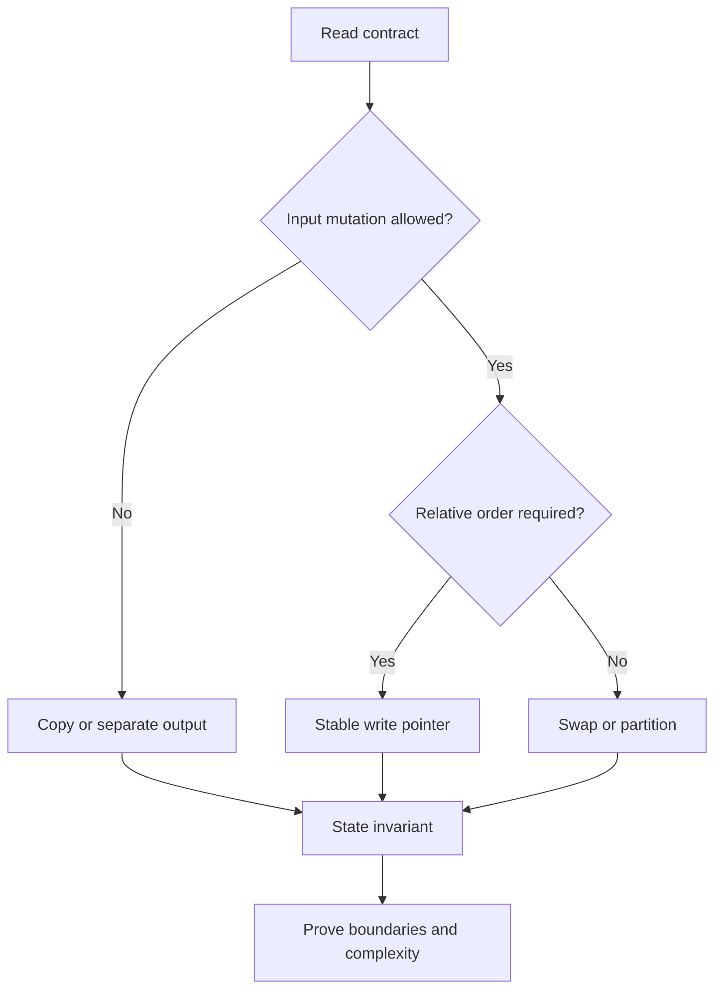

### Example 1 — reference identity is not value equality

Given `int[] a = {4, 1, 7}`, execute `int[] alias = a; alias[1] = 9;`.

**Result:** both variables refer to the same array object, so `a` is now `[4, 9, 7]`. By contrast, `Arrays.copyOf(a, a.length)` creates a distinct array with initially equal component values.

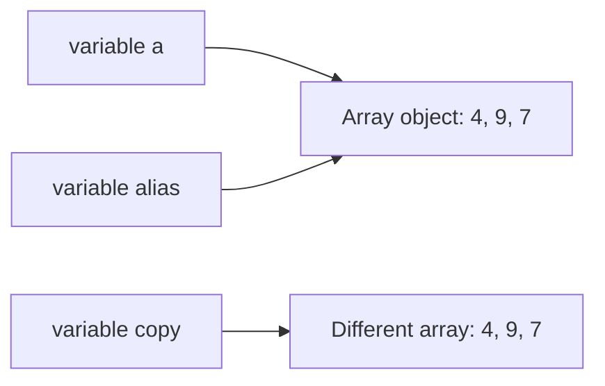

Trace:

| Step | `a == alias` | `a == copy` | `a[1]` | Meaning |
|---:|---:|---:|---:|---|
| After assignment | true | — | 1 | `alias` received the reference |
| After `alias[1] = 9` | true | — | 9 | Mutation is visible through either alias |
| After `copyOf` | true | false | 9 | The new object has equal values but different identity |
| After `copy[1] = 5` | true | false | 9 | Copy mutation does not affect `a` |

Interview consequence: clarify whether “do not modify the input” forbids component mutation. Rebinding a local parameter does not mutate the caller's array, but changing a component does.

```java
int[] original = {4, 1, 7};
int[] alias = original;
alias[1] = 9;
int[] copy = java.util.Arrays.copyOf(original, original.length);
copy[1] = 5;
// original is [4, 9, 7]; copy is [4, 5, 7]
```

### Example 2 — subarray, subsequence, and subset

For `a = [3, -1, 4, 2]`, these terms impose different constraints:

| Candidate | Classification | Reason |
|---|---|---|
| `[-1, 4]` | Subarray, subsequence, and subset selection | Uses the contiguous interval `[1, 2]` |
| `[3, 4, 2]` | Subsequence and subset selection, not subarray | Preserves order but skips index 1 |
| `[4, 3]` | Subset selection only | Selected values exist, but original order is reversed |
| `[3, 3]` | None for this input | A value occurrence cannot be reused unless the input contains it twice |

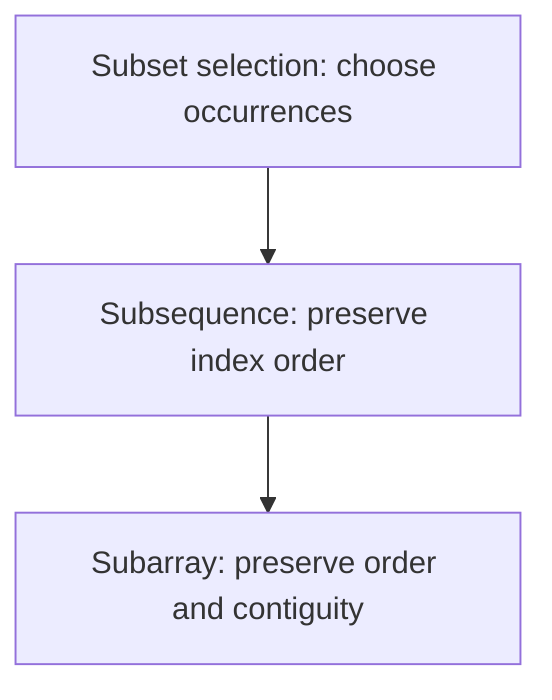

For length `n`:

- non-empty subarrays: `n(n + 1) / 2`;
- subsequences: `2^n` including the empty subsequence;
- value subsets need multiplicity rules when duplicates exist, so “set” language can lose index identity.

Memory trick: **array = interval, sequence = ordered picks, subset = picks without an order promise**.

### Example 3 — stable in-place compaction

Move zeros to the end of `[0, 3, 0, 3, 8]` while preserving the relative order of nonzero values.

Use `read` to scan every component and `write` to identify the next accepted position.

Invariant before processing index `read`:

1. `a[0..write)` contains exactly the nonzero values from original `a[0..read)`, in original order.
2. `write <= read`.
3. `a[read..n)` has not been inspected.

Trace:

| `read` | value | action | `write` after | array after action |
|---:|---:|---|---:|---|
| 0 | 0 | skip | 0 | `[0, 3, 0, 3, 8]` |
| 1 | 3 | write at 0 | 1 | `[3, 3, 0, 3, 8]` |
| 2 | 0 | skip | 1 | `[3, 3, 0, 3, 8]` |
| 3 | 3 | write at 1 | 2 | `[3, 3, 0, 3, 8]` |
| 4 | 8 | write at 2 | 3 | `[3, 3, 8, 3, 8]` |
| fill | — | zero `[3..5)` | 3 | `[3, 3, 8, 0, 0]` |

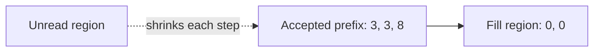

```java
static void stableMoveZeroes(int[] a) {
    int write = 0;
    for (int value : a) {
        if (value != 0) a[write++] = value;
    }
    while (write < a.length) a[write++] = 0;
}
```

**Correctness:** every accepted value is appended once and in scan order, so the prefix is stable. When scanning ends, it contains all nonzero values. Filling the remaining suffix with zeros preserves the required length and yields the target partition.

**Complexity:** `O(n)` time, `O(1)` auxiliary space. This minimizes conceptual complexity; an optional guarded assignment can reduce redundant writes but should not weaken the invariant.

### Example 4 — prefix sums without overflow

For `a = [1_500_000_000, 1_500_000_000, -1_500_000_000]`, the mathematical prefix sums are `[0, 1_500_000_000, 3_000_000_000, 1_500_000_000]`. The second running total exceeds `Integer.MAX_VALUE`, so an `int` prefix silently wraps.

Contract for half-open ranges: `rangeSum(left, right)` returns the sum of `a[left..right)`.

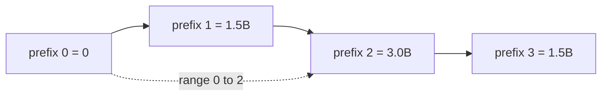

Trace:

| Index consumed | Value | `long` prefix | Meaning |
|---:|---:|---:|---|
| 0 | — | 0 | Empty prefix |
| 1 | 1,500,000,000 | 1,500,000,000 | `a[0..1)` |
| 2 | 1,500,000,000 | 3,000,000,000 | `a[0..2)` |
| 3 | -1,500,000,000 | 1,500,000,000 | `a[0..3)` |

```java
static long[] prefixSums(int[] a) {
    long[] prefix = new long[a.length + 1];
    for (int i = 0; i < a.length; i++) {
        prefix[i + 1] = prefix[i] + a[i]; // long + int -> long
    }
    return prefix;
}

static long rangeSum(long[] prefix, int left, int right) {
    if (left < 0 || left > right || right >= prefix.length) {
        throw new IndexOutOfBoundsException("invalid half-open range");
    }
    return prefix[right] - prefix[left];
}
```

Invariant after consuming `i` components: `prefix[i]` equals the mathematical sum of original `a[0..i)`. Therefore subtracting two prefixes cancels the shared left portion. Build time and space are `O(n)`; each validated range query is `O(1)`.

### Interview checklist

1. Restate mutation, output, ordering, and range conventions.
2. Name indices by role (`read`, `write`, `left`, `right`) rather than letters without meaning.
3. State the invariant before coding.
4. Trace empty, singleton, all-accepted, none-accepted, duplicate, and extreme-value cases.
5. Promote arithmetic before it can overflow.
6. Distinguish auxiliary space from returned output space.
7. State whether a range is closed `[l, r]` or half-open `[l, r)`.
8. Test aliasing expectations when the input is mutable.

## 2. Pattern-recognition decision tree

A trigger word is a hypothesis, not a proof. “Contiguous” narrows the family, but the value domain and required aggregate decide whether a window, prefix state, or Kadane-style recurrence is valid. Run the following checks before naming an algorithm.

### Decision contract

| Question | Consequence | Gate that must be proved |
|---|---|---|
| Is the output a contiguous interval or a count of intervals? | Consider window, prefix state, or Kadane | Windows need a monotone way to repair the constraint |
| Is the input sorted, or may it be sorted without destroying required indices/order? | Consider two pointers, binary search, or merge | Pointer elimination relies on sorted order |
| Is the predicate “seen before,” “how many before,” or “exact sum”? | Consider a set or frequency map | Define precisely what the key and stored value mean |
| Are there many immutable range queries? | Precompute prefix/suffix state | Confirm the aggregate has a valid combine/cancel rule |
| Are there updates between range queries? | Consider Fenwick or segment tree | A static prefix array becomes stale after updates |
| Is the request next greater/smaller or every-window extremum? | Consider monotonic stack/deque | State which dominated candidates may be discarded |
| Are values constrained to `1..n` or `0..n` and mutation is allowed? | Consider cyclic placement or marking | Every value must map to a legal home or be ignored safely |
| Is there a monotone `feasible(mid)` predicate? | Binary-search the answer | Prove the false/true boundary; do not search an arbitrary objective |

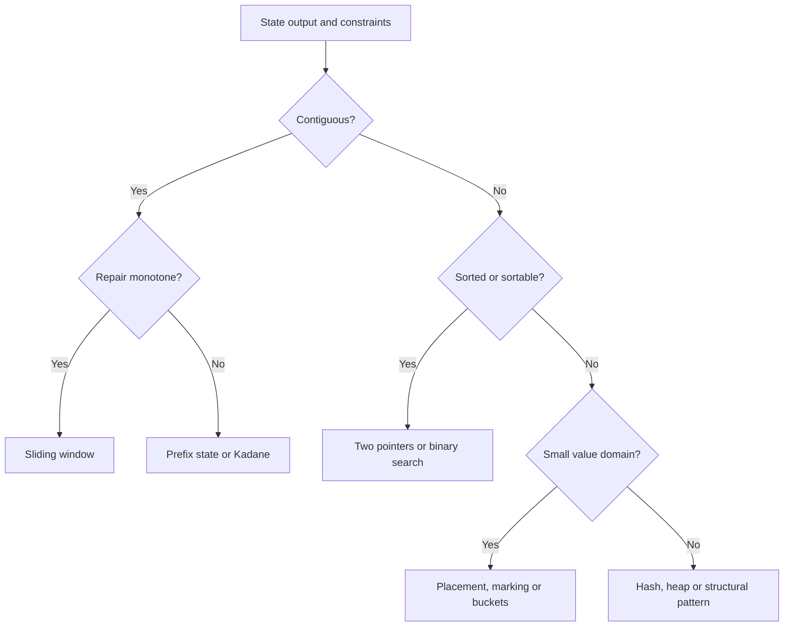

The critical habit is to write the precondition beside the pattern. For example, “minimum length with sum at least `k`” permits a shrinking sum window only when removing from the left cannot increase the sum—typically when values are nonnegative.

### Decision example 1 — exact-sum subarrays with signed values

**Requirement:** count contiguous subarrays whose mathematical sum equals `7` in `[3, 4, -7, 1, 3, 3, 1, -4]`. Values may be negative, so a grow/shrink window has no safe direction.

Choose **prefix sum + frequency map**. Before consuming `a[i]`, `frequency[p]` is the number of earlier prefix boundaries with sum `p`. A subarray ending at `i` sums to `k` exactly when an earlier prefix equals `prefix - k`.

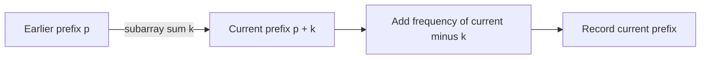

Trace (`frequency` starts with `{0: 1}`):

| `i` | value | prefix | needed `prefix - 7` | matches added | running count |
|---:|---:|---:|---:|---:|---:|
| 0 | 3 | 3 | -4 | 0 | 0 |
| 1 | 4 | 7 | 0 | 1 | 1 |
| 2 | -7 | 0 | -7 | 0 | 1 |
| 3 | 1 | 1 | -6 | 0 | 1 |
| 4 | 3 | 4 | -3 | 0 | 1 |
| 5 | 3 | 7 | 0 | 2 | 3 |
| 6 | 1 | 8 | 1 | 1 | 4 |
| 7 | -4 | 4 | -3 | 0 | 4 |

```java
static long countSubarraysWithSum(int[] a, long target) {
    Map<Long, Integer> frequency = new HashMap<>();
    frequency.put(0L, 1);
    long prefix = 0L;
    long answer = 0L;
    for (int value : a) {
        prefix += value;
        answer += frequency.getOrDefault(prefix - target, 0);
        frequency.merge(prefix, 1, Integer::sum);
    }
    return answer;
}
```

**Correctness:** every earlier boundary with prefix `prefix - target` determines one distinct subarray ending at the current index, and every qualifying subarray has exactly that pair of boundaries. Recording the current prefix after counting excludes empty/reversed intervals. Time is expected `O(n)` and auxiliary space is `O(n)`; `long` protects prefix arithmetic and the result count.

### Decision example 2 — pair sum in sorted input

**Requirement:** return indices of any two distinct values summing to `10` in sorted `[-3, 1, 4, 6, 8, 13]`.

Choose **opposite-end two pointers**. If the current sum is too small, pairing the left value with any index left of `right` cannot do better, so eliminate `left`. If it is too large, eliminate `right` symmetrically.

| Step | `left` value | `right` value | sum | Decision |
|---:|---:|---:|---:|---|
| 1 | -3 | 13 | 10 | return indices `[0, 5]` |

For a non-immediate trace with target `9`, the sums are `10` (decrement right), `5` (increment left), then `9` at values `1 + 8`.

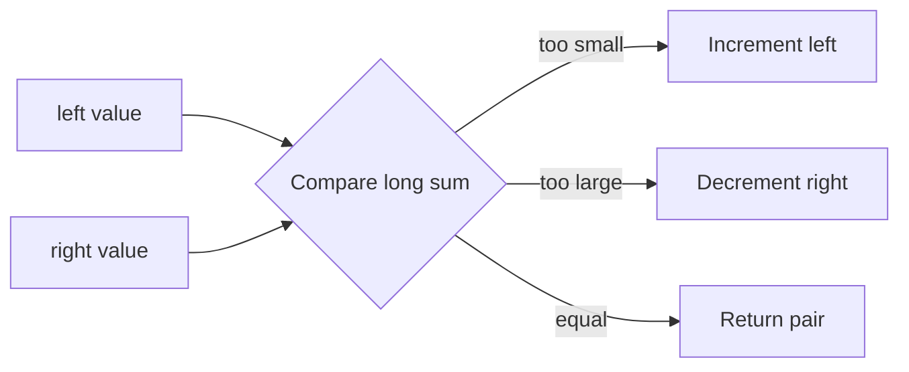

```java
static int[] sortedPairIndices(int[] sorted, long target) {
    requireNondecreasing(sorted);
    int left = 0;
    int right = sorted.length - 1;
    while (left < right) {
        long sum = (long) sorted[left] + sorted[right];
        if (sum == target) return new int[]{left, right};
        if (sum < target) left++;
        else right--;
    }
    return new int[0];
}
```

**Correctness:** each move discards only pairs that are provably too small or too large under sorted order. At least one index leaves the candidate interval per iteration, so time is `O(n)` and auxiliary space is `O(1)`. If original indices must survive sorting, sort value/index pairs or use hashing instead.

### Decision example 3 — minimum qualifying window with nonnegative values

**Requirement:** find the minimum length of a contiguous subarray with sum at least `7` in `[2, 3, 1, 2, 4, 3]`; return `0` if none exists. All values are nonnegative and `target > 0`.

Choose a **sliding window**. Expand `right`; while the sum qualifies, record the length and shrink `left`. Nonnegativity proves that expansion cannot decrease the sum and left-shrinking cannot increase it.

| `right` | value added | sum before shrinking | qualifying windows removed | best |
|---:|---:|---:|---|---:|
| 0 | 2 | 2 | — | — |
| 1 | 3 | 5 | — | — |
| 2 | 1 | 6 | — | — |
| 3 | 2 | 8 | `[0..3]`, then sum 6 | 4 |
| 4 | 4 | 10 | `[1..4]`, `[2..4]`, then sum 6 | 3 |
| 5 | 3 | 9 | `[3..5]`, `[4..5]`, then sum 3 | 2 |

```java
static int minLengthAtLeast(int[] nonnegative, long target) {
    if (target <= 0) throw new IllegalArgumentException("target must be positive");
    for (int value : nonnegative) {
        if (value < 0) throw new IllegalArgumentException("negative value");
    }
    int best = nonnegative.length + 1;
    int left = 0;
    long sum = 0L;
    for (int right = 0; right < nonnegative.length; right++) {
        sum += nonnegative[right];
        while (sum >= target) {
            best = Math.min(best, right - left + 1);
            sum -= nonnegative[left++];
        }
    }
    return best == nonnegative.length + 1 ? 0 : best;
}
```

**Why the gate matters:** with signed values, removing a negative left value increases the sum, so the same pointer rule may skip the optimum. A signed minimum-length problem needs a different structure, commonly increasing prefix sums in a monotonic deque. Under this method's contract, each endpoint advances at most `n` times: `O(n)` time and `O(1)` auxiliary space.

### Decision example 4 — first missing positive in place

**Requirement:** return the smallest missing positive from `[3, 4, -1, 1]` in `O(n)` time and `O(1)` auxiliary space; input mutation is allowed.

Because an answer for length `n` lies in `1..n+1`, use **cyclic placement**: while value `v` is in `1..n`, place it at index `v - 1`. The duplicate guard prevents infinite swapping.

| State | active index | action |
|---|---:|---|
| `[3, 4, -1, 1]` | 0 | swap `3` toward index 2 → `[-1, 4, 3, 1]` |
| `[-1, 4, 3, 1]` | 1 | swap `4` toward index 3 → `[-1, 1, 3, 4]` |
| `[-1, 1, 3, 4]` | 1 | swap `1` toward index 0 → `[1, -1, 3, 4]` |
| `[1, -1, 3, 4]` | scan | index 1 does not contain `2`; return `2` |

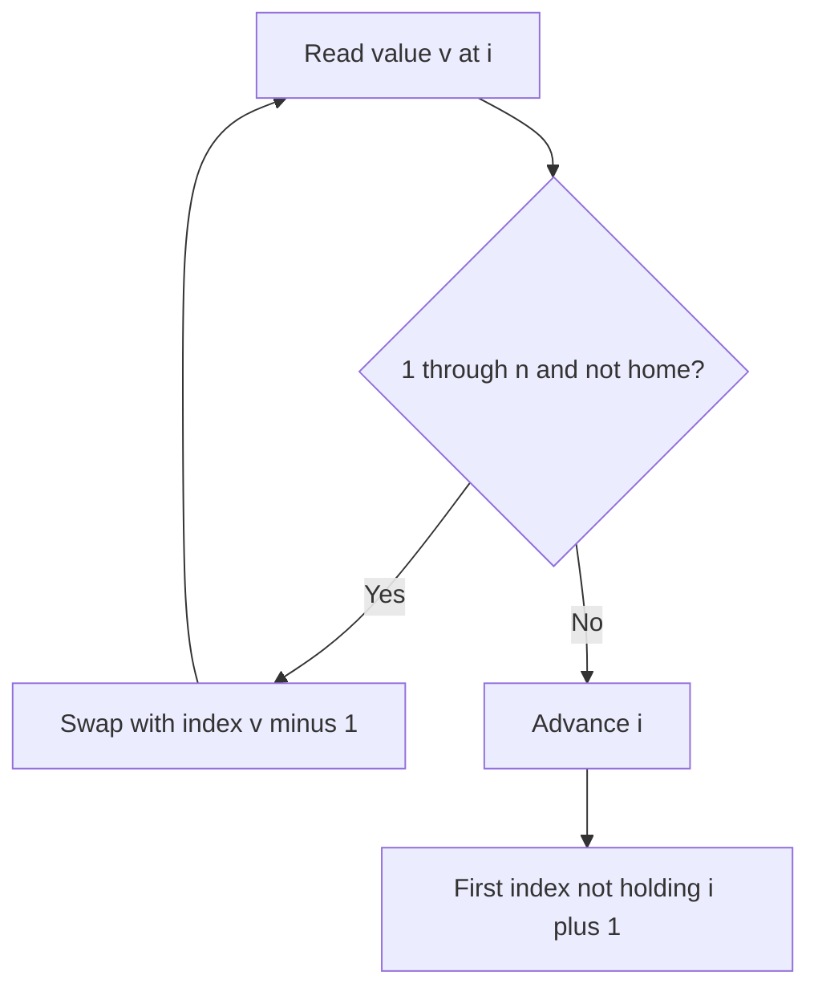

```java
static int firstMissingPositive(int[] a) {
    int i = 0;
    while (i < a.length) {
        int value = a[i];
        if (value >= 1 && value <= a.length && a[value - 1] != value) {
            int tmp = a[value - 1];
            a[value - 1] = value;
            a[i] = tmp;
        } else {
            i++;
        }
    }
    for (i = 0; i < a.length; i++) {
        if (a[i] != i + 1) return i + 1;
    }
    return a.length + 1;
}
```

**Correctness and cost:** every successful swap permanently places at least one in-range value at its home; at most `n` homes can be filled. The final scan returns the first absent home, or `n + 1` when all are filled. Time is `O(n)`, auxiliary space is `O(1)`, and mutation is explicit in the contract.

### Pattern trigger sheet

| Trigger | Candidate | Required proof | Common wrong turn |
|---|---|---|---|
| best-so-far in one pass | linear scan | retained state summarizes the processed prefix | storing every prior state |
| sorted pair/opposite ends | two pointers | a pointer move eliminates only impossible pairs | applying it to unsorted input |
| contiguous + monotone repair | sliding window | expand/shrink direction cannot reverse unexpectedly | using a sum window with negative values |
| count exact-sum subarrays | prefix + frequency map | current-minus-target identifies all earlier boundaries | storing only whether a prefix was seen |
| maximum contiguous sum | Kadane | best ending here is enough for the next state | confusing it with arbitrary subsequence |
| categories or pivot | partition | regions have precise category invariants | assuming stability without providing it |
| values in `1..n` | cyclic placement | legal values map to unique home indices | omitting the duplicate guard |
| sorted or monotone predicate | binary search | rejected/accepted region remains ordered | binary-searching a nonmonotone objective |
| overlap or scheduled ranges | sort then merge | only the last accepted interval can overlap next | merging before sorting |
| every-window maximum/minimum | monotonic deque | discarded candidates can never win later | storing values when indices expire |
| next greater/smaller | monotonic stack | stack order describes unresolved candidates | popping without resolving ownership |
| `k`th/top-`k` | heap or Quickselect | rank—not total order—is the requirement | fully sorting by habit |

### Decision checklist

1. Write the output shape: value, indices, interval, count, mutation, or decision.
2. Record whether values may be negative, duplicated, extreme, or confined to a small range.
3. Record whether the input is sorted and whether sorting may destroy required order or indices.
4. For a window, prove why moving one boundary repairs the violated condition.
5. For a map, define the key, stored value, and the moment each entry becomes visible.
6. For binary search, write `feasible(x)` and prove its monotonic direction.
7. For in-place placement, prove every swap progresses and duplicates terminate.
8. Promote arithmetic before sums, differences, and midpoint calculations can overflow.
9. Trace an empty case, a no-answer case, duplicates, and the smallest legal input.

## 3. Java array interview toolkit

The toolkit is not a bag of memorized calls. Each operation carries a contract about mutation, identity, ordering, lifetime, or numeric range. State that contract before choosing the API.

### Toolkit contract

| Need | Preferred Java tool | Contract to say aloud | Failure to avoid |
|---|---|---|---|
| Independent primitive-array values | `Arrays.copyOf(a, a.length)` | New array object; primitive components are copied by value | `int[] copy = a` creates an alias |
| Destructive ordering | `Arrays.sort(a)` | Sorts the supplied array in place | Losing original positions or caller-visible order |
| Uniform initialization | `Arrays.fill(a, value)` | Overwrites every selected component | Assuming it allocates a new array |
| Counts or membership | `HashMap` / `HashSet` | Define the key and when it becomes visible | Comparing boxed objects with `==` |
| Expiring ordered candidates | `ArrayDeque<Integer>` | Store indices when age and value both matter | Storing only values, which cannot prove expiration |
| Midpoint and arithmetic | `left + (right-left)/2`; cast before arithmetic | Preconditions bound the difference; arithmetic executes in `long` | Casting after an overflowing `int` operation |
| Exchange two components | three-assignment swap | Both indices must be valid; `i == j` is harmless | XOR swap, which is opaque and breaks on the same index |

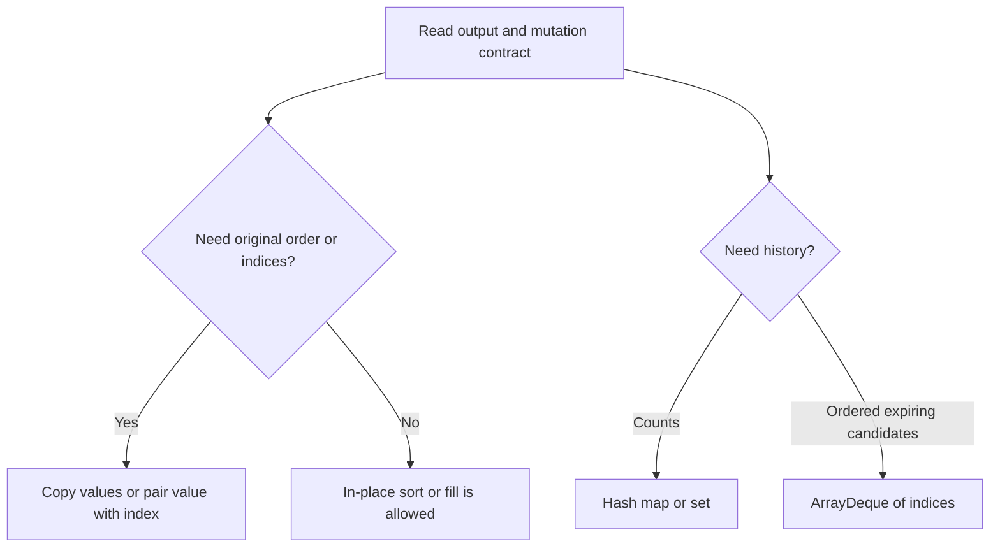

### Toolkit example 1 — sort a copy and preserve original indices

**Requirement:** for `[40, 10, 40, -2]`, produce sorted values without mutating the input and return original indices in value order. Equal values must retain increasing original index. Expected values: `[-2, 10, 40, 40]`; indices: `[3, 1, 0, 2]`.

`Arrays.copyOf` is enough when only sorted values are needed. Once original positions are output, sort explicit `(value, index)` pairs. The index tie-break makes the duplicate rule visible instead of relying on an incidental sort property.

```java
record IndexedValue(int value, int index) {}

static int[] sortedCopy(int[] input) {
    int[] copy = Arrays.copyOf(input, input.length);
    Arrays.sort(copy);                 // mutates only copy
    return copy;
}

static int[] stableOriginalIndicesByValue(int[] input) {
    IndexedValue[] pairs = new IndexedValue[input.length];
    for (int i = 0; i < input.length; i++) pairs[i] = new IndexedValue(input[i], i);
    Arrays.sort(pairs, (a, b) -> {
        int byValue = Integer.compare(a.value(), b.value());
        return byValue != 0 ? byValue : Integer.compare(a.index(), b.index());
    });
    int[] indices = new int[pairs.length];
    for (int i = 0; i < pairs.length; i++) indices[i] = pairs[i].index();
    return indices;
}
```

| Sorted position | pair chosen | output index | input remains |
|---:|---|---:|---|
| 0 | `(-2, 3)` | 3 | `[40, 10, 40, -2]` |
| 1 | `(10, 1)` | 1 | unchanged |
| 2 | `(40, 0)` | 0 | unchanged |
| 3 | `(40, 2)` | 2 | unchanged |

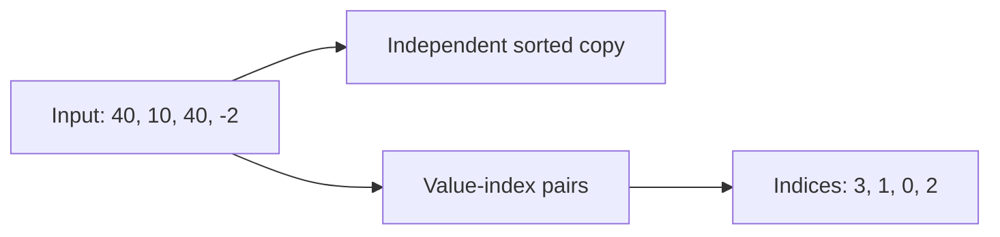

Sorting primitive values is `O(n log n)` time and the returned copy is `O(n)` space. Pair sorting also uses `O(n)` explicit storage. If the API promises `O(1)` auxiliary space, it cannot simultaneously return a full independent copy.

### Toolkit example 2 — frequencies and boxed equality

**Requirement:** decide whether `[1000, 1000, -2]` and `[1000, -2, 1000]` contain the same values with the same multiplicities. Expected result: `true`; `[1, 1, 2]` versus `[1, 2, 2]` is `false`.

The map invariant is: after processing a prefix of the right array, `balance[v]` is the number of unmatched occurrences of `v` from the left array. A missing key is immediate failure; remove a key when its last unmatched occurrence is consumed.

```java
static Map<Integer, Integer> frequencies(int[] input) {
    Map<Integer, Integer> result = new HashMap<>();
    for (int value : input) result.merge(value, 1, Integer::sum);
    return result;
}

static boolean sameMultiset(int[] left, int[] right) {
    if (left.length != right.length) return false;
    Map<Integer, Integer> balance = frequencies(left);
    for (int value : right) {
        Integer count = balance.get(value);
        if (count == null) return false;
        if (count == 1) balance.remove(value);
        else balance.put(value, count - 1);
    }
    return balance.isEmpty();
}
```

| Right value consumed | balance afterward |
|---:|---|
| start | `{1000=2, -2=1}` |
| `1000` | `{1000=1, -2=1}` |
| `-2` | `{1000=1}` |
| `1000` | `{}` → equal |

Two separately boxed `Integer.valueOf(1000)` values need not be the same reference, so `a == b` is not a value-equality contract. Use `a.equals(b)` (or `Objects.equals(a, b)` when null is possible). Hash-based collections use equality/hash semantics, not the caller's reference identity. Expected time is `O(n)` and auxiliary space is `O(u)` for `u` distinct values.

### Toolkit example 3 — store deque indices, not values

**Requirement:** return each width-3 maximum for `[1, 3, -1, -3, 5, 3, 6, 7]`. Expected output: `[3, 3, 5, 5, 6, 7]`.

Keep indices in increasing order from front to back and their values in strictly decreasing order. The front is therefore the largest live candidate. Indices make both expiration (`index <= right - width`) and value lookup possible; values alone cannot distinguish an expired duplicate from a live one.

```java
static int[] windowMaximum(int[] input, int width) {
    if (width <= 0 || width > input.length) throw new IllegalArgumentException("invalid width");
    int[] result = new int[input.length - width + 1];
    Deque<Integer> candidates = new ArrayDeque<>();
    for (int right = 0; right < input.length; right++) {
        while (!candidates.isEmpty() && candidates.peekFirst() <= right - width) {
            candidates.pollFirst();
        }
        while (!candidates.isEmpty()
                && input[candidates.peekLast()] <= input[right]) {
            candidates.pollLast();
        }
        candidates.offerLast(right);
        if (right >= width - 1) {
            result[right - width + 1] = input[candidates.peekFirst()];
        }
    }
    return result;
}
```

| `right` | value | deque indices after updates | represented values | emitted max |
|---:|---:|---|---|---:|
| 0 | 1 | `[0]` | `[1]` | — |
| 1 | 3 | `[1]` | `[3]` | — |
| 2 | -1 | `[1, 2]` | `[3, -1]` | 3 |
| 3 | -3 | `[1, 2, 3]` | `[3, -1, -3]` | 3 |
| 4 | 5 | `[4]` | `[5]` | 5 |
| 5 | 3 | `[4, 5]` | `[5, 3]` | 5 |
| 6 | 6 | `[6]` | `[6]` | 6 |
| 7 | 7 | `[7]` | `[7]` | 7 |

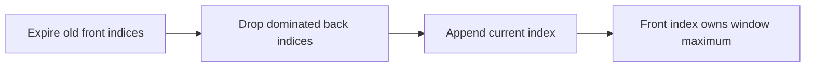

Each index is appended once and removed at most once from each end, so total time is `O(n)` and deque space is `O(width)`. `ArrayDeque` supplies amortized constant-time end operations and rejects nulls, which is useful here because null has no candidate meaning.

### Toolkit example 4 — safe midpoint, arithmetic, and swap

**Requirement:** find the first position whose value is at least `3` in `[1, 3, 3, 7]`; return `1`. Also compute `Integer.MAX_VALUE + 1` and `50_000 × 50_000` mathematically, and permit swapping an element with itself.

Use a half-open search interval `[left, right)`. Before each iteration, every index before `left` is known to be `< target`; every index at or after `right` is known to be `>= target`. The subtraction-based midpoint avoids `left + right` overflow under `0 <= left <= right`.

```java
static int lowerBound(int[] sorted, int target) {
    int left = 0, right = sorted.length;
    while (left < right) {
        int mid = left + (right - left) / 2;
        if (sorted[mid] < target) left = mid + 1;
        else right = mid;
    }
    return left;
}

static long safeSum(int a, int b)     { return (long) a + b; }
static long safeProduct(int a, int b) { return (long) a * b; }

static void swap(int[] a, int i, int j) {
    int tmp = a[i];
    a[i] = a[j];
    a[j] = tmp;
}
```

| Step | interval `[left, right)` | `mid` | value | next interval |
|---:|---|---:|---:|---|
| 1 | `[0, 4)` | 2 | 3 | `[0, 2)` |
| 2 | `[0, 2)` | 1 | 3 | `[0, 1)` |
| 3 | `[0, 1)` | 0 | 1 | `[1, 1)` → return 1 |

The cast must occur before the operator: `(long) a * b` multiplies as `long`, while `(long) (a * b)` first allows `int` overflow and only then widens the wrong value. The expected results are `2_147_483_648L` and `2_500_000_000L`. For swap, `i == j` simply writes the same value back.

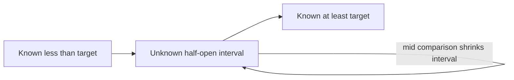

Binary search is `O(log n)` time and `O(1)` space. Arithmetic helpers and swap are `O(1)`.

### Toolkit checklist

1. Say whether the operation mutates the supplied array or returns a new one.
2. Preserve `(value, originalIndex)` pairs when output depends on original positions.
3. Define a map's key, value, and update visibility before coding.
4. Use `.equals` for boxed/object values; use `==` only when reference identity is the requirement.
5. Store deque indices when candidates expire by position.
6. Cast an operand before overflow-sensitive addition, subtraction, or multiplication.
7. Write binary-search interval semantics and midpoint preconditions.
8. Prefer a readable temporary-variable swap and validate both indices.
9. Test empty and singleton inputs, duplicates, extreme integers, invalid window widths, and no-answer searches.

Executable evidence is in `ArrayToolkitContracts.java`. Its deterministic suite checks all four contracts plus 10,000 randomized arrays against brute-force window-maximum and lower-bound oracles.

<a id="4-core-pattern-lab--first-twenty-solved-problems"></a>

## 4. Core pattern lab — first twenty-three solved problems

The source collection groups 47 solved problems under one large “Core Array Patterns” boundary. This incremental lab promotes the first sixteen: Two Sum, one-transaction stock profit, maximum subarray, majority element, Move Zeroes, Remove Duplicates from Sorted Array, Squares of a Sorted Array, 3Sum, Container With Most Water, Trapping Rain Water, Minimum Size Subarray Sum, Fruit Into Baskets, Sliding Window Maximum, Range Sum Query — Immutable, Product of Array Except Self, and Subarray Sum Equals K. The first four compress decision state; problems 5–6 finalize a prefix; problem 7 consumes the only two places that can still hold the largest magnitude; problems 8–10 use sorted or boundary monotonicity to discard state safely; problems 11–13 maintain just enough window state; problem 14 precomputes cancellable prefix state for repeated immutable queries; problem 15 combines two exclusive directional aggregates without division; and problem 16 counts matching prior prefix boundaries. Problems 17–47 remain explicit backlog; this guide does not imply they were reviewed merely because they share the source heading.

### Pattern-lab contract

Before selecting code, pin down the result and the guarantee that makes discarded history irrelevant:

| Problem | Required result | Minimal retained state | Proof obligation | This guide's edge contract |
|---|---|---|---|---|
| Two Sum | two distinct indices, or no answer | value → earliest earlier index | only the complement can complete the current value | target arithmetic is `long`; input is not mutated |
| One stock trade | maximum nonnegative profit | minimum price in the legal prefix | every sale is best paired with the cheapest earlier buy | fewer than two prices returns `0`; result is `long` |
| Maximum subarray | largest sum of a non-empty contiguous range | best sum ending exactly here | every optimum ending here either restarts or extends | empty input is rejected; sum is `long` |
| Majority element | value occurring more than `n / 2`, if present | cancellation candidate and balance | cancellation yields only a candidate without a promise | a second pass verifies; no majority returns empty |
| Move Zeroes | mutate the same array: stable nonzeros, then zero suffix | next output slot `write` | before `read`, the compact prefix is final and `write <= read` | null is rejected; empty and already-valid arrays are no-ops |
| Remove Duplicates | return the length of the stable unique prefix | last accepted value and `write` | sorted runs are contiguous, so one representative completes each run | validate sortedness before mutation at reusable boundaries; suffix is unspecified |
| Sorted Squares | a new nondecreasing array of mathematical squares | unconsumed interval `[left, right]` and backward `write` | the largest remaining magnitude is at an interval endpoint | input is validated and not mutated; `long` preserves every squared `int` |
| 3Sum | unique value triplets from distinct indices whose mathematical sum is zero | sorted suffix plus anchor and two pointers | comparison eliminates one monotone side; duplicate runs emit once | sort a copy, widen sums, and return deterministic lexicographic triplets |
| Container With Most Water | maximum area from one pair of boundaries | current endpoint pair and best area | every pair retaining the shorter endpoint is dominated | reject negative heights, do not mutate, and widen before multiplication |
| Trapping Rain Water | total per-index retained water | unresolved interval plus left/right maxima | the side with the smaller running boundary has an exact final cap | reject negative heights, do not mutate, and accumulate in checked `long` |

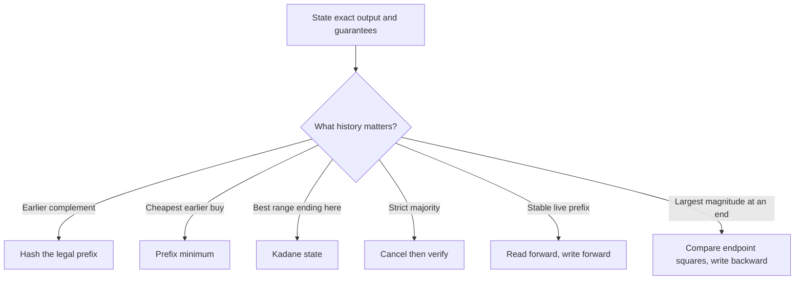

All four implementations are side-effect free. Their arithmetic contracts deliberately differ from many short interview snippets: indices stay `int`, but sums, targets, differences, and returned numeric aggregates use `long` wherever two legal `int` values can exceed the `int` range.

### Example 1 — Two Sum: index the legal prefix

**Requirement:** for `input = [2, 7, 11, 15]` and `target = 9`, return two distinct indices whose values sum mathematically to the target. Return an empty array when no pair exists. Do not mutate the input.

Invariant before reading index `right`: the map stores the earliest index of each value in `input[0..right)`. Therefore any retrieved index is automatically different from `right`.

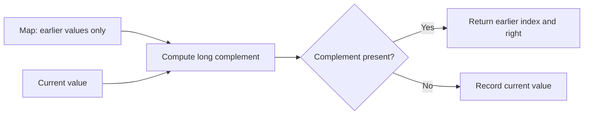

Trace:

| `right` | value | `need = target - value` | map before | decision |
|---:|---:|---:|---|---|
| 0 | 2 | 7 | `{}` | record `2 → 0` |
| 1 | 7 | 2 | `{2=0}` | return `[0, 1]` |

```java
static int[] twoSumIndices(int[] input, long target) {
    Map<Long, Integer> firstIndex = new HashMap<>();
    for (int right = 0; right < input.length; right++) {
        long need = target - input[right];
        Integer left = firstIndex.get(need);
        if (left != null) return new int[]{left, right};
        firstIndex.putIfAbsent((long) input[right], right);
    }
    return new int[0];
}
```

**Why the order matters:** checking before insertion prevents reusing the current index. `putIfAbsent` retains the earliest duplicate, which makes behavior deterministic without changing correctness. `long need` handles pairs such as two `Integer.MAX_VALUE` values with target `4_294_967_294L`.

Expected time is `O(n)` under the map's usual hash-distribution assumption, with `O(n)` auxiliary space. A nested-loop baseline is `O(n²)` time and `O(1)` space; a sorted two-pointer solution is appropriate only when sorting is allowed and original-index identity is preserved separately.

### Example 2 — one stock trade: retain the cheapest legal buy

**Requirement:** for prices `[7, 1, 5, 3, 6, 4]`, choose at most one buy and one later sell and return the maximum profit. Return `0` when no profitable legal trade exists.

Before evaluating day `sell`, `minimum` is the lowest price in `[0, sell)`, and `best` is the largest profit among sales before `sell`. The only state a new selling day needs is the cheapest legal earlier buy.

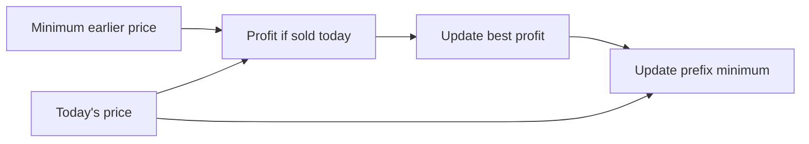

| sell day | price | minimum before | profit today | best after |
|---:|---:|---:|---:|---:|
| 1 | 1 | 7 | -6 | 0 |
| 2 | 5 | 1 | 4 | 4 |
| 3 | 3 | 1 | 2 | 4 |
| 4 | 6 | 1 | 5 | 5 |
| 5 | 4 | 1 | 3 | 5 |

```java
static long maxSingleTradeProfit(int[] prices) {
    if (prices.length < 2) return 0L;
    int minimum = prices[0];
    long best = 0L;
    for (int sell = 1; sell < prices.length; sell++) {
        best = Math.max(best, (long) prices[sell] - minimum);
        minimum = Math.min(minimum, prices[sell]);
    }
    return best;
}
```

The cast occurs before subtraction, so the method remains correct even across the full `int` domain. Selling is evaluated before incorporating today's price into the prefix minimum; buying and selling on one day would produce zero anyway, but keeping the legal-prefix meaning explicit makes the proof portable to variants with fees or a mandatory positive holding period. Time is `O(n)` and auxiliary space is `O(1)`.

### Example 3 — maximum subarray: compress the best ending state

**Requirement:** return the largest mathematical sum of a non-empty contiguous subarray. For `[-2, 1, -3, 4, -1, 2, 1, -5, 4]`, return `6` for `[4, -1, 2, 1]`.

After processing index `i`, `endingHere` is the maximum sum among all non-empty subarrays ending exactly at `i`; `best` is the maximum over every ending position processed so far.

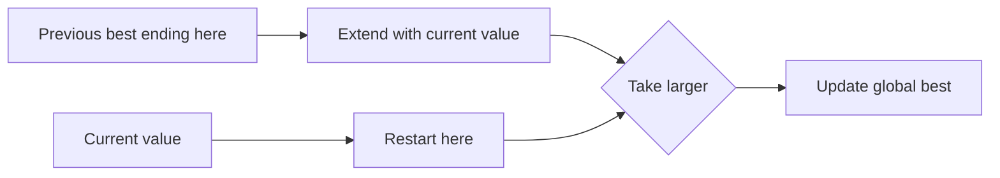

| `i` | value | extend | restart | `endingHere` | `best` |
|---:|---:|---:|---:|---:|---:|
| 0 | -2 | — | -2 | -2 | -2 |
| 1 | 1 | -1 | 1 | 1 | 1 |
| 2 | -3 | -2 | -3 | -2 | 1 |
| 3 | 4 | 2 | 4 | 4 | 4 |
| 4 | -1 | 3 | -1 | 3 | 4 |
| 5 | 2 | 5 | 2 | 5 | 5 |
| 6 | 1 | 6 | 1 | 6 | 6 |

```java
static long maxSubarraySum(int[] input) {
    if (input.length == 0) throw new IllegalArgumentException("non-empty input required");
    long endingHere = input[0], best = input[0];
    for (int i = 1; i < input.length; i++) {
        endingHere = Math.max((long) input[i], endingHere + input[i]);
        best = Math.max(best, endingHere);
    }
    return best;
}
```

Every non-empty subarray ending at `i` either contains no earlier element or extends a subarray ending at `i - 1`; no third case exists. Retaining the best earlier ending dominates every worse extension. Initialization from the first element is essential: initializing to zero would incorrectly allow an empty range for all-negative input. Time is `O(n)`, auxiliary space is `O(1)`, and `long` keeps repeated `int` additions mathematical.

### Example 4 — majority element: cancel, then verify

**Requirement:** return a value only when it occurs strictly more than `floor(n / 2)` times. The usual interview statement may guarantee a majority; this reusable contract does not trust that promise.

The candidate pass pairs occurrences of the current candidate with different values. If a strict majority exists, it survives every possible cancellation. Cancellation does **not** prove that a majority exists, so verification is a separate gate.

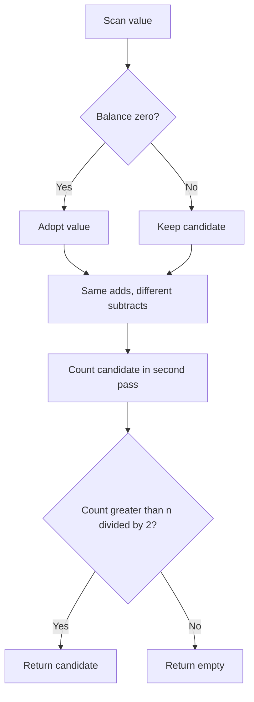

Trace for `[2, 2, 1, 1, 1, 2, 2]`:

| value | candidate before | balance before | candidate/balance after |
|---:|---:|---:|---|
| 2 | — | 0 | `2 / 1` |
| 2 | 2 | 1 | `2 / 2` |
| 1 | 2 | 2 | `2 / 1` |
| 1 | 2 | 1 | `2 / 0` |
| 1 | 2 | 0 | `1 / 1` |
| 2 | 1 | 1 | `1 / 0` |
| 2 | 1 | 0 | `2 / 1` |

The second pass counts four occurrences of `2`; `4 > 7 / 2`, so the result is present.

```java
static OptionalInt majorityElement(int[] input) {
    if (input.length == 0) return OptionalInt.empty();
    int candidate = 0, balance = 0;
    for (int value : input) {
        if (balance == 0) candidate = value;
        balance += value == candidate ? 1 : -1;
    }
    int occurrences = 0;
    for (int value : input) if (value == candidate) occurrences++;
    return occurrences > input.length / 2
            ? OptionalInt.of(candidate)
            : OptionalInt.empty();
}
```

The candidate pass is `O(n)`, verification is another `O(n)`, and auxiliary space is `O(1)`. Under a contractual guarantee, verification may be omitted; without it, `[1, 2, 3]` demonstrates why returning the final candidate is unsound. Majority means strictly more than half, not merely the mode.

### Core-pattern checklist

1. State whether the output is indices, a numeric aggregate, a mutated array, or an optional value.
2. Preserve legality in the state: Two Sum stores only earlier indices; stock state stores only earlier buys.
3. Name exactly what a compressed variable means after each iteration.
4. Distinguish a candidate-producing pass from a proof-producing verification pass.
5. Check before inserting when the current element must not match itself.
6. Initialize non-empty extrema from real input, not a convenient zero.
7. Promote before subtraction or addition when legal `int` values can overflow.
8. Test duplicates, no answer, all-negative input, decreasing prices, absent majority, and integer extremes.

Executable evidence is in `ArrayCorePatterns.java`. It checks 28 explicit scenario groups and runs 40,000 seeded comparisons against brute-force pair-existence, profit, maximum-subarray, and majority oracles.

### Example 5 — Move Zeroes: stable compaction, then clear

**Requirement:** mutate the supplied array so every nonzero value keeps its original relative order at the front and every zero occupies the suffix. For `[0, 1, 0, 3, 12]`, the required final array is `[1, 3, 12, 0, 0]`. Return data is optional; the observable contract is the same array object after mutation.

The `read` pointer discovers values; `write` names the first unfilled slot in the compact prefix. Before each read:

1. `values[0..write)` equals the nonzero subsequence of `values[0..read)` in encounter order.
2. `write <= read`, so copying `values[read]` left cannot destroy an unread value.
3. Nothing at or after `write` is final until the scan ends.

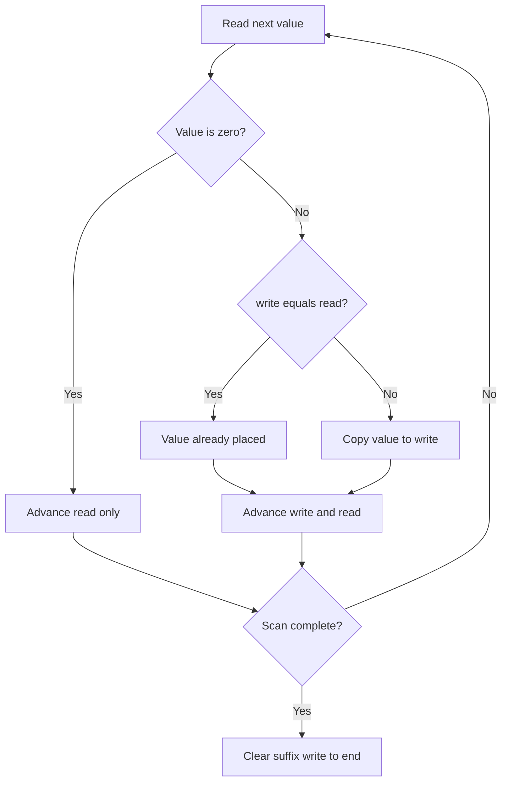

Canonical trace:

| `read` | value | `write` before | action | array after action | `write` after |
|---:|---:|---:|---|---|---:|
| 0 | 0 | 0 | skip | `[0, 1, 0, 3, 12]` | 0 |
| 1 | 1 | 0 | copy to index 0 | `[1, 1, 0, 3, 12]` | 1 |
| 2 | 0 | 1 | skip | `[1, 1, 0, 3, 12]` | 1 |
| 3 | 3 | 1 | copy to index 1 | `[1, 3, 0, 3, 12]` | 2 |
| 4 | 12 | 2 | copy to index 2 | `[1, 3, 12, 3, 12]` | 3 |
| clear | — | 3 | zero indices 3 and 4 | `[1, 3, 12, 0, 0]` | 3 |

```java
static void moveZeroes(int[] values) {
    int write = 0;
    for (int read = 0; read < values.length; read++) {
        if (values[read] == 0) continue;
        if (write != read) values[write] = values[read];
        write++;
    }
    while (write < values.length) values[write++] = 0;
}
```

Four cases pin down different parts of the contract:

| Input | Expected mutation | What it proves |
|---|---|---|
| `[0, 1, 0, 3, 12]` | `[1, 3, 12, 0, 0]` | zeros can be interleaved; nonzeros stay ordered |
| `[4, -1, 7]` | `[4, -1, 7]` | no zero means no movement; conditional copy avoids self-writes |
| `[0, 0, 0]` | `[0, 0, 0]` | empty live prefix and full zero suffix are valid |
| `[0, -1, -1, 0, 2]` | `[-1, -1, 2, 0, 0]` | negatives and duplicates are values, not special cases; stability is observable |

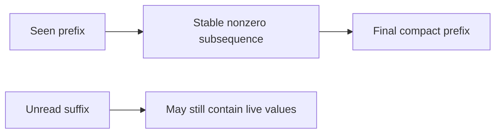

**Correctness.** Initially both prefixes are empty. A zero adds nothing to the required nonzero subsequence, so skipping preserves the invariant. A nonzero is appended at `write`; because reads move left-to-right, append order is source order, and because `write <= read`, the copy cannot overwrite future input. At termination the prefix is exactly every original nonzero in order. Clearing the remaining `n - write` cells creates the required zero suffix without touching that prefix.

**Why not swap with the far end?** A bidirectional partition can violate stability: swapping the first zero in `[0, 1, 2, 0, 3]` with the final `3` produces a prefix beginning `[3, 1, 2]`. The source's same-direction swap is stable and correct, but it can perform two writes for every displaced nonzero. Copy-then-clear makes the two phases explicit; the executable version skips assignments that would leave a cell unchanged and records at most `n` changed-cell writes.

Time is `O(n)`: the scan reads each element once and the clear phase touches at most the suffix. Auxiliary space is `O(1)`. The extra-array baseline is also `O(n)` time but uses `O(n)` space. Repeatedly shifting after each zero is stable but can degrade to `O(n²)` on alternating input.

Interview variations change the predicate, not the proof shape: move all values failing `keep(value)` to the end, return the compacted length, or preserve only the first `k` copies. If the discarded suffix need not be normalized, stop after compaction and return `write`; if stability is not required, a bidirectional partition becomes legal.

Executable evidence is in `MoveZeroesContracts.java`. It checks the four cases above plus empty input, alternating values, null rejection, and 20,000 seeded arrays against an independent extra-array oracle. It also checks the reported nonzero count and the at-most-`n` changed-cell assignment bound.

### Example 6 — Remove Duplicates: finalize a unique prefix

**Requirement:** the input is sorted in nondecreasing order. Mutate the same array so its first `k` cells contain every distinct input value exactly once in original order, then return `k`. The suffix beginning at `k` is explicitly unspecified and must not be tested or cleared. For `[0,0,1,1,1,2,2,3,3,4]`, return `5` with prefix `[0,1,2,3,4]`.

This is stable compaction with a different keep rule from Move Zeroes. Because the input is sorted, all copies of a value form one run. `write` is the length of the finalized unique prefix; `values[write - 1]` is the last accepted value. Before processing `read`:

1. `values[0..write)` contains exactly one representative of every run that starts in `values[0..read)`.
2. That prefix is strictly increasing and matches the original encounter order.
3. `1 <= write <= read` for nonempty input, so a leftward write cannot overwrite unread input.

```mermaid
flowchart LR
    U["Final unique prefix: 0 to write-1"] --> L["Last accepted value"]
    R["Current run value at read"] --> C{"Same as last accepted?"}
    L --> C
    C -->|yes| S["Skip duplicate"]
    C -->|no| W["Write at index write; advance write"]
```

The interview form assumes the sorted-input precondition:

```java
static int removeDuplicates(int[] values) {
    if (values.length == 0) return 0;
    int write = 1;
    for (int read = 1; read < values.length; read++) {
        if (values[read] != values[write - 1]) {
            if (write != read) values[write] = values[read];
            write++;
        }
    }
    return write;
}
```

The `write != read` guard is not needed for correctness. It avoids assignments when an already-unique prefix is already in its final location, which makes mutation accounting and caller-visible write traffic easier to reason about.

#### Worked case 1 — interleaved duplicate runs

Trace `[0,0,1,1,1,2,2,3,3,4]`:

| `read` | value | last accepted | action | finalized prefix | `write` after |
|---:|---:|---:|---|---|---:|
| 1 | 0 | 0 | skip same run | `[0]` | 1 |
| 2 | 1 | 0 | write index 1 | `[0,1]` | 2 |
| 3 | 1 | 1 | skip | `[0,1]` | 2 |
| 4 | 1 | 1 | skip | `[0,1]` | 2 |
| 5 | 2 | 1 | write index 2 | `[0,1,2]` | 3 |
| 6 | 2 | 2 | skip | `[0,1,2]` | 3 |
| 7 | 3 | 2 | write index 3 | `[0,1,2,3]` | 4 |
| 8 | 3 | 3 | skip | `[0,1,2,3]` | 4 |
| 9 | 4 | 3 | write index 4 | `[0,1,2,3,4]` | 5 |

The array may end as `[0,1,2,3,4,2,2,3,3,4]`. That is correct: only indices `0..4` belong to the result. Clearing or validating the suffix adds work and invents a requirement.

```mermaid
stateDiagram-v2
    [*] --> AcceptedFirst
    AcceptedFirst --> Reading
    Reading --> Reading: duplicate, write unchanged
    Reading --> Extended: new run, append once
    Extended --> Reading: advance read
    Reading --> Done: read reaches length
    Extended --> Done: read reaches length
```

#### Worked case 2 — one long run

For `[-7,-7,-7]`, return `k = 1`; the meaningful prefix is `[-7]`. No assignment is needed because the first representative was already accepted. This case proves that `k` counts runs, not occurrences, and that `write` must start at one only after ruling out empty input.

#### Worked case 3 — every value is already unique

For `[Integer.MIN_VALUE,-1,0,Integer.MAX_VALUE]`, return `k = 4` with the entire array unchanged. Equality comparisons are sufficient—there is no subtraction that could overflow at integer extremes. The conditional self-write guard records zero changed assignments.

#### Worked case 4 — precondition failure versus promised input

`[1,0,1]` is outside the problem contract. On an interview platform, state the sorted precondition and omit an extra pass. At a reusable service/library boundary, validate nondecreasing order **before** mutation and reject atomically; detecting disorder only after compaction may leave the caller's array partially changed.

```mermaid
flowchart TD
    A["Reusable API receives array"] --> V{"Sorted nondecreasingly?"}
    V -->|no| X["Reject before any write"]
    V -->|yes, empty| Z["Return k = 0"]
    V -->|yes, nonempty| I["write = 1; scan runs"]
    I --> K["Return k; ignore suffix"]
```

**Correctness.** For a nonempty array, the invariant holds initially because the prefix containing only `values[0]` represents the first run. When `values[read]` equals the last accepted value, sortedness means it belongs to the same run, so skipping it preserves the exact unique prefix. When it differs, it begins a new run; appending it at `write` adds exactly the next distinct value and preserves order. Because `write <= read`, the assignment cannot destroy unread input. At termination every run has contributed once, so `write` is both the prefix length and the number of distinct values.

Time is `O(n)` and auxiliary space is `O(1)`. A `LinkedHashSet` baseline preserves encounter order but costs `O(n)` space; a plain `HashSet` does not specify encounter order. The optimized method performs at most `k - 1` changed-cell assignments and none for an already unique array.

**Follow-up — allow at most `m` copies.** Keep the first `m` cells automatically; afterward accept `values[read]` exactly when it differs from `values[write - m]`. This compares with the oldest retained copy in the allowed window. Reject `m < 1`, and retain the same suffix-is-unspecified rule.

Executable evidence is in `RemoveDuplicatesContracts.java`. It checks the four worked contracts, empty/singleton and signed-boundary cases, null rejection, atomic rejection of unsorted input, assignment bounds, and 20,000 seeded sorted arrays against an independent `LinkedHashSet` oracle.

### Example 7 — Sorted Squares: consume the largest magnitude

**Requirement:** accept an `int[]` sorted in nondecreasing signed order and return a **new** array containing every mathematical square in nondecreasing order. Do not mutate the input. This reusable version returns `long[]`, because Java's full `int` domain includes values whose square does not fit in `int`. Empty input returns an empty result; null or unsorted input is rejected before the output scan.

The subtlety is that signed order is not magnitude order. Squaring folds the negative half around zero: `-9 < -2`, but `81 > 4`. For any remaining sorted interval `[left, right]`, every interior value lies between the endpoints. Its magnitude therefore cannot exceed both endpoint magnitudes. The next largest square must come from `values[left]` or `values[right]`.

```mermaid
flowchart LR
    L["left endpoint"] --> LS["square as long"]
    R["right endpoint"] --> RS["square as long"]
    LS --> C{"which square is larger?"}
    RS --> C
    C -->|left| WL["write at end; left++"]
    C -->|right or tie| WR["write at end; right--"]
    WL --> N["write--"]
    WR --> N
```

The interview core is short once the contracts are settled:

```java
static long[] sortedSquares(int[] values) {
    Objects.requireNonNull(values, "values");
    for (int i = 1; i < values.length; i++) {
        if (values[i - 1] > values[i]) {
            throw new IllegalArgumentException("input must be sorted");
        }
    }

    long[] output = new long[values.length];
    int left = 0, right = values.length - 1;
    for (int write = output.length - 1; write >= 0; write--) {
        long leftSquare = (long) values[left] * values[left];
        long rightSquare = (long) values[right] * values[right];
        if (leftSquare > rightSquare) {
            output[write] = leftSquare;
            left++;
        } else {
            output[write] = rightSquare;
            right--;
        }
    }
    return output;
}
```

Two details are deliberate:

1. Compare widened squares, not `Math.abs(int)`. `Math.abs(Integer.MIN_VALUE)` is still negative because `2^31` is not representable as an `int`.
2. Cast **before** multiplication. `(long) value * value` computes a `long` product; `(long) (value * value)` widens an already-overflowed `int`.

#### Worked case 1 — mixed signs, exact pointer trace

For `[-4,-1,0,3,10]`, fill from right to left:

| step | `left:value` | `right:value` | endpoint squares | chosen endpoint | `write` | output after write |
|---:|---|---|---|---|---:|---|
| 1 | `0:-4` | `4:10` | `16` vs `100` | right | 4 | `[_,_,_,_,100]` |
| 2 | `0:-4` | `3:3` | `16` vs `9` | left | 3 | `[_,_,_,16,100]` |
| 3 | `1:-1` | `3:3` | `1` vs `9` | right | 2 | `[_,_,9,16,100]` |
| 4 | `1:-1` | `2:0` | `1` vs `0` | left | 1 | `[_,1,9,16,100]` |
| 5 | `2:0` | `2:0` | `0` vs `0` | right tie | 0 | `[0,1,9,16,100]` |

```mermaid
sequenceDiagram
    participant I as Remaining interval
    participant C as Endpoint comparison
    participant O as Output from right
    I->>C: [-4,-1,0,3,10]
    C->>O: 10² -> index 4
    I->>C: [-4,-1,0,3]
    C->>O: (-4)² -> index 3
    C->>O: 3², (-1)², 0²
```

#### Worked case 2 — all negative

`[-7,-3,-1]` returns `[1,9,49]`. The left endpoint wins until only `-1` remains. This case rejects the mistaken idea that “sorted input means square left-to-right.” The scan is still linear; one pointer simply moves more often.

#### Worked case 3 — duplicates and equal magnitudes

`[-3,-2,2,3]` returns `[4,4,9,9]`. Equal endpoint squares may consume either side because the returned values, not source indices, define the result. The implementation consumes the right endpoint on ties, giving one deterministic rule without needing deduplication.

#### Worked case 4 — full-width integer boundaries

`[Integer.MIN_VALUE,0,Integer.MAX_VALUE]` requires full-width arithmetic. Use the actual products, not a memorized decimal:

| source value | mathematical square |
|---:|---:|
| `0` | `0L` |
| `Integer.MAX_VALUE = 2^31 - 1` | `4_611_686_014_132_420_609L` |
| `Integer.MIN_VALUE = -2^31` | `4_611_686_018_427_387_904L` |

Thus the exact output is `[0L, 4_611_686_014_132_420_609L, 4_611_686_018_427_387_904L]`. An `int[]` result is safe only under a tighter input bound such as the original problem's `|value| <= 10_000`; a reusable Java method should encode or validate that assumption rather than silently wrap.

```mermaid
flowchart TD
    A["Need squared values"] --> B{"Can every square fit in int?"}
    B -->|documented bound| C["int[] is legal"]
    B -->|full int domain or unknown| D["return long[]"]
    D --> E["cast operand before multiplication"]
    C --> F["still validate sorted input if boundary is reusable"]
```

**Correctness invariant.** Before an iteration with output index `write`, cells `output[write + 1..n)` contain exactly the largest `n - 1 - write` squares in nondecreasing order, and `values[left..right]` are precisely the unconsumed inputs. The largest absolute value in a sorted interval is at an endpoint, so the algorithm writes the largest remaining square at `write`. Removing only that endpoint preserves both claims. When `write < 0`, no input remains and the entire output is sorted.

Time is `O(n)`: validation and construction are each one pass. The returned array costs `O(n)`, while pointer state costs `O(1)`. The square-then-sort baseline is `O(n log n)` time and `O(n)` output. A split-at-zero merge is also linear but needs more boundary logic; endpoint selection is the smaller proof.

Executable evidence is in `SortedSquaresContracts.java`. It checks the four cases above, empty/singleton/zero inputs, null and unsorted rejection, input immutability, and 20,000 seeded sorted arrays against an independent square-then-sort oracle.

### Example 8 — 3Sum: anchor once, eliminate pairs monotonically

**Requirement:** given an `int[]`, return every distinct value triplet `(a, b, c)` with `a <= b <= c` and mathematical sum zero. The three values must come from three distinct input indices. Duplicate index choices that produce the same values do not create another result. This reusable contract rejects null, preserves the caller's array, returns triplets in deterministic lexicographic order, and returns an empty list when fewer than three values or no solution exists.

Sorting turns the three-variable search into a sequence of sorted Two Sum searches. Fix one distinct anchor at `i`, then search only `i + 1..n - 1`. For that anchor:

- if the widened sum is negative, every pair using the current `left` and any index no farther right is also too small, so advance `left`;
- if the sum is positive, every pair using the current `right` and any index no farther left is also too large, so decrement `right`;
- if the sum is zero, emit the value triplet once, then skip the complete equal-value runs at both pointers.

```mermaid
flowchart TD
    S["Sort a copy"] --> A["Choose next distinct anchor i"]
    A --> P["left = i + 1; right = n - 1"]
    P --> C{"long sum sign"}
    C -->|negative| L["left++"]
    C -->|positive| R["right--"]
    C -->|zero| E["emit; skip equal left and right runs"]
    L --> C
    R --> C
    E --> C
```

The reusable implementation uses a record so sortedness and uniqueness are part of the result type rather than conventions hidden inside nested lists:

```java
record Triplet(int first, int second, int third) {}

static List<Triplet> threeSum(int[] input) {
    Objects.requireNonNull(input, "input");
    int[] values = input.clone();              // preserve the caller's order
    Arrays.sort(values);
    List<Triplet> result = new ArrayList<>();

    for (int i = 0; i + 2 < values.length; i++) {
        if (i > 0 && values[i] == values[i - 1]) continue;
        if (values[i] > 0) break;

        long smallest = (long) values[i] + values[i + 1] + values[i + 2];
        if (smallest > 0) break;
        long largest = (long) values[i]
                + values[values.length - 2] + values[values.length - 1];
        if (largest < 0) continue;

        int left = i + 1, right = values.length - 1;
        while (left < right) {
            long sum = (long) values[i] + values[left] + values[right];
            if (sum < 0) {
                left++;
            } else if (sum > 0) {
                right--;
            } else {
                result.add(new Triplet(values[i], values[left], values[right]));
                int leftValue = values[left], rightValue = values[right];
                while (left < right && values[left] == leftValue) left++;
                while (left < right && values[right] == rightValue) right--;
            }
        }
    }
    return List.copyOf(result);
}
```

The cast is before the first addition. Without it, Java performs `int` addition first and can wrap before a later conversion. The two bound checks are optional optimizations, but their proof is the same sorted monotonicity as pointer movement: the next two values form the smallest possible suffix pair, while the final two form the largest.

#### Worked case 1 — canonical duplicates and the full pointer trace

Input `[-1,0,1,2,-1,-4]` sorts to `[-4,-1,-1,0,1,2]`.

| anchor `i:value` | `left:value` | `right:value` | widened sum | decision |
|---|---|---|---:|---|
| `0:-4` | `1:-1` | `5:2` | -3 | advance left |
| `0:-4` | `2:-1` | `5:2` | -3 | advance left |
| `0:-4` | `3:0` | `5:2` | -2 | advance left |
| `0:-4` | `4:1` | `5:2` | -1 | anchor exhausted |
| `1:-1` | `2:-1` | `5:2` | 0 | emit `(-1,-1,2)`; skip runs |
| `1:-1` | `3:0` | `4:1` | 0 | emit `(-1,0,1)`; skip runs |
| `2:-1` | — | — | — | duplicate anchor; skip |

Result: `[(-1,-1,2), (-1,0,1)]`. Original index choices may differ, but the value combinations are unique.

```mermaid
flowchart LR
    A["anchor -1"] --> P1["pair -1 and 2"]
    A --> P2["pair 0 and 1"]
    P1 --> T1["(-1,-1,2)"]
    P2 --> T2["(-1,0,1)"]
    D["next anchor -1"] -. duplicate .-> X["skip"]
```

#### Worked case 2 — one value combination, many index combinations

`[0,0,0,0]` has four choose three index triples, but all produce the same value triplet. Emit `(0,0,0)` once, then skipping the left and right zero runs ends the search. Returning four copies would confuse **index multiplicity** with the requested **value-set uniqueness**.

```mermaid
flowchart TD
    I["four zero occurrences"] --> C["many distinct index triples"]
    C --> V["one normalized value triplet (0,0,0)"]
    V --> O["emit once; skip equal runs"]
```

#### Worked case 3 — duplicate runs on both sides

`[-2,0,0,2,2]` returns only `(-2,0,2)`. After emission, advancing past both zeroes and both twos is necessary. Skipping only the anchor prevents repeated anchor values, but it does not prevent repeated pairs for the same anchor.

| State | remaining left run | remaining right run | action |
|---|---|---|---|
| before match | `0,0` | `2,2` | sum is zero |
| after emit | `0,0` | `2,2` | remember boundary values |
| after run skips | empty | empty | pointer search ends |

#### Worked case 4 — overflow must not invent a solution

`[Integer.MIN_VALUE, Integer.MIN_VALUE, 0]` has mathematical sum `-4_294_967_296`, so the result is empty. In 32-bit `int` arithmetic, however, `Integer.MIN_VALUE + Integer.MIN_VALUE` wraps to zero; an `int sum` would falsely emit a triplet. Conversely, `[Integer.MIN_VALUE, 1, Integer.MAX_VALUE]` is a real zero-sum triplet. Widening before addition distinguishes both cases.

**Invariant for one anchor.** Before each pointer comparison, every candidate pair outside `[left, right]` has either been emitted or proved impossible for the fixed anchor, and every not-yet-classified candidate uses two distinct indices inside that interval. A negative sum rules out the current left value with every remaining right value at or before `right`; a positive sum symmetrically rules out the current right value. A zero sum is emitted, and equal-value runs may be removed because they can only reproduce that same normalized triplet.

**Global correctness.** Every triplet has a smallest sorted index, so it belongs to exactly one anchor iteration. Distinct-anchor skipping chooses one representative of each equal anchor run. The fixed-anchor invariant finds every feasible suffix pair and no infeasible pair. Post-match run skipping suppresses repeated pair values. Therefore the output is complete and contains each value triplet exactly once.

**Complexity and trade-offs.** Sorting costs `O(n log n)`; at most `n` anchors each perform one linear inward scan, so total time is `O(n²)`. The reusable copy costs `O(n)` auxiliary storage, excluding output and the primitive-sort implementation stack. If mutation is explicitly allowed, sorting the input removes that copy and the two-pointer state is `O(1)`. A cubic triple enumeration is easier to derive but costs `O(n³)`; a per-anchor hash set remains `O(n²)` expected time but uses `O(n)` extra storage and still needs careful normalization and deduplication.

Interview variations:

- **target 3Sum:** replace zero with a `long target` and compare the widened sum to it;
- **3Sum Closest:** retain the best widened distance instead of emitting exact matches;
- **4Sum / k-Sum:** recursively fix distinct anchors until the two-pointer base case, while preserving bound and duplicate rules;
- **return original indices:** sorting values loses direct identity, so sort `(value,index)` pairs or use a different ownership contract.

Executable evidence is in `ThreeSumContracts.java`. It checks the four worked behaviors, short/no-answer/null contracts, deterministic ordering, input immutability, and 20,000 seeded arrays against an independent cubic `TreeSet` oracle that widens before addition.

### Example 9 — Container With Most Water: discard the dominated endpoint

**Requirement:** given a non-null array of at least two nonnegative heights, choose distinct indices `left < right` and maximize

`(right - left) * min(height[left], height[right])`.

The width is the index distance, the shorter boundary limits the water level, and intermediate lines neither block nor subtract water. The reusable method below preserves the input and returns `long`. The original problem bounds make an `int` result safe, but widening before multiplication keeps the contract correct for the full nonnegative `int` height domain.

```mermaid
flowchart TD
    H["height = min(left, right)"] --> A["area = width × height"]
    W["width = right - left"] --> A
    M["middle lines do not change this container"] --> A
```

A quadratic baseline evaluates every pair. The linear scan begins with maximum width. After evaluating the current pair, move only a shortest boundary inward:

```java
static long maxArea(int[] height) {
    Objects.requireNonNull(height, "height");
    if (height.length < 2) throw new IllegalArgumentException("need two heights");
    for (int value : height) {
        if (value < 0) throw new IllegalArgumentException("negative height");
    }

    int left = 0, right = height.length - 1;
    long best = 0;
    while (left < right) {
        long area = (long) (right - left) * Math.min(height[left], height[right]);
        best = Math.max(best, area);
        if (height[left] <= height[right]) {
            left++;
        } else {
            right--;
        }
    }
    return best;
}
```

The equality rule is deterministic but not special: when both boundaries are equally short, either one may be discarded. Moving the left pointer on equality keeps the implementation and trace reproducible.

```mermaid
flowchart TD
    E["Evaluate (left, right) with long area"] --> C{"left height ≤ right height?"}
    C -->|yes| L["discard left; left++"]
    C -->|no| R["discard right; right--"]
    L --> N{"left < right?"}
    R --> N
    N -->|yes| E
    N -->|no| O["return best"]
```

#### Worked case 1 — canonical full trace

For `[1,8,6,2,5,4,8,3,7]`, the scan is:

| step | `left:value` | `right:value` | width | area | best | discarded boundary |
|---:|---|---|---:|---:|---:|---|
| 1 | `0:1` | `8:7` | 8 | 8 | 8 | left |
| 2 | `1:8` | `8:7` | 7 | 49 | 49 | right |
| 3 | `1:8` | `7:3` | 6 | 18 | 49 | right |
| 4 | `1:8` | `6:8` | 5 | 40 | 49 | left on equality |
| 5 | `2:6` | `6:8` | 4 | 24 | 49 | left |
| 6 | `3:2` | `6:8` | 3 | 6 | 49 | left |
| 7 | `4:5` | `6:8` | 2 | 10 | 49 | left |
| 8 | `5:4` | `6:8` | 1 | 4 | 49 | left |

The maximum is `49`, formed by indices 1 and 8: width 7 times limiting height 7.

#### Worked case 2 — the widest pair can be optimal

`[4,3,2,1,4]` returns `16`. The endpoint pair has width 4 and limiting height 4. Every inward move reduces width, so nothing can beat it. This example is useful because “move the shorter line” does not mean “always improve immediately”; it means “discard only an endpoint that cannot participate in a better unseen pair.”

#### Worked case 3 — middle lines do not leak or obstruct

`[5,0,0,5]` returns `15`, using the two fives at distance 3. The zero-height lines in the middle are irrelevant to this pair. This is not Trapping Rain Water: the objective selects one pair of boundaries and computes one rectangle, rather than summing water above every index.

```mermaid
flowchart LR
    C["Container With Most Water"] --> P["choose one pair"]
    P --> R["one rectangle: distance × shorter boundary"]
    T["Trapping Rain Water"] --> S["sum contributions across positions"]
```

#### Worked case 4 — zero area and reusable-domain overflow

`[0,0]` returns `0`. At the other numeric extreme, `[Integer.MAX_VALUE,0,Integer.MAX_VALUE]` returns `4_294_967_294L`: width 2 times `2_147_483_647`. An `int` multiplication would wrap before assignment to `long`; the cast must affect an operand before `*`. Under the original constraints `n <= 100_000` and `height[i] <= 10_000`, the maximum is below one billion, but the wider reusable contract does not depend on those limits.

**Why discarding the shorter endpoint is complete.** Suppose `height[left] <= height[right]`. For every `k` with `left < k < right`,

`area(left, k) <= (k - left) * height[left] <= (right - left) * height[left] = area(left, right)`.

So no unseen container that keeps `left` can beat the pair just evaluated; discarding `left` loses no better answer. The argument is symmetric when the right boundary is shorter. On equal heights, both arguments apply, so the deterministic equality rule is safe.

**Loop invariant.** Before each iteration, `best` is the maximum area among evaluated pairs, and every pair excluded by an earlier pointer move is bounded by an evaluated pair and therefore cannot exceed `best`. The dominance argument preserves the invariant after either move. When the pointers meet, every pair is evaluated or dominated, so `best` is the global maximum.

Time is `O(n)`: input validation and the pointer scan are each linear. Auxiliary space is `O(1)`, and the input is unchanged. The all-pairs oracle is `O(n²)` time and is valuable in tests because its control structure is independent of the optimized proof.

Executable evidence is in `ContainerWaterContracts.java`. It checks the four worked behaviors, monotone and equal-height arrays, null/short/negative rejection, nonmutation, full-width arithmetic, and 20,000 seeded arrays against an independent all-pairs oracle.

### Example 10 — Trapping Rain Water: finalize the smaller boundary

**Requirement:** given an elevation map of unit-width, non-negative bars, return the total water retained after rain. This reusable Java contract rejects `null` and negative heights, does not mutate the array, returns `0` for fewer than three bars, and returns `long` so a legal Java `int[]` is not forced into an `int` aggregate.

This is not the previous container problem. A container chooses one pair and maximizes one rectangle. Trapping Rain Water sums a separate vertical contribution above every index:

`waterAt(i) = min(max(height[0..i]), max(height[i..n-1])) - height[i]`.

The maxima include `i`, so the contribution is never negative.

```mermaid
flowchart LR
    H["height[i]"] --> C["cap = min(leftMax, rightMax)"]
    L["max on 0..i"] --> C
    R["max on i..n-1"] --> C
    C --> W["waterAt = cap - height[i]"]
```

#### Choose the implementation from the constraint

| Approach | Retained state | Time | Extra space | Best use |
|---|---|---:|---:|---|
| Scan both sides for every index | none | `O(n²)` | `O(1)` | independent test oracle |
| Prefix and suffix maxima | two length-`n` arrays | `O(n)` | `O(n)` | clearest direct formula and per-index explanation |
| Monotonic decreasing stack | unresolved indices | `O(n)` | `O(n)` | when the interviewer asks for the bounded-region/stack view |
| Two running maxima | two pointers and two maxima | `O(n)` | `O(1)` | optimal aggregate when only the total is required |

```mermaid
flowchart TD
    Q{"What evidence is needed?"}
    Q -->|"simple oracle"| B["scan left and right"]
    Q -->|"per-index caps"| P["prefix + suffix maxima"]
    Q -->|"bounded regions"| S["monotonic stack"]
    Q -->|"total with O(1) space"| T["two running maxima"]
```

The optimized method compares the running boundaries, not adjacent bars. When `leftMax <= rightMax`, the current left position is final:

- if `height[left] <= leftMax`, an actual right boundary of at least `rightMax` exists, so the limiting cap is exactly `leftMax`;
- if `height[left] > leftMax`, this bar becomes the new `leftMax` and contributes zero.

The argument is symmetric when `rightMax < leftMax`. Each step finalizes exactly one index, so no contribution is guessed and no index is revisited.

```java
static long trap(int[] height) {
    if (height == null) throw new IllegalArgumentException("height must not be null");
    for (int value : height) {
        if (value < 0) throw new IllegalArgumentException("heights must be non-negative");
    }

    int left = 0, right = height.length - 1;
    int leftMax = 0, rightMax = 0;
    long water = 0L;

    while (left <= right) {
        if (leftMax <= rightMax) {
            leftMax = Math.max(leftMax, height[left]);
            water = Math.addExact(water, (long) leftMax - height[left]);
            left++;
        } else {
            rightMax = Math.max(rightMax, height[right]);
            water = Math.addExact(water, (long) rightMax - height[right]);
            right--;
        }
    }
    return water;
}
```

```mermaid
flowchart TD
    A["left=0, right=n-1, maxima=0, water=0"] --> C{"leftMax <= rightMax?"}
    C -->|yes| L["raise leftMax; add leftMax-height[left]; left++"]
    C -->|no| R["raise rightMax; add rightMax-height[right]; right--"]
    L --> D{"left <= right?"}
    R --> D
    D -->|yes| C
    D -->|no| O["return water"]
```

#### Worked case 1 — canonical full trace

For `[0,1,0,2,1,0,1,3,2,1,2,1]`, the exact scan is:

| step | `left:right` | `h[left]:h[right]` | maxima after update | side finalized | added | total |
|---:|---|---|---|---|---:|---:|
| 1 | `0:11` | `0:1` | `0:0` | left | 0 | 0 |
| 2 | `1:11` | `1:1` | `1:0` | left | 0 | 0 |
| 3 | `2:11` | `0:1` | `1:1` | right | 0 | 0 |
| 4 | `2:10` | `0:2` | `1:1` | left | 1 | 1 |
| 5 | `3:10` | `2:2` | `2:1` | left | 0 | 1 |
| 6 | `4:10` | `1:2` | `2:2` | right | 0 | 1 |
| 7 | `4:9` | `1:1` | `2:2` | left | 1 | 2 |
| 8 | `5:9` | `0:1` | `2:2` | left | 2 | 4 |
| 9 | `6:9` | `1:1` | `2:2` | left | 1 | 5 |
| 10 | `7:9` | `3:1` | `3:2` | left | 0 | 5 |
| 11 | `8:9` | `2:1` | `3:2` | right | 1 | 6 |
| 12 | `8:8` | `2:2` | `3:2` | right | 0 | 6 |

The result is `6`. The table records the maxima *after* the selected side is updated; that convention makes new boundaries visibly contribute zero.

```mermaid
flowchart TD
    A["steps 1-3: establish leftMax=1, rightMax=1"] --> B["steps 4-6: collect 1, establish maxima 2:2"]
    B --> C["steps 7-9: collect 1+2+1"]
    C --> D["steps 10-12: establish leftMax=3, collect final 1"]
    D --> E["total = 6"]
```

#### Worked case 2 — both basins share boundaries

`[4,2,0,3,2,5]` returns `9`. The per-index contributions are `[0,2,4,1,2,0]`. This case catches “nearest taller bar” solutions: the correct cap comes from the tallest boundary on each side, not necessarily the nearest one.

#### Worked case 3 — no basin means zero

`[]`, `[7]`, `[7,7]`, `[1,2,3,4,5]`, `[5,4,3,2,1]`, and `[3,3,3,3]` all return `0`. Plateaus update or preserve a boundary; they never create negative water. Fewer than three bars cannot have a position with boundaries on both sides.

#### Worked case 4 — aggregate width can overflow `int`

`[Integer.MAX_VALUE,0,0,Integer.MAX_VALUE]` returns `4_294_967_294L`. Each interior index contributes `2_147_483_647`, so an `int water` silently wraps even though each height is a valid `int`. The implementation widens each contribution before accumulation and uses `Math.addExact` to make an unexpected `long` overflow explicit.

**Correctness argument.** Maintain four facts before each iteration: indices outside `[left,right]` are finalized exactly once; `leftMax` is the maximum encountered from the original left; `rightMax` is the maximum encountered from the original right; and `water` is the exact sum for finalized indices. If `leftMax <= rightMax`, an unprocessed left value below `leftMax` is capped by `leftMax`, while a value above it becomes a zero-contribution boundary. Finalizing it therefore preserves all facts. The right branch is symmetric. The interval shrinks every iteration and eventually becomes empty, at which point every index has its exact formula contribution in `water`.

**Complexity.** Validation and the pointer scan are each `O(n)`, every index is finalized once, and auxiliary space is `O(1)`. The input is unchanged. The independent oracle is deliberately `O(n²)` and structurally different, which makes it useful for randomized differential testing.

**Common interview errors:** computing only adjacent valleys; confusing this sum with one container area; moving both pointers on equality and skipping a position; adding before updating the selected maximum; using `int` for the reusable aggregate; or accepting negative heights without defining what they mean. If the width or rainfall model changes, restate the contribution formula before reusing the proof.

Executable evidence is in `TrappingRainWaterContracts.java`. It checks 18 scenario groups, including all four worked behaviors, monotone/flat inputs, validation, nonmutation and full-width accumulation, then compares 20,000 seeded arrays with an independent per-index left/right scan.

### Example 11 — Minimum Size Subarray Sum: shrink only after reaching the target

**Requirement:** given a positive `target` and an array of positive integers, return the minimum length of a contiguous subarray whose sum is at least `target`; return `0` when no such subarray exists. The reusable method rejects `null`, non-positive targets, and non-positive elements, preserves the input, and accumulates into `long` so its arithmetic remains correct for the full positive `int` domain.

The positivity precondition is the reason a variable-size sliding window works. Extending `right` strictly increases the sum, while advancing `left` strictly decreases it. That monotonic motion lets one window represent all useful candidates without backtracking.

```mermaid
flowchart TD
    A["add nums[right] to the window"] --> C{"sum ≥ target?"}
    C -->|no| R["advance right"]
    C -->|yes| B["record the current length"]
    B --> S["subtract nums[left]; left++"]
    S --> C
    R --> D{"right exhausted?"}
    D -->|no| A
    D -->|yes| O["return best, or 0 if absent"]
```

```java
static int minSubArrayLen(int target, int[] nums) {
    if (target <= 0) throw new IllegalArgumentException("target must be positive");
    if (nums == null) throw new IllegalArgumentException("nums must not be null");
    for (int value : nums) {
        if (value <= 0) throw new IllegalArgumentException("values must be positive");
    }

    int left = 0;
    int best = nums.length + 1;
    long sum = 0L;
    for (int right = 0; right < nums.length; right++) {
        sum += nums[right];
        while (sum >= target) {
            best = Math.min(best, right - left + 1);
            sum -= nums[left++];
        }
    }
    return best == nums.length + 1 ? 0 : best;
}
```

The sentinel `nums.length + 1` cannot be a valid subarray length. It separates “no answer recorded” from every legal answer without special-casing the first match.

#### Worked case 1 — canonical full trace

For `target = 7` and `[2,3,1,2,4,3]`, the state changes are:

| action | window after action | sum | best |
|---|---|---:|---:|
| add index 0 (`2`) | `[0..0] = [2]` | 2 | — |
| add index 1 (`3`) | `[0..1] = [2,3]` | 5 | — |
| add index 2 (`1`) | `[0..2] = [2,3,1]` | 6 | — |
| add index 3 (`2`) | `[0..3] = [2,3,1,2]` | 8 | 4 |
| remove index 0 (`2`) | `[1..3] = [3,1,2]` | 6 | 4 |
| add index 4 (`4`) | `[1..4] = [3,1,2,4]` | 10 | 4 |
| remove index 1 (`3`) | `[2..4] = [1,2,4]` | 7 | 3 |
| remove index 2 (`1`) | `[3..4] = [2,4]` | 6 | 3 |
| add index 5 (`3`) | `[3..5] = [2,4,3]` | 9 | 3 |
| remove index 3 (`2`) | `[4..5] = [4,3]` | 7 | 2 |
| remove index 4 (`4`) | `[5..5] = [3]` | 3 | 2 |

The answer is `2`, produced by `[4,3]`. Recording before each removal is essential: a valid window can remain valid through several left moves, and every one may improve the minimum.

```mermaid
flowchart LR
    A["[2,3,1,2] sum 8; best 4"] --> B["[3,1,2,4] sum 10"]
    B --> C["[1,2,4] sum 7; best 3"]
    C --> D["[2,4,3] sum 9"]
    D --> E["[4,3] sum 7; best 2"]
```

#### Worked case 2 — one element can be optimal

`target = 7`, `nums = [7]` returns `1`. After adding the only element, the loop records length 1 and removes it. Because no nonempty subarray can be shorter, an implementation may return early at `best == 1`, but the simple version above keeps one uniform control flow.

#### Worked case 3 — no valid window

`target = 10`, `nums = [1,1,1,1]` returns `0`. The sum never reaches the threshold, the shrink loop never executes, and the sentinel remains unchanged. An empty array also returns `0`; it contains no nonempty candidate and needs no special branch.

#### Worked case 4 — the reusable domain needs a wide sum

`target = 2_000_000_000`, `nums = [1_500_000_000,1_500_000_000]` returns `2`. The mathematical window sum is three billion. An `int sum` wraps negative and can incorrectly report no solution; `long sum` preserves the comparison. The original problem bounds happen to keep the maximum sum within `int`, but a reusable `int[]` method should not silently depend on those narrower bounds.

```mermaid
flowchart TD
    P{"Are all elements positive?"}
    P -->|yes| W["variable window: O(n) time, O(1) space"]
    P -->|zeros allowed| Z["same window works; state the relaxed contract"]
    P -->|negative values possible| N["do not use this proof; choose a prefix-sum method"]
```

**Why each recorded window is the shortest one ending at `right`.** Fix a right endpoint after it is added. While the sum is at least the target, every left move makes the window shorter, so the algorithm records every still-valid suffix of that window. The first removal that makes the sum too small proves no even shorter window ending at this `right` can qualify: all remaining elements are positive, so removing more only lowers the sum. Thus the last length recorded for each `right` is its shortest valid window.

**Global correctness.** Every valid subarray has some right endpoint. The previous argument shows that the algorithm records a candidate no longer than any valid subarray with that endpoint. Taking the minimum across all right endpoints therefore returns the global minimum. If no window ever reaches the target, there is no valid subarray and the untouched sentinel maps to `0`.

```mermaid
flowchart TD
    I["Before adding right: window is below target"] --> E["extend once; sum only increases"]
    E --> V["record and shrink while valid"]
    V --> F["finish with sum below target"]
    F --> I
```

**Complexity.** `right` advances exactly `n` times and `left` at most `n` times, so the scan is `O(n)` rather than `O(n²)`. Validation is another `O(n)` pass, auxiliary space is `O(1)`, and the input is unchanged. A binary-search-on-prefix-sums solution is `O(n log n)` and useful as a follow-up, but positivity makes the linear window strictly simpler.

**Common interview errors:** shrinking only once with `if` instead of exhaustively with `while`; updating the minimum after removing the left value; returning the sentinel instead of `0`; applying the proof to signed inputs; using a non-contiguous subsequence; or storing the reusable sum in `int`. If zeros are intentionally admitted, the same algorithm remains correct, but that is a different contract from the strict positive-input problem.

Executable evidence is in `MinimumSizeSubarrayContracts.java`. It checks 15 scenario groups, including all four worked behaviors, empty input, validation and nonmutation, then compares 20,000 seeded positive arrays with an independent quadratic oracle.

### Example 12 — Fruit Into Baskets: keep at most two types

**Requirement:** given a row of fruit types, choose one contiguous segment containing at most two distinct values and return its maximum length. The story's two unlimited baskets are exactly the two allowed types: after choosing a start, one fruit is taken from every tree until a third type would be required. The original problem has `1 <= fruits.length <= 100_000` and `0 <= fruits[i] < fruits.length`; the reusable Java method below also accepts an empty array and arbitrary `int` type identifiers, rejects `null`, and never mutates the input.

This is a longest-window problem, not a request to pick the two globally most frequent types. A valid answer must be contiguous. The window therefore retains the frequency of every type currently between `left` and `right`. Expanding may introduce a third type; shrinking removes the shortest necessary prefix until the window is legal again.

```mermaid
flowchart TD
    A["add fruits[right] to its frequency"] --> C{"more than two keys?"}
    C -->|yes| S["decrement fruits[left]; remove zero; left++"]
    S --> C
    C -->|no| B["best = max(best, right-left+1)"]
    B --> R["advance right"]
```

```java
static int totalFruit(int[] fruits) {
    if (fruits == null) throw new IllegalArgumentException("fruits must not be null");

    Map<Integer, Integer> frequencies = new HashMap<>();
    int left = 0;
    int best = 0;

    for (int right = 0; right < fruits.length; right++) {
        frequencies.merge(fruits[right], 1, Integer::sum);

        while (frequencies.size() > 2) {
            int departing = fruits[left++];
            int remaining = frequencies.get(departing) - 1;
            if (remaining == 0) {
                frequencies.remove(departing);
            } else {
                frequencies.put(departing, remaining);
            }
        }
        best = Math.max(best, right - left + 1);
    }
    return best;
}
```

Removing a zero-count key is part of the algorithm, not cleanup for style. `frequencies.size()` must equal the number of distinct values in the *current* window; leaving a zero entry behind would keep the window falsely invalid and over-shrink it.

#### Worked case 1 — all trees fit

`[1,2,1]` returns `3`. The window never holds more than the two keys `{1,2}`, so it grows across the full row.

#### Worked case 2 — discard only the invalid prefix

`[0,1,2,2]` returns `3`, from `[1,2,2]`. When type `2` enters at index 2, the leftmost `0` is the only value that must leave before the three-key window becomes valid again.

#### Worked case 3 — a later run extends the best window

`[1,2,3,2,2]` returns `4`, from `[2,3,2,2]`. The arrival of `3` removes type `1`, but the later `2` values extend the legal `{2,3}` window.

#### Worked case 4 — reusable boundary behavior

`[]` returns `0`, `[7]` returns `1`, and `[-1,-2,-1,-1]` returns `4`. Fruit values are opaque type identifiers, so sign and magnitude do not affect the window logic. `null` is rejected because it is different from an existing row with zero trees.

#### Complete trace

For `[1,2,3,2,2]`, every row below records the state after adding `fruits[right]`, completing any required shrink, and updating `best`:

| `right` | added | invalid intermediate state | shrink action | legal window | frequencies | `best` |
|---:|---:|---|---|---|---|---:|
| 0 | 1 | — | none | `[0..0] = [1]` | `{1=1}` | 1 |
| 1 | 2 | — | none | `[0..1] = [1,2]` | `{1=1, 2=1}` | 2 |
| 2 | 3 | `{1=1, 2=1, 3=1}` | remove index 0 (`1`) and its zero-count key | `[1..2] = [2,3]` | `{2=1, 3=1}` | 2 |
| 3 | 2 | — | none | `[1..3] = [2,3,2]` | `{2=2, 3=1}` | 3 |
| 4 | 2 | — | none | `[1..4] = [2,3,2,2]` | `{2=3, 3=1}` | 4 |

```mermaid
flowchart LR
    A["[1,2] valid; best 2"] --> B["add 3: three types"]
    B --> C["drop 1: [2,3] valid"]
    C --> D["extend: [2,3,2]"]
    D --> E["extend: [2,3,2,2]; best 4"]
```

**Window invariant.** After the shrink loop for each `right`:

1. `frequencies` contains exactly the positive counts in `fruits[left..right]`;
2. the window contains at most two distinct values;
3. no earlier left endpoint can form a valid window ending at this `right`.

The first fact holds because expansion increments the entering value, shrinking decrements each departing value, and zero-count mappings are removed. Shrinking stops at the first legal state, which proves the second fact. Immediately before that final removal the window had more than two types, so every strictly earlier left endpoint would still include that invalid prefix; this proves the third fact.

```mermaid
flowchart TD
    E["expand right once"] --> F["map equals exact window frequencies"]
    F --> G["shrink while distinct count exceeds 2"]
    G --> H["leftmost valid window ending at right"]
    H --> I["therefore longest valid window ending at right"]
```

**Global correctness.** Every candidate segment has some right endpoint. By the invariant, after processing that endpoint the algorithm holds the longest valid segment ending there, so updating `best` considers a candidate at least as long as every valid segment with that endpoint. Taking the maximum over all right endpoints returns the global optimum. If the array is empty, there are no candidates and the initialized result `0` is correct.

Each element enters once and leaves at most once. Expected time is `O(n)` with `HashMap`, auxiliary space is `O(1)` under the fixed two-type rule because the repaired map has at most two entries (briefly three immediately after expansion), and the input is unchanged. More generally, “at most `K` distinct” uses the same proof with the threshold changed to `K` and `O(K)` auxiliary space.

```mermaid
flowchart TD
    Q{"What is being optimized?"}
    Q -->|"longest segment, at most K types"| L["one variable window"]
    Q -->|"number of segments, exactly K types"| C["countAtMost(K) - countAtMost(K-1)"]
    Q -->|"two globally frequent types"| N["different, non-contiguous problem"]
```

**Common interview errors:** choosing two global modes and ignoring contiguity; using `if` instead of `while` to repair a window; failing to remove zero-count keys; updating `best` before the window is legal; resetting the whole window when a third type arrives; or assuming fruit IDs are small enough to use as array indices in a reusable API. A two-last-seen-types implementation can also achieve `O(n)` time and constant space, but the frequency-window form generalizes directly to arbitrary `K`.

Executable evidence is in `FruitIntoBasketsContracts.java`. It checks 18 scenario groups covering the four worked behaviors, arbitrary identifiers, boundaries, rejection and nonmutation, then compares 20,000 seeded arrays with an independent quadratic start-and-extend oracle.

### Example 13 — Sliding Window Maximum: retain only undominated candidates

**Requirement:** given a non-null, non-empty `int[] nums` and an integer `k` with `1 <= k <= nums.length`, return the maximum of every contiguous length-`k` window from left to right. There are exactly `nums.length - k + 1` answers. The method rejects invalid `k`, does not mutate `nums`, and supports the full Java `int` range because it compares values without arithmetic. The original problem bounds are narrower, but they are not required by the algorithm.

The obvious `O(nk)` scan repeats most comparisons in overlapping windows. A max heap can retain candidates, but stale entries need indices and lazy removal, giving `O(n log n)` time. A monotonic deque keeps only indices that can still win: indices increase from front to back, while their values strictly decrease. Its front is therefore the current maximum.

```mermaid
flowchart TD
    A["process index right"] --> E["remove expired front indices"]
    E --> D["remove tail values <= nums[right]"]
    D --> P["append right"]
    P --> F{"first full window reached?"}
    F -->|yes| O["emit value at deque front"]
    F -->|no| N["advance right"]
    O --> N
```

```java
static int[] maxSlidingWindow(int[] nums, int k) {
    if (nums == null) throw new IllegalArgumentException("nums must not be null");
    if (k < 1 || k > nums.length) {
        throw new IllegalArgumentException("k must be in [1, nums.length]");
    }

    int[] maxima = new int[nums.length - k + 1];
    Deque<Integer> candidates = new ArrayDeque<>();
    int output = 0;

    for (int right = 0; right < nums.length; right++) {
        while (!candidates.isEmpty() && candidates.peekFirst() <= right - k) {
            candidates.removeFirst();
        }
        while (!candidates.isEmpty()
                && nums[candidates.peekLast()] <= nums[right]) {
            candidates.removeLast();
        }
        candidates.addLast(right);

        if (right >= k - 1) {
            maxima[output++] = nums[candidates.peekFirst()];
        }
    }
    return maxima;
}
```

Store **indices**, not only values. Expiration depends on position. Removing equal tail values with `<=` intentionally keeps the newer equal index: it produces the same maximum and expires later, so the older duplicate can never become useful again.

#### Worked case 1 — mixed values and changing maxima

For `nums = [1,3,-1,-3,5,3,6,7]` and `k = 3`, the result is `[3,3,5,5,6,7]`. The maximum `3` survives the first two windows; when `5` arrives, every remaining candidate is smaller and is dominated.

#### Worked case 2 — decreasing input retains several candidates

For `[9,8,7,6,5]` with `k = 3`, the result is `[9,8,7]`. No entering value dominates a tail, so the deque temporarily contains all three window indices. Each old maximum leaves only when it expires from the front.

#### Worked case 3 — equal maxima prefer the newer index

For `[4,1,4,1,4]` with `k = 3`, the result is `[4,4,4]`. When a new `4` arrives, `<=` removes the older `4`; the newer equal value represents the same answer for every shared window and remains eligible one step longer.

#### Worked case 4 — boundaries and full-width values

With `k = 1`, `[3,1,2]` returns `[3,1,2]`; with `k = n`, `[9,8,7]` returns `[9]`. `nums = [Integer.MIN_VALUE,Integer.MAX_VALUE,Integer.MAX_VALUE]`, `k = 2`, returns two `Integer.MAX_VALUE` values without overflow. `null`, an empty array, `k = 0`, and `k > nums.length` are rejected under this reusable contract.

#### Complete trace

Each row records the deque after expiration, domination removal, and insertion. Entries are `index:value`.

| `right:value` | expired front | dominated tails | deque after insert | emitted maximum |
|---|---|---|---|---:|
| `0:1` | — | — | `[0:1]` | — |
| `1:3` | — | `0:1` | `[1:3]` | — |
| `2:-1` | — | — | `[1:3, 2:-1]` | 3 |
| `3:-3` | — | — | `[1:3, 2:-1, 3:-3]` | 3 |
| `4:5` | `1:3` | `3:-3`, `2:-1` | `[4:5]` | 5 |
| `5:3` | — | — | `[4:5, 5:3]` | 5 |
| `6:6` | — | `5:3`, `4:5` | `[6:6]` | 6 |
| `7:7` | — | `6:6` | `[7:7]` | 7 |

```mermaid
flowchart LR
    A["[1:3, 2:-1, 3:-3]"] -->|"right=4; expire 1:3"| B["[2:-1, 3:-3]"]
    B -->|"5 dominates both tails"| C["[]"]
    C -->|"append 4:5"| D["[4:5] => emit 5"]
```

**Invariant after processing `right`:** every deque index lies in the current window; indices strictly increase; represented values strictly decrease; and every discarded index is dominated by a newer index with an equal or larger value. The first property follows from front expiration. Appending at the right preserves index order. Tail removal followed by append establishes strict value order.

```mermaid
flowchart TD
    C{"Why may tail j be removed?"}
    C --> V["nums[right] >= nums[j]"]
    C --> T["right is newer than j"]
    V --> W["right is at least as large in shared windows"]
    T --> L["right remains eligible at least as long"]
    W --> X["j can never win again"]
    L --> X
```

**Correctness.** An expired index cannot belong to the current or any later window. A tail removed as dominated cannot be a future maximum: the current index is at least as large and lies to its right, so it remains present for every future window that could still contain the removed index. Thus every discarded candidate is impossible. The decreasing value order makes the front at least as large as every retained candidate; since an actual maximum is never discarded without a dominating replacement, the front equals the window maximum when emitted. Processing all right endpoints therefore emits exactly every required maximum in order.

**Complexity.** Every index is appended once and removed at most once from each end; the total deque work is `O(n)`, not `O(nk)`. The deque holds at most `k` indices, so auxiliary space is `O(k)` plus the required `O(n-k+1)` output. The input remains unchanged.

```mermaid
flowchart TD
    Q{"Required query pattern?"}
    Q -->|"one pass, fixed k, max/min"| D["monotonic deque: O(n)"]
    Q -->|"online inserts plus arbitrary deletes"| H["balanced tree or indexed heap"]
    Q -->|"many immutable range queries"| R["sparse table or segment tree"]
```

**Common interview errors:** storing values and losing expiration evidence; emitting before the first full window; expiring with `< right-k` instead of `<= right-k`; removing from the wrong deque end; using an increasing deque for maxima; treating the deque as if it must contain all `k` indices; or accepting invalid `k` and failing during output allocation. Keeping older equal values with `<` is still correct if expiration is implemented carefully, but `<=` yields the smaller, simpler candidate set.

Executable evidence is in `SlidingWindowMaximumContracts.java`. It checks 16 scenario groups covering the four worked behaviors, monotonic and duplicate-heavy inputs, full-width values, rejection and nonmutation, then compares 20,000 seeded arrays with an independent `O(nk)` oracle.

### Example 14 — Range Sum Query — Immutable: subtract two prefix boundaries

**Requirement:** construct a reusable range-sum object from a non-null `int[]`, then answer repeated inclusive queries `[left, right]` where `0 <= left <= right < n`. Construction takes a defensive snapshot: later mutation of the caller's array cannot change earlier query results. An empty array is legal to construct but has no legal query. Invalid ranges raise `IndexOutOfBoundsException`, and the reusable contract returns `long` so valid full-width `int` inputs do not silently overflow.

This intentionally strengthens the original problem's narrower bounds and `int` return type. The immutable-query promise is most useful when it means **snapshot immutability**, not merely “this class has no update method.”

| Approach | Build | One query | Extra space | When it is the right choice |
|---|---:|---:|---:|---|
| Scan `nums[left..right]` | `O(1)` | `O(right-left+1)` | `O(1)` | One or very few queries |
| Prefix sums | `O(n)` | `O(1)` | `O(n)` | Many queries against one immutable snapshot |
| Fenwick / segment tree | `O(n)` | `O(log n)` | `O(n)` | Updates are required; unnecessary here |

```mermaid
flowchart TD
    Q{"Workload contract?"}
    Q -->|"one isolated query"| S["scan the requested range"]
    Q -->|"many queries; no updates"| P["prefix sums"]
    Q -->|"queries plus updates"| T["Fenwick or segment tree"]
```

Define `prefix[k]` as the sum of the first `k` values: `nums[0]` through `nums[k-1]`. The array has length `n + 1`, and `prefix[0] = 0`. That leading zero makes a query beginning at index 0 use the same formula as every other query.

```mermaid
flowchart LR
    N0["nums index 0"] --> P1["prefix index 1"]
    N1["nums index 1"] --> P2["prefix index 2"]
    N2["nums index 2"] --> P3["prefix index 3"]
    Z["prefix[0] = 0"] --> P1
```

```java
static final class ImmutableRangeSum {
    private final long[] prefix;

    ImmutableRangeSum(int[] nums) {
        if (nums == null) throw new IllegalArgumentException("nums must not be null");
        int[] snapshot = Arrays.copyOf(nums, nums.length);
        prefix = new long[snapshot.length + 1];
        for (int i = 0; i < snapshot.length; i++) {
            prefix[i + 1] = prefix[i] + snapshot[i];
        }
    }

    int size() {
        return prefix.length - 1;
    }

    long sumRange(int left, int right) {
        if (left < 0 || right < left || right >= size()) {
            throw new IndexOutOfBoundsException(
                    "required: 0 <= left <= right < " + size());
        }
        return prefix[right + 1] - prefix[left];
    }
}
```

#### Worked case 1 — the canonical three queries

For `[-2,0,3,-5,2,-1]`, the prefix array is `[0,-2,-2,1,-4,-2,-3]`. Therefore `[0,2]` is `prefix[3] - prefix[0] = 1`, `[2,5]` is `prefix[6] - prefix[2] = -1`, and `[0,5]` is `prefix[6] - prefix[0] = -3`.

#### Worked case 2 — single element and left boundary zero

For `[7]`, query `[0,0]` returns `prefix[1] - prefix[0] = 7`. For `[0,0,0]`, `[0,2]` returns `0`. Neither case needs a special `left == 0` branch.

#### Worked case 3 — snapshot semantics survive caller mutation

Construct from `[4,5,6]`, then let the caller change its original array to `[1000000,5,-1000000]`. The constructed object still returns `15` for `[0,2]` and `11` for `[1,2]`, because construction copied the values before building the private prefix array.

```mermaid
sequenceDiagram
    participant C as Caller
    participant R as RangeSum
    C->>R: construct with [4,5,6]
    R->>R: copy, then build [0,4,9,15]
    C->>C: mutate original array
    C->>R: sumRange(0,2)
    R-->>C: 15
```

#### Worked case 4 — widened accumulation

For `[Integer.MAX_VALUE,Integer.MAX_VALUE,Integer.MIN_VALUE]`, `[0,1]` returns `4294967294`, `[0,2]` returns `2147483646`, and `[2,2]` returns `-2147483648`. A prefix `int[]` would overflow while building the second boundary; storing and returning `long` preserves the mathematical sum of any range of `int` components up to the maximum Java array length.

#### Complete trace

Build the prefix array for `[-2,0,3,-5,2,-1]`:

| `i` | `nums[i]` | `prefix[i]` before | assignment | `prefix[i+1]` |
|---:|---:|---:|---|---:|
| 0 | -2 | 0 | `0 + (-2)` | -2 |
| 1 | 0 | -2 | `-2 + 0` | -2 |
| 2 | 3 | -2 | `-2 + 3` | 1 |
| 3 | -5 | 1 | `1 + (-5)` | -4 |
| 4 | 2 | -4 | `-4 + 2` | -2 |
| 5 | -1 | -2 | `-2 + (-1)` | -3 |

Then query `[2,5]`:

| Boundary | Meaning | Value |
|---|---|---:|
| `prefix[right+1] = prefix[6]` | sum of indices `0..5` | -3 |
| `prefix[left] = prefix[2]` | sum of indices `0..1` | -2 |
| subtraction | `(-3) - (-2)` leaves indices `2..5` | -1 |

```mermaid
flowchart LR
    A["prefix[6]: indices 0..5 = -3"] --> C["subtract prefix[2] = -2"]
    B["removed: indices 0..1"] --> C
    C --> D["kept: indices 2..5 = -1"]
```

**Invariant.** After processing source index `i`, `prefix[i+1]` equals the mathematical sum of `nums[0..i]`; all earlier prefix entries remain correct. The base `prefix[0] = 0` is the sum of zero values. If the invariant holds through `i-1`, assigning `prefix[i+1] = prefix[i] + nums[i]` appends exactly the next value, so induction establishes every boundary.

**Query proof.** `prefix[right+1]` contains the sum of indices `0..right`. `prefix[left]` contains exactly the unwanted indices `0..left-1`. Their difference cancels that shared prefix and leaves precisely `nums[left..right]`. Validation guarantees both boundaries exist and the interval is nonempty.

**Complexity and ownership.** Construction is `O(n)` time and `O(n)` space. Each query is `O(1)` time and allocates nothing. The temporary snapshot is eligible for collection after construction; it exists to make ownership explicit, although building directly into a private prefix array also prevents later caller mutation from affecting results because no caller-owned reference is retained.

**Common interview errors:** allocating `prefix` with length `n` and requiring a special branch for `left == 0`; using `prefix[right] - prefix[left]` and losing the right endpoint; accumulating into `int`; promising immutability while retaining a mutable caller-owned array; silently accepting `left > right`; rebuilding the prefix for every query; or reaching for a segment tree even though updates are forbidden. If the API must preserve the original problem's `int` signature, first prove its stated constraints keep every answer in range; a reusable Java API should otherwise expose `long`.

Executable evidence is in `RangeSumQueryContracts.java`. It checks 18 scenario groups covering the four worked behaviors, empty construction, invalid ranges, defensive snapshot isolation and full-width arithmetic, then compares 20,000 seeded queries with an independent linear scan oracle while mutating every caller array after construction.

### Example 15 — Product of Array Except Self: preserve both exclusive sides

**Requirement:** given a non-null `int[] nums` of length at least 2, return a new array `answer` of the same length where

`answer[i] = nums[0] × ... × nums[i-1] × nums[i+1] × ... × nums[n-1]`.

The input must remain unchanged. The interview contract requires `O(n)` time, forbids division, and asks for `O(1)` auxiliary space when the required output array is excluded. The original problem guarantees that every needed product fits a signed 32-bit integer. This reusable implementation additionally uses `Math.multiplyExact` so inputs outside that numeric contract fail visibly instead of silently wrapping.

The empty product is the identity value `1`: before index 0 there are no factors, so its exclusive prefix is 1; after index `n-1` there are no factors, so its exclusive suffix is also 1.

| Approach | Time | Auxiliary space | Why accept or reject it |
|---|---:|---:|---|
| Recompute all other factors for every index | `O(n²)` | `O(1)` | Correct baseline; repeats almost all multiplication |
| Divide the total product by `nums[i]` | `O(n)` | `O(1)` | Violates the no-division contract and needs separate zero-count logic |
| Separate prefix and suffix arrays | `O(n)` | `O(n)` | Clear stepping stone, but stores both sides unnecessarily |
| Output-as-prefix plus scalar suffix | `O(n)` | `O(1)` excluding output | Meets every required bound and handles zeros without branches |

```mermaid
flowchart TD
    Q{"Need every product except i?"}
    Q --> D{"Division allowed and zeros handled?"}
    D -->|"no"| P["exclusive prefix products"]
    P --> S["multiply exclusive suffix in reverse"]
    D -->|"yes"| T["total-product variant"]
    T --> R["still weaker for this contract"]
```

For each index `i`, split the wanted factors into two disjoint regions:

```mermaid
flowchart LR
    L["indices < i: prefix"] --> A["answer[i]"]
    R["indices > i: suffix"] --> A
    X["index i"] -. "excluded" .-> A
```

The first left-to-right pass writes the product strictly before each index into `answer[i]`. The second right-to-left pass carries one scalar `suffix`, multiplies it into the stored prefix, and only then includes `nums[i]` for the next position to the left.

```java
static int[] productExceptSelf(int[] nums) {
    if (nums == null) {
        throw new IllegalArgumentException("nums must not be null");
    }
    if (nums.length < 2) {
        throw new IllegalArgumentException("nums must contain at least two values");
    }

    int[] answer = new int[nums.length];
    int prefix = 1;
    for (int i = 0; i < nums.length; i++) {
        answer[i] = prefix;                         // product of nums[0..i)
        prefix = Math.multiplyExact(prefix, nums[i]);
    }

    int suffix = 1;
    for (int i = nums.length - 1; i >= 0; i--) {
        answer[i] = Math.multiplyExact(answer[i], suffix);
        suffix = Math.multiplyExact(suffix, nums[i]);
    }
    return answer;
}
```

```mermaid
flowchart TD
    I["prefix = 1"] --> F["store prefix before nums[i]"]
    F --> U["prefix *= nums[i]"]
    U --> B["suffix = 1"]
    B --> M["answer[i] *= suffix"]
    M --> V["suffix *= nums[i]"]
```

#### Worked case 1 — ordinary positive values

For `[1,2,3,4]`, return `[24,12,8,6]`. The complete two-pass trace shows why assignment must happen before the current factor is incorporated.

| Pass | `i` | current value | state before | `answer[i]` after | state after |
|---|---:|---:|---:|---:|---:|
| prefix | 0 | 1 | `prefix=1` | 1 | `prefix=1` |
| prefix | 1 | 2 | `prefix=1` | 1 | `prefix=2` |
| prefix | 2 | 3 | `prefix=2` | 2 | `prefix=6` |
| prefix | 3 | 4 | `prefix=6` | 6 | `prefix=24` |
| suffix | 3 | 4 | `suffix=1` | `6×1=6` | `suffix=4` |
| suffix | 2 | 3 | `suffix=4` | `2×4=8` | `suffix=12` |
| suffix | 1 | 2 | `suffix=12` | `1×12=12` | `suffix=24` |
| suffix | 0 | 1 | `suffix=24` | `1×24=24` | `suffix=24` |

The first pass temporarily leaves `[1,1,2,6]`; the reverse pass transforms it into `[24,12,8,6]`.

#### Worked case 2 — exactly one zero

For `[-1,1,0,-3,3]`, return `[0,0,9,0,0]`. Every position other than the zero includes that zero in either its prefix or suffix, so its answer becomes zero. At the zero's own index, neither exclusive side contains the zero: `(-1 × 1) × (-3 × 3) = 9`.

```mermaid
flowchart TD
    Z{"How many zero factors?"}
    Z -->|"none"| N["ordinary signed products"]
    Z -->|"one"| O["only zero index may be nonzero"]
    Z -->|"two or more"| A["every answer includes a zero"]
```

No zero counter or branch appears in the optimized code. Zero behavior follows from ordinary multiplication and the exclusive boundaries.

#### Worked case 3 — two zeros

For `[0,4,0]`, return `[0,0,0]`. Excluding any one position still leaves at least one zero among the remaining factors. A division-based solution cannot form a usable total quotient here; the prefix/suffix invariant remains unchanged.

#### Worked case 4 — signs and the minimum boundary

For `[-2,-3,4,5]`, return `[-60,-40,30,24]`. Each output has the sign determined by the parity of negative factors after excluding its own value. For the smallest legal length, `[5,7]` returns `[7,5]`: each exclusive product contains exactly the other element.

**Prefix invariant.** Immediately before prefix iteration `i`, `prefix` equals the product of `nums[0..i)`. Therefore storing it in `answer[i]` records exactly the factors left of `i`. Multiplying by `nums[i]` establishes the invariant for `i+1`. The base value 1 is the product of the empty range before index 0.

**Suffix invariant.** Immediately before reverse iteration `i`, `suffix` equals the product of `nums(i..n)`, meaning indices `i+1` through `n-1`. The first pass already placed the product of indices left of `i` in `answer[i]`; multiplying the two states includes every index except `i` exactly once. Updating `suffix` with `nums[i]` establishes the invariant for `i-1`. The base value 1 is the empty range after the last index.

**Correctness.** The two disjoint ranges `nums[0..i)` and `nums(i..n)` partition all legal indices except `i`. By the two invariants, the final `answer[i]` is the product of precisely those ranges. This reasoning does not depend on whether factors are positive, negative, or zero, so every required output position is correct.

**Complexity and ownership.** Two full passes take `2n` iterations, hence `O(n)` time. Apart from the required output, only `prefix`, `suffix`, and loop indices are stored, so auxiliary space is `O(1)`. The method never assigns into `nums`, and each output element is finalized in the reverse pass.

**Numeric contract.** Java's ordinary `int` multiplication silently keeps the low-order 32 bits on overflow. The original problem promises safe intermediate prefix/suffix products and safe answers; reusable code should either preserve that precondition explicitly, return a wider/exact type, or detect violations. `Math.multiplyExact` does the latter and throws `ArithmeticException`. Merely switching to `long` extends but does not remove the bound.

**Common interview errors:** including `nums[i]` before storing the exclusive prefix; starting either running product at 0 instead of multiplicative identity 1; overwriting prefix values before the reverse pass consumes them; mutating the input to save space even though the output already supplies reusable storage; counting the required output as auxiliary space when the problem explicitly excludes it; adding brittle zero-specific branches; using division despite the stated constraint; or claiming `int` is safe without citing the problem's numeric guarantee.

**Follow-ups:** if division is allowed, discuss a zero-count variant rather than blindly dividing; if answers may exceed fixed-width types, choose `BigInteger` or a documented modular product; if the operation is over a generic associative monoid without inverses, separate prefix and suffix accumulations generalize the pattern; and if many point updates must be supported, the static two-pass output is no longer sufficient.

Executable evidence is in `ProductExceptSelfContracts.java`. It checks 17 scenario groups covering the four worked behaviors, legal extremes, rejection, overflow detection and nonmutation, then compares 20,000 seeded arrays with an independent quadratic oracle.

### Example 16 — Subarray Sum Equals K: count prior prefix boundaries

**Requirement:** given a non-null `int[] nums` and an `int target`, count every non-empty contiguous subarray whose elements sum exactly to `target`. Values and the target may be negative, zero, or positive; matching ranges may overlap; and the input must remain unchanged. This reusable contract accepts an empty array and returns 0. It returns `long` because an array of `n` zeros contains `n(n+1)/2` matching ranges, which can exceed `int` even when every individual value is small.

| Approach | Time | Space | Why accept or reject it |
|---|---:|---:|---|
| Enumerate every range and rescan it | `O(n³)` | `O(1)` | Correct definition, but repeats each interior sum |
| Fix `left`, extend `right`, reuse a running sum | `O(n²)` | `O(1)` | Useful independent oracle; still examines every pair |
| Sliding window | not generally correct | `O(1)` | Negative values destroy the monotone “shrink lowers sum” rule |
| Prefix sum → frequency of prior boundaries | expected `O(n)` | `O(n)` | Counts all valid starts ending at each position in one scan |

Define `P[j]` as the sum of the first `j` values, so `P[0]=0`. The inclusive range `nums[i..j-1]` sums to `target` exactly when:

`P[j] - P[i] = target`, equivalently `P[i] = P[j] - target`.

At boundary `j`, the answer therefore grows by the number of **earlier** boundaries whose prefix is `P[j]-target`.

```mermaid
flowchart LR
    A["P[i]: earlier boundary"] --> D["range sum = P[j] - P[i]"]
    B["P[j]: current boundary"] --> D
    D --> Q{"equals target?"}
    Q -->|yes| C["count this start i"]
```

The map stores frequencies rather than mere presence. Repeated prefix values represent different legal start boundaries and must all be counted.

```java
static long countSubarrays(int[] nums, int target) {
    if (nums == null) {
        throw new IllegalArgumentException("nums must not be null");
    }

    Map<Long, Long> prefixFrequency = new HashMap<>();
    prefixFrequency.put(0L, 1L);       // empty prefix before index 0
    long prefix = 0L;
    long count = 0L;

    for (int value : nums) {
        prefix += value;
        count += prefixFrequency.getOrDefault(prefix - target, 0L);
        prefixFrequency.merge(prefix, 1L, Long::sum);
    }
    return count;
}
```

The lookup must happen before the current prefix is inserted. This preserves “earlier boundary” semantics and prevents a zero-length range from being counted when `target == 0`.

```mermaid
flowchart TD
    S["seed frequency[0] = 1"] --> U["prefix += value"]
    U --> L["count += frequency[prefix - target]"]
    L --> I["increment frequency[prefix]"]
    I --> N{"more values?"}
    N -->|yes| U
    N -->|no| R["return count"]
```

#### Worked case 1 — two overlapping ranges

For `nums=[1,1,1]` and `target=2`, return 2. The matches are indices `[0..1]` and `[1..2]`. At prefix boundaries 2 and 3, the scan finds prior prefixes 0 and 1 respectively.

#### Worked case 2 — negative values and repeated prefixes

For `nums=[1,-1,0]` and `target=0`, return 3: ranges `[0..1]`, `[0..2]`, and `[2..2]`. Its boundaries are `P=[0,1,0,0]`; prefix 0 appears three times.

```mermaid
flowchart LR
    P0["P[0]=0"] --> P1["P[1]=1"]
    P1 --> P2["P[2]=0"]
    P2 --> P3["P[3]=0"]
    P0 -. "[0..1]" .-> P2
    P0 -. "[0..2]" .-> P3
    P2 -. "[2..2]" .-> P3
```

When the final boundary is processed, prefix 0 already has frequency 2, so one lookup counts both valid starts. A `Set<Long>` would add only 1 and undercount.

#### Worked case 3 — complete signed trace

For `nums=[3,4,7,2,-3,1,4,2]` and `target=7`, return 4. Each row shows state immediately after adding the current value but before inserting the current prefix.

| `j` | value | `P[j+1]` | needed `P[j+1]-7` | prior frequency | count after lookup | frequency update |
|---:|---:|---:|---:|---:|---:|---|
| seed | — | 0 | — | — | 0 | `{0:1}` |
| 0 | 3 | 3 | -4 | 0 | 0 | `3:1` |
| 1 | 4 | 7 | 0 | 1 | 1 | `7:1` |
| 2 | 7 | 14 | 7 | 1 | 2 | `14:1` |
| 3 | 2 | 16 | 9 | 0 | 2 | `16:1` |
| 4 | -3 | 13 | 6 | 0 | 2 | `13:1` |
| 5 | 1 | 14 | 7 | 1 | 3 | `14:2` |
| 6 | 4 | 18 | 11 | 0 | 3 | `18:1` |
| 7 | 2 | 20 | 13 | 1 | 4 | `20:1` |

The four ranges are `[0..1]`, `[2..2]`, `[2..5]`, and `[5..7]`. Notice that prefix 14 occurs twice; both boundaries remain available for later endings.

#### Worked case 4 — empty, all-zero, and full-width arithmetic

- `[]`, target 0 → 0 because no non-empty range exists.
- `[0,0,0]`, target 0 → 6: three singletons, two length-2 ranges, and one length-3 range.
- `[Integer.MAX_VALUE,1,-1]`, target `Integer.MAX_VALUE` → 2: `[0..0]` and `[0..2]`.

The last case is why `prefix` is `long`: after the first two values the mathematical prefix is `2,147,483,648`, one above `Integer.MAX_VALUE`. Casting after an `int` addition would be too late because overflow would already have occurred.

**Loop invariant.** Immediately before processing array index `j`, `prefix` equals `P[j]`; `prefixFrequency[s]` equals the number of boundaries `i` in `[0,j]` with `P[i]=s`; and `count` equals the number of matching non-empty ranges ending before `j`. After adding `nums[j]`, the current boundary is `P[j+1]`. Every matching range ending at `j` begins at an earlier boundary with prefix `P[j+1]-target`, and the map frequency counts each such boundary exactly once. Adding that frequency completes all ranges ending at `j`; inserting `P[j+1]` then establishes the map invariant for the next iteration.

**Correctness.** Every counted prior boundary `i` satisfies `P[j+1]-P[i]=target`, so it identifies one legal non-empty contiguous range `[i..j]`. Conversely, every legal matching range `[i..j]` has exactly that prefix equation; boundary `i` is already in the map when boundary `j+1` is processed, so the algorithm counts it. Thus there are neither false positives nor omissions.

**Why a general sliding window fails.** For positive-only inputs, advancing the left boundary always lowers the sum. Signed inputs have no such monotonicity: in `[1,-1,1]`, target 1, the full array and both singleton `1` values all match, while shrinking across `1` then `-1` changes the sum in opposite directions. A rule based only on “sum too large” or “sum too small” cannot safely discard a boundary.

```mermaid
flowchart TD
    W["signed window sum"] --> R{"move left?"}
    R -->|remove positive| L["sum decreases"]
    R -->|remove negative| H["sum increases"]
    L --> X["no monotone discard rule"]
    H --> X
```

**Complexity and numeric contract.** The scan performs one expected-constant-time lookup and update per value, so expected time is `O(n)` and worst-case stored prefix keys are `O(n)`. Oracle's Java 17 `HashMap` contract describes constant-time basic operations when hashes disperse properly, not an unconditional worst-case guarantee. A Java array cannot be long enough for the sum of all its `int` elements or its `n(n+1)/2` range count to exceed `long`, so widened prefix, frequency, and answer state are sufficient for this signature.

**Common interview errors:** using a set instead of a frequency map; omitting the seeded empty prefix; inserting the current prefix before lookup and counting an empty range for target 0; resetting the map after a match and losing overlaps; applying a positive-only sliding window to signed values; counting non-contiguous subsets; using `int` for prefixes or the result; checking `prefix == target` separately and then also seeding 0, which double-counts ranges beginning at index 0; or claiming deterministic `O(1)` hash operations without stating the expected-time assumption.

**Follow-ups:** return one matching range by storing one prior index instead of a frequency; list all ranges by storing every prior boundary per prefix (output may be quadratic); answer repeated static range-sum queries with a prefix array rather than this frequency scan; count sums divisible by `m` using normalized prefix remainders; and for nonnegative values only, revisit whether a monotone window can satisfy a different objective such as minimum length.

Executable evidence is in `SubarraySumEqualsKContracts.java`. It checks 18 scenario groups covering the four worked behaviors, overlap, negatives, empty/singleton inputs, extreme integers, rejection and nonmutation, then compares 20,000 seeded arrays with an independent quadratic oracle.

### Example 17 — Subarrays Divisible by K: pair equal normalized remainders

**Requirement:** given a non-null `int[] nums` and a positive `int modulus`, count every non-empty contiguous subarray whose mathematical sum is divisible by `modulus`. Values may be negative, zero, or positive; matching ranges may overlap; and the input must remain unchanged. This reusable contract accepts an empty array and returns 0, rejects a non-positive modulus, and returns `long` because up to `n(n+1)/2` ranges can match.

The original interview problem uses `2 <= modulus <= 10,000`, so an array of remainder frequencies is reasonable there. A reusable method can accept every positive `int` modulus without attempting to allocate an array of length `Integer.MAX_VALUE`; the implementation below stores only remainders actually reached.

| Approach | Time | Space | Why accept or reject it |
|---|---:|---:|---|
| Enumerate every range and rescan it | `O(n³)` | `O(1)` | Direct definition, but recomputes interior sums |
| Fix `left`, extend `right`, reuse a running sum | `O(n²)` | `O(1)` | Good independent oracle; still checks every boundary pair |
| Prefix remainder → frequency of prior boundaries | expected `O(n)` | `O(min(n, modulus))` | Counts every valid start ending at the current boundary |
| Remainder-frequency array | `O(n + modulus)` initialization | `O(modulus)` | Fast under the original small-modulus bound; unsafe as a general full-`int` allocation policy |

Let `P[j]` be the sum of the first `j` values and let `R[j] = floorMod(P[j], modulus)`. A range between prefix boundaries `i` and `j` is divisible exactly when:

`P[j] - P[i] ≡ 0 (mod modulus)`, equivalently `R[j] = R[i]`.

```mermaid
flowchart LR
    A["earlier boundary i: R[i]"] --> D["range sum = P[j] - P[i]"]
    B["current boundary j: R[j]"] --> D
    D --> Q{"same normalized remainder?"}
    Q -->|yes| C["count range i..j-1"]
```

At each boundary, add the number of earlier occurrences of its normalized remainder, then record the current boundary. Seed remainder 0 once for the empty prefix so a divisible prefix beginning at index 0 is counted without a special branch.

```java
static long countDivisibleSubarrays(int[] nums, int modulus) {
    if (nums == null) {
        throw new IllegalArgumentException("nums must not be null");
    }
    if (modulus <= 0) {
        throw new IllegalArgumentException("modulus must be positive");
    }

    Map<Integer, Long> remainderFrequency = new HashMap<>();
    remainderFrequency.put(0, 1L);       // empty prefix boundary
    int remainder = 0;
    long count = 0L;

    for (int value : nums) {
        remainder = Math.floorMod((long) remainder + value, modulus);
        count += remainderFrequency.getOrDefault(remainder, 0L);
        remainderFrequency.merge(remainder, 1L, Long::sum);
    }
    return count;
}
```

The cast occurs **before** addition. Even though `remainder` is non-negative, `remainder + value` can overflow `int`; the `long` overload of `Math.floorMod` preserves the mathematical sum and returns the canonical remainder in `[0, modulus)` for a positive modulus.

```mermaid
flowchart TD
    S["seed frequency[0] = 1"] --> U["remainder = floorMod(remainder + value, modulus)"]
    U --> L["count += frequency[remainder]"]
    L --> I["increment frequency[remainder]"]
    I --> N{"more values?"}
    N -->|yes| U
    N -->|no| R["return count"]
```

#### Worked case 1 — canonical mixed-sign trace

For `nums=[4,5,0,-2,-3,1]` and `modulus=5`, return 7. Each row shows state after incorporating the value but before inserting the current boundary.

| index | value | normalized remainder | prior frequency | count after lookup | frequency update |
|---:|---:|---:|---:|---:|---|
| seed | — | 0 | — | 0 | `{0:1}` |
| 0 | 4 | 4 | 0 | 0 | `4:1` |
| 1 | 5 | 4 | 1 | 1 | `4:2` |
| 2 | 0 | 4 | 2 | 3 | `4:3` |
| 3 | -2 | 2 | 0 | 3 | `2:1` |
| 4 | -3 | 4 | 3 | 6 | `4:4` |
| 5 | 1 | 0 | 1 | 7 | `0:2` |

The seven ranges are `[0..5]`, `[1..1]`, `[1..2]`, `[1..4]`, `[2..2]`, `[2..4]`, and `[3..4]`.

```mermaid
flowchart LR
    P0["R[0]=0"] --> P1["R[1]=4"] --> P2["R[2]=4"] --> P3["R[3]=4"]
    P3 --> P4["R[4]=2"] --> P5["R[5]=4"] --> P6["R[6]=0"]
    P0 -. "whole range" .-> P6
    P1 -. "three later 4s" .-> P5
```

#### Worked case 2 — a negative prefix must normalize

For `nums=[-1,2,9]` and `modulus=2`, return 2: ranges `[1..1]=2` and `[0..2]=10`. Java's raw `-1 % 2` is `-1`, while `floorMod(-1,2)` is 1. The boundary remainders are `[0,1,1,0]`, so equal normalized classes reveal both ranges.

```mermaid
flowchart TD
    X["raw Java remainder: -1 % 2 = -1"] --> F["floorMod(-1,2) = 1"]
    F --> E["compare one canonical class: 0 or 1"]
    E --> C["equal classes imply divisible difference"]
```

#### Worked case 3 — repeated remainder frequency, not presence

For `nums=[0,0,0]` and `modulus=7`, return 6. Every boundary has remainder 0. The successive additions are 1, 2, and 3, producing `1+2+3=6`. A set would report only that remainder 0 exists and would undercount overlapping ranges.

#### Worked case 4 — empty input and full-width arithmetic

- `[]`, modulus 7 → 0 because no non-empty range exists.
- `[5]`, modulus 9 → 0; `[5]`, modulus 5 → 1.
- `[Integer.MAX_VALUE,1,-1]`, modulus `Integer.MAX_VALUE` → 3: `[0..0]`, `[0..2]`, and `[1..2]`.

The last case also rejects two tempting shortcuts. Allocating `new long[modulus]` is not a sound reusable policy for such a modulus, and adding an `int` remainder to an `int` value can overflow before `%` runs. Sparse frequencies plus cast-before-add handle both boundaries.

**Loop invariant.** Immediately before processing array index `j`, `remainder` equals `R[j]`; `remainderFrequency[r]` equals the number of boundaries `i` in `[0,j]` with `R[i]=r`; and `count` equals the number of divisible non-empty ranges ending before `j`. Updating the remainder yields `R[j+1]`. Every divisible range ending at `j` begins at one earlier boundary with that same remainder, so adding its frequency counts all and only those new ranges. Inserting the current remainder then re-establishes the boundary-frequency invariant.

**Correctness.** If the algorithm counts boundary `i` against current boundary `j+1`, their normalized remainders are equal, so `P[j+1]-P[i]` is a multiple of `modulus` and range `[i..j]` is valid. Conversely, every valid range `[i..j]` has a prefix difference divisible by the modulus, hence equal normalized boundary remainders; boundary `i` is already stored when `j+1` is processed, so that range is counted exactly once. Lookup-before-insert keeps `i < j+1`, excluding the empty range.

**Complexity and numeric contract.** The method performs one expected-constant-time map lookup and update per value, so expected time is `O(n)` and stored keys are `O(min(n, modulus))`. This is an expected-time statement: the Java 17 `HashMap` API conditions constant-time basic operations on proper hash dispersion. Frequencies and the answer use `long`; remainder arithmetic widens before addition and immediately reduces modulo a positive `int`, so no accumulated prefix sum is required.

**Common interview errors:** comparing raw Java `%` results when negative values are allowed; normalizing the element instead of the running prefix class; omitting the seeded empty prefix; using presence instead of frequency; inserting before lookup and counting an empty range; using a positive-only sliding window; allocating `O(modulus)` storage without retaining the original small-modulus constraint; adding two `int` values before casting; accepting modulus 0; using `Math.abs(modulus)`, which still cannot make `Integer.MIN_VALUE` positive; mutating the input; returning `int` without proving the maximum count; or claiming worst-case linear time from a hash table.

**Follow-ups:** under the original `modulus <= 10,000` bound, replace the map with `long[] frequency`; to return one range, store one earlier boundary per remainder; to list all ranges, store every earlier boundary and account for potentially quadratic output; for “sum congruent to `c`,” look up the normalized class `floorMod(current-c, modulus)`; and for a streaming input, the same state works online while its frequency map grows with observed classes.

Executable evidence is in `SubarraysDivisibleByKContracts.java`. It checks 18 scenario groups covering all four worked behaviors, overlap, negative normalization, invalid moduli, extreme integers, sparse large moduli and nonmutation, then compares 20,000 seeded arrays with an independent quadratic oracle.

### Example 18 — Longest Consecutive Sequence: expand once from each unique start

**Requirement:** given a non-null, unsorted `int[] nums`, return the length of the longest set of distinct values that form a numeric run `v, v+1, ...`. Original positions do not need to be adjacent, duplicates do not extend a run, the input must remain unchanged, and an empty array returns 0. The original interview problem asks for `O(n)` time; this reusable contract also handles the full Java `int` domain safely.

| Approach | Time | Space | Why accept or reject it |
|---|---:|---:|---|
| For every value, search outward again | `O(n²)` worst case | `O(n)` | Repeats the same long run from many interior values |
| Sort a defensive copy, skip duplicates, scan adjacent values | `O(n log n)` | `O(n)` for the copy | Simple independent oracle; copying preserves the caller's array |
| HashSet + unique-start expansion | expected `O(n)` | `O(n)` | Each distinct value belongs to one expansion, conditional on expected hash-set operations |

After deduplication, `x` is the unique start of its run exactly when its mathematical predecessor is absent. The boundary `Integer.MIN_VALUE` has no representable predecessor, so it is always eligible to start a run. Similarly, expansion must stop at `Integer.MAX_VALUE` before evaluating `current + 1`.

```mermaid
flowchart LR
    A["100: predecessor absent"] --> A1["start length 1"]
    B["4: predecessor 3 present"] -. skip .-> X["not a start"]
    C["1: predecessor 0 absent"] --> C1["walk 1, 2, 3, 4"]
```

```java
static int longestConsecutive(int[] nums) {
    if (nums == null) {
        throw new IllegalArgumentException("nums must not be null");
    }

    Set<Integer> values = new HashSet<>();
    for (int value : nums) {
        values.add(value);
    }

    int best = 0;
    for (int value : values) {
        boolean isStart = value == Integer.MIN_VALUE
                || !values.contains(value - 1);
        if (!isStart) {
            continue;
        }

        int current = value;
        int length = 1;
        while (current != Integer.MAX_VALUE
                && values.contains(current + 1)) {
            current++;
            length++;
        }
        best = Math.max(best, length);
    }
    return best;
}
```

```mermaid
flowchart TD
    S["insert distinct values into set"] --> V["take a set value x"]
    V --> P{"x is MIN or x-1 absent?"}
    P -->|no| N["skip interior value"]
    P -->|yes| W{"current is not MAX and current+1 exists?"}
    W -->|yes| I["advance current; increment length"]
    I --> W
    W -->|no| B["update best"]
```

#### Worked case 1 — canonical unsorted islands

For `[100,4,200,1,3,2]`, return 4. Deduplication yields three islands: `{1,2,3,4}`, `{100}`, and `{200}`. Values 2, 3, and 4 are skipped as interior points; only 1 walks the four-value run.

```mermaid
flowchart LR
    A["1"] --> B["2"] --> C["3"] --> D["4"]
    E["100"]
    F["200"]
```

| value considered | predecessor present? | action | completed length |
|---:|---|---|---:|
| 100 | no | expand `{100}` | 1 |
| 4 | yes: 3 | skip | — |
| 200 | no | expand `{200}` | 1 |
| 1 | no | expand `1 → 2 → 3 → 4` | 4 |

Set iteration order is unspecified, so a real run may visit these starts in a different order. The result does not depend on that order.

#### Worked case 2 — duplicates are collapsed before expansion

For `[0,3,7,2,5,8,4,6,0,1]`, return 9 for `0..8`. The repeated 0 occupies one set entry; it neither splits the run nor increases its length. Only 0 lacks a predecessor, so the nine distinct values are expanded once.

#### Worked case 3 — signed values cross zero normally

For `[-2,-1,0,1,2,50]`, return 5 for `-2..2`. Numeric adjacency is independent of sign and original position. The isolated value 50 forms a second run of length 1.

#### Worked case 4 — both integer boundaries stay separate

For `[Integer.MIN_VALUE, Integer.MIN_VALUE + 1, Integer.MAX_VALUE - 1, Integer.MAX_VALUE]`, return 2. These are two separate runs; Java wraparound must not connect `MAX_VALUE` to `MIN_VALUE`.

```mermaid
flowchart LR
    MN["MIN"] --> MN1["MIN + 1"]
    MX1["MAX - 1"] --> MX["MAX"]
    MX -. "MAX + 1 would wrap" .-> MN
    MN -. "MIN - 1 would wrap" .-> MX
```

Without the predecessor guard, `Integer.MIN_VALUE - 1` evaluates to `Integer.MAX_VALUE`, so a set containing both extremes can falsely suppress `MIN_VALUE` as a start. Without the successor guard, `Integer.MAX_VALUE + 1` wraps to `Integer.MIN_VALUE`, which can falsely join boundary runs or make expansion cycle. Java integer overflow does not raise an exception, so the comparisons must prevent those expressions from being evaluated at the boundaries.

**Invariant.** During an expansion from start `s`, immediately before each loop test, the set contains every value in the representable interval `[s,current]`, `length` equals that interval's cardinality, and no predecessor of `s` exists in the Java `int` domain. Advancing only when the representable successor is present preserves the interval and length facts.

**Correctness.** Every expansion is sound because it advances only to a present numeric successor. Every maximal run has exactly one representable first value: either `Integer.MIN_VALUE`, or a value whose predecessor is absent. Therefore the outer loop eventually selects that start and the inner loop reaches every value of the run. No interior value expands because its predecessor is present, so each run is measured exactly once. Taking the maximum returns the longest run.

**Complexity.** Building and scanning the set costs expected `O(n)` time and `O(n)` space. Across all starts, each distinct value is advanced through at most once, so the total inner-loop work is linear. The qualifier matters: the Java 17 `HashSet` API describes constant-time basic operations only under proper hash dispersion, and iteration cost depends on set size plus backing-map capacity.

**Common interview errors:** sorting the caller's array despite a nonmutation contract; counting equal duplicates as consecutive steps; expanding from every value or in both directions; checking original index adjacency; omitting the empty-input rule; writing only `!set.contains(x-1)` or an unguarded `current+1`; relying on iteration order; or claiming deterministic worst-case linear time from a hash set.

**Follow-ups:** return the run by recording its winning start and length; return original indices by mapping each value to one or all positions; use the sorted-copy baseline when deterministic worst-case `O(n log n)` behavior is preferred; and for an online stream, maintain interval-boundary lengths or a union-find structure rather than rescanning the full set after every arrival.

Executable evidence is in `LongestConsecutiveContracts.java`. It checks 20 scenario groups including all four worked behaviors, duplicates, signed runs, empty and singleton input, both integer boundaries, rejection and nonmutation, then compares 20,000 seeded arrays with an independent sorted-copy oracle that performs adjacency arithmetic in `long`.

### Example 19 — Sort Colors: shrink one unknown region

**Requirement:** given a non-null `int[] nums` whose elements are guaranteed to be only 0, 1, or 2, rearrange that same array in place so every 0 precedes every 1 and every 1 precedes every 2. Do not call a library sort. The interview follow-up requires one classification pass and `O(1)` auxiliary space; stability is not required. The original problem has at least one element, while this reusable implementation also accepts an empty array as already sorted.

The one-pass core relies on the stated three-value precondition. A defensive public wrapper can validate all values before mutation, but that validation is an additional pass; keeping the wrapper and core separate makes the trade-off explicit instead of quietly claiming a validated end-to-end one-pass API.

| Approach | Time | Extra space | Passes | Contract judgment |
|---|---:|---:|---:|---|
| General comparison sort | `O(n log n)` | implementation-dependent | multiple | Violates the no-library-sort request and ignores the three-value domain |
| Count 0s, 1s, and 2s, then overwrite | `O(n)` | `O(1)` | two | Correct baseline; simple when the one-pass follow-up is absent |
| Dutch National Flag partition | `O(n)` | `O(1)` | one classification pass | Meets every follow-up bound |

Maintain four adjacent regions:

```mermaid
flowchart LR
    Z["[0, low): all 0"] --> O["[low, scan): all 1"]
    O --> U["[scan, high]: unknown"]
    U --> T["(high, n): all 2"]
```

Only `nums[scan]` is inspected. Each branch permanently classifies one element and shortens the unknown region by exactly one.

```java
static void sortColors(int[] nums) {
    if (nums == null) {
        throw new IllegalArgumentException("nums must not be null");
    }
    for (int value : nums) {
        if (value < 0 || value > 2) {
            throw new IllegalArgumentException("every value must be 0, 1, or 2");
        }
    }
    sortColorsCore(nums);
}

// Interview core: caller guarantees every element is 0, 1, or 2.
static void sortColorsCore(int[] nums) {
    int low = 0;
    int scan = 0;
    int high = nums.length - 1;

    while (scan <= high) {
        if (nums[scan] == 0) {
            swap(nums, low, scan);
            low++;
            scan++;
        } else if (nums[scan] == 1) {
            scan++;
        } else {
            swap(nums, scan, high);
            high--;
            // Do not advance scan: the value arriving from high was unknown.
        }
    }
}

private static void swap(int[] nums, int left, int right) {
    int temporary = nums[left];
    nums[left] = nums[right];
    nums[right] = temporary;
}
```

```mermaid
flowchart TD
    I["inspect nums[scan]"] --> Q{"value?"}
    Q -->|0| L["swap with low; low++; scan++"]
    Q -->|1| M["scan++"]
    Q -->|2| H["swap with high; high--; reinspect scan"]
```

#### Worked case 1 — complete canonical trace

For `[2,0,2,1,1,0]`, the result is `[0,0,1,1,2,2]`. The source workbook's compact trace obscures the first swap; the exact state is shown here. Each row is the state **after** the action.

| step | `low` before | `scan` before | `high` before | inspected | action | array after | next `(low,scan,high)` |
|---:|---:|---:|---:|---:|---|---|---|
| 1 | 0 | 0 | 5 | 2 | swap indices 0 and 5 | `[0,0,2,1,1,2]` | `(0,0,4)` |
| 2 | 0 | 0 | 4 | 0 | swap indices 0 and 0 | `[0,0,2,1,1,2]` | `(1,1,4)` |
| 3 | 1 | 1 | 4 | 0 | swap indices 1 and 1 | `[0,0,2,1,1,2]` | `(2,2,4)` |
| 4 | 2 | 2 | 4 | 2 | swap indices 2 and 4 | `[0,0,1,1,2,2]` | `(2,2,3)` |
| 5 | 2 | 2 | 3 | 1 | advance `scan` | `[0,0,1,1,2,2]` | `(2,3,3)` |
| 6 | 2 | 3 | 3 | 1 | advance `scan` | `[0,0,1,1,2,2]` | `(2,4,3)` |

The loop stops because `scan > high`; the unknown region is empty. Exactly six unknown elements were classified.

#### Worked case 2 — why a 2 swap must be reinspected

For `[1,2,0]`, begin at `(low,scan,high)=(0,0,2)`. The 1 advances `scan` to 1. The 2 at index 1 swaps with index 2, producing `[1,0,2]` and reducing `high` to 1. The incoming 0 is still unclassified, so `scan` must remain 1; reinspecting it moves that 0 left and yields `[0,1,2]`.

```mermaid
flowchart LR
    A["[1,2,0]; scan=1"] -->|"swap 2 with high"| B["[1,0,2]; scan=1"]
    B -->|"reinspect incoming 0"| C["[0,1,2]"]
```

Incrementing `scan` immediately after the 2 swap would stop with `[1,0,2]`, which is not sorted.

#### Worked case 3 — already sorted and one-color inputs

`[0,0,1,1,2,2]` remains unchanged. `[2,2,2]` also remains value-equivalent even though the core performs right-side swaps, including self-swaps. `[1,1,1]` only advances `scan`. These cases demonstrate why the invariant is about classified **regions**, not about requiring every iteration to change the array.

#### Worked case 4 — empty input and defensive validation

`[]` is accepted and returns immediately because `(scan,high)=(0,-1)`. `null` is rejected. The public wrapper rejects `[2,0,3,1]` before any mutation, preserving the caller's array on failure. The interview core does not repeat this validation because the original problem guarantees the value domain; call the wrapper when data is not trusted.

**Loop invariant.** At the start of every iteration:

1. every index in `[0,low)` stores 0;
2. every index in `[low,scan)` stores 1;
3. `[scan,high]` is the only unclassified region; and
4. every index in `(high,n)` stores 2.

Initially all classified regions are empty, so the invariant holds. If the inspected value is 0, swapping with `low` places a 0 at the end of the zero region. When `low < scan`, the displaced value is a known 1 and becomes the final element of the enlarged one region; advancing both pointers preserves every clause. A 1 already belongs at the end of the one region, so advancing only `scan` is safe. A 2 swapped with `high` enters the right region; only `high` moves because the value arriving at `scan` came from the unknown region.

```mermaid
flowchart TD
    U["unknown size = high - scan + 1"] --> Z{"inspected class"}
    Z -->|0 or 1| S["scan increases by 1"]
    Z -->|2| H["high decreases by 1"]
    S --> D["unknown size decreases by 1"]
    H --> D
    D --> E["after n classifications, unknown is empty"]
```

**Termination and correctness.** The non-negative variant `high - scan + 1` decreases by exactly one on every iteration, so the core terminates after exactly `n` inspections. At termination `scan = high + 1`; the unknown region is empty. The invariant then partitions the whole array into a zero region, followed by a one region, followed by a two region, which is precisely the required output. Swaps only permute existing components, so multiplicities are preserved.

**Complexity and mutation.** The core performs exactly `n` classifications and at most `n` swaps, so time is `O(n)` and auxiliary space is `O(1)`. It mutates the caller's array and allocates no result array. The validating wrapper adds another `O(n)` scan but retains `O(1)` space. This algorithm is not stable: equal-category objects with additional identity could change relative order, but the integer problem does not require stability.

**Memory line:** `0 → swap left and advance both; 1 → advance scan; 2 → swap right and reinspect.`

**Common interview errors:** advancing `scan` after swapping a 2; using `scan < high` and leaving one element unclassified; initializing `high` to `nums.length`; confusing the half-open left regions with the inclusive unknown region; calling `Arrays.sort`; claiming one pass after adding an undisclosed validation or counting pass; requiring stability; or copying the source's unrelated low-link comment into array code.

**Follow-ups:** for any three ordered categories, replace the numeric comparisons with a classifier; for many small categories, counting sort may be clearer; for arbitrary pivots, the same three-way partition idea groups values less than, equal to, and greater than the pivot; and if stable ordering is required, explain why this swap-based constant-space method no longer meets that stronger contract.

Executable evidence is in `SortColorsContracts.java`. It checks 20 scenario groups covering all four worked behaviors, each singleton/color pattern, invalid-input atomicity, and mutation semantics, then compares 20,000 seeded arrays with an independent `Arrays.sort` oracle while verifying multiplicities and exactly one classification per element.

### Example 20 — Rotate Array: reverse the two logical chunks

**Requirement.** Given a non-null integer array and a non-negative step count `k`, mutate the same array so every value moves `k` positions to the right, wrapping at the end. The source problem guarantees `1 <= nums.length <= 100,000`, `0 <= k <= 100,000`, and asks for an in-place `O(1)`-auxiliary-space follow-up. This guide's reusable wrapper additionally accepts an empty array as a no-op, rejects `null`, and rejects a negative `k` before mutation.

Normalize first: for non-empty input, `shift = k % n`. Rotations that differ by a multiple of `n` are the same permutation. If `shift == 0`, return without touching the array. Do not apply `% n` before the empty-array guard because Java remainder by zero throws.

| Input contract | Result contract | Mutation / space |
|---|---|---|
| `nums != null`, `k >= 0`; values may be any `int` | original index `i` finishes at `(i + shift) % n` | mutate that array; `O(1)` auxiliary space |
| `nums.length == 0` reusable extension | unchanged empty array | no division and no writes |
| invalid `null` or negative `k` | `IllegalArgumentException` | reject before any array mutation |

#### Why three reversals realize the rotation

Split the original sequence into `A | B`, where `B` contains the final `shift` values. A right rotation needs `B | A`. Reversing the whole array produces `reverse(B) | reverse(A)`; reversing each of those two regions restores their internal order.

```mermaid
flowchart TD
    S["start: A | B"] --> W["reverse all: rev(B) | rev(A)"]
    W --> P["reverse first shift: B | rev(A)"]
    P --> R["reverse remainder: B | A"]
```

The baseline extra-array solution writes `out[(i + shift) % n] = nums[i]` for every `i`, then copies back: `O(n)` time and `O(n)` extra space. Repeated one-step shifts are `O(n * k)` and obscure the required constant-space solution. Three reversals perform the same permutation in `O(n)` time and `O(1)` auxiliary space.

```java
static void rotateRight(int[] nums, int k) {
    if (nums == null) {
        throw new IllegalArgumentException("nums must not be null");
    }
    if (k < 0) {
        throw new IllegalArgumentException("k must be non-negative");
    }
    if (nums.length < 2) {
        return; // also avoids k % 0 for the reusable empty-array contract
    }

    int shift = k % nums.length;
    if (shift == 0) {
        return;
    }

    reverse(nums, 0, nums.length - 1);
    reverse(nums, 0, shift - 1);
    reverse(nums, shift, nums.length - 1);
}

private static void reverse(int[] nums, int left, int right) {
    while (left < right) {
        int temporary = nums[left];
        nums[left] = nums[right];
        nums[right] = temporary;
        left++;
        right--;
    }
}
```

```mermaid
flowchart TD
    V{"valid nums and k?"} -->|no| X["reject before mutation"]
    V -->|yes| N{"length < 2?"}
    N -->|yes| D["done"]
    N -->|no| M["shift = k % length"]
    M --> Z{"shift == 0?"}
    Z -->|yes| D
    Z -->|no| T["reverse all, prefix, suffix"]
    T --> D
```

#### Worked case 1 — canonical full trace

For `nums = [1,2,3,4,5,6,7]` and `k = 3`, `shift = 3`, `A = [1,2,3,4]`, and `B = [5,6,7]`.

| phase | inclusive range | array after phase |
|---|---|---|
| start | — | `[1,2,3,4,5,6,7]` |
| reverse whole array | `[0,6]` | `[7,6,5,4,3,2,1]` |
| reverse rotated prefix | `[0,2]` | `[5,6,7,4,3,2,1]` |
| reverse remaining suffix | `[3,6]` | `[5,6,7,1,2,3,4]` |

```mermaid
flowchart LR
    A["1 2 3 4 | 5 6 7"] --> B["7 6 5 | 4 3 2 1"]
    B --> C["5 6 7 | 4 3 2 1"]
    C --> D["5 6 7 | 1 2 3 4"]
```

The result matches the destination rule: original index 0 moves to 3, index 3 moves to 6, and index 6 wraps to 2.

#### Worked case 2 — values are opaque

For `[-1,-100,3,99]` and `k = 2`, `shift = 2`; the result is `[3,99,-1,-100]`. Rotation never compares or performs arithmetic on component values, so negatives, duplicates, `Integer.MIN_VALUE`, and `Integer.MAX_VALUE` behave exactly like any other payload. Only positions matter.

#### Worked case 3 — normalize a large step count

For `[1,2,3,4,5]` and `k = 7`, `shift = 7 % 5 = 2`, so the result is `[4,5,1,2,3]`. For the same input, `k = 0`, `5`, or `10` normalizes to zero and returns without swaps. A one-element array is unchanged for every non-negative `k`, including `Integer.MAX_VALUE`.

```mermaid
flowchart LR
    K["k = 7"] --> N["shift = 2"]
    N --> A["A = 1 2 3"]
    N --> B["B = 4 5"]
    A --> O["B | A = 4 5 1 2 3"]
    B --> O
```

#### Worked case 4 — reusable boundary and failure behavior

`[]` with `k = 9` remains `[]`; the wrapper returns before evaluating `9 % 0`. `null` is rejected. `[1,2,3]` with `k = -1` is rejected before any reversal, and the array remains `[1,2,3]`. The original problem does not permit negative `k`; if a different API defines negative values as left rotation, normalize with `Math.floorMod(k, n)` only after the empty-array guard and document that changed contract.

**Index proof.** Let `n > 1` and `0 < shift < n`.

- If original index `i < n - shift`, its value is in `A`. Whole reversal moves it to `n - 1 - i`, inside the final `n - shift` positions. Reversing that suffix maps it to `shift + i`, which equals `(i + shift) % n` without wrap.
- If `i >= n - shift`, its value is in `B`. Whole reversal moves it to `n - 1 - i`, inside the first `shift` positions. Reversing that prefix maps it to `shift - 1 - (n - 1 - i) = i - (n - shift)`, which equals `(i + shift) % n` after wrap.

Every original index belongs to exactly one case, and each reversal is a bijection, so no value is lost or duplicated. Therefore the final array is exactly the required rotation.

| Original region | Destination after all reversals | Required destination |
|---|---:|---:|
| `A`: `0 <= i < n - shift` | `i + shift` | `(i + shift) % n` |
| `B`: `n - shift <= i < n` | `i - (n - shift)` | `(i + shift) % n` |

**Termination and bounds.** Each `reverse` iteration increments `left` and decrements `right`, shrinking `right - left + 1` by two until `left >= right`. The three ranges are valid because `0 < shift < n`. Across all three reversals, the algorithm performs at most `n` swaps and at most `2n` component writes. Its running time is `O(n)` and auxiliary space is `O(1)`; it does not allocate an output array and preserves the caller's array identity.

**Memory line:** `right rotate = reverse all, reverse first shift, reverse the rest.`

**Common interview errors:** taking `% nums.length` before checking an empty reusable input; forgetting to normalize `k`; reversing `[0, shift]` instead of `[0, shift - 1]`; mixing inclusive and exclusive endpoints; omitting the `shift == 0` no-op; claiming repeated one-step shifting is linear for arbitrary `k`; silently accepting negative `k` with Java's signed remainder; or returning a new array when the contract requires mutation.

**Follow-ups:** compare the reversal method with cycle replacement and the greatest-common-divisor block-swap method; adapt the split for left rotation; support object arrays without changing the positional proof; or return a rotated copy when mutation is forbidden.

Executable evidence is in `RotateArrayContracts.java`. It checks 20 deterministic scenario groups covering the four worked behaviors, large `k`, no-op rotations, singleton/empty extensions, full-width values, caller mutation and failure atomicity, then compares 20,000 seeded cases against an independent destination-index oracle. It also verifies the normalized shift and the at-most-`n` swap bound.

### Example 21 — Next Permutation: make the smallest possible increase

**Requirement.** Given a non-null integer array, mutate that same array into the lexicographically next greater arrangement of its current multiset. If no greater arrangement exists, wrap to the lexicographically smallest arrangement. The original problem guarantees `1 <= nums.length <= 100` and `0 <= nums[i] <= 100`; this reusable implementation also accepts an empty array as an unchanged boundary case and permits every Java `int` value. It uses constant auxiliary space and does not allocate or return a replacement array.

Lexicographic order compares the first position at which two equal-length arrays differ. To make the immediate successor, preserve the longest possible prefix, increase the next position by the smallest possible amount, then minimize everything to its right.

| Approach | Time | Extra space | Judgment |
|---|---:|---:|---|
| Generate every permutation, sort, find the current one | `O(n! * n)` or worse | `O(n! * n)` | Useful only as a tiny-input oracle |
| Copy, sort, and repeatedly advance permutations | potentially factorial | at least `O(n)` | Violates the in-place/constant-space target |
| Rightmost pivot, rightmost greater successor, reverse suffix | `O(n)` | `O(1)` | Meets the contract |

#### The three structural facts

Scan from right to left while `nums[i] >= nums[i + 1]`. The scanned suffix is non-increasing, so it is already the greatest arrangement of those suffix values.

```mermaid
flowchart LR
    P["unchanged prefix"] --> I["pivot i"]
    I --> S["non-increasing suffix"]
    S --> C["rightmost value greater than pivot"]
```

1. The first index `i` with `nums[i] < nums[i + 1]` is the **rightmost pivot** that can be increased. If none exists, the whole array is the greatest permutation; reversing it performs the required wrap.
2. In the non-increasing suffix, the rightmost value strictly greater than the pivot is the **smallest available greater value**. Swap it with the pivot. Strict `>` matters when duplicates exist.
3. After that swap, the suffix is still non-increasing. Reverse it to make the tail non-decreasing—the smallest possible tail for the newly increased prefix.

```java
static void nextPermutation(int[] nums) {
    if (nums == null) {
        throw new IllegalArgumentException("nums must not be null");
    }

    int pivot = nums.length - 2;
    while (pivot >= 0 && nums[pivot] >= nums[pivot + 1]) {
        pivot--;
    }

    if (pivot >= 0) {
        int successor = nums.length - 1;
        while (nums[successor] <= nums[pivot]) {
            successor--;
        }
        swap(nums, pivot, successor);
    }
    reverse(nums, pivot + 1, nums.length - 1);
}

private static void reverse(int[] nums, int left, int right) {
    while (left < right) {
        swap(nums, left, right);
        left++;
        right--;
    }
}

private static void swap(int[] nums, int left, int right) {
    int temporary = nums[left];
    nums[left] = nums[right];
    nums[right] = temporary;
}
```

```mermaid
flowchart TD
    A["scan from n-2 for nums[i] < nums[i+1]"] --> Q{"pivot exists?"}
    Q -->|no| W["reverse the entire array"]
    Q -->|yes| J["scan from right for nums[j] > nums[i]"]
    J --> X["swap pivot and successor"]
    X --> R["reverse suffix i+1 through n-1"]
    W --> D["done"]
    R --> D
```

#### Worked case 1 — canonical one-step increase

For `[1,2,3]`, the pivot is index 1 because `2 < 3`. The rightmost greater value is 3 at index 2. Swapping gives `[1,3,2]`; the one-element suffix is already minimal. This is the immediate successor, not merely some greater permutation.

| phase | indices / comparison | array after phase |
|---|---|---|
| find pivot | `i=1`, `2 < 3` | `[1,2,3]` |
| find successor | `j=2`, `3 > 2` | `[1,2,3]` |
| swap | indices 1 and 2 | `[1,3,2]` |
| reverse suffix | `[2,2]` | `[1,3,2]` |

#### Worked case 2 — a longer decreasing suffix

For `[1,4,3,2]`, indices 1 through 3 form a non-increasing suffix. The pivot is index 0 with value 1. Scanning from the right selects 2—the smallest suffix value greater than 1—not the larger 4 encountered near the left. Swap to get `[2,4,3,1]`, then reverse the suffix to obtain `[2,1,3,4]`.

```mermaid
flowchart LR
    A["1 | 4 3 2"] -->|"pivot 1; successor 2"| B["2 | 4 3 1"]
    B -->|"reverse suffix"| C["2 | 1 3 4"]
```

| phase | pivot | successor | suffix state | array |
|---|---:|---:|---|---|
| start | — | — | `4,3,2` decreasing | `[1,4,3,2]` |
| select | index 0: 1 | index 3: 2 | greatest ordering for its values | `[1,4,3,2]` |
| swap | value 2 | value 1 | `4,3,1` decreasing | `[2,4,3,1]` |
| minimize tail | — | — | reverse to `1,3,4` | `[2,1,3,4]` |

#### Worked case 3 — duplicates require strict comparisons

For `[1,1,5]`, index 1 is the pivot and 5 is its successor, producing `[1,5,1]`. For `[1,2,2,3]`, the result is `[1,2,3,2]`. The pivot test uses `<`, and the successor must be strictly greater; swapping an equal value would not increase the permutation. The rightmost-greater rule automatically selects the least greater value even when the suffix contains repeated components.

#### Worked case 4 — wrap and reusable boundaries

`[3,2,1]` has no ascent, so it is already the greatest permutation; reversing the whole array yields `[1,2,3]`. `[7,7,7]` also has no pivot and remains value-equivalent after reversal. `[]` and `[42]` are unchanged. `null` is rejected before mutation.

```mermaid
flowchart LR
    G["3 2 1: no pivot"] --> R["reverse indices 0..2"]
    R --> L["1 2 3: smallest permutation"]
    E["empty or singleton"] --> N["reverse range is empty; unchanged"]
```

**Why the result is immediate.** Let `i` be the rightmost pivot. Keeping positions `0..i` unchanged cannot produce a larger permutation because the suffix `i+1..n-1` is already maximal. Changing a position left of `i` would discard permutations obtainable by changing the less-significant position `i`, so the immediate successor must change `i`. Because the suffix is non-increasing, its rightmost component greater than `nums[i]` is the least such component; choosing any larger successor would skip a valid permutation. After the swap, reversing the still non-increasing suffix gives its smallest ordering. Thus no lexicographically greater arrangement lies between the input and the result.

If no pivot exists, every adjacent pair is non-increasing, so the entire array is the greatest arrangement of its multiset. Reversal produces the non-decreasing smallest arrangement and satisfies the wrap rule.

**Termination and complexity.** Each scan moves one index strictly left or right, and each reversal iteration shrinks its range by two. The three phases inspect at most a constant multiple of `n` components, so time is `O(n)`. Only indices and one swap temporary are stored, so auxiliary space is `O(1)`. At most one pivot swap plus `floor((n - i - 1) / 2)` suffix swaps occur; in the wrap case there are `floor(n / 2)` swaps. The caller's array identity and component multiset are preserved.

**Memory line:** `rightmost ascent; swap with rightmost greater; reverse the suffix.`

**Common interview errors:** looking for the leftmost ascent; choosing the largest rather than least-greater successor; accepting an equal successor; sorting the suffix in `O(n log n)` when reversal is sufficient; reversing from `pivot` instead of `pivot + 1`; forgetting the no-pivot wrap; returning a new array; treating duplicates as distinct identities; or claiming that `[1,4,3,2]` jumps to `[2,4,3,1]` without minimizing its suffix.

**Follow-ups:** produce the previous permutation by mirroring every comparison and reversing a non-decreasing suffix; compute the `k`th next permutation with rank/unrank methods when repeated stepping is too slow; generalize to object arrays with a comparator; or enumerate all distinct multiset permutations by starting from sorted order and repeatedly applying this transformation until it wraps.

Executable evidence is in `NextPermutationContracts.java`. It checks 20 deterministic scenario groups covering all four worked behaviors, duplicates, signed and full-width values, empty/singleton extensions, caller identity, wraparound and null rejection. It then compares 20,000 seeded arrays of length at most six with an independent exhaustive-permutation oracle, while verifying multiplicity preservation and the swap bound.

### Example 22 — Find the Duplicate Number: find a cycle entrance without mutation

**Contract.** For an array of length `n + 1`, every component is in `[1,n]` and exactly one distinct value occurs at least twice. Return that repeated value without modifying the array and with `O(1)` auxiliary space. The duplicate may occur more than twice. These promises are structural: without the bounded value range, an element is not necessarily a legal next index; without the single-duplicate promise, the reachable cycle need not identify a unique answer.

The key representation is a total function:

```text
f(i) = nums[i]
```

Indices `0..n` are nodes and every node has one outgoing edge to a node in `1..n`. Starting at `nums[0]` must eventually repeat a node. The repeated array value is exactly the entrance to that reachable cycle, so Floyd's tortoise-and-hare algorithm finds the answer without marking, sorting, copying or hashing.

```mermaid
flowchart LR
    I0["index 0"] -->|"nums[0]=1"| I1["index 1"]
    I1 -->|"nums[1]=3"| I3["index 3"]
    I3 -->|"nums[3]=2"| I2["index 2"]
    I2 -->|"nums[2]=4"| I4["index 4"]
    I4 -->|"nums[4]=2"| I2
```

For `[1,3,4,2,2]`, value 2 has two incoming edges—from indices 3 and 4—and is the cycle entrance. The picture is a functional graph, not a claim that adjacent array cells are linked.

```java
static int findDuplicate(int[] nums) {
    validateShapeAndRange(nums);

    int slow = nums[0];
    int fast = nums[0];
    do {
        slow = nums[slow];
        fast = nums[nums[fast]];
    } while (slow != fast);

    slow = nums[0];
    while (slow != fast) {
        slow = nums[slow];
        fast = nums[fast];
    }
    return slow;
}

private static void validateShapeAndRange(int[] nums) {
    if (nums == null || nums.length < 2) {
        throw new IllegalArgumentException("expected n+1 values");
    }
    int n = nums.length - 1;
    for (int value : nums) {
        if (value < 1 || value > n) {
            throw new IllegalArgumentException("every value must be in [1,n]");
        }
    }
}
```

The validation pass preserves `O(n)` time and `O(1)` space. It proves only shape and range. The online-judge contract promises exactly one distinct repeated value; trying to rediscover every frequency would either consume extra state, mutate the input or change the problem.

```mermaid
flowchart TD
    A["start slow=fast=nums[0]"] --> B["slow moves 1 edge; fast moves 2"]
    B --> C{"slow == fast?"}
    C -->|no| B
    C -->|yes| D["reset slow to nums[0]"]
    D --> E["move both 1 edge"]
    E --> F{"slow == fast?"}
    F -->|no| E
    F -->|yes| G["return cycle entrance"]
```

#### Worked case 1 — canonical trace and a corrected first phase

For `[1,3,4,2,2]`, the source's abbreviated table makes the hare appear at 3 after its first double step. The exact transition is `fast = nums[nums[1]] = nums[3] = 2`.

| phase | move | slow | fast | derivation |
|---|---:|---:|---:|---|
| initialize | 0 | 1 | 1 | both are `nums[0]` |
| intersection | 1 | 3 | 2 | `nums[1]`; `nums[nums[1]]` |
| intersection | 2 | 2 | 2 | meet inside cycle |
| reset | 0 | 1 | 2 | reset only slow |
| entrance | 1 | 3 | 4 | both move one edge |
| entrance | 2 | 2 | 2 | return 2 |

```mermaid
sequenceDiagram
    participant S as slow
    participant F as fast
    Note over S,F: start at 1
    S->>S: 1 → 3
    F->>F: 1 → 3 → 2
    S->>S: 3 → 2
    F->>F: 2 → 4 → 2
    Note over S,F: meet at 2; reset slow to 1
    S->>S: 1 → 3 → 2
    F->>F: 2 → 4 → 2
```

#### Worked case 2 — the duplicate is near the front

`[3,1,3,4,2]` represents `0→3→4→2→3`, so the cycle is `3→4→2→3` and its entrance is 3. Array position 0 is a synthetic starting node: no value points to 0 because all values lie in `[1,n]`. Returning an index seen twice during an ordinary scan is not the contract; the answer is the repeated **value** 3.

| fact | consequence |
|---|---|
| length 5 | `n=4` and legal next nodes are 1 through 4 |
| value 3 occurs at indices 0 and 2 | node 3 has multiple incoming edges |
| Floyd entrance | 3 |
| input after call | still `[3,1,3,4,2]` |

#### Worked case 3 — the duplicate may appear more than twice

For `[3,3,3,3,3]`, `n=4`; every component is a legal next index and 3 is the only distinct repeated value. Starting at 3 immediately reaches the self-loop `3→3`, so both phases terminate with 3. Missing values 1, 2 and 4 do not violate the problem contract.

```mermaid
flowchart LR
    Z0["0"] --> D["3"]
    Z1["1"] --> D
    Z2["2"] --> D
    Z4["4"] --> D
    D --> D
```

This case exposes two common incorrect assumptions: the duplicate need not occur exactly twice, and every other number need not appear.

#### Worked case 4 — smallest legal input and defensive boundary

`[1,1]` has `n=1`; node 1 is a self-loop, so the answer is 1. `[1]` is not a valid instance because length must be `n+1` for some `n≥1`. `[1,3,1]` has length 3, hence `n=2`, and value 3 is not a legal index; the strict wrapper rejects it before pointer traversal. The core algorithm may omit this pass when the caller already enforces the judge's promises.

**Why the entrance is the duplicate.** There are `n+1` positions but only `n` possible values, so at least one value repeats by the pigeonhole principle. In the graph, node 0 has indegree zero because no component is 0. Follow edges from 0: a finite functional graph consists of a stem followed by a cycle. The entrance has one incoming edge from its cycle predecessor and another from the stem (or from node 0 when the stem after the first edge is empty). Thus the entrance has at least two incoming array positions. Because the contract allows only one distinct repeated value, that entrance must be the duplicate.

**Why the two Floyd phases find the entrance.** Let `μ` be the number of edges from `nums[0]` to the entrance and `λ` the cycle length. When slow has moved `t` edges and fast `2t`, their cycle offsets agree when `t ≡ 0 (mod λ)`, so phase 1 meets after at most a linear number of moves. Reset slow to `nums[0]`. The meeting pointer is `t` edges from the start, and `t` is a multiple of `λ`; after both pointers move `μ` more edges, slow reaches the entrance while fast advances an integer number of full cycles plus `μ`, reaching the same entrance.

**Termination and complexity.** The reachable graph has at most `n` value-nodes. Phase 1 meets within a linear number of edge traversals; phase 2 walks at most the stem length. Validation plus both phases therefore take `O(n)` time. Four integer variables use `O(1)` auxiliary space, and no array component is assigned, so the input reference and contents are preserved.

**Memory line:** `values are next indices; meet in the cycle; reset one pointer; meet at the duplicate.`

**Common interview errors:** sorting or sign-marking despite the no-mutation rule; allocating a set despite the constant-space rule; starting from arbitrary out-of-range data; moving the fast pointer only once; resetting both pointers after phase 1; resetting to index 0 instead of the chosen path start `nums[0]` in this formulation; returning the phase-1 intersection without locating the entrance; claiming the duplicate occurs exactly twice; or reproducing the source trace's incorrect first hare position.

**Follow-ups:** use a set when the range promise is absent and extra space is allowed; use a copied/sorted array when preserving input matters but constant space does not; find any duplicate by value-domain binary search in `O(n log n)` time and `O(1)` space; or explain why multiple distinct duplicates destroy the unique cycle-entrance conclusion.

Executable evidence is in `FindDuplicateContracts.java`. It checks 20 deterministic scenario groups covering the four worked behaviors, duplicates at different values, repeated multiplicity, smallest input, no mutation and invalid shape/range rejection. It then generates 20,000 valid arrays and compares Floyd's result with an independent `HashSet` oracle while checking input preservation and linear phase-move bounds.

### Example 23 — First Missing Positive: place only useful values into home indices

**Contract.** Given a non-empty unsorted `int[] nums` of length `n`, return the smallest positive integer absent from the array. Components may span the entire Java `int` range. The required solution is `O(n)` time with `O(1)` auxiliary space, so it may rearrange `nums` in place. The official bounds allow `1 <= n <= 100,000`; the reusable method below additionally returns `1` for an empty array and rejects `null` before mutation.

The answer is always in `[1,n+1]`: if any value in `[1,n]` is absent, the first such value is the answer; otherwise all `n` candidates are present and the answer is `n+1`. Values `<= 0` and `> n` therefore cannot affect the result. This finite candidate window lets the array serve as its own presence table: value `v` belongs at home index `v - 1`.

```mermaid
flowchart LR
    A["all int values"] --> B{"value in 1..n?"}
    B -->|no| I["irrelevant to first answer"]
    B -->|yes| H["home index = value - 1"]
    H --> P["after placement: nums[v-1] = v"]
    P --> S["first mismatched home is missing"]
```

```java
static int firstMissingPositive(int[] nums) {
    if (nums == null) {
        throw new IllegalArgumentException("nums must not be null");
    }
    int n = nums.length;
    for (int i = 0; i < n; i++) {
        while (nums[i] >= 1 && nums[i] <= n) {
            int home = nums[i] - 1;
            if (nums[home] == nums[i]) {
                break;
            }
            int temporary = nums[i];
            nums[i] = nums[home];
            nums[home] = temporary;
        }
    }
    for (int i = 0; i < n; i++) {
        if (nums[i] != i + 1) {
            return i + 1;
        }
    }
    return n + 1;
}
```

The equality guard is essential. With `[1,1]`, the second `1` targets index `0`, where an equal `1` already lives. Swapping equal duplicates would make no progress and would loop forever. Checking `nums[home] == nums[i]` finalizes the current index without confusing duplicate occurrences with distinct candidates.

```mermaid
flowchart TD
    A["inspect nums[i]"] --> B{"1 <= value <= n?"}
    B -->|no| N["advance i"]
    B -->|yes| C["home = value - 1"]
    C --> D{"home already stores value?"}
    D -->|yes| N
    D -->|no| E["swap nums[i] and nums[home]"]
    E --> A
    N --> F{"more indices?"}
    F -->|yes| A
    F -->|no| G["scan homes from index 0"]
```

#### Worked case 1 — the canonical displacement chain

For `[3,4,-1,1]`, re-evaluate the same index after each swap because the displaced component has not yet been classified.

| step | `i` | current value | decision | array after step |
|---:|---:|---:|---|---|
| 0 | 0 | 3 | home `2`; swap indices `0,2` | `[-1,4,3,1]` |
| 1 | 0 | -1 | outside `[1,4]`; advance | `[-1,4,3,1]` |
| 2 | 1 | 4 | home `3`; swap indices `1,3` | `[-1,1,3,4]` |
| 3 | 1 | 1 | home `0`; swap indices `1,0` | `[1,-1,3,4]` |
| 4 | 1 | -1 | irrelevant; advance | `[1,-1,3,4]` |
| 5 | 2 | 3 | already at home | `[1,-1,3,4]` |
| 6 | 3 | 4 | already at home | `[1,-1,3,4]` |
| scan | 1 | expected 2 | first mismatch | return `2` |

```mermaid
sequenceDiagram
    participant A as index 0
    participant B as index 1
    participant C as index 2
    participant D as index 3
    A->>C: place 3 at home 2
    B->>D: place 4 at home 3
    B->>A: place 1 at home 0
    Note over A,D: homes 1, 3, 4 match; home 2 is absent
```

#### Worked case 2 — every candidate is present

`[1,2,0]` needs no swap: 1 and 2 are already home and 0 is irrelevant. The verification scan matches indices 0 and 1, then ignores the stored 0 at index 2 because it expected 3. Wait—this means the first mismatch is at index 2, so the answer is `3`; it is not necessary for irrelevant values to move.

| index | stored | expected | result |
|---:|---:|---:|---|
| 0 | 1 | 1 | match |
| 1 | 2 | 2 | match |
| 2 | 0 | 3 | first mismatch → `3` |

#### Worked case 3 — no useful value exists

For `[7,8,9,11,12]`, `n=5` and every component lies outside `[1,5]`. Placement performs zero swaps. Index 0 does not contain 1, so the answer is immediately `1`. Full-width values are equally harmless: `[Integer.MIN_VALUE, Integer.MAX_VALUE]` returns `1` without arithmetic overflow because subtraction occurs only after the range test proves the value is in `[1,n]`.

#### Worked case 4 — duplicates stop safely

For `[1,1,2,2]`, both 1s initially target home 0; the duplicate guard stops the second one. At index 2, value 2 moves to home 1, displacing the duplicate 1. The resulting arrangement is `[1,2,1,2]`. Homes 1 and 2 are represented, but index 2 does not contain expected value 3, so the result is `3`.

```mermaid
flowchart LR
    S["1, 1, 2, 2"] -->|"duplicate 1 stops"| A["1, 1, 2, 2"]
    A -->|"place 2 at home 1"| B["1, 2, 1, 2"]
    B -->|"scan index 2"| R["3 is missing"]
```

**Invariant and correctness.** A successful swap writes a valid value `v` into its unique home `v-1`. Once a home contains its value, no later successful swap can dislodge it: another `v` sees equality and stops, while every other value targets a different home. Thus each successful swap permanently establishes at least one new home, so there are at most `n` swaps. When placement ends, every distinct value `v` from `[1,n]` that occurs in the input is at index `v-1`; otherwise an occurrence of `v` would still be valid, target a non-equal home, and permit another swap. The verification scan therefore returns the least absent candidate. If no home is missing, all values `1..n` occur and `n+1` is the least absent positive.

```mermaid
flowchart TD
    I["placement complete"] --> P{"nums[0] == 1?"}
    P -->|no| R1["return 1"]
    P -->|yes| Q["advance through matching homes"]
    Q --> M{"first index i with nums[i] != i+1?"}
    M -->|yes| R2["return i+1"]
    M -->|no mismatch| R3["return n+1"]
```

**Complexity and mutation.** The outer traversal and final scan are linear. The permanent-home argument bounds successful swaps by `n`, even though the same `i` may be inspected repeatedly, so total time is `O(n)`. The implementation stores only indices and one temporary component: `O(1)` auxiliary space. It preserves array identity and the component multiset but deliberately changes component order. Use the `HashSet` baseline when input mutation is forbidden; its expected `O(n)` time costs `O(n)` extra space.

**Common errors:** sorting and violating the linear-time requirement; allocating a presence array or set while claiming constant space; treating `0` as a candidate; computing `value - 1` before checking the range; advancing `i` immediately after a swap and leaving a displaced value unclassified; omitting the duplicate guard; returning an index rather than `index + 1`; assuming the answer cannot be `n+1`; claiming each component swaps once instead of proving that each successful swap finalizes a distinct home; or promising nonmutation despite cyclic placement.

**Follow-ups:** preserve input by using a set or a copy; return every missing value in `[1,n]`; adapt placement to values `0..n`; prove the swap bound with a potential function equal to the number of correct homes; or compare cyclic placement with sign marking, including why sign marking needs a separate representation for candidate `n` or a normalization pass.

Executable evidence is in `FirstMissingPositiveContracts.java`. It covers 20 deterministic groups, including the four traces, duplicate-heavy inputs, already-complete ranges, empty and singleton extensions, full-width values, array identity, multiset preservation, the permanent-home postcondition and null rejection. It then checks 20,000 seeded arrays against an independent `HashSet` oracle while enforcing the linear swap bound.

## References and provenance

- [Java Language Specification, Java SE 17, Chapter 10: Arrays](https://docs.oracle.com/javase/specs/jls/se17/html/jls-10.html) — arrays as objects, fixed component count, zero-based indices, and component types.
- [Java Language Specification, Java SE 17, Chapter 4: Types, Values, and Variables](https://docs.oracle.com/javase/specs/jls/se17/html/jls-4.html) — primitive values versus reference values and array reference semantics.
- [Java SE 17 `java.util.Arrays`](https://docs.oracle.com/en/java/javase/17/docs/api/java.base/java/util/Arrays.html) — copying, filling, comparison, sorting, and searching utilities.
- [Java SE 17 `java.util.HashMap`](https://docs.oracle.com/en/java/javase/17/docs/api/java.base/java/util/HashMap.html) — key/value map behavior and the `getOrDefault`/merge operations used by prefix-frequency counting.
- [Java SE 17 `java.util.Map`](https://docs.oracle.com/en/java/javase/17/docs/api/java.base/java/util/Map.html) — map equality semantics and the `merge`/`getOrDefault` contracts used by the toolkit.
- [Java SE 17 `java.util.ArrayDeque`](https://docs.oracle.com/en/java/javase/17/docs/api/java.base/java/util/ArrayDeque.html) — resizable deque behavior, null prohibition, and amortized constant-time end operations.
- [Java Language Specification, Java SE 17, Chapter 5](https://docs.oracle.com/javase/specs/jls/se17/html/jls-5.html) — boxing/unboxing and numeric-promotion rules behind object equality and cast-before-arithmetic guidance.
- [Java Language Specification, Java SE 17, §15.18.1](https://docs.oracle.com/javase/specs/jls/se17/html/jls-15.html#jls-15.18.1) — integer addition and overflow semantics; the examples promote sums to `long` before addition.
- [Java SE 17 `java.lang.Math`](https://docs.oracle.com/en/java/javase/17/docs/api/java.base/java/lang/Math.html) — `max`/`min` contracts and exact-arithmetic alternatives when overflow must raise instead of being prevented by widening.
- [Java SE 25 `java.util.Arrays`](https://docs.oracle.com/en/java/javase/25/docs/api/java.base/java/util/Arrays.html) — the range-`fill` contract corresponding to the suffix-clear phase; the guide uses an explicit loop so assignment evidence is observable.
- [LeetCode, “Move Zeroes”](https://leetcode.com/problems/move-zeroes/) — primary problem statement for stable in-place zero movement.
- [LeetCode, “Remove Duplicates from Sorted Array”](https://leetcode.com/problems/remove-duplicates-from-sorted-array/) — sorted-input, stable in-place unique-prefix, returned-count and ignored-suffix contract.
- [LeetCode, “Squares of a Sorted Array”](https://leetcode.com/problems/squares-of-a-sorted-array/) — sorted-input and nondecreasing squared-output contract, original numeric bounds, and the linear-time follow-up.
- [LeetCode, “3Sum”](https://leetcode.com/problems/3sum/) — distinct-index, zero-sum and duplicate-free value-triplet contract.
- [LeetCode, “Container With Most Water”](https://leetcode.com/problems/container-with-most-water/) — primary pair-selection contract, examples and original input bounds.
- [LeetCode, “Trapping Rain Water”](https://leetcode.com/problems/trapping-rain-water/) — primary unit-width, non-negative elevation-map and total trapped-water contract.
- [LeetCode, “Minimum Size Subarray Sum”](https://leetcode.com/problems/minimum-size-subarray-sum/) — primary positive-input, contiguous-window, minimum-length and zero-when-absent contract, plus the `O(n log n)` follow-up.
- [LeetCode, “Fruit Into Baskets”](https://leetcode.com/problems/fruit-into-baskets/) — primary contiguous-picking, two-basket/type, examples and original input bounds.
- [LeetCode, “Sliding Window Maximum”](https://leetcode.com/problems/sliding-window-maximum/) — primary fixed-size-window contract, examples, bounds and deque hint.
- [LeetCode, “Range Sum Query — Immutable”](https://leetcode.com/problems/range-sum-query-immutable/) — primary repeated inclusive-query contract, canonical example and original bounds.
- [LeetCode, “Product of Array Except Self”](https://leetcode.com/problems/product-of-array-except-self/) — primary no-division, linear-time, output-space-exclusion and 32-bit-product contract.
- [LeetCode, “Subarray Sum Equals K”](https://leetcode.com/problems/subarray-sum-equals-k/) — primary non-empty contiguous-subarray, signed-input, exact-target and result-count contract.
- [LeetCode, “Rotate Array”](https://leetcode.com/problems/rotate-array/) — primary non-negative right-rotation contract, canonical examples, constraints and in-place constant-space follow-up.
- [LeetCode, “Next Permutation”](https://leetcode.com/problems/next-permutation/) — primary lexicographic-successor, in-place mutation, wraparound and constant-extra-memory contract, including duplicate-value examples.
- [LeetCode, “Find the Duplicate Number”](https://leetcode.com/problems/find-the-duplicate-number/) — primary `n+1`/`[1,n]`, one-distinct-duplicate, no-mutation and constant-extra-space contract, including duplicates occurring more than twice.
- [LeetCode, “First Missing Positive”](https://leetcode.com/problems/first-missing-positive/) — primary unsorted-input, full-width component bounds, linear-time and constant-auxiliary-space contract and canonical examples.
- [Java Language Specification, Java SE 27, Chapter 10](https://docs.oracle.com/en/java/javase/27/docs/specs/jls/jls-10.html) — current array-object, fixed-length and zero-based component-index model used by the in-place home mapping.
- [Java Language Specification, Java SE 25, §15.17.3](https://docs.oracle.com/javase/specs/jls/se25/html/jls-15.html#jls-15.17.3) — integer remainder semantics and the zero-divisor exception relevant to `k % n`.
- [Java SE 25 `Math.floorMod`](https://docs.oracle.com/en/java/javase/25/docs/api/java.base/java/lang/Math.html#floorMod(int,int)) — non-negative modulus normalization for an explicitly extended signed-rotation API.
- [LeetCode, “Subarray Sums Divisible by K”](https://leetcode.com/problems/subarray-sums-divisible-by-k/) — primary non-empty contiguous-subarray, signed-input, positive-modulus and result-count contract.
- [LeetCode, “Longest Consecutive Sequence”](https://leetcode.com/problems/longest-consecutive-sequence/) — primary unsorted-input, consecutive-value and linear-time contract.
- [LeetCode, “Sort Colors”](https://leetcode.com/problems/sort-colors/) — primary in-place three-color contract, no-library-sort rule, examples, value bounds and one-pass/constant-space follow-up.
- [NIST Dictionary of Algorithms and Data Structures, “Dutch national flag”](https://xlinux.nist.gov/dads/HTML/DutchNationalFlag.html) — three-region partition description and linear move/examination complexity.
- [Java SE 17 `java.util.HashSet`](https://docs.oracle.com/en/java/javase/17/docs/api/java.base/java/util/HashSet.html) — uniqueness, expected basic-operation cost under proper hash dispersion, and iteration-cost qualification.
- [Java Language Specification, Java SE 17, §15.18.1](https://docs.oracle.com/javase/specs/jls/se17/html/jls-15.html#jls-15.18.1) — integer addition and subtraction overflow retain low-order bits without raising an exception.
- [Java SE 17 `Math.floorMod`](https://docs.oracle.com/en/java/javase/17/docs/api/java.base/java/lang/Math.html#floorMod(long,int)) — canonical non-negative remainder for a positive modulus and the widened overload used by the implementation.
- [Java SE 17 `java.util.Deque`](https://docs.oracle.com/en/java/javase/17/docs/api/java.base/java/util/Deque.html) — double-ended queue operations used for front expiration and tail domination removal.
- [Java Language Specification, Java SE 17, §15.17](https://docs.oracle.com/javase/specs/jls/se17/html/jls-15.html#jls-15.17) — multiplicative operators and binary numeric promotion; the implementation widens an operand before multiplication.
- [Java Language Specification, Java SE 17, Chapter 4](https://docs.oracle.com/javase/specs/jls/se17/html/jls-4.html) — integer operators use 32- or 64-bit precision according to promotion and do not signal ordinary overflow.
- [Java SE 17 `java.lang.Math`](https://docs.oracle.com/en/java/javase/17/docs/api/java.base/java/lang/Math.html) — `addExact(long,long)` reports an overflow instead of silently wrapping.
- [Boyer and Moore, “A Linear Time Majority Vote Algorithm”](https://www.cs.utexas.edu/~moore/best-ideas/mjrty/) — primary description and history of the cancellation algorithm used to produce the majority candidate.

Source intake:

- `DSA_Arrays_FAANG_Mermaid_Question_Workbook.md`, SHA-256 `735a1d5f921e48a1bca3465951ee37ebbf3a5946272e23079f105f3305fafcda`, Sections 1–3 lines 141–251 plus Section 4 through problem 23 (First Missing Positive is lines 2344–2454, bounded before problem 24 at line 2455). Selected as the editable structural source. This refresh corrects the prior checkpoint's two-line offset for the unchanged source bytes.
- `DSA_Arrays_FAANG_Question_Workbook_Expanded.docx`, SHA-256 `2402f45d17423b689b34ff03e55eaa6b52c8720fe6c7c4e162cb962ef5d8d38e`, equivalent Sections 1–3 plus Section 4 through problem 23 (fresh local Pandoc 3.1.3 GFM extraction with `--wrap=none` places problem 23 at lines 2312–2419, bounded before problem 24 at line 2420). Compared as a corroborating companion rather than copied as a duplicate guide.

The source sections supplied the topic boundaries and seed concepts. The requirement contracts, decision gates, worked examples, traces, executable Java, proofs, diagrams, and validation structure here are newly authored study-guide material. Section 4 remains in progress: problem 23, “First Missing Positive,” is promoted from Markdown lines 2344–2454 and fresh no-wrap DOCX GFM-extracted lines 2312–2419; problem 24, “Search in Rotated Sorted Array,” begins at Markdown line 2455 and no-wrap DOCX GFM-extracted line 2420.


