# System Design Blueprints

This is the canonical incremental guide. Each blueprint must make its requirements, arithmetic, ownership boundaries, failure behavior, and verification evidence explicit. Source Blueprints 1–4 are promoted; Blueprint 5 remains queued.

## Blueprint 1 — Global video streaming

### 1. Frame the problem before drawing boxes

The service must let a permitted profile browse, start, pause, seek, switch device, and resume a title with multiple audio/subtitle tracks. A studio path must ingest a pristine master, encode device-compatible renditions, package segments and publish them. The design must keep startup and rebuffering low under regional spikes, survive edge/origin failures, and prevent unauthorized playback.

State the consistency contract per fact:

| Fact | Required behavior | Why |
|---|---|---|
| entitlement and regional availability | fail closed; bounded-stale policy only if explicitly approved | a stale allow can violate licensing |
| manifest/segment grant | short-lived, scoped to asset/session/region; origin accepts only CDN identity | a signed URL is bearer authority, not DRM |
| catalog snapshot | versioned and atomically published | clients must not mix partial rights/config revisions |
| progress | eventually visible; newest per-session sequence wins | retries and device networks reorder events; backward seek is valid |
| recommendations/QoE analytics | eventual and replayable | loss or duplication should not block playback |

Three planes prevent the most common architecture mistake:

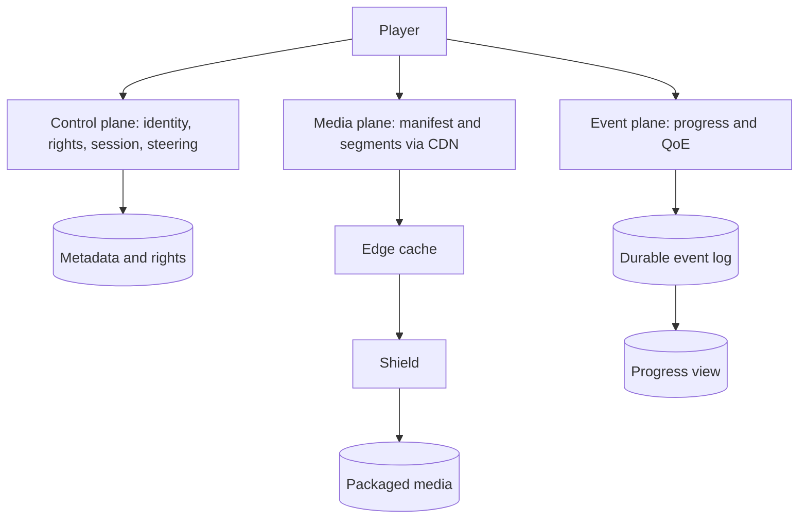

The application API authorizes and steers; it never proxies multi-gigabyte media. That separation makes control-plane CPU and data-plane egress independently scalable.

### 2. Example 1 — capacity proves locality is the architecture

Use decimal network units and write the unit conversion:

\[
T_{Tbps}=\frac{N_{streams}\times bitrate_{Mbps}}{1{,}000{,}000}
\]

| Scenario | Inputs | Result | Design consequence |
|---|---:|---:|---|
| global peak | 60M × 5 Mbps | 300 Tbps | ordinary app servers and a few regions cannot be the media path |
| large region | 1M × 8 Mbps | 8 Tbps | steer by ISP/site health and capacity, not geography alone |
| premiere spike | 2M × 6 Mbps | 12 Tbps | pre-position the predicted hot set before release |
| origin exposure | 100 Tbps viewer traffic, 98.5% byte-hit ratio | 1.5 Tbps cache-miss traffic | a high percentage can still leave enormous origin/shield load |

Request hit ratio is misleading when objects differ greatly in size; operate on byte hit ratio and segment-age cohorts. A shield collapses duplicate fills, while regional/ISP caches localize popular bytes. Netflix's Open Connect material describes appliances placed near viewers and proactive filling; the transferable principle is forecasted placement plus measured fallback, not copying a vendor topology.

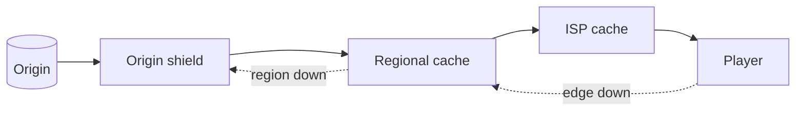

Trace a premiere:

| Time | Event | Guardrail |
|---|---|---|
| T−24 h | planner assigns immutable segment hashes to sites | never place a title where rights forbid delivery |
| T−1 h | fill jobs verify checksum and storage headroom | incomplete renditions stay unpublished |
| T+0 | steering selects a healthy, non-saturated site | capacity token prevents overload amplification |
| T+2 min | one site fails | retry a different site, lower bitrate if throughput falls |
| T+5 min | byte misses exceed budget | shed speculative prefetch and protect shield/origin |

### 3. Example 2 — authorization, signed delivery, and DRM are different controls

`POST /v1/playback-sessions` authenticates the account, resolves profile restrictions and region, checks the versioned rights snapshot, chooses compatible media, and returns a short-lived playback grant. A representative response is:

```json
{
  "sessionId": "ps_7f3",
  "manifestUrl": "https://edge.example/t/a17/master.m3u8?grant=...",
  "expiresAt": "2026-10-21T15:20:00Z",
  "drm": {"licenseUrl": "https://license.example/v1/widevine"},
  "cdnCandidates": ["site-a", "site-b"]
}
```

The token must cover the intended path/asset, expiry, key identifier and policy claims. CDN/origin clocks need bounded skew and signing-key rotation needs an overlap window. The storage origin must reject public access and accept only the delivery service identity; otherwise a user can bypass the signed edge URL. Signing limits distribution authority, while DRM encrypts media and licenses decryption to an approved device/session—neither substitutes for the other.

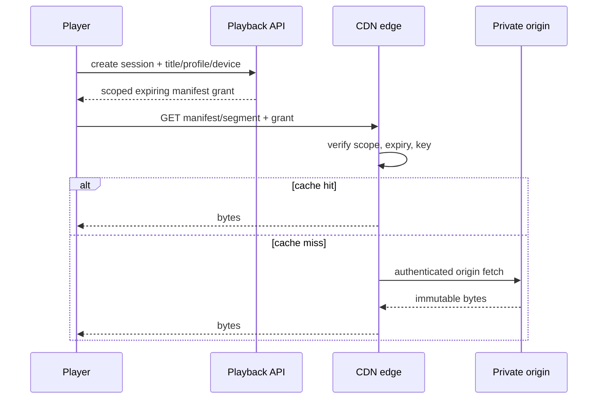

Failure tests: an expired grant returns 403 without origin fetch; a valid grant for another asset fails scope validation; direct origin access fails; rotating keys accept both active keys only during the declared overlap; revocation policy states whether an already-issued short grant may live until expiry.

### 4. Example 3 — adaptive bitrate is a buffer-safety controller

HLS exposes alternative renditions through playlists and ordinary HTTP delivery. The player estimates recent throughput but should not spend the entire estimate: measurement error, shared links and segment-size variance require headroom. A simple teaching policy selects the highest rendition under `estimate × safety`; when the buffer is below eight seconds it caps safety at 0.55.

| Estimate | Buffer | Safety | Budget | Choice from 0.3/1.2/2.5/5 Mbps ladder |
|---:|---:|---:|---:|---|
| 8 Mbps | 20 s | 0.75 | 6 Mbps | 1080p / 5 Mbps |
| 4 Mbps | 20 s | 0.75 | 3 Mbps | 720p / 2.5 Mbps |
| 4 Mbps | 3 s | 0.55 | 2.2 Mbps | 480p / 1.2 Mbps |

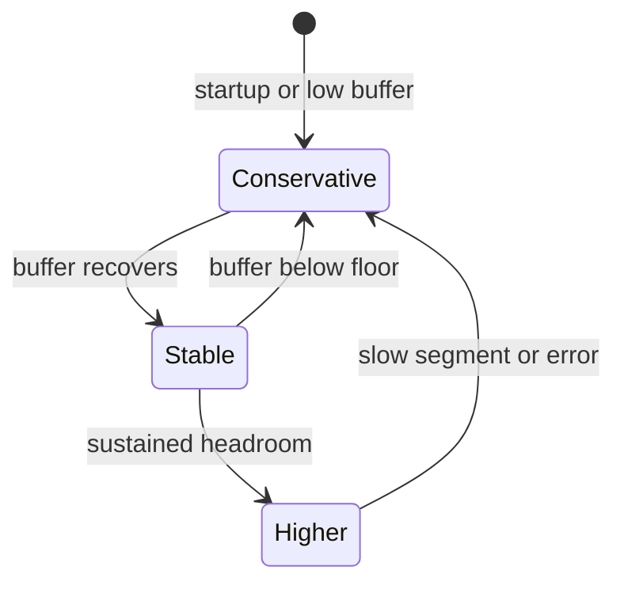

The production controller also accounts for device decode limits, codec/HDR compatibility, segment duration, recent errors and switch hysteresis. Optimize a QoE objective—startup time, rebuffer ratio, failures, sustainable quality and disruptive switches—not maximum pixels. RFC 9317 is useful here because it treats streaming quality as an operational interaction among player, delivery network and access network.

### 5. Example 4 — progress merging must allow a backward seek

Do not merge progress with `max(position)`. A user may deliberately seek backward, and an old retry can carry a larger position than a newer event. Give each playback session a monotonically increasing sequence and use `(profileId, titleId, sessionId, sequence)` as the ordering fact.

| Arrival | Event `(sequence, position)` | Result |
|---|---|---|
| current | `(9, 80s)` | store 80s |
| delayed retry | `(8, 95s)` | ignore stale sequence |
| user seeks backward | `(10, 25s)` | store 25s |
| duplicate | `(10, 25s)` | idempotent no-op |

For multiple devices, define the product rule rather than pretending one clock solves intent: commonly, each session is ordered independently and the resume projection selects the latest accepted event time with bounded clock handling. Keep the immutable event log for replay; build a compact projection for reads. Playback must not wait for this pipeline.

### 6. Media preparation and publication contract

1. Store the pristine mezzanine in durable object storage under immutable identity.
2. Produce a per-title ladder; one fixed ladder wastes bits on simple content and damages complex content.
3. Package aligned HLS/DASH-like segments and manifests, including audio/subtitle variants.
4. Verify checksums, duration alignment, decode compatibility and rights metadata.
5. Atomically move a versioned publication pointer only after all required artifacts pass.
6. Pre-position the hot set; retain origin/shield fallback for the long tail.

Never overwrite published segment bytes in place. Immutable names make caches and retries safe; a new encode publishes a new revision.

### 7. API, storage, and ownership map

```http
GET  /v1/catalog/home?profileId=...
GET  /v1/titles/{titleId}
POST /v1/playback-sessions
GET  /v1/playback-sessions/{sessionId}/manifest
POST /v1/playback-sessions/{sessionId}/progress
```

| Data | System of record | Derived/cached form |
|---|---|---|
| title, tracks, maturity | metadata store | catalog/search projections |
| country/plan/time rights | rights store + versioned snapshots | playback decision cache bounded by policy |
| mezzanine and encoded segments | object storage | shield/edge copies |
| session/grant audit | playback service store | short-lived session cache |
| progress/QoE | durable event log | resume view and analytics |

Multi-GB video never belongs in the metadata database. Segment URLs identify immutable objects; manifests identify a published revision.

### 8. Failure matrix and evidence

| Failure | Expected behavior | Metric/test |
|---|---|---|
| edge unavailable | steer to another healthy site; player may reduce bitrate | failover time, rebuffer delta |
| shield/origin overload | admission control, request collapse, stale immutable edge bytes | origin egress and rejected fills |
| rights store unavailable | fail closed or use explicitly approved bounded snapshot | denial reason and snapshot age |
| progress log delayed | playback continues; client retries idempotently | consumer lag and projection freshness |
| signing key rotation | accept declared overlap, then reject old key | validation counts by key ID |
| bad encode | publication pointer remains on prior good revision | canary decode/checksum failures |

Track startup p50/p95, rebuffer percentage, fatal playback failures by device/ISP/title, sustainable bitrate, switch rate, edge saturation, byte hit ratio, shield collapse ratio, origin egress, rights-decision latency and grant denials. Percentiles need sample counts, and all SLOs need a named measurement window.

### 9. Executable contract

[`VideoPlaybackContracts.java`](VideoPlaybackContracts.java) encodes the four worked examples and boundary failures. Run:

```bash
java -ea study-guides/system-design/blueprints/VideoPlaybackContracts.java
```

The key invariant is subtle: newer progress sequence wins even if its position is smaller.

### 10. Current primary references

- [Netflix Open Connect overview and briefing paper](https://openconnect.netflix.com/en/) — content localization, embedded appliances and proactive delivery.
- [Apple: HTTP Live Streaming](https://developer.apple.com/streaming/) and [HLS Authoring Specification](https://developer.apple.com/documentation/http-live-streaming/hls-authoring-specification-for-apple-devices) — playlist-based adaptive delivery and authoring constraints.
- [RFC 8216: HTTP Live Streaming](https://www.rfc-editor.org/rfc/rfc8216) — protocol semantics for playlists and media segments.
- [RFC 9317: Operational Considerations for Streaming Media](https://www.rfc-editor.org/rfc/rfc9317) — player/network interactions and QoE operations.
- [AWS CloudFront private content](https://docs.aws.amazon.com/AmazonCloudFront/latest/DeveloperGuide/PrivateContent.html) and [signed URLs](https://docs.aws.amazon.com/AmazonCloudFront/latest/DeveloperGuide/private-content-signed-urls.html) — a concrete primary-source example of restricted origins and expiring signed delivery.

### 11. Source provenance and continuation

The confirmed Library source is `top_5_system_design_interview_blueprints.md`, revision 1, SHA-256 `10c3b8139474ea47f35e1fed6cb169b2728db48070f3264e1d23dfa776e9bf03`. This section promotes source lines 5–253 and adds explicit contracts, four worked examples, executable Java, failure tests, and refreshed primary references.

## Blueprint 2 — Real-time ride hailing

### 1. Define “real time” and the ownership boundary

A rider requests a priced trip, the system searches sufficiently fresh available drivers, one driver accepts, both parties observe ordered trip state, and completion triggers one logical payment. “Real time” is not zero latency: give each promise a measurable bound.

| Contract | Example target | Correctness rule |
|---|---:|---|
| driver location | emitted every 4 s; candidate age at decision ≤ 10 s | an older sequence never replaces a newer location; stale drivers are excluded |
| dispatch | accepted offer or explicit no-match within 8 s | a geo result is only a candidate; authoritative state grants ownership |
| offer | expires after 6 s | acceptance after expiry or for a superseded attempt loses |
| trip updates | ordered per trip; reconnect snapshot within 2 s | client applies only a version greater than its last applied version |
| completion/payment | asynchronous after durable trip completion | one stable idempotency key per completion version |

Separate three data classes because they have different durability and consistency needs:

- **location telemetry** is write-heavy, replaceable and TTL-bound;
- **driver/trip ownership** is small, durable and strongly coordinated within a market;
- **events** are durable and replayable for push, payment, support and analytics.

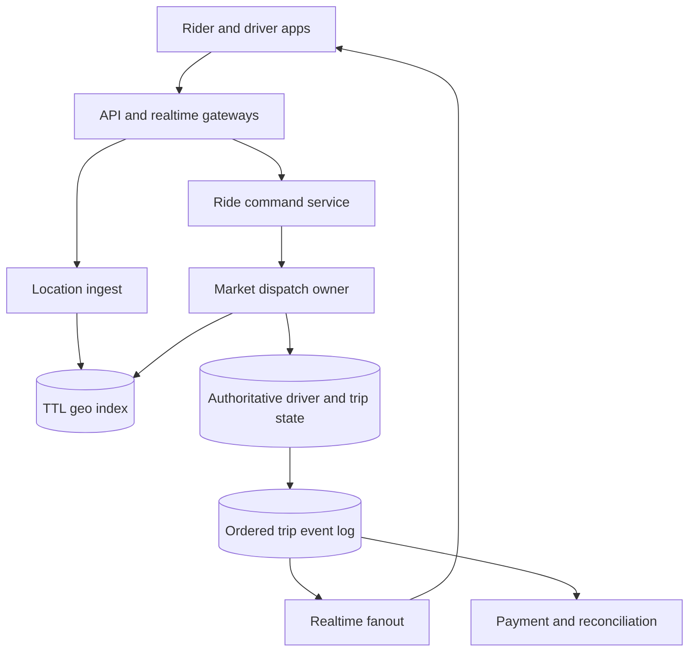

Partition first by market/city because trips are local. Route every command for one trip and its assigned driver to the same home market. Cross-region identity, configuration and analytics can remain global; dispatch ownership should not require a cross-ocean round trip.

### 2. Example 1 — capacity and expanding-cell search

At five million active drivers sending one GPS fix every four seconds:

\[
QPS_{location}=\frac{5{,}000{,}000}{4}=1.25\text{ million updates/s}
\]

If an event averages 180 bytes before replication and indexing, ingress is about 225 MB/s or 19.44 TB/day. Retaining every raw fix for seven days would be roughly 136 TB before replication and compression. The hot path should therefore keep only the latest useful fix per driver with a TTL; a stream/object-store pipeline can retain sampled or policy-approved history separately.

Map a pickup to a cell, inspect nearby cells, filter by freshness and availability, and expand only until the candidate budget or radius limit is met. For an ideal hexagonal disk, `1 + 3k(k + 1)` estimates 1, 7, 19 and 37 cells for rings 0–3. H3 traversal can encounter pentagonal distortion, so that formula is a capacity estimate—not an API cardinality promise.

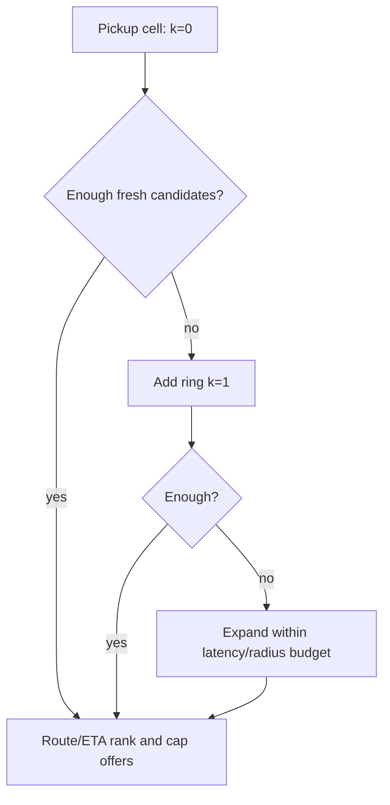

Trace for pickup `p7` at decision time `12:00:10`:

| Candidate | Cell ring | Last fix | Driver state | Result |
|---|---:|---:|---|---|
| d11 | 0 | `12:00:04` | available | keep; age 6 s |
| d12 | 1 | `11:59:57` | available | reject; age 13 s |
| d13 | 1 | `12:00:07` | assigned | reject; geo index is stale |
| d14 | 2 | `12:00:05` | available | keep; then rank by route ETA |

Straight-line or cell distance narrows the set; road ETA makes the final ranking. Cap concurrent offers so one request does not fan out to hundreds of drivers.

### 3. Example 2 — out-of-order location must not move a driver backward

Mobile networks reorder and duplicate uploads. Give each driver session a monotonically increasing sequence and retain both device observation time and server receipt time. The write condition is “newer session/sequence,” not “arrived last.”

| Arrival | Fix `(session, seq, observedAt, cell)` | Stored result |
|---|---|---|
| first | `(s9, 40, 12:00:04, A)` | accept A |
| delayed | `(s9, 39, 12:00:03, B)` | ignore older sequence |
| duplicate | `(s9, 40, 12:00:04, A)` | idempotent no-op |
| new | `(s9, 41, 12:00:08, C)` | replace with C |

On a driver-app restart, issue a new server-authorized session/epoch; otherwise sequence `1` could lose forever to the previous session's `41`. Do not trust a handset clock alone for freshness. Reject implausible future timestamps, bound clock skew, and use server receipt time to enforce a conservative TTL.

The geo index is a disposable projection. Update the latest-location record and cell membership idempotently; periodic repair removes a driver from an old cell if a crash occurs between those operations. Dispatch still checks authoritative availability before offering.

### 4. Example 3 — the offer is not the assignment

Two riders can see the same available driver in a slightly stale geo index. Only one transactional compare-and-set may move that driver from `AVAILABLE` to `ASSIGNED` and bind the trip in the same commit.

```mermaid
sequenceDiagram
  participant A as Trip A dispatch
  participant B as Trip B dispatch
  participant S as Driver state
  participant D as Driver
  A->>D: offer A (attempt a7, expires 10:00:06)
  B->>D: offer B (attempt b3, expires 10:00:06)
  D->>A: accept a7
  D->>B: accept b3
  par competing commits
    A->>S: claim d9 if AVAILABLE/version 22
    B->>S: claim d9 if AVAILABLE/version 22
  end
  S-->>A: 1 row updated; commit trip A
  S-->>B: 0 rows; re-dispatch trip B
```

A representative relational claim is:

```sql
UPDATE driver_state
SET status = 'ASSIGNED', active_trip_id = :trip_id, version = version + 1
WHERE market_id = :market_id
  AND driver_id = :driver_id
  AND status = 'AVAILABLE'
  AND version = :expected_version
RETURNING version;
```

The trip binding and an outbox event belong in the same database transaction. A zero-row result is an ordinary conflict, not an error to paper over. The acceptance endpoint also validates rider/trip, driver, attempt ID and expiry, and uses the request idempotency key so a timeout retry returns the original result.

Critical trace: the database commits Trip A, but the response is lost. The driver retries `accept(a7)` with the same key. The server reads the stored outcome and returns Trip A; it does not try another claim. If Trip B retries, its stored conflict remains a conflict.

### 5. Example 4 — reconnect from snapshot plus ordered replay

WebSocket provides a bidirectional transport, not application-level exactly-once delivery or durable catch-up. Persist a monotonic trip version with every state transition; push is only a low-latency delivery path.

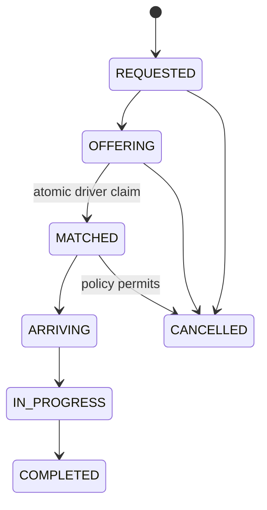

Suppose a rider has applied version 17, disconnects, and the server reaches version 20:

| Step | Server/client action | Outcome |
|---|---|---|
| 1 | server commits v18 `DRIVER_ARRIVING` and v19 `DRIVER_AT_PICKUP` | durable before push |
| 2 | client reconnects with `lastApplied=17` | gateway authenticates trip membership |
| 3 | API returns snapshot v20 `IN_PROGRESS` | client atomically installs v20 |
| 4 | delayed push v19 arrives | ignored because `19 <= 20` |
| 5 | push v21 `COMPLETED` arrives twice | first applies; duplicate is ignored |

Snapshot-first recovery bounds event retention and avoids a replay/snapshot race: obtain a snapshot version, then subscribe or fetch events strictly after that version. Partition trip events by `trip_id` if using a log whose ordering guarantee is per partition.

Completion records an outbox message with stable key `payment:{tripId}:v{completionVersion}`. The payment worker retries uncertain failures with that same key, stores provider outcome, and reconciles pending attempts. Broker delivery claims alone cannot make an external charge exactly once.

### 6. API, data model, and command rules

```http
POST /v1/rides                         Idempotency-Key: rider-generated UUID
GET  /v1/rides/{rideId}
POST /v1/drivers/{driverId}/locations  driverSession + sequence
POST /v1/offers/{offerId}/accept       Idempotency-Key: offer-attempt ID
POST /v1/rides/{rideId}/cancel         expected trip version
GET  /v1/rides/{rideId}/snapshot       returns trip version
```

| Record | Essential fields | Authority/retention |
|---|---|---|
| `DriverLocation` | driver, session, seq, lat/lon, cell, observed/received time | latest projection with short TTL |
| `DriverState` | market, driver, status, active trip, version | authoritative durable row |
| `Trip` | rider, driver, pickup/destination, quote revision, status, version | authoritative durable row |
| `OfferAttempt` | offer, trip, driver, attempt, expiry, result | durable through retry window |
| `TripEvent` | trip, version, type, payload, time | durable replay/audit log |
| `Outbox` | event ID, aggregate/version, payload, publish state | same commit as authoritative change |

Never expose precise driver coordinates to unrelated riders. Authenticate driver devices, authorize every trip subscription, limit location precision and retention, encrypt transport/storage, and audit privileged access.

### 7. Failure matrix and operational evidence

| Failure | Safe behavior | Evidence |
|---|---|---|
| location ingest delayed | exclude fixes beyond the freshness bound; widen search only within latency budget | candidate-age histogram and stale-exclusion count |
| geo projection loses membership | repair from latest-location records; authoritative state still blocks double assignment | projection drift sample and repair lag |
| dispatch dies after claim commit | retry reads idempotent outcome; outbox republishes committed match | unknown-outcome reconciliation age |
| hot downtown cell | split worker ownership, batch ingestion, cap offers and apply backpressure | per-cell QPS/skew and queue age |
| gateway fleet restarts | jitter reconnects, admit gradually, snapshot then resume | reconnect rate and recovery p95 |
| payment timeout | same idempotency key; mark pending and reconcile provider state | pending age and duplicate-charge invariant |
| market region impaired | protect active trips; stop new dispatch before accepting ownership unsafely | failover drill and active-trip recovery time |

Alert on location-ingest lag, candidate age, match latency p50/p95/p99, no-match rate, search-ring distribution, claim conflicts, expired accepts, trip-version gaps, reconnect recovery, outbox age and payment reconciliation age. A double-assigned driver or duplicate charge is a correctness incident even when latency SLOs are green.

### 8. Executable contract

[`RideHailingContracts.java`](RideHailingContracts.java) exercises cell-count estimation, stale/out-of-order location handling, single-winner assignment, ordered reconnect state and stable payment keys. Run:

```bash
java -ea study-guides/system-design/blueprints/RideHailingContracts.java
```

The tests deliberately model a lost response after commit: retrying the same offer attempt returns the same winning trip, while a competing attempt remains rejected.

### 9. Current primary references

- [H3 introduction](https://h3geo.org/docs/) and [grid traversal API](https://h3geo.org/docs/api/traversal/) — hierarchical cells, nearby-cell traversal and documented distortion limits.
- [Uber Engineering: H3 spatial index](https://www.uber.com/us/en/blog/h3/) — the source system's public origin and marketplace/geospatial motivation.
- [Redis `GEOSEARCH`](https://redis.io/docs/latest/commands/geosearch/) — one concrete proximity-index implementation; it does not replace authoritative driver state.
- [PostgreSQL `UPDATE`](https://www.postgresql.org/docs/current/sql-update.html) and [concurrency control](https://www.postgresql.org/docs/current/mvcc.html) — conditional row updates and concurrent transaction behavior.
- [Apache Kafka introduction](https://kafka.apache.org/documentation/) — ordering within a topic-partition; key trip events consistently if that guarantee is used.
- [RFC 6455: WebSocket](https://www.rfc-editor.org/rfc/rfc6455) — bidirectional transport protocol; replay and application ordering remain application responsibilities.
- [Stripe idempotent requests](https://docs.stripe.com/api/idempotent_requests) — a primary-source example of safe request retries with a stable idempotency key.

### 10. Source provenance and continuation

The confirmed Library source remains `top_5_system_design_interview_blueprints.md`, revision 1, SHA-256 `10c3b8139474ea47f35e1fed6cb169b2728db48070f3264e1d23dfa776e9bf03`. This section promotes exactly source lines 254–459 and adds measurable requirements, four worked traces, executable Java, failure evidence and primary-source verification refreshed on 2026-10-22. Source Blueprint 3 begins at line 460 and is promoted in the next section below. The five-blueprint collection is not complete.

## Blueprint 3 — Distributed financial transaction ledger

### 1. Make the correctness boundary explicit

The authoritative ledger accepts a money-moving command, writes an immutable balanced journal transaction, and returns one durable logical result for every idempotency scope/key. Balance and history reads may use projections, but a projection never becomes the authority for whether money moved. When certainty and availability conflict, an unknown write waits for recovery or reconciliation; it is not guessed into success or retried under a fresh identity.

| Contract | Required behavior | Rejected shortcut |
|---|---|---|
| amount | positive integer minor units or an exact decimal with declared scale; one currency per journal transaction | binary floating point |
| journal | at least two entries; signed sum is exactly zero; posted entries are immutable | updating a balance without durable entries |
| retry | unique `(scope, idempotencyKey)` stores request hash and canonical outcome | a new key after timeout |
| concurrency | debit availability and all journal/outbox rows commit in one local transaction | check-then-write in separate transactions |
| external rail | stable provider operation key; timeout becomes `UNKNOWN` until queried/reconciled | assuming timeout means failure |
| publication | journal and outbox commit together; consumers deduplicate event IDs | database write followed by best-effort publish |

Separate ownership so the central invariant stays small:

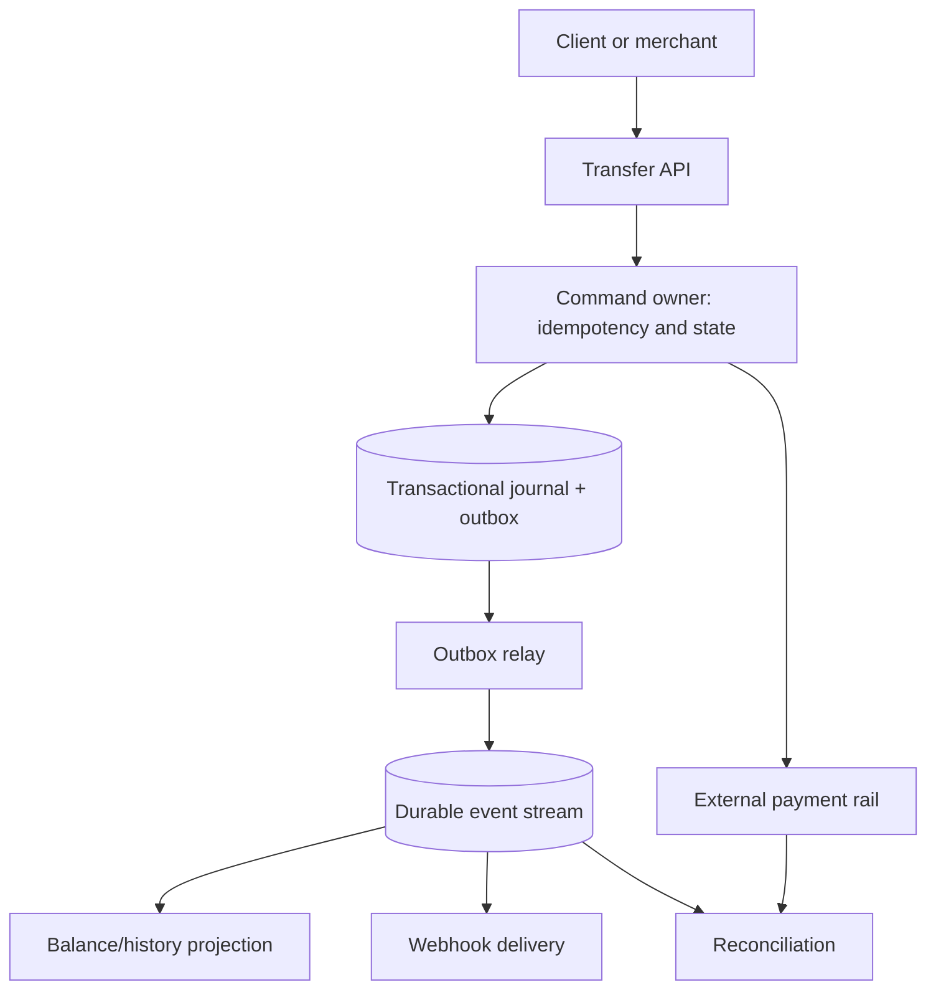

The journal commit is the authority for internal transfers. A card/bank rail has its own authority, so orchestration records a durable attempt state and later reconciles the two systems instead of pretending they share one atomic database transaction.

### 2. Example 1 — balance a transfer, then derive the view

For a USD 12.50 transfer from merchant A to customer B, record signed minor units:

| Transaction | Account | Currency | Amount |
|---|---|---|---:|
| `txn_100` | `merchant:A` | USD | −1250 |
| `txn_100` | `customer:B` | USD | +1250 |
| invariant |  | USD | **0** |

Do not insert one row and hope the second insert succeeds. In one transaction, insert the transaction header, both entries, the idempotency outcome, and an outbox row; commit only after the balance and currency checks pass.

```sql
BEGIN;
INSERT INTO ledger_transaction(txn_id, scope, idem_key, request_hash, status)
VALUES (:txn, :scope, :key, :hash, 'POSTED');
INSERT INTO ledger_entry(txn_id, account_id, currency, amount_minor, entry_no)
VALUES (:txn, 'merchant:A', 'USD', -1250, 1),
       (:txn, 'customer:B', 'USD',  1250, 2);
INSERT INTO outbox(event_id, aggregate_id, aggregate_version, event_type, payload)
VALUES (:event, :txn, 1, 'LedgerPosted', :payload);
COMMIT;
```

An application check is useful, but a production design also needs a database-enforced posting boundary—for example a stored posting procedure, deferred constraint trigger, or staged transaction that cannot change to `POSTED` until its currency-local sum is zero. `BIGINT` arithmetic can overflow, so use checked arithmetic and declare maximum amounts; exact `NUMERIC(p,s)` is the alternative when fractional rules do not map cleanly to one minor-unit scale.

Balance is then a derived sum of posted entries. A cached balance of 8,750 minor units is repairable; the two immutable entries are the evidence.

### 3. Example 2 — a lost response replays one logical transfer

The client sends key `k-1`; the server commits `txn_100`, but the response is lost. The same request and key must return `txn_100` without another pair of entries or outbox event. Reusing `k-1` with amount 1,251 must fail because the stored request hash differs.

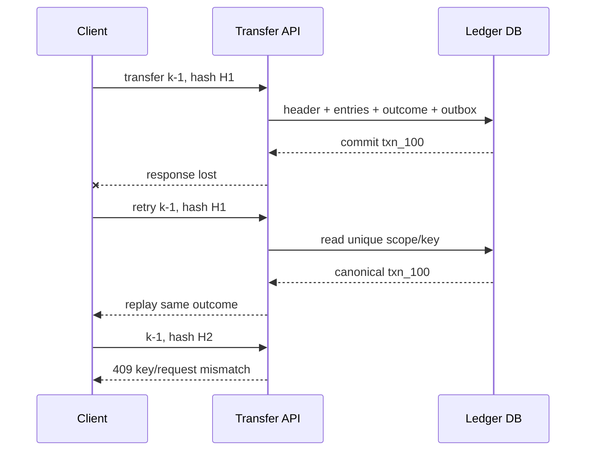

Store canonical request bytes or a stable versioned hash. A hash built from ad-hoc JSON serialization is unsafe because field order, omitted defaults and serializer upgrades can change it. Scope keys by merchant/account and retain them at least as long as clients are allowed to retry; document what happens after expiry.

### 4. Example 3 — concurrent debits need one serialized decision

Wallet W has 1,000 minor units. Transfers A and B each try to debit 700 after both read 1,000. If they perform separate check-then-insert transactions, both may post and the wallet becomes −400.

| Step | Transfer A | Transfer B |
|---|---|---|
| 1 | reads available 1000 | reads available 1000 |
| 2 | claims/post 700 | waits or receives serialization conflict |
| 3 | commits; available becomes 300 | retries, reads 300, rejects insufficient funds |

Viable implementations include a conditional account-state update with a version/available predicate, a row lock around the debit and journal posting, or a serializable transaction with bounded retry. Choose one and test it under contention. If a transfer locks two accounts, acquire locks in a stable global order to reduce deadlocks. Sharding must preserve the same ownership rule: route an account to a home shard, or introduce an explicit cross-shard protocol and accept its availability/latency cost.

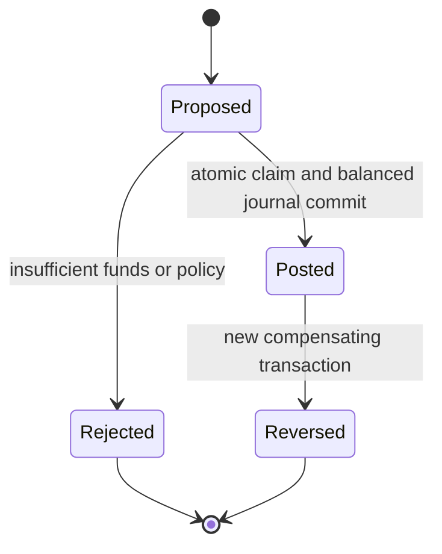

A reversal never edits or deletes the original entries. It posts a linked compensating transaction so both business history and the accounting trail remain explainable.

### 5. Example 4 — timeout to an external rail is `UNKNOWN`, not failed

Suppose internal operation `op_7` sends an authorization under provider key `rail:op_7`; the rail commits but the connection times out. Retrying with a new key can double-charge. Mark the attempt `UNKNOWN`, retry/query only with the stable key where supported, consume signed provider events idempotently, and reconcile until the external authority is known.

| Time | Internal state | Evidence/action |
|---|---|---|
| T0 | `CREATED` | durable operation and provider key |
| T1 | `SENT` | request attempt recorded |
| T2 | `UNKNOWN` | timeout; no success/failure assumption |
| T3 | `UNKNOWN` | duplicate webhook event ID ignored |
| T4 | `SUCCEEDED` | provider query/settlement record confirms charge |
| T5 | projected | one inbox event updates balance and merchant webhook |

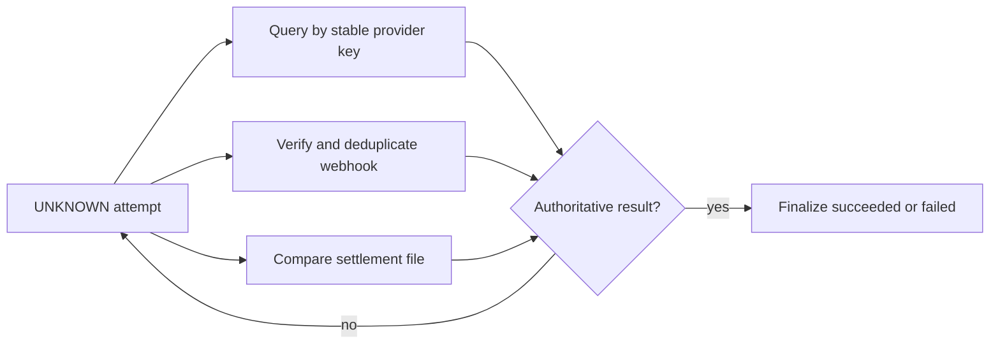

The outbox relay may publish more than once. Every downstream projection therefore keeps an inbox/processed-event record in the same local transaction as its update. Replay from the immutable stream must reproduce the same balance; periodically compare journal-derived totals, projections and provider settlement records, and route differences to an explicit exception queue.

### 6. Capacity, partitioning, and read paths

At 25,000 transfers/s with four journal entries per transfer, the journal receives 100,000 entry inserts/s. If a stored entry plus indexes averages 320 bytes, raw entry growth is about 32 MB/s, 2.76 TB/day, before replication, outbox, backups and transaction metadata. This arithmetic requires partitioning and lifecycle plans, but it does not justify weakening the invariant.

Partition by a stable ownership key and keep an account's conflicting commands at one authority. Hot merchant accounts may require sub-ledgers with an explicit aggregation invariant; simply hashing every transaction can scatter one account's spend decisions and reintroduce overspending. Serve statements and dashboards from replayable projections, with a visible freshness/version marker; use the journal for authoritative investigation and repair.

Core records:

```text
LedgerTransaction(txn_id, scope, idem_key, request_hash, type, state, created_at)
LedgerEntry(txn_id, entry_no, account_id, currency, amount_minor, created_at)
AccountState(account_id, currency, available_minor, version)
Outbox(event_id, aggregate_id, aggregate_version, payload, published_at)
Inbox(consumer, event_id, processed_at)
RailAttempt(operation_id, provider_key, state, provider_reference, version)
ReconciliationException(id, source, expected, observed, state)
```

### 7. Failure matrix and operational evidence

| Failure | Safe behavior | Evidence |
|---|---|---|
| response lost after commit | replay canonical outcome for same key/hash | replay count; duplicate-effect invariant |
| outbox relay crashes after publish | publish again; consumer inbox deduplicates | oldest unpublished age; duplicate deliveries |
| projection falls behind | journal remains authoritative; expose staleness | consumer lag and projection version |
| database primary fails mid-write | transaction is committed or absent; recover before deciding | recovery drill and uncertain-write count |
| processor timeout | `UNKNOWN`; same provider key; query/reconcile | unknown-attempt age histogram |
| settlement disagrees | preserve both facts; open exception | break count/value by rail and age |
| hot account saturates shard | admission control and ordered queue; no unsafe fail-open | per-account skew, conflict/retry rate |

Alert immediately on any posted transaction whose entries do not sum to zero, mixed-currency posting, duplicate logical effect, negative balance where disallowed, journal/projection checksum divergence, or one provider key linked to multiple operations. Track posting p50/p95/p99, serialization retries, idempotency replays/mismatches, outbox age, consumer lag, unknown rail age, reconciliation breaks and recovery objectives. Monetary totals need currency-local aggregation; never sum USD and EUR into one number.

### 8. Executable contract

[`FinancialLedgerContracts.java`](FinancialLedgerContracts.java) exercises balanced posting, replay under a stable idempotency key, key/request mismatch rejection, a contested debit, stable external-rail identity, unknown-state reconciliation, consumer deduplication, mixed-currency rejection and invalid amounts. Run:

```bash
java -ea study-guides/system-design/blueprints/FinancialLedgerContracts.java
```

The synchronized in-memory method models one database transaction for teaching; it is not a claim that JVM locking coordinates a fleet.

### 9. Current primary references

- [Stripe idempotent requests](https://docs.stripe.com/api/idempotent_requests) and [advanced error handling](https://docs.stripe.com/error-low-level) — stable retry identity and indeterminate outcomes after network/server errors.
- [Stripe webhook endpoint guidance](https://docs.stripe.com/events/manage-webhook-endpoints) — duplicate events and consumer-side event tracking.
- [PostgreSQL numeric types](https://www.postgresql.org/docs/current/datatype-numeric.html) — exact numeric types and precision/scale behavior.
- [PostgreSQL transaction isolation](https://www.postgresql.org/docs/current/transaction-iso.html) — serialization anomalies, guarantees and retry-relevant failures.
- [AWS Prescriptive Guidance: transactional outbox](https://docs.aws.amazon.com/prescriptive-guidance/latest/cloud-design-patterns/transactional-outbox.html) — atomic database/outbox writes plus duplicate-aware consumers.

### 10. Source provenance and continuation

The confirmed Library source remains `top_5_system_design_interview_blueprints.md`, revision 1, SHA-256 `10c3b8139474ea47f35e1fed6cb169b2728db48070f3264e1d23dfa776e9bf03`. This bounded pass promotes exactly source lines 460–680 and adds measurable contracts, four worked examples, executable invariants, failure evidence and primary-source verification refreshed on 2026-10-23. Source Blueprint 4 begins at line 681 and remains queued after fair domain rotation. The five-blueprint collection is not complete.

## Blueprint 4 — Large-scale, polite web crawler

### 1. Define the safety and ownership contracts first

The crawler discovers HTTP(S) URLs from approved seeds, sitemaps and fetched documents; normalizes fetch identity; consults the applicable robots policy; schedules fairly; fetches within strict network and byte limits; stores evidence; extracts links; and chooses a bounded recrawl time. Discovery is not permission to fetch, a fetched page is not automatically indexable, and `robots.txt` is not an authorization mechanism.

| Contract | Required behavior | Unsafe shortcut |
|---|---|---|
| URL identity | resolve against the document base; lowercase scheme/host; remove default port, dot segments and fragment; preserve unknown query semantics | sort/drop every query parameter |
| origin ownership | one scheduler owner coordinates `(scheme, host, effective port)` delay and concurrency | partition only by full-URL hash |
| robots | cache policy by origin and user-agent; longest matching rule wins; refresh with bounded staleness | fetch robots for every page or treat it as access control |
| fetch safety | allow HTTP(S), validate the address actually connected to, block private/link-local/loopback destinations, cap redirects/time/bytes | validate only the first hostname before redirects |
| delivery | leased work is at-least-once; content storage and downstream parsing are idempotent | assume a queue makes fetching exactly once |
| recrawl | base the next time on observed change, freshness demand, cache validators and failures | fixed interval for every URL |

Align the partition key with the politeness invariant:

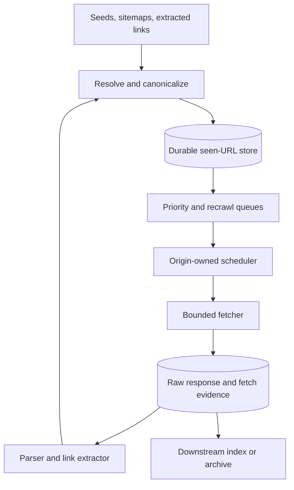

The durable seen set gives exact admission decisions. A Bloom filter can protect it from obvious misses but must not silently become the only record if false-positive URL loss is unacceptable.

### 2. Example 1 — canonicalization and deduplication without changing meaning

Resolve relative links before canonicalizing. For the base `https://Example.COM/a/b/`, the reference `../c#section` becomes `https://example.com/a/c`: the host is case-insensitive, the dot segment is removed, and the fragment is not part of HTTP fetch identity. `https://example.com:443/a/c` maps to the same key because 443 is the HTTPS default.

| Candidate | Canonical fetch key | Decision |
|---|---|---|
| `https://Example.COM:443/a/../b#top` | `https://example.com/b` | admit once |
| `https://example.com/b#comments` | `https://example.com/b` | duplicate fetch identity |
| `https://example.com/?b=2&a=1` | unchanged query | distinct unless site-specific evidence says otherwise |
| `https://example.com/?a=1&b=2` | unchanged query | distinct by conservative default |

Do not decode reserved characters, collapse meaningful repeated slashes, or globally sort/delete query parameters. RFC 3986 supplies generic equivalences; application-specific query equivalence needs an explicit host policy backed by evidence. Store the original discovery URL and source edge beside the canonical key so a bad normalization rule can be audited and replayed.

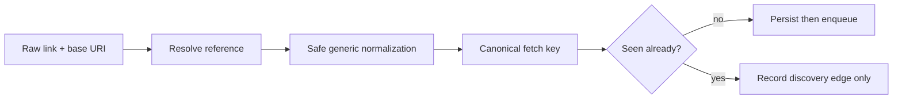

### 3. Example 2 — priority cannot bypass per-origin politeness

Assume global priorities put two `example.com` URLs ahead of all other work. The scheduler allows one concurrent request per origin and a 1,000 ms minimum delay:

| Time | Event | Origin state/result |
|---:|---|---|
| 1,000 ms | lease `/one` for 5 s | in-flight = 1 |
| 1,001 ms | try `/two` | denied; concurrency already consumed |
| 1,200 ms | `/one` completes 200 | next allowed = 2,200 ms |
| 2,199 ms | try `/two` | denied; delay not elapsed |
| 2,200 ms | lease `/two` | allowed |

Global front queues rank importance/freshness; origin queues enforce eligibility. A worker leases a bounded batch and acknowledges after the raw response plus fetch record are durable. If it dies, lease expiry makes the item visible again, so duplicate fetches are expected and downstream writes use stable fetch identities.

At 250,000 fetches/s and 80 KiB average compressed bodies, ingress is about 20.48 GB/s or 1.77 PB/day before replication and metadata. If only 8% of pages change and policy retains unchanged bodies by reference, the changed-body component is about 142 TB/day. Write the retention horizon, replication factor and compression basis next to every storage estimate.

### 4. Example 3 — robots and overload responses modify eligibility

RFC 9309 scopes robots policy to the service that serves `/robots.txt`; cache it using normal HTTP cache controls, follow the specified redirect/error behavior, and apply the most specific matching rule for the crawler's user-agent. Given:

```text
Disallow: /private
Allow:    /private/public
```

`/private/report` is ineligible while `/private/public/index.html` is eligible because the longer matching path wins. A robots fetch failure needs an explicit state and policy; it must not be confused with an empty allow-all file.

When an eligible fetch returns 429 or 503 with `Retry-After: 10`, the origin owner moves `next_allowed_fetch_at` at least ten seconds forward. Without the header it applies capped exponential backoff with jitter. A queue retry that ignores this shared state simply shifts overload between workers.

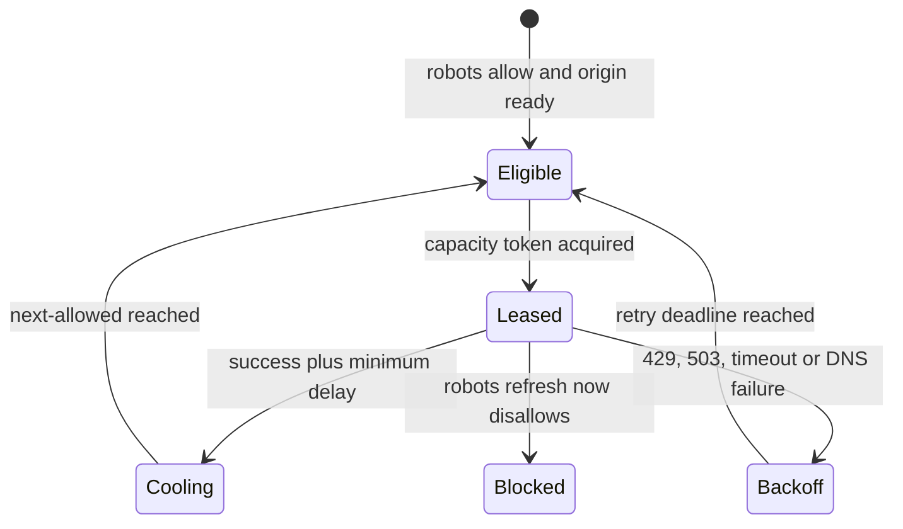

Robots rules do not protect secrets: an operator must authenticate private resources. Likewise, a crawler may store a public response yet exclude it from indexing because of separate content directives or product policy.

### 5. Example 4 — safe fetch, conditional recrawl and redirect trace

An internet crawler is an SSRF-capable system by design. Isolate it from control-plane credentials and private networks; allow only HTTP(S); resolve A and AAAA records; reject loopback, private, link-local, multicast and platform metadata destinations; and ensure the validated address is the one the client connects to. Repeat the full check after every redirect, cap redirect count, and reject protocol changes outside policy.

Trace a recrawl of `https://news.example/story`:

| Step | Request/evidence | Safe decision |
|---|---|---|
| 1 | prior record has ETag `"v7"`, body hash H7 | send `If-None-Match: "v7"` |
| 2 | origin returns 304 | retain H7; update fetch evidence, not body bytes |
| 3 | next response redirects to `http://169.254.169.254/...` | reject after destination validation; do not follow |
| 4 | later 200 has ETag `"v8"`, hash H8 | store immutable body, parse once by `(URL, H8)` |
| 5 | H8 differs from H7 | shorten the next base interval; failures multiply it with a cap |

HTTP validators reduce transferred bytes, not scheduling work: a 304 still consumes origin capacity. Treat sitemap `lastmod` as a hint and measure its reliability per source. JavaScript rendering is a separate, much smaller budget selected after cheap HTML signals; renderer workers inherit the same destination and response limits.

### 6. Records, APIs and idempotent stages

```text
Url(url_hash, canonical_url, origin_id, first_seen, last_seen, priority)
Origin(origin_id, robots_version, next_allowed, max_concurrency, error_score)
Frontier(url_hash, due_at, priority, lease_owner, lease_expiry, attempt)
Fetch(fetch_id, url_hash, requested_at, final_url, status, validators, body_hash, bytes)
Content(body_hash, object_key, media_type, length)
LinkEdge(source_fetch_id, target_url_hash, relation)
```

`POST /discoveries` accepts a stable source-fetch ID plus extracted references; the normalizer inserts URL and edge records idempotently. Fetchers lease with compare-and-set ownership. The content object key is its cryptographic hash, so a retry cannot create a second logical body. Parsing deduplicates on `(parserVersion, bodyHash)` while index publication uses `(urlHash, fetchVersion)`.

Partition frontier ownership by origin hash, then keep multiple priority/time buckets inside that owner. Hot origins scale only up to their declared concurrency; adding workers must never multiply politeness capacity. Separate scheduler lag, network time, parser lag and indexing lag so one healthy aggregate does not hide a broken stage.

### 7. Failure matrix and operational evidence

| Failure | Safe behavior | Evidence |
|---|---|---|
| worker dies after fetch | lease expires; refetch allowed; content/parser writes deduplicate | expired lease age and duplicate-fetch rate |
| robots policy stale | revalidate; retain version used for every decision | robots age, status and blocked-fetch audit |
| DNS rebinding or redirect to private IP | bind connection to validated public address; validate every hop | rejection reason, resolved address and redirect chain |
| origin sends endless/huge body | header/read deadline, compressed and expanded byte caps, abort | bytes rejected and timeout phase |
| 429/503 spike | honor `Retry-After`, reduce origin concurrency, jittered backoff | per-origin status rate and next-allowed time |
| poison parse/render input | sandbox, CPU/memory/depth deadline, quarantine sample | parser version, failure fingerprint and queue age |
| frontier shard unavailable | stop issuing its host leases until ownership is fenced | epoch/lease conflicts and recovery time |

Operate on pages/s and bytes/s, but also per-origin concurrency/delay violations, robots decisions, frontier due-time lag, lease expiries, redirect blocks, status families, DNS/TLS/connect/header/body latency, compressed/expanded bytes, content-change rate, duplicate URL/body rate, render admission and end-to-end freshness percentiles. Any private-address connection or robots-disallowed fetch is a correctness incident.

### 8. Executable contract

[`WebCrawlerContracts.java`](WebCrawlerContracts.java) exercises conservative URL identity, exact admission deduplication, longest-match robots decisions, priority ordering, origin-scoped concurrency/delay, `Retry-After`, public-address boundaries and adaptive recrawl delay. Run:

```bash
java -ea study-guides/system-design/blueprints/WebCrawlerContracts.java
```

The address helper intentionally validates numeric literals only. Production code must resolve every hostname, validate all A/AAAA answers, and bind the HTTP connection to a validated address; a separate preflight lookup is not sufficient against DNS rebinding.

### 9. Current primary references

- [RFC 9309: Robots Exclusion Protocol](https://www.rfc-editor.org/rfc/rfc9309) — matching, caching, redirects and unavailable-policy behavior; robots is not access control.
- [RFC 3986: URI Generic Syntax](https://www.rfc-editor.org/rfc/rfc3986) — reference resolution, dot-segment removal, fragments and scheme-based normalization.
- [RFC 9110: HTTP Semantics](https://www.rfc-editor.org/rfc/rfc9110) and [RFC 9111: HTTP Caching](https://www.rfc-editor.org/rfc/rfc9111) — `Retry-After`, validators, 304 responses and cache revalidation.
- [Google Crawling Infrastructure: crawl budget](https://developers.google.com/crawling/docs/crawl-budget) — host capacity and demand/freshness as separate scheduling inputs.
- [OWASP SSRF Prevention Cheat Sheet](https://cheatsheetseries.owasp.org/cheatsheets/Server_Side_Request_Forgery_Prevention_Cheat_Sheet.html) — address validation, DNS rebinding and binding the connection to the validated destination.
- [Java SE 17 `URI`](https://docs.oracle.com/en/java/javase/17/docs/api/java.base/java/net/URI.html) — dependency-free reference resolution and path normalization used by the executable teaching contract.

### 10. Source provenance and continuation

The confirmed Library source remains `top_5_system_design_interview_blueprints.md`, revision 1, SHA-256 `10c3b8139474ea47f35e1fed6cb169b2728db48070f3264e1d23dfa776e9bf03`. This bounded pass promotes exactly source lines 681–902 and adds explicit safety contracts, four worked traces, executable Java, capacity arithmetic, failure evidence and primary-source verification refreshed on 2026-10-23. Source Blueprint 5 begins at line 903 and remains queued. The five-blueprint collection is not complete.
