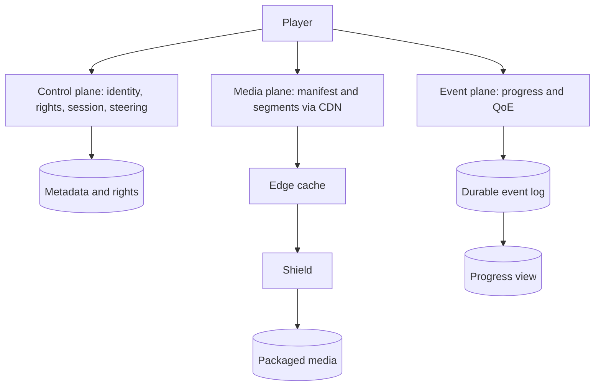
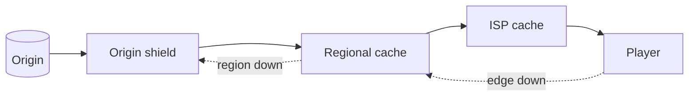
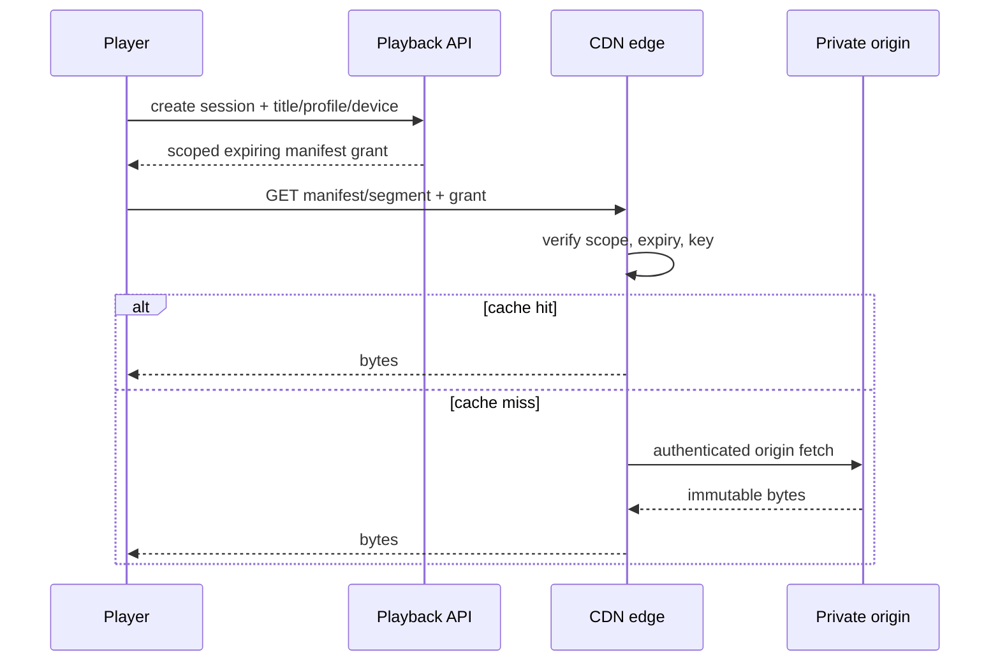
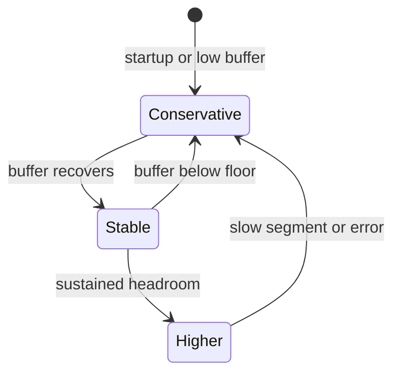

# System Design Blueprints

This is the canonical incremental guide. Each blueprint must make its requirements, arithmetic, ownership boundaries, failure behavior, and verification evidence explicit. This pass processes only source Blueprint 1 (lines 5–253); the ride-hailing blueprint begins the next source section.

## Blueprint 1 — Global video streaming

### 1. Frame the problem before drawing boxes

The service must let a permitted profile browse, start, pause, seek, switch device, and resume a title with multiple audio/subtitle tracks. A studio path must ingest a pristine master, encode device-compatible renditions, package segments and publish them. The design must keep startup and rebuffering low under regional spikes, survive edge/origin failures, and prevent unauthorized playback.

State the consistency contract per fact:

| Fact | Required behavior | Why |
|---|---|---|
| entitlement and regional availability | fail closed; bounded-stale policy only if explicitly approved | a stale allow can violate licensing |
| manifest/segment grant | short-lived, scoped to asset/session/region; origin accepts only CDN identity | a signed URL is bearer authority, not DRM |
| catalog snapshot | versioned and atomically published | clients must not mix partial rights/config revisions |
| progress | eventually visible; newest per-session sequence wins | retries and device networks reorder events; backward seek is valid |
| recommendations/QoE analytics | eventual and replayable | loss or duplication should not block playback |

Three planes prevent the most common architecture mistake:



The application API authorizes and steers; it never proxies multi-gigabyte media. That separation makes control-plane CPU and data-plane egress independently scalable.

### 2. Example 1 — capacity proves locality is the architecture

Use decimal network units and write the unit conversion:

\[
T_{Tbps}=\frac{N_{streams}\times bitrate_{Mbps}}{1{,}000{,}000}
\]

| Scenario | Inputs | Result | Design consequence |
|---|---:|---:|---|
| global peak | 60M × 5 Mbps | 300 Tbps | ordinary app servers and a few regions cannot be the media path |
| large region | 1M × 8 Mbps | 8 Tbps | steer by ISP/site health and capacity, not geography alone |
| premiere spike | 2M × 6 Mbps | 12 Tbps | pre-position the predicted hot set before release |
| origin exposure | 100 Tbps viewer traffic, 98.5% byte-hit ratio | 1.5 Tbps cache-miss traffic | a high percentage can still leave enormous origin/shield load |

Request hit ratio is misleading when objects differ greatly in size; operate on byte hit ratio and segment-age cohorts. A shield collapses duplicate fills, while regional/ISP caches localize popular bytes. Netflix's Open Connect material describes appliances placed near viewers and proactive filling; the transferable principle is forecasted placement plus measured fallback, not copying a vendor topology.



Trace a premiere:

| Time | Event | Guardrail |
|---|---|---|
| T−24 h | planner assigns immutable segment hashes to sites | never place a title where rights forbid delivery |
| T−1 h | fill jobs verify checksum and storage headroom | incomplete renditions stay unpublished |
| T+0 | steering selects a healthy, non-saturated site | capacity token prevents overload amplification |
| T+2 min | one site fails | retry a different site, lower bitrate if throughput falls |
| T+5 min | byte misses exceed budget | shed speculative prefetch and protect shield/origin |

### 3. Example 2 — authorization, signed delivery, and DRM are different controls

`POST /v1/playback-sessions` authenticates the account, resolves profile restrictions and region, checks the versioned rights snapshot, chooses compatible media, and returns a short-lived playback grant. A representative response is:

```json
{
  "sessionId": "ps_7f3",
  "manifestUrl": "https://edge.example/t/a17/master.m3u8?grant=...",
  "expiresAt": "2026-10-21T15:20:00Z",
  "drm": {"licenseUrl": "https://license.example/v1/widevine"},
  "cdnCandidates": ["site-a", "site-b"]
}
```

The token must cover the intended path/asset, expiry, key identifier and policy claims. CDN/origin clocks need bounded skew and signing-key rotation needs an overlap window. The storage origin must reject public access and accept only the delivery service identity; otherwise a user can bypass the signed edge URL. Signing limits distribution authority, while DRM encrypts media and licenses decryption to an approved device/session—neither substitutes for the other.



Failure tests: an expired grant returns 403 without origin fetch; a valid grant for another asset fails scope validation; direct origin access fails; rotating keys accept both active keys only during the declared overlap; revocation policy states whether an already-issued short grant may live until expiry.

### 4. Example 3 — adaptive bitrate is a buffer-safety controller

HLS exposes alternative renditions through playlists and ordinary HTTP delivery. The player estimates recent throughput but should not spend the entire estimate: measurement error, shared links and segment-size variance require headroom. A simple teaching policy selects the highest rendition under `estimate × safety`; when the buffer is below eight seconds it caps safety at 0.55.

| Estimate | Buffer | Safety | Budget | Choice from 0.3/1.2/2.5/5 Mbps ladder |
|---:|---:|---:|---:|---|
| 8 Mbps | 20 s | 0.75 | 6 Mbps | 1080p / 5 Mbps |
| 4 Mbps | 20 s | 0.75 | 3 Mbps | 720p / 2.5 Mbps |
| 4 Mbps | 3 s | 0.55 | 2.2 Mbps | 480p / 1.2 Mbps |



The production controller also accounts for device decode limits, codec/HDR compatibility, segment duration, recent errors and switch hysteresis. Optimize a QoE objective—startup time, rebuffer ratio, failures, sustainable quality and disruptive switches—not maximum pixels. RFC 9317 is useful here because it treats streaming quality as an operational interaction among player, delivery network and access network.

### 5. Example 4 — progress merging must allow a backward seek

Do not merge progress with `max(position)`. A user may deliberately seek backward, and an old retry can carry a larger position than a newer event. Give each playback session a monotonically increasing sequence and use `(profileId, titleId, sessionId, sequence)` as the ordering fact.

| Arrival | Event `(sequence, position)` | Result |
|---|---|---|
| current | `(9, 80s)` | store 80s |
| delayed retry | `(8, 95s)` | ignore stale sequence |
| user seeks backward | `(10, 25s)` | store 25s |
| duplicate | `(10, 25s)` | idempotent no-op |

For multiple devices, define the product rule rather than pretending one clock solves intent: commonly, each session is ordered independently and the resume projection selects the latest accepted event time with bounded clock handling. Keep the immutable event log for replay; build a compact projection for reads. Playback must not wait for this pipeline.

### 6. Media preparation and publication contract

1. Store the pristine mezzanine in durable object storage under immutable identity.
2. Produce a per-title ladder; one fixed ladder wastes bits on simple content and damages complex content.
3. Package aligned HLS/DASH-like segments and manifests, including audio/subtitle variants.
4. Verify checksums, duration alignment, decode compatibility and rights metadata.
5. Atomically move a versioned publication pointer only after all required artifacts pass.
6. Pre-position the hot set; retain origin/shield fallback for the long tail.

Never overwrite published segment bytes in place. Immutable names make caches and retries safe; a new encode publishes a new revision.

### 7. API, storage, and ownership map

```http
GET  /v1/catalog/home?profileId=...
GET  /v1/titles/{titleId}
POST /v1/playback-sessions
GET  /v1/playback-sessions/{sessionId}/manifest
POST /v1/playback-sessions/{sessionId}/progress
```

| Data | System of record | Derived/cached form |
|---|---|---|
| title, tracks, maturity | metadata store | catalog/search projections |
| country/plan/time rights | rights store + versioned snapshots | playback decision cache bounded by policy |
| mezzanine and encoded segments | object storage | shield/edge copies |
| session/grant audit | playback service store | short-lived session cache |
| progress/QoE | durable event log | resume view and analytics |

Multi-GB video never belongs in the metadata database. Segment URLs identify immutable objects; manifests identify a published revision.

### 8. Failure matrix and evidence

| Failure | Expected behavior | Metric/test |
|---|---|---|
| edge unavailable | steer to another healthy site; player may reduce bitrate | failover time, rebuffer delta |
| shield/origin overload | admission control, request collapse, stale immutable edge bytes | origin egress and rejected fills |
| rights store unavailable | fail closed or use explicitly approved bounded snapshot | denial reason and snapshot age |
| progress log delayed | playback continues; client retries idempotently | consumer lag and projection freshness |
| signing key rotation | accept declared overlap, then reject old key | validation counts by key ID |
| bad encode | publication pointer remains on prior good revision | canary decode/checksum failures |

Track startup p50/p95, rebuffer percentage, fatal playback failures by device/ISP/title, sustainable bitrate, switch rate, edge saturation, byte hit ratio, shield collapse ratio, origin egress, rights-decision latency and grant denials. Percentiles need sample counts, and all SLOs need a named measurement window.

### 9. Executable contract

[`VideoPlaybackContracts.java`](VideoPlaybackContracts.java) encodes the four worked examples and boundary failures. Run:

```bash
java -ea study-guides/system-design/blueprints/VideoPlaybackContracts.java
```

The key invariant is subtle: newer progress sequence wins even if its position is smaller.

### 10. Current primary references

- [Netflix Open Connect overview and briefing paper](https://openconnect.netflix.com/en/) — content localization, embedded appliances and proactive delivery.
- [Apple: HTTP Live Streaming](https://developer.apple.com/streaming/) and [HLS Authoring Specification](https://developer.apple.com/documentation/http-live-streaming/hls-authoring-specification-for-apple-devices) — playlist-based adaptive delivery and authoring constraints.
- [RFC 8216: HTTP Live Streaming](https://www.rfc-editor.org/rfc/rfc8216) — protocol semantics for playlists and media segments.
- [RFC 9317: Operational Considerations for Streaming Media](https://www.rfc-editor.org/rfc/rfc9317) — player/network interactions and QoE operations.
- [AWS CloudFront private content](https://docs.aws.amazon.com/AmazonCloudFront/latest/DeveloperGuide/PrivateContent.html) and [signed URLs](https://docs.aws.amazon.com/AmazonCloudFront/latest/DeveloperGuide/private-content-signed-urls.html) — a concrete primary-source example of restricted origins and expiring signed delivery.

### 11. Source provenance and continuation

The confirmed Library source is `top_5_system_design_interview_blueprints.md`, revision 1, SHA-256 `10c3b8139474ea47f35e1fed6cb169b2728db48070f3264e1d23dfa776e9bf03`. This section promotes source lines 5–253 and adds explicit contracts, four worked examples, executable Java, failure tests, and refreshed primary references. Source Blueprint 2, **Real-Time Ride-Hailing Service**, begins at line 254 and remains queued after fair domain rotation. The five-blueprint collection is not complete.
