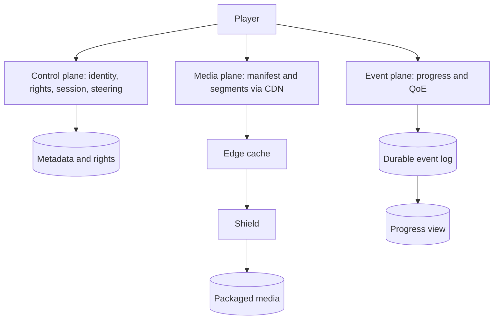
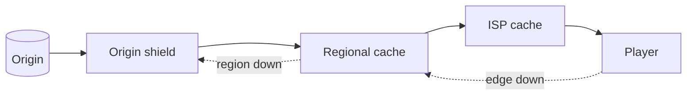
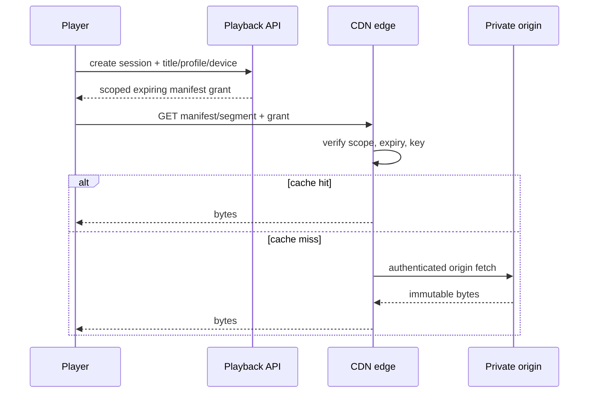
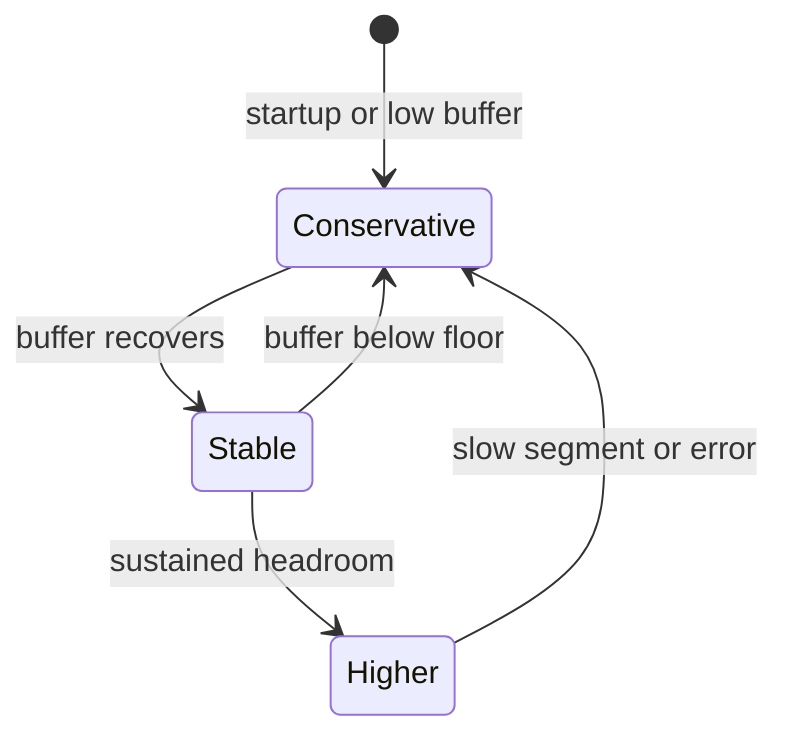
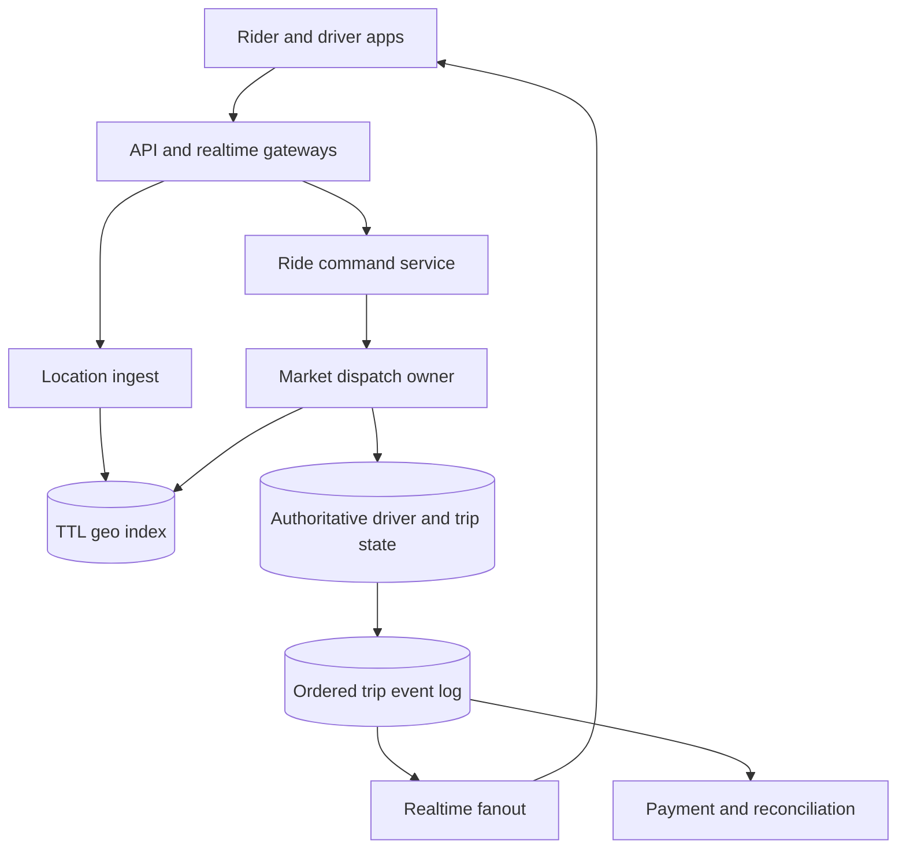
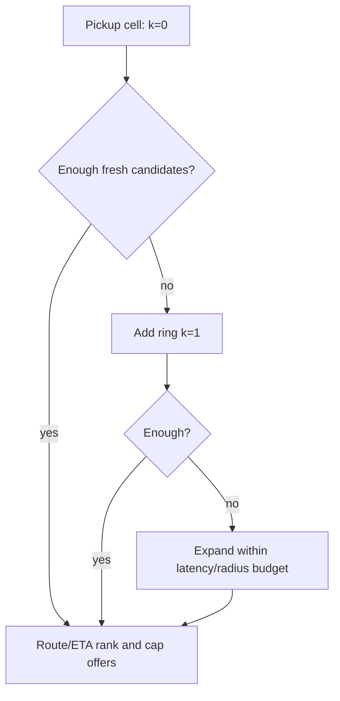
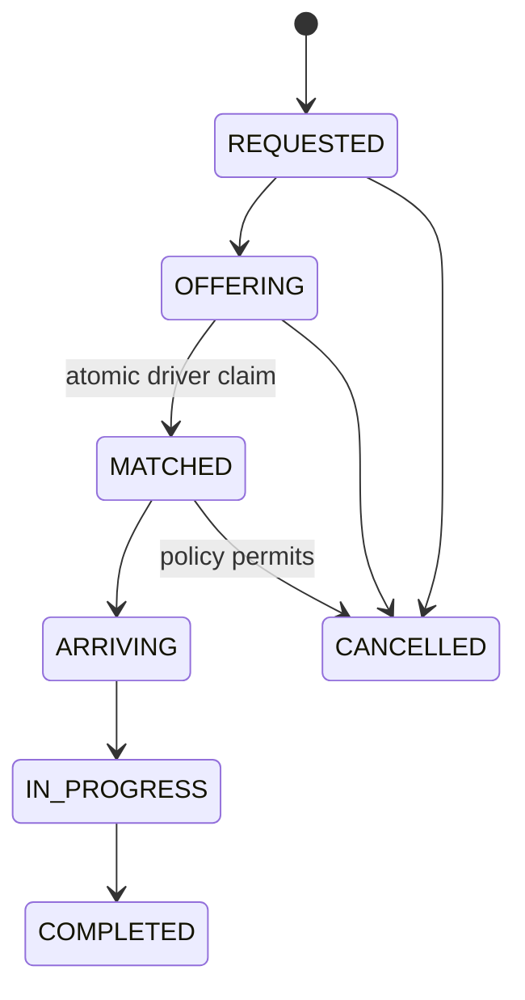

# System Design Blueprints

This is the canonical incremental guide. Each blueprint must make its requirements, arithmetic, ownership boundaries, failure behavior, and verification evidence explicit. Source Blueprints 1–2 are promoted; Blueprints 3–5 remain queued.

## Blueprint 1 — Global video streaming

### 1. Frame the problem before drawing boxes

The service must let a permitted profile browse, start, pause, seek, switch device, and resume a title with multiple audio/subtitle tracks. A studio path must ingest a pristine master, encode device-compatible renditions, package segments and publish them. The design must keep startup and rebuffering low under regional spikes, survive edge/origin failures, and prevent unauthorized playback.

State the consistency contract per fact:

| Fact | Required behavior | Why |
|---|---|---|
| entitlement and regional availability | fail closed; bounded-stale policy only if explicitly approved | a stale allow can violate licensing |
| manifest/segment grant | short-lived, scoped to asset/session/region; origin accepts only CDN identity | a signed URL is bearer authority, not DRM |
| catalog snapshot | versioned and atomically published | clients must not mix partial rights/config revisions |
| progress | eventually visible; newest per-session sequence wins | retries and device networks reorder events; backward seek is valid |
| recommendations/QoE analytics | eventual and replayable | loss or duplication should not block playback |

Three planes prevent the most common architecture mistake:



The application API authorizes and steers; it never proxies multi-gigabyte media. That separation makes control-plane CPU and data-plane egress independently scalable.

### 2. Example 1 — capacity proves locality is the architecture

Use decimal network units and write the unit conversion:

\[
T_{Tbps}=\frac{N_{streams}\times bitrate_{Mbps}}{1{,}000{,}000}
\]

| Scenario | Inputs | Result | Design consequence |
|---|---:|---:|---|
| global peak | 60M × 5 Mbps | 300 Tbps | ordinary app servers and a few regions cannot be the media path |
| large region | 1M × 8 Mbps | 8 Tbps | steer by ISP/site health and capacity, not geography alone |
| premiere spike | 2M × 6 Mbps | 12 Tbps | pre-position the predicted hot set before release |
| origin exposure | 100 Tbps viewer traffic, 98.5% byte-hit ratio | 1.5 Tbps cache-miss traffic | a high percentage can still leave enormous origin/shield load |

Request hit ratio is misleading when objects differ greatly in size; operate on byte hit ratio and segment-age cohorts. A shield collapses duplicate fills, while regional/ISP caches localize popular bytes. Netflix's Open Connect material describes appliances placed near viewers and proactive filling; the transferable principle is forecasted placement plus measured fallback, not copying a vendor topology.



Trace a premiere:

| Time | Event | Guardrail |
|---|---|---|
| T−24 h | planner assigns immutable segment hashes to sites | never place a title where rights forbid delivery |
| T−1 h | fill jobs verify checksum and storage headroom | incomplete renditions stay unpublished |
| T+0 | steering selects a healthy, non-saturated site | capacity token prevents overload amplification |
| T+2 min | one site fails | retry a different site, lower bitrate if throughput falls |
| T+5 min | byte misses exceed budget | shed speculative prefetch and protect shield/origin |

### 3. Example 2 — authorization, signed delivery, and DRM are different controls

`POST /v1/playback-sessions` authenticates the account, resolves profile restrictions and region, checks the versioned rights snapshot, chooses compatible media, and returns a short-lived playback grant. A representative response is:

```json
{
  "sessionId": "ps_7f3",
  "manifestUrl": "https://edge.example/t/a17/master.m3u8?grant=...",
  "expiresAt": "2026-10-21T15:20:00Z",
  "drm": {"licenseUrl": "https://license.example/v1/widevine"},
  "cdnCandidates": ["site-a", "site-b"]
}
```

The token must cover the intended path/asset, expiry, key identifier and policy claims. CDN/origin clocks need bounded skew and signing-key rotation needs an overlap window. The storage origin must reject public access and accept only the delivery service identity; otherwise a user can bypass the signed edge URL. Signing limits distribution authority, while DRM encrypts media and licenses decryption to an approved device/session—neither substitutes for the other.



Failure tests: an expired grant returns 403 without origin fetch; a valid grant for another asset fails scope validation; direct origin access fails; rotating keys accept both active keys only during the declared overlap; revocation policy states whether an already-issued short grant may live until expiry.

### 4. Example 3 — adaptive bitrate is a buffer-safety controller

HLS exposes alternative renditions through playlists and ordinary HTTP delivery. The player estimates recent throughput but should not spend the entire estimate: measurement error, shared links and segment-size variance require headroom. A simple teaching policy selects the highest rendition under `estimate × safety`; when the buffer is below eight seconds it caps safety at 0.55.

| Estimate | Buffer | Safety | Budget | Choice from 0.3/1.2/2.5/5 Mbps ladder |
|---:|---:|---:|---:|---|
| 8 Mbps | 20 s | 0.75 | 6 Mbps | 1080p / 5 Mbps |
| 4 Mbps | 20 s | 0.75 | 3 Mbps | 720p / 2.5 Mbps |
| 4 Mbps | 3 s | 0.55 | 2.2 Mbps | 480p / 1.2 Mbps |



The production controller also accounts for device decode limits, codec/HDR compatibility, segment duration, recent errors and switch hysteresis. Optimize a QoE objective—startup time, rebuffer ratio, failures, sustainable quality and disruptive switches—not maximum pixels. RFC 9317 is useful here because it treats streaming quality as an operational interaction among player, delivery network and access network.

### 5. Example 4 — progress merging must allow a backward seek

Do not merge progress with `max(position)`. A user may deliberately seek backward, and an old retry can carry a larger position than a newer event. Give each playback session a monotonically increasing sequence and use `(profileId, titleId, sessionId, sequence)` as the ordering fact.

| Arrival | Event `(sequence, position)` | Result |
|---|---|---|
| current | `(9, 80s)` | store 80s |
| delayed retry | `(8, 95s)` | ignore stale sequence |
| user seeks backward | `(10, 25s)` | store 25s |
| duplicate | `(10, 25s)` | idempotent no-op |

For multiple devices, define the product rule rather than pretending one clock solves intent: commonly, each session is ordered independently and the resume projection selects the latest accepted event time with bounded clock handling. Keep the immutable event log for replay; build a compact projection for reads. Playback must not wait for this pipeline.

### 6. Media preparation and publication contract

1. Store the pristine mezzanine in durable object storage under immutable identity.
2. Produce a per-title ladder; one fixed ladder wastes bits on simple content and damages complex content.
3. Package aligned HLS/DASH-like segments and manifests, including audio/subtitle variants.
4. Verify checksums, duration alignment, decode compatibility and rights metadata.
5. Atomically move a versioned publication pointer only after all required artifacts pass.
6. Pre-position the hot set; retain origin/shield fallback for the long tail.

Never overwrite published segment bytes in place. Immutable names make caches and retries safe; a new encode publishes a new revision.

### 7. API, storage, and ownership map

```http
GET  /v1/catalog/home?profileId=...
GET  /v1/titles/{titleId}
POST /v1/playback-sessions
GET  /v1/playback-sessions/{sessionId}/manifest
POST /v1/playback-sessions/{sessionId}/progress
```

| Data | System of record | Derived/cached form |
|---|---|---|
| title, tracks, maturity | metadata store | catalog/search projections |
| country/plan/time rights | rights store + versioned snapshots | playback decision cache bounded by policy |
| mezzanine and encoded segments | object storage | shield/edge copies |
| session/grant audit | playback service store | short-lived session cache |
| progress/QoE | durable event log | resume view and analytics |

Multi-GB video never belongs in the metadata database. Segment URLs identify immutable objects; manifests identify a published revision.

### 8. Failure matrix and evidence

| Failure | Expected behavior | Metric/test |
|---|---|---|
| edge unavailable | steer to another healthy site; player may reduce bitrate | failover time, rebuffer delta |
| shield/origin overload | admission control, request collapse, stale immutable edge bytes | origin egress and rejected fills |
| rights store unavailable | fail closed or use explicitly approved bounded snapshot | denial reason and snapshot age |
| progress log delayed | playback continues; client retries idempotently | consumer lag and projection freshness |
| signing key rotation | accept declared overlap, then reject old key | validation counts by key ID |
| bad encode | publication pointer remains on prior good revision | canary decode/checksum failures |

Track startup p50/p95, rebuffer percentage, fatal playback failures by device/ISP/title, sustainable bitrate, switch rate, edge saturation, byte hit ratio, shield collapse ratio, origin egress, rights-decision latency and grant denials. Percentiles need sample counts, and all SLOs need a named measurement window.

### 9. Executable contract

[`VideoPlaybackContracts.java`](VideoPlaybackContracts.java) encodes the four worked examples and boundary failures. Run:

```bash
java -ea study-guides/system-design/blueprints/VideoPlaybackContracts.java
```

The key invariant is subtle: newer progress sequence wins even if its position is smaller.

### 10. Current primary references

- [Netflix Open Connect overview and briefing paper](https://openconnect.netflix.com/en/) — content localization, embedded appliances and proactive delivery.
- [Apple: HTTP Live Streaming](https://developer.apple.com/streaming/) and [HLS Authoring Specification](https://developer.apple.com/documentation/http-live-streaming/hls-authoring-specification-for-apple-devices) — playlist-based adaptive delivery and authoring constraints.
- [RFC 8216: HTTP Live Streaming](https://www.rfc-editor.org/rfc/rfc8216) — protocol semantics for playlists and media segments.
- [RFC 9317: Operational Considerations for Streaming Media](https://www.rfc-editor.org/rfc/rfc9317) — player/network interactions and QoE operations.
- [AWS CloudFront private content](https://docs.aws.amazon.com/AmazonCloudFront/latest/DeveloperGuide/PrivateContent.html) and [signed URLs](https://docs.aws.amazon.com/AmazonCloudFront/latest/DeveloperGuide/private-content-signed-urls.html) — a concrete primary-source example of restricted origins and expiring signed delivery.

### 11. Source provenance and continuation

The confirmed Library source is `top_5_system_design_interview_blueprints.md`, revision 1, SHA-256 `10c3b8139474ea47f35e1fed6cb169b2728db48070f3264e1d23dfa776e9bf03`. This section promotes source lines 5–253 and adds explicit contracts, four worked examples, executable Java, failure tests, and refreshed primary references.

## Blueprint 2 — Real-time ride hailing

### 1. Define “real time” and the ownership boundary

A rider requests a priced trip, the system searches sufficiently fresh available drivers, one driver accepts, both parties observe ordered trip state, and completion triggers one logical payment. “Real time” is not zero latency: give each promise a measurable bound.

| Contract | Example target | Correctness rule |
|---|---:|---|
| driver location | emitted every 4 s; candidate age at decision ≤ 10 s | an older sequence never replaces a newer location; stale drivers are excluded |
| dispatch | accepted offer or explicit no-match within 8 s | a geo result is only a candidate; authoritative state grants ownership |
| offer | expires after 6 s | acceptance after expiry or for a superseded attempt loses |
| trip updates | ordered per trip; reconnect snapshot within 2 s | client applies only a version greater than its last applied version |
| completion/payment | asynchronous after durable trip completion | one stable idempotency key per completion version |

Separate three data classes because they have different durability and consistency needs:

- **location telemetry** is write-heavy, replaceable and TTL-bound;
- **driver/trip ownership** is small, durable and strongly coordinated within a market;
- **events** are durable and replayable for push, payment, support and analytics.



Partition first by market/city because trips are local. Route every command for one trip and its assigned driver to the same home market. Cross-region identity, configuration and analytics can remain global; dispatch ownership should not require a cross-ocean round trip.

### 2. Example 1 — capacity and expanding-cell search

At five million active drivers sending one GPS fix every four seconds:

\[
QPS_{location}=\frac{5{,}000{,}000}{4}=1.25\text{ million updates/s}
\]

If an event averages 180 bytes before replication and indexing, ingress is about 225 MB/s or 19.44 TB/day. Retaining every raw fix for seven days would be roughly 136 TB before replication and compression. The hot path should therefore keep only the latest useful fix per driver with a TTL; a stream/object-store pipeline can retain sampled or policy-approved history separately.

Map a pickup to a cell, inspect nearby cells, filter by freshness and availability, and expand only until the candidate budget or radius limit is met. For an ideal hexagonal disk, `1 + 3k(k + 1)` estimates 1, 7, 19 and 37 cells for rings 0–3. H3 traversal can encounter pentagonal distortion, so that formula is a capacity estimate—not an API cardinality promise.



Trace for pickup `p7` at decision time `12:00:10`:

| Candidate | Cell ring | Last fix | Driver state | Result |
|---|---:|---:|---|---|
| d11 | 0 | `12:00:04` | available | keep; age 6 s |
| d12 | 1 | `11:59:57` | available | reject; age 13 s |
| d13 | 1 | `12:00:07` | assigned | reject; geo index is stale |
| d14 | 2 | `12:00:05` | available | keep; then rank by route ETA |

Straight-line or cell distance narrows the set; road ETA makes the final ranking. Cap concurrent offers so one request does not fan out to hundreds of drivers.

### 3. Example 2 — out-of-order location must not move a driver backward

Mobile networks reorder and duplicate uploads. Give each driver session a monotonically increasing sequence and retain both device observation time and server receipt time. The write condition is “newer session/sequence,” not “arrived last.”

| Arrival | Fix `(session, seq, observedAt, cell)` | Stored result |
|---|---|---|
| first | `(s9, 40, 12:00:04, A)` | accept A |
| delayed | `(s9, 39, 12:00:03, B)` | ignore older sequence |
| duplicate | `(s9, 40, 12:00:04, A)` | idempotent no-op |
| new | `(s9, 41, 12:00:08, C)` | replace with C |

On a driver-app restart, issue a new server-authorized session/epoch; otherwise sequence `1` could lose forever to the previous session's `41`. Do not trust a handset clock alone for freshness. Reject implausible future timestamps, bound clock skew, and use server receipt time to enforce a conservative TTL.

The geo index is a disposable projection. Update the latest-location record and cell membership idempotently; periodic repair removes a driver from an old cell if a crash occurs between those operations. Dispatch still checks authoritative availability before offering.

### 4. Example 3 — the offer is not the assignment

Two riders can see the same available driver in a slightly stale geo index. Only one transactional compare-and-set may move that driver from `AVAILABLE` to `ASSIGNED` and bind the trip in the same commit.

```mermaid
sequenceDiagram
  participant A as Trip A dispatch
  participant B as Trip B dispatch
  participant S as Driver state
  participant D as Driver
  A->>D: offer A (attempt a7, expires 10:00:06)
  B->>D: offer B (attempt b3, expires 10:00:06)
  D->>A: accept a7
  D->>B: accept b3
  par competing commits
    A->>S: claim d9 if AVAILABLE/version 22
    B->>S: claim d9 if AVAILABLE/version 22
  end
  S-->>A: 1 row updated; commit trip A
  S-->>B: 0 rows; re-dispatch trip B
```

A representative relational claim is:

```sql
UPDATE driver_state
SET status = 'ASSIGNED', active_trip_id = :trip_id, version = version + 1
WHERE market_id = :market_id
  AND driver_id = :driver_id
  AND status = 'AVAILABLE'
  AND version = :expected_version
RETURNING version;
```

The trip binding and an outbox event belong in the same database transaction. A zero-row result is an ordinary conflict, not an error to paper over. The acceptance endpoint also validates rider/trip, driver, attempt ID and expiry, and uses the request idempotency key so a timeout retry returns the original result.

Critical trace: the database commits Trip A, but the response is lost. The driver retries `accept(a7)` with the same key. The server reads the stored outcome and returns Trip A; it does not try another claim. If Trip B retries, its stored conflict remains a conflict.

### 5. Example 4 — reconnect from snapshot plus ordered replay

WebSocket provides a bidirectional transport, not application-level exactly-once delivery or durable catch-up. Persist a monotonic trip version with every state transition; push is only a low-latency delivery path.



Suppose a rider has applied version 17, disconnects, and the server reaches version 20:

| Step | Server/client action | Outcome |
|---|---|---|
| 1 | server commits v18 `DRIVER_ARRIVING` and v19 `DRIVER_AT_PICKUP` | durable before push |
| 2 | client reconnects with `lastApplied=17` | gateway authenticates trip membership |
| 3 | API returns snapshot v20 `IN_PROGRESS` | client atomically installs v20 |
| 4 | delayed push v19 arrives | ignored because `19 <= 20` |
| 5 | push v21 `COMPLETED` arrives twice | first applies; duplicate is ignored |

Snapshot-first recovery bounds event retention and avoids a replay/snapshot race: obtain a snapshot version, then subscribe or fetch events strictly after that version. Partition trip events by `trip_id` if using a log whose ordering guarantee is per partition.

Completion records an outbox message with stable key `payment:{tripId}:v{completionVersion}`. The payment worker retries uncertain failures with that same key, stores provider outcome, and reconciles pending attempts. Broker delivery claims alone cannot make an external charge exactly once.

### 6. API, data model, and command rules

```http
POST /v1/rides                         Idempotency-Key: rider-generated UUID
GET  /v1/rides/{rideId}
POST /v1/drivers/{driverId}/locations  driverSession + sequence
POST /v1/offers/{offerId}/accept       Idempotency-Key: offer-attempt ID
POST /v1/rides/{rideId}/cancel         expected trip version
GET  /v1/rides/{rideId}/snapshot       returns trip version
```

| Record | Essential fields | Authority/retention |
|---|---|---|
| `DriverLocation` | driver, session, seq, lat/lon, cell, observed/received time | latest projection with short TTL |
| `DriverState` | market, driver, status, active trip, version | authoritative durable row |
| `Trip` | rider, driver, pickup/destination, quote revision, status, version | authoritative durable row |
| `OfferAttempt` | offer, trip, driver, attempt, expiry, result | durable through retry window |
| `TripEvent` | trip, version, type, payload, time | durable replay/audit log |
| `Outbox` | event ID, aggregate/version, payload, publish state | same commit as authoritative change |

Never expose precise driver coordinates to unrelated riders. Authenticate driver devices, authorize every trip subscription, limit location precision and retention, encrypt transport/storage, and audit privileged access.

### 7. Failure matrix and operational evidence

| Failure | Safe behavior | Evidence |
|---|---|---|
| location ingest delayed | exclude fixes beyond the freshness bound; widen search only within latency budget | candidate-age histogram and stale-exclusion count |
| geo projection loses membership | repair from latest-location records; authoritative state still blocks double assignment | projection drift sample and repair lag |
| dispatch dies after claim commit | retry reads idempotent outcome; outbox republishes committed match | unknown-outcome reconciliation age |
| hot downtown cell | split worker ownership, batch ingestion, cap offers and apply backpressure | per-cell QPS/skew and queue age |
| gateway fleet restarts | jitter reconnects, admit gradually, snapshot then resume | reconnect rate and recovery p95 |
| payment timeout | same idempotency key; mark pending and reconcile provider state | pending age and duplicate-charge invariant |
| market region impaired | protect active trips; stop new dispatch before accepting ownership unsafely | failover drill and active-trip recovery time |

Alert on location-ingest lag, candidate age, match latency p50/p95/p99, no-match rate, search-ring distribution, claim conflicts, expired accepts, trip-version gaps, reconnect recovery, outbox age and payment reconciliation age. A double-assigned driver or duplicate charge is a correctness incident even when latency SLOs are green.

### 8. Executable contract

[`RideHailingContracts.java`](RideHailingContracts.java) exercises cell-count estimation, stale/out-of-order location handling, single-winner assignment, ordered reconnect state and stable payment keys. Run:

```bash
java -ea study-guides/system-design/blueprints/RideHailingContracts.java
```

The tests deliberately model a lost response after commit: retrying the same offer attempt returns the same winning trip, while a competing attempt remains rejected.

### 9. Current primary references

- [H3 introduction](https://h3geo.org/docs/) and [grid traversal API](https://h3geo.org/docs/api/traversal/) — hierarchical cells, nearby-cell traversal and documented distortion limits.
- [Uber Engineering: H3 spatial index](https://www.uber.com/us/en/blog/h3/) — the source system's public origin and marketplace/geospatial motivation.
- [Redis `GEOSEARCH`](https://redis.io/docs/latest/commands/geosearch/) — one concrete proximity-index implementation; it does not replace authoritative driver state.
- [PostgreSQL `UPDATE`](https://www.postgresql.org/docs/current/sql-update.html) and [concurrency control](https://www.postgresql.org/docs/current/mvcc.html) — conditional row updates and concurrent transaction behavior.
- [Apache Kafka introduction](https://kafka.apache.org/documentation/) — ordering within a topic-partition; key trip events consistently if that guarantee is used.
- [RFC 6455: WebSocket](https://www.rfc-editor.org/rfc/rfc6455) — bidirectional transport protocol; replay and application ordering remain application responsibilities.
- [Stripe idempotent requests](https://docs.stripe.com/api/idempotent_requests) — a primary-source example of safe request retries with a stable idempotency key.

### 10. Source provenance and continuation

The confirmed Library source remains `top_5_system_design_interview_blueprints.md`, revision 1, SHA-256 `10c3b8139474ea47f35e1fed6cb169b2728db48070f3264e1d23dfa776e9bf03`. This section promotes exactly source lines 254–459 and adds measurable requirements, four worked traces, executable Java, failure evidence and primary-source verification refreshed on 2026-10-22. Source Blueprint 3 begins at line 460 and remains queued after fair domain rotation. The five-blueprint collection is not complete.
